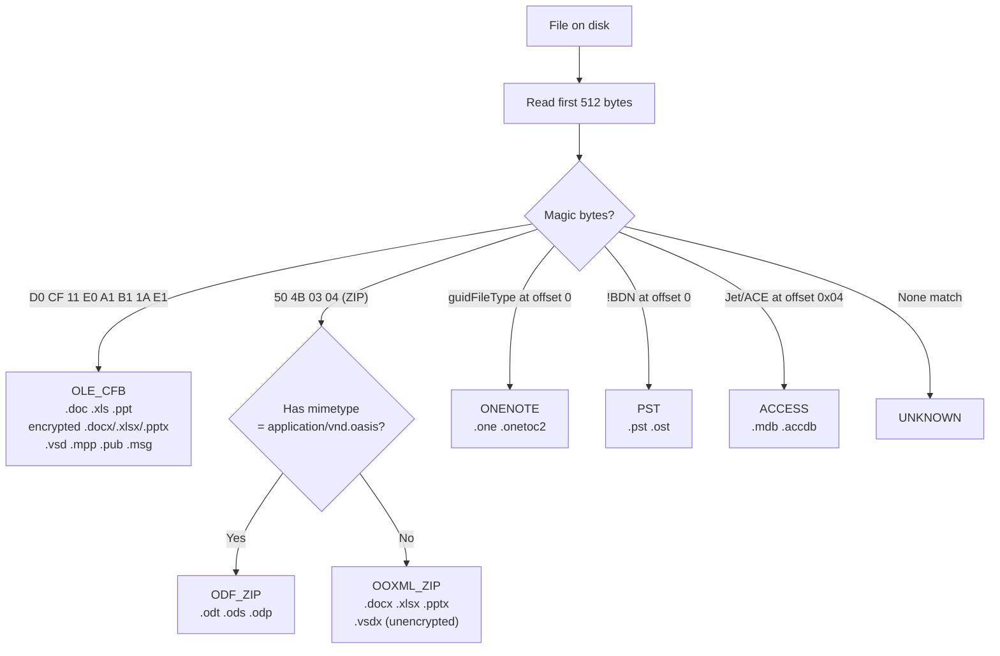
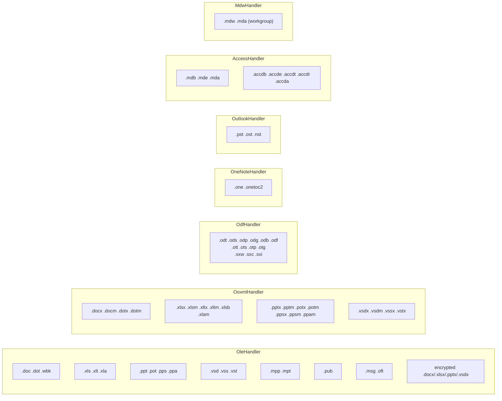
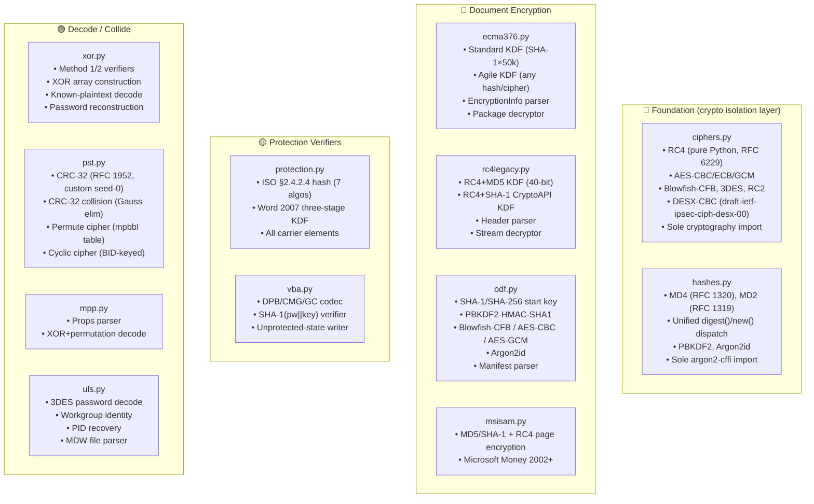
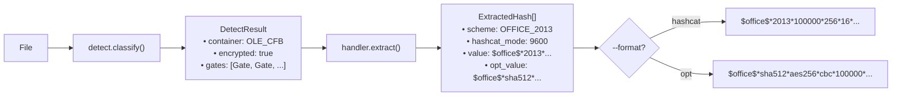

# Office Password Toolkit — Modular Design

The definitive architecture document for `office-password-toolkit`. Shows how the spec analysis, hashcat integration, fast recovery techniques, and Python code fit together.

**Related documents:**

- [toolkit-architecture.md](toolkit-architecture.md) — analysis → code mapping with cross-reference tables
- [gap-analysis.md](gap-analysis.md) — what's implemented vs missing (96% coverage)
- [../research/overview.md](../research/overview.md) — visual map of all products × gates × algorithms
- [../hashcat/proposed/README.md](../hashcat/proposed/README.md) — proposed 6-mode hashcat design (37000-series)
- [../recovery/README.md](../recovery/README.md) — non-GPU recovery techniques

## 1. Architecture Overview

```mermaid
flowchart TD
  subgraph CLI["Layer 1: CLI (cli/app.py)"]
    INFO["opt info\nstdout → hash line (pipeable)\nstderr → gate info + strength"]
    UNLOCK["opt unlock\ntry everything, cheapest first"]
    ADV["opt advanced\ninfo · extract · decode · collide\nbypass · strip · decrypt · verify"]
  end

  subgraph FACADES["Layer 2: Facades"]
    F_EXT["extract.py"]
    F_BYP["bypass.py"]
    F_DEC["decrypt.py"]
    F_DEF["defaults.py"]
  end

  subgraph DETECT["Layer 3: Detection (detect.py)"]
    D["classify(path) → ContainerKind"]
  end

  subgraph HANDLERS["Layer 4: Format Handlers (formats/)"]
    OLE["OleHandler"]
    OOXML["OoxmlHandler"]
    ODF_H["OdfHandler"]
    ON_H["OneNoteHandler"]
    PST_H["OutlookHandler"]
    ACC_H["AccessHandler"]
    MDW_H["MdwHandler"]
  end

  subgraph CRYPTO["Layer 5: Crypto Modules (crypto/)"]
    CIPH["ciphers.py\n(sole cryptography import)"]
    HASH["hashes.py\n(sole argon2-cffi import,\npure-Python MD4/MD2)"]
    E376["ecma376.py"]
    RC4["rc4legacy.py"]
    XOR["xor.py"]
    PROT["protection.py"]
    ODF_C["odf.py"]
    VBA["vba.py"]
    PST_C["pst.py"]
    MPP["mpp.py"]
    MSISAM["msisam.py"]
    ULS["uls.py"]
  end

  CLI --> FACADES
  FACADES --> DETECT
  DETECT --> HANDLERS
  HANDLERS --> CRYPTO
```



**Import rule:** each layer imports only from the layers below it — never upward.

- `crypto/` protocol modules import from `ciphers.py` and `hashes.py`, which are the sole importers of `cryptography` and `argon2-cffi`. No module imports `pycryptodome` (dropped). `hashlib` is imported only in `hashes.py` and the algorithm-availability probe in `ecma376.py`.
- `formats/` imports from `crypto/`, `formats.base`, `models`
- `detect` imports from `formats` (one-directional — handlers never import `detect`)
- Facades import from `detect` and `formats`
- CLI imports from everything

**Handler registry:** `formats/__init__.py` instantiates one handler per `ContainerKind` and provides `handler_for(container)`:

```python
_HANDLERS = {
    h.container: h
    for h in (
        OleHandler(),
        OoxmlHandler(),
        OdfHandler(),
        OneNoteHandler(),
        OutlookHandler(),
        AccessHandler(),
        MdwHandler(),
    )
}


def handler_for(container: ContainerKind) -> FormatHandler | None:
    return _HANDLERS.get(container)
```

Adding a new format = add one instance to that tuple. Everything downstream picks it up automatically.

## 2. Detection Pipeline



| Magic bytes | Offset | ContainerKind | Products |
|---|---|---|---|
| `D0 CF 11 E0 A1 B1 1A E1` | 0 | `OLE_CFB` | Word, Excel, PPT, Visio, Project, Publisher, Outlook .msg, encrypted OOXML |
| `50 4B 03 04` | 0 | `OOXML_ZIP` or `ODF_ZIP` | Unencrypted OOXML, ODF |
| `{7B5C52E4-...}` / `{43FF2FA1-...}` | 0 | `ONENOTE` | OneNote .one / .onetoc2 |
| `21 42 44 4E` (`!BDN`) | 0 | `PST` | Outlook .pst / .ost |
| `00 01 00 00` (Jet4) / `01 00 00 00` (ACE) | 4 | `ACCESS` | Access .mdb / .accdb |

**Critical:** an encrypted `.docx`/`.xlsx`/`.pptx` is **OLE/CFB on disk** (magic `D0CF11E0`), not ZIP. The OPC package is encrypted inside `\EncryptedPackage`. Detection is by magic bytes, never by extension.

## 3. Format Handler Layer

### FormatHandler contract (5 operations)

| Method | Returns | Purpose | Default |
|---|---|---|---|
| `is_encrypted(path)` | `bool` | Real document-open ciphertext present? | raises |
| `gates(path)` | `list[Gate]` | Every permission/password gate in the file | raises |
| `extract(path)` | `list[ExtractedHash]` | Crackable hash lines (hashcat + unified) | raises |
| `bypass(path, out)` | writes file | Copy with non-encrypting protection stripped | raises |
| `decrypt(path, out, pw)` | writes file | Plaintext copy using the open password | raises |

### Handler → product × extension mapping



### Handler → crypto module dependencies

| Handler | Crypto modules used |
|---|---|
| `OleHandler` | `ecma376`, `rc4legacy`, `xor`, `vba`, `mpp` |
| `OoxmlHandler` | `protection`, `vba` |
| `OdfHandler` | `odf` |
| `OneNoteHandler` | `ecma376`, `rc4legacy` |
| `OutlookHandler` | `pst` |
| `AccessHandler` | `ecma376`, `rc4legacy`, `msisam`, `vba` |
| `MdwHandler` | `uls` |

### Proposed handler additions

| Product | Current routing | Proposed |
|---|---|---|
| Visio .vsd | → `OleHandler` (works) | No change needed — same OLE encryption |
| Visio .vsdx | → `OoxmlHandler` (protection) / `OleHandler` (encrypted) | No change needed |
| Project .mpp | → `OleHandler` (VBA works; open password OUT-OF-CORPUS) | Optional `ProjectHandler` when .mpp encryption is RE'd |
| Publisher .pub | → `OleHandler` (VBA works) | No change needed |
| InfoPath .xsn | No handler (CAB, no encryption) | Low priority — no file-level encryption |
| Outlook .msg | → `OleHandler` (IRM detection) | Optional IRM-aware message handler |

## 4. Crypto Module Layer

Each module is **pure functions** operating on bytes/parameters. No filesystem access. No handler awareness.



### Module → algorithm → spec mapping

| Module | Algorithm | Spec sections | Hash lines emitted |
|---|---|---|---|
| `ecma376.py` | Standard Encryption | [MS-OFFCRYPTO] §2.3.4.5–9 | `$office$*2007*...` |
| `ecma376.py` | Agile Encryption | [MS-OFFCRYPTO] §2.3.4.10–15 | `$office$*2010*...` / `$office$*2013*...` |
| `rc4legacy.py` | RC4+MD5 (40-bit) | [MS-OFFCRYPTO] §2.3.6 | `$oldoffice$0*...` / `$oldoffice$1*...` |
| `rc4legacy.py` | RC4+SHA-1 CryptoAPI | [MS-OFFCRYPTO] §2.3.5 | `$oldoffice$3*...` / `$oldoffice$4*...` |
| `xor.py` | XOR Obfuscation | [MS-OFFCRYPTO] §2.3.7 | `$officexor$...` (decode, not hashcat) |
| `protection.py` | ISO Protection Hash | [MS-OFFCRYPTO] §2.4.2.4 | `$office$2016$0$...` |
| `protection.py` | Word 2007 Three-Stage | [MS-OE376] §2.1.410 | `$docprotect$...` (no hashcat mode) |
| `odf.py` | ODF 1.1 (Blowfish) | OASIS ODF Part 3 | `$odf$*0*0*...` |
| `odf.py` | ODF 1.2 (AES-CBC) | OASIS ODF Part 3 | `$odf$*1*1*...` |
| `odf.py` | ODF 1.3 (Argon2id) | OASIS ODF Part 3 | `$odf$` extended (no hashcat mode) |
| `vba.py` | VBA Project Password | [MS-OVBA] §2.4.3–4 | `sha1hex:keyhex` (mode 110) |
| `pst.py` | PST CRC-32 | [MS-PST] §5.3 | — (collide/strip, no hashcat) |
| `pst.py` | PST Body Cipher | [MS-PST] §5.1–2 | — (decode, no hashcat) |
| `mpp.py` | MPP Props XOR Decode | MPXJ reverse-engineering | — (decode, no hashcat) |
| `msisam.py` | MSISAM MD5/SHA-1 + RC4 | Jackcess MSISAMCryptCodecHandler | `$msisam$...` (no hashcat mode) |
| `uls.py` | Jet ULS 3DES Password | Reversed from msjet40.dll | — (decode, no hashcat) |
| `hashes.py` | MD4 / MD2 | RFC 1320 / RFC 1319 | — (support for ecma376/protection) |
| `ciphers.py` | RC4, AES, Blowfish, 3DES, RC2, DESX | RFC 6229 / NIST SP 800-38A / draft-ietf-ipsec-ciph-desx-00 | — (primitives for protocol modules) |

### Hash line emission

Every crypto module that produces a crackable hash exposes two emitter functions:

- `*_hashcat_line()` → hashcat-compatible format (`ExtractedHash.value`)
- `unified_*_line()` → self-describing format (`ExtractedHash.opt_value`)

The CLI `--format` flag selects which to output: `hashcat` (default) or `opt`.

## 5. The Recovery Ladder

```mermaid
flowchart LR
  DEFAULT["1. DEFAULT\nTry VelvetSweatshop\n/01Hannes Ruescher/01"] --> READ["2. READ\nCleartext password\nin file bytes"]
  READ --> DECODE["3. DECODE\nReverse obfuscation\n(XOR, Jet, DPB, PST)"]
  DECODE --> BYPASS["4. BYPASS\nVBA lock: DPB→DPx\nread source directly"]
  BYPASS --> STRIP["5. STRIP\nDelete XML element\nor zero binary record"]
  STRIP --> COLLIDE["6. COLLIDE\n16/32-bit verifier\nPST CRC-32"]
  COLLIDE --> KEYSPACE["7. KEYSPACE\nRC4-40 bit key brute\n(2^40 search)"]
  KEYSPACE --> CRACK["8. CRACK\nGPU hashcat\nor toolkit verify"]
  CRACK --> NONE["9. NONE\nIRM/RMS certificate\nDigital signature"]
```



`opt unlock` walks this ladder top-to-bottom, stopping at the first success. `opt info` reports which step would apply for each gate (via stderr) and emits any crackable hash lines (via stdout).

| Step | RecoveryClass | Toolkit function | What it does |
|---|---|---|---|
| 1 | `DEFAULT` | `default_passwords()` | Try known fixed passwords |
| 2 | `READ` | `handler.gates()` → Gate.recovery == READ | Report cleartext password location |
| 3 | `DECODE` | `xor.decode()`, `pst.decode_block()`, `vba.decode_dpb()` | Reverse obfuscation |
| 4 | `BYPASS` | `handler.bypass()` | Write unprotected copy |
| 5 | `STRIP` | `handler.bypass()` | Delete protection elements |
| 6 | `COLLIDE` | `pst.collide_crc32()`, `xor.collide_method1()` | Find any matching password |
| 7 | `KEYSPACE` | `handler.extract()` → hashcat 37001 | Emit hash for key-seed brute force |
| 8 | `CRACK` | `handler.extract()` → hashcat 37000/37100/37200 | Emit hash for GPU attack |
| 9 | `NONE` | — | Report as non-recoverable |

### CLI command mapping

| Command | Who it's for | What it does |
|---|---|---|
| `opt info file.xlsx` | Everyone | **stdout:** crackable hash line (pipe to hashcat). **stderr:** human-readable gate info, strength badges, recovery suggestion per gate. `--json` for structured stderr. |
| `opt unlock file.xlsx` | Everyone | Walks the recovery ladder automatically, outputs the unlocked file. |
| `opt advanced info file.xlsx` | Experts | Detailed gate-by-gate analysis with spec references. |
| `opt advanced extract file.xlsx` | Experts | Extract hash in a specific format (hashcat, unified, json). |
| `opt advanced decode file.xls` | Experts | Reverse XOR/Jet/PST/VBA obfuscation explicitly. |
| `opt advanced collide file.xls` | Experts | Find a colliding password for 16/32-bit verifiers. |
| `opt advanced bypass file.xlsm` | Experts | VBA project lock bypass (DPB rename, source read). |
| `opt advanced strip file.xlsx -o out.xlsx` | Experts | Delete specific protection elements, write clean copy. |
| `opt advanced decrypt file.docx -p <pw>` | Experts | Decrypt with a known password. |
| `opt advanced verify file.xlsx -p <pw>` | Experts | Test a password against a specific gate without decrypting. |

**Design rationale:** `info` merges the old `extract` command — the hash line goes to stdout so `opt info file.xlsx | hashcat -m 37000` just works. Gate info goes to stderr so it doesn't pollute the pipe. `unlock` is the "just open it" button. Expert subcommands hide under `advanced` to avoid overwhelming new users.

## 6. Hash Line Output

### Output streams

`opt info` splits output across two streams:

| Stream | Content | Purpose |
|---|---|---|
| **stdout** | Hash line(s), one per line | Pipe directly to hashcat: `opt info file.xlsx \| hashcat -m 37000` |
| **stderr** | Human-readable gate info, strength badges, recovery suggestions | Read in the terminal while the hash pipes elsewhere |

### Hash format selection

| Flag | Format | Audience |
|---|---|---|
| `--format hashcat` (default) | Existing hashcat line (`$office$*2013*...`, `$oldoffice$3*...`) | Current hashcat (modes 9400–25300) |
| `--format unified` | Self-describing line (`$office$*sha512*aes256*cbc*...`) | Future hashcat 37000-series, toolkit's own verifier |
| `--json` | Structured JSON on stderr | Programmatic consumers |

### The 4 unified format families

| Family | Grammar | What it covers |
|---|---|---|
| `$office$` | `$office$*<hashfunc>*<cipher>*<mode>*<iters>*<salt>*<encverifier>*<encverifierhash>` | ALL MS Office document-open encryption |
| `$protect$` | `$protect$*<hashfunc>*<kdf>*<iters>*<salt>*<hash>` | ALL editing/permission verifiers |
| `$odf$` | `$odf$*<startkey>*<kdf>*<cipher>*<iters>*<mem>*<lanes>*<salt>*<iv>*<checksum>*<ct>` | ALL ODF encryption |
| `$vba$` | `$vba$*<hashfunc>*<hash>*<salt>` | VBA project password |

### HashScheme → hashcat mode mapping

| HashScheme enum | hashcat mode (current) | hashcat mode (proposed) | Unified family |
|---|---|---|---|
| `OFFICE_2007` | 9400 | 37000 (kernel 37020) | `$office$` |
| `OFFICE_2010` | 9500 | 37000 (kernel 37011) | `$office$` |
| `OFFICE_2013` | 9600 | 37000 (kernel 37013) | `$office$` |
| `OFFICE_AGILE` | — (gap) | 37000 (kernel by hash) | `$office$` |
| `OLDOFFICE_RC4_MD5` | 9700 | 37000 (kernel 37030) | `$office$` |
| `OLDOFFICE_RC4_SHA1` | 9800 | 37000 (kernel 37040) | `$office$` |
| `OFFICE_SHEETPROT` | 25300 | 37100 (kernel 37114) | `$protect$` |
| `OFFICE_PROTECT` | — (gap) | 37100 (kernel by hash) | `$protect$` |
| `DOC_PROTECT` | — (gap) | 37100 (kernel 37116) | `$protect$` |
| `ODF` | 18400 / 18600 | 37200 | `$odf$` |
| `VBA_SHA1` | 110 | 110 | `$vba$` |
| `OFFICEXOR` | — (decode) | — (decode) | — |
| `PST_CRC` | — (collide) | — (collide) | — |

## 7. Data Model

| Class | Fields | Purpose |
|---|---|---|
| `ContainerKind` (StrEnum, 8) | `OLE_CFB`, `OOXML_ZIP`, `ODF_ZIP`, `ONENOTE`, `PST`, `ACCESS`, `ACCESS_MDW`, `UNKNOWN` | Physical container type (by magic bytes) |
| `GateType` (StrEnum, 12) | `OPEN`, `MODIFY`, `PROTECT_SHEET`, `PROTECT_WORKBOOK`, `RESTRICT_EDIT`, `ALLOW_EDIT_RANGES`, `SHARED_REVISIONS`, `SECTION`, `VBA_PROJECT`, `SIGNATURE`, `IRM`, `MAIL_BODY` | What the password protects |
| `RecoveryClass` (StrEnum, 10) | `DEFAULT`, `READ`, `DECODE`, `BYPASS`, `STRIP`, `COLLIDE`, `DECRYPT`, `KEYSPACE`, `CRACK`, `NONE` | How to recover (ordered cheapest-first) |
| `HashScheme` (StrEnum, 9) | `OFFICE_2007`, `OFFICE_2010`, `OFFICE_2013`, `OLDOFFICE_RC4_MD5`, `OLDOFFICE_RC4_SHA1`, `OFFICE_SHEETPROT`, `ODF`, `VBA_SHA1`, `MSISAM` | Which hash-line format to emit |
| `Gate` (frozen dataclass) | `gate`, `recovery`, `scheme`, `hashcat_mode`, `where`, `note` | One permission gate found in a file |
| `ExtractedHash` (frozen dataclass) | `scheme`, `hashcat_mode`, `value`, `gate`, `opt_value` | One crackable hash extracted |
| `DetectResult` (frozen dataclass) | `path`, `container`, `extension`, `encrypted`, `gates` | Detection + gate enumeration result |

### Data flow



## 8. Extension Points

### Add a new product

1. Create `formats/newproduct.py` with a `NewProductHandler(FormatHandler)` class
2. Set `container = ContainerKind.X` (or reuse an existing kind)
3. Implement `is_encrypted()`, `gates()`, `extract()` and optionally `bypass()`/`decrypt()`
4. Add one instance to the `_HANDLERS` tuple in `formats/__init__.py`
5. Done — detection, facades, and CLI pick it up automatically

### Add a new algorithm

1. Create `crypto/newalgo.py` with pure KDF/verifier/emitter functions
2. Wire it into the handler(s) that need it (import in `formats/xyz.py`)
3. Add a `HashScheme` enum value if it produces a new hash-line format
4. Done — the handler calls the crypto module, the hash line flows out

### Add a new hashcat mode

1. Add a `HashScheme` enum value (e.g., `OFFICE_37000`)
2. Add an emitter function in the relevant crypto module (e.g., `ecma376.office37000_line()`)
3. Set `hashcat_mode = 37000` on the `ExtractedHash`
4. Done — `opt extract --format hashcat` emits the new line

### Support the 37000-series unified modes

The existing `unified_*_line()` emitters in each crypto module already produce the `$office$*sha512*aes256*cbc*...` format. When hashcat registers modes 37000–37201:

1. Update `HashScheme` enum values to reference new mode numbers
2. Update `hashcat_mode` on `ExtractedHash` objects
3. The unified emitters become the primary hashcat output
4. Legacy mode numbers become backward-compatibility aliases

## 9. Cross-Reference Map

### Analysis → code

| Analysis doc | Handler | Crypto module(s) |
|---|---|---|
| `formats/word.md` | `OleHandler`, `OoxmlHandler` | `ecma376`, `rc4legacy`, `xor`, `protection`, `vba` |
| `formats/excel.md` | `OleHandler`, `OoxmlHandler` | `ecma376`, `rc4legacy`, `xor`, `protection`, `vba` |
| `formats/powerpoint.md` | `OleHandler`, `OoxmlHandler` | `ecma376`, `rc4legacy`, `protection`, `vba` |
| `formats/onenote.md` | `OneNoteHandler` | `ecma376`, `rc4legacy` |
| `formats/outlook.md` | `OutlookHandler` | `pst` |
| `formats/access.md` | `AccessHandler`, `MdwHandler` | `ecma376`, `rc4legacy`, `msisam`, `vba`, `uls` |
| `formats/opendocument.md` | `OdfHandler` | `odf` |
| `formats/visio.md` | `OleHandler`, `OoxmlHandler` | `ecma376`, `rc4legacy`, `vba` |
| `formats/project.md` | `OleHandler` | `mpp`, `vba` |
| `formats/publisher.md` | `OleHandler` | `vba` |
| `formats/infopath.md` | — | — (no encryption) |

### Algorithms → code

| Algorithm doc | Crypto function | Emitter |
|---|---|---|
| `algorithms/password/ecma376-agile.md` | `ecma376.verify_password()` | `ecma376.office_hash_line()` / `ecma376.unified_office_line()` |
| `algorithms/password/ecma376-standard.md` | `ecma376.verify_password()` | `ecma376.office_hash_line()` / `ecma376.unified_office_line()` |
| `algorithms/password/rc4-cryptoapi-sha1.md` | `rc4legacy.rc4_cryptoapi_verify()` | `rc4legacy.rc4_cryptoapi_hash_line()` / `rc4legacy.unified_rc4_office_line()` |
| `algorithms/password/rc4-md5-legacy.md` | `rc4legacy.rc4_md5_verify()` | `rc4legacy.rc4_md5_hash_line()` / `rc4legacy.unified_rc4_office_line()` |
| `algorithms/password/xor-obfuscation.md` | `xor.password_verifier_method1()` | — (decode, not hash) |
| `algorithms/password/iso-protection-hash.md` | `protection.verify()` | `protection.hash_line_25300()` / `protection.unified_protect_line()` |
| `algorithms/password/word2007-documentprotection.md` | `protection.word2007_protection_verify()` | `protection.unified_protect_line_from_sid()` |
| `algorithms/password/odf-encryption.md` | `odf.verify()` | `odf.odf_hash_line()` / `odf.unified_odf_line()` |
| `algorithms/password/vba-project-password.md` | `vba.password_hash()` | `vba.extract_vba_hash()` / `vba.unified_vba_line()` |
| `algorithms/password/pst-crc32.md` | `pst.password_crc()` | — (collide, not hash) |
| `algorithms/non-password/pst-body-cipher.md` | `pst.permute_decode()`, `pst.cyclic_decode()` | — (decode) |
| `algorithms/non-password/irm-rms-encryption.md` | — | — (NONE) |
| `algorithms/non-password/digital-signatures.md` | — | — (STRIP) |
| `algorithms/non-password/access-jet-obfuscation.md` | `AccessHandler._decode_jet3()` / `._decode_jet4()` | — (decode) |

### Hashcat design → code

| new_hashcat doc | HashScheme values | Emitter functions |
|---|---|---|
| `office_open.md` (37000) | `OFFICE_2007`, `OFFICE_2010`, `OFFICE_2013`, `OFFICE_AGILE`, `OLDOFFICE_RC4_MD5`, `OLDOFFICE_RC4_SHA1` | `ecma376.unified_office_line()`, `rc4legacy.unified_office_line()` |
| `office_protect.md` (37100) | `OFFICE_SHEETPROT`, `OFFICE_PROTECT`, `DOC_PROTECT` | `protection.unified_protect_line()` |
| `odf_open.md` (37200/37201) | `ODF` | `odf.unified_odf_line()` |
| `vba_project.md` (110) | `VBA_SHA1` | `vba.unified_vba_line()` |

### Fast recovery → toolkit commands

| fast_recovery doc | Toolkit command | Toolkit function |
|---|---|---|
| `defaults.md` | `opt unlock` (step 1, auto) | `default_passwords()` |
| `cleartext.md` | `opt info` (reports location on stderr) | `OleHandler.gates()` → Gate with READ |
| `decode.md` | `opt unlock` (step 3, auto) / `opt advanced decode` | `xor.decode_document()`, `pst.decode_block()`, `vba.decode_dpb()`, `access.decode_jet_password()` |
| `strip.md` | `opt unlock` (step 4-5, auto) / `opt advanced bypass` | `handler.bypass()` → writes stripped copy |
| `collide.md` | `opt unlock` (step 6, auto) / `opt advanced collide` | `pst.collide_crc32()`, `xor.collide_method1()` |
| `bypass.md` | `opt unlock` (step 4, auto) / `opt advanced bypass` | `vba.unprotected_project_state()` → `handler.bypass()` |
