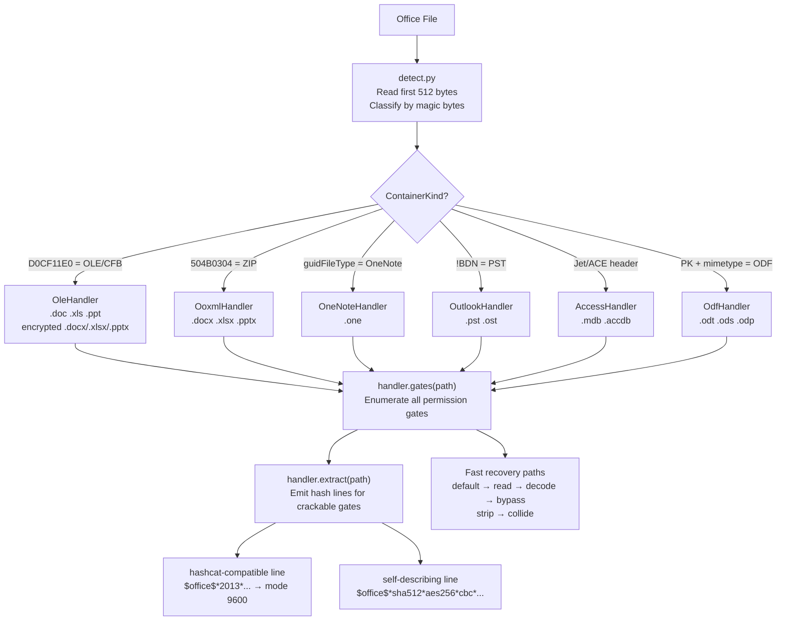
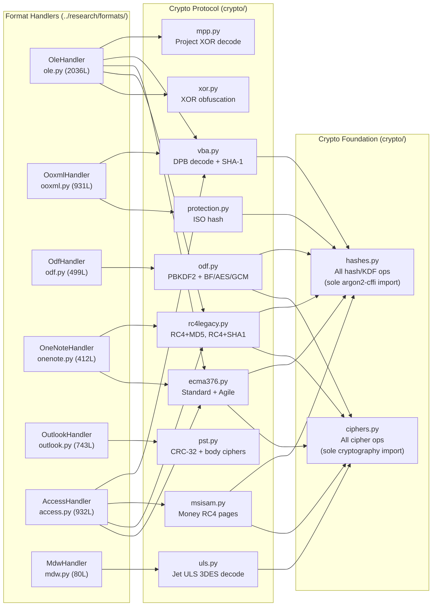
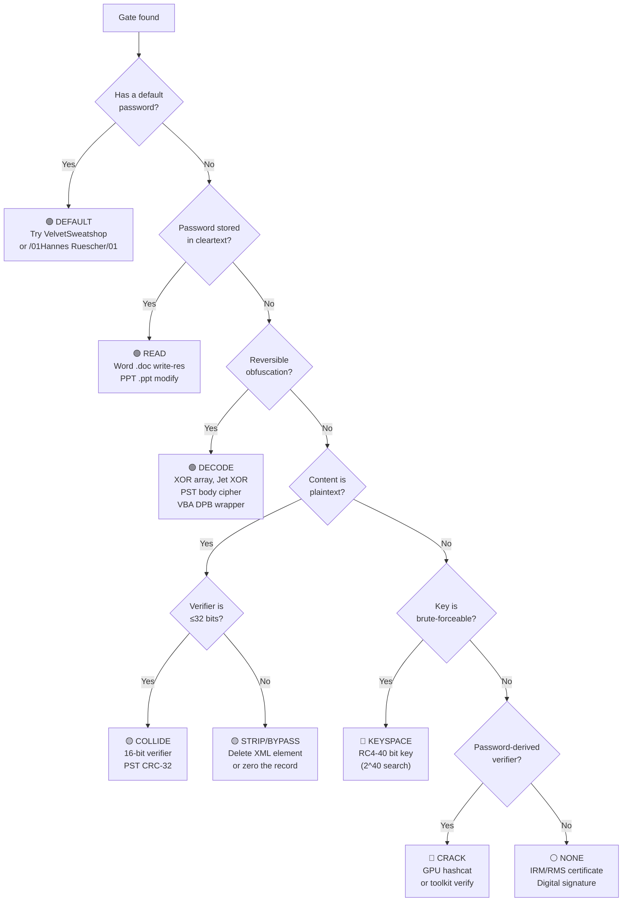

# Toolkit Architecture — Analysis to Code

How the spec analysis in `../research/` maps to the Python `office-password-toolkit` at `/root/projects/office_collection/office-password-toolkit/`.

**Related documents:**

- [gap-analysis.md](gap-analysis.md) — what's implemented vs missing (96% coverage)
- [modular-design.md](modular-design.md) — the complete modular architecture blueprint
- [../hashcat/proposed/README.md](../hashcat/proposed/README.md) — proposed 6-mode hashcat design (37000-series)
- [../recovery/README.md](../recovery/README.md) — non-GPU recovery techniques

## Pipeline Overview

## Container → Handler → Crypto Mapping

## Analysis → Code Mapping

### Format docs → Format handlers

| Analysis doc | Handler class | Source file | Container magic |
|---|---|---|---|
| [../research/formats/word.md](../research/formats/word.md) | `OleHandler` (.doc) / `OoxmlHandler` (.docx) | `formats/ole.py` / `formats/ooxml.py` | `D0CF11E0` / `504B0304` |
| [../research/formats/excel.md](../research/formats/excel.md) | `OleHandler` (.xls) / `OoxmlHandler` (.xlsx/.xlsb) | `formats/ole.py` / `formats/ooxml.py` | `D0CF11E0` / `504B0304` |
| [../research/formats/powerpoint.md](../research/formats/powerpoint.md) | `OleHandler` (.ppt) / `OoxmlHandler` (.pptx) | `formats/ole.py` / `formats/ooxml.py` | `D0CF11E0` / `504B0304` |
| [../research/formats/onenote.md](../research/formats/onenote.md) | `OneNoteHandler` | `formats/onenote.py` | guidFileType bytes |
| [../research/formats/outlook.md](../research/formats/outlook.md) | `OutlookHandler` | `formats/outlook.py` | `!BDN` NDB magic |
| [../research/formats/access.md](../research/formats/access.md) | `AccessHandler` | `formats/access.py` | Jet/ACE header at offset 0x04 |
| [../research/formats/opendocument.md](../research/formats/opendocument.md) | `OdfHandler` | `formats/odf.py` | `504B0304` + `mimetype` entry |
| [../research/formats/visio.md](../research/formats/visio.md) | `OleHandler` (.vsd) / `OoxmlHandler` (.vsdx) | `formats/ole.py` / `formats/ooxml.py` | Same as Word/Excel/PPT |
| [../research/formats/project.md](../research/formats/project.md) | `OleHandler` (.mpp) | `formats/ole.py` | `D0CF11E0` (OUT-OF-CORPUS) |
| [../research/formats/publisher.md](../research/formats/publisher.md) | `OleHandler` (.pub) | `formats/ole.py` | `D0CF11E0` (OUT-OF-CORPUS) |
| [../research/formats/infopath.md](../research/formats/infopath.md) | — (no encryption) | — | CAB archive |

### Algorithm docs → Crypto modules

| Analysis doc | Crypto module | Key function | Output |
|---|---|---|---|
| [../research/algorithms/password/ecma376-agile.md](../research/algorithms/password/ecma376-agile.md) | `crypto/ecma376.py` | `verify_password()`, `decrypt_package()` | `$office$*2013*...` / `$office$*sha512*...` |
| [../research/algorithms/password/ecma376-standard.md](../research/algorithms/password/ecma376-standard.md) | `crypto/ecma376.py` | `verify_password()`, `decrypt_package()` | `$office$*2007*...` / `$office$*sha1*aes128*...` |
| [../research/algorithms/password/rc4-cryptoapi-sha1.md](../research/algorithms/password/rc4-cryptoapi-sha1.md) | `crypto/rc4legacy.py` | `rc4_cryptoapi_verify()` | `$oldoffice$3*...` / `$office$*sha1*rc4*...` |
| [../research/algorithms/password/rc4-md5-legacy.md](../research/algorithms/password/rc4-md5-legacy.md) | `crypto/rc4legacy.py` | `rc4_md5_verify()` | `$oldoffice$0*...` / `$office$*md5*rc4*...` |
| [../research/algorithms/password/xor-obfuscation.md](../research/algorithms/password/xor-obfuscation.md) | `crypto/xor.py` | `xor_decode_method1()`, `reconstruct_password()` | No hash line — DECODE/COLLIDE |
| [../research/algorithms/password/iso-protection-hash.md](../research/algorithms/password/iso-protection-hash.md) | `crypto/protection.py` | `verify()`, `hash_line_25300()` | `$office$2016$0$...` / `$protect$*sha512*...` |
| [../research/algorithms/password/word2007-documentprotection.md](../research/algorithms/password/word2007-documentprotection.md) | `crypto/protection.py` | `word2007_protection_verify()` | `$protect$*sha1*word2007*...` |
| [../research/algorithms/password/odf-encryption.md](../research/algorithms/password/odf-encryption.md) | `crypto/odf.py` | `verify()`, `decrypt_entry()` | `$odf$*0*0*...` / `$odf$*sha1*pbkdf2*bf*...` |
| [../research/algorithms/password/vba-project-password.md](../research/algorithms/password/vba-project-password.md) | `crypto/vba.py` | `decode_data_encryption()`, `extract_vba_hash()` | `sha1hex:keyhex` / `$vba$*sha1*...*...` |
| [../research/algorithms/password/pst-crc32.md](../research/algorithms/password/pst-crc32.md) | `crypto/pst.py` | `password_crc()`, `crc_collision()` | No hash line — COLLIDE |
| [../research/algorithms/non-password/pst-body-cipher.md](../research/algorithms/non-password/pst-body-cipher.md) | `crypto/pst.py` | `permute_decode()`, `cyclic_decode()` | No hash — DECODE |
| [../research/algorithms/non-password/irm-rms-encryption.md](../research/algorithms/non-password/irm-rms-encryption.md) | — (not recoverable) | — | RecoveryClass.NONE |
| [../research/algorithms/non-password/digital-signatures.md](../research/algorithms/non-password/digital-signatures.md) | — (STRIP only) | — | RecoveryClass.STRIP |
| [../research/algorithms/non-password/access-jet-obfuscation.md](../research/algorithms/non-password/access-jet-obfuscation.md) | `formats/access.py` | Jet 3/4 header XOR decode | No hash — DECODE |

## Recovery Class Decision Tree

## The 4 Unified Hash-Line Families

How the self-describing `--format opt` lines map to hashcat modes:

### `$office$` — document-open encryption

| Scheme fields | hashcat mode | Notes |
|---|---|---|
| `sha1 * aes128 * cbc * 100000` | 9500 | Office 2010 default |
| `sha512 * aes256 * cbc * 100000` | 9600 | Office 2013+ default |
| `sha1 * aes128 * ecb * 50000` | 9400 | Office 2007 standard |
| `md5 * rc4 * stream * 0` | 9700 | Office 97/2000 |
| `sha1 * rc4 * stream * 0` | 9800 | Office XP/2003 |
| Any other agile tuple | — (GAP) | Toolkit verifies in Python |

### `$protect$` — editing/permission verifiers

| Scheme fields | hashcat mode | Notes |
|---|---|---|
| `sha512 * iso * 100000` | 25300 | Office 2013+ default |
| Any other primitive/spinCount | — (GAP) | Toolkit verifies in Python |

### `$odf$` — OpenDocument encryption

| Scheme fields | hashcat mode | Notes |
|---|---|---|
| `sha1 * pbkdf2 * bf_cfb * 1024` | 18600 | ODF 1.1 |
| `sha256 * pbkdf2 * aes256cbc * 100000` | 18400 | ODF 1.2 |
| `* argon2id *` or `* aes256gcm *` | — (GAP) | Toolkit verifies in Python |

### `$vba$` — VBA project password

| Scheme fields | hashcat mode | Notes |
|---|---|---|
| `sha1 * <hash> * <salt>` | 110 | `sha1($pass.$salt)` with `--hex-salt` |

## GateType × RecoveryClass × HashScheme

The complete mapping from every gate type to its recovery path:

| GateType | Where | RecoveryClass | HashScheme | hashcat mode |
|---|---|---|---|---|
| `OPEN` (agile) | `\EncryptionInfo` vMinor=4 | `CRACK` | `OFFICE_2013` / `OFFICE_2010` / `OFFICE_AGILE` | 9600 / 9500 / — |
| `OPEN` (standard) | `\EncryptionInfo` vMinor=2 | `CRACK` | `OFFICE_2007` | 9400 |
| `OPEN` (RC4-MD5) | `FilePass` vMajor=1 | `KEYSPACE` / `CRACK` | `OLDOFFICE_RC4_MD5` | 9700 |
| `OPEN` (RC4-SHA1) | `FilePass` vMajor=2-4 | `KEYSPACE` / `CRACK` | `OLDOFFICE_RC4_SHA1` | 9800 |
| `OPEN` (XOR) | `FilePass` wEncType=0 | `DECODE` | `OFFICEXOR` | — |
| `OPEN` (ODF 1.1) | manifest.xml Blowfish | `CRACK` | `ODF` | 18600 |
| `OPEN` (ODF 1.2) | manifest.xml AES-CBC | `CRACK` | `ODF` | 18400 |
| `OPEN` (ODF 1.3) | manifest.xml Argon2/GCM | `CRACK` | `ODF` | — |
| `OPEN` (PST) | PidTagPstPassword | `COLLIDE` | `PST_CRC` | — |
| `MODIFY` (.doc) | SttbfAssoc[0x11] | `READ` | — | — |
| `MODIFY` (.ppt) | ModifyPasswordAtom | `READ` | — | — |
| `MODIFY` (.docx/.xlsx/.pptx) | writeProtection / fileSharing / modifyVerifier | `STRIP` / `CRACK` | `OFFICE_SHEETPROT` / `OFFICE_PROTECT` | 25300 / — |
| `PROTECT_SHEET` (.xls) | Password record 0x0013 | `COLLIDE` | — | — |
| `PROTECT_SHEET` (.xlsx) | sheetProtection element | `STRIP` / `CRACK` | `OFFICE_SHEETPROT` / `OFFICE_PROTECT` | 25300 / — |
| `PROTECT_WORKBOOK` | workbookProtection | `STRIP` / `CRACK` | `OFFICE_SHEETPROT` / `OFFICE_PROTECT` | 25300 / — |
| `RESTRICT_EDIT` (.doc) | Dop.lKeyProtDoc | `COLLIDE` | — | — |
| `RESTRICT_EDIT` (.docx legacy) | documentProtection crypt* | `STRIP` / `CRACK` | `DOC_PROTECT` | — |
| `RESTRICT_EDIT` (.docx ISO) | documentProtection *Value | `STRIP` / `CRACK` | `OFFICE_SHEETPROT` / `OFFICE_PROTECT` | 25300 / — |
| `SECTION` (OneNote) | ObjectDataEncryptionKeyV2 | `CRACK` | `OFFICE_2013` | 9600 |
| `VBA_PROJECT` | PROJECT DPB= | `BYPASS` / `CRACK` | `VBA_SHA1` | 110 |
| `SIGNATURE` | _signatures / _xmlsignatures | `STRIP` | — | — |
| `IRM` | IRMDS / CertificateKeyEncryptor | `NONE` | — | — |
| `MAIL_BODY` (PST) | bCryptMethod | `DECODE` | — | — |

## Module File Sizes

| Layer | File | Lines | Role |
|---|---|---|---|
| **Crypto foundation** | `crypto/ciphers.py` | 292 | All cipher ops — sole `cryptography` import point (RC4, AES, Blowfish, 3DES, RC2, DESX) |
| | `crypto/hashes.py` | 493 | All hash/KDF ops — sole `argon2-cffi` import point, pure-Python MD4 (RFC 1320) + MD2 (RFC 1319) |
| **Crypto protocol** | `crypto/pst.py` | 1063 | CRC-32 + collider + permute/cyclic body ciphers |
| | `crypto/ecma376.py` | 600 | Standard + agile KDFs, EncryptionInfo parser, decryptor |
| | `crypto/odf.py` | 609 | PBKDF2 + Blowfish-CFB / AES-256-CBC / Argon2id + AES-GCM, manifest parser |
| | `crypto/uls.py` | 494 | Jet User-Level Security 3DES password decode + MDW parsing |
| | `crypto/rc4legacy.py` | 459 | MD5+RC4 and SHA-1+RC4 KDFs, $oldoffice$ lines |
| | `crypto/xor.py` | 406 | XOR obfuscation: Method 1/2 verifiers, array, body transform |
| | `crypto/vba.py` | 344 | DPB/CMG/GC decode, SHA-1 verifier, bypass triple |
| | `crypto/protection.py` | 307 | ISO protection hash (iterator APPENDED), Word 2007 three-stage |
| | `crypto/msisam.py` | 188 | MSISAM MD5/SHA-1 + RC4 page encryption (Microsoft Money) |
| | `crypto/mpp.py` | 165 | Microsoft Project Props-based XOR password decode |
| **Formats** | `formats/ole.py` | 2036 | OLE/CFB: FilePass, EncryptionInfo, FibBase, DopBase, SttbfAssoc |
| | `formats/access.py` | 932 | Access: Jet 3/4 decode, ACE 2007/2010+ agile, VBA extraction |
| | `formats/ooxml.py` | 931 | OOXML ZIP: sheetProtection, workbookProtection, documentProtection XML |
| | `formats/outlook.py` | 743 | PST: HEADER, bCryptMethod, NID_MESSAGE_STORE, PidTagPstPassword |
| | `formats/odf.py` | 499 | ODF ZIP: manifest.xml parsing, per-stream extraction |
| | `formats/onenote.py` | 412 | OneNote: FileNode walk, magic-bounded blob, EncryptionInfo carve |
| | `formats/mdw.py` | 80 | MDW/MDA: Jet workgroup file detection + ULS dispatch |
| **Core** | `cli/app.py` | 1532 | Typer CLI: info, unlock, advanced (8 subcommands) |
| | `detect.py` | 363 | Magic-byte detection, product detection, handler dispatch |
| | `models.py` | 280 | ContainerKind, GateType, RecoveryClass, Gate, ExtractedHash, DetectResult |
| | `constants.py` | 59 | VelvetSweatshop, /01Hannes Ruescher/01, magic bytes, exit codes |
| | `extract.py` | 43 | Facade: detect → handler.extract() |
| | `bypass.py` | 38 | Facade: detect → handler.bypass() |
| | `decrypt.py` | 34 | Facade: detect → handler.decrypt() |
| | `defaults.py` | 23 | Default password list |
| **Total** | | **13,636** | |
