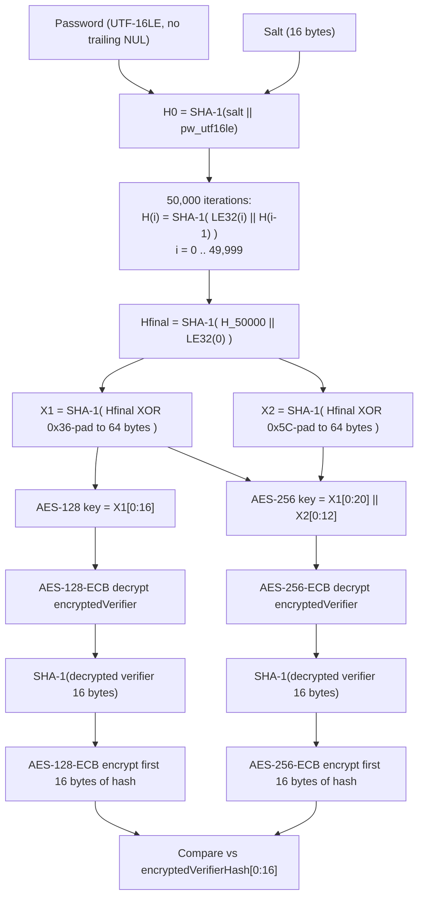

# Mode 9400 — MS Office 2007

Strength: MODERATE — SHA-1 x50,000 iterated KDF with AES-128/256 verification. The 50k iteration count is fixed and was already considered low by 2012 standards; modern GPUs process this at meaningful speed.

## KDF Pipeline



## Hash Line Format

```
$office$*2007*20*128*16*18410007331073848057180885845227*944c70a5ee6e5ab2a6a86ff54b5f621a*e6650f1f2630c27fd8fc0f5e56e2e01f99784b9f
```

### Field Table

| Index | Separator | Length (chars) | Encoding | Field | Constraints |
|-------|-----------|----------------|----------|-------|-------------|
| 0 | `*` | 8 | ASCII | Signature `$office$` | Fixed literal, `TOKEN_ATTR_VERIFY_SIGNATURE` |
| 1 | `*` | 4 | Decimal digits | Version | Must equal `2007` |
| 2 | `*` | 2 | Decimal digits | verifierHashSize | Must equal `20` |
| 3 | `*` | 3 | Decimal digits | keySize | Must be `128` or `256` |
| 4 | `*` | 2 | Decimal digits | saltSize | Must equal `16` |
| 5 | `*` | 32 | Hex (lowercase) | Salt (16 bytes) | `TOKEN_ATTR_VERIFY_HEX` |
| 6 | `*` | 32 | Hex (lowercase) | encryptedVerifier (16 bytes) | `TOKEN_ATTR_VERIFY_HEX` |
| 7 | `*` | 40 | Hex (lowercase) | encryptedVerifierHash (20 bytes) | `TOKEN_ATTR_VERIFY_HEX` |

All token lengths are enforced as `TOKEN_ATTR_FIXED_LENGTH`. Separator is `*` throughout.

## Self-Test Example

- **ST_HASH:** `$office$*2007*20*128*16*18410007331073848057180885845227*944c70a5ee6e5ab2a6a86ff54b5f621a*e6650f1f2630c27fd8fc0f5e56e2e01f99784b9f`
- **ST_PASS:** `hashcat`
- **Parameters:** version=2007, verifierHashSize=20, keySize=128, saltSize=16

## Parser Constraints

| Field | Accepted | Rejected |
|-------|----------|----------|
| Signature (token 0) | `$office$` exactly | Any other string |
| Version (token 1) | `2007` | Any other 4-digit value |
| verifierHashSize (token 2) | `20` | Any other 2-digit value |
| keySize (token 3) | `128` or `256` | `192`, any other 3-digit value |
| saltSize (token 4) | `16` | Any other 2-digit value |
| Salt (token 5) | Exactly 32 hex characters | Non-hex, wrong length |
| encryptedVerifier (token 6) | Exactly 32 hex characters | Non-hex, wrong length |
| encryptedVerifierHash (token 7) | Exactly 40 hex characters | Non-hex, wrong length |

All numeric fields use `TOKEN_ATTR_VERIFY_DIGIT`; all hex fields use `TOKEN_ATTR_VERIFY_HEX`. Value validation (version=2007, etc.) happens post-tokenization and returns `PARSER_SALT_VALUE` on mismatch.

## Technical Details

- **pw_max:** `MODULE_DEFAULT` (no custom override; framework default applies — 256 bytes for slow-hash outside-kernel modes)
- **Salt handling:** `SALT_TYPE_EMBEDDED` — salt is parsed from the hash line, 16 bytes stored in `salt_buf[0..3]` (byte-swapped to host order). `salt_iter = 50000` (fixed, `ROUNDS_OFFICE2007`).
- **Kernel architecture:** Pure kernel (`m09400-pure.cl`), `ATTACK_EXEC_OUTSIDE_KERNEL` with three phases:
  - `_init`: SHA-1(salt || password_utf16le_swap) — produces 20-byte H0
  - `_loop`: Iterative SHA-1 with LE32 counter prepended — `SHA-1(LE32(i) || H(i-1))` for 50,000 rounds, SIMD-vectorized (`OPTI_TYPE_SLOW_HASH_SIMD_LOOP`, `NEW_SIMD_CODE`)
  - `_comp`: Derives AES key via ipad/opad expansion, then runs **both** AES-128 and AES-256 verification paths unconditionally (no branching on keySize)
- **Comparison width:** 128 bits (`DGST_SIZE_4_4`, positions 0-3). The kernel re-encrypts only the first 16 bytes of SHA-1(decrypted_verifier), so comparison is against `encryptedVerifierHash[0:16]`. This is a deliberate truncation from the spec's 160-bit verifier hash — 128-bit collision resistance is more than sufficient.
- **Cipher:** AES in ECB mode (single-block operations, no IV/CBC). Both AES-128 and AES-256 use shared-memory S-box tables for performance.
- **Password encoding:** UTF-16LE via `sha1_update_global_utf16le_swap` in `_init`.
- **Digest positions:** `DGST_POS0=0, DGST_POS1=1, DGST_POS2=2, DGST_POS3=3` (sequential).
- **Optimizations:** `OPTI_TYPE_ZERO_BYTE | OPTI_TYPE_SLOW_HASH_SIMD_LOOP`.
- **Generate type:** `OPTS_TYPE_PT_GENERATE_LE` (little-endian password generation).

## esalt Struct (`office2007_t`)

| Field | Type | Size | Description |
|-------|------|------|-------------|
| `encryptedVerifier[4]` | `u32[4]` | 16 bytes | AES-encrypted random verifier from `EncryptionVerifier` |
| `encryptedVerifierHash[5]` | `u32[5]` | 20 bytes | First 20 bytes of AES-encrypted SHA-1(verifier) |
| `keySize` | `u32` | 4 bytes | AES key length: 128 or 256 |

## tmp Struct (`office2007_tmp_t`)

| Field | Type | Size | Description |
|-------|------|------|-------------|
| `out[5]` | `u32[5]` | 20 bytes | Running SHA-1 state across loop iterations |

## Kernel Verification Logic (comp)

The `_comp` kernel performs both AES-128 and AES-256 verification on every invocation, regardless of `keySize`:

1. Append `LE32(0)` block key to the 50,000-round SHA-1 output, hash once more to get `Hfinal`
2. Compute `X1 = SHA-1(Hfinal XOR 0x36-padded-to-64)` (ipad derivation)
3. **AES-128 path:** Use `X1[0:16]` as key, ECB-decrypt `encryptedVerifier`, SHA-1 the 16-byte plaintext, ECB-re-encrypt first 16 bytes, compare against `encryptedVerifierHash[0:16]`
4. Compute `X2 = SHA-1(Hfinal XOR 0x5C-padded-to-64)` (opad derivation)
5. **AES-256 path:** Use `X1[0:20] || X2[0:12]` (32 bytes) as key, same decrypt/hash/re-encrypt/compare sequence

Both paths emit results via `COMPARE_M`; only the correct key-size path will match.

## Gaps and Rejection Boundaries

- **AES-192 not supported:** `keySize=192` is rejected by the parser (`module_09400.c:153`). Spec-legal (`AlgID` 0x0000660F) but extremely rare in the wild. No kernel code path exists for 24-byte AES keys.
- **Non-SHA-1 hash algorithms:** Any `verifierHashSize != 20` is rejected. The spec allows other hash sizes in theory; hashcat only implements SHA-1.
- **Non-AES standard encryption:** RC4-based CryptoAPI standard encryption (`AlgID` 0x00006801) is a different scheme handled by modes 9700-9720, not 9400.
- **Agile encryption:** Office 2010+ agile encryption (EncryptionInfo version-minor 0x0004) is covered by modes 9500/9600, not 9400.
- **keySize not used for kernel branching:** The stored `keySize` value is validated by the parser but the kernel runs both AES-128 and AES-256 decrypt/verify paths unconditionally. Only one will match the stored `encryptedVerifierHash`, making it functionally correct but doing double work.

## Specification References

- ECMA-376 Standard Encryption: `[MS-OFFCRYPTO] Section 2.3.6` (Standard Encryption)
- Key derivation: `[MS-OFFCRYPTO] Section 2.3.6.2` (Password Verifier Generation)
- Algorithm documentation: [ecma376-standard.md](../../research/algorithms/password/ecma376-standard.md)

## Source Files

- Module: `hashcat/src/modules/module_09400.c`
- Kernel: `hashcat/OpenCL/m09400-pure.cl`
