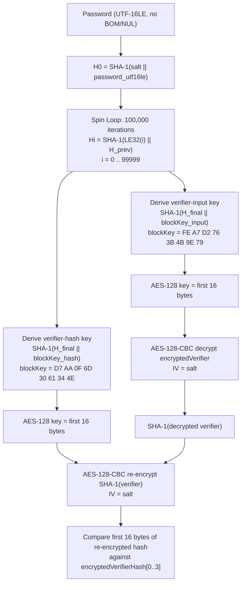

# Mode 9500 — MS Office 2010

**Strength: HIGH** — 100,000 iterations of SHA-1 + AES-128-CBC verification

Covers Microsoft Office 2010 password-encrypted OOXML documents (`.docx`, `.xlsx`, `.pptx`, `.docm`, `.xlsm`, `.pptm`) using the ECMA-376 agile encryption profile with `hashAlgorithm=SHA-1`, `cipherAlgorithm=AES`, `cipherChaining=ChainingModeCBC`, `keyBits=128`, `saltSize=16`, `spinCount=100000`.

## KDF Pipeline



**Key detail:** The kernel does NOT decrypt the encryptedVerifierHash and compare plaintext hashes. Instead, it re-encrypts the computed `SHA-1(verifier)` using the verifier-hash key and compares the first 16 bytes (one AES block) of the resulting ciphertext against the stored `encryptedVerifierHash`. This is equivalent to the decrypt-and-compare approach but avoids needing to decrypt the second ciphertext.

## Hash Line Format

```
$office$*2010*100000*128*16*34170046140146368675746031258762*de5bc114991bb3a5679a6e24320bdb09*1b72a4ddffba3dcd5395f6a5ff75b126cb832b733c298e86162028ca47a235a9
```

| Index | Separator | Length | Encoding | Field | Constraints |
|-------|-----------|--------|----------|-------|-------------|
| 0 | `*` | 8 chars | ASCII | Signature | Fixed: `$office$` |
| 1 | `*` | 4 chars | Decimal digits | Version | Pinned: `2010` |
| 2 | `*` | 6 chars | Decimal digits | spinCount | Pinned: `100000` |
| 3 | `*` | 3 chars | Decimal digits | keyBits | Pinned: `128` |
| 4 | `*` | 2 chars | Decimal digits | saltSize | Pinned: `16` |
| 5 | `*` | 32 chars | Hex (lowercase) | saltValue | 16 bytes, byte-swapped per u32 |
| 6 | `*` | 32 chars | Hex (lowercase) | encryptedVerifierHashInput | 16 bytes, byte-swapped per u32 |
| 7 | — | 64 chars | Hex (lowercase) | encryptedVerifierHashValue | 32 bytes, byte-swapped per u32 |

**Total token count:** 8

## Self-Test Example

- **ST_PASS:** `hashcat`
- **ST_HASH:** `$office$*2010*100000*128*16*34170046140146368675746031258762*de5bc114991bb3a5679a6e24320bdb09*1b72a4ddffba3dcd5395f6a5ff75b126cb832b733c298e86162028ca47a235a9`

## Parser Constraints

| Field | Validation | Rejection condition |
|-------|-----------|---------------------|
| Signature (token 0) | `TOKEN_ATTR_FIXED_LENGTH` (8) + `TOKEN_ATTR_VERIFY_SIGNATURE` | Not exactly `$office$` |
| Version (token 1) | `TOKEN_ATTR_FIXED_LENGTH` (4) + `TOKEN_ATTR_VERIFY_DIGIT` | Not exactly `2010` (checked post-parse) |
| spinCount (token 2) | `TOKEN_ATTR_FIXED_LENGTH` (6) + `TOKEN_ATTR_VERIFY_DIGIT` | Not exactly `100000` (checked post-parse) |
| keyBits (token 3) | `TOKEN_ATTR_FIXED_LENGTH` (3) + `TOKEN_ATTR_VERIFY_DIGIT` | Not exactly `128` (checked post-parse) |
| saltSize (token 4) | `TOKEN_ATTR_FIXED_LENGTH` (2) + `TOKEN_ATTR_VERIFY_DIGIT` | Not exactly `16` (checked post-parse) |
| saltValue (token 5) | `TOKEN_ATTR_FIXED_LENGTH` (32) + `TOKEN_ATTR_VERIFY_HEX` | Not 32 hex chars |
| encryptedVerifier (token 6) | `TOKEN_ATTR_FIXED_LENGTH` (32) + `TOKEN_ATTR_VERIFY_HEX` | Not 32 hex chars |
| encryptedVerifierHash (token 7) | `TOKEN_ATTR_FIXED_LENGTH` (64) + `TOKEN_ATTR_VERIFY_HEX` | Not 64 hex chars |

All four numeric fields are validated in two passes: first the tokenizer checks fixed length and all-digit, then `module_hash_decode` checks the parsed integer value matches the pinned constant. Any mismatch returns `PARSER_SALT_VALUE`.

## Technical Details

- **pw_max:** 256 (MODULE_DEFAULT — pure kernel default PW_MAX)
- **Salt type:** `SALT_TYPE_EMBEDDED` — salt is parsed from the hash line, stored as 4x u32 (16 bytes), byte-swapped
- **Salt iterations:** `salt_iter = 100000` (spinCount, stored directly)
- **Kernel architecture:** Pure kernel (`m09500-pure.cl`), not optimized; uses SIMD vectorization (`NEW_SIMD_CODE`, `OPTI_TYPE_SLOW_HASH_SIMD_LOOP`)
- **Execution model:** `ATTACK_EXEC_OUTSIDE_KERNEL` — init/loop/comp split; the spin loop runs in `_loop`, AES verification in `_comp`
- **Deep comp kernel:** `OPTS_TYPE_DEEP_COMP_KERNEL` enabled — `_comp` runs via `KERN_RUN_3`
- **Comparison width:** 128-bit (4x u32) — `DGST_SIZE_4_4`, positions 0/1/2/3; comparing the first AES block of re-encrypted verifier hash
- **Password encoding:** UTF-16LE (`OPTS_TYPE_PT_GENERATE_LE`), converted via `sha1_update_global_utf16le_swap` in `_init`
- **Digest source:** `digest[0..3]` loaded from `encryptedVerifierHash[0..3]` (first 16 bytes of the 32-byte field)
- **AES tables:** Shared local memory (`s_td0..s_td4`, `s_te0..s_te4`) when `REAL_SHM` is defined, otherwise constant memory

## esalt Struct: `office2010_t`

| Field | Type | Size | Source |
|-------|------|------|--------|
| `encryptedVerifier[4]` | `u32[4]` | 16 bytes | Token 6 (32 hex chars), byte-swapped |
| `encryptedVerifierHash[8]` | `u32[8]` | 32 bytes | Token 7 (64 hex chars), byte-swapped |

## Temp Struct: `office2010_tmp_t`

| Field | Type | Size | Purpose |
|-------|------|------|---------|
| `out[5]` | `u32[5]` | 20 bytes | SHA-1 state (160 bits) carried between `_init`, `_loop`, and `_comp` |

## Block Key Constants (hardcoded in kernel)

| Purpose | Constant (hex bytes) | Kernel variable |
|---------|---------------------|-----------------|
| Verifier input key derivation | `FE A7 D2 76 3B 4B 9E 79` | `encryptedVerifierHashInputBlockKey` |
| Verifier hash key derivation | `D7 AA 0F 6D 30 61 34 4E` | `encryptedVerifierHashValueBlockKey` |

Per [MS-OFFCRYPTO] Section 2.3.4.11 / 2.3.4.13. The third block key (`14 6E 0B E7 AB AC D0 D6` for `encryptedKeyValue`) is not used by this module — it would only be needed for full document decryption, not password verification.

## Gaps and Rejected Profiles

This module rejects any hash line where the parameters differ from the single hardcoded profile:

- **spinCount != 100000** — rejected at parse time; custom iteration counts not supported
- **keyBits != 128** — rejected; AES-192 or AES-256 variants not handled
- **saltSize != 16** — rejected; only 16-byte salts accepted
- **version != 2010** — rejected; Office 2013+ agile (SHA-512/AES-256) routes to mode 9600
- **Non-SHA-1 hash algorithm** — not representable in the hash line; kernel hardcodes SHA-1
- **Non-AES cipher or non-CBC chaining** — not representable; kernel hardcodes AES-128-CBC
- **encryptedVerifierHash longer/shorter than 32 bytes** — fixed at 64 hex chars; SHA-256/SHA-512 hashes not supported

Any OOXML document that uses a non-default agile profile (different spinCount, larger key, different hash) will fail to load.

## Related

- **Mode 9400** — MS Office 2007 (SHA-1/AES-128, spinCount 50000, standard encryption)
- **Mode 9600** — MS Office 2013 (SHA-512/AES-256, spinCount 100000, agile encryption)
- **Spec:** [MS-OFFCRYPTO] Sections 2.3.4.11 (key generation), 2.3.4.13 (password verification)
- **Extractor:** `office2john.py` parses OLE/CFB `EncryptionInfo` stream and emits the `$office$*2010*...` line
