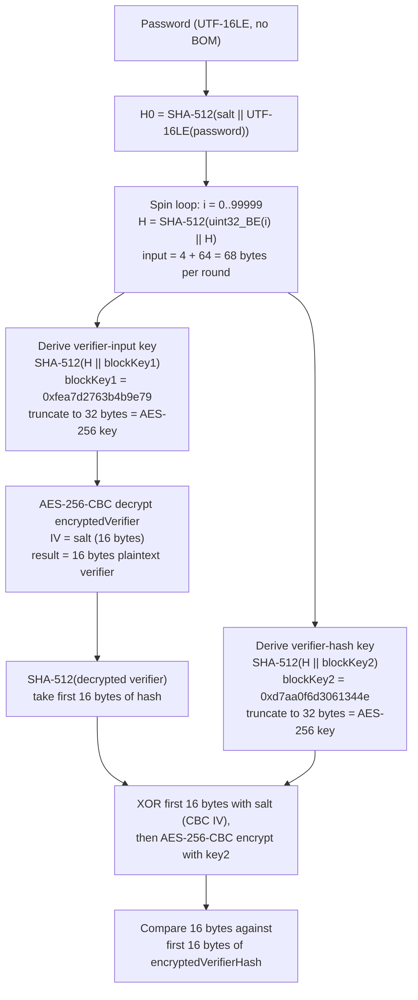

# Mode 9600 — MS Office 2013

Strength: HIGH (SHA-512 x 100 000 iterations + AES-256-CBC)

Source files: `hashcat/src/modules/module_09600.c`, `hashcat/OpenCL/m09600-pure.cl`

## KDF Pipeline



## Hash Line Format

```
$office$*2013*100000*256*16*67805436882475302087847656644837*0c392d3b9ca889656d1e615c54f9f3c9*612b79e33b96322c3253fc8a0f314463cd76bc4efe1352f7efffca0f374f7e4b
```

| Index | Separator | Length | Encoding | Field | Constraints |
|-------|-----------|--------|----------|-------|-------------|
| 0 | `*` | 8 fixed | ASCII | Signature | Must be `$office$` (VERIFY_SIGNATURE) |
| 1 | `*` | 4 fixed | Decimal digits | Version | Must equal `2013` (VERIFY_DIGIT, pinned) |
| 2 | `*` | 6 fixed | Decimal digits | spinCount | Must equal `100000` (VERIFY_DIGIT, pinned) |
| 3 | `*` | 3 fixed | Decimal digits | keySize | Must equal `256` (VERIFY_DIGIT, pinned) |
| 4 | `*` | 2 fixed | Decimal digits | saltSize | Must equal `16` (VERIFY_DIGIT, pinned) |
| 5 | `*` | 32 fixed | Hex | Salt (16 bytes) | VERIFY_HEX; also used as AES-CBC IV |
| 6 | `*` | 32 fixed | Hex | encryptedVerifier (16 bytes) | VERIFY_HEX; = encryptedVerifierHashInput |
| 7 | `*` | 64 fixed | Hex | encryptedVerifierHash (32 bytes) | VERIFY_HEX; first 32 bytes of encryptedVerifierHashValue |

Total token count: 8.

## Self-Test Example

- **Password:** `hashcat`
- **Hash:** `$office$*2013*100000*256*16*67805436882475302087847656644837*0c392d3b9ca889656d1e615c54f9f3c9*612b79e33b96322c3253fc8a0f314463cd76bc4efe1352f7efffca0f374f7e4b`

## Parser Constraints (Acceptance Envelope)

| Field | Accepted | Rejected |
|-------|----------|----------|
| Signature | Exactly `$office$` (8 chars) | Any other prefix |
| Version | Exactly `2013` (4 digits) | Any other value; different digit count |
| spinCount | Exactly `100000` (6 digits) | Any other count; 5-digit or 7-digit values cannot even tokenize (fixed length = 6) |
| keySize | Exactly `256` (3 digits) | `128`, `512`, or any non-256 value |
| saltSize | Exactly `16` (2 digits) | Any other size |
| Salt | Exactly 32 hex chars | Shorter/longer; non-hex characters |
| encryptedVerifier | Exactly 32 hex chars | Shorter/longer; non-hex characters |
| encryptedVerifierHash | Exactly 64 hex chars | Shorter/longer; non-hex characters |

All four numeric fields are parsed then compared with `==`; any mismatch returns `PARSER_SALT_VALUE`. The fixed-length tokenizer rejects values that do not match the expected character count before the numeric check even runs.

## Esalt Structure (`office2013_t`)

| Field | Type | Size | Description |
|-------|------|------|-------------|
| `encryptedVerifier[4]` | `u32[4]` | 16 bytes | AES-256-CBC encrypted 16-byte random verifier |
| `encryptedVerifierHash[8]` | `u32[8]` | 32 bytes | First 32 bytes of AES-256-CBC encrypted SHA-512 hash of verifier |

Byte order: hex is parsed with `hex_to_u32` then `byte_swap_32` (big-endian hex to host order).

## Tmp Structure (`office2013_tmp_t`)

| Field | Type | Size | Description |
|-------|------|------|-------------|
| `out[8]` | `u64[8]` | 64 bytes | Running SHA-512 state across loop iterations |

## Technical Details

- **pw_max:** 256 (MODULE_DEFAULT; pure kernel, PW_MAX = 256)
- **pw_min:** 0 (MODULE_DEFAULT)
- **Salt type:** SALT_TYPE_EMBEDDED (all parameters parsed from hash line)
- **salt_len:** 16 bytes (fixed)
- **salt_iter:** 100000 (= spinCount, stored verbatim; the loop kernel runs exactly this many SHA-512 rounds)
- **kernel_loops_max:** 1000 (iterations per GPU dispatch; 100000 / 1000 = 100 dispatches minimum)
- **Kernel architecture:** Pure kernel only (`m09600-pure.cl`); no optimized kernel exists
- **SIMD:** `NEW_SIMD_CODE` enabled; uses `OPTI_TYPE_SLOW_HASH_SIMD_LOOP` with vectorized `pack64v`/`unpack64v` in loop
- **64-bit arithmetic:** `OPTI_TYPE_USES_BITS_64` — SHA-512 operates on 64-bit words
- **Attack execution:** `ATTACK_EXEC_OUTSIDE_KERNEL` (iterated hash; init/loop/comp split)
- **Deep comp kernel:** Yes (`OPTS_TYPE_DEEP_COMP_KERNEL`, returns `KERN_RUN_3`)
- **Digest size:** `DGST_SIZE_4_4` (4 x u32 = 16 bytes); digest is the first 4 words of encryptedVerifierHash
- **Digest positions:** 0, 1, 2, 3 (sequential)
- **Comparison width:** 128 bits (16 bytes) — first AES block of re-encrypted verifier hash vs. stored encryptedVerifierHash[0..3]
- **Password encoding:** UTF-16LE (converted in `sha512_update_global_utf16le_swap` in init kernel); no BOM, no null terminator
- **Byte generation:** `OPTS_TYPE_PT_GENERATE_LE` (little-endian plaintext)
- **JIT build options:** `-D _unroll` on NVIDIA, AMD HIP, and AMD ROCM with vperm; no unroll on Apple platforms
- **Unstable warning:** Apple Metal on Intel Iris GPUs (pipeline creation failure for m09600_init)

## Verification Logic (comp kernel)

1. Take the final 512-bit SHA-512 state from the loop (64 bytes)
2. Derive key1: `SHA-512(state || blockKey1_verifierInput)` — 64 + 8 = 72 bytes input; take first 32 bytes (256 bits) as AES key
3. Derive key2: `SHA-512(state || blockKey2_verifierHash)` — same structure; take first 32 bytes as AES key
4. AES-256 ECB decrypt encryptedVerifier (single 16-byte block); XOR with salt for CBC (first block, IV = salt)
5. SHA-512 hash the 16-byte decrypted verifier
6. Take first 16 bytes of that hash, XOR with salt, AES-256 ECB encrypt with key2 (first block CBC encrypt with IV = salt)
7. Compare the resulting 16 bytes (4 x u32) against the first 16 bytes of the stored encryptedVerifierHash

Block keys (big-endian as stored in kernel):
- Verifier input: `0xfea7d276 3b4b9e79`
- Verifier hash: `0xd7aa0f6d 3061344e`

## Gaps and Rejected Parameters

- **spinCount != 100000:** Rejected. The 6-digit fixed-length token cannot represent counts outside 100000-999999, and even within that range only 100000 passes the `== 100000` check. Non-default spin counts (e.g., custom Group Policy settings) are unsupported.
- **keySize != 256:** Rejected. The 3-digit field pins to `256`. AES-128 agile documents (if they existed for 2013+) would fail parsing.
- **saltSize != 16:** Rejected. Pinned to `16`.
- **version != 2013:** Rejected. Office 2010 agile (version 2010) is mode 9500. There is no mode for version values other than 2010 or 2013.
- **Non-SHA-512 agile profiles:** No algorithm identifier in the hash line; SHA-512 is implied by version=2013. Alternative hash algorithms in agile encryption have no hashcat mode.
- **Full encryptedVerifierHashValue:** The hash line carries only 32 of the 64 on-disk bytes (64 hex chars = 32 bytes). Only the first 16 bytes (one AES block) participate in the comparison.

## Coverage

Covers the document-open password for ECMA-376 agile-encrypted OOXML files produced by Office 2013, 2016, 2019, 2021, and Microsoft 365 under their default encryption profile (SHA-512, AES-256-CBC, 100000 iterations, 16-byte salt). File types: `.docx`, `.docm`, `.dotx`, `.xlsx`, `.xlsm`, `.xltx`, `.pptx`, `.pptm`, and related OOXML extensions. The on-disk file is an OLE/CFB container wrapping the EncryptionInfo and EncryptedPackage streams.

Does not cover: Office 2007 (mode 9400), Office 2010 agile (mode 9500), modify/write-reservation passwords, sheet/workbook protection, VBA project passwords, or non-default agile parameter combinations.

## Related Documents

- Spec: `[MS-OFFCRYPTO] Section 2.3.4.11` (agile encryption password verifier)
- Algorithm doc: `analysis/password-algorithms/ecma376-agile.md`
- Mode 9400: Office 2007 (SHA-1/AES-128, CryptoAPI provider)
- Mode 9500: Office 2010 agile (SHA-1/AES-128, 100000 iterations)
- Mode 9700: Office 97-03 (RC4, MD5-based)
- Mode 9800: Office 97-03 (RC4, SHA-1 verifier variant)
