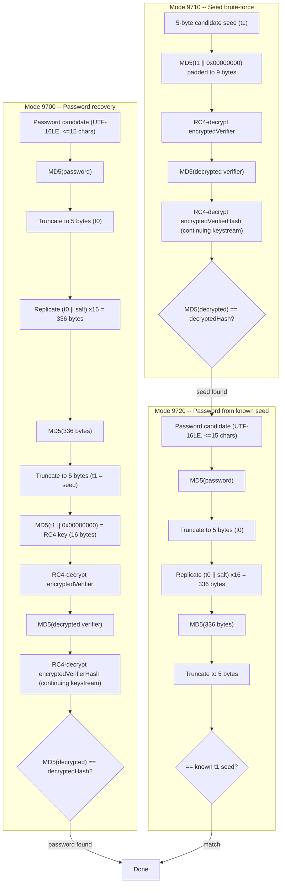

# Mode 9700 / 9710 / 9720 — MS Office <=2003 MD5 + RC4-40

Strength: WEAK (40-bit effective key, un-iterated MD5, guaranteed break at 2^40 via collider)

Covers Word 97/2000 (`.doc`, version tag `$oldoffice$0`) and Excel 97/2000 (`.xls`, version tag `$oldoffice$1`) password-to-open encryption using the legacy 40-bit RC4 scheme per [MS-OFFCRYPTO] section 2.3.6. Three hashcat modes work together in a pipeline: 9700 does direct password recovery, 9710 brute-forces the 40-bit key seed bypassing the password entirely, and 9720 recovers the original password from a known seed.

## Three-mode attack pipeline



## Hash line format

### Modes 9700 / 9710 (5 tokens, `*`-separated)

```
$oldoffice$0*55045061647456688860411218030058*e7e24d163fbd743992d4b8892bf3f2f7*493410dbc832557d3fe1870ace8397e2
```

| Index | Separator | Length | Encoding | Meaning | Constraints |
|-------|-----------|--------|----------|---------|-------------|
| 0 | — | 11 | ASCII | Signature `$oldoffice$` | `TOKEN_ATTR_FIXED_LENGTH`, `VERIFY_SIGNATURE` |
| 1 | `*` | 1 | digit | Version (`0` = Word, `1` = Excel) | `TOKEN_ATTR_FIXED_LENGTH`, `VERIFY_DIGIT`; post-parse rejects anything not `0` or `1` |
| 2 | `*` | 32 | hex | Salt (16 bytes) | `TOKEN_ATTR_FIXED_LENGTH` (no `VERIFY_HEX` — see Gaps) |
| 3 | `*` | 32 | hex | Encrypted verifier (16 bytes) | `TOKEN_ATTR_FIXED_LENGTH`, `VERIFY_HEX` |
| 4 | `*` | 32 | hex | Encrypted verifier hash (16 bytes) | `TOKEN_ATTR_FIXED_LENGTH`, `VERIFY_HEX` |

### Mode 9720 (6 tokens, `*` and `:` separated)

```
$oldoffice$0*55045061647456688860411218030058*e7e24d163fbd743992d4b8892bf3f2f7*493410dbc832557d3fe1870ace8397e2:91b2e062b9
```

| Index | Separator | Length | Encoding | Meaning | Constraints |
|-------|-----------|--------|----------|---------|-------------|
| 0 | — | 11 | ASCII | Signature `$oldoffice$` | same as above |
| 1 | `*` | 1 | digit | Version | same as above |
| 2 | `*` | 32 | hex | Salt (16 bytes) | same as above |
| 3 | `*` | 32 | hex | Encrypted verifier (16 bytes) | `TOKEN_ATTR_FIXED_LENGTH`, `VERIFY_HEX` |
| 4 | `:` | 32 | hex | Encrypted verifier hash (16 bytes) | `TOKEN_ATTR_FIXED_LENGTH`, `VERIFY_HEX` |
| 5 | `:` | 10 | hex | RC4 key seed / t1 (5 bytes) | `TOKEN_ATTR_FIXED_LENGTH`, `VERIFY_HEX` |

Note: token 4's separator changes from `*` (9700/9710) to `:` (9720) because the 6th token uses `:` as its separator, redefining the boundary.

## Self-test examples

| Mode | ST_HASH | ST_PASS | Notes |
|------|---------|---------|-------|
| 9700 | `$oldoffice$0*55045061647456688860411218030058*e7e24d163fbd743992d4b8892bf3f2f7*493410dbc832557d3fe1870ace8397e2` | `hashcat` | Direct password recovery |
| 9710 | Same hash line as 9700 | `\x91\xb2\xe0\x62\xb9` (5 raw bytes) | Brute-forces the 5-byte t1 seed directly; output is always hexified |
| 9720 | `$oldoffice$0*55045061647456688860411218030058*e7e24d163fbd743992d4b8892bf3f2f7*493410dbc832557d3fe1870ace8397e2:91b2e062b9` | `hashcat` | Recovers password given the seed appended to the hash |

All three self-test examples use the same underlying document. The seed `91b2e062b9` is the t1 value that the password `hashcat` produces through the KDF.

## esalt structure

```c
typedef struct oldoffice01 {
    u32 version;              // 0 (Word) or 1 (Excel)
    u32 encryptedVerifier[4]; // 16 bytes, loaded from token[3]
    u32 encryptedVerifierHash[4]; // 16 bytes, loaded from token[4]
    u32 rc4key[2];            // 5 bytes (padded to 8), only used by mode 9720
} oldoffice01_t;
```

## Parser constraints table

| Check | 9700 | 9710 | 9720 |
|-------|------|------|------|
| Signature | `$oldoffice$0` or `$oldoffice$1` | same | same |
| Version digit | `0` or `1` only; others -> `PARSER_SALT_VALUE` | same | same |
| Salt field hex validation | **No** (`VERIFY_HEX` absent on token[2]) | same | same |
| Verifier hex validation | Yes | Yes | Yes |
| VerifierHash hex validation | Yes | Yes | Yes |
| RC4 key seed validation | N/A | N/A | Yes, 10 hex chars |
| Token count | 5 | 5 | 6 |
| Autodetect | Enabled | **Disabled** (`AUTODETECT_DISABLE`) | **Disabled** (`AUTODETECT_DISABLE`) |

## Technical details

- **pw_max**: 15 characters for modes 9700 and 9720 (per MSDN spec dd772916); mode 9710 pins `pw_min = pw_max = 5` (fixed 5-byte seed search)
- **pw_min**: Default (1) for 9700/9720; 5 for 9710
- **Password encoding**: UTF-16LE (`OPTS_TYPE_PT_UTF16LE`) for 9700 and 9720; raw bytes for 9710 (no UTF-16LE flag)
- **Salt handling**: 16-byte salt from the hash, but `salt_len` is set to 48 bytes internally — the parser appends the encrypted verifier (16 bytes) and encrypted verifier hash (16 bytes) into `salt_buf[4..11]` as a deduplication workaround because Office reuses the same salt across documents
- **Salt type**: `SALT_TYPE_EMBEDDED` (all three modes)
- **Kernel architecture**: Optimized only (`a0/a1/a3-optimized.cl`); no `-pure.cl` kernels exist
- **Attack execution**: `ATTACK_EXEC_INSIDE_KERNEL` (all three); un-iterated, no tmp buffer
- **Comparison width**: 128-bit (4x u32) for modes 9700/9710 (comparing RC4-decrypted verifier hash); 40-bit (digest[0] full + digest[1] & 0xff, c=0, d=0) for mode 9720 (comparing only the 5-byte seed)
- **Digest positions**: `DGST_POS0=0, DGST_POS1=1, DGST_POS2=2, DGST_POS3=3` (all three)
- **Digest size**: `DGST_SIZE_4_4` (16 bytes, all three)
- **Digest source**: 9700/9710 set digest from `encryptedVerifierHash[0..3]`; 9720 sets digest from `rc4key[0..1]` with `digest[2]=0, digest[3]=0`
- **JIT build options**: 9700 and 9710 force `FIXED_LOCAL_SIZE` (32 for GPU, 1 for CPU) because the RC4 S-box in `inc_cipher_rc4.cl` uses fixed addressing macros `KEY32`/`KEY8`; mode 9720 does not use RC4 at all, so no JIT override
- **Optimizations**: `OPTI_TYPE_ZERO_BYTE | OPTI_TYPE_PRECOMPUTE_INIT | OPTI_TYPE_NOT_ITERATED` (all three)
- **RC4 S-box**: Stored in `LOCAL_VK u32 S[64 * FIXED_LOCAL_SIZE]` — local memory, per-workitem within the workgroup
- **Benchmark mask**: 9710 uses `?b?b?b?b?b` (exhaustive 5-byte search); 9700/9720 use default
- **Output format**: 9710 forces `OUTFILE_FMT_HASH | OUTFILE_FMT_HEXPLAIN` (result always hex-encoded)
- **OPTS_TYPE_SUGGEST_KG**: 9720 sets this flag, suggesting key-generation mode for feeding seeds from 9710 results
- **Unstable warning**: 9700 and 9710 flag Apple Metal Intel Iris GPUs as unstable (self-test failures); 9720 has no unstable warning

## How the three modes work together

The three-mode pipeline exploits the 40-bit bottleneck in the KDF:

1. **Try mode 9700 first** for direct password recovery. If the password is in a dictionary or follows a known pattern, this is fastest. The full KDF runs: `password -> MD5 -> truncate(5) -> replicate+salt(336) -> MD5 -> truncate(5) -> MD5(+block) -> RC4 -> verify`.

2. **If 9700 fails, run mode 9710** with mask `?b?b?b?b?b` to exhaustively search the 2^40 seed space. This skips the password-to-seed derivation entirely and directly brute-forces the 5-byte t1 value. The kernel does: `seed(5 bytes) -> MD5(seed || 0x00000000, padded to 9 bytes) -> RC4 key -> decrypt + verify`. At ~2^40 candidates this is a guaranteed break regardless of password complexity.

3. **Once 9710 finds the seed, run mode 9720** to recover the original password (if needed for other documents using the same password). The hash line includes the seed appended after `:`. The kernel computes only: `password -> MD5 -> truncate(5) -> replicate+salt(336) -> MD5 -> truncate(5)`, then compares the 5-byte result against the known seed. No RC4 is involved — this is a pure MD5 filter, making it extremely fast.

## KDF pipeline details (mode 9700)

Per [MS-OFFCRYPTO] section 2.3.6.2:

1. **H0** = `MD5(password_UTF16LE)` — single MD5 block (password <= 15 chars = 30 UTF-16LE bytes + padding fits in 64 bytes)
2. **t0** = `H0[0:5]` — truncate to 5 bytes (the 40-bit bottleneck)
3. **336-byte buffer** = `(t0 || salt)` repeated 16 times — each repetition is 21 bytes (5 + 16), total 336 bytes
4. **H1** = `MD5(336-byte buffer)` — multiple MD5 blocks (336 bytes = 5 full blocks + 16-byte final block with padding)
5. **t1** = `H1[0:5]` — truncate to 5 bytes again (the seed)
6. **cbRequiredKeyLength / cbHash** = 16 (128-bit RC4 key schedule, but only 40 bits of entropy)
7. **derivedKey** = `MD5(t1 || blockKey)` where `blockKey = 0x00000000` (u32 LE) — padded input is 9 bytes
8. **RC4 key** = full 16-byte MD5 output used for `rc4_init_128`

Verification:
- RC4-decrypt `encryptedVerifier` (16 bytes, offset 0 in keystream)
- RC4-decrypt `encryptedVerifierHash` (16 bytes, offset 16, **same continuous keystream** — state not reset)
- Check: `MD5(decryptedVerifier) == decryptedVerifierHash`

The kernel implements this as: decrypt verifier, compute its MD5, then re-encrypt the MD5 result using `rc4_next_16` continuing at offset 16 with the same `j` state, and compare the re-encrypted output against `encryptedVerifierHash` stored in the digest.

## Gaps and rejection cases

- **Version values other than 0 or 1**: Rejected by post-tokenizer check (`PARSER_SALT_VALUE`). Digits 2-9 are tokenized (pass `VERIFY_DIGIT`) but fail the version check. Non-digit characters fail at the tokenizer level.
- **Salt field hex validation missing**: Token[2] (salt) has `TOKEN_ATTR_FIXED_LENGTH` but not `VERIFY_HEX`. Non-hex characters in the salt field will be mis-parsed by `hex_to_u32` rather than cleanly rejected. The encrypted verifier and hash fields do have `VERIFY_HEX`.
- **No pure kernels**: Only optimized kernels exist. No `-pure.cl` variants are provided.
- **No non-zero block keys**: The verification always uses block key `0x00000000`. The spec defines block keys for encrypting different data streams, but hashcat only verifies against block 0.
- **40-bit key only**: The module implements the 40-bit RC4 scheme exclusively. The 128-bit CryptoAPI RC4 scheme (which uses SHA-1 instead of MD5) is handled by modes 9800/9810/9820, a separate module family.
- **Passwords > 15 characters**: Hard-rejected by `pw_max = 15`. The spec mandates this limit (MSDN dd772916). The password must also fit in a single 64-byte MD5 block when UTF-16LE encoded (15 chars * 2 bytes = 30 bytes + 0x80 + padding + length = 64 bytes exactly).

## Related modes and references

| Mode | Name | Relationship |
|------|------|-------------|
| 9800 | MS Office <=2003 SHA-1 + RC4 | Same era, CryptoAPI provider, uses SHA-1 instead of MD5 |
| 9810 | MS Office <=2003 SHA-1 + RC4, collider #1 | Seed brute-force for 9800 |
| 9820 | MS Office <=2003 SHA-1 + RC4, collider #2 | Password from seed for 9800 |
| 9400 | MS Office 2007 | OOXML Standard encryption (AES + SHA-1, iterated) |
| 9500 | MS Office 2010 | OOXML Agile (AES + SHA-512, 100k iterations) |
| 9600 | MS Office 2013/2016 | OOXML Agile (AES + SHA-512, 100k iterations) |

## Source files

- Module: `hashcat/src/modules/module_09700.c`, `module_09710.c`, `module_09720.c`
- Kernels: `hashcat/OpenCL/m09700_a{0,1,3}-optimized.cl`, `m09710_a3-optimized.cl`, `m09720_a3-optimized.cl`
- RC4 implementation: `hashcat/OpenCL/inc_cipher_rc4.cl` (`rc4_init_128`, `rc4_next_16`)
- Spec: [MS-OFFCRYPTO] section 2.3.6 (RC4 Encryption)
