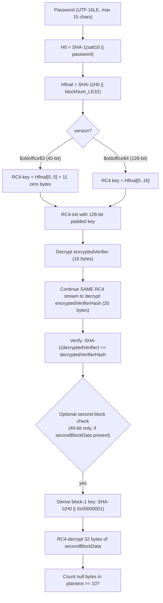

# Mode 9800 / 9810 / 9820 — MS Office <= 2003 SHA-1 + RC4 (CryptoAPI)

Strength: WEAK — un-iterated SHA-1 with no spin count; 40-bit key variant is trivially brute-forceable

Spec reference: [MS-OFFCRYPTO] section 2.3.5 (Office Binary Document RC4 CryptoAPI Encryption)

## Mode Family Overview

| Mode | HASH_NAME | What it recovers | Signatures accepted | pw_min | pw_max | Input encoding |
|------|-----------|------------------|---------------------|--------|--------|----------------|
| 9800 | `MS Office <= 2003 $3/$4, SHA1 + RC4` | Password | `$oldoffice$3`, `$oldoffice$4` | 0 (default) | 15 | UTF-16LE (PT_UTF16LE, PT_GENERATE_BE) |
| 9810 | `MS Office <= 2003 $3, SHA1 + RC4, collider #1` | Raw 40-bit RC4 key | `$oldoffice$3`, `$oldoffice$4` | 5 | 5 | Raw bytes (PT_GENERATE_LE, PT_ALWAYS_HEXIFY) |
| 9820 | `MS Office <= 2003 $3, SHA1 + RC4, collider #2` | Password that produces a known 40-bit key | `$oldoffice$3` only | 0 (default) | 15 | UTF-16LE (PT_UTF16LE, PT_GENERATE_BE) |

All three modes use `ATTACK_EXEC_INSIDE_KERNEL` (single-pass, no iterated loop), `DGST_SIZE_4_4` (128-bit / 4x u32 comparison), and `SALT_TYPE_EMBEDDED`. Autodetect is disabled for 9810 and 9820 (`OPTS_TYPE_AUTODETECT_DISABLE`). Mode 9820 also sets `OPTS_TYPE_SUGGEST_KG` (suggests key-generation attack).

## KDF Pipeline



### Key derivation details

- **No iteration / spin count**: the SHA-1 calls are single-pass, not iterated. This is the CryptoAPI scheme, not the agile scheme.
- **Salt prefix**: the salt (16 bytes) is prepended to the password, NOT appended. The SHA-1 message is `salt || password_utf16le`.
- **Block number**: `blockNum` is a 4-byte little-endian u32. Block 0 (`0x00000000`) for the verifier key, block 1 (`0x00000001`) for the second-block key. In the kernel this appears as the second SHA-1 call: `SHA1(H0[20 bytes] || 0x00000000[4 bytes])` — total 24 bytes input, hence `w3_t[3] = (20 + 4) * 8 = 192`.
- **40-bit key truncation**: for version 3, the kernel masks `digest[1] &= 0xff` and zeros `digest[2]` and `digest[3]`, yielding 5 effective key bytes (40 bits). The remaining 11 bytes are zero-padded to form a 128-bit RC4 key for `rc4_init_128`.
- **128-bit key**: for version 4, all 16 bytes of `Hfinal` are used directly.

### Verification logic in the kernel

1. RC4-decrypt the 16-byte `encryptedVerifier` to obtain `plainVerifier`.
2. Continue the same RC4 stream (offset 16, same `j` state) to decrypt the next 16 bytes of `encryptedVerifierHash` (only the first 16 of 20 bytes are compared — `DGST_SIZE_4_4`).
3. Compute `SHA-1(plainVerifier)` (16 bytes, padded), swap endianness, and use the same RC4 stream at offset 16 to decrypt the hash.
4. Compare the 4 words of decrypted hash against the stored digest.
5. If a second block is present (`secondBlockLen != 0`), derive a separate 40-bit key using block number 1, RC4-decrypt 32 bytes of `secondBlockData`, and count null bytes in the plaintext. The candidate is accepted only if `null_bytes >= MIN_NULL_BYTES` (10). This disambiguates 40-bit key collisions.

## esalt Structure (`oldoffice34_t`)

| Field | Type | Size | Description |
|-------|------|------|-------------|
| `version` | `u32` | 4 B | 3 = 40-bit RC4, 4 = 128-bit RC4 |
| `encryptedVerifier[4]` | `u32[4]` | 16 B | RC4-encrypted verifier block |
| `encryptedVerifierHash[5]` | `u32[5]` | 20 B | RC4-encrypted SHA-1 hash of verifier |
| `secondBlockData[8]` | `u32[8]` | 32 B | Optional ciphertext from file offset 512 (40-bit disambiguation) |
| `secondBlockLen` | `u32` | 4 B | 0 if no second block, 64 if present (character count of hex) |
| `rc4key[2]` | `u32[2]` | 8 B | Known 40-bit key for mode 9820 (5 bytes in rc4key[0] + 1 byte of rc4key[1]) |

## Hash Line Format

### Mode 9800 (standard, 5 or 6 tokens)

```
$oldoffice$3*83328705222323020515404251156288*2855956a165ff6511bc7f4cd77b9e101*941861655e73a09c40f7b1e9dfd0c256ed285acd
```

| Index | Separator | Length | Encoding | Meaning | Constraints |
|-------|-----------|--------|----------|---------|-------------|
| 0 | — | 11 chars | ASCII | Signature `$oldoffice$` | TOKEN_ATTR_VERIFY_SIGNATURE, must match `$oldoffice$3` or `$oldoffice$4` |
| 1 | `*` | 1 char | digit | Version: `3` or `4` | TOKEN_ATTR_VERIFY_DIGIT; parsed value must be 3 or 4, else `PARSER_SALT_VALUE` |
| 2 | `*` | 32 chars | hex | Salt (16 bytes) | TOKEN_ATTR_FIXED_LENGTH (no hex validation on this field) |
| 3 | `*` | 32 chars | hex | EncryptedVerifier (16 bytes) | TOKEN_ATTR_VERIFY_HEX |
| 4 | `*` | 40 chars | hex | EncryptedVerifierHash (20 bytes) | TOKEN_ATTR_VERIFY_HEX |
| 5 (opt) | `*` | 64 chars | hex | Second block data (32 bytes) | TOKEN_ATTR_VERIFY_HEX; parsed only on retry when 5-token parse fails with `PARSER_TOKEN_LENGTH` |

### Mode 9810 (collider #1, same format as 9800)

Identical hash line format. Same parser as 9800. The difference is purely in the kernel: the "password" is a raw 5-byte RC4 key (not UTF-16LE encoded), and the search space is 2^40. The module enforces `pw_min = pw_max = 5` and uses benchmark mask `?b?b?b?b?b`. Output is forced to `OUTFILE_FMT_HASH | OUTFILE_FMT_HEXPLAIN`.

### Mode 9820 (collider #2, hash + known key appended)

```
$oldoffice$3*83328705222323020515404251156288*2855956a165ff6511bc7f4cd77b9e101*941861655e73a09c40f7b1e9dfd0c256ed285acd:b8f63619ca
```

| Index | Separator | Length | Encoding | Meaning | Constraints |
|-------|-----------|--------|----------|---------|-------------|
| 0 | — | 11 chars | ASCII | Signature `$oldoffice$` | TOKEN_ATTR_VERIFY_SIGNATURE, only `$oldoffice$3` accepted (signatures_cnt=1) |
| 1 | `*` | 1 char | digit | Version: `3` or `4` | TOKEN_ATTR_VERIFY_DIGIT |
| 2 | `*` | 32 chars | hex | Salt (16 bytes) | TOKEN_ATTR_FIXED_LENGTH |
| 3 | `*` | 32 chars | hex | EncryptedVerifier (16 bytes) | TOKEN_ATTR_VERIFY_HEX |
| 4 | `:` | 40 chars | hex | EncryptedVerifierHash (20 bytes) | TOKEN_ATTR_VERIFY_HEX |
| 5 | — | 10 chars | hex | Known 40-bit RC4 key (5 bytes) | TOKEN_ATTR_VERIFY_HEX |

With optional second block (7-token variant):

| Index | Separator | Length | Encoding | Meaning | Constraints |
|-------|-----------|--------|----------|---------|-------------|
| 0-3 | same | same | same | same | same |
| 4 | `*` | 40 chars | hex | EncryptedVerifierHash | Note: separator changes to `*` instead of `:` |
| 5 | `:` | 64 chars | hex | Second block data (32 bytes) | TOKEN_ATTR_VERIFY_HEX |
| 6 | — | 10 chars | hex | Known 40-bit RC4 key (5 bytes) | TOKEN_ATTR_VERIFY_HEX |

The digest for 9820 is the `rc4key` itself (`digest[0] = rc4key[0], digest[1] = rc4key[1], digest[2] = 0, digest[3] = 0`), not the encrypted verifier hash. The kernel derives the 40-bit key from each candidate password and compares it to the known key.

## Self-Test Examples

| Mode | ST_PASS | ST_HASH |
|------|---------|---------|
| 9800 | `hashcat` | `$oldoffice$3*83328705222323020515404251156288*2855956a165ff6511bc7f4cd77b9e101*941861655e73a09c40f7b1e9dfd0c256ed285acd` |
| 9810 | `\xb8\xf6\x36\x19\xca` (raw 5 bytes) | `$oldoffice$3*83328705222323020515404251156288*2855956a165ff6511bc7f4cd77b9e101*941861655e73a09c40f7b1e9dfd0c256ed285acd` |
| 9820 | `hashcat` | `$oldoffice$3*83328705222323020515404251156288*2855956a165ff6511bc7f4cd77b9e101*941861655e73a09c40f7b1e9dfd0c256ed285acd:b8f63619ca` |

All three self-tests use the same underlying document. The 40-bit RC4 key for password `hashcat` on this salt is `b8f63619ca`. Mode 9810 uses the raw key bytes as the "password"; mode 9820 appends it to the hash line after `:`.

## How the Three Modes Work Together

The three modes represent a two-phase attack strategy for 40-bit ($oldoffice$3) hashes:

1. **Mode 9800 (password attack)**: Standard password cracking. Try candidate passwords, derive the key, verify against the encrypted verifier. Works for both 40-bit and 128-bit. This is the primary mode.

2. **Mode 9810 (collider #1 — key-space brute-force)**: Instead of guessing passwords, brute-force the 40-bit RC4 key directly. The 2^40 key space (~1.1 trillion keys) is feasible on modern GPUs. The kernel skips the SHA-1 KDF entirely — it takes the 5-byte "password" directly as the RC4 key, RC4-decrypts the verifier, and checks the hash. This recovers the RC4 key (output as hex), but NOT the original password.

3. **Mode 9820 (collider #2 — password from key)**: Given the known 40-bit key from step 2 (appended after `:`), find a password that produces that same key through the KDF. The kernel runs the full SHA-1 KDF on each candidate password, truncates to 40 bits, and compares directly against the known key — no RC4 decrypt needed in the hot path. This is much faster per candidate than mode 9800 because it avoids the RC4 and verification steps.

**Workflow**: For a 40-bit hash, run 9810 first to recover the key (guaranteed success given enough time/compute, since 2^40 is tractable). Then feed the recovered key into 9820 to find the actual password (if the password is in your dictionary/rule set). This two-phase approach is faster because step 1 is a small fixed search, and step 2 has a cheaper per-candidate cost.

**128-bit limitation**: Modes 9810 and 9820 only work for 40-bit keys. The 2^128 key space makes brute-forcing a 128-bit RC4 key infeasible. For `$oldoffice$4` hashes, only mode 9800 (standard password attack) applies. The 9810 parser accepts `$oldoffice$4` signatures but searching only 5 bytes will never find a 128-bit key. The 9820 parser explicitly accepts only `$oldoffice$3` (`signatures_cnt = 1`).

## Parser Constraints Summary

| Constraint | 9800 | 9810 | 9820 |
|------------|------|------|------|
| Accepted signatures | `$oldoffice$3`, `$oldoffice$4` | `$oldoffice$3`, `$oldoffice$4` | `$oldoffice$3` only |
| Version values | 3 or 4 (else `PARSER_SALT_VALUE`) | 3 or 4 | 3 or 4 |
| Salt field length | Exactly 32 hex chars | Exactly 32 hex chars | Exactly 32 hex chars |
| Salt hex validation | None (no VERIFY_HEX on token[2]) | None | None |
| EncryptedVerifier | 32 hex chars, hex-validated | 32 hex chars, hex-validated | 32 hex chars, hex-validated |
| EncryptedVerifierHash | 40 hex chars, hex-validated | 40 hex chars, hex-validated | 40 hex chars, hex-validated |
| Second block (optional) | 64 hex chars, hex-validated | 64 hex chars, hex-validated | 64 hex chars, hex-validated |
| RC4 key field | N/A | N/A | 10 hex chars, hex-validated |
| Token count | 5 or 6 | 5 or 6 | 6 or 7 |

### Salt uniquification workaround

All three parsers append `encryptedVerifier[0..3]` and `encryptedVerifierHash[0..3]` to `salt_buf[4..11]`, extending `salt_len` from 16 to 48. This is a hashcat workaround because Office can produce multiple documents with the same 16-byte salt but different verifiers; the extended salt ensures each document maps to a unique salt slot.

## Technical Details

- **pw_max**: 15 characters for modes 9800 and 9820 (per MSDN dd772916, Office CryptoAPI password limit); 5 bytes fixed for mode 9810
- **Salt handling**: 16 bytes from the hash line, byte-swapped to big-endian for SHA-1 processing. Extended to 48 bytes internally with verifier data for uniquification.
- **Kernel architecture**: Optimized only (no pure kernels). `ATTACK_EXEC_INSIDE_KERNEL` — single-pass, no `_init`/`_loop`/`_comp` separation. All attack modes (a0/a1/a3) have optimized `.cl` files. RC4 S-box uses `LOCAL_VK` memory (`S[64 * FIXED_LOCAL_SIZE]`) with `FIXED_LOCAL_SIZE` forced via JIT: 32 for GPU, 1 for CPU.
- **Comparison width**: 128-bit (4x u32). Only the first 16 bytes of the 20-byte `encryptedVerifierHash` are compared.
- **Optimizations**: `OPTI_TYPE_ZERO_BYTE`, `OPTI_TYPE_PRECOMPUTE_INIT`, `OPTI_TYPE_NOT_ITERATED`
- **Unstable warning**: Apple Metal with Intel GPU (Intel Iris Graphics) — self-test fails on modes 9800 and 9810. Mode 9820 has no unstable warning.
- **Output format (9810)**: Forced to `OUTFILE_FMT_HASH | OUTFILE_FMT_HEXPLAIN` — the recovered key is always shown in hex.

## 40-bit vs 128-bit Key Size Distinction

| Property | `$oldoffice$3` (version 3) | `$oldoffice$4` (version 4) |
|----------|---------------------------|---------------------------|
| RC4 key size | 40 bits (5 bytes) | 128 bits (16 bytes) |
| Key derivation truncation | `Hfinal[0..5]` + 11 zero-pad bytes | `Hfinal[0..16]` used directly |
| Kernel masking | `digest[1] &= 0xff; digest[2] = 0; digest[3] = 0` | No masking |
| Collider attack feasible | Yes (2^40 key space) | No (2^128 key space) |
| Modes available | 9800, 9810, 9820 | 9800 only |
| Second-block disambiguation | Supported (optional field) | Not applicable |

The second-block check is relevant only for 40-bit keys because the small key space means multiple passwords may produce the same 5-byte key (or the same RC4 key may decrypt the verifier correctly by chance). The second block at file offset 512 provides a second independent check: if the decrypted second block contains at least 10 null bytes (out of 32), the candidate passes. This is a heuristic specific to document structure (early file content tends to contain many null bytes).

## Gaps and Rejection Boundaries

- **Key sizes other than 40 or 128 bits**: The parser hard-checks `version == 3 || version == 4`. Any `$oldoffice$5` (56-bit, which office2john emits for `KeySize = 0x38`) or other key lengths (48, 64, 80, 96, 112, 120) are rejected with `PARSER_SALT_VALUE`. These CryptoAPI configurations exist in the spec but hashcat has no mode for them.
- **Non-standard salt sizes**: The parser assumes exactly 16-byte (32 hex char) salt. Documents with non-standard `SaltSize` values are rejected.
- **MD5-based Office encryption**: The sibling `$oldoffice$0`/`$oldoffice$1` (Office 97/2000, MD5 + RC4) is a completely separate format handled by modes 9700/9710/9720.
- **Agile/Standard encryption**: Modern `$office$*` format (Office 2007+, AES-based) is modes 9400-9600, unrelated.
- **128-bit collider**: No collider modes exist for `$oldoffice$4`. The 2^128 search space makes this infeasible.
- **SIMD on 9810/9820**: The comment `//too much register pressure` disables `NEW_SIMD_CODE` in the collider kernels. The base 9800 kernel does use SIMD in the optimized variant.

## Related Documentation

- Algorithm specification: [MS-OFFCRYPTO] section 2.3.5 (RC4 CryptoAPI Encryption)
- Password limit reference: MSDN dd772916 (15 character maximum)
- Sibling modes: 9700/9710/9720 (MD5 + RC4, `$oldoffice$0/$1`)
- Modern Office modes: 9400 (Office 2007), 9500 (Office 2010), 9600 (Office 2013+)
