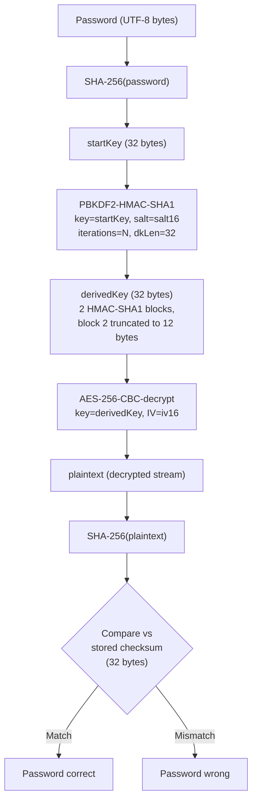

# Mode 18400 — Open Document Format (ODF) 1.2 (SHA-256, AES)

**Strength: HIGH** — 100,000 iterations of PBKDF2-HMAC-SHA1 with a SHA-256 start key and AES-256-CBC encryption.

## KDF Pipeline



## Hash Line Format

```
$odf$*1*1*100000*32*<checksum_64hex>*16*<iv_32hex>*16*<salt_32hex>*0*<ciphertext_hex>
```

| Index | Separator | Length | Encoding | Field | Constraints |
|-------|-----------|--------|----------|-------|-------------|
| 0 | `*` | 5 (fixed) | ASCII | Signature `$odf$` | Must match exactly |
| 1 | `*` | 1 (fixed) | Digit | cipher_type | Must be `1` (AES-256-CBC) |
| 2 | `*` | 1 (fixed) | Digit | checksum_type | Must be `1` (SHA-256) |
| 3 | `*` | 4–6 | Digit | iteration_count | Decimal, 1000–999999 range |
| 4 | `*` | 2 (fixed) | Digit | key_size | Must be `32` |
| 5 | `*` | 64 (fixed) | Hex | checksum | SHA-256 verifier (32 bytes) |
| 6 | `*` | 2 (fixed) | Digit | iv_len | Must be `16` |
| 7 | `*` | 32 (fixed) | Hex | iv | AES-CBC IV (16 bytes) |
| 8 | `*` | 2 (fixed) | Digit | salt_len | Must be `16` |
| 9 | `*` | 32 (fixed) | Hex | salt | PBKDF2 salt (16 bytes) |
| 10 | `*` | 1 (fixed) | Digit | unused | Must be `0` |
| 11 | — | 16–2048 | Hex | ciphertext | Encrypted stream bytes (8–1024 bytes raw) |

## Self-Test Vector

- **Password:** `hashcat`
- **Iterations:** 100,000
- **Hash (truncated):**
```
$odf$*1*1*100000*32*751854d8b90731ce0579f96bea6f0d4ac2fb2f546b31f1b6af9a5f66952a0bf4*16*2185a966155baa9e2fb597298febecbc*16*c18eaae34bcbbe9119be017fe5f8b52d*0*051e0f1c...d3322
```

## Parser Constraints

| Field | Accepted | Rejected |
|-------|----------|----------|
| signature | `$odf$` | Anything else |
| cipher_type | `1` only | Any other digit (0, 2–9) |
| checksum_type | `1` only | Any other digit (0, 2–9) |
| iteration_count | 4–6 digit decimal (1000–999999); value must be >= 1 | < 1000 (too few digits), >= 1000000 (too many digits), zero |
| key_size | `32` only | Any other 2-digit value |
| checksum | Exactly 64 hex chars | Non-hex chars, wrong length |
| iv_len | `16` only | Any other 2-digit value |
| iv | Exactly 32 hex chars | Non-hex chars, wrong length |
| salt_len | `16` only | Any other 2-digit value |
| salt | Exactly 32 hex chars | Non-hex chars, wrong length |
| unused | `0` only | Any other single digit |
| ciphertext | 16–2048 hex chars (even count implied by hex_decode) | < 16 or > 2048 hex chars, non-hex |

## Technical Details

- **pw_max:** MODULE_DEFAULT (256 bytes, since OPTS_TYPE_PT_GENERATE_LE with no override)
- **Salt type:** SALT_TYPE_EMBEDDED (parsed from hash line)
- **Salt length:** Fixed 16 bytes (4 x u32 in salt_buf)
- **salt_iter:** `iterations - 1` (first PBKDF2 iteration runs in `_init`, remainder in `_loop`)
- **Kernel architecture:** Pure kernel (`m18400-pure.cl`), three-phase: `_init` / `_loop` / `_comp`
- **SIMD:** NEW_SIMD_CODE enabled; OPTI_TYPE_SLOW_HASH_SIMD_LOOP
- **Digest size:** DGST_SIZE_4_8 (8 x u32 = 32 bytes, full SHA-256 width)
- **Comparison width:** 4 x u32 (r0--r3 from first 16 bytes of SHA-256 output), using COMPARE_M
- **Endianness:** OPTS_TYPE_PT_GENERATE_LE; byte-swapping applied at kernel boundaries

## Esalt Structure (`odf12_t`)

| Field | Type | Size | Purpose |
|-------|------|------|---------|
| `iterations` | u32 | 4 bytes | PBKDF2 iteration count |
| `iv` | u32[4] | 16 bytes | AES-256-CBC initialization vector |
| `checksum` | u32[8] | 32 bytes | Stored SHA-256 verifier over plaintext |
| `encrypted_data` | u32[256] | 1024 bytes max | Captured ciphertext from encrypted stream |
| `encrypted_len` | int | 4 bytes | Actual byte length of ciphertext |

## Temp Structure (`odf12_tmp_t`)

| Field | Type | Size | Purpose |
|-------|------|------|---------|
| `ipad` | u32[5] | 20 bytes | HMAC-SHA1 inner pad state |
| `opad` | u32[5] | 20 bytes | HMAC-SHA1 outer pad state |
| `dgst` | u32[10] | 40 bytes | Current PBKDF2 iteration digest (2 blocks x 20 bytes) |
| `out` | u32[10] | 40 bytes | XOR accumulator across PBKDF2 iterations |

## Kernel Phase Details

- **`m18400_init`:** Computes `startKey = SHA-256(password)`. Sets up HMAC-SHA1 ipad/opad using the 32-byte startKey as the HMAC key. Runs the first PBKDF2 iteration for both blocks (block counter j=1 and j=2, big-endian, appended to the 16-byte salt as 4-byte suffix, total message = 20 bytes). Stores ipad/opad and initial dgst/out into tmps.
- **`m18400_loop`:** SIMD-vectorized. Iterates remaining PBKDF2-HMAC-SHA1 rounds (LOOP_CNT per kernel invocation) for both blocks. Each iteration feeds the previous HMAC-SHA1 output as the next message, XORs into the running `out` accumulator. Two blocks processed: i=0 (out[0..4]) and i=5 (out[5..9]).
- **`m18400_comp`:** Assembles the 32-byte derived key from `out[0..7]` (byte-swapped). Builds AES-256 decryption key schedule. Decrypts the full ciphertext using AES-256-CBC with the stored IV. Computes `SHA-256(plaintext)` over the decrypted bytes. Compares the first 4 words of the computed SHA-256 against the stored checksum (digest[0..3]).

## PBKDF2 Block Structure

The 32-byte derived key requires two 20-byte HMAC-SHA1 blocks:
- **Block 1** (j=1): Produces `out[0..4]` = 20 bytes (bytes 0–19 of derived key)
- **Block 2** (j=2): Produces `out[5..9]` = 20 bytes, truncated to 12 bytes (bytes 20–31 of derived key)

Total derived key = 20 + 12 = 32 bytes.

## Gaps — What This Mode Rejects

- **ODF 1.1 Blowfish-CFB:** Uses SHA-1 start key and SHA-1 checksum with Blowfish cipher. Covered by mode 18600, not parseable here (cipher_type and checksum_type must both be 1).
- **Non-AES-256 ciphers:** Any cipher_type other than 1 is rejected.
- **Non-SHA-256 checksums:** Any checksum_type other than 1 is rejected.
- **Non-standard key/salt/IV sizes:** key_size must be 32, salt_len must be 16, iv_len must be 16. Non-standard profile combinations are rejected.
- **Iteration counts outside 4–6 digit range:** Counts below 1000 or at/above 1000000 fail the token length constraint on field 3 (4–6 decimal digits).
- **Large ciphertext:** Maximum 1024 raw bytes (2048 hex chars) due to the 256 x u32 esalt buffer. Streams longer than this must be truncated by the extractor.
- **Whole-package encryption:** ODF `encrypted-package` format is not supported by extractors or this module.
- **Sheet/section protection:** Unrelated digest-based protection, not handled by this mode.

## References

- Analysis: [odf-encryption.md](../../research/algorithms/password/odf-encryption.md)
- Module source: `hashcat/src/modules/module_18400.c`
- Kernel source: `hashcat/OpenCL/m18400-pure.cl`
- Related mode: 18600 (ODF 1.1, Blowfish-CFB, SHA-1)
