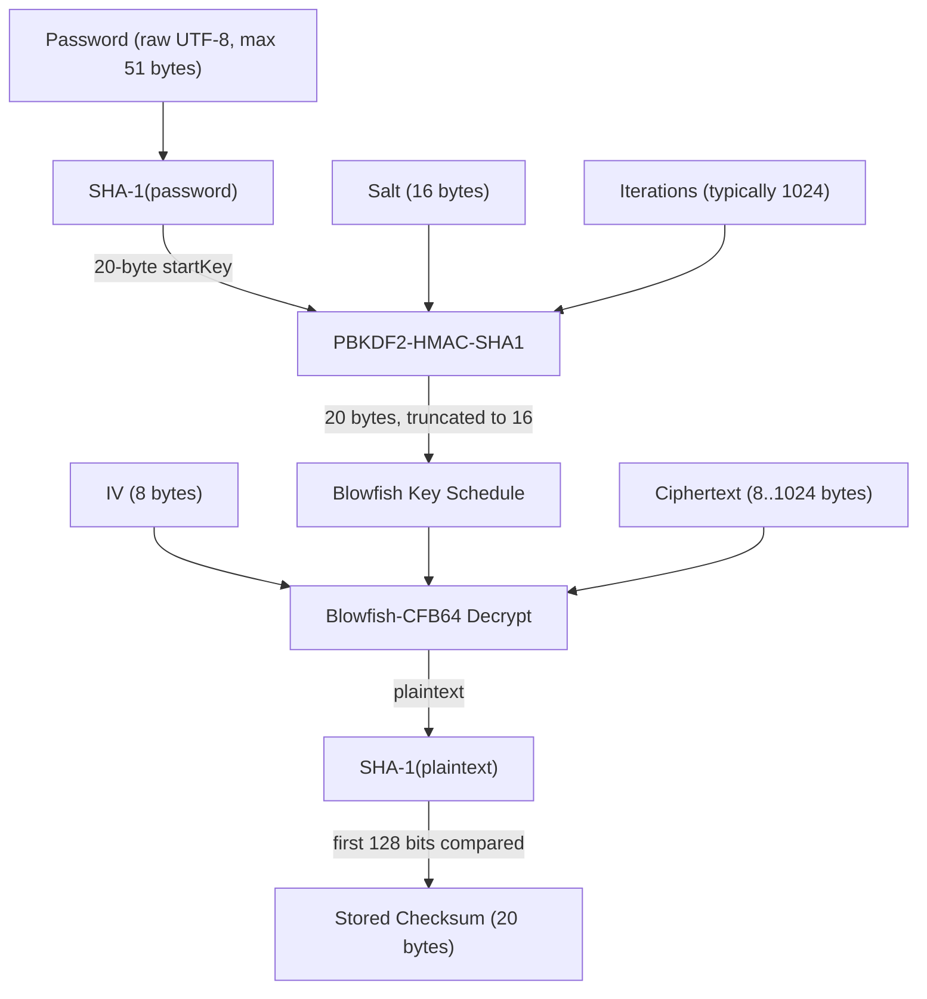

# Mode 18600 — Open Document Format (ODF) 1.1 (SHA-1, Blowfish)

Strength: WEAK — SHA-1 start key with PBKDF2-HMAC-SHA1 (typically 1024 iterations) + Blowfish-CFB. Low iteration count and legacy primitives make this highly attackable.

## KDF Pipeline



**Pipeline detail:**

1. `startKey = SHA-1(password)` — 20 bytes; this is the "Bogus SHA-1 in StarOffice code" path, where the password is hashed before use as the PBKDF2 key (not a standard PKCS#5 pattern).
2. `derivedKey = PBKDF2(PRF=HMAC-SHA1, password=startKey, salt=salt16, c=iterations, dkLen=16)` — single PBKDF2 block (dkLen 16 <= hLen 20), counter `INT(1)` appended to salt for U_1, output truncated from 20 to 16 bytes.
3. Blowfish key schedule with the 16-byte derived key (128-bit key).
4. Blowfish-CFB64 decryption (full 8-byte feedback) with the 8-byte IV.
5. `SHA-1(plaintext)` verification: the first 128 bits (4 x u32) of the resulting hash are compared against the stored 20-byte checksum. The fifth word is stored (`DGST_SIZE_4_5`) but only the first four words drive the GPU comparison (`r0..r3` in `m18600_comp`).

## Hash Line Format

Signature: `$odf$`  
Separator: `*`  
Token count: 12

```
$odf$*0*0*1024*16*bff753835f4ea15644b8a2f8e4b5be3d147b9576*8*ee371da34333b69d*16*a902eff54a4d782a26a899a31f97bef4*0*dae7e41f...c4ec871
```

### Field Table

| Index | Field | Length (chars) | Encoding | Meaning | Constraints |
|-------|-------|---------------|----------|---------|-------------|
| 0 | Signature | 5 (fixed) | ASCII | `$odf$` | `TOKEN_ATTR_VERIFY_SIGNATURE`, must be exactly `$odf$` |
| 1 | cipher_type | 1 (fixed) | Digit | Cipher algorithm selector | Must be `0` (Blowfish-CFB); any other value rejected `PARSER_SALT_VALUE` |
| 2 | checksum_type | 1 (fixed) | Digit | Checksum algorithm selector | Must be `0` (SHA-1/1K); any other value rejected `PARSER_SALT_VALUE` |
| 3 | iterations | 4–6 (variable) | Digit | PBKDF2 iteration count | `TOKEN_ATTR_VERIFY_DIGIT`, `VERIFY_LENGTH` min=4 max=6; value must be >= 1 (checked separately); typical value 1024 |
| 4 | key_size | 2 (fixed) | Digit | Derived key length in bytes | Must be `16`; any other value rejected `PARSER_SALT_VALUE` |
| 5 | checksum | 40 (fixed) | Hex | SHA-1 hash of original plaintext | `TOKEN_ATTR_VERIFY_HEX`, 20 bytes decoded |
| 6 | iv_len | 1 (fixed) | Digit | IV length in bytes | Must be `8`; any other value rejected `PARSER_SALT_VALUE` |
| 7 | iv | 16 (fixed) | Hex | Blowfish-CFB initialization vector | `TOKEN_ATTR_VERIFY_HEX`, 8 bytes decoded, byte-swapped for endianness |
| 8 | salt_len | 2 (fixed) | Digit | Salt length in bytes | Must be `16`; any other value rejected `PARSER_SALT_VALUE` |
| 9 | salt | 32 (fixed) | Hex | PBKDF2 salt | `TOKEN_ATTR_VERIFY_HEX`, 16 bytes decoded, byte-swapped for endianness |
| 10 | unused | 1 (fixed) | Digit | Reserved / unused field | Must be `0`; any other value rejected `PARSER_SALT_VALUE` |
| 11 | ciphertext | 16–2048 (variable) | Hex | Encrypted content.xml data | `TOKEN_ATTR_VERIFY_HEX`, `VERIFY_LENGTH` min=16 max=2048; decodes to 8–1024 bytes |

## Self-Test Example

- **ST_HASH:** `$odf$*0*0*1024*16*bff753835f4ea15644b8a2f8e4b5be3d147b9576*8*ee371da34333b69d*16*a902eff54a4d782a26a899a31f97bef4*0*dae7e41fbc3a500d3ce152edd8876c4f38fb17d673ee2ac44ef1e0e283622cd2ae298a82d8d98f2ea737247881fc353e73a2f535c6e13e0cdc60821c1a61c53a4b0c46ff3a3b355d7b793fad50de15999fc7c1194321d1c54316c3806956c4a3ade7daabb912a2a36398eba883af088b3cb69b43365d9ba9fce3fb0c1524f73947a7e9fc1bf3adb5f85a367035feacb5d97c578b037144c2793f34aa09dcd04bdaa455aee0d4c52fe377248611dd56f2bd4eb294673525db905f5d905a28dec0909348e6bf94bcebf03ddd61a48797cd5728ce6dbb71037b268f526e806401abcf495f6edd0b5d87118671ec690d4627f86a43e51c7f6d42a75a56eec51204d47e115e813ed4425c97b16b195e02ce776c185194b9de43ae89f356e29face016cb393d6fb93af8ea305d921d5592dd184051ac790b9b90266f52b8d53ce1cb1d762942d6d5bbd0e3821be21af9fa6874ba0c60e64f41d3e5b6caca1c53b575afdc5d8f6a3edbf874dbe009c6cb296466fe9637aed4aed8a43a95ea7d26b4090ad33d4ee7a83844b0893e8bc0f04944205fb9576cb5720f019028cd75ca9ac47b3e5fa231354d74135564df43b659cfaea7e195c4a896e0e0e0c85dc9ce3a9ce9ba552bc2a6dbac4901c19558818e1957ed72d78662bb5ba53475ca584371f1825ae0c92322a4404e63c2baad92665aac29b5c6f96e1e6338d48fb0aef4d0b686063974f58b839484f8dcf0a02537cba67a7d2c4de13125d74820cb07ec72782035af1ea6c4db61c77016d1c021b63c8b07adb4e8510f5c41bbc501f60f3dd16462399b52eb146787e38e700147c7aa23ac4d5d22d9d1c93e67a01c92a197d4765cbf8d56a862a1205abb450a182913a69b8d5334a59924f86fb3ccd0dcfe7426053e26ba26b57c05f38d85863fff1f81135b0366e8cd8680663ae8aaf7d005317b849d5e08be882708fa0d8d02d47e89150124b507c34845c922b95e62aa0b3fef218773d7aeb572c67b35ad8787f31ecc6e1846b673b8ba6172223176eabf0020b6aa3aa71405b40b2fc2127bf9741a103f1d8eca21bf27328cdf15153f2f223eff7b831a72ed8ecacf4ea8df4ea44f3a3921e5a88fb2cfa355ece0f05cbc88fdd1ecd368d6e3b2dfabd999e5b708f1bccaeebb296c9d7b76659967742fe966aa6871cbbffe710b0cd838c6e02e6eb608cb5c81d066b60b5b3604396331d97d4a2c4c2317406e48c9f5387a2c72511d1e6899bd450e9ca88d535755bcfddb53a6df118cd9cdc7d8b4b814f7bc17684d8e5975defaa25d06f410ed0724c16b8f69ec3869bc1f05c71483666968d1c04509875dadd72c6182733d564eb1a7d555dc34f6b817c5418626214d0b2c3901c5a46f5b20fddfdf9f71a7dfd75b9928778a3f65e1832dff22be973c2b259744d500a3027c2a2e08972eaaad4c5c4ec871`
- **ST_PASS:** `hashcat`
- **Iterations:** 1024
- **Ciphertext length:** 2048 hex chars = 1024 bytes

## Parser Constraints Table

| Parameter | Accepted | Rejected |
|-----------|----------|----------|
| cipher_type (field 1) | `0` (Blowfish-CFB) | Any non-zero value --> `PARSER_SALT_VALUE` |
| checksum_type (field 2) | `0` (SHA-1/1K) | Any non-zero value --> `PARSER_SALT_VALUE` |
| iterations (field 3) | 4–6 digit numeric string (1000–999999); value >= 1 | < 4 digits, > 6 digits, non-digit chars, value 0 --> `PARSER_SALT_ITERATION` |
| key_size (field 4) | `16` | Any other 2-digit value --> `PARSER_SALT_VALUE` |
| checksum (field 5) | Exactly 40 hex chars | Wrong length or non-hex --> tokenizer fail |
| iv_len (field 6) | `8` | Any other single digit --> `PARSER_SALT_VALUE` |
| iv (field 7) | Exactly 16 hex chars | Wrong length or non-hex --> tokenizer fail |
| salt_len (field 8) | `16` | Any other 2-digit value --> `PARSER_SALT_VALUE` |
| salt (field 9) | Exactly 32 hex chars | Wrong length or non-hex --> tokenizer fail |
| unused (field 10) | `0` | Any non-zero digit --> `PARSER_SALT_VALUE` |
| ciphertext (field 11) | 16–2048 hex chars (8–1024 bytes) | Outside range or non-hex --> tokenizer fail |

## Technical Details

- **pw_max:** 51 — hardcoded in `module_pw_max()` with the comment "Bogus SHA-1 in StarOffice code". StarOffice/OpenOffice's implementation pre-hashes the password through SHA-1 before feeding to PBKDF2; the 51-byte limit corresponds to a single SHA-1 compression block (64 bytes minus padding overhead: 55 bytes for the last block with length, but StarOffice used 51). This means passwords longer than 51 bytes are silently rejected by hashcat regardless of attack mode.
- **pw_min:** MODULE_DEFAULT (0)
- **Salt type:** `SALT_TYPE_EMBEDDED` — all cryptographic parameters are parsed from the hash line itself
- **salt_iter:** `iterations - 1` (the _init kernel performs the first PBKDF2 HMAC-SHA1 round; _loop handles the remaining iterations)
- **Kernel architecture:** Pure kernel only (`m18600-pure.cl`), no optimized variant. Uses SIMD vectorization (`NEW_SIMD_CODE`).
- **Execution mode:** `ATTACK_EXEC_OUTSIDE_KERNEL` — iterated hash, init/loop/comp three-phase structure
- **Comparison width:** 128 bits (4 x u32). The `_comp` kernel extracts `r0..r3` from `sha1_ctx.h[0..3]`; `DGST_SIZE_4_5` stores all 5 words but `DGST_POS0..3 = 0..3` drives comparison using only the first four. Fifth SHA-1 word is never compared on the GPU.
- **Cipher:** Blowfish-CFB64 with full 8-byte feedback, using `inc_cipher_blowfish.cl`. Key is scheduled from the 16-byte truncated PBKDF2 output (128-bit Blowfish key). Decryption uses the S-box arrays in local memory, with dynamic local memory sizing via JIT build options to maximize GPU occupancy.
- **Optimizations:** `OPTI_TYPE_ZERO_BYTE | OPTI_TYPE_SLOW_HASH_SIMD_LOOP`; `OPTS_TYPE_PT_GENERATE_LE | OPTS_TYPE_DYNAMIC_SHARED`
- **JIT build options:** Extensive shared memory management — the Blowfish S-boxes (4 x 256 x 4 bytes = 4096 bytes per thread) are allocated in local/shared memory, with `FIXED_LOCAL_SIZE_COMP` computed from `device_local_mem_size / 4096` or `kernel_dynamic_local_mem_size_memset / 4096` for CUDA

## esalt Struct (`odf11_t`)

| Field | Type | Size | Source |
|-------|------|------|--------|
| `iterations` | `u32` | 4 bytes | Field 3 (iteration count) |
| `iv[2]` | `u32[2]` | 8 bytes | Field 7 (Blowfish IV, byte-swapped) |
| `checksum[5]` | `u32[5]` | 20 bytes | Field 5 (SHA-1 checksum, raw hex_to_u32) |
| `encrypted_data[256]` | `u32[256]` | 1024 bytes max | Field 11 (ciphertext, hex-decoded + byte-swapped) |
| `encrypted_len` | `int` | 4 bytes | Decoded byte length of ciphertext |

## tmp Struct (`odf11_tmp_t`)

| Field | Type | Size | Purpose |
|-------|------|------|---------|
| `ipad[5]` | `u32[5]` | 20 bytes | HMAC-SHA1 inner pad state |
| `opad[5]` | `u32[5]` | 20 bytes | HMAC-SHA1 outer pad state |
| `dgst[5]` | `u32[5]` | 20 bytes | Current PBKDF2 U_i value |
| `out[5]` | `u32[5]` | 20 bytes | Accumulated XOR of all U_i values |

## Gaps / Rejection Envelope

- **AES-256 ODF 1.2:** `cipher_type=1` is rejected; use mode 18400 instead
- **SHA-256 checksum:** `checksum_type=1` is rejected; use mode 18400 instead
- **Non-standard key sizes:** Only `key_size=16` accepted; 24/32-byte keys rejected
- **Non-standard IV/salt lengths:** Only `iv_len=8` and `salt_len=16` accepted
- **Iteration counts < 1000 or > 999999:** The token parser enforces 4–6 digit length, so 1–999 and 1000000+ are rejected at the tokenizer level. Value 0 is separately rejected via `if (iterations < 1) return PARSER_SALT_ITERATION`.
- **Passwords > 51 bytes:** Silently truncated/rejected by `module_pw_max()`. This is a StarOffice implementation constraint where the pre-SHA-1 step was buggy.
- **Fifth checksum word:** The comparison only checks 128 bits of the 160-bit SHA-1. Theoretically a 2^-128 false positive rate; no practical impact.
- **OpenOffice "buggy SHA-1" checksum variant:** JtR's implementation matches both standard and buggy SHA-1 checksums; hashcat computes only the standard SHA-1. This means some very old StarOffice files with the buggy checksum may not verify correctly even with the right password.

## References

- Unified design: [odf_open.md](../proposed/odf_open.md) (mode 37200)
- ODF encryption spec: [odf-encryption.md](../../research/algorithms/password/odf-encryption.md)
- Module source: `hashcat/src/modules/module_18600.c`
- Kernel source: `hashcat/OpenCL/m18600-pure.cl`
- Blowfish cipher include: `hashcat/OpenCL/inc_cipher_blowfish.cl`
- SHA-1 include: `hashcat/OpenCL/inc_hash_sha1.cl`
