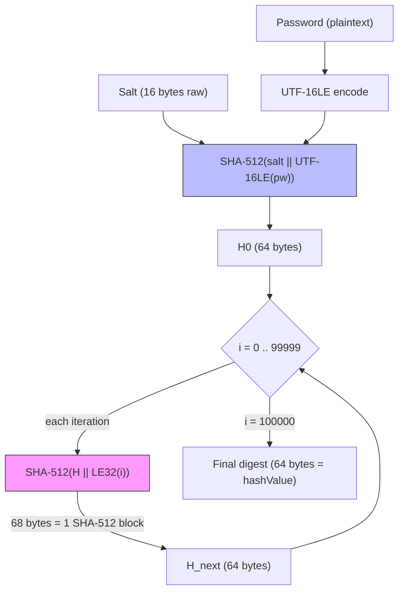

# Mode 25300 — MS Office 2016 SheetProtection

| Property | Value |
|---|---|
| Mode | 25300 |
| Hash name | MS Office 2016 - SheetProtection |
| Category | HASH_CATEGORY_DOCUMENTS |
| Strength | Red — SHA-512 is strong but this is a write-protection verifier, not encryption; recovered password removes the protection entirely |
| Spec reference | [MS-OFFCRYPTO] SS2.4.2.4 "ISO Write Protection Method" |

## KDF Pipeline



**Critical distinction from agile encryption (mode 9600):** the iterator is **appended** (`H || LE32(i)`), not prepended (`LE32(i) || H`). Agile mode 9600 prepends the iterator per SS2.3.4.11; this mode appends it per SS2.4.2.4.

### Pipeline detail

| Stage | Kernel | Operation | Input size | Notes |
|---|---|---|---|---|
| Init | `m25300_init` | `SHA-512(salt \|\| UTF-16LE(pw))` | 16 + 2*pw_len bytes | Salt bytes first, password second; `sha512_update_global_swap` for salt, `sha512_update_global_utf16le_swap` for password |
| Loop | `m25300_loop` | `SHA-512(H \|\| LE32(i))` x LOOP_CNT | 68 bytes fixed | Single-block transform; pad at byte 68 (`w4[1]=0x80000000`), length = 544 bits (`w7[3]=(64+4)*8`) |
| Comp | `m25300_comp` | Compare 4 of 16 u32 words | — | `out[7]` (low+high halves) and `out[3]` (low+high halves) via `COMPARE_M`; host confirms full 64 bytes |

## Hash Line Format

### Self-test example

```
Password: hashcat

$office$2016$0$100000$876MLoKTq42+/DLp415iZQ==$TNDvpvYyvlSUy97UOLKNhXynhUDDA7H8kLql0ISH5SxcP6hbthdjaTo4Z3/MU0dcR2SAd+AduYb3TB5CLZ8+ow==
```

### Field table

| Index | Content | Separator | Length | Encoding | Meaning | Constraints |
|---|---|---|---|---|---|---|
| 0 | `$office$2016$0$` | — | 15 (fixed) | ASCII | Signature + variant discriminator | TOKEN_ATTR_FIXED_LENGTH, TOKEN_ATTR_VERIFY_SIGNATURE; must match `SIGNATURE_OFFICE2016_SHEETPROTECTION` exactly |
| 1 | `100000` | `$` | 6 (fixed) | Decimal digits | spinCount (iteration count) | TOKEN_ATTR_FIXED_LENGTH, TOKEN_ATTR_VERIFY_DIGIT; additionally hard-checked `== 100000` (else PARSER_SALT_VALUE) |
| 2 | `876MLoKTq42+/DLp415iZQ==` | `$` | 24 (fixed) | Base64 (standard alphabet) | saltValue | TOKEN_ATTR_FIXED_LENGTH, TOKEN_ATTR_VERIFY_BASE64A; must decode to exactly 16 bytes (else PARSER_SALT_LENGTH) |
| 3 | `TNDvpvYyvlSUy97U...` | `$` | 88 (fixed) | Base64 (standard alphabet) | hashValue (SHA-512 digest) | TOKEN_ATTR_FIXED_LENGTH, TOKEN_ATTR_VERIFY_BASE64A; must decode to exactly 64 bytes (else PARSER_HASH_LENGTH) |

Total hash line length: `15 + 6 + 1 + 24 + 1 + 88 = 135` characters.

## Parser Constraints

| Constraint | Accepted | Rejected (error code) |
|---|---|---|
| Signature | Exactly `$office$2016$0$` | Any other prefix (PARSER_SIGNATURE_UNMATCHED) |
| spinCount value | Exactly `100000` (6 digits) | Any other value — 50000, 200000, etc. (PARSER_SALT_VALUE) |
| spinCount length | Exactly 6 characters | Shorter/longer digit strings (PARSER_TOKEN_LENGTH) |
| Salt Base64 length | Exactly 24 characters | Any other length (PARSER_TOKEN_LENGTH) |
| Salt decoded length | Exactly 16 bytes | Any other decoded size (PARSER_SALT_LENGTH) |
| Hash Base64 length | Exactly 88 characters | Any other length (PARSER_TOKEN_LENGTH) |
| Hash decoded length | Exactly 64 bytes | Any other decoded size (PARSER_HASH_LENGTH) |
| Base64 alphabet | Standard Base64 (`A-Za-z0-9+/=`) | URL-safe or other variants (PARSER_TOKEN_ENCODING) |

## Technical Details

- **pw_max**: MODULE_DEFAULT (256 bytes for ATTACK_EXEC_OUTSIDE_KERNEL)
- **pw_min**: MODULE_DEFAULT (no minimum enforced)
- **salt_type**: SALT_TYPE_EMBEDDED (salt carried inside the hash line, not as a separate field)
- **salt_len**: 16 bytes (fixed, verified at parse time after Base64 decode)
- **salt_iter**: 100000 (stored from spinCount; controls LOOP_CNT in GPU kernel)
- **Kernel architecture**: Pure kernel only (`m25300-pure.cl`), no optimized kernel
- **SIMD**: Yes (`NEW_SIMD_CODE` defined; `OPTI_TYPE_SLOW_HASH_SIMD_LOOP`)
- **Execution model**: ATTACK_EXEC_OUTSIDE_KERNEL (slow hash with init/loop/comp split)
- **Digest size**: DGST_SIZE_8_8 (8 x u64 = 64 bytes, full SHA-512 output)
- **Digest comparison positions**: DGST_POS0=14, DGST_POS1=15, DGST_POS2=6, DGST_POS3=7 (maps to u32 halves of `out[7]` and `out[3]`)
- **Comparison width**: 4 of 16 u32 words for GPU early-out; host confirms full 512 bits
- **Byte order**: Digest stored byte-swapped (`byte_swap_64`) in module; kernel uses big-endian SHA-512 internally
- **Generate mode**: OPTS_TYPE_PT_GENERATE_LE (password generated as little-endian)
- **JIT options**: `-D _unroll` for NVIDIA, AMD HIP, and ROCM (with vperm); no unroll on Apple
- **Unstable warning**: Apple Metal + Intel Iris GPU (pipeline creation failure)

## Esalt and Tmp Structures

```c
typedef struct office2016 {
  u32 salt_buf[24 + 1];     // stores the 24-char Base64 salt string (for re-encoding)
} office2016_t;

typedef struct office2016_tmp {
  u64 out[8];               // running SHA-512 state (512 bits)
} office2016_tmp_t;
```

The `office2016_t` esalt stores the raw Base64 salt string (not decoded bytes) so `module_hash_encode` can reconstruct the hash line without re-encoding. The decoded 16 raw bytes go into `salt->salt_buf` for kernel use. The `office2016_tmp_t` carries the 64-byte SHA-512 state between `_init`, `_loop` iterations, and `_comp`.

## Iterator Append vs Prepend — Key Architectural Difference

This is the defining difference between mode 25300 (write protection) and mode 9600 (agile encryption):

| Property | Mode 25300 (SheetProtection) | Mode 9600 (Agile Encryption) |
|---|---|---|
| Spec section | SS2.4.2.4 | SS2.3.4.11 |
| Iterator position | **Appended**: `SHA-512(H \|\| LE32(i))` | **Prepended**: `SHA-512(LE32(i) \|\| H)` |
| Post-loop processing | None — loop output IS the hashValue | Derives key via `SHA-512(LE32(i_final) \|\| H \|\| blockKey)` then AES decryption + HMAC verification |
| Output used for | Direct comparison against stored hashValue | Decryption key material |
| What it protects | Edit/write protection (removable) | Document-open encryption (irrecoverable without password) |

In the kernel (`m25300_loop`), the iterator placement is visible at line 131: `w4[0] = hc_swap32(j)` places the 4-byte iterator at byte offset 64 (after the 64-byte digest in `w0`-`w3`), confirming the append position.

## Gaps and Rejections

What this mode does NOT cover:

- **Non-100000 spin counts**: The spec (SS2.4.2.4) permits any `spinCount` value. Real-world documents may use 50000, 200000, or other values. Mode 25300 rejects all of these.
- **Non-SHA-512 algorithms**: The spec permits SHA-1, SHA-256, SHA-384, MD2, MD4, MD5, RIPEMD-128, RIPEMD-160, and WHIRLPOOL via the `algorithmName` attribute. None are implemented.
- **Non-16-byte salts**: The spec does not mandate a specific salt length. Mode 25300 requires exactly 16 bytes.
- **Legacy XOR verifier**: The pre-ISO `password="XXXX"` 16-bit XOR checksum (trivially reversible) is an entirely different format.
- **Document-open encryption**: Modes 9400 (Office 2007), 9500 (Office 2010), 9600 (Office 2013+) handle the agile/standard encryption that protects document contents.
- **No bundled extractor**: `office2john.py` and `msoffcrypto-tool` target open-password modes (9400/9500/9600) and generally do not emit 25300 lines. Manual extraction from OPC/ZIP XML is required.

## Extraction

The protection attributes are plain XML inside the OPC ZIP package (not encrypted, not in `\EncryptionInfo`):

- **Sheet protection**: `xl/worksheets/sheet*.xml` — `<sheetProtection algorithmName="SHA-512" saltValue="..." hashValue="..." spinCount="100000" ...>`
- **Workbook structure**: `xl/workbook.xml` — `<workbookProtection algorithmName="SHA-512" saltValue="..." hashValue="..." spinCount="100000" ...>`
- **Word document protection**: `word/settings.xml` — `<w:documentProtection w:algorithmName="SHA-512" w:saltValue="..." w:hashValue="..." w:spinCount="100000" ...>`

Assemble as: `$office$2016$0$<spinCount>$<saltValue>$<hashValue>` (salt and hash are already Base64 in the XML).

## References

- Source module: `hashcat/src/modules/module_25300.c`
- Source kernel: `hashcat/OpenCL/m25300-pure.cl`
- SHA-512 include: `hashcat/OpenCL/inc_hash_sha512.cl`
- Spec: [MS-OFFCRYPTO] SS2.4.2.4 "ISO Write Protection Method"
- Algorithm documentation: `analysis/password-algorithms/iso-protection-hash.md`
