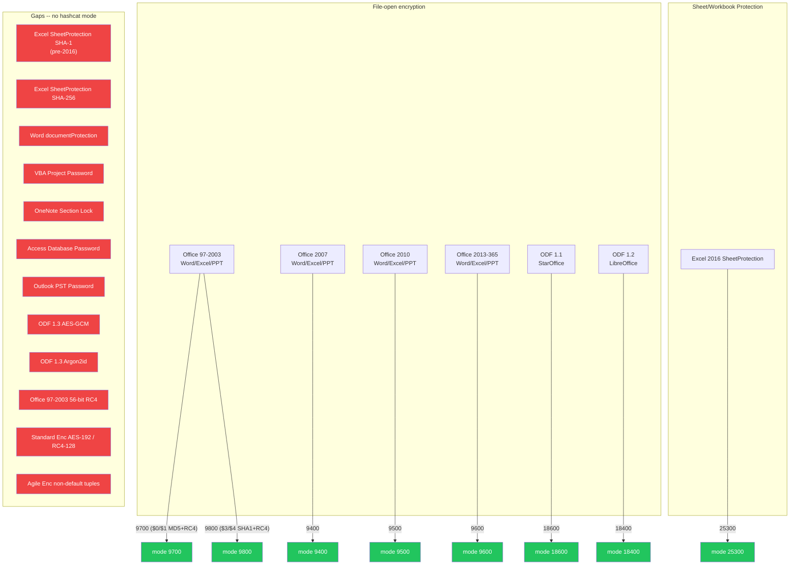

# Hashcat Office Mode Index

Source-verified inventory of every hashcat mode that targets Microsoft Office, ODF, or related document encryption, read directly from the module `.c` files. Covers 8 base modules and 4 collider sub-modes (12 total).

## Mode Summary Table

| Mode | HASH_NAME | Signature | KDF | Iterations | Key bits | pw_max | Covers |
|------|-----------|-----------|-----|------------|----------|--------|--------|
| 9400 | MS Office 2007 | `$office$` | SHA-1 PBKDF (50k fixed) | 50,000 (hardcoded) | 128 or 256 | MODULE_DEFAULT | Office 2007 Standard Encryption (file-open) |
| 9500 | MS Office 2010 | `$office$` | SHA-1 PBKDF (spinCount) | 100,000 (pinned) | 128 (pinned) | MODULE_DEFAULT | Office 2010 Agile Encryption (file-open) |
| 9600 | MS Office 2013 | `$office$` | SHA-512 PBKDF (spinCount) | 100,000 (pinned) | 256 (pinned) | MODULE_DEFAULT | Office 2013/2016/2019/365 Agile Encryption (file-open) |
| 9700 | MS Office <= 2003 $0/$1, MD5 + RC4 | `$oldoffice$0` / `$oldoffice$1` | MD5 (no iteration) | 0 | 40-bit RC4 | 15 | Office 97/2000 Binary RC4 (file-open) |
| 9710 | ...collider #1 | `$oldoffice$0` / `$oldoffice$1` | MD5 (no iteration) | 0 | 40-bit RC4 | 5 | 9700 RC4-key attack: brute-force 5-byte RC4 key directly |
| 9720 | ...collider #2 | `$oldoffice$0` / `$oldoffice$1` + `:rc4key` | MD5 (no iteration) | 0 | 40-bit RC4 | 15 | 9700 with known RC4-key appended; recover plaintext password |
| 9800 | MS Office <= 2003 $3/$4, SHA1 + RC4 | `$oldoffice$3` / `$oldoffice$4` | SHA-1 (no iteration) | 0 | 128-bit RC4 | 15 | Office XP/2003 CryptoAPI RC4 (file-open) |
| 9810 | ...collider #1 | `$oldoffice$3` | SHA-1 (no iteration) | 0 | 40-bit RC4 | 5 | 9800 RC4-key attack |
| 9820 | ...collider #2 | `$oldoffice$3` + `:rc4key` | SHA-1 (no iteration) | 0 | 128-bit RC4 | 15 | 9800 with known RC4-key; recover plaintext password |
| 18400 | Open Document Format (ODF) 1.2 (SHA-256, AES) | `$odf$` | PBKDF2-SHA-1 | variable (from hash) | 256 (AES-256-CBC) | MODULE_DEFAULT | ODF 1.2 with SHA-256 checksum + AES |
| 18600 | Open Document Format (ODF) 1.1 (SHA-1, Blowfish) | `$odf$` | PBKDF2-SHA-1 | variable (from hash) | 128 (Blowfish-CFB) | 51 | ODF 1.1 / StarOffice with SHA-1 checksum + Blowfish |
| 25300 | MS Office 2016 - SheetProtection | `$office$2016$0$` | SHA-512 (spinCount) | 100,000 (pinned) | n/a (hash-only) | MODULE_DEFAULT | Excel 2016 SheetProtection / WorkbookProtection |

Notes on `MODULE_DEFAULT`: for iterated modes (9400/9500/9600/25300/18400), pw_max defaults to 256 in hashcat's core. For non-iterated in-kernel modes (9700/9800), the module pins it to 15 because the Office 97-2003 spec limits passwords to 15 characters.

## Coverage Map

Which file types and protection gates are covered by existing hashcat modes, and which are gaps.

### Coverage Detail Table

| File type | Protection gate | Status | Hashcat mode(s) | Notes |
|-----------|----------------|--------|-----------------|-------|
| Word/Excel/PPT 97-2003 | File-open (Binary RC4, $0/$1 MD5) | COVERED | 9700, 9710, 9720 | 40-bit RC4 only; collider modes for key-level attack |
| Word/Excel/PPT 97-2003 | File-open (CryptoAPI RC4, $3/$4 SHA-1) | COVERED | 9800, 9810, 9820 | 128-bit RC4 only; collider modes for key-level attack |
| Word/Excel/PPT 2007 | File-open (Standard Encryption) | COVERED | 9400 | SHA-1 PBKDF, AES-128/256; fixed 50k rounds |
| Word/Excel/PPT 2010 | File-open (Agile Encryption) | COVERED | 9500 | SHA-1 PBKDF, AES-128; pinned to spinCount=100000, keyBits=128 |
| Word/Excel/PPT 2013+ | File-open (Agile Encryption) | COVERED | 9600 | SHA-512 PBKDF, AES-256; pinned to spinCount=100000, keyBits=256 |
| Excel 2016+ | SheetProtection (SHA-512) | COVERED | 25300 | Hash-only scheme, pinned spinCount=100000 |
| ODF 1.1 / StarOffice | File-open (SHA-1 + Blowfish-CFB) | COVERED | 18600 | PBKDF2-SHA-1, variable iterations |
| ODF 1.2 / LibreOffice | File-open (SHA-256 + AES-256-CBC) | COVERED | 18400 | PBKDF2-SHA-1, variable iterations |
| Excel pre-2016 | SheetProtection (SHA-1, spinCount) | GAP | — | Different hash algorithm than 25300 |
| Excel 2013+ | SheetProtection (SHA-256, spinCount) | GAP | — | Different hash algorithm than 25300 |
| Word 2007+ | documentProtection | GAP | — | Same algorithmic family as SheetProtection but different XML structure; no module |
| Word/Excel/PPT 97-2003 | File-open (56-bit RC4 variant) | GAP | — | Some Office 2000 installs used 56-bit keys; parser rejects (neither $0/$1 nor $3/$4) |
| Word/Excel/PPT 2007 | File-open (AES-192 or RC4-128 Standard Enc) | GAP | — | 9400 parser accepts keySize 128 or 256 but not 192; non-AES ciphers not handled |
| Word/Excel/PPT 2010+ | File-open (non-default Agile tuples) | GAP | — | 9500 rejects spinCount != 100000 or keySize != 128; 9600 rejects spinCount != 100000 or keySize != 256 |
| VBA Project | DPB password hash | GAP | — | XOR obfuscation / SHA-1 hash stored in project stream; trivially reversible but no hashcat mode |
| OneNote | Section encryption | GAP | — | AES-128-CBC with PBKDF2; entirely different container format |
| Access | Database password | GAP | — | XOR-based obfuscation (pre-2007) or RC4 (2007+); no hashcat mode |
| Outlook | PST password | GAP | — | CRC32-based; trivially bypassable, no hashcat mode |
| ODF 1.3+ | File-open (AES-256-GCM) | GAP | — | New authenticated encryption mode; 18400 only handles CBC |
| ODF 1.3+ | File-open (Argon2id KDF) | GAP | — | New KDF replacing PBKDF2; no hashcat support |

## Gap Summary: Rejected Parameter Combinations

Hashes that are structurally valid but get `PARSER_SALT_VALUE` from existing modules.

| Module | Field | Accepted | Rejected (valid in spec) | Impact |
|--------|-------|----------|--------------------------|--------|
| 9400 | version | 2007 | anything else | Only Office 2007 Standard Encryption |
| 9400 | verifierHashSize | 20 | 32 (SHA-256 would use 32) | Locks to SHA-1 verifier path |
| 9400 | keySize | 128, 256 | 192 | AES-192 Standard Encryption not crackable |
| 9400 | saltSize | 16 | other | No deviation observed in practice |
| 9400 | iterations | 50,000 (hardcoded) | any other value | Cannot handle custom iteration counts (spec allows variable) |
| 9500 | version | 2010 | 2007, 2013, etc. | Only Office 2010 |
| 9500 | spinCount | 100,000 | any other value | Non-default iteration counts rejected |
| 9500 | keySize | 128 | 256, 192, etc. | Only AES-128 Agile; AES-256 Agile 2010 docs rejected |
| 9500 | saltSize | 16 | other | Fixed |
| 9600 | version | 2013 | 2010, 2016, etc. | Only Office 2013+ labeled hashes |
| 9600 | spinCount | 100,000 | any other value | Non-default iteration counts rejected |
| 9600 | keySize | 256 | 128, 192, etc. | Only AES-256 Agile |
| 9600 | saltSize | 16 | other | Fixed |
| 25300 | spinCount | 100,000 | any other value | Custom spinCount protection hashes rejected |
| 25300 | signature prefix | `$office$2016$0$` | other prefixes | Only algorithm 0 (SHA-512); SHA-1/SHA-256 protection not handled |
| 9700 | version tag | `$oldoffice$0`, `$oldoffice$1` | `$oldoffice$2` | Version 2 (56-bit) not accepted |
| 9800 | version tag | `$oldoffice$3`, `$oldoffice$4` | others | Only CryptoAPI RC4 variants 3 and 4 |
| 18400 | cipher/checksum | SHA-256 + AES-CBC | AES-GCM, other combinations | Only ODF 1.2 default algorithm suite |
| 18600 | cipher/checksum | SHA-1 + Blowfish-CFB | other combinations | Only ODF 1.1 default algorithm suite |

## Parser Constraint Summary (Hard-coded Value Pins)

These values are checked in `module_hash_decode()` and cause `PARSER_SALT_VALUE` on mismatch:

- **9400**: `version == 2007`, `verifierHashSize == 20`, `saltSize == 16`, `keySize in {128, 256}`, iterations hardcoded to 50,000 (not parsed from hash)
- **9500**: `version == 2010`, `spinCount == 100000`, `keySize == 128`, `saltSize == 16`
- **9600**: `version == 2013`, `spinCount == 100000`, `keySize == 256`, `saltSize == 16`
- **9700**: signature must be `$oldoffice$0` or `$oldoffice$1` (version 0 or 1)
- **9800**: signature must be `$oldoffice$3` or `$oldoffice$4` (version 3 or 4)
- **25300**: signature must be `$office$2016$0$`, `spinCount == 100000`
- **18400/18600**: signature `$odf$`, iteration count parsed from hash (variable)

## Per-mode Documentation

Per-mode docs are in this directory. For the unified redesign, see `../proposed/`:

| Mode | Analysis card |
|------|--------------|
| 9400 | [09400_office2007_standard.md](09400_office2007.md) |
| 9500 | [09500_office2010_agile.md](09500_office2010.md) |
| 9600 | [09600_office2013_agile.md](09600_office2013.md) |
| 9700 | [09700_oldoffice_rc4_md5.md](09700_rc4_md5.md) |
| 9800 | [09800_oldoffice_rc4_cryptoapi_sha1.md](09800_rc4_sha1.md) |
| 18400 | [18400_odf12_aes.md](18400_odf12.md) |
| 18600 | [18600_odf11_blowfish.md](18600_odf11.md) |
| 25300 | [25300_office_protection_sha512.md](25300_protection.md) |

### Proposed new modules (gap-filling)

| Proposal | Analysis card |
|----------|--------------|
| Agile Encryption generalized (variable spinCount/keySize/hashAlgo) | [office_open.md](../proposed/office_open.md) (mode 37000) |
| SheetProtection SHA-1 | [office_protect.md](../proposed/office_protect.md) (mode 37100) |
| SheetProtection SHA-256 | [office_protect.md](../proposed/office_protect.md) (mode 37100) |
| Protection hash generalized | [office_protect.md](../proposed/office_protect.md) (mode 37100) |
| ODF 1.3 AES-GCM | [odf_open.md](../proposed/odf_open.md) (mode 37200) |
| ODF 1.3 Argon2id | [odf_open.md](../proposed/odf_open.md) (mode 37201) |
| OneNote section encryption | [office_open.md](../proposed/office_open.md) (mode 37000) |
| Access database password | [office_open.md](../proposed/office_open.md) (mode 37000) |
| Old Office 56-bit RC4 | [office_open.md](../proposed/office_open.md) (mode 37000) |
| Standard Encryption AES-192 / RC4-128 | [office_open.md](../proposed/office_open.md) (mode 37000) |

### Tooling and non-hashcat entries

| Topic | Analysis card |
|-------|--------------|
| VBA DPB decode | [../../recovery/bypass.md](../../recovery/bypass.md) |
| XOR obfuscation (legacy) | [../../recovery/decode.md](../../recovery/decode.md) |
| Legacy binary protection passwords | [../../recovery/collide.md](../../recovery/collide.md) |
| PST password (CRC32) | [../../recovery/collide.md](../../recovery/collide.md) |
| VBA project password (XOR) | [../proposed/vba_project.md](../proposed/vba_project.md) |
| Digital signatures (n/a) | [../proposed/not_crackable.md](../proposed/not_crackable.md) |
| IRM / extensible encryption (n/a) | [../proposed/not_crackable.md](../proposed/not_crackable.md) |
