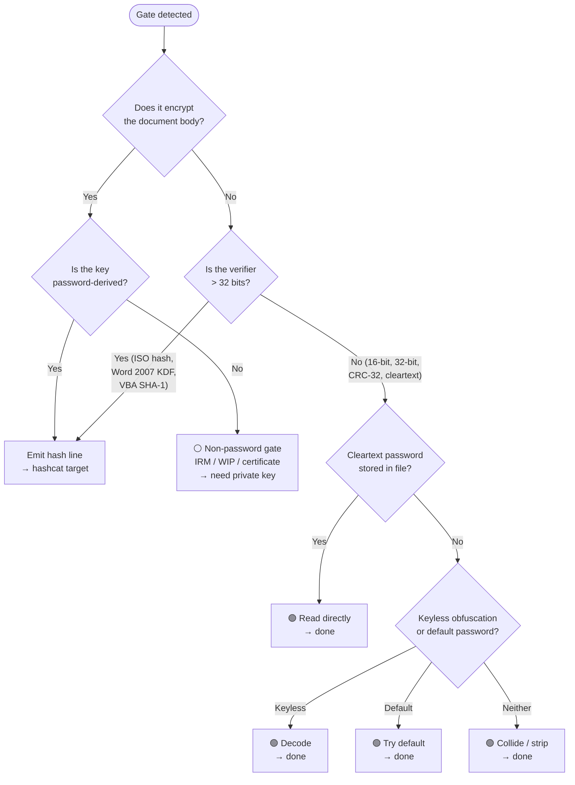

# Not a hashcat target

Everything in the Office protection landscape that does NOT produce a crackable hash line. These gates are trivially bypassed without GPU effort — decode, collide, strip, read in the clear, or try a known default. The 6-mode architecture (37000/37001/37002/37100/37200/37201) handles everything that IS crackable; this document covers everything that ISN'T. A unified toolkit handles these as pre-crack filters: if the gate is in this list, resolve it directly and never submit it to a cracking backend.

## Decision tree

---

## Instant-recovery gates

### XOR obfuscation (Excel Method 1 / Word Method 2)

| Property | Detail |
|---|---|
| Affected formats | `.xls` (Excel 97-2003, `FilePass` 0x002F with `wEncryptionType`=0x0000), `.doc` (Word 97-2003, `FibBase.fEncrypted=1, fObfuscated=1`) |
| What it is | A 16-byte XOR array derived from a password truncated to 15 ANSI characters. Excel uses Method 1 (byte-at-a-time cycling, [MS-OFFCRYPTO] section 2.3.7.1-2.3.7.3); Word uses Method 2 (32-bit block XOR, [MS-OFFCRYPTO] section 2.3.7.4-2.3.7.6). The array XORs the record/stream data — record headers and specific records (BOF, FilePass, etc.) are exempt. |
| Verifier | Excel: 16-bit (`key` u16 + `verificationBytes` u16 in `XORObfuscation` structure). Word: 32-bit (`FibBase.lKey`). |
| Why not crackable | The spec says it plainly: "XOR obfuscation is not recommended. Document data can easily be extracted. The document password could be retrievable" ([MS-OFFCRYPTO] section 4.1.3.4). No salt, no iteration. The 16-byte XOR array can be recovered from known plaintext (e.g. the BOF signature in a BIFF8 stream, or the `\0x05SummaryInformation` property set header). The 16/32-bit verifier is collided in microseconds. |
| What to do instead | Recover the XOR array from known plaintext and decode the stream directly. Alternatively, collide the 16/32-bit verifier — 2^16 or 2^32 candidates is trivial on any CPU. |
| Spec | [MS-OFFCRYPTO] section 2.3.7; [MS-XLS] section 2.4.117, 2.2.10; [MS-DOC] section 2.2.6.1, 2.5.2 |

### 16-bit verifiers (legacy sheet/workbook/write-reservation)

| Property | Detail |
|---|---|
| Affected formats | `.xls` (BIFF8) — every non-encryption protection record |
| Records | `Password` 0x0013 (`wPassword` u16 — sheet and workbook protection), `FileSharing` 0x005B (`wResPass` u16 — write reservation), `Prot4RevPass` 0x01BC (`protPwdRev` u16 — revision protection), `FeatProtection` in `Feat` 0x0868 (`wPassword` u32, but only the low 16 bits are meaningful — zero-extended) |
| What it is | All use `CreatePasswordVerifier_Method1` ([MS-OFFCRYPTO] section 2.3.7.1): password truncated to 15 ANSI chars, hashed to a 16-bit value. The spec: "This password verifier is used to prevent accidental editing, and is not designed to be used as a security feature" ([MS-XLS] section 2.2.9). |
| Why not crackable | 2^16 = 65,536 possible values. A brute-force collision on any CPU takes microseconds. Multiple passwords map to the same verifier. No content encryption — the underlying data is plaintext. |
| What to do instead | Option 1: collide the verifier in < 1 ms. Option 2: zero out the `wPassword`/`wResPass`/`protPwdRev` field with a hex editor (or delete the record entirely). Option 3: for OOXML equivalents that still carry the legacy `password` attribute (a 4-hex-digit `ST_UnsignedShortHex`), delete the attribute from the XML. |
| Spec | [MS-XLS] section 2.4.191, 2.4.118, 2.4.206, 2.5.124; [MS-OFFCRYPTO] section 2.3.7.1 |

### PST CRC-32 (advisory open password)

| Property | Detail |
|---|---|
| Affected formats | `.pst` / `.ost` (Outlook Personal Folders / Offline Storage) |
| Location | `PidTagPstPassword` (`0x67FF0003`) in the `NID_MESSAGE_STORE` Property Context |
| What it is | A CRC-32 hash (standard IEEE 802.3, polynomial `0xEDB88320`) of the password string, stored as a `PtypInteger32`. Zero-seeded via `ComputeCRC` ([MS-PST] section 5.3). The password is UI-only enforcement — it is checked by the Outlook UI and never fed into any encoding or decryption operation. |
| Why not crackable | The spec is unambiguous: "the password itself is not used to secure the PST data in any way" and "the password is stored as a CRC-32 hash of the original password string, which is prone to collisions and is relatively weak against a brute-force approach" ([MS-PST] section 4.2). CRC-32 is linear, invertible, and maps to 2^32 values — trivial to collide. The body cipher (`bCryptMethod` 0x01 permutative / 0x02 cyclic) operates entirely independently and is keyless. |
| What to do instead | Option 1: set `PidTagPstPassword` to `0x00000000` (or delete the property). Option 2: collide the CRC-32 in microseconds. Neither operation has any effect on the body cipher — data blocks are decoded with the public BID key regardless. |
| Spec | [MS-PST] section 2.4.3.3, 4.2, 5.3 |

### Cleartext passwords

| Property | Detail |
|---|---|
| Word .doc write-reservation | Stored verbatim in `SttbfAssoc` index 0x11 (Table stream), UTF-16LE, max 15 chars. `FibBase.fWriteReservation=1` signals its presence. The spec: "Binary documents that conform to [MS-DOC] MUST store the write protection password in the file in plaintext" ([MS-OFFCRYPTO] section 2.4.2.1). Read it directly — no derivation, no hash, no cracking. |
| PowerPoint .ppt modify password | `ModifyPasswordAtom` (RT 0x0FBA, `recInstance`=0x003) in `PP10DocBinaryTagExtension`. The `modifyPassword` field is a `PrintableUnicodeString`: cleartext UTF-16LE, max 255 chars. No key derivation, no hashing, no obfuscation ([MS-PPT] section 2.4.7). |
| What to do instead | Read the bytes from the documented offset. Done. |

### Default passwords

| Password | Application | Trigger | Spec |
|---|---|---|---|
| `VelvetSweatshop` | Excel (2007, 2010, 2013) | `Password` 0x0013 in Globals or `Prot4RevPass` 0x01BC carries a non-zero verifier, but no user-supplied open password was set. Entire workbook auto-encrypted under this fixed string. | [MS-OFFCRYPTO] section 2.4.2.3, Appendix A notes 24-25; [MS-XLS] section 2.4.191 note 100 |
| `/01Hannes Ruescher/01` | PowerPoint (2003, 2007, 2007 SP1) | `ModifyPasswordAtom` present (write-protection method 3) with no separate open password. File encrypted under this fixed string. PowerPoint 2007 SP2 stopped this behavior. | [MS-OFFCRYPTO] section 2.4.2.3, section 5 note 26 |

**Always attempt decryption with the applicable default password before submitting a hash to the cracking backend.** If decryption succeeds, the file had no real user-chosen open password — only strippable protection gates underneath.

### Jet .mdb obfuscation

| Property | Detail |
|---|---|
| Affected formats | `.mdb` (Access 97 = Jet 3, Access 2000-2003 = Jet 4) |
| What it is | The database password is XOR-masked into the page 0 header (approximately offset 0x42). Jet 3 uses a hardcoded fixed-key XOR constant. Jet 4 uses a key derived from the 8-byte IEEE 754 creation-date double at header offset 0x72. In both cases the database body pages are NOT encrypted — the password is an access-control gate only. |
| Why not crackable | The XOR key is either a published constant (Jet 3) or derivable from a public header field (Jet 4). The password bytes are recovered by reading the header and undoing the XOR mask. No hash, no iteration, no salt. |
| What to do instead | Read the header, apply the XOR unmask, recover the cleartext password. Tools: mdbtools, Jackcess, or a few lines of Python. |
| Spec | OUT-OF-CORPUS — no `[MS-*]` specification exists for Jet/ACE database format. Sourced from community reverse-engineering (mdbtools, Jackcess). |

---

## Non-password gates

These gates involve real cryptography, but the key is not derived from a user password. No amount of GPU cracking helps.

### IRM / RMS (Information Rights Management)

| Property | Detail |
|---|---|
| Affected formats | Any Office document (`.doc`, `.docx`, `.xls`, `.xlsx`, `.ppt`, `.pptx`) |
| What it is | Content encrypted with AES-128-ECB (16-byte block, IV all zeros) under a symmetric content key. The content key is RSA-encrypted per-user via Rights Account Certificates (RAC) from a Rights Management Services (RMS) server. The IRMDS data space is rooted at `\0x06DataSpaces` with `0x09DRMTransform` / `DRMEncryptedTransform` (TransformID `{C73DFACD-061F-43B0-8B64-0C620D2A8B50}`); protected content in `\0x09DRMContent`. Agile encryption may alternatively carry a `CertificateKeyEncryptor` alongside the `PasswordKeyEncryptor`. |
| Why not crackable | No password involved. The decryption key is bound to an X.509 certificate or RMS authorization. Access requires either the user's private key or authorization from the RMS server. |
| What to do instead | Obtain the private key from the authorized user's certificate store, or obtain RMS authorization via Active Directory. There is no password to crack. |
| Spec | [MS-OFFCRYPTO] section 2.2.1-2.2.10; [MS-RMPR] |

### Digital signatures

| Property | Detail |
|---|---|
| Affected formats | Any Office document (binary: `_signatures` stream; OOXML: `_xmlsignatures/sigN.xml`) |
| What it is | PKI-based integrity verification. CryptoAPI format uses MD5 hash + RSA signing. Xmldsig format uses XML-Signature Syntax ([XMLDSig]) with optional XAdES extensions. The signature covers the document content but does not encrypt it. |
| Why not crackable | Signatures verify integrity, not confidentiality. There is no password. You cannot forge a valid signature without the signer's private key. |
| What to do instead | To remove: delete the `_signatures` stream or `_xmlsignatures/` part. The document content is unaffected. To verify: validate the certificate chain. |
| Spec | [MS-OFFCRYPTO] section 2.5.1-2.5.3 |

### ODF 1.4 PGP (public-key encryption)

| Property | Detail |
|---|---|
| Affected formats | `.odt` / `.ods` / `.odp` (ODF 1.4+ with PGP encryption) |
| What it is | ODF 1.4 introduces a PGP public-key encryption option where the document symmetric key is encrypted with the recipient's PGP public key. No password is involved — the decryption key is the recipient's PGP private key. |
| Why not crackable | Public-key encryption. No password-derived verifier exists. Requires the PGP private key. |
| What to do instead | Obtain the PGP private key from the recipient's keyring. There is no password to crack. |
| Spec | OASIS ODF 1.4 (not in MS corpus). |

### ODF body protection (sheet/section protection)

| Property | Detail |
|---|---|
| Affected formats | `.ods` (`table:protection-key` on `<table:table>`), `.odt` (`text:protection-key` on `<text:section>`) |
| What it is | A digest verifier stored as a Base64 attribute. The `protection-key-digest-algorithm` attribute names the hash (typically SHA-1 or SHA-256). The digest is likely a simple one-pass hash of the password (not iterated). The content is **plaintext** — this is an application-enforced flag, not encryption. |
| Why not crackable (practically) | Content is plaintext. Stripping the `protection-key` attribute (or setting `protected="false"`) lifts the restriction instantly. The digest algorithm is defined by OASIS ODF, not by any [MS-*] spec — MS Office does not implement these features ([MS-OODF14] §2.1.1348). Even if technically crackable as a fast hash, STRIP is always faster. |
| What to do instead | Delete `table:protection-key` / `text:protection-key` from the XML and re-zip. |
| Spec | OASIS ODF Part 3 (not in MS corpus); [MS-OODF14] confirms "not supported" |

### PST body cipher (keyless obfuscation)

| Property | Detail |
|---|---|
| Affected formats | `.pst` / `.ost` |
| `bCryptMethod` values | `0x01` (`NDB_CRYPT_PERMUTE`): fixed 256-byte substitution table `mpbbCrypt`, no key. `0x02` (`NDB_CRYPT_CYCLIC`): BID-keyed substitution using `mpbbR`/`mpbbS`/`mpbbI` tables; `dwKey` = lower DWORD of the block's BID, which is public metadata in the unencoded BBT. |
| What it is | The spec: "These algorithms only provide data obfuscation and can be conveniently decoded once the exact encoding algorithm is understood" ([MS-PST] section 4.1). No password is involved. The permutative cipher is a single constant lookup table published in the spec. The cyclic cipher's key is the block BID, stored in unencoded infrastructure metadata. |
| Why not crackable | No password. The entire algorithm and all key material are published constants or public metadata. |
| What to do instead | Decode directly using the published algorithm. For permutative: `data[i] = mpbbI[data[i]]`. For cyclic: `CryptCyclic(data, cb, (DWORD)(bid & 0xFFFFFFFF))`. |
| Spec | [MS-PST] section 4.1, 5.1, 5.2 |

---

## Summary matrix

| Gate | Category | Verifier size | Content encrypted? | Recovery method | Time |
|---|---|---|---|---|---|
| XOR obfuscation (Excel Method 1) | Instant decode | 16-bit | Yes (XOR) | Known-plaintext XOR array recovery | Microseconds |
| XOR obfuscation (Word Method 2) | Instant decode | 32-bit | Yes (XOR) | Known-plaintext XOR array recovery | Microseconds |
| Sheet/workbook/write `Password` (.xls) | Instant collide | 16-bit | No | Brute-force or zero the field | Microseconds |
| `FileSharing.wResPass` (.xls) | Instant collide | 16-bit | No | Brute-force or zero the field | Microseconds |
| `Prot4RevPass` (.xls) | Instant collide | 16-bit | No | Brute-force or zero the field | Microseconds |
| `FeatProtection.wPassword` (.xls) | Instant collide | 16-bit (zero-extended to 32) | No | Brute-force or zero the field | Microseconds |
| PST `PidTagPstPassword` | Instant collide | CRC-32 (32-bit) | No | Collide or zero the property | Microseconds |
| Word .doc `SttbfAssoc[0x11]` | Read cleartext | N/A (plaintext) | No | Read from file | Instant |
| PowerPoint .ppt `ModifyPasswordAtom` | Read cleartext | N/A (plaintext) | No | Read from file | Instant |
| `VelvetSweatshop` (Excel) | Try default | N/A | Yes (ECMA-376) | Attempt decryption with fixed string | Instant |
| `/01Hannes Ruescher/01` (PowerPoint) | Try default | N/A | Yes (RC4 CryptoAPI) | Attempt decryption with fixed string | Instant |
| Jet 3 .mdb password | Instant decode | N/A (XOR mask) | No | Fixed-key XOR unmask | Instant |
| Jet 4 .mdb password | Instant decode | N/A (XOR mask) | No | Date-derived XOR unmask | Instant |
| IRM / RMS | Non-password | N/A (certificate) | Yes (AES-128) | Need private key / RMS authorization | N/A |
| Digital signatures | Non-password | N/A (PKI) | No | Strip to remove | Instant |
| PST body cipher (permute/cyclic) | Non-password | N/A (keyless) | Yes (obfuscation) | Decode with published algorithm | Instant |
| ODF 1.4 PGP encryption | Non-password | N/A (PGP key) | Yes | Need PGP private key | N/A |
| ODF sheet protection (`table:protection-key`) | Strip | Digest (SHA-1/256) | No | Strip attribute from XML | Instant |
| ODF section protection (`text:protection-key`) | Strip | Digest (SHA-1/256) | No | Strip attribute from XML | Instant |

---

## Toolkit integration

The extraction pipeline MUST check for these gates before emitting hash lines:

1. **Default-password check** — attempt `VelvetSweatshop` / `/01Hannes Ruescher/01` on any encrypted Excel/PowerPoint file. If decryption succeeds, the underlying protection gates are strippable — no hash line needed.
2. **Cleartext-password extraction** — if Word .doc `fWriteReservation=1` or PowerPoint .ppt `ModifyPasswordAtom` present, read the password and report it directly.
3. **Tiny-verifier identification** — any 16-bit `wPassword`/`wResPass`/`protPwdRev` or CRC-32 `PidTagPstPassword` is flagged as instant-collide, never submitted to a cracking backend.
4. **XOR-obfuscation decode** — if `FilePass.wEncryptionType=0x0000` (Excel) or `FibBase.fObfuscated=1` (Word), decode via known-plaintext recovery rather than cracking.
5. **Jet .mdb unmask** — if Jet 3/4 database password detected, apply the XOR unmask and report the cleartext password.
6. **Non-password gate flagging** — IRM, digital signatures, and PST body ciphers are reported as informational. No hash line emitted.

Everything that survives these filters is a genuine cracking target and gets a `$office$`, `$protect$`, or `$vba$` hash line per the [hash-formats](../../design/cli-output.md) specification.
