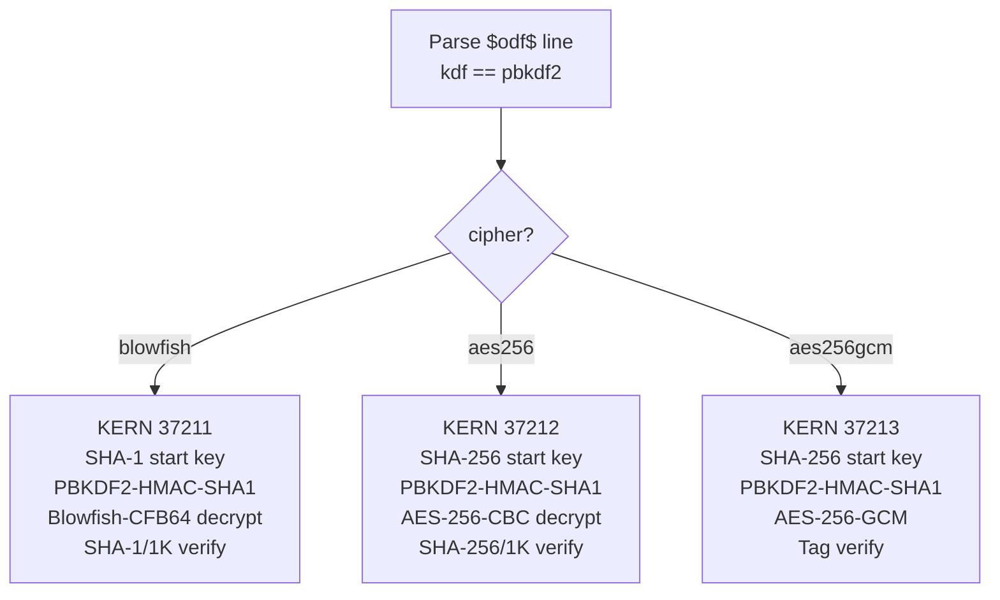
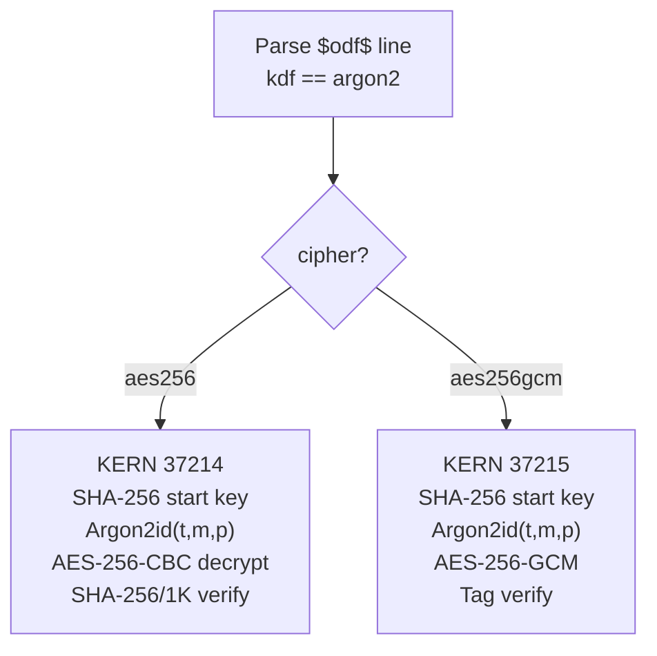

# Modes 37200/37201 — `$odf$` OpenDocument Encryption

Two mode numbers (split because Argon2id has a fundamentally different loop kernel from PBKDF2), one hash-line grammar, 5 internal kernels.

**Why two modes, not one?** PBKDF2 and Argon2id have incompatible loop structures. PBKDF2 is a tight HMAC-SHA1 chain (tiny state, no memory). Argon2id is memory-hard (64 MiB+ working memory, multi-lane fill). They cannot share a loop kernel. KeePass makes the same split: mode 13400 for AES-KDF, mode 34300 for Argon2.

## Hash line grammar (shared by both modes)

```
$odf$*<startkey>*<kdf>*<cipher>*<iters>*<mem>*<lanes>*<salt>*<iv>*<checksum>*<ciphertext>
```

## Field table

| # | Field | Type | Values | Source |
|---|---|---|---|---|
| 1 | `startkey` | string | `sha1` / `sha256` | `manifest:start-key-generation-name` |
| 2 | `kdf` | string | `pbkdf2` / `argon2` | `manifest:key-derivation-name` |
| 3 | `cipher` | string | `blowfish` / `aes256` / `aes256gcm` | `manifest:algorithm-name` |
| 4 | `iters` | decimal | PBKDF2 count or Argon2 time cost | `manifest:iteration-count` or `loext:argon2-iterations` |
| 5 | `mem` | decimal | `0` for PBKDF2; KiB for Argon2 (65536 = 64 MiB) | `loext:argon2-memory` |
| 6 | `lanes` | decimal | `0` for PBKDF2; parallelism for Argon2 | `loext:argon2-lanes` |
| 7 | `salt` | hex | 16 B | `manifest:salt` |
| 8 | `iv` | hex | 8 B (Blowfish) / 16 B (AES-CBC) / 12 B (GCM) | `manifest:initialisation-vector` |
| 9 | `checksum` | hex | 20 B (SHA-1/1K) / 32 B (SHA-256/1K) / 16 B (GCM tag) | `manifest:checksum` or GCM tag |
| 10 | `ciphertext` | hex | first ≤1024 B of encrypted member | raw ZIP entry bytes |

**Mode routing:** `kdf == pbkdf2` → mode 37200; `kdf == argon2` → mode 37201. The `kdf` field is the discriminator.

## `module_kern_type_dynamic` dispatch

### Mode 37200 (PBKDF2)



### Mode 37201 (Argon2id)



## Modes replaced + new coverage

| Old mode | Profile | New kernel |
|---|---|---|
| 18600 | ODF 1.1 Blowfish-CFB | 37211 |
| 18400 | ODF 1.2 AES-256-CBC | 37212 |
| — (gap) | AES-256-GCM + PBKDF2 | 37213 |
| — (gap) | Argon2id + AES-256-CBC | 37214 |
| — (gap) | Argon2id + AES-256-GCM | 37215 |

## KDF pipeline

```
start_key   = Hash(UTF8(password))         # SHA-1 (20B) or SHA-256 (32B)
derived_key = KDF(start_key, salt, params)  # PBKDF2 or Argon2id
plaintext   = Cipher_decrypt(derived_key, iv, ciphertext)
verify      = checksum_check(plaintext, stored_checksum)
```

- **PBKDF2 PRF is always HMAC-SHA1** regardless of start-key hash
- **Password encoding is UTF-8** (not UTF-16LE)
- **Verification:** for blowfish/aes256 → hash first ≤1024 plaintext bytes; for aes256gcm → GCM tag

## Examples

```
# ODF 1.1 Blowfish (replaces 18600)
$odf$*sha1*pbkdf2*blowfish*1024*0*0*<salt>*<iv8>*<sha1checksum>*<ciphertext>

# ODF 1.2 AES-256-CBC (replaces 18400)
$odf$*sha256*pbkdf2*aes256*100000*0*0*<salt>*<iv16>*<sha256checksum>*<ciphertext>

# ODF 1.3 Argon2id + AES-256-GCM (NEW)
$odf$*sha256*argon2*aes256gcm*3*65536*4*<salt>*<nonce12>*<gcmtag>*<ciphertext>
```
