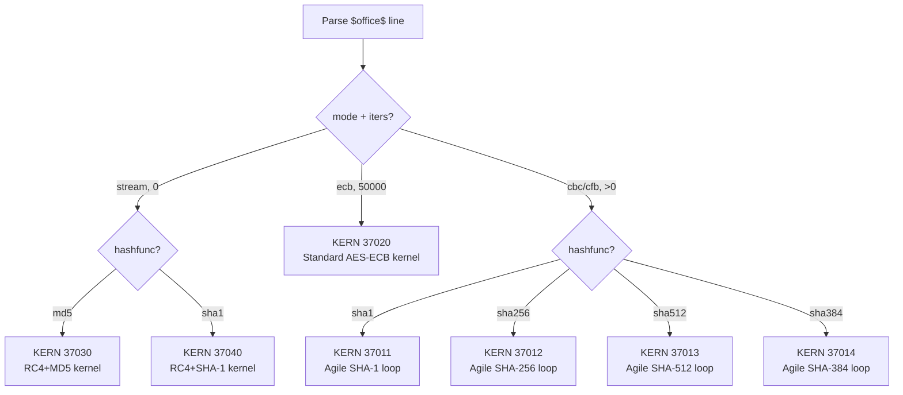
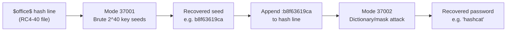

# Mode 37000 — `$office$` Document-Open Encryption

One mode number, one hash-line grammar, **7 internal kernels** — covers every MS Office document-open password across 36 confirmed encryption paths.

## Hash line grammar

```
$office$*<hashfunc>*<cipher>*<mode>*<iters>*<salt>*<encverifier>*<encverifierhash>
```

## Field table

| # | Field | Type | Values | Source |
|---|---|---|---|---|
| 1 | `hashfunc` | string | `md5` `sha1` `sha256` `sha384` `sha512` `ripemd128` `ripemd160` `whirlpool` | `AlgIDHash` or agile `hashAlgorithm` |
| 2 | `cipher` | string | `aes128` `aes192` `aes256` `rc4-40` `rc4-48` `rc4-56` `rc4-64` `rc4-72` `rc4-80` `rc4-88` `rc4-96` `rc4-104` `rc4-112` `rc4-120` `rc4-128` `rc2` `des` `3des` | `AlgID` or agile `cipherAlgorithm`+`keyBits` |
| 3 | `mode` | string | `ecb` `cbc` `cfb` `stream` | Fixed per scheme or agile `cipherChaining` |
| 4 | `iters` | decimal | `0`–`10000000` | `spinCount` or `0` for RC4 |
| 5 | `salt` | hex | variable (typically 16 B) | `EncryptionVerifier.Salt` or agile `saltValue` |
| 6 | `encverifier` | hex | 16 B | `EncryptedVerifier` or `encryptedVerifierHashInput` |
| 7 | `encverifierhash` | hex | 16–64 B | `EncryptedVerifierHash` or `encryptedVerifierHashValue` |

## `module_kern_type_dynamic` dispatch

The parser reads `hashfunc`, `cipher`, and `mode` from the line, sets `esalt->scheme`, and `module_kern_type_dynamic()` returns the kernel ID:



| `scheme` | `hashfunc` | `cipher` | `mode` | `iters` | Kernel | Replaces |
|---|---|---|---|---|---|---|
| RC4+MD5 | `md5` | `rc4-40` | `stream` | `0` | 37030 | 9700 |
| RC4+SHA-1 | `sha1` | `rc4-*` | `stream` | `0` | 37040 | 9800 |
| Standard | `sha1` | `aes*` | `ecb` | `50000` | 37020 | 9400 |
| Agile SHA-1 | `sha1` | any | `cbc`/`cfb` | any | 37011 | 9500 |
| Agile SHA-256 | `sha256` | any | `cbc`/`cfb` | any | 37012 | — (gap) |
| Agile SHA-512 | `sha512` | any | `cbc`/`cfb` | any | 37013 | 9600 |
| Agile SHA-384 | `sha384` | any | `cbc`/`cfb` | any | 37014 | — (gap) |

## What each kernel does

**37030 (RC4+MD5):** `H0=MD5(pw)`, truncate 5B, 336-byte buffer, `H1=MD5(buf)`, truncate 5B, `Hfinal=MD5(t1||block)`, RC4 decrypt 32B, `MD5(verifier)==storedHash`. No iteration.

**37040 (RC4+SHA-1):** `H0=SHA1(salt||pw)`, `Hfinal=SHA1(H0||block)`, truncate to KeySize/8, zero-pad if 40-bit, RC4 decrypt 36B, `SHA1(verifier)==storedHash`. No iteration. Accepts 40/56/64/72/80/88/96/104/112/120/128-bit keys from the `cipher` field.

**37020 (Standard):** `H0=SHA1(salt||pw)`, 50000× `Hn=SHA1(LE32(i)||Hn-1)` (iterator prepended), `Hfinal=SHA1(Hn||block0)`, ipad/opad expansion, AES-ECB decrypt, `SHA1(verifier)==storedHash`. Handles AES-128/192/256 from the `cipher` field — the key truncation (`X1[0:16]` vs `X1||X2[0:4]` vs `X1||X2[0:12]`) branches in the comp kernel.

**37011/37012/37013/37014 (Agile):** `H0=H(salt||pw)`, spinCount× `Hn=H(LE32(i)||Hn-1)` (iterator prepended), `Hfinal=H(Hn||blockKey)`, truncate/pad-0x36 to keyBits, AES-CBC decrypt verifier, `H(verifier)==storedHash`. The loop kernel is compiled per hash primitive (SHA-1/256/384/512). The comp kernel branches on cipher (AES key size) and chaining mode (CBC/CFB) via `deep_comp_kernel` or inline branching — these are cheap post-loop operations.

## Mode 37001 — Key-Seed Brute Force

Brute-force the raw RC4 key seed directly, bypassing the password entirely. The RC4 legacy schemes truncate the derived key to a small number of bytes — 5 bytes (40-bit) for MD5+RC4, and 5–16 bytes depending on `KeySize` for CryptoAPI+SHA-1. By searching the key-seed space directly, you are guaranteed to find a decrypting key regardless of password length or complexity.

- **Replaces:** 9710 (MD5+RC4 collider #1), 9810 (SHA-1+RC4 collider #1)
- **`pw_min = pw_max = seed_bytes`** — each "candidate" is a raw key seed, not a password
- **Input:** same `$office$` hash line as mode 37000
- **`kern_type_dynamic`** selects the kernel by `hashfunc`:
  - `md5` → kernel 37031: compute `Hfinal = MD5(candidate5 || block0)`, RC4 decrypt verifier, MD5 compare
  - `sha1` → kernel 37041: compute `Hfinal = SHA1(candidate5 || block0)`, RC4 decrypt verifier, SHA1 compare

| `cipher` field | Seed size | Search space | Feasibility |
|---|---|---|---|
| `rc4-40` | 5 bytes | 2^40 ≈ 1.1 trillion | Hours on one GPU — guaranteed |
| `rc4-56` | 7 bytes | 2^56 | Expensive but tractable with a cluster |
| `rc4-128` | 16 bytes | 2^128 | Infeasible — use mode 37000 (password attack) instead |

The kernel does NOT run the password→H0→H1 KDF chain. It takes the raw seed bytes and computes only `Hfinal = H(seed || block_LE32)` → RC4 → verify. This is why it's orders of magnitude faster per candidate than mode 37000.

Usage: `hashcat -m 37001 -a 3 hash.txt ?b?b?b?b?b` (40-bit brute) or `?b?b?b?b?b?b?b` (56-bit brute).

## Mode 37002 — Password-from-Seed Recovery

Given a known key seed (recovered by mode 37001), find the literal password that maps to it. This is a pure hash filter — no RC4, no verifier decrypt.

- **Replaces:** 9720 (MD5+RC4 collider #2), 9820 (SHA-1+RC4 collider #2)
- **`pw_max = 15`** (legacy RC4 password ceiling)
- **Input:** `$office$` hash line with `:XXXXXXXXXX` seed suffix (5-byte seed as 10 hex chars)
- **`kern_type_dynamic`** selects by `hashfunc`:
  - `md5` → kernel 37032: compute `H0 = MD5(UTF16LE(pw))`, truncate 5B → 336-byte buffer → `H1 = MD5(buf)`, compare `H1[0:5]` against target seed. No RC4.
  - `sha1` → kernel 37042: compute `H0 = SHA1(salt || UTF16LE(pw))`, `Hfinal = SHA1(H0 || block0)`, compare `Hfinal[0:seed_bytes]` against target seed. No RC4.

Usage: `hashcat -m 37002 -a 0 hash_with_seed.txt wordlist.txt`

**Workflow:** run 37001 first to get the key seed (decrypts the file), then optionally run 37002 to recover the human-typed password (credential reuse hunting).



## Complete encryption path inventory (audit-confirmed)

All 36 document-open encryption paths across every Office product. Each row maps to exactly one `$office$` hash line and one 37000 kernel.

| # | Product | Extension | Scheme | Hash | Cipher | Iters | Key bits | Kernel | Replaces |
|---|---|---|---|---|---|---|---|---|---|
| 1 | Word | .doc | RC4 + MD5 | MD5 | RC4 | 0 | 40 eff. | 37030 | 9700 |
| 2 | Word | .doc | RC4 CryptoAPI + SHA-1 | SHA-1 | RC4 | 0 | 40–128 | 37040 | 9800 |
| 3 | Word | .docx | Standard AES-128 | SHA-1 | AES-128 ECB | 50000 | 128 | 37020 | 9400 |
| 4 | Word | .docx | Standard AES-192 | SHA-1 | AES-192 ECB | 50000 | 192 | 37020 | **GAP** |
| 5 | Word | .docx | Standard AES-256 | SHA-1 | AES-256 ECB | 50000 | 256 | 37020 | 9400 |
| 6 | Word | .docx | Agile (2010 default) | SHA-1 | AES-128 CBC | 100000 | 128 | 37011 | 9500 |
| 7 | Word | .docx | Agile (2013+ default) | SHA-512 | AES-256 CBC | 100000 | 256 | 37013 | 9600 |
| 8 | Word | .docx | Agile (non-default) | SHA-256 | any | any | any | 37012 | **GAP** |
| 9 | Word | .docx | Agile (non-default) | SHA-384 | any | any | any | 37014 | **GAP** |
| 10 | Word | .docx | Agile (non-default spin) | SHA-1 | AES-128 CBC | ≠100000 | 128 | 37011 | **GAP** |
| 11 | Word | .docx | Agile (non-default spin) | SHA-512 | AES-256 CBC | ≠100000 | 256 | 37013 | **GAP** |
| 12 | Excel | .xls | RC4 + MD5 | MD5 | RC4 | 0 | 40 eff. | 37030 | 9700 |
| 13 | Excel | .xls | RC4 CryptoAPI + SHA-1 | SHA-1 | RC4 | 0 | 40–128 | 37040 | 9800 |
| 14 | Excel | .xlsx/.xlsb | Standard | SHA-1 | AES-128/192/256 ECB | 50000 | 128/192/256 | 37020 | 9400 (no 192) |
| 15 | Excel | .xlsx/.xlsb | Agile | SHA-1/256/384/512 | any | any | any | 37011–37014 | 9500/9600 defaults only |
| 16 | PPT | .ppt | RC4 CryptoAPI + SHA-1 | SHA-1 | RC4 | 0 | 40–128 | 37040 | 9800 |
| 17 | PPT | .pptx | Standard | SHA-1 | AES | 50000 | 128/192/256 | 37020 | 9400 |
| 18 | PPT | .pptx | Agile | SHA-1/256/384/512 | any | any | any | 37011–37014 | 9500/9600 |
| 19 | OneNote | .one | RC4 CryptoAPI + SHA-1 | SHA-1 | RC4 | 0 | 40–128 | 37040 | 9800 (needs extractor) |
| 20 | OneNote | .one | Standard | SHA-1 | AES | 50000 | 128/192/256 | 37020 | 9400 (needs extractor) |
| 21 | OneNote | .one | Agile | SHA-1/256/384/512 | any | any | any | 37011–37014 | 9600 (needs extractor) |
| 22 | Visio | .vsd | RC4 CryptoAPI + SHA-1 | SHA-1 | RC4 | 0 | 40–128 | 37040 | 9800 |
| 23 | Visio | .vsdx | Standard | SHA-1 | AES | 50000 | 128/192/256 | 37020 | 9400 |
| 24 | Visio | .vsdx | Agile | SHA-1/256/384/512 | any | any | any | 37011–37014 | 9500/9600 |
| 25 | Access | .accdb 2010+ | Agile (UNCONFIRMED) | SHA-512 | AES-256 CBC | 100000 | 256 | 37013 | **GAP** |
| 26 | Access | .accdb 2007 | RC4 CryptoAPI (UNCONFIRMED) | SHA-1 | RC4 | 0 | 40–128 | 37040 | **GAP** |
| 27 | Project | .mpp | Proprietary (UNCONFIRMED) | unknown | unknown | unknown | unknown | **OUT-OF-CORPUS** | **GAP** |

**Explicitly NOT mode 37000:**

| Path | Why excluded | Correct action |
|---|---|---|
| XOR obfuscation (Excel Method 1 / Word Method 2) | Non-cryptographic — 16-byte XOR array, no KDF | Decode tool (known-plaintext recovery) |
| ODF 1.1 / 1.2 / 1.3 | Different KDF family (PBKDF2/Argon2id) | Mode 37200 / 37201 |
| ODF 1.4 PGP | Public-key encryption, no password | Not a hashcat target |
| PST CRC-32 | Advisory only, encrypts nothing | Collide tool |
| PST body cipher | Keyless obfuscation | Decode tool |
| IRM / RMS / Certificate | Certificate-wrapped, no password | Not recoverable |
| Outlook WIP/EDP (bCryptMethod 0x10) | OS-held key, not in file | Not recoverable |

## Products covered

| Product | Schemes used | All via `$office$` |
|---|---|---|
| Word .doc | RC4+MD5, RC4+SHA1 | ✓ |
| Word .docx | Standard, Agile | ✓ |
| Excel .xls | RC4+MD5, RC4+SHA1 | ✓ |
| Excel .xlsx/.xlsb | Standard, Agile | ✓ |
| PowerPoint .ppt | RC4+SHA1 | ✓ |
| PowerPoint .pptx | Standard, Agile | ✓ |
| OneNote .one | RC4+SHA1, Standard, Agile | ✓ |
| Visio .vsd | RC4+SHA1 | ✓ |
| Visio .vsdx | Standard, Agile | ✓ |
| Access .accdb 2007 | RC4+SHA1 (UNCONFIRMED) | ✓ |
| Access .accdb 2010+ | Agile (UNCONFIRMED) | ✓ |

## Password encoding

All MS Office document-open schemes: **UTF-16LE**, no BOM, no NUL. Max 255 Unicode code points (agile) or 15 chars (XOR/RC4 era).

## Example lines

```
# Office 2013+ Agile (replaces 9600)
$office$*sha512*aes256*cbc*100000*67805436882475302087847656644837*0c392d3b9ca889656d1e615c54f9f3c9*612b79e33b96322c3253fc8a0f314463cd76bc4efe1352f7efffca0f374f7e4b

# Office 97/2000 RC4+MD5 (replaces 9700)
$office$*md5*rc4-40*stream*0*55045061647456688860411218030058*e7e24d163fbd743992d4b8892bf3f2f7*493410dbc832557d3fe1870ace8397e2

# Non-default agile: SHA-256/AES-192/CFB (NEW — no mode today)
$office$*sha256*aes192*cfb*200000*<salt>*<encverifier>*<encverifierhash>

# RC4 CryptoAPI 56-bit (NEW — office2john typ 5, no mode today)
$office$*sha1*rc4-56*stream*0*<salt>*<encverifier>*<encverifierhash>
```
