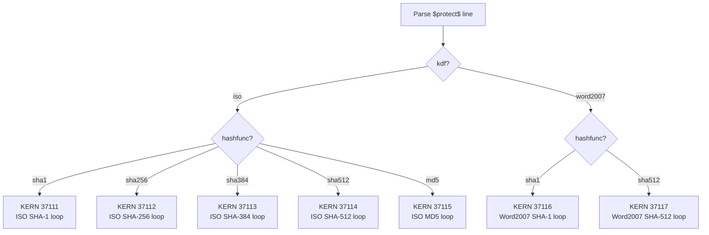

# Mode 37100 — `$protect$` Editing/Permission Verifier

One mode number, one hash-line grammar, **7 internal kernels** — covers every MS Office editing, permission, and write-reservation password across 17 confirmed carrier elements.

## Hash line grammar

```
$protect$*<hashfunc>*<kdf>*<iters>*<salt>*<hash>
```

## Field table

| # | Field | Type | Values | Source |
|---|---|---|---|---|
| 1 | `hashfunc` | string | `md5` `sha1` `sha256` `sha384` `sha512` `ripemd128` `ripemd160` `whirlpool` | `algorithmName` or `cryptAlgorithmSid` |
| 2 | `kdf` | string | `iso` or `word2007` | Determined by which attribute set is present |
| 3 | `iters` | decimal | `0`–`10000000` (iso) / `0`–`5000000` (word2007) | `spinCount` / `cryptSpinCount` |
| 4 | `salt` | hex | 1–65536 B (typically 16) | `saltValue` / `salt` (base64 decoded) |
| 5 | `hash` | hex | digest width per hashfunc (16–64 B) | `hashValue` / `hash` (base64 decoded) |

## `module_kern_type_dynamic` dispatch



| Internal kernel | KDF | Hash | Replaces |
|---|---|---|---|
| 37111 | ISO | SHA-1 | — (gap: Office 2007/2010 default) |
| 37112 | ISO | SHA-256 | — (gap) |
| 37113 | ISO | SHA-384 | — (gap) |
| 37114 | ISO | SHA-512 | 25300 (unpinned: any spinCount/salt) |
| 37115 | ISO | MD5 | — (gap) |
| 37116 | Word2007 | SHA-1 | — (gap: Word 2007 default) |
| 37117 | Word2007 | SHA-512 | — (gap) |

## The two KDF variants

### `iso` — iterator APPENDED, salt prepended

```
H0 = H(salt || UTF16LE(password))
Hn = H(Hn-1 || LE32(n))    for n = 0..spinCount-1
verify: Hfinal == stored hash
```

### `word2007` — three-stage legacy, salt APPENDED

```
L  = CreatePasswordVerifier_Method2(ASCII(password))   // 32-bit DWORD
X  = UTF16LE(uppercase_hex(reverse_bytes(L)))           // 16 bytes
H0 = H(X || salt)                                       // salt APPENDED
Hn = H(Hn-1 || LE32(n))
verify: Hfinal == stored hash
```

**Critical difference from `$office$` agile:** iterator is APPENDED here (`Hn-1 || LE32(n)`), but PREPENDED in agile (`LE32(n) || Hn-1`). Getting this wrong silently produces wrong hashes for every candidate.

## Complete carrier inventory (audit-confirmed, 17 elements)

All 17 carrier elements that produce a GPU-crackable `$protect$` hash line. The KDF algorithm is identical across all carriers within the same KDF variant — only the XML element name and file path differ.

| # | Carrier | Location | Product | KDF |
|---|---|---|---|---|
| 1 | `<sheetProtection>` (worksheet) | `xl/worksheets/sheetN.xml` | Excel | `iso` |
| 2 | `<sheetProtection>` (chart sheet) | `xl/chartsheets/sheetN.xml` | Excel | `iso` |
| 3 | `<workbookProtection>` (structure) | `xl/workbook.xml` (workbook* attrs) | Excel | `iso` |
| 4 | `<workbookProtection>` (revisions) | `xl/workbook.xml` (revisions* attrs) | Excel | `iso` |
| 5 | `<fileSharing>` | `xl/workbook.xml` | Excel | `iso` |
| 6 | `<protectedRange>` | `xl/worksheets/sheetN.xml` | Excel | `iso` |
| 7 | `<w:writeProtection>` (ISO dialect) | `word/settings.xml` | Word | `iso` |
| 8 | `<w:writeProtection>` (legacy dialect) | `word/settings.xml` | Word | `word2007` |
| 9 | `<w:documentProtection>` (ISO dialect) | `word/settings.xml` | Word | `iso` |
| 10 | `<w:documentProtection>` (legacy dialect) | `word/settings.xml` | Word | `word2007` |
| 11 | `<p:modifyVerifier>` (ISO dialect) | `ppt/presentation.xml` | PowerPoint | `iso` |
| 12 | `<p:modifyVerifier>` (legacy dialect) | `ppt/presentation.xml` | PowerPoint | `word2007` |
| 13 | `BrtSheetProtectionIso` | `.xlsb` binary record | Excel | `iso` |
| 14 | `BrtBookProtectionIso` | `.xlsb` binary record | Excel | `iso` |
| 15 | `BrtCsProtectionIso` | `.xlsb` binary record | Excel | `iso` |
| 16 | `BrtRangeProtectionIso` | `.xlsb` binary record | Excel | `iso` |
| 17 | `BrtFileSharingIso` | `.xlsb` binary record | Excel | `iso` |

**Explicitly NOT mode 37100:**

| Gate | Why excluded | Correct action |
|---|---|---|
| `.xls` Password record 0x0013 (sheet/workbook) | 16-bit verifier, no salt, no iteration | Instant collide or strip |
| `.xls` FileSharing 0x005B wResPass | 16-bit verifier | Instant collide or strip |
| `.xls` Prot4RevPass 0x01BC | 16-bit verifier | Instant collide or strip |
| `.xls` FeatProtection wPassword | 16-bit (zero-extended to 32) | Instant collide or strip |
| `.doc` DopBase.lKeyProtDoc | 32-bit verifier (Method 2) | Instant collide or strip |
| ODF `table:protection-key` (.ods) | OASIS-defined digest, content is plaintext | Strip (always faster than cracking) |
| ODF `text:protection-key` (.odt) | OASIS-defined digest, content is plaintext | Strip |

## Dual-hash caveat

Per [MS-XLSX] §2.6.56 and [MS-XLSB] §2.2.10: ALL Excel ISO protection verifiers (carriers 1–6, 13–17) must be tried **TWO ways** per candidate password:

1. **Standard path:** full Unicode password → `H(salt ‖ password)` → spin iterations
2. **Legacy-compatible path:** Unicode password → 16-bit verifier via `CreatePasswordVerifier_Method1` ([MS-OFFCRYPTO] §2.3.7.1) → reinterpret that 16-bit value as a single UTF-16LE character → `H(salt ‖ character)` → spin iterations

There is **no on-disk indicator** of which method was used. A correct implementation MUST compute both hashes and accept a match from either. This is a toolkit/extractor concern — the kernel always receives a single candidate and hashes it one way. The toolkit should emit TWO hash lines per Excel protection gate (one for each path) or handle the dual check internally.

## Password encoding

| KDF | Encoding | Max length |
|---|---|---|
| `iso` | UTF-16LE | 255 chars |
| `word2007` | ASCII (MBCS low-byte) | 15 chars |

## Examples

```
# SHA-512, ISO, 100000 (replaces 25300 — now accepts any spinCount)
$protect$*sha512*iso*100000*f3be8c2e8293ab8dbefc32e9e35e6265*4cd0efa6f632be5494...

# SHA-1, ISO, 100000 (NEW — Office 2007/2010 default, no mode today)
$protect$*sha1*iso*100000*f3be8c2e8293ab8dbefc32e9e35e6265*43dd022c47da3d67c3...

# Word 2007 legacy, SHA-1, three-stage KDF (NEW — no mode today)
$protect$*sha1*word2007*50000*deadbeefcafebabe1234567890abcdef*9a0b1c2d3e4f5a6b7c...
```
