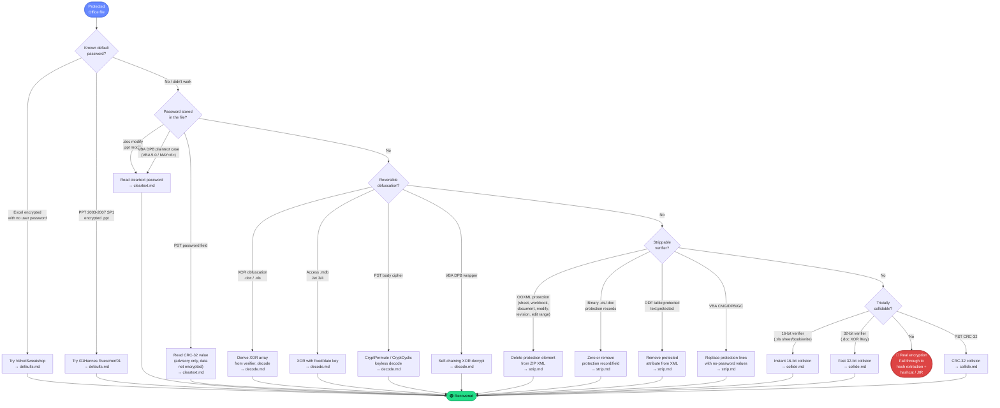

# Fast Recovery Techniques

Practical methods to recover access to password-protected Office documents **without cracking the password hash**. Every technique here exploits a structural weakness in how Office stores protection: default passwords, cleartext storage, reversible obfuscation, strippable verifiers, or trivially collidable checksums. None require a GPU, a wordlist, or hashcat.

## The Key Insight

Most Office "passwords" do not encrypt content. The product × gate matrix in [analysis/overview.md](../research/overview.md) shows that of the ~40 distinct protection gates across all Office formats, only a handful (the 🔴 gates) actually encrypt document bytes with a password-derived key. Everything else falls into one of these categories:

| Category | What it means | Recovery time |
|---|---|---|
| 🟢 **Cleartext / Decode** | The password is stored in the file, either literally or under trivially reversible obfuscation. Read it out. | Instant |
| 🟡 **Verifier only** | The document body is plaintext. A hash or checksum of the password is stored in the file and can be deleted or zeroed without touching the content. | Seconds (hex/XML edit) |
| ⚪ **Advisory / UI-only** | The "protection" is a flag that controls application behavior, not data access. Flip the flag or use a different tool. | Instant |

Even some 🔴 gates fall to fast recovery because the file was encrypted under a **known default password** that Office applies automatically, or because the "encryption" is XOR obfuscation with a key derivable from the file itself.

## Decision Tree

Given a protected file, walk this tree **top to bottom**. The first technique that applies gives you instant or near-instant recovery. Only fall through to hashcat if every fast path fails.

## Technique Summary

Which technique works on which gate. Check marks indicate the technique applies; the badge shows recovery speed.

| Gate | Format | Default | Cleartext | Decode | Strip | Collide | Bypass |
|---|---|:---:|:---:|:---:|:---:|:---:|:---:|
| **Open (XOR obfuscation)** | `.doc` | — | — | 🟢 | — | 🟢 | — |
| **Open (XOR obfuscation)** | `.xls` | — | — | 🟢 | — | 🟢 | — |
| **Open (VelvetSweatshop)** | `.xls`/`.xlsx` | 🟢 | — | — | — | — | — |
| **Open (/01Hannes Ruescher/01)** | `.ppt` | 🟢 | — | — | — | — | — |
| **Modify / Write Reservation** | `.doc` | — | 🟢 | — | 🟢 | — | — |
| **Modify / Write Reservation** | `.ppt` | — | 🟢 | — | 🟢 | — | — |
| **Modify / Write Reservation** | `.xls` | — | — | — | 🟢 | 🟢 | — |
| **Modify / Write Reservation** | `.docx` | — | — | — | 🟢 | — | — |
| **Modify / Write Reservation** | `.xlsx` | — | — | — | 🟢 | — | — |
| **Modify / Write Reservation** | `.pptx` | — | — | — | 🟢 | — | — |
| **Sheet Protection** | `.xls` | — | — | — | 🟢 | 🟢 | — |
| **Sheet Protection** | `.xlsx`/`.xlsb` | — | — | — | 🟢 | — | — |
| **Workbook Protection** | `.xls` | — | — | — | 🟢 | 🟢 | — |
| **Workbook Protection** | `.xlsx`/`.xlsb` | — | — | — | 🟢 | — | — |
| **Document Protection** | `.doc` | — | — | — | 🟢 | 🟢 | — |
| **Document Protection** | `.docx` | — | — | — | 🟢 | — | — |
| **Edit Ranges** | `.xls` | — | — | — | 🟢 | 🟢 | — |
| **Edit Ranges** | `.xlsx`/`.xlsb` | — | — | — | 🟢 | — | — |
| **Revision Protection** | `.xls` | — | — | — | 🟢 | 🟢 | — |
| **VBA Project Lock** | all | — | 🟡 | 🟢 | 🟢 | — | 🟢 |
| **PST Password** | `.pst` | — | 🟢 | — | 🟢 | 🟢 | — |
| **PST Body Cipher** | `.pst` | — | — | 🟢 | — | — | — |
| **Access Open** | `.mdb` (Jet 3) | — | — | 🟢 | — | — | — |
| **Access Open** | `.mdb` (Jet 4) | — | — | 🟢 | — | — | — |
| **ODF Sheet/Cell Protection** | `.odt`/`.ods` | — | — | — | 🟢 | — | — |

**Badge legend:** 🟢 = instant (< 1 second) | 🟡 = fast (seconds, may need code page detection) | 🔴 = not applicable (fall through to hashcat)

## Technique Documents

| # | Technique | File | What it does |
|---|---|---|---|
| 1 | **Default Passwords** | [defaults.md](defaults.md) | Try known default passwords that Office applies automatically: `VelvetSweatshop` for Excel, `/01Hannes Ruescher/01` for PowerPoint. Spec-confirmed in [MS-OFFCRYPTO] SS2.4.2.3, product behavior notes <25> and <26>. |
| 2 | **Cleartext Passwords** | [cleartext.md](cleartext.md) | Read passwords stored in the clear: `.doc` write-reservation in `SttbfAssoc` index 0x11 (UTF-16LE), `.ppt` modify password in `ModifyPasswordAtom` (UTF-16LE), VBA plaintext case under the DPB wrapper, PST CRC-32 advisory value. |
| 3 | **Reversible Decode** | [decode.md](decode.md) | Reverse trivial obfuscation: XOR obfuscation arrays for `.doc`/`.xls` (16-byte repeating key derived from in-file verifier), Jet fixed-key and date-key XOR for `.mdb`, PST permutative/cyclic body ciphers (keyless table lookup), VBA DPB self-chaining XOR wrapper. |
| 4 | **Strip Protection** | [strip.md](strip.md) | Delete or zero protection elements from files where the document body is plaintext. OOXML: unzip, remove XML attributes/elements (`sheetProtection`, `workbookProtection`, `documentProtection`, `writeProtection`, `modifyVerifier`, `protectedRange`, `fileSharing`), rezip. OLE binary: zero verifier fields in BIFF records or DopBase. ODF: remove `table:protected` / `text:protected` attributes. VBA: replace `CMG=`/`DPB=`/`GC=` with no-password sentinel values. |
| 5 | **Instant Collision** | [collide.md](collide.md) | Find a colliding password for trivially small verifier spaces. 16-bit `CreatePasswordVerifier_Method1` (2^16 = 65,536 buckets, instant exhaustive search): covers `.xls` sheet/workbook/write/revision protection and edit ranges. 32-bit XOR verifier (`.doc` `FibBase.lKey`): fast collision from the combined XorKey+Verifier16 space. PST CRC-32 (2^32 buckets): standard CRC-32 collision or preimage in milliseconds. |
| 6 | **VBA Bypass** | [bypass.md](bypass.md) | Access VBA macro source code despite "Lock project for viewing": the password gates only the VBE UI, not the data. Module streams are compressed ([MS-OVBA] SS2.4.1) but never encrypted. Decompress directly with `olefile` + `zlib`, or patch the `CMG=`/`DPB=`/`GC=` lines to unlock the editor. Content integrity hashes ([MS-OVBA] SS2.4.2) deliberately exclude the protection fields, so modifications do not invalidate them. |

## Cross-References

| Resource | Path | What it covers |
|---|---|---|
| Gate overview + detection tree | [analysis/overview.md](../research/overview.md) | Full product x gate matrix, algorithm x product matrix, file detection decision tree |
| XOR obfuscation spec | [analysis/algorithms/password/xor-obfuscation.md](../research/algorithms/password/xor-obfuscation.md) | Method 1/2 KDF, XorMatrix, PadArray, data transformation, default passwords |
| VBA project password spec | [analysis/algorithms/password/vba-project-password.md](../research/algorithms/password/vba-project-password.md) | DPB wrapper, password hash structure, content integrity hashes |
| ISO protection hash spec | [analysis/algorithms/password/iso-protection-hash.md](../research/algorithms/password/iso-protection-hash.md) | OOXML sheet/workbook/document/write protection KDF |
| PST CRC-32 spec | [analysis/algorithms/password/pst-crc32.md](../research/algorithms/password/pst-crc32.md) | Advisory password gate, CRC-32 parameters |
| PST body cipher spec | [analysis/algorithms/non-password/pst-body-cipher.md](../research/algorithms/non-password/pst-body-cipher.md) | Permutative and cyclic keyless decode |
| Access Jet obfuscation | [analysis/algorithms/non-password/access-jet-obfuscation.md](../research/algorithms/non-password/access-jet-obfuscation.md) | Fixed-key and date-key XOR for `.mdb` |
| Word format reference | [analysis/formats/word.md](../research/formats/word.md) | `.doc`/`.docx` gate locations, container structure |
| Excel format reference | [analysis/formats/excel.md](../research/formats/excel.md) | `.xls`/`.xlsx` gate locations, VelvetSweatshop details |
| PowerPoint format reference | [analysis/formats/powerpoint.md](../research/formats/powerpoint.md) | `.ppt`/`.pptx` gate locations, `/01Hannes Ruescher/01` details |
| Outlook format reference | [analysis/formats/outlook.md](../research/formats/outlook.md) | `.pst` password and body cipher locations |
| Access format reference | [analysis/formats/access.md](../research/formats/access.md) | `.mdb`/`.accdb` Jet/ACE header layout |

## What These Techniques Do NOT Cover

These techniques work only against gates where the protection mechanism has a structural shortcut. They do not help with:

- **🔴 ECMA-376 Agile encryption** (`.docx`/`.xlsx`/`.pptx` with SHA-512 + AES-256, 100,000 iterations) — real encryption, requires password recovery via hashcat mode 9600
- **🔴 ECMA-376 Standard encryption** (AES + SHA-1, 50,000 iterations) — real encryption, hashcat mode 9500
- **🔴 RC4 CryptoAPI + SHA-1** (`.doc`/`.xls`/`.ppt` with non-default passwords) — real encryption, hashcat mode 9800/9700/9800
- **🔴 RC4 + MD5 legacy 40-bit** (`.doc`/`.xls` older than Office 2003) — real encryption, hashcat mode 9700/9800
- **🔴 ACE 2010+ encryption** (`.accdb` with SHA-512 + AES-256) — real encryption, analogous to agile
- **🔴 ODF encryption** (PBKDF2/Argon2id + AES-256 or Blowfish) — real encryption, hashcat modes 18400/18600
- **🔴 OneNote encryption** — uses the same ECMA-376 Standard/Agile schemes
- **⚪ IRM / RMS** — certificate-based, no password to recover
- **⚪ Digital signatures** — PKI integrity, not access control

For these, extract the hash with the appropriate tool and proceed to password recovery. See [hashcat current modes](../hashcat/current/README.md) and [proposed unified design](../hashcat/proposed/README.md) for extraction procedures and hashcat module mappings.
