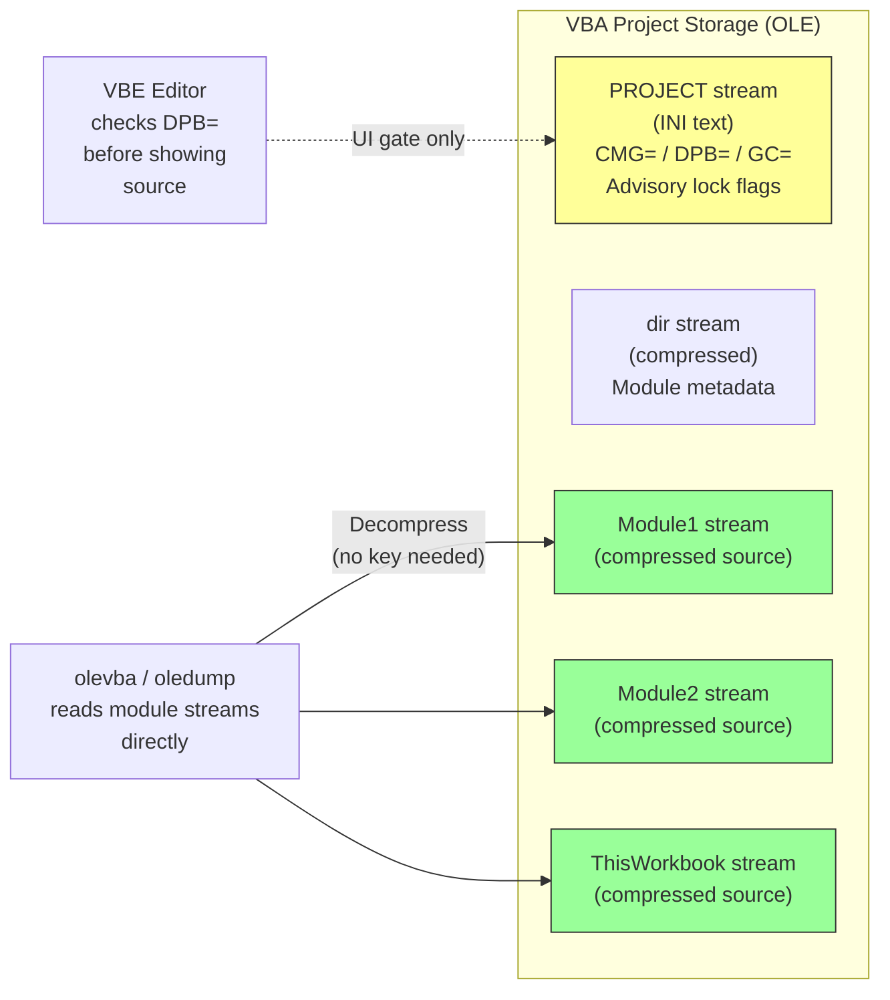
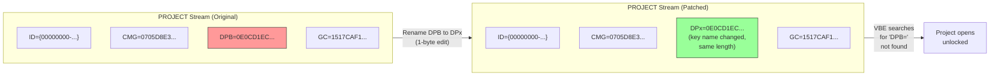
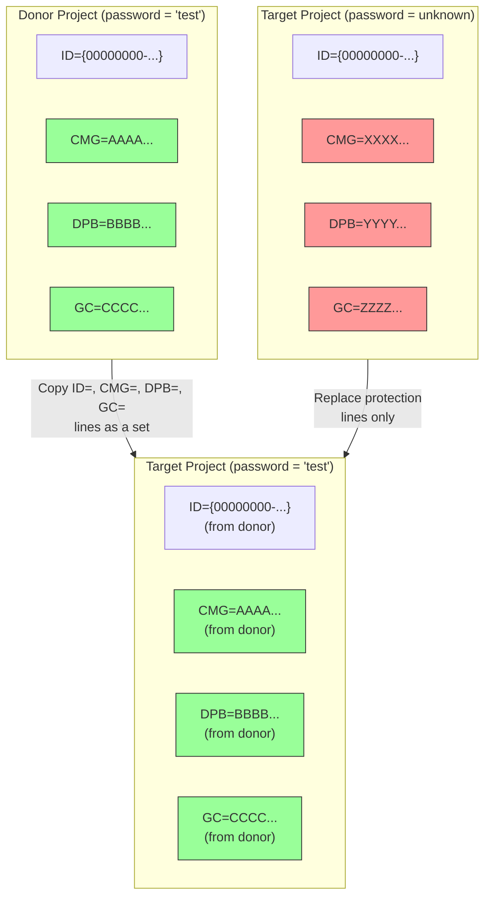
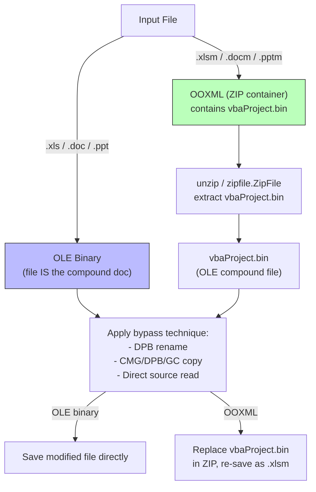

# VBA Project Lock Bypass

Techniques to access VBA macro source code without breaking the project password. The VBA "Lock project for viewing" password is an advisory UI gate — the underlying source code is stored compressed but **never encrypted**. Every technique here exploits that fundamental design fact.

| Technique | Difficulty | Speed | Works On | Section |
|---|---|---|---|---|
| Direct source reading (olevba/oledump) | Trivial | :green_circle: Instant | All VBA hosts | [ss1](#1-the-lock-is-advisory-source-is-not-encrypted) |
| DPB-to-DPx rename | Easy | :green_circle: Instant | All VBA hosts | [ss2](#2-dpb-to-dpx-rename-trick) |
| CMG/DPB/GC triple copy | Easy | :green_circle: Instant | All VBA hosts | [ss3](#3-cmgdpbgc-triple-copy-from-known-project) |
| EvilClippy -g | Easy | :green_circle: Instant | OOXML (.xlsm/.docm/.pptm) | [ss4](#4-evilclippy-g-strip-the-lock-entirely) |
| Python olefile edit | Moderate | :green_circle: Instant | OLE binary + OOXML | [ss5](#5-python-olefile-programmatic-bypass) |

**Spec basis:** [MS-OVBA] ss4.2 states: *"The design of this encryption is to obfuscate sensitive information, not to secure it."* All three protection lines (CMG, DPB, GC) use a reversible XOR wrapper whose key material (Seed, Version, ProjKey) is stored alongside the ciphertext. Module streams are compressed ([MS-OVBA] ss2.4.1) but never encrypted.

For full DPB/CMG/GC structure and the XOR obfuscation algorithm, see [../research/algorithms/password/vba-project-password.md](../research/algorithms/password/vba-project-password.md).

---

## 1. The Lock Is Advisory — Source Is NOT Encrypted



The VBE editor checks the `DPB=` line in the PROJECT stream before allowing the user to view source. But the actual macro source lives in separate module streams, compressed with the VBA compression algorithm ([MS-OVBA] ss2.4.1) — a deterministic LZ-based scheme that requires no password or key to decompress.

**Key facts:**

- Module streams (e.g., `Module1`, `ThisWorkbook`, `Sheet1`) contain `CompressedSourceCode` ([MS-OVBA] ss2.3.4.3) that any tool can decompress.
- The `dir` stream contains module metadata (names, types, stream offsets) — also compressed, also no password needed.
- The PROJECT stream protection lines (`CMG=`, `DPB=`, `GC=`) control only the VBE UI. They have zero effect on the accessibility of module stream bytes.
- All three VBA content integrity hashes (Content Hash, Agile Content Hash, V3 Content Hash) deliberately **exclude** the protection lines from their normalized data ([MS-OVBA] ss2.4.2.6). Modifying or removing protection does not invalidate any content hash.

### 1.1 Direct Reading with olevba

`olevba` (part of oletools) decompresses and dumps all VBA module source code, ignoring the project lock entirely.

**OLE binary files (.xls, .doc, .ppt):**

```bash
# Dump all macro source code from a locked workbook
olevba locked_macros.xls

# Extract to individual files
olevba --deobf locked_macros.xls

# Show only the source code, no metadata
olevba -c locked_macros.xls
```

**OOXML files (.xlsm, .docm, .pptm):**

```bash
# Works identically -- olevba finds vbaProject.bin inside the ZIP
olevba locked_macros.xlsm

# Explicit extraction if needed
unzip -p locked_macros.xlsm xl/vbaProject.bin > vbaProject.bin
olevba vbaProject.bin
```

### 1.2 Direct Reading with oledump

`oledump.py` (by Didier Stevens) provides stream-level access with decompression via the `-v` flag (VBA decompression plugin).

```bash
# List all streams in the OLE file (identify module streams)
python oledump.py locked_macros.xls

# Output example:
#  1:       457 'VBA/Module1'
#  2:       312 'VBA/Sheet1'
#  3:       298 'VBA/ThisWorkbook'
#  4:       512 'VBA/dir'
#  5:       233 'VBA/PROJECT'

# Decompress and dump a specific module stream
python oledump.py -s 1 -v locked_macros.xls

# Dump all VBA streams
python oledump.py -v locked_macros.xls
```

### 1.3 Direct Reading with Python

```python
from __future__ import annotations

import olefile
import struct
import zlib


def read_vba_modules(filepath: str) -> dict[str, str]:
    """Read all VBA module source code from an OLE file, bypassing the project lock.

    The VBA project password gates only the VBE UI. Module streams contain
    compressed source code ([MS-OVBA] ss2.3.4.3, ss2.4.1) that requires
    no key to decompress.
    """
    ole = olefile.OleFileIO(filepath)
    modules: dict[str, str] = {}

    # Find the VBA storage -- usually "VBA" or "_VBA_PROJECT_CUR/VBA"
    for stream_path in ole.listdir():
        joined = "/".join(stream_path)
        # Skip dir, PROJECT, _VBA_PROJECT metadata streams
        if stream_path[-1] in ("dir", "PROJECT", "_VBA_PROJECT", "PROJECTwm"):
            continue
        # Module streams live under the VBA storage
        if "VBA" in stream_path:
            raw = ole.openstream(stream_path).read()
            try:
                source = _decompress_vba(raw)
                modules[joined] = source.decode("latin-1")
            except Exception:
                pass  # Not a compressed module stream

    ole.close()
    return modules


def _decompress_vba(data: bytes) -> bytes:
    """Decompress VBA compressed container ([MS-OVBA] ss2.4.1).

    The compression is a custom LZ scheme, not standard zlib/deflate.
    For production use, prefer oletools.olevba which handles edge cases.
    This is a minimal implementation for illustration.
    """
    # Signature byte must be 0x01
    if not data or data[0] != 0x01:
        msg = "Not a VBA compressed container"
        raise ValueError(msg)

    result = bytearray()
    pos = 1  # Skip signature byte

    while pos < len(data):
        # Read chunk header (2 bytes, little-endian)
        if pos + 2 > len(data):
            break
        header = struct.unpack_from("<H", data, pos)[0]
        pos += 2

        chunk_size = (header & 0x0FFF) + 3
        is_compressed = (header >> 15) & 1
        chunk_end = pos + chunk_size - 2  # -2 for header already consumed

        if not is_compressed:
            # Raw chunk: copy 4096 bytes verbatim
            result.extend(data[pos : pos + 4096])
            pos += 4096
            continue

        # Compressed chunk
        while pos < chunk_end and pos < len(data):
            flag_byte = data[pos]
            pos += 1
            for bit_index in range(8):
                if pos >= chunk_end or pos >= len(data):
                    break
                if (flag_byte >> bit_index) & 1 == 0:
                    # Literal byte
                    result.append(data[pos])
                    pos += 1
                else:
                    # Copy token
                    if pos + 2 > len(data):
                        break
                    token = struct.unpack_from("<H", data, pos)[0]
                    pos += 2

                    decompressed_current = len(result)
                    bit_count = max(4, (decompressed_current % 4096).bit_length())
                    length_mask = 0xFFFF >> bit_count
                    offset_mask = ~length_mask & 0xFFFF
                    length = (token & length_mask) + 3
                    offset = ((token & offset_mask) >> (16 - bit_count)) + 1

                    for _ in range(length):
                        src_pos = len(result) - offset
                        if src_pos < 0:
                            result.append(0)
                        else:
                            result.append(result[src_pos])

    return bytes(result)
```

---

## 2. DPB-to-DPx Rename Trick

The simplest bypass that makes the VBE editor itself open the project unlocked. The VBE locates the project password by searching for the literal key name `DPB=` in the PROJECT stream. Renaming it to anything else (e.g., `DPx=`) makes the host application unable to find the protection state, so it falls through to "no password set."



### 2.1 Why It Works

| Step | What Happens |
|---|---|
| 1 | VBE opens the OLE compound file and reads the `PROJECT` stream |
| 2 | VBE scans for the `DPB="..."` line to determine if a password is set |
| 3 | The line key is `DPx=` — no match for `DPB=` |
| 4 | VBE concludes no password protection exists |
| 5 | Source code is displayed without prompting for a password |

**Critical constraint:** The replacement key name must be the **same byte length** as `DPB`. The PROJECT stream is stored in an OLE stream with a fixed allocated size. Changing the length shifts all subsequent bytes and corrupts the stream unless the OLE directory entry's size field is also updated. Sticking to a same-length rename (e.g., `DPB` -> `DPx`, `DPB` -> `DPb`, `DPB` -> `DBP`) avoids this entirely.

### 2.2 Manual Hex Editor Procedure

**For OLE binary files (.xls, .doc, .ppt) — edit directly:**

1. Open the file in a hex editor (HxD, 010 Editor, etc.)
2. Search for the ASCII string `DPB=` (hex: `44 50 42 3D`)
3. Change the `B` (0x42) to `x` (0x78), producing `DPx=` (hex: `44 50 78 3D`)
4. Save the file
5. Open in the Office application — the VBE project is now unlocked

**For OOXML files (.xlsm, .docm, .pptm):**

1. Rename `.xlsm` to `.zip` and extract
2. Locate the VBA project binary: `xl/vbaProject.bin` (Excel), `word/vbaProject.bin` (Word), or `ppt/vbaProject.bin` (PowerPoint)
3. Open `vbaProject.bin` in a hex editor
4. Search for `DPB=` and rename to `DPx=` as above
5. Replace the modified `vbaProject.bin` in the ZIP
6. Rename `.zip` back to `.xlsm`

### 2.3 One-Shot Bypass with sed (OLE Binary)

```bash
# Binary-safe find-and-replace of DPB= to DPx= in an OLE file
sed -i 's/DPB=/DPx=/g' locked_macros.xls
```

> **Warning:** `sed` on binary files can be fragile depending on locale settings. The Python method below is safer.

### 2.4 Post-Rename Behavior

After opening the renamed file in the VBE:

1. The project appears unlocked (no password prompt)
2. You can view and edit all modules
3. The VBE may show a warning about a corrupted protection record on first open — click through it
4. To permanently remove the lock: go to Tools > VBAProject Properties > Protection, uncheck "Lock project for viewing," clear the password fields, and save
5. This resets CMG/DPB/GC to the no-password state

---

## 3. CMG/DPB/GC Triple Copy from Known Project

Instead of disabling protection, replace the protection lines with values from a project whose password you know. All three lines (CMG, DPB, GC) must be replaced as a set because they share the same obfuscation wrapper parameters tied to the ProjectCLSID in the `ID=` line.



### 3.1 Procedure

**Step 1: Create a donor project.**

1. Open a new Excel workbook (or Word document, etc.)
2. Press Alt+F11 to open the VBE
3. Tools > VBAProject Properties > Protection
4. Check "Lock project for viewing"
5. Set password to something known (e.g., `test`)
6. Save as `.xlsm` (or `.xls` for binary format)

**Step 2: Extract the donor's protection lines.**

```bash
# For OOXML: extract vbaProject.bin
unzip -p donor.xlsm xl/vbaProject.bin > donor_vba.bin

# Dump the PROJECT stream and grab the four lines
python3 -c "
import olefile
ole = olefile.OleFileIO('donor_vba.bin')
project = ole.openstream('PROJECT').read().decode('latin-1')
for line in project.splitlines():
    if line.startswith(('ID=', 'CMG=', 'DPB=', 'GC=')):
        print(line)
ole.close()
"
```

Output (example):
```
ID="{00000000-0000-0000-0000-000000000000}"
CMG="CAC866BE68BE68BE68BE68"
DPB="B2B2B8B488A488A488A4"
GC="5153BAA5B6ADB7AD"
```

**Step 3: Replace the target's protection lines with the donor's values.**

Use the Python script in [section 5](#5-python-olefile-programmatic-bypass) to perform the replacement, or do it manually in a hex editor.

**Step 4: Open the target file and enter the donor password.**

The VBE now prompts for a password. Enter the donor password (`test` in this example). Full access is granted.

### 3.2 Why All Four Lines Must Match

| Line | Purpose | Why It Must Come from the Same Source |
|---|---|---|
| `ID=` | ProjectCLSID — seeds the ProjKey for the XOR wrapper | DPB, CMG, and GC are all encrypted with ProjKey derived from this CLSID. Mismatched ID invalidates all three. |
| `CMG=` | Protection state bitfield (fUserProtected, fHostProtected, fVBEProtected) | Must indicate protection is active, or the VBE ignores DPB |
| `DPB=` | Password hash (or plaintext password) | The actual password check. Must decode correctly with the ProjKey from ID. |
| `GC=` | Visibility state (0x00 = hidden, 0xFF = visible) | Controls whether the project tree shows modules. Must decode with same ProjKey. |

**Exception:** When both the donor and the target use the hash-case DPB (the normal modern case), both have `ID="{00000000-0000-0000-0000-000000000000}"` and `ProjKey = 0xAC`. In this case you only need to copy CMG, DPB, and GC — the ID line is already identical.

### 3.3 Content Hash Integrity

Per [MS-OVBA] ss2.4.2.6, the Project Normalized Data algorithm **explicitly excludes** `ProjectId`, `ProjectProtectionState`, `ProjectPassword`, and `ProjectVisibilityState` from the hash input. Replacing all four protection lines does not invalidate any VBA content integrity hash (Content Hash, Agile Content Hash, or V3 Content Hash). The project passes integrity verification unchanged.

---

## 4. EvilClippy -g — Strip the Lock Entirely

[EvilClippy](https://github.com/outflanknl/EvilClippy) is a tool for manipulating VBA macro projects. The `-g` flag removes project protection by clearing the CMG/DPB/GC lines and resetting protection flags.

### 4.1 Usage

```bash
# Remove VBA project lock from an OOXML file
EvilClippy -g locked_macros.xlsm

# Output: locked_macros-EvilClippy.xlsm (unlocked copy)
```

### 4.2 What -g Does Internally

1. Opens the OOXML ZIP and extracts `vbaProject.bin`
2. Parses the OLE compound file within `vbaProject.bin`
3. Reads the `PROJECT` stream
4. Replaces the `DPB=` line with a no-password DPB value (Length=1, Data=0x00, wrapped in the XOR obfuscation)
5. Resets `CMG=` to indicate no protection bits set (fUserProtected=0, fHostProtected=0, fVBEProtected=0)
6. Sets `GC=` to visible (Data=0xFF)
7. Rewrites the `PROJECT` stream and repacks the OLE/ZIP

### 4.3 Limitations

| Aspect | Detail |
|---|---|
| Format support | Primarily targets OOXML (.xlsm, .docm, .pptm). OLE binary (.xls, .doc) support varies by version. |
| .NET dependency | Written in C#; requires .NET Framework or Mono on Linux |
| Digital signatures | If the VBA project or document has a digital signature, stripping protection invalidates it. The signature must be removed or re-signed. |
| Trusted Publisher prompts | If the original file was signed by a Trusted Publisher, the unlocked file will trigger macro security warnings on open. |

---

## 5. Python olefile Programmatic Bypass

A complete Python implementation that performs the DPB-to-DPx rename on both OLE binary and OOXML files.

### 5.1 OLE Binary (.xls, .doc, .ppt)

```python
from __future__ import annotations

import re
import shutil
import sys

import olefile


def bypass_vba_lock_ole(filepath: str, output: str | None = None) -> str:
    """Bypass VBA project lock in an OLE binary file by renaming DPB= to DPx=.

    The VBE editor searches for 'DPB=' in the PROJECT stream to determine
    if a password is set. Renaming the key to 'DPx=' (same byte length)
    makes the host unable to find the protection state.

    Per [MS-OVBA] ss4.2, the protection is obfuscation, not encryption.
    Module source streams remain fully accessible regardless.

    Args:
        filepath: Path to the input OLE binary file (.xls, .doc, .ppt).
        output: Path for the output file. Defaults to overwriting the input.

    Returns:
        Path to the modified file.
    """
    if output is None:
        output = filepath
    elif output != filepath:
        shutil.copy2(filepath, output)

    ole = olefile.OleFileIO(output, write_mode=True)

    # Locate the PROJECT stream -- may be at root or under a VBA storage
    project_path: list[str] | None = None
    for entry in ole.listdir():
        if entry[-1] == "PROJECT":
            project_path = entry
            break

    if project_path is None:
        ole.close()
        msg = "No PROJECT stream found -- not a VBA project file"
        raise FileNotFoundError(msg)

    # Read the PROJECT stream content
    project_data = ole.openstream(project_path).read()
    project_text = project_data.decode("latin-1")

    # Verify DPB= exists and is not already bypassed
    if "DPB=" not in project_text:
        ole.close()
        if "DPx=" in project_text:
            return output  # Already bypassed
        msg = "No DPB= line found -- project may not be password-protected"
        raise ValueError(msg)

    # Replace DPB= with DPx= (same byte length, safe binary substitution)
    patched = project_text.replace("DPB=", "DPx=", 1)
    patched_bytes = patched.encode("latin-1")

    # Write back to the OLE stream
    ole.write_stream(project_path, patched_bytes)
    ole.close()

    return output


if __name__ == "__main__":
    if len(sys.argv) < 2:
        print(f"Usage: {sys.argv[0]} <file.xls> [output.xls]")
        sys.exit(1)
    result = bypass_vba_lock_ole(sys.argv[1], sys.argv[2] if len(sys.argv) > 2 else None)
    print(f"Bypassed: {result}")
```

### 5.2 OOXML (.xlsm, .docm, .pptm)

```python
from __future__ import annotations

import os
import shutil
import sys
import tempfile
import zipfile

import olefile


# Map OOXML extensions to their vbaProject.bin path inside the ZIP
VBA_BIN_PATHS: dict[str, str] = {
    ".xlsm": "xl/vbaProject.bin",
    ".xlsb": "xl/vbaProject.bin",
    ".xltm": "xl/vbaProject.bin",
    ".xlam": "xl/vbaProject.bin",
    ".docm": "word/vbaProject.bin",
    ".dotm": "word/vbaProject.bin",
    ".pptm": "ppt/vbaProject.bin",
    ".potm": "ppt/vbaProject.bin",
    ".ppam": "ppt/vbaProject.bin",
    ".ppsm": "ppt/vbaProject.bin",
}


def bypass_vba_lock_ooxml(filepath: str, output: str | None = None) -> str:
    """Bypass VBA project lock in an OOXML file by renaming DPB= to DPx=.

    Extracts vbaProject.bin from the OOXML ZIP, patches the PROJECT stream
    inside the OLE compound file, and reassembles the ZIP.

    Args:
        filepath: Path to the input OOXML file (.xlsm, .docm, .pptm, etc.).
        output: Path for the output file. Defaults to overwriting the input.

    Returns:
        Path to the modified file.
    """
    if output is None:
        output = filepath

    ext = os.path.splitext(filepath)[1].lower()
    vba_path = VBA_BIN_PATHS.get(ext)
    if vba_path is None:
        msg = f"Unsupported OOXML extension: {ext}"
        raise ValueError(msg)

    with tempfile.TemporaryDirectory() as tmpdir:
        vba_bin = os.path.join(tmpdir, "vbaProject.bin")

        # Extract vbaProject.bin from the OOXML ZIP
        with zipfile.ZipFile(filepath, "r") as zin:
            # Read the target OLE binary
            try:
                vba_data = zin.read(vba_path)
            except KeyError:
                msg = f"{vba_path} not found in {filepath}"
                raise FileNotFoundError(msg) from None

            # Write it to a temp file for olefile editing
            with open(vba_bin, "wb") as f:
                f.write(vba_data)

        # Patch the OLE compound file
        ole = olefile.OleFileIO(vba_bin, write_mode=True)
        project_data = ole.openstream("PROJECT").read()
        project_text = project_data.decode("latin-1")

        if "DPB=" not in project_text:
            ole.close()
            if "DPx=" in project_text:
                return filepath  # Already bypassed
            msg = "No DPB= line found in vbaProject.bin PROJECT stream"
            raise ValueError(msg)

        patched = project_text.replace("DPB=", "DPx=", 1)
        ole.write_stream("PROJECT", patched.encode("latin-1"))
        ole.close()

        # Read back the patched OLE binary
        with open(vba_bin, "rb") as f:
            patched_vba = f.read()

        # Rebuild the OOXML ZIP with the patched vbaProject.bin
        tmp_output = os.path.join(tmpdir, "output" + ext)
        with zipfile.ZipFile(filepath, "r") as zin, zipfile.ZipFile(tmp_output, "w") as zout:
            for item in zin.infolist():
                if item.filename == vba_path:
                    zout.writestr(item, patched_vba)
                else:
                    zout.writestr(item, zin.read(item.filename))

        shutil.move(tmp_output, output)

    return output


if __name__ == "__main__":
    if len(sys.argv) < 2:
        print(f"Usage: {sys.argv[0]} <file.xlsm> [output.xlsm]")
        sys.exit(1)
    result = bypass_vba_lock_ooxml(sys.argv[1], sys.argv[2] if len(sys.argv) > 2 else None)
    print(f"Bypassed: {result}")
```

### 5.3 CMG/DPB/GC Triple Copy (Python)

```python
from __future__ import annotations

import olefile


def copy_vba_protection(
    donor_path: str,
    target_path: str,
) -> None:
    """Copy VBA protection lines (ID, CMG, DPB, GC) from a donor project.

    After this operation, the target file's VBA project is protected with
    the donor's password. Enter the donor's known password to unlock.

    Both files must be OLE compound files (binary format or extracted
    vbaProject.bin). For OOXML, extract vbaProject.bin first, patch it,
    then repack into the ZIP.

    Args:
        donor_path: OLE file with a known VBA project password.
        target_path: OLE file whose VBA lock should be replaced.
    """
    # Extract protection lines from the donor
    donor_ole = olefile.OleFileIO(donor_path)
    donor_project = donor_ole.openstream("PROJECT").read().decode("latin-1")
    donor_ole.close()

    donor_lines: dict[str, str] = {}
    for line in donor_project.splitlines():
        for key in ("ID=", "CMG=", "DPB=", "GC="):
            if line.startswith(key):
                donor_lines[key] = line
                break

    missing = {"ID=", "CMG=", "DPB=", "GC="} - set(donor_lines.keys())
    if missing:
        msg = f"Donor PROJECT stream missing protection lines: {missing}"
        raise ValueError(msg)

    # Read the target's PROJECT stream
    target_ole = olefile.OleFileIO(target_path, write_mode=True)
    target_project = target_ole.openstream("PROJECT").read().decode("latin-1")

    # Replace each protection line in the target with the donor's version
    result_lines: list[str] = []
    for line in target_project.splitlines():
        replaced = False
        for key in ("ID=", "CMG=", "DPB=", "GC="):
            if line.startswith(key):
                result_lines.append(donor_lines[key])
                replaced = True
                break
        if not replaced:
            result_lines.append(line)

    patched = "\r\n".join(result_lines)
    if target_project.endswith("\r\n"):
        patched += "\r\n"

    target_ole.write_stream("PROJECT", patched.encode("latin-1"))
    target_ole.close()
```

---

## 6. OOXML vs. OLE Binary Workflow

The bypass techniques are identical for both container formats. The only difference is how you access `vbaProject.bin`.



### 6.1 vbaProject.bin Locations

| Format | Container | vbaProject.bin Path |
|---|---|---|
| Excel .xlsm / .xlsb / .xltm / .xlam | ZIP (OOXML) | `xl/vbaProject.bin` |
| Word .docm / .dotm | ZIP (OOXML) | `word/vbaProject.bin` |
| PowerPoint .pptm / .potm / .ppam / .ppsm | ZIP (OOXML) | `ppt/vbaProject.bin` |
| Excel .xls | OLE (direct) | N/A — file itself is OLE |
| Word .doc | OLE (direct) | N/A — file itself is OLE |
| PowerPoint .ppt | OLE (direct) | N/A — file itself is OLE |
| Access .mdb / .accdb | Jet/ACE database | VBA project stored in system tables (MSysModules2 / MSysResources) — different extraction path |

### 6.2 OOXML Shell Workflow

```bash
# --- Full OOXML bypass workflow (DPB rename) ---

# 1. Extract vbaProject.bin from the OOXML ZIP
mkdir work && cd work
unzip ../locked_macros.xlsm xl/vbaProject.bin

# 2. Apply the DPB rename
sed -i 's/DPB=/DPx=/g' xl/vbaProject.bin

# 3. Replace the patched binary in the OOXML ZIP
zip -f ../locked_macros.xlsm xl/vbaProject.bin

# 4. Clean up
cd .. && rm -rf work
```

---

## 7. Comparison of Techniques

| Technique | Modifies File? | Preserves Macros? | Preserves Content Hash? | Needs Tools? | Risk |
|---|---|---|---|---|---|
| olevba / oledump (read source directly) | :green_circle: No | :green_circle: Yes | :green_circle: Yes | oletools / oledump.py | None — read-only |
| DPB-to-DPx rename | :yellow_circle: Yes (1 byte) | :green_circle: Yes | :green_circle: Yes | Hex editor or Python | Minimal — same-length substitution |
| CMG/DPB/GC triple copy | :yellow_circle: Yes (3-4 lines) | :green_circle: Yes | :green_circle: Yes | Hex editor or Python + donor file | Low — must copy all lines as a set |
| EvilClippy -g | :yellow_circle: Yes | :green_circle: Yes | :green_circle: Yes | EvilClippy (.NET) | Invalidates digital signatures |
| Python olefile script | :yellow_circle: Yes | :green_circle: Yes | :green_circle: Yes | Python + olefile | Same as DPB rename |

All techniques preserve the VBA content integrity hash because the hash normalization algorithms exclude the protection lines ([MS-OVBA] ss2.4.2.6).

---

## 8. When These Techniques Do NOT Work

| Scenario | Why | What To Do Instead |
|---|---|---|
| Document-open password (Agile/Standard encryption) | The entire file or document stream is AES-encrypted. VBA project is inside the encrypted payload. | Must decrypt the document first — see [../research/algorithms/password/ecma376-agile.md](../research/algorithms/password/ecma376-agile.md) |
| IRM/RMS protected document | Azure Rights Management encrypts the document body. | Must have RMS rights or key recovery — see [../research/algorithms/non-password/irm-rms-encryption.md](../research/algorithms/non-password/irm-rms-encryption.md) |
| Access .accdb with database password | The Jet/ACE database is encrypted at the container level. | Decrypt the database first, then extract VBA project from system tables |
| Signed VBA project (Authenticode) | The VBA project has a digital signature. Modifying protection lines invalidates the signature. | Signature can be removed (delete the `_VBA_PROJECT_CUR/VBA/_VBA_PROJECT` digital signature storage), but macro trust policy may then block execution |

---

## References

- [MS-OVBA] — VBA File Format Reference (ss2.3.1.15-17, ss2.4.3, ss2.4.4, ss4.2)
- [MS-CFB] — Compound Binary File Format
- [../research/algorithms/password/vba-project-password.md](../research/algorithms/password/vba-project-password.md) — Full DPB/CMG/GC structure and XOR obfuscation algorithm
- [oletools](https://github.com/decalage2/oletools) — Python toolkit for OLE/VBA analysis
- [oledump.py](https://github.com/DidierStevens/DidierStevensSuite) — OLE stream dumper
- [EvilClippy](https://github.com/outflanknl/EvilClippy) — VBA stomping and protection removal tool
