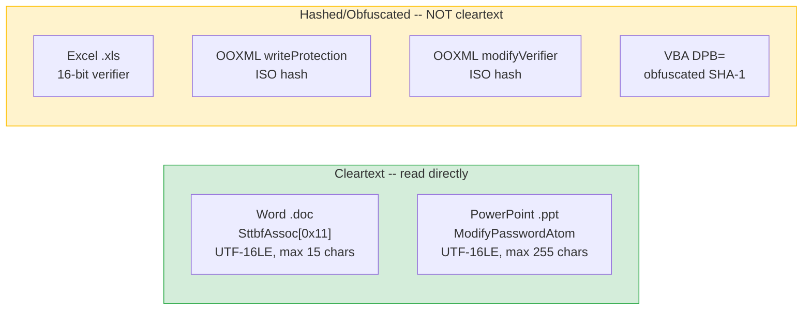
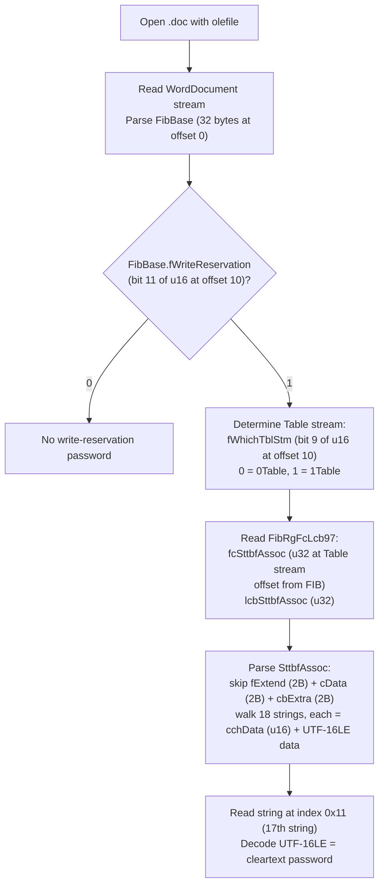
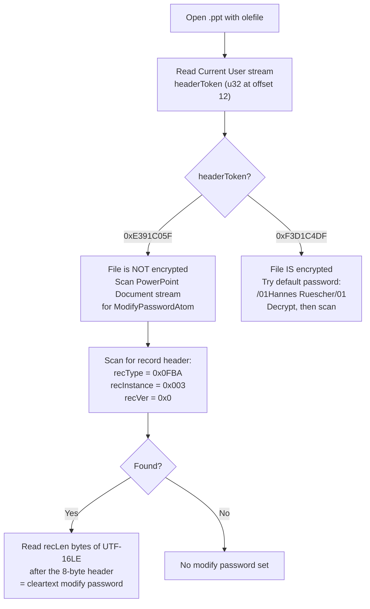

# Cleartext Passwords in Office Files

Exactly two legacy binary formats store the modify/write-reservation password as readable text inside the file. No hashing, no key derivation, no brute force — just read the bytes.

## Scope

| Format | Gate | Storage | Recovery |
|---|---|---|---|
| Word `.doc` | Write reservation | `SttbfAssoc` index 0x11, Table stream | :green_circle: Read UTF-16LE string directly |
| PowerPoint `.ppt` | Modify password | `ModifyPasswordAtom` (RT 0x0FBA, recInstance 0x003) | :green_circle: Read UTF-16LE string directly |

### What is NOT cleartext

These look similar but are **not** stored in the clear:

| Format | Gate | Why it is not cleartext |
|---|---|---|
| Excel `.xls` | Write reservation | 16-bit XOR verifier (`Password` record 0x0013), not the actual password. See [MS-OFFCRYPTO] SS2.3.7.1. |
| Word `.docx` | Write reservation | `<w:writeProtection>` stores an ISO iterated hash (`hashValue`/`saltValue`/`spinCount`) or legacy three-stage KDF hash. Never cleartext. |
| PowerPoint `.pptx` | Modify verifier | `<p:modifyVerifier>` stores an ISO iterated hash or CryptoAPI SID hash. Never cleartext. |
| All OOXML | Document/sheet protection | ISO hash or legacy hash in XML attributes. Never cleartext. |
| All formats | VBA project lock | `DPB=` in PROJECT stream is XOR-obfuscated SHA-1 hash ([MS-OVBA] SS2.4.3). The key is stored alongside the data so it can be reversed, but the result is a hash, not the original password. |



---

## 1. Word `.doc` Write-Reservation Password

### Background

The spec is unambiguous:

> "Binary documents that conform to [MS-DOC] MUST store the write protection password in the file in plaintext." — [MS-OFFCRYPTO] SS2.4.2.1

> "The write-reservation password is embedded in cleartext in the file. Be aware that protection with a write reservation password is not considered a security mechanism." — [MS-DOC] SS4.2

The password sits in the `SttbfAssoc` string table at index 0x11 (decimal 17) in the Table stream (`0Table` or `1Table`). It is encoded as UTF-16LE with a maximum length of 15 characters.

### Locating the password



### FibBase field layout (bytes 10-17)

| Offset | Field | Bits | Relevant flag |
|---|---|---|---|
| 10 | flags word | bit 8 | `fEncrypted` — if 1, file has open encryption |
| 10 | flags word | bit 9 | `fWhichTblStm` — 0 = `0Table`, 1 = `1Table` |
| 10 | flags word | bit 11 | `fWriteReservation` — 1 = password present at SttbfAssoc[0x11] |
| 10 | flags word | bit 15 | `fObfuscated` — XOR obfuscation (irrelevant here) |
| 14 | `lKey` | u32 LE | encryption key/header size (0 when not encrypted) |

### SttbfAssoc structure

| Offset | Size | Field | Value |
|---|---|---|---|
| 0 | 2 | `fExtend` | MUST be 0xFFFF (extended STTB) |
| 2 | 2 | `cData` | MUST be 0x0012 (18 strings) |
| 4 | 2 | `cbExtra` | MUST be 0x0000 |
| 6 | var | strings[0..17] | Each: `cchData` (u16 LE char count) + UTF-16LE chars |

String index 0x11 (the 18th string, zero-indexed 17) is the write-reservation password.

### Python: extract Word `.doc` write-reservation password

```python
from __future__ import annotations

import struct

import olefile


def read_doc_write_password(path: str) -> str | None:
    """Read the cleartext write-reservation password from a Word .doc file.

    The password is stored verbatim at SttbfAssoc index 0x11 in the Table
    stream, per [MS-OFFCRYPTO] SS2.4.2.1 and [MS-DOC] SS2.9.276.

    Returns the password string, or None if no write-reservation is set.
    """
    ole = olefile.OleFileIO(path)

    # --- Parse FibBase (first 32 bytes of WordDocument stream) ---
    wd = ole.openstream("WordDocument").read()
    flags_word = struct.unpack_from("<H", wd, 10)[0]

    f_write_reservation = bool(flags_word & (1 << 11))
    if not f_write_reservation:
        ole.close()
        return None

    f_which_tbl_stm = bool(flags_word & (1 << 9))
    table_name = "1Table" if f_which_tbl_stm else "0Table"

    # --- Locate SttbfAssoc via FibRgFcLcb97 ---
    # FibRgFcLcb97 starts at offset 0x01A2 in the WordDocument stream
    # for Word 97+ files (nFib >= 0x00C1).  fcSttbfAssoc is at a
    # fixed position within FibRgFcLcb97.  For nFib = 0x00C1 the
    # FibRgFcLcb97 table starts at 0x01A2; fcSttbfAssoc is pair
    # index 0x08 (zero-based) = offset 0x01A2 + 0x08 * 8 = 0x01E2.
    #
    # However, the safest approach for any nFib is to compute the
    # offset from the FIB layout.  We use the known fixed offset for
    # Word 97-2003 files here.
    #
    # FibRgFcLcb97 layout (each entry is fc:u32 + lcb:u32 = 8 bytes):
    #   Index 0x08 => fcSttbfAssoc / lcbSttbfAssoc
    #   Absolute offset in WordDocument: 0x01A2 + 8 * 8 = 0x01E2
    #   (FibRgFcLcb97 base is after FibBase(32) + csw(2) +
    #    FibRgW97(28) + cslw(2) + FibRgLw97(88) + cbRgFcLcb(2) = 0x01A2)
    #
    # A more robust method: walk the FIB generically.  For brevity
    # we use the fixed offset that works for all Word 97-2003 files.

    fib_rgfclcb_base = 0x01A2
    sttb_assoc_idx = 0x08  # pair index for fcSttbfAssoc
    fc_offset = fib_rgfclcb_base + sttb_assoc_idx * 8
    fc_sttbf_assoc, lcb_sttbf_assoc = struct.unpack_from("<II", wd, fc_offset)

    if lcb_sttbf_assoc == 0:
        ole.close()
        return None

    # --- Read SttbfAssoc from Table stream ---
    tbl = ole.openstream(table_name).read()
    sttb = tbl[fc_sttbf_assoc : fc_sttbf_assoc + lcb_sttbf_assoc]

    f_extend, c_data, cb_extra = struct.unpack_from("<HHH", sttb, 0)
    assert f_extend == 0xFFFF, "Expected extended STTB"
    assert c_data == 0x0012, f"Expected 18 strings, got {c_data}"

    # Walk strings to index 0x11 (17)
    pos = 6  # after fExtend + cData + cbExtra
    for i in range(c_data):
        cch = struct.unpack_from("<H", sttb, pos)[0]
        pos += 2
        if i == 0x11:
            password = sttb[pos : pos + cch * 2].decode("utf-16-le")
            ole.close()
            return password if password else None
        pos += cch * 2

    ole.close()
    return None


if __name__ == "__main__":
    import sys

    path = sys.argv[1] if len(sys.argv) > 1 else "test.doc"
    pw = read_doc_write_password(path)
    if pw:
        print(f"Write-reservation password: {pw}")
    else:
        print("No write-reservation password found.")
```

### What `fEncrypted` means for this gate

If `FibBase.fEncrypted` is set (bit 8), the file has an **open** encryption password. The Table stream (except the encryption header) is ciphertext. You must decrypt the file first before you can read the SttbfAssoc. The write-reservation password is independent of the open password — a file can have both, one, or neither.

When only the write-reservation flag is set and `fEncrypted` is 0, the Table stream is plaintext and the password is immediately readable.

---

## 2. PowerPoint `.ppt` Modify Password

### Background

The spec confirms this is cleartext storage:

> "Document write protection methods 1 and 3 both embed the password in plaintext into the file. [...] the password can be extracted with little difficulty. Document write protection is not considered to be a security mechanism." — [MS-OFFCRYPTO] SS4.1.4

The modify password lives in a `ModifyPasswordAtom` record inside the `PP10DocBinaryTagExtension` container. The record uses type `RT_CString` (0x0FBA) with `recInstance` = 0x003 to distinguish it from other string records. The password is raw UTF-16LE, max 255 characters.

### Caveat: encrypted `.ppt` files

A `.ppt` file with a modify password **may also be encrypted** with an open password. Older PowerPoint versions (2003, 2007, 2007 SP1) automatically encrypted modify-protected files under the default password `/01Hannes Ruescher/01` even when the user set no open password ([MS-OFFCRYPTO] SS2.4.2.3). PowerPoint 2007 SP2+ stopped this behavior.

**Before scanning for the ModifyPasswordAtom**, check the `Current User` stream's `headerToken`:
- `0xE391C05F` = not encrypted — proceed to scan
- `0xF3D1C4DF` = encrypted — decrypt first (try `/01Hannes Ruescher/01` as the open password)



### ModifyPasswordAtom record layout

| Offset | Size | Field | Value |
|---|---|---|---|
| 0 | 2 | recVer + recInstance | Low 4 bits: `recVer` = 0x0; High 12 bits: `recInstance` = 0x003. Combined u16 LE = 0x0030 |
| 2 | 2 | recType | 0x0FBA (`RT_CString`) |
| 4 | 4 | recLen | Byte count of password data (even, max 510) |
| 8 | recLen | modifyPassword | Cleartext UTF-16LE string |

The first 16-bit word of the record header encodes both `recVer` (low nibble) and `recInstance` (upper 12 bits). For the ModifyPasswordAtom: `recVer` = 0x0, `recInstance` = 0x003, so the combined value is `(0x003 << 4) | 0x0 = 0x0030`.

### Container path

```
PowerPoint Document stream
  DocumentContainer
    docInfoList (DocInfoListContainer)
      DocProgTagsContainer
        DocProgBinaryTagContainer
          tagName RT_CString (recInstance=0x000): "___PPT10"
          BinaryTagDataBlob (RT 0x138B)
            PP10DocBinaryTagExtension
              ModifyPasswordAtom (RT 0x0FBA, recInstance=0x003)
```

### Python: extract PowerPoint `.ppt` modify password

```python
from __future__ import annotations

import struct

import olefile


def read_ppt_modify_password(path: str) -> str | None:
    """Read the cleartext modify password from a PowerPoint .ppt file.

    The password is stored verbatim in the ModifyPasswordAtom record
    (recType RT_CString 0x0FBA, recInstance 0x003) inside the
    PP10DocBinaryTagExtension container.

    Per [MS-OFFCRYPTO] SS2.4.2.3 and [MS-PPT] SS2.4.7.

    Returns the password string, or None if no modify password is set.
    Raises RuntimeError if the file is encrypted (must decrypt first).
    """
    ole = olefile.OleFileIO(path)

    # --- Check encryption status via Current User stream ---
    cu = ole.openstream("Current User").read()
    header_token = struct.unpack_from("<I", cu, 12)[0]

    if header_token == 0xF3D1C4DF:
        ole.close()
        raise RuntimeError(
            "File is encrypted. Decrypt first (try default password "
            "'/01Hannes Ruescher/01' for older PowerPoint versions)."
        )

    # --- Scan PowerPoint Document stream for ModifyPasswordAtom ---
    pptdoc = ole.openstream("PowerPoint Document").read()
    ole.close()

    # Record header: 8 bytes
    #   u16 LE: (recInstance << 4) | recVer
    #   u16 LE: recType
    #   u32 LE: recLen
    #
    # ModifyPasswordAtom:
    #   recVer = 0x0, recInstance = 0x003 => first u16 = 0x0030
    #   recType = 0x0FBA
    #   recLen = even, <= 510

    target_ver_instance = 0x0030  # (0x003 << 4) | 0x0
    target_rec_type = 0x0FBA

    pos = 0
    end = len(pptdoc) - 8  # need at least 8 bytes for header
    while pos <= end:
        ver_instance, rec_type, rec_len = struct.unpack_from("<HHI", pptdoc, pos)

        if ver_instance == target_ver_instance and rec_type == target_rec_type:
            if rec_len > 0 and rec_len <= 510 and rec_len % 2 == 0:
                data_start = pos + 8
                data_end = data_start + rec_len
                if data_end <= len(pptdoc):
                    password = pptdoc[data_start:data_end].decode("utf-16-le")
                    # Strip trailing null if present
                    password = password.rstrip("\x00")
                    if password:
                        return password

        # Advance past this record.  For container records (recVer=0xF),
        # step into children; for atoms, skip data.
        rec_ver = ver_instance & 0x0F
        if rec_ver == 0xF:
            pos += 8  # step into container children
        else:
            pos += 8 + rec_len

    return None


if __name__ == "__main__":
    import sys

    path = sys.argv[1] if len(sys.argv) > 1 else "test.ppt"
    try:
        pw = read_ppt_modify_password(path)
        if pw:
            print(f"Modify password: {pw}")
        else:
            print("No modify password found.")
    except RuntimeError as e:
        print(f"Error: {e}")
```

### Handling encrypted `.ppt` files with default password

If the file is encrypted under the default password `/01Hannes Ruescher/01`, you need to decrypt the RC4 CryptoAPI layer first. The `msoffcrypto-python` library handles this:

```python
from __future__ import annotations

import io

import msoffcrypto


def decrypt_ppt_default_password(path: str) -> io.BytesIO:
    """Decrypt a .ppt file encrypted with the default PowerPoint password.

    Returns a BytesIO of the decrypted file, which can then be passed
    to read_ppt_modify_password() after writing to a temp file or
    adapting that function to accept a stream.
    """
    with open(path, "rb") as f:
        ms = msoffcrypto.OfficeFile(f)
        ms.load_key(password="/01Hannes Ruescher/01")
        decrypted = io.BytesIO()
        ms.decrypt(decrypted)
    decrypted.seek(0)
    return decrypted
```

---

## 3. Combined Recovery Script

A single script that checks both formats:

```python
from __future__ import annotations

import struct
import sys

import olefile


def check_doc(path: str) -> None:
    """Check a .doc file for a cleartext write-reservation password."""
    ole = olefile.OleFileIO(path)
    wd = ole.openstream("WordDocument").read()
    flags = struct.unpack_from("<H", wd, 10)[0]

    f_encrypted = bool(flags & (1 << 8))
    f_write_res = bool(flags & (1 << 11))

    if f_encrypted:
        print("[!] File has open encryption -- Table stream is ciphertext.")
        print("    Decrypt first, then re-run.")
        ole.close()
        return

    if not f_write_res:
        print("[-] No write-reservation flag set.")
        ole.close()
        return

    table_name = "1Table" if (flags & (1 << 9)) else "0Table"
    tbl = ole.openstream(table_name).read()

    fc_offset = 0x01A2 + 0x08 * 8
    fc, lcb = struct.unpack_from("<II", wd, fc_offset)
    if lcb == 0:
        print("[-] SttbfAssoc has zero length.")
        ole.close()
        return

    sttb = tbl[fc : fc + lcb]
    pos = 6  # skip fExtend + cData + cbExtra
    c_data = struct.unpack_from("<H", sttb, 2)[0]
    for i in range(c_data):
        cch = struct.unpack_from("<H", sttb, pos)[0]
        pos += 2
        if i == 0x11:
            pw = sttb[pos : pos + cch * 2].decode("utf-16-le")
            if pw:
                print(f"[+] Write-reservation password: {pw}")
            else:
                print("[-] SttbfAssoc[0x11] is empty.")
            break
        pos += cch * 2
    ole.close()


def check_ppt(path: str) -> None:
    """Check a .ppt file for a cleartext modify password."""
    ole = olefile.OleFileIO(path)
    cu = ole.openstream("Current User").read()
    token = struct.unpack_from("<I", cu, 12)[0]

    if token == 0xF3D1C4DF:
        print("[!] File is encrypted.")
        print("    Try decrypting with: /01Hannes Ruescher/01")
        ole.close()
        return

    pptdoc = ole.openstream("PowerPoint Document").read()
    ole.close()

    pos = 0
    end = len(pptdoc) - 8
    while pos <= end:
        vi, rt, rl = struct.unpack_from("<HHI", pptdoc, pos)
        if vi == 0x0030 and rt == 0x0FBA and 0 < rl <= 510 and rl % 2 == 0:
            pw = pptdoc[pos + 8 : pos + 8 + rl].decode("utf-16-le").rstrip("\x00")
            if pw:
                print(f"[+] Modify password: {pw}")
                return
        if (vi & 0x0F) == 0x0F:
            pos += 8
        else:
            pos += 8 + rl

    print("[-] No modify password found.")


if __name__ == "__main__":
    if len(sys.argv) < 2:
        print(f"Usage: {sys.argv[0]} <file.doc|file.ppt>")
        sys.exit(1)

    path = sys.argv[1]
    if path.lower().endswith((".doc", ".dot")):
        check_doc(path)
    elif path.lower().endswith(".ppt"):
        check_ppt(path)
    else:
        print(f"Unsupported extension: {path}")
        sys.exit(1)
```

---

## Spec References

| Topic | Spec | Section |
|---|---|---|
| Word write-reservation is cleartext | [MS-OFFCRYPTO] | SS2.4.2.1 |
| Word write-reservation is cleartext (reiterated) | [MS-DOC] | SS4.2 |
| SttbfAssoc string table layout | [MS-DOC] | SS2.9.276 |
| FibBase flags (fWriteReservation, fWhichTblStm) | [MS-DOC] | SS2.5.2 |
| PowerPoint modify password is cleartext | [MS-OFFCRYPTO] | SS4.1.4 |
| PowerPoint ModifyPasswordAtom layout | [MS-PPT] | SS2.4.7 |
| Binary Document Write Protection Method 3 | [MS-OFFCRYPTO] | SS2.4.2.3 |
| Default password `/01Hannes Ruescher/01` | [MS-OFFCRYPTO] | SS2.4.2.3, SS5 note 26 |
| Excel write-reservation is NOT cleartext (16-bit verifier) | [MS-OFFCRYPTO] | SS2.3.7.1 |
| OOXML write/modify protection uses ISO hash | [MS-OFFCRYPTO] | SS2.4.2.4 |
| VBA DPB= is obfuscated, not cleartext | [MS-OVBA] | SS2.4.3 |

**See also:**

- [Word format analysis](../research/formats/word.md)
- [PowerPoint format analysis](../research/formats/powerpoint.md)
