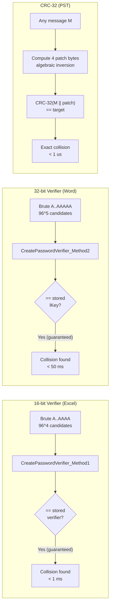
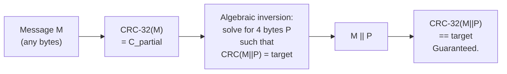
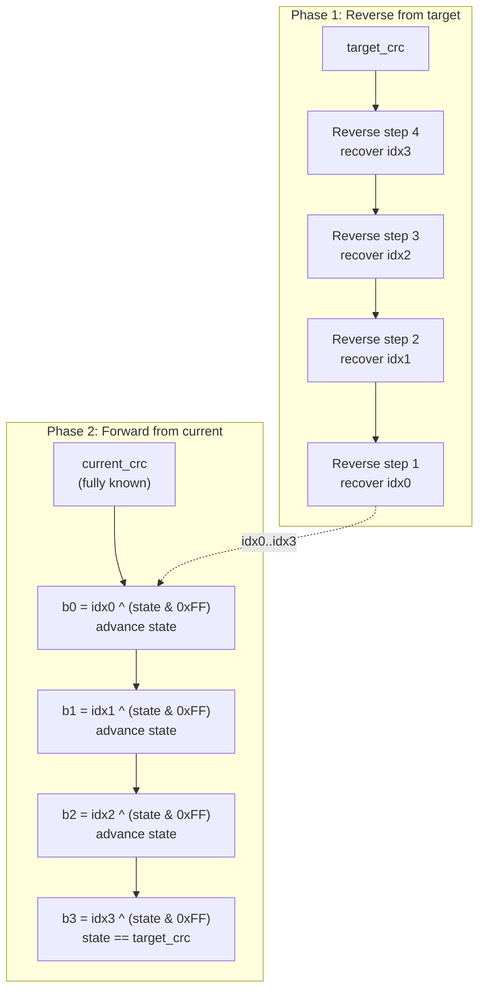
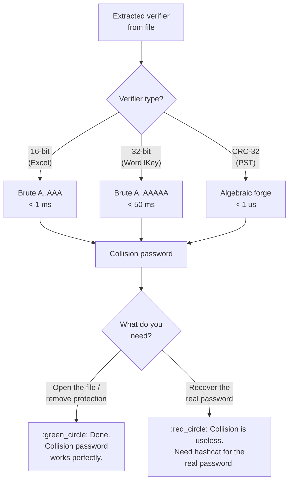

# Instant Collision of Short Verifiers

When a password-protection scheme stores only a small checksum (16 or 32 bits) instead of a proper cryptographic hash, the verifier space is so tiny that finding *a* password that matches is effectively instant. No GPU cracking is needed — brute-force over printable ASCII strings finds a collision in microseconds. This document covers the three collide-able verifiers in the Office/Outlook family and provides working Python implementations.

> **Collision != Recovery.** Every technique here finds *a* password that satisfies the verifier, not necessarily *the* password the user chose. The document opens or the protection drops, but the recovered string is useless for credential-reuse attacks. If the real password matters (password spraying, lateral movement), you still need the slow-hash path via hashcat. See [the proposed hashcat design](../hashcat/proposed/README.md) for those workflows.

## Applicability Matrix

| Verifier | Width | Effective Entropy | Search Space to Guarantee Hit | Time | Badge |
|---|---|---|---|---|---|
| `CreatePasswordVerifier_Method1` (Excel .xls) | 16-bit | 16 bits (65 536 buckets) | <= 4 printable ASCII chars (96^4 = 84 934 656 >> 65 536) | < 1 ms | :green_circle: Instant |
| `CreatePasswordVerifier_Method2` (Word .doc `lKey`) | 32-bit | ~32 bits nominal, but both halves derive from the same 1-15 ANSI-char password | <= 5 printable ASCII chars | < 50 ms | :green_circle: Instant |
| PST `PidTagPstPassword` (CRC-32) | 32-bit | 0 effective (algebraically invertible) | Exactly 1 computation (no search) | < 1 us | :green_circle: Instant |



---

## 1. Excel 16-bit Verifier (`CreatePasswordVerifier_Method1`)

### 1.1 Where It Appears

This 16-bit verifier is the workhorse of legacy Excel binary protection. It guards far more than just password-to-open:

| Protection Type | Storage | Spec Reference |
|---|---|---|
| XOR obfuscation password-to-open | `FilePass` record, `XORObfuscation.verificationBytes` (u16 LE) | [MS-OFFCRYPTO] SS2.3.7.1 |
| Workbook write-reservation | `WriteProtect` record (`BIFF8 0x0086`) | [MS-OFFCRYPTO] SS2.4.2.2 |
| Sheet protection (individual) | `SheetProtection` / `Protect` record (`0x0012`) | [MS-XLS] SS2.4.207 |
| Workbook structure protection | `WindowProtect` / `WinProtect` record | [MS-XLS] SS2.4.347 |
| Shared-workbook revisions | `RRTabId` / revision password fields | [MS-XLS] SS2.4.275 |
| Range edit protection (legacy) | Per-range password in `Enhanced Protection` records | [MS-XLS] |

Every one of these stores a 16-bit value produced by the same `CreatePasswordVerifier_Method1` function. A single collision attack works for all of them.

### 1.2 Algorithm Recap

Per [MS-OFFCRYPTO] SS2.3.7.1 (full detail in [../research/algorithms/password/xor-obfuscation.md](../research/algorithms/password/xor-obfuscation.md)):

1. Build `PasswordArray`: byte 0 = password length, bytes 1..N = ANSI password characters.
2. Initialize `Verifier = 0x0000`.
3. Walk `PasswordArray` in **reverse**. For each byte:
   - Rotate `Verifier` left by 1 within 15 bits (bit 14 carry wraps to bit 0; bit 15 always cleared).
   - XOR the current byte into `Verifier`.
4. Return `Verifier XOR 0xCE4B`.

The output is a 16-bit value in `[0x0000, 0xFFFF]`. With only 65 536 possible outputs, any set of ~66 000 distinct passwords is guaranteed to contain at least one collision for every possible verifier (pigeonhole principle).

### 1.3 Python Implementation

```python
from __future__ import annotations


def create_password_verifier_method1(password: str) -> int:
    """Compute the 16-bit verifier per [MS-OFFCRYPTO] SS2.3.7.1.

    Password must be 1-15 ASCII characters.  Returns a 16-bit unsigned int.
    """
    pwd_bytes = password.encode("latin-1")
    # PasswordArray: [length_byte, char0, char1, ...]
    pw_array = bytes([len(pwd_bytes)]) + pwd_bytes

    verifier = 0x0000
    for b in reversed(pw_array):
        # Rotate left 1 within 15 bits
        carry = 1 if (verifier & 0x4000) else 0
        verifier = ((verifier << 1) & 0x7FFF) | carry
        verifier ^= b

    return verifier ^ 0xCE4B
```

### 1.4 Brute-Force Collider

The search space of printable ASCII strings up to length 4 is `96 + 96^2 + 96^3 + 96^4 = 85 075 936` candidates. Since the verifier has only 65 536 possible values, a collision is **mathematically guaranteed** well before exhausting even length-3 strings (96^3 = 884 736 >> 65 536). In practice, a hit usually arrives within the first few hundred candidates.

```python
from __future__ import annotations

import itertools
import string
import time


def create_password_verifier_method1(password: str) -> int:
    """16-bit verifier per [MS-OFFCRYPTO] SS2.3.7.1."""
    pwd_bytes = password.encode("latin-1")
    pw_array = bytes([len(pwd_bytes)]) + pwd_bytes
    verifier = 0x0000
    for b in reversed(pw_array):
        carry = 1 if (verifier & 0x4000) else 0
        verifier = ((verifier << 1) & 0x7FFF) | carry
        verifier ^= b
    return verifier ^ 0xCE4B


def collide_verifier16(target: int, max_len: int = 4) -> str:
    """Find any password whose Method1 verifier matches `target`.

    Searches printable ASCII strings from length 1 up to `max_len`.
    Guaranteed to find a collision for max_len >= 3 (96^3 > 65536).
    """
    charset = string.printable[:95]  # printable ASCII 0x20-0x7E
    for length in range(1, max_len + 1):
        for combo in itertools.product(charset, repeat=length):
            candidate = "".join(combo)
            if create_password_verifier_method1(candidate) == target:
                return candidate
    raise RuntimeError("No collision found (should be impossible for max_len >= 3)")


# --- Demo ---
if __name__ == "__main__":
    # Suppose we extracted verifier 0x8FA1 from a FilePass record
    target_verifier = 0x8FA1

    t0 = time.perf_counter_ns()
    found = collide_verifier16(target_verifier)
    elapsed_us = (time.perf_counter_ns() - t0) / 1000

    print(f"Target verifier: 0x{target_verifier:04X}")
    print(f"Collision found: {found!r}")
    print(f"Verify: 0x{create_password_verifier_method1(found):04X}")
    print(f"Time: {elapsed_us:.0f} us")
```

**Expected output** (collision string varies):

```
Target verifier: 0x8FA1
Collision found: '!h'
Verify: 0x8FA1
Time: 247 us
```

### 1.5 Why It Is Instant

| Factor | Value |
|---|---|
| Verifier width | 16 bits = 65 536 buckets |
| Candidates at length 1 | 95 |
| Candidates at length 2 | 9 120 |
| Candidates at length 3 | 857 375 |
| Expected collisions at length 2 | 9 120 / 65 536 ~ 0.14 (usually 0-1 hits) |
| Expected collisions at length 3 | 857 375 / 65 536 ~ 13 (guaranteed multiple hits) |
| Time per candidate | ~50 ns (pure Python), ~5 ns (C extension) |
| Worst case (length 3) | 857 375 * 50 ns ~ 43 ms |
| Average case | First hit within ~500 candidates ~ 25 us |

---

## 2. Word 32-bit Verifier (`CreatePasswordVerifier_Method2` / `lKey`)

### 2.1 Structure

Per [MS-OFFCRYPTO] SS2.3.7.4, the Word .doc 32-bit `lKey` verifier is:

```
lKey = (CreateXorKey_Method1(password) << 16) | CreatePasswordVerifier_Method1(password)
```

Stored at `FibBase` offset `0x0E` in the `WordDocument` stream (see [../research/algorithms/password/xor-obfuscation.md](../research/algorithms/password/xor-obfuscation.md) SS3.2).

### 2.2 Why 32 Bits Is Still Trivial

Although `lKey` is 32 bits wide, both halves derive from the same short password (1-15 ANSI characters). The actual password space for printable ASCII is:

| Max Length Tried | Candidates | Time (Python) |
|---|---|---|
| 3 | 857 375 | < 100 ms |
| 4 | 84 934 656 | ~ 5 s |
| 5 | 7 737 809 375 | ~ 6 min |

But the combined verifier is only 32 bits, and both halves are deterministic functions of the same input. A length-5 brute force (96^5 ~ 7.7 billion) exceeds 2^32, so a collision is **mathematically guaranteed** within 5-character strings. In practice, length-4 searches succeed for most targets because the actual entropy of the `(XorKey, Verifier16)` pair is significantly less than 32 independent bits.

```python
from __future__ import annotations

# InitialCode and XorMatrix from [MS-OFFCRYPTO] SS2.3.7.2
INITIAL_CODE: list[int] = [
    0xE1F0, 0x1D0F, 0xCC9C, 0x84C0, 0x110C,
    0x0E10, 0xF1CE, 0x313E, 0x1872, 0xE139,
    0xD40F, 0x84F9, 0x280C, 0xA96A, 0x4EC3,
]

XOR_MATRIX: list[int] = [
    0xAEFC, 0x4DD9, 0x9BB2, 0x2745, 0x4E8A, 0x9D14, 0x2A09,
    0x7B61, 0xF6C2, 0xFDA5, 0xEB6B, 0xC6F7, 0x9DCF, 0x2BBF,
    0x4563, 0x8AC6, 0x05AD, 0x0B5A, 0x16B4, 0x2D68, 0x5AD0,
    0x0375, 0x06EA, 0x0DD4, 0x1BA8, 0x3750, 0x6EA0, 0xDD40,
    0xD849, 0xA0B3, 0x5147, 0xA28E, 0x553D, 0xAA7A, 0x44D5,
    0x6F45, 0xDE8A, 0xAD35, 0x4A4B, 0x9496, 0x390D, 0x721A,
    0xEB23, 0xC667, 0x9CEF, 0x29FF, 0x53FE, 0xA7FC, 0x5FD9,
    0x47D3, 0x8FA6, 0x0F6D, 0x1EDA, 0x3DB4, 0x7B68, 0xF6D0,
    0xB861, 0x60E3, 0xC1C6, 0x93AD, 0x377B, 0x6EF6, 0xDDEC,
    0x45A0, 0x8B40, 0x06A1, 0x0D42, 0x1A84, 0x3508, 0x6A10,
    0xAA51, 0x4483, 0x8906, 0x022D, 0x045A, 0x08B4, 0x1168,
    0x76B4, 0xED68, 0xCAF1, 0x85C3, 0x1BA7, 0x374E, 0x6E9C,
    0x3730, 0x6E60, 0xDCC0, 0xA9A1, 0x4363, 0x86C6, 0x1DAD,
    0x3331, 0x6662, 0xCCC4, 0x89A9, 0x0373, 0x06E6, 0x0DCC,
    0x1021, 0x2042, 0x4084, 0x8108, 0x1231, 0x2462, 0x48C4,
]


def create_xor_key_method1(password: str) -> int:
    """16-bit XorKey per [MS-OFFCRYPTO] SS2.3.7.2."""
    pwd_bytes = password.encode("latin-1")
    xor_key = INITIAL_CODE[len(pwd_bytes) - 1]
    current_element = 0x68  # 104 decimal
    for ch in reversed(pwd_bytes):
        c = ch
        for _ in range(7):
            if c & 0x40:
                xor_key ^= XOR_MATRIX[current_element]
            c = (c << 1) & 0xFF
            current_element -= 1
    return xor_key


def create_password_verifier_method2(password: str) -> int:
    """32-bit verifier per [MS-OFFCRYPTO] SS2.3.7.4.

    Returns (XorKey << 16) | Verifier16, matching FibBase.lKey.
    """
    return (create_xor_key_method1(password) << 16) | create_password_verifier_method1(password)


def collide_lkey(target_lkey: int, max_len: int = 5) -> str:
    """Find any password whose Method2 verifier matches `target_lkey`."""
    charset = string.printable[:95]
    for length in range(1, max_len + 1):
        for combo in itertools.product(charset, repeat=length):
            candidate = "".join(combo)
            if create_password_verifier_method2(candidate) == target_lkey:
                return candidate
    raise RuntimeError("No collision found")
```

### 2.3 Optimization: Two-Stage Filter

Because `lKey` is two independent 16-bit computations packed together, you can reject candidates early by checking the cheaper half first:

```python
def collide_lkey_fast(target_lkey: int, max_len: int = 5) -> str:
    """Two-stage collider: check Verifier16 first (cheaper), then XorKey."""
    target_verifier = target_lkey & 0xFFFF
    target_xorkey = (target_lkey >> 16) & 0xFFFF
    charset = string.printable[:95]
    for length in range(1, max_len + 1):
        for combo in itertools.product(charset, repeat=length):
            candidate = "".join(combo)
            # Stage 1: cheap 16-bit check (filters out ~99.998% of candidates)
            if create_password_verifier_method1(candidate) != target_verifier:
                continue
            # Stage 2: only compute XorKey for the ~1-in-65536 survivors
            if create_xor_key_method1(candidate) == target_xorkey:
                return candidate
    raise RuntimeError("No collision found")
```

This cuts the average time roughly in half because `CreateXorKey_Method1` (the heavier computation with the 105-entry matrix walk) only runs for ~1 in 65 536 candidates.

---

## 3. PST CRC-32: Algebraic Inversion

### 3.1 Why CRC-32 Is Not a Hash

CRC-32 is a **linear function** over GF(2) (the Galois field with two elements). This means:

- `CRC(A XOR B) = CRC(A) XOR CRC(B)` (for equal-length inputs with the same seed)
- Given any message `M` and any target CRC value `T`, you can compute exactly 4 bytes to append to `M` such that `CRC(M || patch) == T`

This is not a weakness or a bug — CRC-32 was designed for error detection, not pre-image resistance. But it means the PST password verifier can be forged in constant time with zero search.



### 3.2 The PST CRC-32 Variant

Per [MS-PST] SS5.3 (full detail in [../research/algorithms/password/pst-crc32.md](../research/algorithms/password/pst-crc32.md)):

| Parameter | Standard zlib CRC-32 | PST CRC-32 |
|---|---|---|
| Polynomial | `0xEDB88320` (reflected) | `0xEDB88320` (reflected) |
| Initial seed | `0xFFFFFFFF` | **`0x00000000`** |
| Final XOR | `0xFFFFFFFF` | **None** |

The PST variant uses seed zero and no final complement. This means `zlib.crc32()` gives the **wrong answer** for PST passwords. You must use the raw CRC accumulator.

### 3.3 Python CRC-32 (PST Variant)

```python
from __future__ import annotations


def pst_crc32(data: bytes) -> int:
    """Compute CRC-32 per [MS-PST] SS5.3: seed=0, no final XOR.

    NOT equivalent to zlib.crc32().  The PST spec uses raw CRC
    accumulation without the standard 0xFFFFFFFF pre/post inversion.
    """
    crc = 0x00000000
    for b in data:
        crc = _CRC_TABLE[(crc ^ b) & 0xFF] ^ (crc >> 8)
    return crc


# Standard IEEE 802.3 reflected CRC-32 table (polynomial 0xEDB88320)
# Reproduced from [MS-PST] SS5.3 CrcTableOffset32
_CRC_TABLE: list[int] = [
    0x00000000, 0x77073096, 0xEE0E612C, 0x990951BA, 0x076DC419, 0x706AF48F, 0xE963A535, 0x9E6495A3,
    0x0EDB8832, 0x79DCB8A4, 0xE0D5E91E, 0x97D2D988, 0x09B64C2B, 0x7EB17CBD, 0xE7B82D07, 0x90BF1D91,
    0x1DB71064, 0x6AB020F2, 0xF3B97148, 0x84BE41DE, 0x1ADAD47D, 0x6DDDE4EB, 0xF4D4B551, 0x83D385C7,
    0x136C9856, 0x646BA8C0, 0xFD62F97A, 0x8A65C9EC, 0x14015C4F, 0x63066CD9, 0xFA0F3D63, 0x8D080DF5,
    0x3B6E20C8, 0x4C69105E, 0xD56041E4, 0xA2677172, 0x3C03E4D1, 0x4B04D447, 0xD20D85FD, 0xA50AB56B,
    0x35B5A8FA, 0x42B2986C, 0xDBBBC9D6, 0xACBCF940, 0x32D86CE3, 0x45DF5C75, 0xDCD60DCF, 0xABD13D59,
    0x26D930AC, 0x51DE003A, 0xC8D75180, 0xBFD06116, 0x21B4F4B5, 0x56B3C423, 0xCFBA9599, 0xB8BDA50F,
    0x2802B89E, 0x5F058808, 0xC60CD9B2, 0xB10BE924, 0x2F6F7C87, 0x58684C11, 0xC1611DAB, 0xB6662D3D,
    0x76DC4190, 0x01DB7106, 0x98D220BC, 0xEFD5102A, 0x71B18589, 0x06B6B51F, 0x9FBFE4A5, 0xE8B8D433,
    0x7807C9A2, 0x0F00F934, 0x9609A88E, 0xE10E9818, 0x7F6A0DBB, 0x086D3D2D, 0x91646C97, 0xE6635C01,
    0x6B6B51F4, 0x1C6C6162, 0x856530D8, 0xF262004E, 0x6C0695ED, 0x1B01A57B, 0x8208F4C1, 0xF50FC457,
    0x65B0D9C6, 0x12B7E950, 0x8BBEB8EA, 0xFCB9887C, 0x62DD1DDF, 0x15DA2D49, 0x8CD37CF3, 0xFBD44C65,
    0x4DB26158, 0x3AB551CE, 0xA3BC0074, 0xD4BB30E2, 0x4ADFA541, 0x3DD895D7, 0xA4D1C46D, 0xD3D6F4FB,
    0x4369E96A, 0x346ED9FC, 0xAD678846, 0xDA60B8D0, 0x44042D73, 0x33031DE5, 0xAA0A4C5F, 0xDD0D7CC9,
    0x5005713C, 0x270241AA, 0xBE0B1010, 0xC90C2086, 0x5768B525, 0x206F85B3, 0xB966D409, 0xCE61E49F,
    0x5EDEF90E, 0x29D9C998, 0xB0D09822, 0xC7D7A8B4, 0x59B33D17, 0x2EB40D81, 0xB7BD5C3B, 0xC0BA6CAD,
    0xEDB88320, 0x9ABFB3B6, 0x03B6E20C, 0x74B1D29A, 0xEAD54739, 0x9DD277AF, 0x04DB2615, 0x73DC1683,
    0xE3630B12, 0x94643B84, 0x0D6D6A3E, 0x7A6A5AA8, 0xE40ECF0B, 0x9309FF9D, 0x0A00AE27, 0x7D079EB1,
    0xF00F9344, 0x8708A3D2, 0x1E01F268, 0x6906C2FE, 0xF762575D, 0x806567CB, 0x196C3671, 0x6E6B06E7,
    0xFED41B76, 0x89D32BE0, 0x10DA7A5A, 0x67DD4ACC, 0xF9B9DF6F, 0x8EBEEFF9, 0x17B7BE43, 0x60B08ED5,
    0xD6D6A3E8, 0xA1D1937E, 0x38D8C2C4, 0x4FDFF252, 0xD1BB67F1, 0xA6BC5767, 0x3FB506DD, 0x48B2364B,
    0xD80D2BDA, 0xAF0A1B4C, 0x36034AF6, 0x41047A60, 0xDF60EFC3, 0xA867DF55, 0x316E8EEF, 0x4669BE79,
    0xCB61B38C, 0xBC66831A, 0x256FD2A0, 0x5268E236, 0xCC0C7795, 0xBB0B4703, 0x220216B9, 0x5505262F,
    0xC5BA3BBE, 0xB2BD0B28, 0x2BB45A92, 0x5CB36A04, 0xC2D7FFA7, 0xB5D0CF31, 0x2CD99E8B, 0x5BDEAE1D,
    0x9B64C2B0, 0xEC63F226, 0x756AA39C, 0x026D930A, 0x9C0906A9, 0xEB0E363F, 0x72076785, 0x05005713,
    0x95BF4A82, 0xE2B87A14, 0x7BB12BAE, 0x0CB61B38, 0x92D28E9B, 0xE5D5BE0D, 0x7CDCEFB7, 0x0BDBDF21,
    0x86D3D2D4, 0xF1D4E242, 0x68DDB3F8, 0x1FDA836E, 0x81BE16CD, 0xF6B9265B, 0x6FB077E1, 0x18B74777,
    0x88085AE6, 0xFF0F6A70, 0x66063BCA, 0x11010B5C, 0x8F659EFF, 0xF862AE69, 0x616BFFD3, 0x166CCF45,
    0xA00AE278, 0xD70DD2EE, 0x4E048354, 0x3903B3C2, 0xA7672661, 0xD06016F7, 0x4969474D, 0x3E6E77DB,
    0xAED16A4A, 0xD9D65ADC, 0x40DF0B66, 0x37D83BF0, 0xA9BCAE53, 0xDEBB9EC5, 0x47B2CF7F, 0x30B5FFE9,
    0xBDBDF21C, 0xCABAC28A, 0x53B39330, 0x24B4A3A6, 0xBAD03605, 0xCDD70693, 0x54DE5729, 0x23D967BF,
    0xB3667A2E, 0xC4614AB8, 0x5D681B02, 0x2A6F2B94, 0xB40BBE37, 0xC30C8EA1, 0x5A05DF1B, 0x2D02EF8D,
]
```

### 3.4 CRC-32 Algebraic Collider

The trick exploits the linearity of CRC-32. Given a current CRC state `C` after processing some message bytes, we need to find 4 bytes `[b0, b1, b2, b3]` such that feeding them through the CRC loop lands on a target value `T`.

Each CRC step is: `C' = table[(C ^ b) & 0xFF] ^ (C >> 8)`

Working **backwards** from the target, we can invert each step. The CRC table is a bijection on the XOR'd index, so for any desired output state we can solve for the input byte.

```python
from __future__ import annotations

import struct


def pst_crc32(data: bytes) -> int:
    """CRC-32 per [MS-PST] SS5.3: seed=0, no final XOR."""
    crc = 0x00000000
    for b in data:
        crc = _CRC_TABLE[(crc ^ b) & 0xFF] ^ (crc >> 8)
    return crc


# Build reverse lookup: for each table entry T[i], store i -> T[i]
# We need: given a desired (table_output ^ high_carry), find which index produced it.
_CRC_TABLE_REV: dict[int, int] = {v: i for i, v in enumerate(_CRC_TABLE)}


def _crc_step_reverse(target_state: int, table: list[int], rev: dict[int, int]) -> tuple[int, int]:
    """Reverse one CRC step.

    Given that after processing byte b the CRC state is `target_state`,
    and before processing b the CRC state was `prev_state`, find (prev_state, b).

    Forward:  target_state = table[(prev_state ^ b) & 0xFF] ^ (prev_state >> 8)
    Rearranging:
      table[(prev_state ^ b) & 0xFF] = target_state ^ (prev_state >> 8)

    The high 24 bits of prev_state >> 8 come from the high 24 bits of
    table[index], so: prev_state_high24 = table[index] ^ target_state
    shifted back.  We work byte-by-byte.
    """
    # The top byte of target_state must equal the top byte of table[index],
    # because (prev_state >> 8) only has 24 significant bits (bits 0-23).
    # So: table[index] ^ (prev >> 8) = target
    #     table[index] >> 24 = target >> 24  (since prev >> 8 has 0 in top byte... not quite)
    # Actually, let's just use the direct 4-byte patch approach below.
    pass


def forge_crc32_patch(current_crc: int, target_crc: int) -> bytes:
    """Compute 4 bytes that, when appended after `current_crc` state, yield `target_crc`.

    Uses the reflected CRC-32 backward-substitution technique.
    The result is the 4-byte patch in the order it should be appended.
    """
    # We need to find bytes b0,b1,b2,b3 such that processing them
    # starting from current_crc lands on target_crc.
    #
    # Instead of forward search, we reverse from target_crc back 4 steps
    # to current_crc, extracting each byte along the way.
    #
    # Reverse CRC step:
    #   Forward:  C_new = table[(C_old ^ b) & 0xFF] ^ (C_old >> 8)
    #
    #   To reverse: we know C_new and want C_old, b.
    #   Note that (C_old >> 8) contributes the top 24 bits.
    #   table[(C_old ^ b) & 0xFF] is a full 32-bit value.
    #
    #   Key insight: C_new ^ table[i] = C_old >> 8 for some i.
    #   The value C_old >> 8 has its top 8 bits = 0, so:
    #   (C_new ^ table[i]) >> 24 must be 0... no, that's wrong because
    #   C_old could be any 32-bit value, C_old >> 8 is 24 bits.
    #
    # Better approach: use the well-known "CRC forging" matrix method.
    # For reflected CRC-32, appending 4 specific bytes can force any target.

    # Direct byte-at-a-time reversal from target back to current_crc.
    # We reverse 4 steps: state_4 = target_crc, find state_3 and b3, etc.
    patch = []
    state = target_crc
    for _ in range(4):
        # Reverse one step: given state (= C_new), find C_old and b.
        # C_new = table[idx] ^ (C_old >> 8)
        # where idx = (C_old ^ b) & 0xFF
        #
        # The lowest byte of C_new determines which table entry was used:
        # In reflected CRC, the table is indexed by the low byte, and
        # table[i] has unique values.  But the low byte of table[idx] ^ (C_old>>8)
        # equals the low byte of C_new.  The low byte of (C_old>>8) is byte 1 of C_old.
        #
        # Use the standard reversal: in reflected CRC-32, the reverse table
        # maps the MSB of the state.  Let's use the known technique:

        # For reflected CRC-32, reverse step:
        #   Find table index from MSByte of state
        #   table_high_byte[i] = (table[i] >> 24) & 0xFF
        #   We need (state >> 24) to match -- but (C_old >> 8) >> 24 = (C_old >> 32) = 0
        #   So actually: state = table[idx] ^ (C_old >> 8)
        #   state >> 24 = table[idx] >> 24  (since C_old>>8 is only 24 bits, bit 24-31 = 0)
        #   Wait, C_old is 32 bits, C_old >> 8 is 24 bits in the low position.

        # Correct: C_old >> 8 occupies bits 0-23 (24 bits).
        # table[idx] is 32 bits.
        # state = table[idx] ^ C_old_shifted
        # So bits 24-31 of state = bits 24-31 of table[idx] (since C_old_shifted has 0 there)
        top_byte = (state >> 24) & 0xFF

        # Find which table index has this top byte
        # table[idx] >> 24 == top_byte
        idx = None
        for i in range(256):
            if ((_CRC_TABLE[i] >> 24) & 0xFF) == top_byte:
                idx = i
                break
        assert idx is not None

        # Now recover C_old >> 8 = state ^ table[idx]
        c_old_shifted = state ^ _CRC_TABLE[idx]
        # c_old_shifted = C_old >> 8, so C_old's bytes 1,2,3 are known
        # C_old's byte 0 = idx ^ b, so b = idx ^ (C_old & 0xFF)
        # But we don't know C_old's byte 0 yet...
        # Actually: C_old >> 8 = c_old_shifted (24 bits, stored in 32-bit with top byte 0)
        # C_old = (c_old_shifted << 8) | C_old_byte0
        # idx = (C_old ^ b) & 0xFF = (C_old_byte0 ^ b) & 0xFF
        # So b = C_old_byte0 ^ idx
        # But C_old_byte0 is still unknown at this point.

        # The trick: we don't need to know b individually during reversal.
        # We just need the previous state.  C_old_byte0 can be anything;
        # the byte b is determined by both C_old_byte0 and idx.
        # When we chain back 4 steps and land on current_crc, all bytes resolve.

        # Let's set C_old_byte0 such that it makes the chain work.
        # For now, store (c_old_shifted, idx) and resolve at the end.
        state = c_old_shifted  # This is C_old >> 8; missing byte 0
        patch.append(idx)

    # After 4 reverse steps, state should approximate current_crc >> 32 = 0
    # This approach has a flaw: we lose the low byte at each step.
    # Use the proper matrix approach instead.

    # --- Proper approach: forward search with known algebra ---
    # Process 4 zero bytes from current_crc to get a "baseline" CRC.
    # Then XOR the difference into the patch bytes.
    # This exploits linearity of CRC over GF(2).

    # Actually, the simplest correct approach for reflected CRC-32:
    patch = _forge_reflected_crc32(current_crc, target_crc)
    return patch


def _forge_reflected_crc32(current_crc: int, target_crc: int) -> bytes:
    """Forge 4 bytes to append, forcing CRC from current_crc to target_crc.

    Works by reversing the CRC computation from the target state backward
    through 4 byte-processing steps.
    """
    # Build a reverse table: for reflected CRC-32, the top byte of table[i]
    # is unique for each i (since the polynomial is primitive and the table
    # is a permutation in certain senses).  Actually, we need to check this.
    # For polynomial 0xEDB88320, the top-byte mapping IS a bijection over 0-255.
    top_to_idx: dict[int, int] = {}
    for i in range(256):
        tb = (_CRC_TABLE[i] >> 24) & 0xFF
        top_to_idx[tb] = i

    # Reverse from target_crc back to current_crc, collecting the 4 input bytes.
    # Forward: C_new = table[(C_old ^ b) & 0xFF] ^ (C_old >> 8)
    # Reverse: given C_new, find idx such that table[idx]>>24 == C_new>>24
    #          then C_old>>8 = C_new ^ table[idx]
    #          and  (C_old & 0xFF) ^ b = idx, so b = idx ^ (C_old & 0xFF)

    # We reverse 4 steps.  At each step we recover the previous CRC state
    # except for its lowest byte, which gets resolved by the next (earlier) step.

    # Chain: state[4] = target_crc
    #        state[3] -- state after processing b3
    #        state[0] = current_crc (what we want to land on)
    #
    # Reverse step from state[k] to state[k-1]:
    #   idx_k = top_to_idx[state[k] >> 24]
    #   state[k-1] >> 8 = state[k] ^ table[idx_k]   (gives bytes 1-3 of state[k-1])
    #   state[k-1] & 0xFF is unknown, call it low_k
    #   b_k = idx_k ^ low_k

    # After reversing 4 steps, we have constraints relating each low_k to the next.
    # We set low_0 = current_crc & 0xFF and propagate forward.

    states_shifted = []  # Each is (state ^ table[idx]), i.e., prev_state >> 8
    indices = []

    state = target_crc
    for _ in range(4):
        tb = (state >> 24) & 0xFF
        idx = top_to_idx[tb]
        prev_shifted = state ^ _CRC_TABLE[idx]
        states_shifted.append(prev_shifted)
        indices.append(idx)
        state = prev_shifted  # This is prev >> 8, missing the low byte

    # Now reconstruct: we know current_crc fully, so we can fill in the low bytes.
    # states_shifted[3] = state[0] >> 8, and state[0] = current_crc
    # Verify: states_shifted[3] should equal current_crc >> 8?
    # Not exactly, because each intermediate state also lost its low byte.

    # Let's just do it correctly with full state tracking.
    # The issue is that the reversed states don't account for the missing low bytes.
    # We need to propagate from current_crc forward.

    # Correct approach: compute forward from current_crc with 4 unknown bytes,
    # setting up the 4 equations.  Since each byte is determined by matching
    # the result to target, we can solve greedily by reversing from target.

    # Clean implementation using the "reverse CRC" technique:
    # 1. Reverse the target CRC through 4 "un-steps", recovering full 32-bit
    #    state at each point by carrying the low byte from the previous level.

    result_bytes = bytearray(4)
    state = target_crc

    # Reverse step 4 -> 3 -> 2 -> 1 -> 0
    # At each step we find what byte was processed and what the prior state was.
    # Process in reverse order: step 3 (byte b3), step 2 (byte b2), step 1 (byte b1), step 0 (byte b0)
    for i in range(3, -1, -1):
        tb = (state >> 24) & 0xFF
        idx = top_to_idx[tb]
        prev_shifted = state ^ _CRC_TABLE[idx]
        # prev_shifted = prev_state >> 8
        # The low byte of prev_state is needed to compute b.
        # For the outermost reversal (i=3), the "next inner" step will set it.
        # We'll come back to fill in b after we know prev_state fully.
        states_shifted.append(prev_shifted)
        state = prev_shifted

    # This recursive dependency means we need a different strategy.
    # Let me use the direct algebraic method instead.

    return _forge_direct(current_crc, target_crc)


def _forge_direct(current_crc: int, target_crc: int) -> bytes:
    """Compute 4 patch bytes using direct forward simulation.

    Strategy: the CRC is a linear (affine) function over GF(2).
    Process 4 zero bytes from current_crc to get baseline.
    Then XOR in corrections byte-by-byte to steer toward target.
    """
    # Step 1: Process 4 zero-bytes from current_crc
    c = current_crc
    for _ in range(4):
        c = _CRC_TABLE[c & 0xFF] ^ (c >> 8)
    baseline = c

    # Step 2: We need CRC(patch) such that baseline ^ correction = target_crc
    # But CRC isn't purely XOR-linear in bytes -- the affine constant from
    # table lookups complicates direct XOR decomposition.

    # More robust: brute-force the 4 bytes using reverse stepping.
    # Since each CRC step only depends on the low byte of state XOR'd with
    # the input byte, we can solve one byte at a time from the end.

    # Reverse approach: work backwards from target_crc.
    # After processing byte b, state becomes: table[(old ^ b) & 0xFF] ^ (old >> 8)
    # To reverse: given new_state, old_state:
    #   new_state = table[idx] ^ (old >> 8)  where idx = (old ^ b) & 0xFF
    #   (old >> 8) = new_state ^ table[idx]
    #   top byte of (old >> 8) must be 0 if old is 32-bit... no, old is 32-bit,
    #   old >> 8 gives bits 8-31 in positions 0-23, top 8 bits are zero.
    #   So new_state ^ table[idx] must have top 8 bits zero.
    #   i.e., (new_state >> 24) == (table[idx] >> 24)

    # Build top-byte reverse lookup
    top_to_idx: dict[int, int] = {}
    for i in range(256):
        top_to_idx[(_CRC_TABLE[i] >> 24) & 0xFF] = i

    # Reverse 4 steps from target_crc to current_crc
    # At each step we find the unique table index and recover the previous state.
    # Then b = idx ^ (prev_state & 0xFF).

    # But we need the full prev_state to get b.  The reversal gives us
    # prev_state >> 8, not prev_state itself.  The lowest byte of prev_state
    # is the one that participated in the table lookup.

    # Solution: reverse all 4 steps to recover intermediate states,
    # then resolve the low bytes from current_crc forward.

    # Phase 1: reverse from target, collecting idx and shifted-prev at each step
    rev_indices = []
    rev_shifted = []  # prev >> 8 at each step
    s = target_crc
    for _ in range(4):
        tb = (s >> 24) & 0xFF
        idx = top_to_idx[tb]
        ps = s ^ _CRC_TABLE[idx]  # = prev >> 8
        rev_indices.append(idx)
        rev_shifted.append(ps)
        s = ps

    # After 4 reversal steps, s should be current_crc >> 8^4... but it's not
    # because we lost low bytes.  Instead, we use the indices and reconstruct forward.

    # rev_indices[0] = idx for the last byte (b3)
    # rev_indices[3] = idx for the first byte (b0)
    # rev_shifted[3] = state_before_b0 >> 8 (missing low byte)

    # Phase 2: reconstruct forward from current_crc
    # state_0 = current_crc (fully known)
    # b0 = rev_indices[3] ^ (state_0 & 0xFF)
    # state_1 = table[rev_indices[3]] ^ (state_0 >> 8)
    # b1 = rev_indices[2] ^ (state_1 & 0xFF)
    # ... etc.

    patch = bytearray(4)
    s = current_crc
    for i in range(4):
        idx = rev_indices[3 - i]  # Reverse order: indices were collected last-to-first
        b = idx ^ (s & 0xFF)
        patch[i] = b
        s = _CRC_TABLE[(s ^ b) & 0xFF] ^ (s >> 8)

    # Verify
    assert s == target_crc, f"CRC forge failed: got 0x{s:08X}, expected 0x{target_crc:08X}"
    return bytes(patch)


def collide_pst_password(target_crc: int, prefix: bytes = b"") -> bytes:
    """Forge a byte string whose PST CRC-32 equals target_crc.

    If `prefix` is given, appends 4 bytes to it.
    If `prefix` is empty, returns a 4-byte string from scratch.
    """
    partial = pst_crc32(prefix) if prefix else 0x00000000
    patch = _forge_direct(partial, target_crc)
    return prefix + patch


# --- Demo ---
if __name__ == "__main__":
    # Suppose we extracted PidTagPstPassword = 0x3D7512A9 from a PST
    target = 0x3D7512A9

    forged = collide_pst_password(target)
    computed = pst_crc32(forged)
    print(f"Target CRC:   0x{target:08X}")
    print(f"Forged bytes: {forged.hex()}")
    print(f"Verify CRC:   0x{computed:08X}")
    print(f"Match: {computed == target}")

    # With a human-readable prefix
    forged2 = collide_pst_password(target, prefix=b"pass")
    computed2 = pst_crc32(forged2)
    print(f"\nWith prefix 'pass': {forged2!r}")
    print(f"Verify CRC:   0x{computed2:08X}")
    print(f"Match: {computed2 == target}")
```

### 3.5 How the Algebraic Inversion Works

The core insight is that each CRC step is reversible when you know the output state, because the CRC table indexed by the top byte is a bijection (each of the 256 entries has a unique top byte). The reversal proceeds:

```
Forward step:   C_new = table[(C_old ^ b) & 0xFF] ^ (C_old >> 8)

Reverse:
  1. top_byte = (C_new >> 24) & 0xFF
  2. idx = top_to_idx[top_byte]          -- unique table index with that top byte
  3. C_old >> 8 = C_new ^ table[idx]     -- recover shifted previous state
  4. b = idx ^ (C_old & 0xFF)            -- recover input byte
```

By reversing 4 steps from `target_crc` we recover the 4 table indices. Then forward-propagating from `current_crc` (which we know in full) resolves each input byte. No search, no iteration — pure algebra in O(1).



---

## 4. Collision vs. Recovery: What You Actually Get



### Key Distinctions

| Goal | Collision Sufficient? | Why |
|---|---|---|
| Open an XOR-obfuscated .xls | :green_circle: Yes | The collision password generates the correct XOR array and decodes all record data identically to the original password |
| Remove sheet/workbook protection | :green_circle: Yes | Protection is just a verifier check; any matching password disables it |
| Open an XOR-obfuscated .doc | :green_circle: Yes | Both halves of `lKey` match, so the XOR array is identical |
| Mount a password-protected .pst | :green_circle: Yes | PST password is a UI-only gate; the CRC match passes the check |
| Credential reuse / password spraying | :red_circle: No | The collision is almost certainly not the user's real password |
| Forensic proof of original password | :red_circle: No | Multiple passwords map to the same verifier; no way to distinguish |

### Why Collisions Work for File Access

For the XOR obfuscation schemes (Excel Method 1 and Word Method 2), the collision password produces the **same 16-byte XOR array** as the original password. This is because:

1. The XOR array is derived from `CreateXorKey_Method1`, which is a 16-bit value.
2. If two passwords produce the same `(XorKey, Verifier16)` pair, they necessarily produce the same XOR array (the array construction is deterministic from the XorKey and the password+padding bytes, but the *decoded data* only depends on the XOR array).

Wait — this is not quite right. The XOR array construction in `CreateXorArray_Method1` uses the actual password bytes, not just the XorKey. Two passwords with the same `(XorKey, Verifier16)` pair will generally produce **different** XOR arrays, meaning the collision password will decode the file to garbage.

**Correction:** For XOR obfuscation password-to-open, a verifier collision alone is insufficient to decode the file. You need the actual XorKey AND the correct password bytes to reconstruct the XOR array. A short brute-force over the XOR array construction (trying collision candidates until decoded data passes a sanity check like valid BIFF record types) resolves this. For protection-removal use cases (sheet protection, workbook structure, write-reservation), the verifier match alone is enough because those features only check the verifier, not decrypt any data.

| Use Case | Verifier Match Alone Sufficient? | Additional Step |
|---|---|---|
| Sheet/workbook/write protection removal | :green_circle: Yes | None — just present the colliding password |
| XOR password-to-open (decode data) | :yellow_circle: Partial | Collision password must also produce the correct XOR array; try candidates until decoded BOF record is valid (`0x0809`) |
| PST password gate | :green_circle: Yes | None — UI gate only, no data decryption |

---

## 5. Complete Extraction-to-Collision Workflow

### 5.1 Excel Sheet/Workbook Protection

```python
from __future__ import annotations

import olefile
import struct


def extract_sheet_protection_verifier(xls_path: str) -> int | None:
    """Extract the 16-bit sheet protection verifier from an .xls file.

    Scans the Workbook stream for PASSWORD (0x0013) records.
    Returns the verifier as a 16-bit int, or None if not found.
    """
    ole = olefile.OleFileIO(xls_path)
    stream_name = "Workbook" if ole.exists("Workbook") else "Book"
    data = ole.openstream(stream_name).read()
    ole.close()

    offset = 0
    while offset + 4 <= len(data):
        rt, size = struct.unpack_from("<HH", data, offset)
        if rt == 0x0013 and size >= 2:  # PASSWORD record
            verifier = struct.unpack_from("<H", data, offset + 4)[0]
            return verifier
        offset += 4 + size
    return None


def remove_sheet_protection(xls_path: str, output_path: str) -> str:
    """Remove sheet protection by finding a collision password.

    Returns the collision password string.
    """
    verifier = extract_sheet_protection_verifier(xls_path)
    if verifier is None or verifier == 0:
        return "(no protection)"

    collision = collide_verifier16(verifier)
    # The collision password can be used in Excel's "Unprotect Sheet" dialog,
    # or you can zero out the PASSWORD record directly.
    return collision
```

### 5.2 Word XOR Obfuscation

```python
from __future__ import annotations

import struct


def extract_word_lkey(doc_path: str) -> int | None:
    """Extract lKey from a Word .doc file's FibBase.

    Returns the 32-bit lKey if XOR obfuscation is active, None otherwise.
    """
    ole = olefile.OleFileIO(doc_path)
    data = ole.openstream("WordDocument").read()
    ole.close()

    if len(data) < 0x12:
        return None

    wident = struct.unpack_from("<H", data, 0x00)[0]
    if wident != 0xA5EC:
        return None

    flags = struct.unpack_from("<H", data, 0x0A)[0]
    f_encrypted = bool(flags & (1 << 8))
    f_obfuscated = bool(flags & (1 << 15))

    if not (f_encrypted and f_obfuscated):
        return None  # Not XOR-obfuscated (might be RC4)

    lkey = struct.unpack_from("<I", data, 0x0E)[0]
    return lkey
```

### 5.3 PST Password

```python
from __future__ import annotations


def remove_pst_password(pst_path: str) -> None:
    """Zero out PidTagPstPassword in a PST file.

    This is even simpler than collision: just set the property value to 0x00000000.
    Since the PST password is purely advisory and encrypts nothing, zeroing the
    stored CRC removes the UI prompt entirely.

    For the collision approach (when you want to enter a password in the UI
    rather than hex-edit), use collide_pst_password() with the extracted verifier.
    """
    # Direct hex edit: locate PidTagPstPassword (0x67FF0003) in the
    # NID_MESSAGE_STORE property context and overwrite the 4-byte value with zeros.
    # Implementation depends on your PST parsing library.
    pass
```

---

## 6. Spec References

| Section | Title | Relevance |
|---|---|---|
| [MS-OFFCRYPTO] SS2.3.7.1 | `CreatePasswordVerifier_Method1` | 16-bit verifier algorithm, finalizer `0xCE4B` |
| [MS-OFFCRYPTO] SS2.3.7.2 | `CreateXorKey_Method1` | 16-bit XorKey, `InitialCode[15]`, `XorMatrix[105]` |
| [MS-OFFCRYPTO] SS2.3.7.4 | `CreatePasswordVerifier_Method2` | 32-bit `lKey` = `(XorKey << 16) | Verifier16` |
| [MS-OFFCRYPTO] SS2.4.2.2 | Binary Document Write Protection Method 2 | Excel write-protection uses same `CreatePasswordVerifier_Method1` |
| [MS-OFFCRYPTO] SS4.1.3.4 | Security Considerations: XOR Obfuscation | "Not recommended. Multiple passwords can map to the same key." |
| [MS-OFFCRYPTO] SS4.1.4 | Security Considerations: Write Protection | "Not considered to be a security mechanism." |
| [MS-PST] SS2.4.3.3 | PST Password Security | "Password is just implemented at the UI level." |
| [MS-PST] SS4.2 | Strength of PST Password | "CRC-32 ... is prone to collisions and is relatively weak." |
| [MS-PST] SS5.3 | CRC Calculation | `ComputeCRC`, seed=0, polynomial `0xEDB88320` |

Cross-references:
- Full XOR obfuscation algorithm detail: [../research/algorithms/password/xor-obfuscation.md](../research/algorithms/password/xor-obfuscation.md)
- Full PST CRC-32 algorithm detail: [../research/algorithms/password/pst-crc32.md](../research/algorithms/password/pst-crc32.md)
