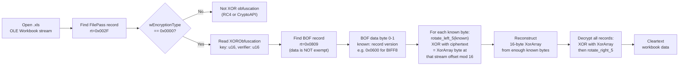
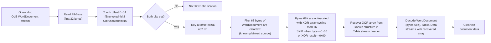
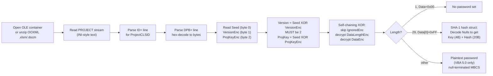
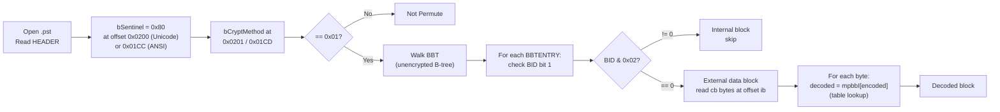
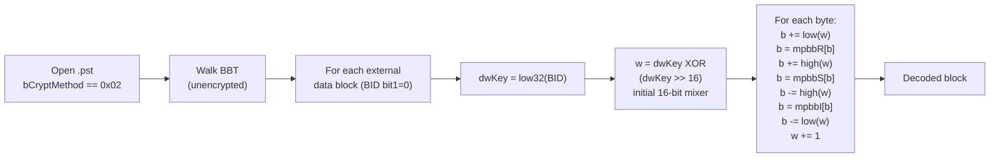
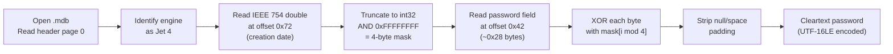

# Reversible Obfuscation: Decode Without the Password

These are schemes where the "encryption" is a reversible transform and the key material is either fixed, derived from public file metadata, or reconstructible from known plaintext. No password is needed. No brute-force. No GPU.

| # | Target | Technique | Speed | Spec Status |
|---|---|---|---|---|
| 1 | [XOR Obfuscation (Excel .xls)](#1-xor-obfuscation-excel-xls-method-1) | Known-plaintext XOR array recovery from BOF headers, then XOR + rotate-right-5 | :green_circle: Instant | [MS-OFFCRYPTO] SS2.3.7 |
| 2 | [XOR Obfuscation (Word .doc)](#2-xor-obfuscation-word-doc-method-2) | Known-plaintext XOR array recovery, then XOR with skip-on-zero | :green_circle: Instant | [MS-OFFCRYPTO] SS2.3.7 |
| 3 | [VBA Project DPB](#3-vba-project-dpb-wrapper) | Seeded self-chaining XOR, fully reversible from in-file constants | :green_circle: Instant | [MS-OVBA] SS2.4.3 |
| 4 | [PST Body Cipher (Permute)](#4-pst-body-cipher-ndb_crypt_permute) | Fixed 256-byte substitution table lookup | :green_circle: Instant | [MS-PST] SS5.1 |
| 5 | [PST Body Cipher (Cyclic)](#5-pst-body-cipher-ndb_crypt_cyclic) | Per-block substitution stream keyed by public BID | :green_circle: Instant | [MS-PST] SS5.2 |
| 6 | [Access Jet 3 (.mdb)](#6-access-jet-3-mdb) | Fixed-key XOR at header offset 0x42 | :green_circle: Instant | UNCONFIRMED (community RE) |
| 7 | [Access Jet 4 (.mdb)](#7-access-jet-4-mdb) | Date-derived XOR mask from header offset 0x72 | :green_circle: Instant | UNCONFIRMED (community RE) |

Every technique here is :green_circle: instant — the document is decoded in a single pass with no trial-and-error. The "password" either never existed, is stored in the file, or is irrelevant because the transform is invertible from public metadata alone.

---

## 1. XOR Obfuscation — Excel .xls (Method 1)

**What:** Excel 97-2003 "Password to Open" using `wEncryptionType == 0x0000` in the FilePass record. Not real encryption. The document bytes are XORed against a repeating 16-byte array derived from the password, then each byte is rotated left by 5 bits. The key insight: BIFF record headers (the `rt` and `size` fields) are *not* obfuscated, but the record *data* bytes are — and those record data bytes have known structure (BOF record data starts at predictable values). The XOR array can be recovered from known plaintext without knowing the password.

**Spec:** [MS-OFFCRYPTO] SS2.3.7.1-2.3.7.3, [MS-XLS] SS2.2.10

### Decode Pipeline



### On-Disk Layout

| Field | Location | Type | Value |
|---|---|---|---|
| BIFF record type | Workbook stream, record header byte 0 | u16 LE | `0x002F` (FilePass) |
| wEncryptionType | FilePass body offset 0 | u16 LE | `0x0000` (XOR) |
| XorKey | XORObfuscation offset 0 | u16 LE | stored key |
| verificationBytes | XORObfuscation offset 2 | u16 LE | stored verifier |
| BOF record type | first record in stream | u16 LE | `0x0809` |
| BOF data (known plaintext) | BOF record data bytes | varies | version-dependent constants |

**Records NOT obfuscated** ([MS-XLS] SS2.2.10): BOF (0x0809), FilePass (0x002F), UsrExcl, FileLock, InterfaceHdr, RRDInfo, RRDHead. Additionally, the `rt` and `size` framing of *every* record are never obfuscated — only the record data payload is transformed.

### Known-Plaintext Recovery

The transform for each byte is: `ciphertext[i] = rotate_left_5(plaintext[i]) XOR xor_array[stream_offset mod 16]`

So: `xor_array[stream_offset mod 16] = ciphertext[i] XOR rotate_left_5(plaintext[i])`

For BIFF8 files, the BOF record data begins with predictable bytes (the BIFF version field, the document type field). The first non-exempt record whose data bytes are obfuscated gives us known plaintext at known stream offsets. Since each recovered byte reveals one position in the 16-byte XOR array, we need at most 16 known-plaintext bytes at distinct `offset mod 16` positions to recover the full array.

### Python Implementation

```python
from __future__ import annotations

import struct
import olefile


def rotate_left_5(b: int) -> int:
    """Rotate an 8-bit value left by 5 bits."""
    return ((b << 5) | (b >> 3)) & 0xFF


def rotate_right_5(b: int) -> int:
    """Rotate an 8-bit value right by 5 bits."""
    return ((b >> 5) | (b << 3)) & 0xFF


def recover_xor_array_from_known_plaintext(
    ciphertext: bytes,
    plaintext: bytes,
    stream_offset: int,
) -> dict[int, int]:
    """Recover XOR array positions from known plaintext.

    Returns a dict mapping array_index -> array_byte for each
    position that can be determined from the known plaintext pair.
    """
    recovered: dict[int, int] = {}
    for i, (ct_byte, pt_byte) in enumerate(zip(ciphertext, plaintext)):
        array_idx = (stream_offset + i) % 16
        # Encrypt direction: rotate_left_5(pt) XOR array[idx] = ct
        # So: array[idx] = ct XOR rotate_left_5(pt)
        recovered[array_idx] = ct_byte ^ rotate_left_5(pt_byte)
    return recovered


def decrypt_xor_method1(data: bytes, xor_array: bytes, stream_offset: int) -> bytes:
    """Decrypt Method 1 (Excel): XOR then rotate-right-5.

    Per [MS-OFFCRYPTO] SS2.3.7.3: for each byte, XOR with the
    array element at (stream_offset mod 16), then rotate right 5.
    """
    result = bytearray(len(data))
    for i, b in enumerate(data):
        idx = (stream_offset + i) % 16
        b ^= xor_array[idx]
        result[i] = rotate_right_5(b)
    return bytes(result)


def decode_xls_xor_obfuscation(filepath: str) -> bytes:
    """Decode an XOR-obfuscated Excel .xls file without the password.

    Walks the Workbook stream, finds known-plaintext bytes from
    exempt/predictable records, reconstructs the 16-byte XOR array,
    and decodes all obfuscated record data in a single pass.
    """
    ole = olefile.OleFileIO(filepath)
    stream_name = "Workbook" if ole.exists("Workbook") else "Book"
    raw = ole.openstream(stream_name).read()
    ole.close()

    # Phase 1: locate FilePass and confirm XOR obfuscation
    pos = 0
    filepass_found = False
    while pos + 4 <= len(raw):
        rt = struct.unpack_from("<H", raw, pos)[0]
        sz = struct.unpack_from("<H", raw, pos + 2)[0]
        if rt == 0x002F:  # FilePass
            enc_type = struct.unpack_from("<H", raw, pos + 4)[0]
            if enc_type != 0x0000:
                raise ValueError("Not XOR obfuscation (wEncryptionType != 0)")
            filepass_found = True
            break
        pos += 4 + sz
    if not filepass_found:
        raise ValueError("No FilePass record found")

    # Phase 2: collect known plaintext from BOF records and other sources
    # BOF record (0x0809) data is obfuscated; its first 4 bytes are
    # the BIFF version (0x0600 for BIFF8) and document type.
    # We scan for BOF records whose data gives us known positions.
    xor_array = [None] * 16
    recovered_count = 0

    # BIFF8 BOF known bytes: version=0x0600, dt depends on substream
    # The first BOF in the Workbook globals has dt=0x0005 (workbook)
    bof_known = {
        0x0005: bytes([0x00, 0x06, 0x05, 0x00]),  # BIFF8 workbook
        0x0010: bytes([0x00, 0x06, 0x10, 0x00]),  # BIFF8 sheet
        0x0020: bytes([0x00, 0x06, 0x20, 0x00]),  # BIFF8 chart
    }

    pos = 0
    while pos + 4 <= len(raw) and recovered_count < 16:
        rt = struct.unpack_from("<H", raw, pos)[0]
        sz = struct.unpack_from("<H", raw, pos + 2)[0]
        data_offset = pos + 4  # stream offset of record data

        if rt == 0x0809 and sz >= 4:  # BOF
            ct = raw[data_offset : data_offset + 4]
            # Try each known BOF data pattern
            for _dt, known in bof_known.items():
                partial = recover_xor_array_from_known_plaintext(
                    ct,
                    known,
                    data_offset,
                )
                for idx, val in partial.items():
                    if xor_array[idx] is None:
                        xor_array[idx] = val
                        recovered_count += 1
                if recovered_count >= 16:
                    break

        pos += 4 + sz

    if recovered_count < 16:
        # Fill remaining positions from other known structures if needed.
        # In practice, multiple BOF records at different stream offsets
        # usually provide all 16 positions.
        missing = [i for i, v in enumerate(xor_array) if v is None]
        raise ValueError(f"Could not recover array positions: {missing}")

    xor_bytes = bytes(xor_array)

    # Phase 3: decode all non-exempt record data
    exempt_types = {0x0809, 0x002F, 0x0194, 0x0195, 0x00E1, 0x01AF, 0x01B0}
    output = bytearray(raw)
    pos = 0
    while pos + 4 <= len(raw):
        rt = struct.unpack_from("<H", raw, pos)[0]
        sz = struct.unpack_from("<H", raw, pos + 2)[0]
        if rt not in exempt_types and sz > 0:
            data_start = pos + 4
            decrypted = decrypt_xor_method1(
                raw[data_start : data_start + sz],
                xor_bytes,
                data_start,
            )
            output[data_start : data_start + sz] = decrypted
        pos += 4 + sz

    return bytes(output)
```

---

## 2. XOR Obfuscation — Word .doc (Method 2)

**What:** Word 97-2003 "Password to Open" using `fEncrypted == 1 AND fObfuscated == 1` in FibBase. Same family as Excel XOR, but the data transform is simpler: XOR only (no rotation), with a skip-on-zero rule that leaks plaintext structure. The initial 68 bytes of the WordDocument stream are stored in the clear, and the `Table` and `Data` streams are obfuscated in full.

**Spec:** [MS-OFFCRYPTO] SS2.3.7.4-2.3.7.6, [MS-DOC] SS2.2.6

### Decode Pipeline



### On-Disk Layout

| Field | Offset | Type | Value / Meaning |
|---|---|---|---|
| wIdent | 0x00 | u16 LE | `0xA5EC` (Word magic) |
| nFib | 0x02 | u16 LE | Format version |
| Flags word | 0x0A | u16 LE | bit 8 = fEncrypted, bit 15 = fObfuscated |
| lKey | 0x0E | u32 LE | high 16 bits = XorKey, low 16 bits = Verifier16 |

**Streams obfuscated:** WordDocument (bytes 68+), Table (0Table/1Table), Data. All other streams/storages are NOT obfuscated.

### Known-Plaintext Recovery

Method 2 has no rotation, so recovery is even simpler:

`xor_array[offset mod 16] = ciphertext[i] XOR plaintext[i]`

(subject to the skip-on-zero caveat: if `plaintext[i] == 0x00` or `plaintext[i] XOR xor_array[...] == 0x00`, the byte passes through unchanged, which itself reveals information)

The Table stream (`0Table` or `1Table`) begins with known structures. Combined with the 68 cleartext FibBase bytes that indicate where streams begin and how long they are, enough known plaintext is typically available to reconstruct all 16 array positions.

### Python Implementation

```python
from __future__ import annotations

import struct
import olefile


def decrypt_xor_method2(
    data: bytes,
    xor_array: bytes,
    start_offset: int = 0,
) -> bytes:
    """Decrypt Method 2 (Word): XOR with skip-on-zero.

    Per [MS-OFFCRYPTO] SS2.3.7.6: XOR each byte with the array
    element at (offset mod 16). If the input byte is 0x00 or the
    XOR result would be 0x00, leave the byte unchanged.
    """
    result = bytearray(len(data))
    for i, b in enumerate(data):
        idx = (start_offset + i) % 16
        if b == 0x00:
            result[i] = b  # skip: input is zero
        else:
            xored = b ^ xor_array[idx]
            if xored == 0x00:
                result[i] = b  # skip: result would be zero
            else:
                result[i] = xored
    return bytes(result)


def detect_word_xor_obfuscation(filepath: str) -> tuple[bool, int]:
    """Check if a .doc file uses XOR obfuscation. Returns (is_xor, lkey)."""
    ole = olefile.OleFileIO(filepath)
    wd = ole.openstream("WordDocument").read()
    ole.close()

    wident = struct.unpack_from("<H", wd, 0x00)[0]
    if wident != 0xA5EC:
        return False, 0

    flags = struct.unpack_from("<H", wd, 0x0A)[0]
    f_encrypted = bool(flags & (1 << 8))
    f_obfuscated = bool(flags & (1 << 15))
    lkey = struct.unpack_from("<I", wd, 0x0E)[0]

    return (f_encrypted and f_obfuscated), lkey
```

### The Skip-on-Zero Leak

Method 2 leaves bytes unchanged when `input == 0x00` or `input XOR array[idx] == 0x00`. This means:
- Every null byte in the plaintext leaks through as a null byte in the ciphertext.
- Every byte equal to `xor_array[offset mod 16]` leaks through unchanged.
- The structural pattern of null-heavy document formats (padding, string terminators) is clearly visible in the obfuscated stream.

This is an additional known-plaintext source: null bytes in the ciphertext directly reveal null bytes in the plaintext, confirming document structure.

---

## 3. VBA Project DPB Wrapper

**What:** The "Lock project for viewing" password in any Office VBA project (Excel, Word, PowerPoint, Access). The password is wrapped in a seeded self-chaining XOR cipher whose key material — `Seed`, `Version` (fixed at 2), and `ProjKey` (byte-sum of the public CLSID string) — is stored in the file itself. The wrapper is fully reversible without any secret. Under the wrapper, the payload is either a SHA-1 hash (recoverable but not invertible to the password) or, for VBA 5.0 files, the plaintext password itself.

**Spec:** [MS-OVBA] SS2.4.3, SS2.4.4

The spec explicitly states: *"The design of this encryption is to obfuscate sensitive information, not to secure it."* ([MS-OVBA] SS4.2)

### Decode Pipeline



### On-Disk Structure

| Property | Source | Content |
|---|---|---|
| `ID="<GUID>"` | PROJECT stream | CLSID string (38 chars); all-zeros when DPB stores a hash |
| `DPB="<hex>"` | PROJECT stream | Hex-encoded Encrypted Data Structure |
| `CMG="<hex>"` | PROJECT stream | Protection state (same wrapper) |
| `GC="<hex>"` | PROJECT stream | Visibility state (same wrapper) |

**Encrypted Data Structure** ([MS-OVBA] SS2.4.3.1):

| Field | Size | Description |
|---|---|---|
| Seed | 1 byte | Random encryption seed (stored unencrypted) |
| VersionEnc | 1 byte | `Seed XOR 2` |
| ProjKeyEnc | 1 byte | `Seed XOR ProjKey` |
| IgnoredEnc | 0-3 bytes | `(Seed AND 6) / 2` filler bytes |
| DataLengthEnc | 4 bytes (LE) | Encrypted payload length |
| DataEnc | variable | Encrypted payload |

**Password Hash Data Structure** (29 bytes, [MS-OVBA] SS2.4.4.1):

| Field | Offset | Size | Description |
|---|---|---|---|
| Reserved | 0 | 1 | MUST be 0xFF |
| GrbitKey | 1 (high nibble) | 4 bits | Null-byte flags for Key |
| GrbitHashNull | 1 (low nibble) - 3 | 20 bits | Null-byte flags for Hash |
| KeyNoNulls | 4 | 4 bytes | 4-byte salt (nulls replaced with 0x01) |
| PasswordHashNoNulls | 8 | 20 bytes | SHA-1 digest (nulls replaced with 0x01) |
| Terminator | 28 | 1 | MUST be 0x00 |

### Python Implementation

```python
from __future__ import annotations

import hashlib
import struct
import olefile


def _projkey_from_clsid(clsid: str) -> int:
    """Compute ProjKey as the byte-sum of the CLSID string.

    For the hash case, CLSID is all-zeros:
    {00000000-0000-0000-0000-000000000000}
    byte-sum = 0x07AC, low byte = 0xAC.
    """
    return sum(clsid.encode("ascii")) & 0xFF


def vba_decrypt_wrapper(enc_bytes: bytes) -> tuple[int, int, int, bytes]:
    """Decrypt the VBA Data Encryption wrapper ([MS-OVBA] SS2.4.3.3).

    All key material is in the encrypted blob itself.
    Returns (version, projkey, length, data).
    """
    seed = enc_bytes[0]
    version = seed ^ enc_bytes[1]  # MUST be 2
    projkey = seed ^ enc_bytes[2]

    # Initialize the three-byte chain state
    unenc_byte1 = projkey
    enc_byte1 = enc_bytes[2]  # ProjKeyEnc
    enc_byte2 = enc_bytes[1]  # VersionEnc

    pos = 3

    # Skip IgnoredEnc: (Seed AND 6) / 2 bytes
    ignored_len = (seed & 6) // 2
    for _ in range(ignored_len):
        b_enc = enc_bytes[pos]
        b_dec = (b_enc ^ ((enc_byte2 + unenc_byte1) & 0xFF)) & 0xFF
        enc_byte2 = enc_byte1
        enc_byte1 = b_enc
        unenc_byte1 = b_dec
        pos += 1

    # Decrypt DataLengthEnc (4 bytes, little-endian)
    length = 0
    for byte_idx in range(4):
        b_enc = enc_bytes[pos]
        b_dec = (b_enc ^ ((enc_byte2 + unenc_byte1) & 0xFF)) & 0xFF
        length += b_dec * (256**byte_idx)
        enc_byte2 = enc_byte1
        enc_byte1 = b_enc
        unenc_byte1 = b_dec
        pos += 1

    # Decrypt DataEnc
    data = bytearray()
    for _ in range(length):
        b_enc = enc_bytes[pos]
        b_dec = (b_enc ^ ((enc_byte2 + unenc_byte1) & 0xFF)) & 0xFF
        data.append(b_dec)
        enc_byte2 = enc_byte1
        enc_byte1 = b_enc
        unenc_byte1 = b_dec
        pos += 1

    return version, projkey, length, bytes(data)


def decode_nulls(encoded: bytes, grbit: int, bit_count: int) -> bytes:
    """Reverse the Encode Nulls transform ([MS-OVBA] SS2.4.4.3).

    Where grbit bit is 0, the original byte was 0x00 (stored as 0x01).
    Where grbit bit is 1, the stored byte is the original.
    """
    result = bytearray()
    for i in range(bit_count):
        bit_pos = bit_count - 1 - i
        bit_set = bool(grbit & (1 << bit_pos))
        if bit_set:
            result.append(encoded[i])
        else:
            result.append(0x00)
    return bytes(result)


def extract_vba_password_info(filepath: str) -> dict:
    """Extract VBA project password information from any Office file.

    Returns a dict with:
      - 'case': 'none', 'hash', or 'plaintext'
      - 'password': plaintext password (plaintext case only)
      - 'sha1_hash': 20-byte SHA-1 digest (hash case only)
      - 'key': 4-byte salt (hash case only)
    """
    ole = olefile.OleFileIO(filepath)

    # Find the PROJECT stream (may be in VBA/ or at root)
    for stream_path in [["VBA", "PROJECT"], ["PROJECT"], ["Macros", "VBA", "PROJECT"]]:
        if ole.exists("/".join(stream_path)):
            project_text = ole.openstream(stream_path).read().decode("latin-1")
            break
    else:
        ole.close()
        raise ValueError("No PROJECT stream found")
    ole.close()

    # Parse the ID= line for CLSID
    clsid = ""
    dpb_hex = ""
    for line in project_text.splitlines():
        if line.startswith("ID="):
            clsid = line.split("=", 1)[1].strip().strip('"')
        elif line.startswith("DPB="):
            dpb_hex = line.split("=", 1)[1].strip().strip('"')

    if not dpb_hex:
        return {"case": "none"}

    # Hex-decode and decrypt the wrapper
    enc_bytes = bytes.fromhex(dpb_hex)
    version, projkey, length, data = vba_decrypt_wrapper(enc_bytes)

    assert version == 2, f"Unexpected Version: {version}"

    # Distinguish payload cases
    if length == 1 and data[0] == 0x00:
        return {"case": "none"}

    if length == 29 and data[0] == 0xFF and data[28] == 0x00:
        # Password Hash Data Structure
        # Bytes 1-3: packed GrbitKey (4 bits) + GrbitHashNull (20 bits)
        grbit_24 = (data[1] << 16) | (data[2] << 8) | data[3]
        grbit_key = (grbit_24 >> 20) & 0x0F  # top 4 bits
        grbit_hash = grbit_24 & 0x000FFFFF  # bottom 20 bits

        key_encoded = data[4:8]
        hash_encoded = data[8:28]

        key = decode_nulls(key_encoded, grbit_key, 4)
        password_hash = decode_nulls(hash_encoded, grbit_hash, 20)

        return {
            "case": "hash",
            "sha1_hash": password_hash,
            "key": key,
        }

    # Plaintext password (VBA 5.0 / MAY<6>)
    password = data.rstrip(b"\x00").decode("latin-1")
    return {
        "case": "plaintext",
        "password": password,
    }


def verify_vba_password(
    candidate: str,
    key: bytes,
    stored_hash: bytes,
    codepage: int = 1252,
) -> bool:
    """Verify a candidate against a stored VBA password hash.

    SHA-1(candidate_MBCS || key) == stored_hash.
    Single-pass SHA-1, no iteration.
    """
    pw_bytes = candidate.encode(f"cp{codepage}")
    computed = hashlib.sha1(pw_bytes + key).digest()  # noqa: S324
    return computed == stored_hash
```

### What You Get

| DPB Payload | Result |
|---|---|
| Length=1, Data=0x00 | No password was set |
| Length=29 (hash struct) | SHA-1 hash + 4-byte salt. Original password not directly recoverable, but it is a single-pass SHA-1 with a 4-byte salt and no iteration — trivial to brute-force offline |
| Other length (VBA 5.0) | The plaintext password falls out directly |

**Bonus:** The VBA macro source code itself is compressed ([MS-OVBA] SS2.4.1) but NOT encrypted. It can be read from the module streams without any password at all — the DPB password gates only the VBE editor UI. Tools like `oletools` and `olevba` read the macros directly.

---

## 4. PST Body Cipher — NDB_CRYPT_PERMUTE

**What:** Outlook .pst files with `bCryptMethod == 0x01` use a fixed, keyless monoalphabetic byte substitution. Every byte in every external data block is run through a hardcoded 256-byte lookup table. No password, no key, no secret. Just `decoded[i] = mpbbI[encoded[i]]`.

**Spec:** [MS-PST] SS5.1, SS2.2.2.6

The spec states: *"These algorithms only provide data obfuscation and can be conveniently decoded once the exact encoding algorithm is understood."* ([MS-PST] SS4.1)

### Decode Pipeline



### Key Fields

| Field | Offset | Value |
|---|---|---|
| bSentinel | 0x0200 (Unicode) / 0x01CC (ANSI) | MUST be 0x80 |
| bCryptMethod | 0x0201 (Unicode) / 0x01CD (ANSI) | 0x01 = Permute |
| BBT root | HEADER.root.BREFBBT | locates the Block B-tree |
| Per-block BID | BBTENTRY.BREF.bid | bit 1: 0=external (decode), 1=internal (skip) |
| Per-block offset | BBTENTRY.BREF.ib | absolute file offset |
| Per-block size | BBTENTRY.cb | byte count of data field |

### Python Implementation

```python
from __future__ import annotations

# mpbbI: the inverse (decode) substitution table
# Bytes 512-767 of the mpbbCrypt constant from [MS-PST] SS5.1
MPBB_I: bytes = bytes(
    [
        71,
        241,
        180,
        230,
        11,
        106,
        114,
        72,
        133,
        78,
        158,
        235,
        226,
        248,
        148,
        83,
        224,
        187,
        160,
        2,
        232,
        90,
        9,
        171,
        219,
        227,
        186,
        198,
        124,
        195,
        16,
        221,
        57,
        5,
        150,
        48,
        245,
        55,
        96,
        130,
        140,
        201,
        19,
        74,
        107,
        29,
        243,
        251,
        143,
        38,
        151,
        202,
        145,
        23,
        1,
        196,
        50,
        45,
        110,
        49,
        149,
        255,
        217,
        35,
        209,
        0,
        94,
        121,
        220,
        68,
        59,
        26,
        40,
        197,
        97,
        87,
        32,
        144,
        61,
        131,
        185,
        67,
        190,
        103,
        210,
        70,
        66,
        118,
        192,
        109,
        91,
        126,
        178,
        15,
        22,
        41,
        60,
        169,
        3,
        84,
        13,
        218,
        93,
        223,
        246,
        183,
        199,
        98,
        205,
        141,
        6,
        211,
        105,
        92,
        134,
        214,
        20,
        247,
        165,
        102,
        117,
        172,
        177,
        233,
        69,
        33,
        112,
        12,
        135,
        159,
        116,
        164,
        34,
        76,
        111,
        191,
        31,
        86,
        170,
        46,
        179,
        120,
        51,
        80,
        176,
        163,
        146,
        188,
        207,
        25,
        28,
        167,
        99,
        203,
        30,
        77,
        62,
        75,
        27,
        155,
        79,
        231,
        240,
        238,
        173,
        58,
        181,
        89,
        4,
        234,
        64,
        85,
        37,
        81,
        229,
        122,
        137,
        56,
        104,
        82,
        123,
        252,
        39,
        174,
        215,
        189,
        250,
        7,
        244,
        204,
        142,
        95,
        239,
        53,
        156,
        132,
        43,
        21,
        213,
        119,
        52,
        73,
        182,
        18,
        10,
        127,
        113,
        136,
        253,
        157,
        24,
        65,
        125,
        147,
        216,
        88,
        44,
        206,
        254,
        36,
        175,
        222,
        184,
        54,
        200,
        161,
        128,
        166,
        153,
        152,
        168,
        47,
        14,
        129,
        101,
        115,
        228,
        194,
        162,
        138,
        212,
        225,
        17,
        208,
        8,
        139,
        42,
        242,
        237,
        154,
        100,
        63,
        193,
        108,
        249,
        236,
    ]
)


def crypt_permute_decode(data: bytearray, cb: int) -> None:
    """Decode a data block using NDB_CRYPT_PERMUTE ([MS-PST] SS5.1).

    Fixed table lookup: decoded[i] = mpbbI[encoded[i]].
    Operates in-place on the data bytearray.
    """
    for i in range(cb):
        data[i] = MPBB_I[data[i]]
```

---

## 5. PST Body Cipher — NDB_CRYPT_CYCLIC

**What:** Outlook .pst files with `bCryptMethod == 0x02` use a per-block keyed substitution stream. The "key" is the low 32 bits of the block's BID — which is public metadata stored in the unencrypted BBT. Not a secret. The cipher is self-inverse: running it twice with the same BID restores the original data.

**Spec:** [MS-PST] SS5.2, SS2.2.2.6

### Decode Pipeline



### Python Implementation

```python
from __future__ import annotations

# Full 768-byte table from [MS-PST] SS5.1
# mpbbR = bytes 0-255, mpbbS = bytes 256-511, mpbbI = bytes 512-767
# (mpbbR and mpbbS shown here; mpbbI is in section 4 above)

MPBB_R: bytes = bytes(
    [
        65,
        54,
        19,
        98,
        168,
        33,
        110,
        187,
        244,
        22,
        204,
        4,
        127,
        100,
        232,
        93,
        30,
        242,
        203,
        42,
        116,
        197,
        94,
        53,
        210,
        149,
        71,
        158,
        150,
        45,
        154,
        136,
        76,
        125,
        132,
        63,
        219,
        172,
        49,
        182,
        72,
        95,
        246,
        196,
        216,
        57,
        139,
        231,
        35,
        59,
        56,
        142,
        200,
        193,
        223,
        37,
        177,
        32,
        165,
        70,
        96,
        78,
        156,
        251,
        170,
        211,
        86,
        81,
        69,
        124,
        85,
        0,
        7,
        201,
        43,
        157,
        133,
        155,
        9,
        160,
        143,
        173,
        179,
        15,
        99,
        171,
        137,
        75,
        215,
        167,
        21,
        90,
        113,
        102,
        66,
        191,
        38,
        74,
        107,
        152,
        250,
        234,
        119,
        83,
        178,
        112,
        5,
        44,
        253,
        89,
        58,
        134,
        126,
        206,
        6,
        235,
        130,
        120,
        87,
        199,
        141,
        67,
        175,
        180,
        28,
        212,
        91,
        205,
        226,
        233,
        39,
        79,
        195,
        8,
        114,
        128,
        207,
        176,
        239,
        245,
        40,
        109,
        190,
        48,
        77,
        52,
        146,
        213,
        14,
        60,
        34,
        50,
        229,
        228,
        249,
        159,
        194,
        209,
        10,
        129,
        18,
        225,
        238,
        145,
        131,
        118,
        227,
        151,
        230,
        97,
        138,
        23,
        121,
        164,
        183,
        220,
        144,
        122,
        92,
        140,
        2,
        166,
        202,
        105,
        222,
        80,
        26,
        17,
        147,
        185,
        82,
        135,
        88,
        252,
        237,
        29,
        55,
        73,
        27,
        106,
        224,
        41,
        51,
        153,
        189,
        108,
        217,
        148,
        243,
        64,
        84,
        111,
        240,
        198,
        115,
        184,
        214,
        62,
        101,
        24,
        68,
        31,
        221,
        103,
        16,
        241,
        12,
        25,
        236,
        174,
        3,
        161,
        20,
        123,
        169,
        11,
        255,
        248,
        163,
        192,
        162,
        1,
        247,
        46,
        188,
        36,
        104,
        117,
        13,
        254,
        186,
        47,
        181,
        208,
        218,
        61,
    ]
)

MPBB_S: bytes = bytes(
    [
        20,
        83,
        15,
        86,
        179,
        200,
        122,
        156,
        235,
        101,
        72,
        23,
        22,
        21,
        159,
        2,
        204,
        84,
        124,
        131,
        0,
        13,
        12,
        11,
        162,
        98,
        168,
        118,
        219,
        217,
        237,
        199,
        197,
        164,
        220,
        172,
        133,
        116,
        214,
        208,
        167,
        155,
        174,
        154,
        150,
        113,
        102,
        195,
        99,
        153,
        184,
        221,
        115,
        146,
        142,
        132,
        125,
        165,
        94,
        209,
        93,
        147,
        177,
        87,
        81,
        80,
        128,
        137,
        82,
        148,
        79,
        78,
        10,
        107,
        188,
        141,
        127,
        110,
        71,
        70,
        65,
        64,
        68,
        1,
        17,
        203,
        3,
        63,
        247,
        244,
        225,
        169,
        143,
        60,
        58,
        249,
        251,
        240,
        25,
        48,
        130,
        9,
        46,
        201,
        157,
        160,
        134,
        73,
        238,
        111,
        77,
        109,
        196,
        45,
        129,
        52,
        37,
        135,
        27,
        136,
        170,
        252,
        6,
        161,
        18,
        56,
        253,
        76,
        66,
        114,
        100,
        19,
        55,
        36,
        106,
        117,
        119,
        67,
        255,
        230,
        180,
        75,
        54,
        92,
        228,
        216,
        53,
        61,
        69,
        185,
        44,
        236,
        183,
        49,
        43,
        41,
        7,
        104,
        163,
        14,
        105,
        123,
        24,
        158,
        33,
        57,
        190,
        40,
        26,
        91,
        120,
        245,
        35,
        202,
        42,
        176,
        175,
        62,
        254,
        4,
        140,
        231,
        229,
        152,
        50,
        149,
        211,
        246,
        74,
        232,
        166,
        234,
        233,
        243,
        213,
        47,
        112,
        32,
        242,
        31,
        5,
        103,
        173,
        85,
        16,
        206,
        205,
        227,
        39,
        59,
        218,
        186,
        215,
        194,
        38,
        212,
        145,
        29,
        210,
        28,
        34,
        51,
        248,
        250,
        241,
        90,
        239,
        207,
        144,
        182,
        139,
        181,
        189,
        192,
        191,
        8,
        151,
        30,
        108,
        226,
        97,
        224,
        198,
        193,
        89,
        171,
        187,
        88,
        222,
        95,
        223,
        96,
        121,
        126,
        178,
        138,
    ]
)


def crypt_cyclic(data: bytearray, cb: int, dw_key: int) -> None:
    """Decode (or encode) a data block using NDB_CRYPT_CYCLIC.

    Self-inverse: running this twice with the same dwKey restores
    the original data. dwKey is the low 32 bits of the block's BID.
    Per [MS-PST] SS5.2.
    """
    w = (dw_key ^ (dw_key >> 16)) & 0xFFFF

    for i in range(cb):
        b = data[i]
        w_lo = w & 0xFF
        w_hi = (w >> 8) & 0xFF

        b = (b + w_lo) & 0xFF
        b = MPBB_R[b]
        b = (b + w_hi) & 0xFF
        b = MPBB_S[b]
        b = (b - w_hi) & 0xFF
        b = MPBB_I[b]
        b = (b - w_lo) & 0xFF

        data[i] = b
        w = (w + 1) & 0xFFFF


def decode_pst_block(
    data: bytearray,
    crypt_method: int,
    bid: int,
) -> None:
    """Decode one PST data block in-place.

    crypt_method: from HEADER.bCryptMethod (0x00/0x01/0x02)
    bid: from BBTENTRY, used as dwKey for cyclic
    """
    cb = len(data)
    if crypt_method == 0x00:
        return  # NDB_CRYPT_NONE
    if crypt_method == 0x01:
        crypt_permute_decode(data, cb)  # NDB_CRYPT_PERMUTE
    elif crypt_method == 0x02:
        dw_key = bid & 0xFFFFFFFF
        crypt_cyclic(data, cb, dw_key)  # NDB_CRYPT_CYCLIC
```

---

## 6. Access Jet 3 (.mdb)

> **UNCONFIRMED** — no `[MS-ACCESS]` or `[MS-JET]` spec exists. All details below are from community reverse-engineering (mdbtools, Jackcess).

**What:** Access 97 databases store the database-open password at header offset 0x42, XOR-masked with a hardcoded fixed key. The database body pages are stored in cleartext — the password gates only the engine's open check. Read the header, apply the fixed XOR mask, and the password falls out.

### Decode Pipeline


### Python Implementation

```python
from __future__ import annotations

import struct

# UNCONFIRMED: fixed XOR key from mdbtools/Jackcess source code.
# These bytes must be verified against the actual mdbtools implementation.
JET3_FIXED_KEY: bytes = bytes(
    [
        0x86,
        0xFB,
        0xEC,
        0x37,
        0x5D,
        0x44,
        0x9C,
        0xFA,
        0xC6,
        0x5E,
        0x28,
        0xE6,
        0x13,
        0xB6,
        0x8A,
        0x60,
        0x54,
        0x94,
        0x7B,
        0x36,
    ]
)

JET3_PWD_OFFSET: int = 0x42
JET3_PWD_LEN: int = 0x14  # 20 bytes


def decode_jet3_password(header: bytes) -> str:
    """Decode Jet 3 database-open password (UNCONFIRMED).

    XOR the stored password field with the fixed key.
    The database body is cleartext regardless.
    """
    field = header[JET3_PWD_OFFSET : JET3_PWD_OFFSET + JET3_PWD_LEN]
    cleartext = bytes(f ^ k for f, k in zip(field, JET3_FIXED_KEY))
    return cleartext.rstrip(b"\x00").rstrip(b" ").decode("latin-1")
```

---

## 7. Access Jet 4 (.mdb)

> **UNCONFIRMED** — same out-of-corpus caveat as Jet 3.

**What:** Access 2000-2003 databases store the password at header offset 0x42, XOR-masked with a 4-byte key derived from the creation-date double at header offset 0x72. The mask is derived entirely from the same header page — no external secret. Body pages remain cleartext.

### Decode Pipeline



### Python Implementation

```python
from __future__ import annotations

import struct

JET4_PWD_OFFSET: int = 0x42
JET4_PWD_LEN: int = 0x28  # 40 bytes (UTF-16LE, up to 20 chars)
JET4_DATE_OFFSET: int = 0x72


def decode_jet4_password(header: bytes) -> str:
    """Decode Jet 4 database-open password (UNCONFIRMED).

    The XOR mask is derived from the creation-date IEEE 754 double
    stored in the same header page. Body pages are cleartext.
    """
    # Read the creation date as an IEEE 754 double
    date_double = struct.unpack_from("<d", header, JET4_DATE_OFFSET)[0]

    # Truncate to a 32-bit integer and serialize as 4 little-endian bytes
    mask_int = int(date_double) & 0xFFFFFFFF
    mask = struct.pack("<I", mask_int)

    # XOR the password field with the cycling 4-byte mask
    field = header[JET4_PWD_OFFSET : JET4_PWD_OFFSET + JET4_PWD_LEN]
    cleartext = bytes(f ^ mask[i % 4] for i, f in enumerate(field))

    # Jet 4 stores passwords as UTF-16LE
    return cleartext.rstrip(b"\x00").decode("utf-16-le", errors="replace")
```

---

## Cross-Reference to Analysis Documents

| Decode Path | Analysis Document | Spec |
|---|---|---|
| XOR Obfuscation (Excel/Word) | [xor-obfuscation.md](../research/algorithms/password/xor-obfuscation.md) | [MS-OFFCRYPTO] SS2.3.7 |
| VBA DPB Wrapper | [vba-project-password.md](../research/algorithms/password/vba-project-password.md) | [MS-OVBA] SS2.4.3, SS2.4.4 |
| PST Body Cipher | [pst-body-cipher.md](../research/algorithms/non-password/pst-body-cipher.md) | [MS-PST] SS5.1, SS5.2 |
| Access Jet Obfuscation | [access-jet-obfuscation.md](../research/algorithms/non-password/access-jet-obfuscation.md) | No spec (community RE) |

## What Is NOT Here

These are real encryption schemes that cannot be decoded without the password (or a very expensive brute-force attack):

| Scheme | Why It Is Not Reversible |
|---|---|
| RC4 40-bit (Office 97) | Real stream cipher with MD5-derived key. Weak, but requires cracking not decoding. |
| RC4 CryptoAPI (Office 2003) | SHA-1 key derivation with salt. Brute-forceable but not reversible. |
| ECMA-376 Standard (Office 2007) | AES-128-CBC with SHA-1 key derivation, 50k iterations. |
| ECMA-376 Agile (Office 2010+) | AES-128/256-CBC with SHA-512 key derivation, 100k+ iterations. |
| ACE 2010+ (.accdb) | Reportedly SHA-512 + AES-256-CBC per page, 100k iterations. |
| IRM/RMS | Server-bound key material; no local decode path. |
