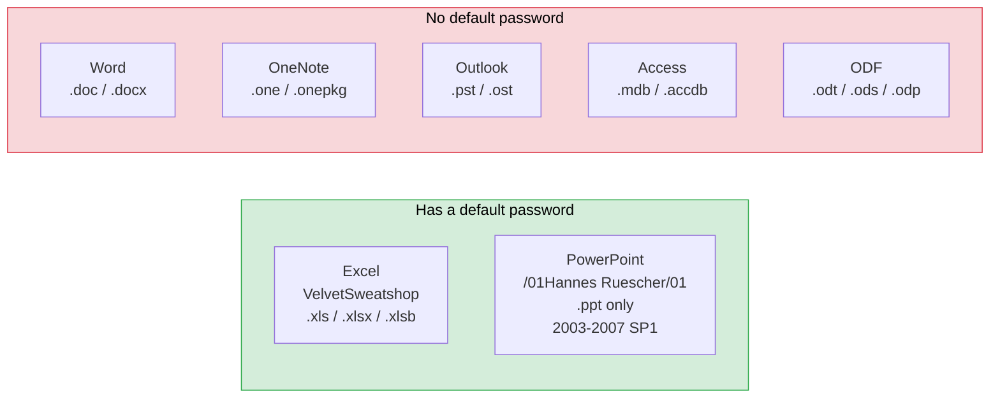
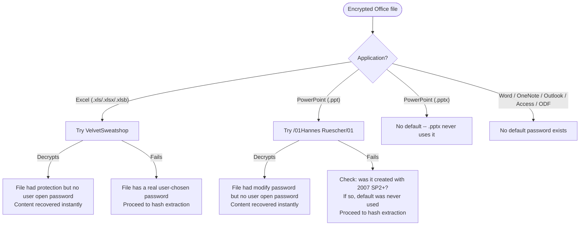

# Default Passwords — Try Before Anything Else

Two Microsoft Office applications ship with **spec-defined default passwords** that silently encrypt files when a protection record is set but the user never supplies an open password. Before attempting any hash extraction, cracking, or protection stripping, try these passwords first — they succeed instantly on a large class of "encrypted" files.

Word, OneNote, Outlook (PST/OST), Access, and ODF formats have **no default passwords**.

## Which Products Have Defaults?



## Decision Flowchart



---

## VelvetSweatshop (Excel)

| Field | Value |
|---|---|
| Password string | `VelvetSweatshop` |
| Hex bytes (UTF-16LE input) | `56 65 6C 76 65 74 53 77 65 61 74 73 68 6F 70` |
| Spec reference | [MS-OFFCRYPTO] SS2.4.2.3, Appendix A notes \<24\>, \<25\> |
| Applies to | Excel 2007, Excel 2010, Excel 2013 |
| Formats | `.xls` (BIFF8), `.xlsx` (OOXML), `.xlsb` (binary OOXML) |
| Recovery speed | Instant — single decryption attempt |

### When Excel Uses VelvetSweatshop

Excel auto-encrypts the entire workbook stream under this fixed password when a protection verifier is set but the user never supplied an open/encryption password. The encryption method used is ECMA-376 Document Encryption as specified in [MS-OFFCRYPTO] SS2.3.4.

The trigger conditions are any of the following:

| Format | Record / Element | Field | Trigger condition | Spec reference |
|---|---|---|---|---|
| .xls | `Password` (0x0013) in Globals substream | `wPassword` | != 0x0000 | [MS-XLS] SS2.4.191, product note \<100\> |
| .xls | `Prot4RevPass` (0x01BC) | `protPwdRev` | != 0x0000 | [MS-XLS] SS2.4.206, product note \<104\> |
| .xlsb | `BrtBookProtection` (type 534) | `protpwdBook` | != 0x0000 | [MS-XLSB] SS2.4.308, product note \<25\> |
| .xlsb | `BrtBookProtection` (type 534) | `protpwdRev` | != 0x0000 | [MS-XLSB] SS2.4.308, product note \<26\> |
| .xlsb | `BrtBookProtectionIso` (type 677) | `ipdBookPasswordData.rgbHash` | non-empty (cbLength > 0) | [MS-XLSB] SS2.4.309, product note \<27\> |
| .xlsb | `BrtBookProtectionIso` (type 677) | `ipdRevPasswordData.rgbHash` | non-empty (cbLength > 0) | [MS-XLSB] SS2.4.309, product note \<28\> |

In plain English: the user set sheet protection, workbook protection, or revision protection but never clicked through the "encrypt with password" dialog. Excel quietly encrypts the file under `VelvetSweatshop` so the protection verifier is carried inside an encrypted container.

### Detecting VelvetSweatshop Files

A VelvetSweatshop-encrypted file looks identical to a user-password-encrypted file on disk. There is no flag or marker distinguishing them. The only way to know is to attempt decryption with the default password.

For `.xlsx` / `.xlsb`: the file on disk is an OLE/CFB container (starts with `D0 CF 11 E0`), not a ZIP (not `PK\x03\x04`), containing `\EncryptionInfo` and `\EncryptedPackage` streams — exactly the same structure as a user-password-encrypted file.

For `.xls`: the `Workbook` stream contains a `FilePass` record (0x002F) with XOR, RC4+MD5, or RC4 CryptoAPI encryption parameters — again indistinguishable from user-chosen encryption.

### Python: Try VelvetSweatshop with msoffcrypto-tool

```python
from __future__ import annotations

import msoffcrypto
import io
from pathlib import Path


def try_velvetsweatshop(file_path: str | Path) -> io.BytesIO | None:
    """Attempt to decrypt an Excel file using the VelvetSweatshop default password.

    Returns a BytesIO with the decrypted content on success, None on failure.
    Try this FIRST on any encrypted Excel file before password cracking.
    Per [MS-OFFCRYPTO] SS2.4.2.3.
    """
    file_path = Path(file_path)

    with file_path.open("rb") as f:
        try:
            office_file = msoffcrypto.OfficeFile(f)
        except Exception:
            # Not a recognized encrypted Office file
            return None

        if not office_file.is_encrypted():
            return None

        # Try the spec-defined default password
        office_file.load_key(password="VelvetSweatshop")

        decrypted = io.BytesIO()
        try:
            office_file.decrypt(decrypted)
        except Exception:
            # Default password did not work -- file has a real user password
            return None

    decrypted.seek(0)
    return decrypted


if __name__ == "__main__":
    import sys

    if len(sys.argv) != 2:
        print(f"Usage: {sys.argv[0]} <encrypted-excel-file>")
        sys.exit(1)

    result = try_velvetsweatshop(sys.argv[1])
    if result is not None:
        out_path = Path(sys.argv[1]).stem + "_decrypted" + Path(sys.argv[1]).suffix
        Path(out_path).write_bytes(result.read())
        print(f"VelvetSweatshop worked -- decrypted to {out_path}")
    else:
        print("VelvetSweatshop did not work -- file has a real user password")
```

### What You Get After Decryption

When VelvetSweatshop succeeds, the decrypted file still has its protection verifiers in place (sheet protection, workbook protection, revision protection). Those are all strippable gates — 16-bit verifiers (.xls) or ISO hashes (.xlsx) that can be removed by zeroing or deleting the protection records/elements. See the [protection stripping](strip.md) techniques.

The file never had a real open password — the encryption was just a side effect of setting protection on a file that Excel then needed to "seal."

---

## /01Hannes Ruescher/01 (PowerPoint)

| Field | Value |
|---|---|
| Password string | `/01Hannes Ruescher/01` |
| Hex bytes (ASCII) | `2F 30 31 48 61 6E 6E 65 73 20 52 75 65 73 63 68 65 72 2F 30 31` |
| Spec reference | [MS-OFFCRYPTO] SS2.4.2.3, SS5 note \<26\> |
| Applies to | PowerPoint 2003, PowerPoint 2007, PowerPoint 2007 SP1 |
| Stopped in | PowerPoint 2007 SP2 |
| Formats | `.ppt` only (OLE/CFB binary format) |
| Recovery speed | Instant — single decryption attempt |

### When PowerPoint Uses /01Hannes Ruescher/01

PowerPoint's binary format stores the modify password in cleartext UTF-16LE in the `ModifyPasswordAtom` record (RT 0x0FBA, recInstance 0x003) — this is [MS-OFFCRYPTO] SS2.4.2.3 "Binary Document Write Protection Method 3." The spec says files with a modify password MUST be encrypted. When the user set a modify password but did not separately set an open/encryption password, PowerPoint 2003 through 2007 SP1 encrypted the file under `/01Hannes Ruescher/01`.

The encryption method is RC4 CryptoAPI + SHA-1, the only encryption PowerPoint binary supports ([MS-PPT] SS2.3.7). The key derivation has no iteration: `H0 = SHA-1(salt + password)`, then `Hfinal = SHA-1(H0 + blockNumber)`.

### Version Applicability

| PowerPoint Version | Uses Default Password? |
|---|---|
| PowerPoint 2003 | Yes |
| PowerPoint 2007 | Yes |
| PowerPoint 2007 SP1 | Yes |
| PowerPoint 2007 SP2 | **No** — stopped using it |
| PowerPoint 2010+ | No |

The spec note \<26\> in [MS-OFFCRYPTO] SS5 states: "Due to security concerns, it is preferable not to use the default password."

A `.ppt` file created without the default password (2007 SP2+) can still be opened by earlier versions — the change is in the saving application, not the format.

### .pptx Never Uses a Default Password

The OOXML PowerPoint format (`.pptx`, `.pptm`, `.ppsx`, `.potx`) does **not** use the `/01Hannes Ruescher/01` default password. The modify verifier in `.pptx` is stored as a `<p:modifyVerifier>` element in `ppt/presentation.xml` using an ISO hash — it does not trigger file-level encryption.

### Python: Try /01Hannes Ruescher/01 with msoffcrypto-tool

```python
from __future__ import annotations

import msoffcrypto
import io
from pathlib import Path

# The default password for PowerPoint 2003-2007 SP1
# Per [MS-OFFCRYPTO] SS2.4.2.3, SS5 note <26>
HANNES_RUESCHER = "/01Hannes Ruescher/01"


def try_hannes_ruescher(file_path: str | Path) -> io.BytesIO | None:
    """Attempt to decrypt a .ppt file using the /01Hannes Ruescher/01 default password.

    Returns a BytesIO with the decrypted content on success, None on failure.
    Only applies to .ppt files from PowerPoint 2003 through 2007 SP1.
    """
    file_path = Path(file_path)

    with file_path.open("rb") as f:
        try:
            office_file = msoffcrypto.OfficeFile(f)
        except Exception:
            return None

        if not office_file.is_encrypted():
            return None

        office_file.load_key(password=HANNES_RUESCHER)

        decrypted = io.BytesIO()
        try:
            office_file.decrypt(decrypted)
        except Exception:
            return None

    decrypted.seek(0)
    return decrypted
```

### What You Get After Decryption

When the default password works, the decrypted `.ppt` file contains the modify password in cleartext UTF-16LE in the `ModifyPasswordAtom`. That password is readable with a hex editor or by parsing the OLE stream — it is not hashed, not obfuscated, stored verbatim. The modify password itself is not a security mechanism ([MS-OFFCRYPTO] SS4.1.4).

---

## Combined Trial Script

Try both default passwords on any encrypted Office file:

```python
from __future__ import annotations

import msoffcrypto
import io
from pathlib import Path

# Per [MS-OFFCRYPTO] SS2.4.2.3
DEFAULT_PASSWORDS = [
    ("VelvetSweatshop", "Excel 2007-2013"),
    ("/01Hannes Ruescher/01", "PowerPoint 2003-2007 SP1"),
]


def try_defaults(file_path: str | Path) -> tuple[str, io.BytesIO] | None:
    """Try all known default passwords against an encrypted Office file.

    Returns (password_name, decrypted_stream) on success, None if all fail.
    """
    file_path = Path(file_path)

    for password, description in DEFAULT_PASSWORDS:
        with file_path.open("rb") as f:
            try:
                office_file = msoffcrypto.OfficeFile(f)
            except Exception:
                return None

            if not office_file.is_encrypted():
                return None

            office_file.load_key(password=password)

            decrypted = io.BytesIO()
            try:
                office_file.decrypt(decrypted)
                decrypted.seek(0)
                print(f"Default password worked: {password} ({description})")
                return password, decrypted
            except Exception:
                continue

    return None


if __name__ == "__main__":
    import sys

    if len(sys.argv) != 2:
        print(f"Usage: {sys.argv[0]} <encrypted-office-file>")
        sys.exit(1)

    result = try_defaults(sys.argv[1])
    if result is not None:
        password, stream = result
        out_path = Path(sys.argv[1]).stem + "_decrypted" + Path(sys.argv[1]).suffix
        Path(out_path).write_bytes(stream.read())
        print(f"Decrypted to {out_path}")
    else:
        print("No default password worked -- file has a real user-chosen password")
```

---

## Quick Reference

| | Product | Default Password | Hex Bytes | Spec | Versions | Formats |
|---|---|---|---|---|---|---|
| :green_circle: | Excel | `VelvetSweatshop` | `56 65 6C 76 65 74 53 77 65 61 74 73 68 6F 70` | [MS-OFFCRYPTO] SS2.4.2.3 note \<24\> | 2007, 2010, 2013 | .xls, .xlsx, .xlsb |
| :yellow_circle: | PowerPoint | `/01Hannes Ruescher/01` | `2F 30 31 48 61 6E 6E 65 73 20 52 75 65 73 63 68 65 72 2F 30 31` | [MS-OFFCRYPTO] SS5 note \<26\> | 2003, 2007, 2007 SP1 | .ppt only |
| :red_circle: | Word | None | — | — | — | — |
| :red_circle: | OneNote | None | — | — | — | — |
| :red_circle: | Outlook | None | — | — | — | — |
| :red_circle: | Access | None | — | — | — | — |
| :red_circle: | ODF | None | — | — | — | — |

:green_circle: = try first on any encrypted file of this type, instant recovery if it works
:yellow_circle: = try on .ppt files only, limited to older versions (2003-2007 SP1)
:red_circle: = no default password exists, do not waste time trying

## Why These Defaults Exist

Both defaults exist because of the same design decision: the spec requires that files with certain protection records be encrypted ([MS-OFFCRYPTO] SS2.4.2.3). When the user sets a protection verifier (sheet/workbook/revision protection in Excel, modify password in PowerPoint) but does not separately set an open password, the application needs a password to feed into the encryption engine. Rather than leaving the file unencrypted (which would expose the protection verifier to trivial removal), the application encrypts under a fixed default password.

The result is a file that appears encrypted but can be opened by anyone who knows the default password — which is published in the spec itself.

## Cross-References

- VelvetSweatshop trigger conditions: [../research/formats/excel.md](../research/formats/excel.md) — "VelvetSweatshop Trigger Conditions" section
- `/01Hannes Ruescher/01` trigger mechanism: [../research/formats/powerpoint.md](../research/formats/powerpoint.md) — "Default password: /01Hannes Ruescher/01" section
- Protection stripping after decryption: [strip.md](strip.md)
- RC4 CryptoAPI encryption details: [../research/algorithms/password/rc4-cryptoapi-sha1.md](../research/algorithms/password/rc4-cryptoapi-sha1.md)
- ECMA-376 encryption details: [../research/algorithms/password/ecma376-agile.md](../research/algorithms/password/ecma376-agile.md)
