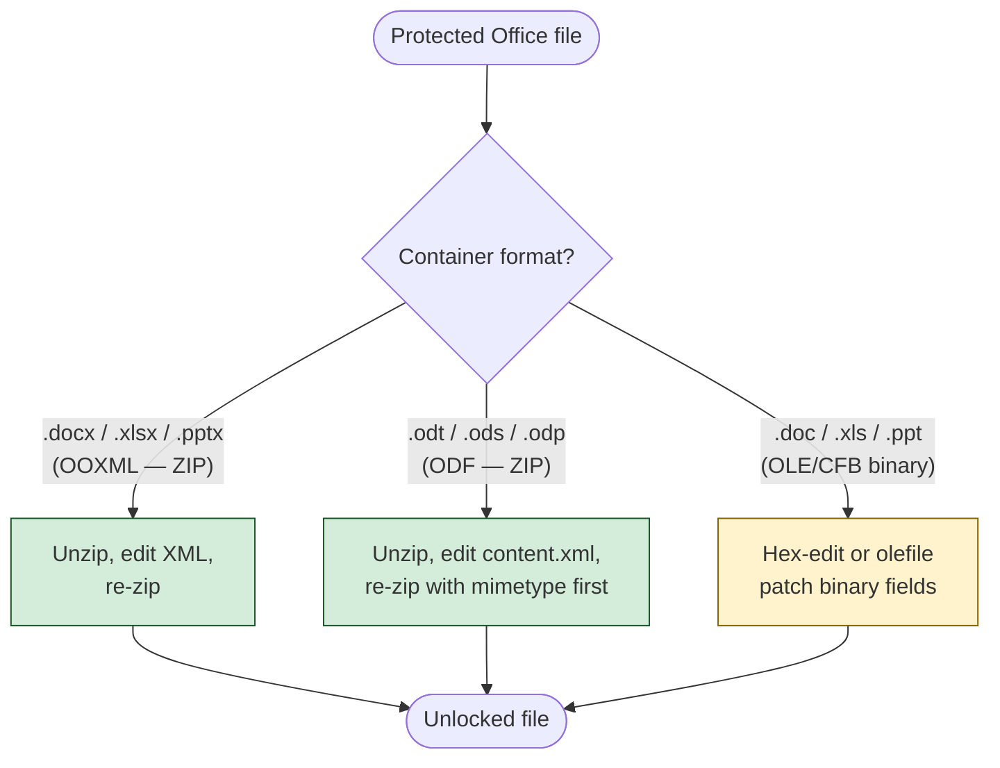

# Strip Protection Elements to Unlock Editing

Remove advisory protection gates from Office and ODF files without breaking the password. These gates store verifier hashes or boolean flags alongside plaintext content — the document body is never encrypted. Stripping the gate element restores full editing access instantly.

> **Scope.** This document covers only strippable gates (marked with a yellow badge in the format analysis docs). Document-open encryption, OneNote section passwords, and IRM/RMS certificate-based protection encrypt the content itself and cannot be stripped — see [What You Cannot Strip](#what-you-cannot-strip) at the end.



## Quick Reference: All Strippable Gates

| Badge | Format | Gate | Target to Remove | Spec |
|---|---|---|---|---|
| :green_circle: | .xlsx | Sheet protection | `<sheetProtection>` in `xl/worksheets/sheetN.xml` | [MS-OE376] SS2.1.681 |
| :green_circle: | .xlsx | Workbook protection | `<workbookProtection>` in `xl/workbook.xml` | [MS-OE376] SS2.1.621 |
| :green_circle: | .xlsx | Write reservation | `<fileSharing>` in `xl/workbook.xml` | [MS-OE376] SS2.1.607 |
| :green_circle: | .xlsx | Edit ranges | `<protectedRange>` in `xl/worksheets/sheetN.xml` | [MS-XLSX] SS2.6.56 |
| :green_circle: | .xlsx | Revision protection | `revisions*` attrs on `<workbookProtection>` | [MS-OE376] SS2.1.621 |
| :green_circle: | .docx | Write reservation | `<w:writeProtection>` in `word/settings.xml` | [MS-OI29500] SS2.1.426 |
| :green_circle: | .docx | Restrict editing | `<w:documentProtection>` in `word/settings.xml` | [MS-OI29500] SS2.1.402 |
| :green_circle: | .pptx | Modify verifier | `<p:modifyVerifier>` in `ppt/presentation.xml` | [MS-OI29500] SS2.1.1104 |
| :green_circle: | all OOXML | Digital signatures | `_xmlsignatures/` directory | [MS-OFFCRYPTO] SS2.5.2 |
| :green_circle: | .ods | Sheet protection | `table:protected` on `<table:table>` in `content.xml` | OASIS ODF SS19.700 |
| :green_circle: | .ods | Workbook structure | `table:structure-protected` on `<office:spreadsheet>` | OASIS ODF SS8.5.1 |
| :green_circle: | .odt | Section protection | `text:protected` on `<text:section>` in `content.xml` | OASIS ODF SS19.855 |
| :yellow_circle: | .xls | Sheet/workbook prot | `Password` record 0x0013, `Protect` 0x0012 | [MS-XLS] SS2.4.191 |
| :yellow_circle: | .xls | Write reservation | `FileSharing` 0x005B, `WriteProtect` 0x0086 | [MS-XLS] SS2.4.118 |
| :yellow_circle: | .xls | Revision protection | `Prot4RevPass` 0x01BC | [MS-XLS] SS2.4.206 |
| :yellow_circle: | .doc | Document protection | `DopBase.lKeyProtDoc` at Table stream DopBase+72 | [MS-DOC] SS2.7.2 |
| :yellow_circle: | .doc | Write reservation | `SttbfAssoc` index 0x11 (cleartext password) | [MS-DOC] SS2.9.276 |

Badge key: :green_circle: = instant XML edit, :yellow_circle: = binary patch (slightly more involved), :red_circle: = cannot strip.

---

## Part 1: OOXML Files (.docx / .xlsx / .pptx)

OOXML files are ZIP archives containing XML parts. The procedure is always:

1. Unzip the file
2. Edit or delete the protection XML element
3. Re-zip with the same structure

### Base Procedure: Unzip / Edit / Re-zip

```bash
# Unzip
mkdir work && cd work
unzip ../protected.xlsx

# ... edit the XML files (see sections below) ...

# Re-zip — store order matters for [Content_Types].xml at root
cd work
zip -r ../unlocked.xlsx . -x '*.DS_Store'
```

Python equivalent that handles the full round-trip:

```python
from __future__ import annotations

import shutil
import zipfile
from pathlib import Path
from xml.etree import ElementTree as ET


def strip_ooxml_elements(
    src: Path,
    dst: Path,
    removals: dict[str, list[str]],
) -> list[str]:
    """Remove named XML elements from an OOXML package.

    Args:
        src: Path to the protected OOXML file.
        dst: Path for the unlocked output file.
        removals: Mapping of ZIP member path to list of element tag
            names (with namespace prefix) to delete.
            Example: {"xl/worksheets/sheet1.xml": ["{...}sheetProtection"]}

    Returns:
        List of human-readable descriptions of what was removed.
    """
    log: list[str] = []
    with zipfile.ZipFile(src, "r") as zin, zipfile.ZipFile(dst, "w") as zout:
        for item in zin.infolist():
            data = zin.read(item.filename)
            if item.filename in removals:
                tree = ET.fromstring(data)
                for tag in removals[item.filename]:
                    for elem in tree.findall(f".//{tag}"):
                        parent = tree.find(f".//{tag}/..")
                        if parent is None:
                            # Element is root child — walk the tree.
                            for p in tree.iter():
                                if elem in list(p):
                                    p.remove(elem)
                                    log.append(f"Removed <{tag.split('}')[1]}> from {item.filename}")
                                    break
                        else:
                            parent.remove(elem)
                            log.append(f"Removed <{tag.split('}')[1]}> from {item.filename}")
                data = ET.tostring(tree, xml_declaration=True, encoding="UTF-8")
            zout.writestr(item, data)
    return log
```

---

### 1. Excel Sheet Protection (.xlsx)

**What it gates:** Prevents editing cells, formatting, sorting, filtering on individual worksheets.

**Location:** `xl/worksheets/sheetN.xml` — one `<sheetProtection>` element per sheet.

**Element to delete:**

```xml
<!-- Delete the entire element, including all attributes -->
<sheetProtection
    sheet="1" objects="1" scenarios="1"
    algorithmName="SHA-512"
    hashValue="TI4jF..."
    saltValue="rNh+..."
    spinCount="100000"/>
```

**Bash procedure:**

```bash
mkdir work && cd work
unzip ../protected.xlsx

# Remove sheetProtection from every worksheet
for f in xl/worksheets/sheet*.xml; do
    sed -i 's/<sheetProtection[^\/]*\/>//' "$f"
    # Handle non-self-closing variant too
    sed -i 's/<sheetProtection[^>]*>[^<]*<\/sheetProtection>//' "$f"
done

zip -r ../unlocked.xlsx .
cd .. && rm -rf work
```

**Python procedure:**

```python
from __future__ import annotations

import zipfile
from pathlib import Path
from xml.etree import ElementTree as ET

NS = "http://schemas.openxmlformats.org/spreadsheetml/2006/main"


def strip_sheet_protection(src: Path, dst: Path) -> None:
    """Remove sheetProtection from every worksheet in an xlsx file."""
    with zipfile.ZipFile(src, "r") as zin, zipfile.ZipFile(dst, "w") as zout:
        for item in zin.infolist():
            data = zin.read(item.filename)
            if item.filename.startswith("xl/worksheets/sheet") and item.filename.endswith(".xml"):
                tree = ET.fromstring(data)
                for elem in tree.findall(f".//{{{NS}}}sheetProtection"):
                    tree.remove(elem)
                data = ET.tostring(tree, xml_declaration=True, encoding="UTF-8")
            zout.writestr(item, data)
```

---

### 2. Excel Workbook Protection (.xlsx)

**What it gates:** Prevents adding, deleting, renaming, or reordering sheets (`lockStructure`), and prevents window resizing (`lockWindows`).

**Location:** `xl/workbook.xml` — `<workbookProtection>` element.

**Element to delete:**

```xml
<workbookProtection
    lockStructure="1"
    lockWindows="0"
    workbookAlgorithmName="SHA-512"
    workbookHashValue="abc123..."
    workbookSaltValue="def456..."
    workbookSpinCount="100000"/>
```

**Bash:**

```bash
sed -i 's/<workbookProtection[^\/]*\/>//' xl/workbook.xml
```

---

### 3. Excel Write Reservation (.xlsx)

**What it gates:** Forces a "read-only recommended" prompt and requires a password to save back to the original file.

**Location:** `xl/workbook.xml` — `<fileSharing>` element.

**Element to delete:**

```xml
<fileSharing
    userName="JDoe"
    readOnlyRecommended="1"
    algorithmName="SHA-512"
    hashValue="base64hash..."
    saltValue="base64salt..."
    spinCount="100000"/>
```

**Bash:**

```bash
sed -i 's/<fileSharing[^\/]*\/>//' xl/workbook.xml
```

---

### 4. Excel Edit Ranges (.xlsx)

**What it gates:** Password-protected editable ranges on a protected sheet. Users without the range password cannot edit cells in the specified `sqref`.

**Location:** `xl/worksheets/sheetN.xml` — `<protectedRange>` elements inside `<protectedRanges>`.

**Elements to delete:**

```xml
<protectedRanges>
    <protectedRange
        name="EditableArea"
        sqref="A1:D10"
        algorithmName="SHA-512"
        hashValue="..."
        saltValue="..."
        spinCount="100000"/>
</protectedRanges>
```

**Bash — delete the entire `<protectedRanges>` block:**

```bash
for f in xl/worksheets/sheet*.xml; do
    # Remove self-closing protectedRange elements
    sed -i 's/<protectedRange[^\/]*\/>//g' "$f"
    # Remove the wrapper if now empty
    sed -i 's/<protectedRanges>\s*<\/protectedRanges>//g' "$f"
done
```

---

### 5. Excel Revision Protection (.xlsx)

**What it gates:** Prevents removal of change-tracking history in shared workbooks.

**Location:** `xl/workbook.xml` — the `lockRevision`, `revisionsAlgorithmName`, `revisionsHashValue`, `revisionsSaltValue`, `revisionsSpinCount`, and `revisionsPassword` attributes on `<workbookProtection>`.

**Procedure:** Strip the revision-related attributes from `<workbookProtection>`, or delete the entire element if you also want to remove structure protection (gate 2 above).

```python
from __future__ import annotations

from xml.etree import ElementTree as ET

REVISION_ATTRS = [
    "lockRevision",
    "revisionsAlgorithmName",
    "revisionsHashValue",
    "revisionsSaltValue",
    "revisionsSpinCount",
    "revisionsPassword",
]


def strip_revision_protection(workbook_xml: str) -> str:
    """Remove revision-protection attributes from workbookProtection."""
    tree = ET.fromstring(workbook_xml)
    ns = "http://schemas.openxmlformats.org/spreadsheetml/2006/main"
    for elem in tree.findall(f".//{{{ns}}}workbookProtection"):
        for attr in REVISION_ATTRS:
            elem.attrib.pop(attr, None)
    return ET.tostring(tree, xml_declaration=True, encoding="unicode")
```

---

### 6. Word Write Reservation (.docx)

**What it gates:** Forces a "read-only" prompt on open and requires a password to save changes.

**Location:** `word/settings.xml` — `<w:writeProtection>` element.

**Element to delete:**

```xml
<!-- ISO dialect -->
<w:writeProtection
    w:algorithmName="SHA-512"
    w:hashValue="base64encodedHash..."
    w:saltValue="base64encodedSalt..."
    w:spinCount="100000"/>

<!-- Or the simple read-only-recommended form -->
<w:writeProtection w:recommended="1"/>
```

**Bash:**

```bash
mkdir work && cd work
unzip ../protected.docx

# The w: namespace prefix complicates sed; use a broader pattern
sed -i 's/<w:writeProtection[^\/]*\/>//' word/settings.xml

zip -r ../unlocked.docx .
cd .. && rm -rf work
```

---

### 7. Word Restrict Editing (.docx)

**What it gates:** Restricts the document to read-only, comments-only, tracked-changes-only, or forms-only editing mode.

**Location:** `word/settings.xml` — `<w:documentProtection>` element.

**Two approaches (both work):**

**Approach A — Delete the element entirely:**

```bash
sed -i 's/<w:documentProtection[^\/]*\/>//' word/settings.xml
```

**Approach B — Set enforcement to 0 (preserves the element but disables it):**

```python
from __future__ import annotations

from xml.etree import ElementTree as ET

W_NS = "http://schemas.openxmlformats.org/wordprocessingml/2006/main"


def disable_document_protection(settings_xml: str) -> str:
    """Set w:enforcement='0' on documentProtection to disable restriction."""
    ET.register_namespace("w", W_NS)
    tree = ET.fromstring(settings_xml)
    for elem in tree.findall(f".//{{{W_NS}}}documentProtection"):
        elem.set(f"{{{W_NS}}}enforcement", "0")
    return ET.tostring(tree, xml_declaration=True, encoding="unicode")
```

Per [MS-OE376] SS2.1.410, `w:enforcement="1"` activates the restriction. Setting it to `"0"` or removing the element both disable the gate. Note the spec quirk: Word enforces protection even when `enforcement` is omitted ([MS-OE376] SS2.1.410 note (i)), so deletion is safer than just removing the `enforcement` attribute.

---

### 8. PowerPoint Modify Verifier (.pptx)

**What it gates:** Requires a password to edit the presentation (content is still plaintext).

**Location:** `ppt/presentation.xml` — `<p:modifyVerifier>` element.

**Element to delete:**

```xml
<p:modifyVerifier
    algorithmName="SHA-512"
    hashValue="TI4jF..."
    saltValue="rNh+..."
    spinCount="100000"/>
```

**Bash:**

```bash
mkdir work && cd work
unzip ../protected.pptx

sed -i 's/<p:modifyVerifier[^\/]*\/>//' ppt/presentation.xml

zip -r ../unlocked.pptx .
cd .. && rm -rf work
```

---

### 9. Digital Signatures (All OOXML)

**What it gates:** Validates document integrity via PKI. Removing signatures does not affect content — it just removes the signed-by attestation.

**Location:** `_xmlsignatures/` directory within the ZIP package.

**Procedure:**

```bash
mkdir work && cd work
unzip ../signed.xlsx

# Delete the entire signatures directory
rm -rf _xmlsignatures/

# Also remove the signature relationship from _rels/.rels if present
sed -i '/_xmlsignatures/d' _rels/.rels 2>/dev/null

zip -r ../unsigned.xlsx .
cd .. && rm -rf work
```

---

### All-In-One Python Script for OOXML

This script handles every OOXML strippable gate in a single pass:

```python
from __future__ import annotations

import sys
import zipfile
from pathlib import Path
from xml.etree import ElementTree as ET

# Namespace URIs used by each application.
NS_SHEET = "http://schemas.openxmlformats.org/spreadsheetml/2006/main"
NS_WORD = "http://schemas.openxmlformats.org/wordprocessingml/2006/main"
NS_PPT = "http://schemas.openxmlformats.org/presentationml/2006/main"

# Elements to strip, keyed by the ZIP member path pattern they appear in.
STRIP_RULES: list[tuple[str, str]] = [
    # Excel
    ("xl/worksheets/", f"{{{NS_SHEET}}}sheetProtection"),
    ("xl/worksheets/", f"{{{NS_SHEET}}}protectedRanges"),
    ("xl/workbook.xml", f"{{{NS_SHEET}}}workbookProtection"),
    ("xl/workbook.xml", f"{{{NS_SHEET}}}fileSharing"),
    # Word
    ("word/settings.xml", f"{{{NS_WORD}}}writeProtection"),
    ("word/settings.xml", f"{{{NS_WORD}}}documentProtection"),
    # PowerPoint
    ("ppt/presentation.xml", f"{{{NS_PPT}}}modifyVerifier"),
]


def strip_all(src: Path, dst: Path) -> list[str]:
    """Strip every known protection element from an OOXML file.

    Returns a log of what was removed.
    """
    log: list[str] = []
    with zipfile.ZipFile(src, "r") as zin, zipfile.ZipFile(dst, "w") as zout:
        for item in zin.infolist():
            # Skip signature files entirely.
            if item.filename.startswith("_xmlsignatures"):
                log.append(f"Deleted {item.filename}")
                continue

            data = zin.read(item.filename)

            # Check if any strip rule applies to this member.
            applicable = [(prefix, tag) for prefix, tag in STRIP_RULES if item.filename.startswith(prefix) or item.filename == prefix]

            if applicable and item.filename.endswith(".xml"):
                tree = ET.fromstring(data)
                for _prefix, tag in applicable:
                    for elem in list(tree.iter(tag)):
                        # Walk parents to find and remove.
                        for parent in tree.iter():
                            if elem in list(parent):
                                parent.remove(elem)
                                short = tag.split("}")[-1]
                                log.append(f"Removed <{short}> from {item.filename}")
                                break
                data = ET.tostring(tree, xml_declaration=True, encoding="UTF-8")

            zout.writestr(item, data)
    return log


if __name__ == "__main__":
    if len(sys.argv) != 3:
        print(f"Usage: {sys.argv[0]} <protected.xlsx|docx|pptx> <unlocked.xlsx|docx|pptx>")
        sys.exit(1)
    results = strip_all(Path(sys.argv[1]), Path(sys.argv[2]))
    for entry in results:
        print(entry)
    if not results:
        print("No protection elements found.")
```

---

## Part 2: ODF Files (.odt / .ods / .odp)

ODF files are also ZIP archives, but the `mimetype` entry must be the first member and must be stored uncompressed. Failing to preserve this breaks the file.

### Base Procedure: Unzip / Edit / Re-zip (ODF)

```bash
mkdir work && cd work
unzip ../protected.ods

# ... edit content.xml ...

# Re-zip: mimetype MUST be first and uncompressed
zip -0 ../unlocked.ods mimetype
zip -r ../unlocked.ods . -x mimetype
```

The `-0` flag stores `mimetype` without compression. The second `zip -r` adds everything else with default compression, excluding the already-added `mimetype`.

### ODF Sheet Protection (.ods)

**What it gates:** Prevents cell editing on individual sheets.

**Location:** `content.xml` — `table:protected`, `table:protection-key`, and `table:protection-key-digest-algorithm` attributes on `<table:table>`.

**Before:**

```xml
<table:table table:name="Sheet1"
             table:protected="true"
             table:protection-key="hBcz5mJP8wJk1GZvqFP7c0E9hXA="
             table:protection-key-digest-algorithm=
                 "http://www.w3.org/2000/09/xmldsig#sha1">
```

**After (remove the three protection attributes):**

```xml
<table:table table:name="Sheet1">
```

**Bash (using sed):**

```bash
# Remove protection attributes from table:table elements
sed -i -E 's/ table:protected="[^"]*"//g' content.xml
sed -i -E 's/ table:protection-key="[^"]*"//g' content.xml
sed -i -E 's/ table:protection-key-digest-algorithm="[^"]*"//g' content.xml
```

### ODF Workbook Structure Protection (.ods)

**What it gates:** Prevents adding/deleting/renaming sheets.

**Location:** `content.xml` — `table:structure-protected` and `table:protection-key` attributes on `<office:spreadsheet>`.

```bash
sed -i -E 's/ table:structure-protected="[^"]*"//g' content.xml
sed -i -E 's/ table:protection-key="[^"]*"//g' content.xml
```

### ODF Section Protection (.odt)

**What it gates:** Prevents editing content within a `<text:section>`.

**Location:** `content.xml` — `text:protected`, `text:protection-key`, and `text:protection-key-digest-algorithm` attributes on `<text:section>`.

```bash
sed -i -E 's/ text:protected="[^"]*"//g' content.xml
sed -i -E 's/ text:protection-key="[^"]*"//g' content.xml
sed -i -E 's/ text:protection-key-digest-algorithm="[^"]*"//g' content.xml
```

### ODF Index/TOC Protection (.odt)

Same attributes as section protection, but on `<text:table-of-content>`, `<text:alphabetical-index>`, or `<text:bibliography>` elements. The same `sed` commands above handle it since they operate globally on `content.xml`.

### ODF Digital Signatures

**Location:** `META-INF/documentsignatures.xml` and `META-INF/macrosignatures.xml`.

```bash
rm -f META-INF/documentsignatures.xml META-INF/macrosignatures.xml
```

### All-In-One Python Script for ODF

```python
from __future__ import annotations

import sys
import zipfile
from pathlib import Path
from xml.etree import ElementTree as ET

# Protection attributes to strip from content.xml.
TABLE_NS = "urn:oasis:names:tc:opendocument:xmlns:table:1.0"
TEXT_NS = "urn:oasis:names:tc:opendocument:xmlns:text:1.0"

STRIP_ATTRS: list[tuple[str, str]] = [
    # Sheet protection (.ods)
    (f"{{{TABLE_NS}}}protected", "table:protected"),
    (f"{{{TABLE_NS}}}protection-key", "table:protection-key"),
    (f"{{{TABLE_NS}}}protection-key-digest-algorithm", "table:protection-key-digest-algorithm"),
    # Workbook structure (.ods)
    (f"{{{TABLE_NS}}}structure-protected", "table:structure-protected"),
    # Section / TOC protection (.odt)
    (f"{{{TEXT_NS}}}protected", "text:protected"),
    (f"{{{TEXT_NS}}}protection-key", "text:protection-key"),
    (f"{{{TEXT_NS}}}protection-key-digest-algorithm", "text:protection-key-digest-algorithm"),
]


def strip_odf(src: Path, dst: Path) -> list[str]:
    """Strip all protection attributes from an ODF file.

    Preserves the mimetype-first, uncompressed constraint.
    """
    log: list[str] = []
    with zipfile.ZipFile(src, "r") as zin, zipfile.ZipFile(dst, "w") as zout:
        # Write mimetype first, uncompressed.
        if "mimetype" in zin.namelist():
            zout.writestr(
                zipfile.ZipInfo("mimetype"),
                zin.read("mimetype"),
                compress_type=zipfile.ZIP_STORED,
            )

        for item in zin.infolist():
            if item.filename == "mimetype":
                continue  # Already written.

            data = zin.read(item.filename)

            # Delete signature files.
            if item.filename in (
                "META-INF/documentsignatures.xml",
                "META-INF/macrosignatures.xml",
            ):
                log.append(f"Deleted {item.filename}")
                continue

            # Strip protection attributes from content.xml.
            if item.filename == "content.xml":
                tree = ET.fromstring(data)
                for elem in tree.iter():
                    for qname, readable in STRIP_ATTRS:
                        if qname in elem.attrib:
                            del elem.attrib[qname]
                            tag_short = elem.tag.split("}")[-1] if "}" in elem.tag else elem.tag
                            log.append(f"Removed {readable} from <{tag_short}> in content.xml")
                data = ET.tostring(tree, xml_declaration=True, encoding="UTF-8")

            zout.writestr(item, data)
    return log


if __name__ == "__main__":
    if len(sys.argv) != 3:
        print(f"Usage: {sys.argv[0]} <protected.odt|ods|odp> <unlocked.odt|ods|odp>")
        sys.exit(1)
    results = strip_odf(Path(sys.argv[1]), Path(sys.argv[2]))
    for entry in results:
        print(entry)
    if not results:
        print("No protection elements found.")
```

---

## Part 3: Binary OLE Files (.doc / .xls / .ppt)

Binary files require patching specific byte offsets in OLE streams. Use `olefile` for reliable stream access.

### .doc — Document Protection

**What it gates:** Forms-only, comments-only, tracked-changes-only, or read-only editing restriction.

**Location:** Table stream (`0Table` or `1Table`), `DopBase` structure at offset given by `FibRgFcLcb97.fcDop`. The protection verifier is at `DopBase + 72` (4 bytes, signed i32 LE). Protection mode flags are at `DopBase + 4` (flags dword).

**Byte layout of `DopBase` protection fields:**

| DopBase Offset | Size | Field | Action |
|---|---|---|---|
| +4 | 4 | Flags dword (fRevMarking bit 19, fLockAtn bit 24, fProtEnabled bit 29, fLockRev bit 34) | Clear protection bits |
| +72 | 4 | `lKeyProtDoc` (i32 LE) | Set to `0x00000000` |

```python
from __future__ import annotations

import struct

import olefile


def strip_doc_protection(filepath: str) -> None:
    """Zero out document-protection verifier and flags in a .doc file.

    Patches DopBase.lKeyProtDoc to zero and clears fProtEnabled,
    fLockAtn, fLockRev flags. Per [MS-DOC] SS2.7.2, these protections
    are advisory and not a security feature.
    """
    ole = olefile.OleFileIO(filepath, write_mode=True)

    # Determine which Table stream to use from FibBase.fWhichTblStm.
    wd_stream = ole.openstream("WordDocument")
    fib_data = wd_stream.read(32)
    flags_word = struct.unpack_from("<H", fib_data, 10)[0]
    table_name = "1Table" if (flags_word >> 9) & 1 else "0Table"

    # Read FibRgFcLcb97 to find fcDop.
    # fcDop is at a fixed offset within the Table stream reference array.
    # For Word 97+ (nFib >= 0x00C1), FibRgFcLcb97 starts at offset 0x01A2
    # in the FIB, and fcDop is the 76th pair (fc at 0x01A2 + 75*8 = 0x03EA).
    wd_stream.seek(0)
    fib_all = wd_stream.read(0x400)
    fc_dop = struct.unpack_from("<I", fib_all, 0x0192)[0]
    lcb_dop = struct.unpack_from("<I", fib_all, 0x0196)[0]

    if lcb_dop == 0:
        print("No Dop structure found.")
        ole.close()
        return

    # Read and patch the Dop in the Table stream.
    table_stream = ole.openstream(table_name)
    table_data = bytearray(table_stream.read())

    # Zero lKeyProtDoc at DopBase + 72.
    lkey_offset = fc_dop + 72
    struct.pack_into("<i", table_data, lkey_offset, 0)

    # Clear protection flags in the flags dword at DopBase + 4.
    flags_dword = struct.unpack_from("<I", table_data, fc_dop + 4)[0]
    flags_dword &= ~(1 << 24)  # Clear fLockAtn (bit 24)
    flags_dword &= ~(1 << 29)  # Clear fProtEnabled (bit 29)
    struct.pack_into("<I", table_data, fc_dop + 4, flags_dword)

    # The fLockRev bit is at bit 34 of the combined 64-bit flags field,
    # which is bit 2 of the second dword (DopBase + 8).
    flags_dword2 = struct.unpack_from("<I", table_data, fc_dop + 8)[0]
    flags_dword2 &= ~(1 << 2)  # Clear fLockRev (bit 34 - 32 = bit 2)
    struct.pack_into("<I", table_data, fc_dop + 8, flags_dword2)

    ole.write_stream(table_name, bytes(table_data))
    ole.close()
    print(f"Stripped document protection from {filepath}")
```

### .doc — Write Reservation

**What it gates:** Forces "read-only" and prevents saving. The password is stored in **cleartext** at `SttbfAssoc` index 0x11 in the Table stream.

**Procedure:** Clear the `fWriteReservation` flag in FibBase and zero the password string at `SttbfAssoc[0x11]`.

The simplest approach: clear the `fWriteReservation` bit (bit 11 of the flags word at FibBase offset 10).

```python
from __future__ import annotations

import struct

import olefile


def strip_doc_write_reservation(filepath: str) -> None:
    """Clear the write-reservation flag in a .doc file.

    The write-reservation password is stored in cleartext in the Table
    stream's SttbfAssoc at index 0x11. Clearing fWriteReservation in
    FibBase disables the gate. Per [MS-OFFCRYPTO] SS2.4.2.1, this
    protection is not a security mechanism.
    """
    ole = olefile.OleFileIO(filepath, write_mode=True)

    wd_stream = ole.openstream("WordDocument")
    fib_data = bytearray(wd_stream.read())

    # Clear fWriteReservation (bit 11) in the flags word at offset 10.
    flags_word = struct.unpack_from("<H", fib_data, 10)[0]
    flags_word &= ~(1 << 11)
    struct.pack_into("<H", fib_data, 10, flags_word)

    ole.write_stream("WordDocument", bytes(fib_data))
    ole.close()
    print(f"Stripped write-reservation from {filepath}")
```

### .doc — Digital Signatures

**Location:** `_signatures` stream (CryptoAPI format) or `_xmlsignatures` storage.

```python
from __future__ import annotations

import olefile


def strip_doc_signatures(filepath: str) -> None:
    """Remove digital signature streams from a .doc file."""
    ole = olefile.OleFileIO(filepath, write_mode=True)
    for stream_name in ["_signatures", "_xmlsignatures"]:
        if ole.exists(stream_name):
            ole.write_stream(stream_name, b"")
            print(f"Cleared {stream_name}")
    ole.close()
```

---

### .xls — Sheet and Workbook Protection

**What it gates:** Sheet protection prevents editing cells on individual sheets. Workbook protection prevents structural changes.

**Location:** `Workbook` stream — `Password` record (type 0x0013, 4 bytes total: 2-byte type + 2-byte size + 2-byte `wPassword`) and `Protect` record (type 0x0012).

**Byte layout of relevant records:**

| Record | Type (u16 LE) | Size (u16 LE) | Data | Action |
|---|---|---|---|---|
| Password | `0x0013` | `0x0002` | `wPassword` (u16 LE) | Set `wPassword` to `0x0000` |
| Protect | `0x0012` | `0x0002` | `fLock` (u16 LE) | Set `fLock` to `0x0000` |

```python
from __future__ import annotations

import struct

import olefile


def strip_xls_protection(filepath: str) -> None:
    """Zero all Password and Protect records in an .xls file.

    Handles both sheet-level and workbook-level protection by zeroing
    every Password record (0x0013) and Protect record (0x0012) in the
    Workbook stream. Per [MS-XLS] SS2.2.9, the password verifier is
    advisory and 'not designed to be used as a security feature.'
    """
    ole = olefile.OleFileIO(filepath, write_mode=True)

    stream_name = "Workbook" if ole.exists("Workbook") else "Book"
    data = bytearray(ole.openstream(stream_name).read())

    offset = 0
    patched = 0
    while offset < len(data) - 4:
        rec_type = struct.unpack_from("<H", data, offset)[0]
        rec_size = struct.unpack_from("<H", data, offset + 2)[0]

        if rec_type == 0x0013 and rec_size == 2:
            # Password record -- zero the verifier.
            struct.pack_into("<H", data, offset + 4, 0x0000)
            patched += 1

        elif rec_type == 0x0012 and rec_size == 2:
            # Protect record -- set fLock to 0.
            struct.pack_into("<H", data, offset + 4, 0x0000)
            patched += 1

        offset += 4 + rec_size

    ole.write_stream(stream_name, bytes(data))
    ole.close()
    print(f"Patched {patched} protection records in {filepath}")
```

### .xls — Write Reservation

**What it gates:** Forces read-only via `FileSharing` record (0x005B).

**Location:** `Workbook` stream — `FileSharing` record, `wResPass` at data offset +2.

| Field | Offset in record data | Size | Action |
|---|---|---|---|
| `fReadOnlyRec` | +0 | 2 | Set to `0x0000` |
| `wResPass` | +2 | 2 | Set to `0x0000` |

Also remove the `WriteProtect` record (0x0086, zero-length data) by overwriting its type with a harmless record or blanking it.

```python
from __future__ import annotations

import struct

import olefile


def strip_xls_write_reservation(filepath: str) -> None:
    """Zero the FileSharing record's wResPass in an .xls file.

    Per [MS-OFFCRYPTO] SS4.1.4, write protection is not a security
    mechanism and can be easily removed with a binary editor.
    """
    ole = olefile.OleFileIO(filepath, write_mode=True)

    stream_name = "Workbook" if ole.exists("Workbook") else "Book"
    data = bytearray(ole.openstream(stream_name).read())

    offset = 0
    while offset < len(data) - 4:
        rec_type = struct.unpack_from("<H", data, offset)[0]
        rec_size = struct.unpack_from("<H", data, offset + 2)[0]

        if rec_type == 0x005B and rec_size >= 4:
            # FileSharing: zero fReadOnlyRec and wResPass.
            struct.pack_into("<H", data, offset + 4, 0x0000)  # fReadOnlyRec
            struct.pack_into("<H", data, offset + 6, 0x0000)  # wResPass

        elif rec_type == 0x0086:
            # WriteProtect: overwrite record type with an unused type (0x0000)
            # to effectively remove it. Record size is already 0.
            struct.pack_into("<H", data, offset, 0x0000)

        offset += 4 + rec_size

    ole.write_stream(stream_name, bytes(data))
    ole.close()
    print(f"Stripped write-reservation from {filepath}")
```

### .xls — Revision Protection

**What it gates:** Prevents removal of shared-workbook revision logs.

**Location:** `Workbook` stream — `Prot4RevPass` record (0x01BC), `protPwdRev` (u16 LE).

```python
from __future__ import annotations

import struct

import olefile


def strip_xls_revision_protection(filepath: str) -> None:
    """Zero Prot4RevPass and Prot4Rev records in an .xls file."""
    ole = olefile.OleFileIO(filepath, write_mode=True)

    stream_name = "Workbook" if ole.exists("Workbook") else "Book"
    data = bytearray(ole.openstream(stream_name).read())

    offset = 0
    while offset < len(data) - 4:
        rec_type = struct.unpack_from("<H", data, offset)[0]
        rec_size = struct.unpack_from("<H", data, offset + 2)[0]

        if rec_type == 0x01BC and rec_size == 2:
            # Prot4RevPass: zero protPwdRev.
            struct.pack_into("<H", data, offset + 4, 0x0000)

        elif rec_type == 0x01AF and rec_size == 2:
            # Prot4Rev: set fRevLock to 0.
            struct.pack_into("<H", data, offset + 4, 0x0000)

        offset += 4 + rec_size

    ole.write_stream(stream_name, bytes(data))
    ole.close()
    print(f"Stripped revision protection from {filepath}")
```

### .xls — Digital Signatures

Same approach as .doc — clear the `_signatures` stream or `_xmlsignatures` storage.

---

### .ppt — Modify Password

**What it gates:** Requires a password to save changes. The password is stored in **cleartext UTF-16LE** in the `ModifyPasswordAtom` record.

**Location:** `PowerPoint Document` stream — `ModifyPasswordAtom` (RecordHeader: recType=0x0FBA, recInstance=0x003, recVer=0x0). The password follows the 8-byte record header as raw UTF-16LE.

**Procedure:** Find the `ModifyPasswordAtom` and zero its data, or set `recLen` to 0.

```python
from __future__ import annotations

import struct

import olefile


def strip_ppt_modify_password(filepath: str) -> None:
    """Zero the ModifyPasswordAtom in a .ppt file.

    The modify password is stored in cleartext UTF-16LE in the
    PowerPoint Document stream. Per [MS-OFFCRYPTO] SS4.1.4, write
    protection is not a security mechanism.
    """
    ole = olefile.OleFileIO(filepath, write_mode=True)
    data = bytearray(ole.openstream("PowerPoint Document").read())

    offset = 0
    while offset < len(data) - 8:
        # Parse PPT record header (8 bytes).
        ver_inst = struct.unpack_from("<H", data, offset)[0]
        rec_ver = ver_inst & 0x0F
        rec_instance = (ver_inst >> 4) & 0x0FFF
        rec_type = struct.unpack_from("<H", data, offset + 2)[0]
        rec_len = struct.unpack_from("<I", data, offset + 4)[0]

        # ModifyPasswordAtom: recType=0x0FBA, recInstance=0x003, recVer=0x0
        if rec_type == 0x0FBA and rec_instance == 0x003 and rec_ver == 0x0:
            # Zero out the password data.
            for i in range(rec_len):
                data[offset + 8 + i] = 0
            # Set record length to 0.
            struct.pack_into("<I", data, offset + 4, 0)
            print(f"Zeroed ModifyPasswordAtom at offset {offset}")
            break

        # Advance: container records (recVer=0xF) contain child records,
        # so step into them; atom records skip over their data.
        if rec_ver == 0xF:
            offset += 8  # Step into container.
        else:
            offset += 8 + rec_len  # Skip over atom data.

    ole.write_stream("PowerPoint Document", bytes(data))
    ole.close()
```

### .ppt — Digital Signatures

Same OLE stream approach as .doc and .xls.

---

## Part 4: VBA Project Lock (All Formats)

The VBA project password (DPB= line in the PROJECT stream) prevents viewing macros in the VBA editor. The macro source code is stored compressed but **unencrypted** in module streams ([MS-OVBA] SS2.3.4.3) — the project password only gates the editor UI.

**Location:**
- `.doc` / `.xls` / `.ppt`: OLE storage `Macros/VBA/PROJECT` or `_VBA_PROJECT_CUR/VBA/PROJECT`
- `.docm` / `.xlsm` / `.pptm`: Embedded OLE binary `word/vbaProject.bin` (or `xl/` / `ppt/`) inside the ZIP, then `VBA/PROJECT` stream within that OLE file

**Procedure:** Replace the `DPB=` line with `DPB=""` and `CMG=` with `CMG=""` in the PROJECT stream. The next time the VBA editor opens the file, it will see no password protection.

```python
from __future__ import annotations

import olefile


def strip_vba_project_lock(ole_path: str, project_stream: str = "VBA/PROJECT") -> None:
    """Remove VBA project password lock from an OLE container.

    For OOXML files, first extract vbaProject.bin from the ZIP, then
    call this function on the extracted .bin file, then re-pack.

    Per [MS-OVBA] SS4.2, the VBA data encryption 'is to obfuscate
    sensitive information, not to secure it.'
    """
    ole = olefile.OleFileIO(ole_path, write_mode=True)

    if not ole.exists(project_stream):
        print(f"No {project_stream} stream found.")
        ole.close()
        return

    project_data = ole.openstream(project_stream).read().decode("latin-1")
    lines = project_data.split("\r\n")
    new_lines = []
    stripped = False

    for line in lines:
        if line.startswith("DPB="):
            new_lines.append('DPB=""')
            stripped = True
        elif line.startswith("CMG="):
            new_lines.append('CMG=""')
        elif line.startswith("GC="):
            new_lines.append('GC=""')
        else:
            new_lines.append(line)

    if stripped:
        ole.write_stream(project_stream, "\r\n".join(new_lines).encode("latin-1"))
        print(f"Stripped VBA project lock from {ole_path}")
    else:
        print("No DPB= line found -- no VBA project password.")

    ole.close()
```

---

## What You Cannot Strip

These gates encrypt the document content. Removing metadata does not recover plaintext.

| Gate | Why It Cannot Be Stripped |
|---|---|
| :red_circle: **Document-open encryption** (all formats) | The content bytes are ciphertext. Removing `EncryptionInfo` or manifest encryption elements leaves you with encrypted gibberish, not a usable document. Must recover the password or key. |
| :red_circle: **OneNote section password** | Each section's content is encrypted with AES-128-CBC derived from the password. No cleartext content exists in the file. |
| :red_circle: **IRM / RMS (Rights Management)** | Content is AES-128-ECB encrypted with a key from the RMS service. Requires the user's Rights Account Certificate private key to decrypt. Cannot be bypassed without the certificate. |
| :red_circle: **ODF document-open encryption** | Individual ZIP members are DEFLATE-compressed then encrypted (Blowfish-CFB, AES-256-CBC, or AES-256-GCM depending on ODF version). The manifest is cleartext, but the content files are ciphertext. |
| :red_circle: **ODF 1.4 PGP encryption** | Symmetric content key is PGP-encrypted to recipient public keys. Requires the recipient's PGP private key. |

### How to Tell If a File Is Encrypted vs. Just Protected

```python
from __future__ import annotations

from pathlib import Path


def check_encryption(filepath: str) -> str:
    """Determine whether a file is encrypted or merely protected.

    Returns 'encrypted', 'protected', 'plain', or 'unknown'.
    """
    data = Path(filepath).read_bytes()

    # OLE/CFB signature: encrypted OOXML or legacy binary encryption.
    if data[:8] == b"\xd0\xcf\x11\xe0\xa1\xb1\x1a\xe1":
        ext = Path(filepath).suffix.lower()
        if ext in (".docx", ".docm", ".xlsx", ".xlsm", ".xlsb", ".pptx", ".pptm"):
            return "encrypted"  # OOXML wrapped in CFB = document-open encryption.
        # Legacy binary: need deeper inspection for FilePass / FibBase.fEncrypted.
        return "unknown (legacy binary -- inspect OLE streams)"

    # ZIP magic: OOXML or ODF without document-open encryption.
    if data[:4] == b"PK\x03\x04":
        return "protected or plain (ZIP -- check XML for protection elements)"

    return "unknown"
```

---

## Cross-Reference to Analysis Documents

| Topic | Document |
|---|---|
| Word protection field layouts (FibBase, DopBase, SttbfAssoc) | `analysis/formats/word.md` |
| Excel protection record layouts (Password, FileSharing, Prot4RevPass, FeatProtection) | `analysis/formats/excel.md` |
| PowerPoint protection (CryptSession10Container, ModifyPasswordAtom) | `analysis/formats/powerpoint.md` |
| ODF encryption and body protection attributes | `analysis/formats/opendocument.md` |
| ISO protection hash algorithm (used by all OOXML protection elements) | `analysis/algorithms/password/iso-protection-hash.md` |
| XOR obfuscation password verifier (16-bit and 32-bit) | `analysis/algorithms/password/xor-obfuscation.md` |
| VBA project password mechanism | `analysis/algorithms/password/vba-project-password.md` |
| VelvetSweatshop default password (Excel) | `analysis/formats/excel.md` SS VelvetSweatshop |
| /01Hannes Ruescher/01 default password (PowerPoint) | `analysis/formats/powerpoint.md` |
