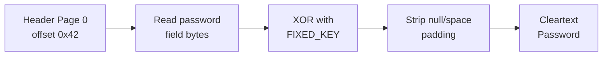
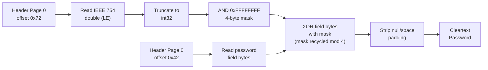
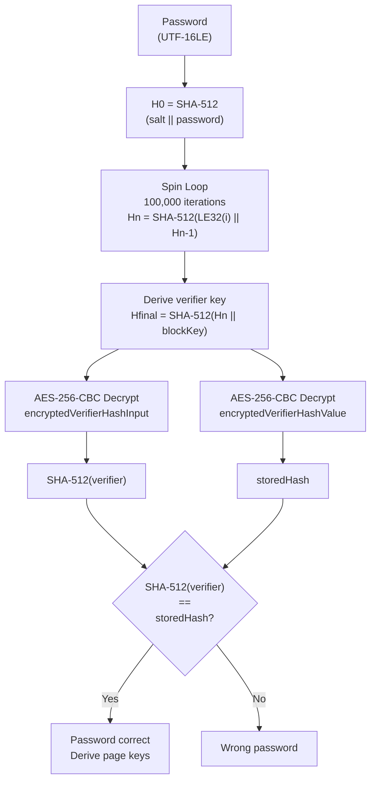
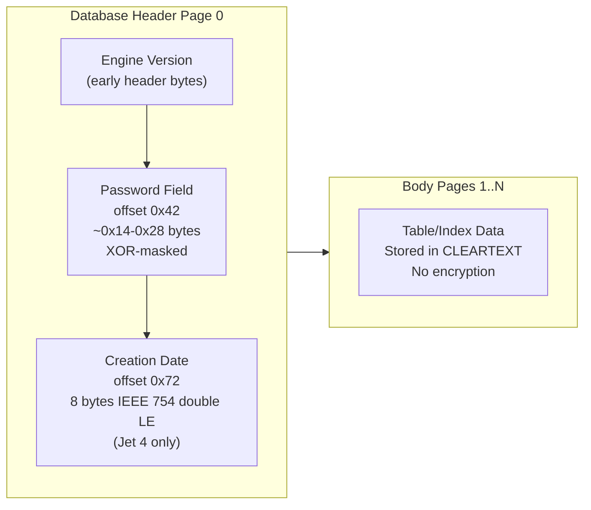
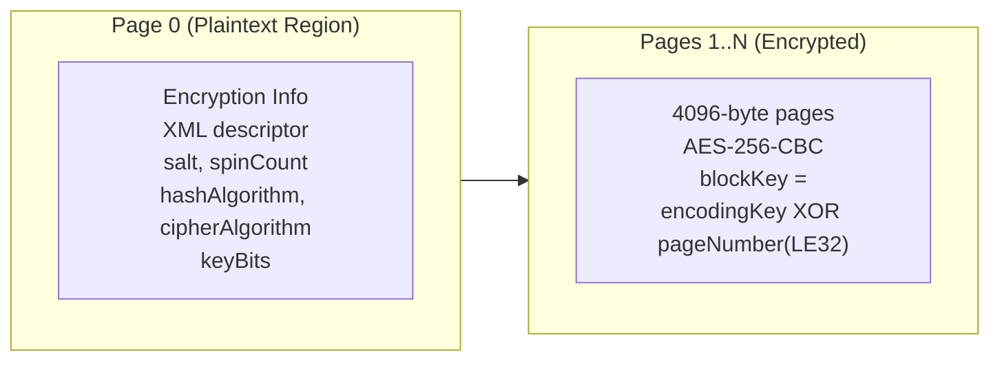

# Access Jet Fixed-Key / Date-Key Obfuscation

🟢 **Cleartext / Decode** (Jet 3/4) | 🔴 **Real Encryption** (ACE 2010+) — database-open obfuscation for `.mdb` (Jet 3/4) and `.accdb` (ACE) containers

## Overview

- Non-password gate: the database-open password for every Access variant is **out-of-corpus** — no `[MS-ACCESS]`, `[MS-JET]`, or `[MS-ACE]` Open Specification exists; all database-open password content below is **UNCONFIRMED** community RE
- Jet 3/4 (`.mdb`): password stored as a reversible XOR mask in the header page — body pages are cleartext, no real encryption; instant decode given only the file header
- ACE 2010+ (`.accdb`): reportedly uses ECMA-376 agile-style SHA-512 + AES-256-CBC per 4096-byte page with per-page block keys — real encryption if confirmed
- The one spec-derived component is the VBA project lock inside Access databases, which conforms to `[MS-OVBA]`; see [VBA Project Password](../password/vba-project-password.md)
- Used by: [Access](../../formats/access.md)
- Structural analogue (ACE 2010+): [ECMA-376 Agile Encryption](../password/ecma376-agile.md) ([MS-OFFCRYPTO] SS2.3.4.10–2.3.4.15)

## KDF Pipeline

### Jet 3: Fixed-Key XOR (UNCONFIRMED)



### Jet 4: Date-Key XOR (UNCONFIRMED)



## Verification Flow

Jet 3/4 passwords are instant decode — no verification loop is needed. Read the header, apply the XOR mask, and the cleartext password falls out.

### ACE 2010+: Agile-Style KDF (UNCONFIRMED)



## On-Disk Structure

### Jet 3/4 Header Page 0 (UNCONFIRMED)



### ACE 2010+ Structure (UNCONFIRMED)



## Quick Reference

| Parameter | Jet 3 (UNCONFIRMED) | Jet 4 (UNCONFIRMED) | ACE 2007 (UNCONFIRMED) | ACE 2010+ (UNCONFIRMED) |
|---|---|---|---|---|
| Container | `.mdb` | `.mdb` | `.accdb` | `.accdb` |
| Scheme | Fixed-key XOR | Date-key XOR | RC4 | SHA-512 + AES-256-CBC |
| Body encryption | None (cleartext) | None (cleartext) | RC4 (key width unconfirmed) | AES-256-CBC per page |
| Salt | None | None (date-derived mask) | UNCONFIRMED | 16 bytes (UNCONFIRMED) |
| Iteration | None | None | UNCONFIRMED | 100,000 (UNCONFIRMED) |
| Password field | Header 0x42, ~0x14 bytes | Header 0x42, ~0x28 bytes | UNCONFIRMED | XML descriptor in page 0 |
| Spec status | OUT-OF-CORPUS | OUT-OF-CORPUS | OUT-OF-CORPUS | OUT-OF-CORPUS |

## Extraction Target

### Jet 3/4: Fields to Extract (UNCONFIRMED)

| Field | Source Location | Type | Example |
|---|---|---|---|
| Engine version | Header page early bytes | integer | Jet 3 vs Jet 4 discriminator |
| Password field | Header offset 0x42 | byte array (~0x14-0x28 bytes) | XOR-masked password bytes |
| Creation date (Jet 4) | Header offset 0x72 | IEEE 754 double, little-endian | Date value for mask derivation |

### ACE 2010+: Fields to Extract (UNCONFIRMED)

| Field | Source Location | Type | Example |
|---|---|---|---|
| Salt | XML descriptor in page 0, `saltValue` | base64 -> bytes | 16-byte salt |
| Spin count | XML descriptor, `spinCount` | decimal integer | `100000` |
| Hash algorithm | XML descriptor, `hashAlgorithm` | string | `SHA512` |
| Cipher algorithm | XML descriptor, `cipherAlgorithm` | string | `AES` |
| Key bits | XML descriptor, `keyBits` | decimal integer | `256` |
| Encrypted verifier | XML descriptor, `encryptedVerifierHashInput` | base64 -> bytes | (verifier blob) |
| Encrypted verifier hash | XML descriptor, `encryptedVerifierHashValue` | base64 -> bytes | (hash blob) |
| Encrypted key value | XML descriptor, `encryptedKeyValue` | base64 -> bytes | (key blob) |

**Python function signatures these map to:**

```python
def decode_jet3_password(
    header: bytes,  # full header page (page 0)
    fixed_key: bytes,  # UNCONFIRMED: hardcoded XOR key from mdbtools/Jackcess
) -> str:
    """Decode Jet 3 database-open password by XOR with fixed key (UNCONFIRMED)."""
    ...


def decode_jet4_password(
    header: bytes,  # full header page (page 0)
) -> str:
    """Decode Jet 4 database-open password by date-derived XOR mask (UNCONFIRMED)."""
    ...


def verify_ace2010_password(
    password: str,
    salt: bytes,  # from XML descriptor saltValue
    spin_count: int,  # from XML descriptor spinCount
    hash_algo: str,  # from XML descriptor hashAlgorithm
    key_bits: int,  # from XML descriptor keyBits
    encrypted_verifier: bytes,  # from XML descriptor encryptedVerifierHashInput
    encrypted_verifier_hash: bytes,  # from XML descriptor encryptedVerifierHashValue
) -> bool:
    """Verify ACE 2010+ database-open password via agile-style KDF (UNCONFIRMED)."""
    ...
```

---

## 1. What it is and where it is used

- Microsoft Access databases use a proprietary paged file format managed by two engines: the Jet engine (`.mdb`, Access 97 through Access 2003) and the Access Connectivity Engine (ACE, `.accdb`, Access 2007 and later)
- Neither engine's file format is covered by a published `[MS-*]` Open Specification
- Grep of the complete converted `[MS-*]` corpus confirms this: `[MS-OFFCRYPTO]` contains zero references to Jet, ACE, `.mdb`, `.accdb`, or "database password"; only incidental glossary mentions of "access database" appear in `[MS-XLS]` and `[MS-DOC]`
- Access databases are **not** OLE/CFB Compound Files and are **not** OPC/ZIP packages — they are flat paged files with a header page (page 0) that carries the database metadata, including the obfuscated password field
- The database-open password is an access-control gate enforced by the engine at open time; in the Jet 3 and Jet 4 variants, the database body pages are stored in cleartext regardless of whether a password is set
- The one exception is the **VBA project** embedded within an Access database — because Access is a VBA host application, the embedded VBA project storage conforms to `[MS-OVBA]` and its protection gates (project password, protection state, visibility state) are fully specified by that document; see [VBA Project Password](../password/vba-project-password.md) for the complete algorithm
- The VBA project lock is orthogonal to the database-open password; it gates only the VBA editor UI's access to macro source code
- Related container documentation: [Access format](../../formats/access.md)

## 2. Corpus status: out-of-corpus declaration

> **OUT-OF-CORPUS.** There is no `[MS-ACCESS]`, `[MS-JET]`, or `[MS-ACE]` specification in the Microsoft Open Specifications corpus. Every byte offset, field width, constant, and algorithm step attributed to the database-open password mechanism in this document is sourced from community reverse-engineering (mdbtools, Jackcess) and is marked **UNCONFIRMED**. Do not implement from these notes alone; read the mdbtools and Jackcess source code and validate against real files before relying on any value.

- `[MS-OFFCRYPTO]` (v20240820) defines encryption for Word, Excel, and PowerPoint documents — it makes no reference to Access, Jet, ACE, `.mdb`, or `.accdb` files; the database-open password mechanism is therefore entirely outside the scope of `[MS-OFFCRYPTO]`
- `[MS-OVBA]` (v20240820) defines the VBA project file format structure — it applies to VBA projects embedded in Access databases but does not define or reference the database-open password

## 3. Profiles / parameters table

| Profile | Engine / era | Container | Obfuscation scheme | Body encryption | Spec status |
|---|---|---|---|---|---|
| Jet 3 | Access 97 | `.mdb` | UNCONFIRMED: fixed-key XOR of stored password field in header page 0 | None — body pages are cleartext | OUT-OF-CORPUS |
| Jet 4 | Access 2000 / 2002 / 2003 | `.mdb` | UNCONFIRMED: date-key XOR (mask derived from creation-date double at header offset 0x72) of stored password field | None — body pages are cleartext | OUT-OF-CORPUS |
| ACE 2007 | Access 2007 | `.accdb` | UNCONFIRMED: RC4 keyed by a hash of the password; body is encrypted | UNCONFIRMED: RC4 (key width unconfirmed — 40 or 128 bit) | OUT-OF-CORPUS |
| ACE 2010+ | Access 2010 / 2013 / 2016 / 2019 / 2021 / LTSC 2024 | `.accdb` | UNCONFIRMED: structurally resembles ECMA-376 agile encryption with SHA-512 + AES-256-CBC, spinCount 100000, per-4096-byte-page CBC | UNCONFIRMED: AES-256-CBC per page, blockKey = encodingKey XOR pageNumber (LE32) | OUT-OF-CORPUS; structural analogue: [MS-OFFCRYPTO] sections 2.3.4.10–2.3.4.15 |
| VBA project lock (all versions) | Access 97 through LTSC 2024 | VBA project storage within `.mdb` or `.accdb` | [MS-OVBA] Data Encryption (reversible XOR, section 2.4.3) wrapping SHA-1 password hash (section 2.4.4.4) | None — VBA module streams are compressed but not encrypted | **Spec-derived**: [MS-OVBA] sections 2.3.1.15, 2.3.1.16, 2.3.1.17, 2.4.3, 2.4.4 |

## 4. Byte layout / on-disk structure (UNCONFIRMED — community RE)

Access databases are paged files, not compound files. The database-open password lives in the header page (page 0). All offsets and field sizes below are from community reverse-engineering (mdbtools, Jackcess `DatabaseImpl`) and are **UNCONFIRMED**.

### 4.1. Jet 3 / Jet 4 header page layout (UNCONFIRMED)

| Field | Offset (hex) | Size | Type | Meaning | Source |
|---|---|---|---|---|---|
| Engine version marker | varies (early header) | varies | integer | Distinguishes Jet 3 vs Jet 4 engine format | UNCONFIRMED (Jackcess) |
| Stored password field | 0x42 | ~0x14 to 0x28 bytes (engine-dependent) | byte array | Password bytes masked by the XOR key; null/space padded | UNCONFIRMED (Jackcess, mdbtools) |
| Creation-date value | 0x72 | 8 bytes | IEEE 754 double, little-endian | Jet 4 only: used to derive the 4-byte XOR mask; Jet 3 does not use this field for the password | UNCONFIRMED (Jackcess) |

### 4.2. ACE header / encryption info (UNCONFIRMED)

| Field | Location | Description | Source |
|---|---|---|---|
| Encryption info descriptor | UNCONFIRMED: page 0, plaintext region | ACE 2010+: an XML descriptor structurally resembling the ECMA-376 agile `EncryptionInfo` blob, containing salt, spinCount, hash algorithm, cipher algorithm, and key bits | UNCONFIRMED (Jackcess) |
| Encrypted pages | Pages 1..N | ACE 2010+: each 4096-byte page encrypted with AES-256-CBC; blockKey = encodingKey XOR pageNumber (LE32) | UNCONFIRMED (Jackcess) |

### 4.3. VBA project storage (spec-derived)

When a VBA project is present, it is embedded as an OLE/Compound File Binary storage within the Access file. The `PROJECT` stream ([MS-OVBA] section 2.3.1) is a small INI-style text blob containing three protection records:

| Line (property) | Spec section | Content |
|---|---|---|
| `CMG="..."` (ProjectProtectionState) | [MS-OVBA] section 2.3.1.15 | Obfuscated 4-byte bitfield: bit 0 = `fUserProtected`, bit 1 = `fHostProtected`, bit 2 = `fVBEProtected` |
| `DPB="..."` (ProjectPassword) | [MS-OVBA] section 2.3.1.16 | Obfuscated payload: no-password sentinel (1-byte `0x00`), 29-byte Password Hash Data Structure (SHA-1 hash + 4-byte Key), or (VBA 5.0 only) plaintext password |
| `GC="..."` (ProjectVisibilityState) | [MS-OVBA] section 2.3.1.17 | Obfuscated 1-byte flag: `0x00` = not visible, `0xFF` = visible |

All three records are obfuscated by the same reversible Data Encryption algorithm ([MS-OVBA] section 2.4.3). See section 5 below and [VBA Project Password](../password/vba-project-password.md) for the full algorithm.

## 5. VBA project password — spec-derived algorithm ([MS-OVBA])

This section reproduces the VBA project password mechanism from `[MS-OVBA]` as it applies to Access databases. Access is a VBA host application; the embedded VBA project uses the identical protection scheme as Excel, Word, and PowerPoint. The complete algorithm with all pseudocode is documented in [VBA Project Password](../password/vba-project-password.md); a summary follows.

### 5.1. Data Encryption ([MS-OVBA] section 2.4.3)

VBA uses a reversible byte-at-a-time XOR cipher for the `CMG`, `DPB`, and `GC` records. The algorithm's conventions ([MS-OVBA] section 2.4.3):
- XOR denotes a bitwise exclusive OR operation.
- BAND denotes a bitwise AND operation.
- All operations resulting in integer overflow store only low-order bits (high-order bit truncation).

#### 5.1.1. Encrypted Data Structure ([MS-OVBA] section 2.4.3.1)

| Field | Size | Description |
|---|---|---|
| Seed | 1 byte | Random encryption seed |
| VersionEnc | 1 byte | Encrypted version byte; decrypts to Version = 2 |
| ProjKeyEnc | 1 byte | Encrypted project key; decrypts to ProjKey (checksum of ProjectCLSID) |
| IgnoredEnc | variable, (Seed BAND 6) / 2 bytes | Arbitrary obfuscation bytes |
| DataLengthEnc | 4 bytes | Encrypted length of DataEnc, in little-endian |
| DataEnc | variable | The encrypted payload |

#### 5.1.2. Encryption algorithm ([MS-OVBA] section 2.4.3.2)

Input parameters: `Data` (byte array to obfuscate), `Length` (unsigned 32-bit integer, length of Data).

```
SET ProjKey TO 0.
FOR each CharacterByte IN the string ProjectId.ProjectCLSID:
    ADD CharacterByte TO ProjKey.
END FOR

VersionEnc = Seed XOR Version       -- Version MUST be 2

ProjKeyEnc = Seed XOR ProjKey

SET UnencryptedByte1 TO ProjKey.
SET EncryptedByte1 TO ProjKeyEnc.
SET EncryptedByte2 TO VersionEnc.

-- IgnoredEnc (obfuscation padding)
SET IgnoredLength TO (Seed BAND 6) / 2.
FOR Counter FROM 1 TO IgnoredLength INCLUSIVE:
    SET TempValue TO any value.
    SET ByteEnc TO (TempValue XOR (EncryptedByte2 + UnencryptedByte1)).
    APPEND IgnoredEnc WITH ByteEnc.
    SET EncryptedByte2 TO EncryptedByte1.
    SET EncryptedByte1 TO ByteEnc.
    SET UnencryptedByte1 TO TempValue.
END FOR

-- DataLengthEnc (4 bytes, little-endian)
FOR each Byte IN Length in little-endian order:
    SET ByteEnc TO (Byte XOR (EncryptedByte2 + UnencryptedByte1)).
    APPEND DataLengthEnc WITH ByteEnc.
    SET EncryptedByte2 TO EncryptedByte1.
    SET EncryptedByte1 TO ByteEnc.
    SET UnencryptedByte1 TO Byte.
END FOR

-- DataEnc
FOR each DataByte IN Data:
    SET ByteEnc TO (DataByte XOR (EncryptedByte2 + UnencryptedByte1)).
    APPEND DataEnc WITH ByteEnc.
    SET EncryptedByte2 TO EncryptedByte1.
    SET EncryptedByte1 TO ByteEnc.
    SET UnencryptedByte1 TO DataByte.
END FOR
```

#### 5.1.3. Decryption algorithm ([MS-OVBA] section 2.4.3.3)

Input: an Encrypted Data Structure (section 2.4.3.1). Output: `Length` (unsigned 32-bit integer), `Data` (byte array).

```
Version = Seed XOR VersionEnc       -- Version MUST be 2
ProjKey = Seed XOR ProjKeyEnc

SET UnencryptedByte1 TO ProjKey.
SET EncryptedByte1 TO ProjKeyEnc.
SET EncryptedByte2 TO VersionEnc.

-- Skip IgnoredEnc
IgnoredLength = (Seed BAND 6) / 2
FOR each ByteEnc IN IgnoredEnc:
    SET Byte TO (ByteEnc XOR (EncryptedByte2 + UnencryptedByte1)).
    SET EncryptedByte2 TO EncryptedByte1.
    SET EncryptedByte1 TO ByteEnc.
    SET UnencryptedByte1 TO Byte.
END FOR

-- Decrypt Length (4 bytes, reassembled little-endian)
SET ByteIndex TO zero.
FOR each ByteEnc IN DataLengthEnc:
    SET Byte TO (ByteEnc XOR (EncryptedByte2 + UnencryptedByte1)).
    SET TempValue TO 256 raised to the power of ByteIndex.
    MULTIPLY TempValue by Byte.
    ADD TempValue TO Length.
    SET EncryptedByte2 TO EncryptedByte1.
    SET EncryptedByte1 TO ByteEnc.
    SET UnencryptedByte1 TO Byte.
    INCREMENT ByteIndex.
END FOR

-- Length equals the length of DataEnc.

-- Decrypt Data
FOR each ByteEnc IN DataEnc:
    SET Byte TO (ByteEnc XOR (EncryptedByte2 + UnencryptedByte1)).
    APPEND Data WITH Byte.
    SET EncryptedByte2 TO EncryptedByte1.
    SET EncryptedByte1 TO ByteEnc.
    SET UnencryptedByte1 TO Byte.
END FOR
```

### 5.2. ProjectPassword payload ([MS-OVBA] section 2.3.1.16)

The `DPB=` line's `EncryptedPassword` field (minimum 16 hex digits, i.e. 8 bytes) decrypts via section 2.4.3.3 to one of three cases:

1. **No password:** `Data` = `0x00`, `Length` = 1. The VBA project has no password set.

2. **Password hash (SHOULD case):** `Data` = a 29-byte Password Hash Data Structure ([MS-OVBA] section 2.4.4.1), `Length` = 29. When this case applies, `ProjectId.ProjectCLSID` MUST be `{00000000-0000-0000-0000-000000000000}` ([MS-OVBA] section 2.3.1.16).

3. **Plaintext password (MAY case, VBA 5.0 only):** `Data` = null-terminated MBCS password string, `Length` = byte count including null terminator. Product behavior note `<6>` ([MS-OVBA] section 2.3.1.16): "VBA 5.0 will save the encrypted plain text password."

### 5.3. Password Hash Data Structure ([MS-OVBA] section 2.4.4.1)

| Field | Offset (within 29-byte structure) | Size | Description |
|---|---|---|---|
| Reserved | 0 | 1 byte | MUST be 0xFF; MUST be ignored |
| GrbitKey | 1 (bits 7..4 of byte 1) | 4 bits | Each bit flags a corresponding null byte of Key |
| GrbitHashNull | 1 (bits 3..0 of byte 1) through byte 3 (bits 7..4) | 20 bits | Each bit flags a corresponding null byte of PasswordHash |
| KeyNoNulls | 4 | 4 bytes | Key with null bytes replaced per Encode Nulls (section 2.4.4.2) |
| PasswordHashNoNulls | 8 | 20 bytes | SHA-1 digest with null bytes replaced per Encode Nulls (section 2.4.4.2) |
| Terminator | 28 | 1 byte | MUST be 0x00 |

### 5.4. Encode Nulls ([MS-OVBA] section 2.4.4.2)

Replaces `0x00` bytes in the input with `0x01` and records the positions in a bitfield.

```
FOR each Byte IN InputBytes:
    IF Byte EQUALS 0x00 THEN:
        APPEND EncodedBytes WITH 0x01.
        APPEND GrbitNull WITH one bit set to FALSE.
    ELSE:
        APPEND EncodedBytes WITH Byte.
        APPEND GrbitNull WITH one bit set to TRUE.
    END IF
END FOR
```

### 5.5. Decode Nulls ([MS-OVBA] section 2.4.4.3)

Reverses Encode Nulls: reads the bitfield and restores `0x00` bytes.

```
SET Index TO 0.
FOR each Bit IN GrbitNull:
    IF Bit EQUALS FALSE THEN:
        APPEND DecodedBytes WITH 0x00.
    ELSE:
        APPEND DecodedBytes WITH EncodedBytes[Index].
    END IF
    INCREMENT Index.
END FOR
```

### 5.6. Password Hash Algorithm ([MS-OVBA] section 2.4.4.4)

Parameters: `Password` (byte array, MBCS-encoded per PROJECTCODEPAGE), `Key` (4 bytes, any value; when validating, use the stored Key from the Password Hash Data Structure).

Output: `PasswordHash` (20 bytes).

```
LET BytesToHash be a variable array of bytes.
APPEND BytesToHash WITH Password.
APPEND BytesToHash WITH Key.
SET PasswordHash TO the SHA-1 cryptographic digest of BytesToHash, as specified by [RFC 3174].
```

This is a single-pass SHA-1 with no iteration. The password is MBCS-encoded (not UTF-16LE), and the 4-byte Key is appended after the password bytes (i.e. the hash input is `Password || Key`).

### 5.7. Password Hash Validation ([MS-OVBA] section 2.4.4.5)

Parameters: `NewPassword` (MBCS byte array), `Key` (4 bytes, from stored hash), `OldPasswordHash` (20 bytes, from stored hash).

Output: `Valid` (Boolean).

```
LET NewHash be an array of 20 bytes.
CALL Password Hash Algorithm (section 2.4.4.4) with NewPassword and Key RETURNING NewHash.
IF NewHash EQUALS OldPasswordHash THEN:
    SET Valid TO TRUE.
ELSE:
    SET Valid TO FALSE.
END IF
```

## 6. Database-open password — UNCONFIRMED community RE

All content in this section is **UNCONFIRMED** and sourced from community reverse-engineering (mdbtools, Jackcess). There is no `[MS-*]` specification for any of these mechanisms. Do not implement from these notes; read the mdbtools and Jackcess source code first and validate against real files.

### 6.1. Jet 3 — fixed-key XOR (Access 97, UNCONFIRMED)

**Source:** mdbtools, Jackcess `DatabaseImpl`.

- The stored password field at header offset 0x42 is XOR-masked with a hardcoded fixed key
- The fixed key bytes are not in this corpus; they must be read from the mdbtools or Jackcess source code
- The database body pages are stored in cleartext; the password gates only the engine's open check

```
-- UNCONFIRMED pseudocode (community RE)
field = header_bytes[0x42 : 0x42 + PWD_LEN]     -- PWD_LEN ~0x14, engine-dependent
cleartext_password = XOR(field, FIXED_KEY)        -- FIXED_KEY from mdbtools/Jackcess
strip null/space padding from cleartext_password
```

There is no key derivation function, no iteration, no salt. The mask is static and invertible.

### 6.2. Jet 4 — date-key XOR (Access 2000-2003, UNCONFIRMED)

**Source:** Jackcess `DatabaseImpl`.

- The stored password field at header offset 0x42 is XOR-masked with a 4-byte key derived from the creation-date value stored as an 8-byte IEEE 754 little-endian double at header offset 0x72
- There is no key derivation function, no iteration, no salt
- The mask is derived from file metadata stored in the same header and is invertible given the header bytes

```
-- UNCONFIRMED pseudocode (community RE, Jackcess model)
date_double = read_ieee754_double_LE(header_bytes[0x72 : 0x72 + 8])
mask_int    = truncate_to_int32(date_double) BAND 0xFFFFFFFF
pwd_mask    = serialize_little_endian_32(mask_int)   -- 4 bytes

field = header_bytes[0x42 : 0x42 + PWD_LEN]
FOR i FROM 0 TO len(field) - 1:
    cleartext_password[i] = field[i] XOR pwd_mask[i MOD 4]
END FOR
strip null/space padding from cleartext_password
```

Some Jet 4 files may additionally RC4-encode parts of the header page with a separate encoding key (UNCONFIRMED, distinct from the database password). This does not affect the password recovery procedure.

### 6.3. ACE 2007 — RC4 keyed by password hash (UNCONFIRMED)

**Source:** community RE tools.

- The database body is encrypted with RC4, keyed by a hash of the user-supplied password
- The exact hash algorithm, key width (40-bit or 128-bit), and verifier structure are **UNCONFIRMED** in this corpus
- This is a real encryption scheme, not a reversible mask

### 6.4. ACE 2010+ — agile-style SHA-512 + AES-256-CBC (UNCONFIRMED)

**Source:** Jackcess.

Community reverse-engineering describes a scheme structurally resembling the ECMA-376 agile encryption specified in [MS-OFFCRYPTO] sections 2.3.4.10 through 2.3.4.15, but applied per-page with Access-specific deviations:

- Page 0 (plaintext region) holds an XML descriptor structurally resembling the agile `EncryptionInfo` blob, containing salt, spinCount, hash algorithm identifier, cipher algorithm identifier, and key bit count
- UNCONFIRMED parameters: SHA-512 hash, AES-256-CBC cipher, spinCount = 100000
- Subsequent 4096-byte pages are each encrypted with AES-256-CBC; the block key for each page is reportedly `encodingKey XOR pageNumber` where `pageNumber` is a little-endian 32-bit integer
- The key derivation is reportedly the same spin loop as ECMA-376 agile: `H_0 = Hash(salt || password)`, then `H_{n+1} = Hash(iterator_LE || H_n)` for `spinCount` iterations

For the closest documented analogue, see [ECMA-376 Agile Encryption](../password/ecma376-agile.md). However, the per-page blockKey deviation means this is not a direct reuse of the OOXML agile scheme. Do not assume compatibility without RE validation.

## 7. User-level security (Jet ULS, `.mdw` file) — UNCONFIRMED, out-of-corpus

- Jet user-level security (ULS) is a separate mechanism from the database-open password
- It uses an external workgroup information file (`.mdw`) to store per-user and per-group credentials and permissions
- ULS was supported in Jet 3 and Jet 4 (`.mdb` only) and was retired in Access 2007; it is not available for `.accdb` files
- There is no `[MS-*]` specification for Jet ULS
- The `.mdw` file format, its password storage mechanism, and the permission model are entirely out-of-corpus
- Community reverse-engineering (mdbtools) describes some aspects of the `.mdw` format, but details are not reproduced here

## 8. Security considerations

### 8.1. VBA project lock — from the spec

The `[MS-OVBA]` specification explicitly states the security posture of VBA project protection:

> "When data in a VBA project, such as a password, is encrypted, the information necessary to decrypt the data is stored with the encrypted data. The design of this encryption is to obfuscate sensitive information, not to secure it." — [MS-OVBA] section 4.2

The spec identifies the following encrypted items ([MS-OVBA] section 4.2):
- Project password (ProjectPassword, section 2.3.1.16)
- Project protection state (ProjectProtectionState, section 2.3.1.15)
- Project visibility state (ProjectVisibilityState, section 2.3.1.17)

Additionally, the VBA source code in the module streams is compressed ([MS-OVBA] section 2.4.1) but **not encrypted**. The project lock gates only the VBA editor UI; the actual macro code is readable from the module streams without the password.

The Content Hash ([MS-OVBA] section 2.4.2) provides an integrity digest for the VBA project, but `ProjectId`, `ProjectProtectionState`, `ProjectPassword`, and `ProjectVisibilityState` are explicitly excluded from the normalized data used to compute this hash ([MS-OVBA] section 2.4.2.6). This means the protection state and password can be altered without invalidating the content hash.

- Product behavior note `<5>` ([MS-OVBA] section 2.3.1.15): VBA 5.0 saves `0x00000000` for the protection state regardless of whether protection is enabled
- Product behavior note `<6>` ([MS-OVBA] section 2.3.1.16): VBA 5.0 saves the encrypted plaintext password rather than a hash

### 8.2. Database-open password — UNCONFIRMED observations

- **Jet 3/4 `.mdb` (UNCONFIRMED):** The XOR mask is invertible given only the file header bytes. The database body is not encrypted. The database-open password provides no confidentiality for the data; it is an access-control gate enforced by the Jet engine at open time. Any tool that reads the file directly (bypassing the engine's open check) can access all table data without the password.
- **ACE `.accdb` (UNCONFIRMED):** The 2010+ scheme reportedly encrypts the database body with AES-256-CBC per-page, which — if confirmed — provides actual confidentiality. The ACE 2007 RC4 scheme reportedly encrypts the body as well, though the effective key width is unconfirmed.

## 9. Spec references

### Spec-derived (VBA project lock)

| Section | Title | Relevance |
|---|---|---|
| [MS-OVBA] section 2.3.1.15 | ProjectProtectionState | Bitfield specifying who locked the VBA project (user, host, VBE) |
| [MS-OVBA] section 2.3.1.16 | ProjectPassword | Obfuscated password hash or plaintext; three payload cases |
| [MS-OVBA] section 2.3.1.17 | ProjectVisibilityState | Single-byte visibility flag (0x00 = hidden, 0xFF = visible) |
| [MS-OVBA] section 2.4.3 | Data Encryption | Reversible XOR obfuscation algorithm used for CMG, DPB, GC |
| [MS-OVBA] section 2.4.3.1 | Encrypted Data Structure | Wire format: Seed, VersionEnc, ProjKeyEnc, IgnoredEnc, DataLengthEnc, DataEnc |
| [MS-OVBA] section 2.4.3.2 | Encryption | Encryption procedure with chained XOR |
| [MS-OVBA] section 2.4.3.3 | Decryption | Decryption procedure; inverse of section 2.4.3.2 |
| [MS-OVBA] section 2.4.4 | Password Hash | Custom format for storing a SHA-1 password hash with null-encoding |
| [MS-OVBA] section 2.4.4.1 | Password Hash Data Structure | 29-byte structure: Reserved, GrbitKey, GrbitHashNull, KeyNoNulls, PasswordHashNoNulls, Terminator |
| [MS-OVBA] section 2.4.4.2 | Encode Nulls | Replaces 0x00 with 0x01 and records positions in bitfield |
| [MS-OVBA] section 2.4.4.3 | Decode Nulls | Restores 0x00 bytes from bitfield |
| [MS-OVBA] section 2.4.4.4 | Password Hash Algorithm | SHA-1(Password MBCS || Key 4-byte); single pass, no iteration |
| [MS-OVBA] section 2.4.4.5 | Password Hash Validation | Compare new hash against stored hash using same Key |
| [MS-OVBA] section 4.1 | Project Integrity Verification | Content Hash used to verify VBA project integrity |
| [MS-OVBA] section 4.2 | Encryption Method | Explicit statement: "designed to obfuscate, not to secure" |
| [MS-OVBA] product note `<5>` | section 2.3.1.15 | VBA 5.0 saves 0x00000000 regardless of protection state |
| [MS-OVBA] product note `<6>` | section 2.3.1.16 | VBA 5.0 saves encrypted plaintext password |

### Out-of-corpus (database-open password)

No `[MS-*]` spec references exist. Community sources:

| Source | Coverage |
|---|---|
| mdbtools | Jet 3/4 `.mdb` file format, fixed-key XOR, header offsets |
| Jackcess (`DatabaseImpl`) | Jet 3/4 `.mdb` header layout, date-key derivation, ACE `.accdb` encryption |
| [MS-OFFCRYPTO] sections 2.3.4.10–2.3.4.15 | Structural analogue only: ECMA-376 agile encryption (does not reference Access) |

### Cross-references

- [VBA Project Password](../password/vba-project-password.md) — full algorithm for the VBA project lock
- [XOR Obfuscation](../password/xor-obfuscation.md) — Office document XOR obfuscation, same family of reversible masks
- [ECMA-376 Agile Encryption](../password/ecma376-agile.md) — closest documented analogue for ACE 2010+
- [Access format](../../formats/access.md) — container documentation for `.mdb` and `.accdb`
- [IRM/RMS Encryption](./irm-rms-encryption.md) — another non-password protection mechanism

### The boundary

The database-open password for every Access variant (Jet 3, Jet 4, ACE 2007, ACE 2010+) is entirely outside the `[MS-*]` Open Specifications corpus. The UNCONFIRMED community RE notes in this document are a starting point for investigation, not a build specification. Before implementing any database-open password handling, read the Jackcess and mdbtools source code directly and validate against real `.mdb` and `.accdb` files.
