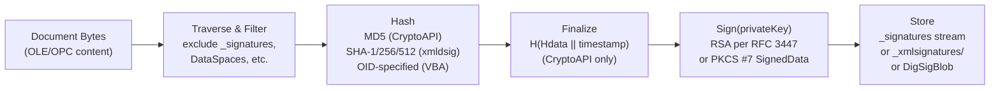
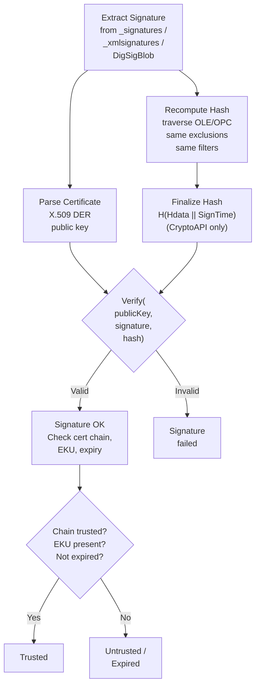
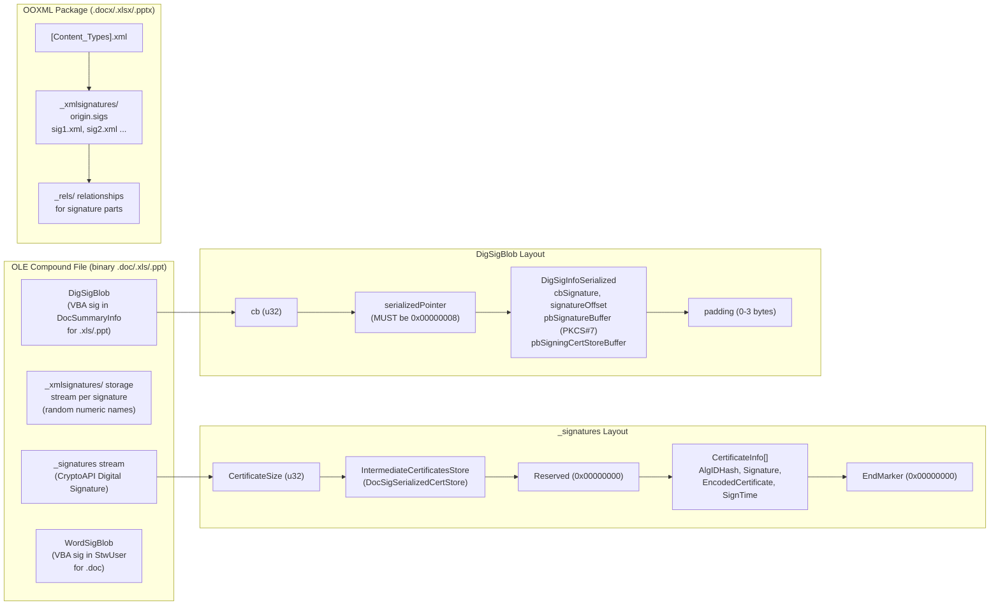

# Office Digital Signatures (CryptoAPI / xmldsig / VBA)

:white_circle: **PKI / Not Password** — asymmetric (RSA / X.509) signature; no password, no salt, no iteration count, no crackable verifier

## Overview

- Three distinct signature mechanisms covering binary OLE documents (.doc, .xls, .ppt), OOXML packages (.docx, .xlsx, .pptx), and VBA macro projects
- **CryptoAPI signatures** ([MS-OFFCRYPTO] SS2.5.1): binary RSA + MD5 format stored in a `_signatures` stream; Office 97–2003 era, still present in binary files
- **Xmldsig signatures** ([MS-OFFCRYPTO] SS2.5.2–2.5.3): XML Digital Signature [XMLDSig] format with configurable hash (SHA-1/SHA-256/SHA-512); stored in `_xmlsignatures` storage (OLE) or OPC digital signature parts (OOXML); supports XAdES extensions
- **VBA project signatures** ([MS-OSHARED] SS2.3.2): PKCS #7 SignedData wrapping the VBA project content hash per [MS-OVBA] SS2.4.2; distinct from VBA password protection (which only hides source in the editor)
- Used by: [Word](../../formats/word.md), [Excel](../../formats/excel.md), [PowerPoint](../../formats/powerpoint.md) (all three mechanisms); OOXML containers use xmldsig via [ECMA-376] Part 2 Section 12
- Specs: [MS-OFFCRYPTO] sections 2.5.x (document-level), [MS-OSHARED] sections 2.3.2.x (VBA project)

## Signing Flow



## Verification Flow



## On-Disk Structure



## Quick Reference

| Parameter | CryptoAPI Signature | Xmldsig Signature | VBA Project Signature |
|---|---|---|---|
| Hash | MD5 (MUST be 0x00008003) | SHA-1 (Office 2007), OS-supported (2010+) | Per digestAlgorithm OID |
| Signing | RSA per [RFC3447] SS9.2 | Per [XMLDSig] | PKCS #7 SignedData [PKCS7] SS9.1 |
| Certificate | X.509 DER [RFC3280] | Per [XMLDSig] KeyInfo | X.509 in SignedData.certificates |
| Storage | `_signatures` stream (OLE root) | `_xmlsignatures` storage (OLE) or OPC parts | DigSigBlob (XLS/PPT) or WordSigBlob (DOC) |
| XAdES | No | Optional (EPES through X-L) | No |
| Timestamp | FILETIME in CertificateInfo.SignTime | In SignatureProperties | Countersignature [PKCS9] SS6.6 |
| Multi-sig | Array of CertificateInfo | One stream per signature | One per project |
| Password | None | None | None |

## Related Algorithms

| Algorithm | Relationship |
|---|---|
| [IRM/RMS Encryption](./irm-rms-encryption.md) | Also non-password, certificate-based — but encrypts content rather than signing it |
| [ECMA-376 Agile Encryption](../password/ecma376-agile.md) | Password-based document-open encryption (orthogonal — a document can be both encrypted and signed) |
| [RC4 CryptoAPI](../password/rc4-cryptoapi-sha1.md) | Password-based binary document encryption (same era as CryptoAPI signatures) |

## Extraction Target

### CryptoAPI Signature (from `_signatures` stream)

| Field | Source Location | Type | Example |
|---|---|---|---|
| Signer name | `CertificateInfo.SignerName` | UTF-16LE string | `"John Smith"` |
| Issuer name | `CertificateInfo.IssuerName` | UTF-16LE string | `"DigiCert SHA2 Assured ID CA"` |
| Hash algorithm | `CertificateInfo.AlgIDHash` | i32 LE | `0x00008003` (MD5, always) |
| Signature bytes | `CertificateInfo.Signature` | byte array (LE) | RSA signature value |
| Certificate | `CertificateInfo.EncodedCertificate` | ASN.1 DER bytes | X.509 certificate |
| Serial number | `CertificateInfo.SerialNumber` | byte array (LE, truncated) | Certificate serial |
| Sign time | `CertificateInfo.SignTime` | TimeEncoding (8 bytes) | FILETIME with swapped halves |
| Expiry time | `CertificateInfo.ExpireTime` | TimeEncoding (8 bytes) | Certificate expiration |
| Intermediate certs | `IntermediateCertificatesStore` | DocSigSerializedCertStore | Chain certificates |

### Xmldsig Signature (from `_xmlsignatures` streams or OPC parts)

| Field | Source Location | Type | Example |
|---|---|---|---|
| Signature value | `SignatureValue` element | base64 | RSA/DSA signature |
| Signing certificate | `KeyInfo` element | base64 X.509 | Signer's certificate |
| Digest method | `DigestMethod@Algorithm` | URI string | `"http://www.w3.org/2001/04/xmlenc#sha256"` |
| Canonicalization | `CanonicalizationMethod@Algorithm` | URI string | Canonical XML 1.0 |
| Package digest | `Reference[@URI="#idPackageObject"]` | base64 | Content digest |
| Office metadata | `SignatureInfoV1` children | mixed | SetupID, versions, resolution |
| XAdES properties | `QualifyingProperties` element | XML | SigningCertificate, SigningTime, policy |

### VBA Project Signature (from DigSigBlob / WordSigBlob)

| Field | Source Location | Type | Example |
|---|---|---|---|
| PKCS #7 blob | `DigSigInfoSerialized.pbSignatureBuffer` | byte array | SignedData ASN.1 |
| Cert store | `DigSigInfoSerialized.pbSigningCertStoreBuffer` | VBASigSerializedCertStore | Signing certificate |
| Content type OID | `SignedData.contentInfo.contentType` | OID | `1.3.6.1.4.1.311.2.1.4` |
| Digest algorithm | `SignedData.digestAlgorithms` | OID | Algorithm identifier |
| Signing certificate | `SignedData.certificates` | ASN.1 DER | X.509 chain |
| Timestamp | `Countersignature` in unauthenticatedAttributes | PKCS #9 SS6.6 | TSA countersignature |

**Python function signatures for verification:**

```python
def verify_cryptoapi_signature(
    ole_storage: OleStorage,  # OLE compound file root storage
    cert_info: CertificateInfo,  # parsed from _signatures stream
) -> bool:
    """Verify a CryptoAPI digital signature per [MS-OFFCRYPTO] SS2.5.1.5.

    Recomputes MD5 hash over the OLE tree (excluding _signatures, DataSpaces, etc.),
    appends SignTime, and verifies the RSA signature against the embedded certificate.
    """
    ...


def verify_xmldsig_signature(
    storage_or_package: Storage,  # OLE storage or OPC package
    signature_xml: bytes,  # raw XML from _xmlsignatures stream or OPC part
) -> bool:
    """Verify an xmldsig digital signature per [MS-OFFCRYPTO] SS2.5.2.

    Validates the XML Digital Signature [XMLDSig] including all Reference digests,
    certificate chain, and optional XAdES properties.
    """
    ...


def verify_vba_signature(
    signed_data: bytes,  # PKCS #7 SignedData from pbSignatureBuffer
    vba_hash: bytes,  # content hash per [MS-OVBA] SS2.4.2
) -> bool:
    """Verify a VBA project digital signature per [MS-OSHARED] SS2.3.2.4.6.

    Validates PKCS #7 SignedData integrity, certificate chain to trusted root,
    code-signing EKU (1.3.6.1.5.5.7.3.3), and optional timestamp countersignature.
    """
    ...
```

---

> **Class:** PKI / public-key cryptographic signature — **not** password-based, **not** crackable. There is no password, no salt, no iteration count, and no password-derived verifier in any Office digital signature structure. Signature verification requires the signer's public key (from the embedded certificate); signature creation requires the corresponding private key. This document covers structures from two specs: [MS-OFFCRYPTO] sections 2.5.x (document-level CryptoAPI and xmldsig signatures) and [MS-OSHARED] sections 2.3.2.x (VBA project digital signatures). For password-based encryption algorithms, see the sibling documents under ../password/. For IRM / certificate-wrapped content encryption (also non-password), see [irm-rms-encryption.md](./irm-rms-encryption.md).

## 1. What it is and where it is used

Office digital signatures provide integrity and authenticity assurance for document content and VBA projects. The specification defines **three distinct signature mechanisms**, each applicable to different file types and stored in different locations:

1. **CryptoAPI digital signatures** ([MS-OFFCRYPTO] section 2.5.1): A binary signature format stored in a `_signatures` stream at the root of an OLE compound file. Uses MD5 hashing (mandated) and RSA signing per [RFC3447]. Applies to Office binary documents (.doc, .xls, .ppt); see [word.md](../../formats/word.md), [excel.md](../../formats/excel.md), [powerpoint.md](../../formats/powerpoint.md) for the carrier containers.

2. **Xmldsig digital signatures** ([MS-OFFCRYPTO] sections 2.5.2–2.5.3): An XML-Signature Syntax and Processing [XMLDSig] format stored in a `_xmlsignatures` storage within the OLE compound file (for binary documents) or via the OPC Digital Signatures framework (for ECMA-376 documents [ECMA-376] Part 2 Section 12). Supports configurable hash algorithms (SHA-1 default in Office 2007; OS-supported algorithms in later versions) and optional XAdES extensions. Applies to both binary documents (.doc, .xls, .ppt) and OOXML documents (.docx, .xlsx, .pptx); see ../../formats/ for the carrier containers.

3. **VBA project digital signatures** ([MS-OSHARED] sections 2.3.2–2.3.2.5): A PKCS #7 SignedData [PKCS7] structure that signs VBA macro project content. Stored in a `DigSigBlob` (inside the Document Summary Information OLE property set for .xls and .ppt) or a `WordSigBlob` (inside the StwUser string table for .doc). The signed content hash is produced by [MS-OVBA] section 2.4.2. This is **distinct from** VBA project password protection — the password merely hides the VBA source in the editor; the digital signature authenticates the project.

- All three mechanisms use standard PKI (X.509 certificates, RSA signing); none involves any password-derived key material.
- Products: Microsoft Office 97 through Office 2019 and later, including Word, Excel, PowerPoint, and SharePoint Server ([MS-OFFCRYPTO] section 5; [MS-OSHARED] section 1.3.4).

## 2. Profiles / parameters

| # | Mechanism | Storage location | Hash algorithm | Signing algorithm | Certificate format | XAdES | Spec |
|---|---|---|---|---|---|---|---|
| 1 | CryptoAPI digital signature | `_signatures` stream (OLE root) | MD5 (MUST be `AlgIDHash = 0x00008003`) | RSA per [RFC3447] section 9.2 | X.509 DER per [RFC3280] | No | [MS-OFFCRYPTO] section 2.5.1 |
| 2 | Xmldsig digital signature (binary) | `_xmlsignatures` storage (OLE root), one stream per signature | Application-provided (SHA-1 in Office 2007; OS-supported in Office 2010+) | Per [XMLDSig] | Per [XMLDSig] KeyInfo | Optional (XAdES-EPES through XAdES-X-L) | [MS-OFFCRYPTO] sections 2.5.2–2.5.3 |
| 3 | Xmldsig digital signature (ECMA-376) | OPC digital signature parts per [ECMA-376] Part 2 Section 12 | Application-provided | Per [XMLDSig] | Per [XMLDSig] KeyInfo | Optional | [ECMA-376] Part 2 Section 12; [MS-OFFCRYPTO] section 2.5.2 |
| 4 | VBA project digital signature (XLS/PPT) | `DigSigBlob` in Document Summary Information property set (`VtDigSigValue` / `VT_BLOB`), PIDSI `0x00000011` | Specified by `digestAlgorithm` OID in SignedData (application-chosen) | PKCS #7 SignedData [PKCS7] section 9.1 | X.509 DER in `certificates` field + `VBASigSerializedCertStore` | No | [MS-OSHARED] sections 2.3.2.1–2.3.2.5 |
| 5 | VBA project digital signature (DOC) | `WordSigBlob` in StwUser string table, variable named "Sign" or "SigAgile" | Specified by `digestAlgorithm` OID in SignedData | PKCS #7 SignedData [PKCS7] section 9.1 | X.509 DER in `certificates` field + `VBASigSerializedCertStore` | No | [MS-OSHARED] sections 2.3.2.1, 2.3.2.3–2.3.2.5 |

- Container: OLE Compound File Binary (CFB) or OPC/ZIP
- All integers: little-endian ([MS-OFFCRYPTO] section 1.3.6; [MS-OSHARED] section 1.3.5)
- Protection: asymmetric (RSA public-key / PKCS #7)
- No password, salt, or iteration count exists anywhere in these structures

## 3. Byte layout / on-disk structures

### 3.1 TimeEncoding structure ([MS-OFFCRYPTO] section 2.5.1.1)

Encodes a UTC date/time as a FILETIME with its two 32-bit halves in swapped order.

| Field | Offset | Size | Type | Description |
|---|---|---|---|---|
| `HighDateTime` | 0 | 4 | `u32` LE | High-order 32 bits of the FILETIME value. Assign to `FILETIME.dwHighDateTime`. |
| `LowDateTime` | 4 | 4 | `u32` LE | Low-order 32 bits of the FILETIME value. Assign to `FILETIME.dwLowDateTime`. |

**Total: 8 bytes.** The byte ordering is reversed relative to a standard FILETIME: `HighDateTime` precedes `LowDateTime` in the on-disk structure.

### 3.2 CertificateInfo structure ([MS-OFFCRYPTO] section 2.5.1.2)

| Field | Offset (relative) | Size | Type | Description |
|---|---|---|---|---|
| `CertificateInfoSize` | 0 | 4 | `u32` LE | Byte count of the remainder of this structure (excludes this field itself). |
| `SignerLength` | 4 | 4 | `u32` LE | Character count of `SignerName`, excluding terminating null. |
| `IssuerLength` | 8 | 4 | `u32` LE | Character count of `IssuerName`, excluding terminating null. |
| `ExpireTime` | 12 | 8 | `TimeEncoding` | Certificate expiration time (UTC). |
| `SignTime` | 20 | 8 | `TimeEncoding` | Time this signature was created (UTC). |
| `AlgIDHash` | 28 | 4 | `i32` LE | Algorithm identifier. **MUST be `0x00008003` (MD5).** |
| `SignatureSize` | 32 | 4 | `u32` LE | Byte count of the `Signature` field. |
| `EncodedCertificateSize` | 36 | 4 | `u32` LE | Byte count of the `EncodedCertificate` field. |
| `Version` | 40 | 4 | `u32` LE | **MUST be `0x00000000`.** |
| `SerialNumberSize` | 44 | 4 | `u32` LE | Byte count of the `SerialNumber` field. |
| `IssuerBlobSize` | 48 | 4 | `u32` LE | Byte count of the `IssuerBlob` field. |
| `Reserved` | 52 | 4 | `u32` LE | **MUST be `0x00000000`.** |
| `SignerName` | 56 | variable | UTF-16LE, null-terminated | Name of the signer. |
| `IssuerName` | varies | variable | UTF-16LE, null-terminated | Name of the issuer. |
| `Signature` | varies | `SignatureSize` | byte array | Binary signature value per [RFC3280], stored in **little-endian** form. |
| `EncodedCertificate` | varies | `EncodedCertificateSize` | byte array | ASN.1 DER encoding of the X.509 certificate per [RFC3280]. |
| `SerialNumber` | varies | `SerialNumberSize` | byte array | Certificate serial number per [RFC3280], least significant byte first, leading `0x00` bytes truncated. |
| `IssuerBlob` | varies | `IssuerBlobSize` | byte array | ASN.1 issuer structure per [RFC3280] section 4.1.2.4. |

### 3.3 CryptoAPI Digital Signature structure ([MS-OFFCRYPTO] section 2.5.1.3)

| Field | Offset (relative) | Size | Type | Description |
|---|---|---|---|---|
| `CertificateSize` | 0 | 4 | `u32` LE | Byte count of `IntermediateCertificatesStore`. |
| `IntermediateCertificatesStore` | 4 | `CertificateSize` | `DocSigSerializedCertStore` | Intermediate certificates (not self-signed root CAs, not end-entity). Generated per [MS-OSHARED] section 2.3.9.1. |
| `Reserved` | 4 + `CertificateSize` | 4 | `u32` LE | **MUST be `0x00000000`.** |
| `CertificateInfoArray` | varies | variable | array of `CertificateInfo` | One `CertificateInfo` per signature in this stream. |
| `EndMarker` | varies | 4 | `u32` LE | **MUST be `0x00000000`.** |

The `_signatures` stream at the OLE compound file root MUST contain exactly one CryptoAPI Digital Signature structure ([MS-OFFCRYPTO] section 2.5.1.4).

### 3.4 DigSigBlob structure ([MS-OSHARED] section 2.3.2.2)

Wraps VBA digital signature data for XLS and PPT files (stored as a `VT_BLOB` typed property in the Document Summary Information property set).

| Field | Offset | Size | Type | Description |
|---|---|---|---|---|
| `cb` | 0 | 4 | `u32` LE | Size of `signatureInfo` + `padding` combined, in bytes. |
| `serializedPointer` | 4 | 4 | `u32` LE | Offset of `signatureInfo` within this structure. **MUST be `0x00000008`.** |
| `signatureInfo` | 8 | variable | `DigSigInfoSerialized` | The signature data (section 3.5). |
| `padding` | varies | 0–3 | byte array | Pads `signatureInfo` to a 4-byte multiple. Contents undefined, MUST be ignored. |

### 3.5 DigSigInfoSerialized structure ([MS-OSHARED] section 2.3.2.1)

Core structure for both `DigSigBlob` and `WordSigBlob` parents. All offsets are relative to the beginning of the parent `DigSigBlob` structure, or (if `WordSigBlob`) relative to the beginning of the parent's `cbSigInfo` field.

| Field | Offset | Size | Type | Description |
|---|---|---|---|---|
| `cbSignature` | 0 | 4 | `u32` LE | Size of `pbSignatureBuffer` in bytes. |
| `signatureOffset` | 4 | 4 | `u32` LE | Offset of `pbSignatureBuffer` relative to the parent structure. |
| `cbSigningCertStore` | 8 | 4 | `u32` LE | Size of `pbSigningCertStoreBuffer` in bytes. |
| `certStoreOffset` | 12 | 4 | `u32` LE | Offset of `pbSigningCertStoreBuffer` relative to the parent structure. |
| `cbProjectName` | 16 | 4 | `u32` LE | Size of `rgchProjectNameBuffer` in bytes (excluding null terminator). **MUST be `0x00000000`.** |
| `projectNameOffset` | 20 | 4 | `u32` LE | Offset of `rgchProjectNameBuffer` relative to the parent structure. |
| `fTimestamp` | 24 | 4 | `BOOL` LE | Reserved. **MUST be `0x00000000`.** MUST be ignored on reading. |
| `cbTimestampUrl` | 28 | 4 | `u32` LE | Size of `rgchTimestampBuffer` in bytes (excluding null terminator). **MUST be `0x00000000`.** |
| `timestampUrlOffset` | 32 | 4 | `u32` LE | Offset of `rgchTimestampBuffer` relative to the parent structure. |
| `pbSignatureBuffer` | varies | `cbSignature` | byte array | The VBA Digital Signature (PKCS #7 SignedData, section 7). |
| `pbSigningCertStoreBuffer` | varies | `cbSigningCertStore` | `VBASigSerializedCertStore` | Public certificate information of the signing certificate. |
| `rgchProjectNameBuffer` | varies | `cbProjectName` + 2 | UTF-16LE, null-terminated | Reserved. **MUST be a single null character (`0x0000`).** |
| `rgchTimestampBuffer` | varies | `cbTimestampUrl` + 2 | UTF-16LE, null-terminated | Reserved. **MUST be a single null character (`0x0000`).** |

### 3.6 WordSigBlob structure ([MS-OSHARED] section 2.3.2.3)

Wraps VBA digital signature data for DOC files (stored as a length-prefixed Unicode string in the StwUser string table, variable name "Sign" or "SigAgile").

| Field | Offset | Size | Type | Description |
|---|---|---|---|---|
| `cch` | 0 | 2 | `u16` LE | Half the byte count of the remainder of the structure. Formula: `cch = (cbSigInfo + (cbSigInfo mod 2) + 8) / 2`. |
| `cbSigInfo` | 2 | 4 | `u32` LE | Size of `signatureInfo` in bytes. |
| `serializedPointer` | 6 | 4 | `u32` LE | Offset of `signatureInfo` relative to `cbSigInfo`. **MUST be `0x00000008`.** |
| `signatureInfo` | 10 | `cbSigInfo` | `DigSigInfoSerialized` | The signature data (section 3.5). |
| `padding` | varies | 0–1 | byte array | Pads the structure to a 2-byte multiple. Contents undefined, MUST be ignored. |

### 3.7 VBASigSerializedCertStore structure ([MS-OSHARED] section 2.3.2.5.5)

| Field | Offset | Size | Type | Description |
|---|---|---|---|---|
| `version` | 0 | 4 | `u32` LE | **MUST be `0x00000000`.** |
| `fileType` | 4 | 4 | `u32` LE | **MUST be `0x54524543`** (ASCII "CERT" read as little-endian `u32`). |
| `certGroup` | 8 | variable | `CertStoreCertificateGroup` | The digital certificate and optional properties. |
| `endMarkerElement` | varies | 12 | `EndElementMarkerEntry` | End-of-store marker (section 3.9). |

### 3.8 DocSigSerializedCertStore structure ([MS-OSHARED] section 2.3.9.1)

Used by the CryptoAPI digital signature `IntermediateCertificatesStore` field.

| Field | Offset | Size | Type | Description |
|---|---|---|---|---|
| `version` | 0 | 4 | `u32` LE | **MUST be `0x00000000`.** |
| `fileType` | 4 | 4 | `u32` LE | **MUST be `0x54524543`.** |
| `certificateList` | 8 | variable | array of `CertStoreCertificateGroup` | Zero or more certificate groups. Read until `id == 0x00000000` (the `endMarkerElement`). |
| `endMarkerElement` | varies | 12 | `EndElementMarkerEntry` | End-of-store marker. |

### 3.9 EndElementMarkerEntry structure ([MS-OSHARED] section 2.3.2.5.2)

| Field | Offset | Size | Type | Description |
|---|---|---|---|---|
| `id` | 0 | 4 | `u32` LE | **MUST be `0x00000000`.** |
| `marker` | 4 | 8 | `u64` LE | **MUST be `0x0000000000000000`.** |

### 3.10 SerializedCertificateEntry structure ([MS-OSHARED] section 2.3.2.5.1)

| Field | Offset | Size | Type | Description |
|---|---|---|---|---|
| `id` | 0 | 4 | `u32` LE | **MUST be `0x00000020`.** |
| `encodingType` | 4 | 4 | `u32` LE | **MUST be `0x00000001`** (ASN.1 DER encoding). |
| `length` | 8 | 4 | `u32` LE | Byte count of the `certificate` field. |
| `certificate` | 12 | `length` | byte array | ASN.1 DER-encoded X.509 certificate per [RFC3280]. |

### 3.11 SerializedPropertyEntry structure ([MS-OSHARED] section 2.3.2.5.3)

| Field | Offset | Size | Type | Description |
|---|---|---|---|---|
| `id` | 0 | 4 | `u32` LE | Property identifier. MUST be `<= 0x0000FFFF` and MUST NOT be `0x00000000` or `0x00000020` (those sentinel values are reserved for `EndElementMarkerEntry` and `SerializedCertificateEntry`). |
| `encodingType` | 4 | 4 | `u32` LE | **MUST be `0x00000001`** (ASN.1 encoding). |
| `length` | 8 | 4 | `u32` LE | Byte count of the `value` field. |
| `value` | 12 | `length` | byte array | Property value. SHOULD be ignored on read ([MS-OSHARED] section 2.3.2.5.3). |

### 3.12 CertStoreCertificateGroup structure ([MS-OSHARED] section 2.3.2.5.4)

| Field | Offset | Size | Type | Description |
|---|---|---|---|---|
| `elementList` | 0 | variable | array of `SerializedPropertyEntry` | Zero or more property entries. Read until `id == 0x00000020` (the `certificateElement.id`), which signals the start of the next field. |
| `certificateElement` | varies | variable | `SerializedCertificateEntry` | The X.509 certificate stored in this group. |

## 4. CryptoAPI digital signature generation ([MS-OFFCRYPTO] section 2.5.1.5)

### 4.1 Hash scope — what is included and excluded

The hash covers the OLE compound file contents by recursively traversing all storages and streams, with the following exclusions.

**Excluded storages** (and all their children):

- `\0x06DataSpaces`
- `\0x05Bagaaqy23kudbhchAaq5u2chNd`

**Excluded streams:**

- `_signatures`
- `\0x09DRMContent`

- Stream and storage names are included in the hash data (without the terminating Unicode null character)
- The `ClsID` (GUID) of each storage is included before its children

### 4.2 Application-specific filtering

- **Excel ([MS-XLS]):** If the stream name is `Workbook`, the `IsFiltered` flag MUST be `true` and the `AppFilter` process specified in [MS-XLS] section 2.1.7.15 is applied, which excludes a portion of the stream from the hash.
- **PowerPoint ([MS-PPT]):** If the stream name is `Current User`, the `IsFiltered` flag MUST be `true` and the `AppFilter` returns without appending data. The stream name is hashed but the stream content is not.
- **All other documents and streams:** `IsFiltered` MUST be `false`; the entire stream content is hashed.

### 4.3 Sort order

Streams and storages within each storage level are sorted case-sensitively, ascending, skipping non-printable characters. For example, `Data` sorts before `\0x05DocumentSummaryInformation` ([MS-OFFCRYPTO] section 2.5.1.5).

### 4.4 GenerateSignature pseudocode

```
FUNCTION GenerateSignature
  PARAMETERS Storage, Certificate
  RETURNS Signature

  CALL HashObject.Initialize           // HashObject uses MD5 (MUST)
  CALL GenerateSignatureHash(Storage, HashObject, IsFiltered, AppFilter)
  SET Hdata TO HashObject.Finalize
  SET Hfinal TO H(Hdata + TimeStamp)   // H = MD5; TimeStamp = FILETIME (UTC)
  SET Signature TO RFC3447(Hfinal, Certificate)  // RSA sign per [RFC3447] section 9.2
  RETURN Signature
END FUNCTION
```

`TimeStamp` is a `FILETIME` structure ([MS-DTYP]) containing the current system time in UTC. It MUST be stored in the `CertificateInfo.SignTime` field.

### 4.5 GenerateSignatureHash pseudocode

```
FUNCTION GenerateSignatureHash
  PARAMETERS Storage, HashObject, IsFiltered, AppFilter
  RETURNS VOID

  DECLARE StorageNameArray as (empty array of Unicode strings)
  DECLARE StreamNameArray as (empty array of Unicode strings)

  SET ClsID TO Storage.GUID
  CALL HashObject.AppendData(ClsID)

  FOR EACH Child IN Storage.Children
      IF Child IS a storage AND Child.Name NOT IN ExcludedStorages
          APPEND Child.Name to StorageNameArray
      END IF
      IF Child IS a stream AND Child.Name NOT IN ExcludedStreams
          APPEND Child.Name to StreamNameArray
      END IF
  END FOR

  SORT StorageNameArray
  SORT StreamNameArray

  FOR EACH StreamName IN StreamNameArray
      CALL HashObject.AppendData(StreamName)        // name without null terminator
      SET ChildStream TO Storage.Children[StreamName]
      IF IsFiltered IS true
          CALL AppFilter(ChildStream, HashObject)
      ELSE
          CALL HashObject.AppendData(ChildStream.Data)
      ENDIF
  ENDFOR

  FOR EACH StorageName IN StorageNameArray
      CALL HashObject.AppendData(StorageName)       // name without null terminator
      SET ChildStorage TO Storage.Children[StorageName]
      CALL GenerateSignatureHash(ChildStorage, HashObject, IsFiltered, AppFilter)
  END FOR
END FUNCTION
```

### 4.6 IRM-protected documents

If a document is IRM-protected ([MS-OFFCRYPTO] section 2.2), the hash MUST be created by first appending the **unencrypted** form of the storage decrypted from the `\0x09DRMContent` stream, followed by the entire original encrypted file storage with the `\0x09DRMContent` stream excluded ([MS-OFFCRYPTO] section 2.5.1.5).

### 4.7 Signing constraint

The certificate MUST be an RSA certificate per [RFC3447], and the signing operation MUST be performed as specified in [RFC3447] section 9.2 (RSASSA-PKCS1-v1_5).

## 5. CryptoAPI digital signature verification

Verification reverses the generation process:

```
FUNCTION VerifySignature
  PARAMETERS Storage, CertificateInfo
  RETURNS Boolean

  // 1. Reconstruct the hash
  CALL HashObject.Initialize           // MD5
  CALL GenerateSignatureHash(Storage, HashObject, IsFiltered, AppFilter)
  SET Hdata TO HashObject.Finalize

  // 2. Reconstruct the final hash using the stored timestamp
  SET TimeStamp TO CertificateInfo.SignTime  // convert from TimeEncoding to FILETIME
  SET Hfinal TO H(Hdata + TimeStamp)

  // 3. RSA signature verification
  SET result TO RFC3447_Verify(Hfinal, CertificateInfo.Signature,
                               CertificateInfo.EncodedCertificate.PublicKey)
  RETURN result
END FUNCTION
```

The verifier extracts the `SignTime` from the `CertificateInfo` structure, reconstructs `Hfinal = MD5(Hdata || TimeStamp)`, and validates the RSA signature against the public key in the embedded X.509 certificate.

## 6. Xmldsig digital signatures ([MS-OFFCRYPTO] sections 2.5.2–2.5.3)

### 6.1 _xmlsignatures storage ([MS-OFFCRYPTO] section 2.5.3)

Digital signatures MUST be stored as streams within a storage named `_xmlsignatures` at the root of the compound document. Each stream:

- MUST be named using a base-10 string representation of a random number (unique within the storage)
- Contains exactly one XML digital signature as UTF-8 characters with no leading header
- MUST be a valid signature per [XMLDSig], generated per the rules in section 2.5.2
- Multiple signatures can coexist in the `_xmlsignatures` storage

For ECMA-376 documents, the process is very similar but uses the OPC digital signature framework per [ECMA-376] Part 2 Section 12. Both document types use the XML signature format specified in [XMLDSig]; see [ECMA-376] Part 2 Section 12.2.4 for the OPC schema reference.

### 6.2 SignedInfo element ([MS-OFFCRYPTO] section 2.5.2.1)

MUST contain:

- `CanonicalizationMethod`: algorithm MUST be Canonical XML 1.0 [Can-XML-1.0]
- `Reference` with `URI="#idPackageObject"`, `DigestMethod` provided by the application (SHA-1 in Office 2007; OS-supported in Office 2010+)
- `Reference` with `URI="#idOfficeObject"`, `DigestMethod` provided by the application

### 6.3 SignatureValue element ([MS-OFFCRYPTO] section 2.5.2.2)

Contains the value of the signature as specified in [XMLDSig].

### 6.4 KeyInfo element ([MS-OFFCRYPTO] section 2.5.2.3)

Contains the key information as specified in [XMLDSig].

### 6.5 idPackageObject element ([MS-OFFCRYPTO] section 2.5.2.4)

Contains:

- A `Manifest` element ([XMLDSig]) with `Reference` elements for each signed stream. `DigestMethod` is application-provided (SHA-1 in Office 2007; OS-supported in Office 2010+).
- A `SignatureProperties` element with a `SignatureProperty` containing a timestamp per [ECMA-376] Part 2 Section 12.2.4.20.

**Excluded storages** (and all children):

- `\0x05Bagaaqy23kudbhchAaq5u2chNd`
- `\0x06DataSpaces`
- `Xmlsignatures`
- `MsoDataStore`

**Excluded streams:**

- `\0x09DRMContent`
- `_signatures`
- `\0x05SummaryInformation`
- `\0x05DocumentSummaryInformation`

**Application-specific filtering:**

- **Excel ([MS-XLS]):** If the stream name is `Workbook`, the stream MUST be filtered per [MS-XLS] section 2.1.7.21.
- **PowerPoint ([MS-PPT]):** The `CurrentUser` stream MUST be hashed as if it were empty (hash of 0 bytes).

### 6.6 idOfficeObject element ([MS-OFFCRYPTO] section 2.5.2.5)

Contains a `SignatureProperties` element with a `SignatureProperty` containing a `SignatureInfoV1` element. The `SignatureInfoV1` XML Schema namespace is `http://schemas.microsoft.com/office/2006/digsig`.

#### SignatureInfoV1 required child elements (EG_RequiredChildren)

| Element | Type | Max length | Description |
|---|---|---|---|
| `SetupID` | `ST_UniqueIdentifierWithBraces` | GUID pattern `\{[0-9a-fA-F]{8}\-...\}` | Cross-reference with the signature line stored in document content. |
| `SignatureText` | `ST_SignatureText` | 100 chars | Text of the actual signature. |
| `SignatureImage` | `xsd:base64Binary` | — | Image for the digital signature. |
| `SignatureComments` | `ST_SignatureComments` | 255 chars | Comments on the digital signature. |
| `WindowsVersion` | `ST_Version` | 64 chars | OS version where the signature was created. |
| `OfficeVersion` | `ST_Version` | 64 chars | Office suite version. May be appended with `/` + unsigned integer signing version to gate relationship verification in future application versions. Not including the `/` results in all signed relationships being verified, consistent with previous behavior. |
| `ApplicationVersion` | `ST_Version` | 64 chars | Application version that created the signature. |
| `Monitors` | `ST_PositiveInteger` | — | Monitor count at signature creation. |
| `HorizontalResolution` | `ST_PositiveInteger` | — | Primary monitor horizontal resolution. |
| `VerticalResolution` | `ST_PositiveInteger` | — | Primary monitor vertical resolution. |
| `ColorDepth` | `ST_PositiveInteger` | — | Primary monitor color depth. |
| `SignatureProviderId` | `ST_UniqueIdentifierWithBraces` | GUID pattern | Class identifier of the signature provider. Default: `{00000000-0000-0000-0000-000000000000}`; East Asian: `{000CD6A4-0000-0000-C000-000000000046}` ([MS-OFFCRYPTO] product behavior <31>). |
| `SignatureProviderUrl` | `ST_SignatureProviderUrl` | 2083 chars | URL of the signing software. |
| `SignatureProviderDetails` | `xsd:int` | — | Bitmask flags (see table below). |
| `SignatureType` | `ST_SignatureType` | — | `1` = not printed; `2` = printed (requires `idValidSigLnImg` and `idInvalidSigLnImg` objects). |

**SignatureProviderDetails bitmask values:**

| Value | Description |
|---|---|
| `0x00000000` | No restrictions on provider usage. |
| `0x00000001` | Provider MUST only be used for UI. |
| `0x00000002` | Provider MUST only be used for invisible signatures. |
| `0x00000004` | Provider MUST only be used for visible signatures. |
| `0x00000008` | Application UI MUST be used for the provider. |
| `0x00000010` | Application stamp UI MUST be used for the provider. |

#### SignatureInfoV1 optional child elements (EG_OptionalChildren)

| Element | Type | Description |
|---|---|---|
| `DelegateSuggestedSigner` | `xsd:string` | Name of the person to whom the signature was delegated. |
| `DelegateSuggestedSigner2` | `xsd:string` | Title of the delegated signer. |
| `DelegateSuggestedSignerEmail` | `xsd:string` | Email of the delegated signer. |
| `ManifestHashAlgorithm` | `xsd:anyURI` (minOccurs="0") | URI identifying the manifest hash algorithm. Value MUST be ignored. |

#### SignatureInfoV2 optional child elements (EG_OptionalChildrenV2)

| Element | Type | Description |
|---|---|---|
| `Address1` | `xsd:string` | Location where the signature was created. |
| `Address2` | `xsd:string` | Additional location information. |

`SignatureInfoV2` provides additional information for the XAdES `SignatureProductionPlace` element ([XAdES] section 7.2.7).

### 6.7 XAdES elements ([MS-OFFCRYPTO] section 2.5.2.6)

XML Advanced Electronic Signatures [XAdES] extensions MAY be present in xmldsig signatures for both binary and ECMA-376 documents. Office 2010 and Office 2013 add XAdES when configured by the user; the default is XAdES-EPES per [XAdES] section 4.4.2 ([MS-OFFCRYPTO] product behavior <32>).

The XAdES `Object` element uses the following options:

| XAdES feature | Requirement |
|---|---|
| `SignedSignatureProperties` | MUST contain a `SigningCertificate` property per [XAdES] section 7.2.2. |
| `SigningTime` | MUST be present per [XAdES] section 7.2.1. |
| `SignaturePolicyIdentifier` | MUST be present per [XAdES] section 7.2.3. |
| XAdES-T timestamp | If present, MUST be an `EncapsulatedTimeStamp` element with DER-encoded ASN.1 data. |
| XAdES-C certificate refs | Certificates in the chain (except the signing certificate) MUST be in `CompleteCertificateRefs` ([XAdES] section 7.4.1). `CompleteRevocationRefs` MUST also be present ([XAdES] section 7.4.2). |
| XAdES-X reference timestamps | `SigAndRefsTimestamp` ([XAdES] section 7.5.1 and section 7.5.1.1) MUST be used, with `EncapsulatedTimeStamp` containing DER-encoded ASN.1 data. |
| XAdES-X-L validation data | `CertificateValues` and `RevocationValues` MUST be per [XAdES] sections 7.6.1–7.6.2. All validation-chain certificates except the signing certificate MUST be in `CertificateValues`. |

There MUST be a `Reference` element for the digest of the `SignedProperties` element per [XAdES] section 6.2.1. This `Reference` SHOULD be placed within the `SignedInfo` element (Office 2010+ default, [MS-OFFCRYPTO] product behavior <33>). If placed in a `Manifest` instead, the containing `Object` MUST have `id="idXAdESReferenceObject"`. Office 2007 requires a compatibility update to validate a `SignedInfo`-level reference to `SignedProperties`; to ensure backward compatibility, an implementation can place the `Reference` within a manifest.

## 7. VBA digital signature ([MS-OSHARED] section 2.3.2.4)

The digital signature for a VBA project is a specific implementation of the PKCS #7 Cryptographic Message Syntax Standard [PKCS7]. Additional implementation information for attributes is described in [PKCS9]. The data that the VBA digital signature signs is described in [MS-OVBA] section 2.4.2. File formats [MS-XLS] and [MS-PPT] store their VBA digital signature in their OLE Property Sets ([MS-OSHARED] section 2.3.3.2). File format [MS-DOC] stores the VBA digital signature in the StwUser string table ([MS-DOC] section 2.9.298).

### 7.1 Structure

The VBA digital signature MUST be a PKCS #7 `SignedData` structure ([PKCS7] section 9.1). It uses ASN.1 notation ([ITUX680-1994]).

### 7.2 SignedData constraints ([MS-OSHARED] section 2.3.2.4.1)

- `digestAlgorithms`: MUST contain exactly one `digestAlgorithmIdentifier` ([PKCS7] section 6.3) specifying the algorithm used to create the digest
- `contentInfo.contentType`: MUST be OID `1.3.6.1.4.1.311.2.1.4`; the `content` MUST be a `SpcIndirectDataContent` (section 7.3) or `SpcIndirectDataContentV2` (section 7.4); the type is specified by the consumer of the `DigSigBlob` or `WordSigBlob`
- `certificates`: MUST include the signature verification certificate and can contain intermediate certificates and the root; if a `Countersignature` ([PKCS9] section 6.6) is present, its certificates MUST also be in this field
- `crls`: SHOULD be absent; if present, MUST be ignored
- `signerInfos`: MUST contain exactly one `SignerInfo`

### 7.3 SpcIndirectDataContent ([MS-OSHARED] section 2.3.2.4.3.1)

```asn1
SpcIndirectDataContent ::= SEQUENCE {
    data               SpcAttributeTypeAndOptionalValue,
    messageDigest      DigestInfo
}
SpcAttributeTypeAndOptionalValue ::= SEQUENCE {
    type               OBJECT IDENTIFIER,    -- MUST be 1.3.6.1.4.1.311.2.1.29
    value              [0] EXPLICIT ANY OPTIONAL  -- SHOULD be zero-byte OCTETSTRING;
                                                  -- if data present, MUST be ignored
}
DigestInfo ::= SEQUENCE {
    digestAlgorithm    AlgorithmIdentifier,   -- same OID as SignedData.digestAlgorithms
    digest             OCTETSTRING            -- hash per [MS-OVBA] section 2.4.2
}
AlgorithmIdentifier ::= SEQUENCE {
    algorithm          OBJECT IDENTIFIER,
    parameters         [0] EXPLICIT ANY OPTIONAL  -- MUST be Null with length zero
}
```

### 7.4 SpcIndirectDataContentV2 ([MS-OSHARED] section 2.3.2.4.3.2)

```asn1
SpcIndirectDataContentV2 ::= SEQUENCE {
    data               SpcAttributeTypeAndOptionalValue,
    messageDigest      DigestInfo
}
-- SpcAttributeTypeAndOptionalValue.type MUST be 1.3.6.1.4.1.311.2.1.31
-- SpcAttributeTypeAndOptionalValue.value MUST contain DER-encoded SigFormatDescriptorV1

SigFormatDescriptorV1 ::= SEQUENCE {
    size               INTEGER,    -- MUST equal the size of this structure
    version            INTEGER,    -- MUST be 1
    format             INTEGER     -- MUST be 1
}

-- DigestInfo.digest MUST contain DER-encoded SigDataV1Serialized

SigDataV1Serialized ::= SEQUENCE {
    algorithmIdSize    INTEGER,    -- size of algorithmId field
    compiledHashSize   INTEGER,    -- SHOULD be 0
    sourceHashSize     INTEGER,    -- size of sourceHash field
    algorithmIdOffset  INTEGER,    -- byte offset of algorithmId from structure start
    compiledHashOffset INTEGER,    -- SHOULD be 0
    sourceHashOffset   INTEGER,    -- byte offset of sourceHash from structure start
    algorithmId        OBJECT IDENTIFIER,  -- same as SignedData.digestAlgorithms
    compiledHash       OCTETSTRING,        -- SHOULD be empty
    sourceHash         OCTETSTRING         -- hash per [MS-OVBA] section 2.4.2
}
```

### 7.5 SignerInfo constraints ([MS-OSHARED] section 2.3.2.4.2)

- `authenticatedAttributes` MUST be present and MUST contain:
  - `content-type` attribute (per [PKCS7] section 9.2)
  - `message-digest` attribute (per [PKCS7] section 9.2)
  - Optionally one `SpcStatementType` (OID `1.3.6.1.4.1.311.2.1.21` or `1.3.6.1.4.1.311.2.1.22`; MUST be ignored)
  - Optionally one `SpcSpOpusInfo`
- If timestamped: `unauthenticatedAttributes` MUST be present and MUST contain a single `Countersignature` ([PKCS9] section 6.6)
- If not timestamped: `unauthenticatedAttributes` MUST be absent

### 7.6 SpcSpOpusInfo ([MS-OSHARED] section 2.3.2.4.4.2)

```asn1
SpcSpOpusInfo ::= SEQUENCE {
    programName        [0] EXPLICIT SpcString OPTIONAL,  -- project description
    moreInfo           [1] EXPLICIT SpcLink OPTIONAL     -- URL
}
SpcString ::= CHOICE {
    unicode            [0] IMPLICIT BMPSTRING             -- SHOULD be 0-length
}
SpcLink ::= CHOICE {
    url                [0] IMPLICIT IA5STRING
}
```

The `programName.unicode` field SHOULD have a value that is a 0-length `BMPSTRING` ([ITUX680-1994] section 34.12). The `moreInfo.url` field, if present, specifies a URL to associate with the signature.

### 7.7 Countersignature / timestamp ([MS-OSHARED] section 2.3.2.4.5)

The `Countersignature` in `unauthenticatedAttributes` SHOULD be generated by a trusted third-party timestamp authority (TSA). Its `authenticatedAttributes` MUST contain:

- `ContentType` ([PKCS9] section 6.3): value MUST be PKCS #7 Data ([PKCS7] section 8)
- `SigningTime` ([PKCS9] section 6.5): set per the spec
- `messageDigest` ([PKCS9] section 6.4): value MUST be set as specified by [PKCS9] section 6.6

The TSA certificate (whose private key signed the `Countersignature`) MUST be added to the `SignedData.certificates` field. Intermediate and root certificates of the TSA chain MAY also be included.

## 8. VBA digital signature verification ([MS-OSHARED] section 2.3.2.4.6)

### 8.1 SignedData integrity

The `SignedData` integrity is verified per PKCS #7 ([PKCS7] section 9.3 and section 9.4).

### 8.2 Certificate processing ([MS-OSHARED] section 2.3.2.4.6.1)

The signing certificate and chain MUST be verified:

1. The certificate chain MUST validate to a trusted root per X.509 path validation ([RFC3280] section 6).
2. The signing certificate MUST either contain the extended key usage (EKU) value for code signing (`1.3.6.1.5.5.7.3.3`) or have no EKU fields present.
3. The certificate chain MUST be within its validity period. If expired, the signature MUST have a timestamp, validated per timestamp processing (section 8.3), and the chain MUST have been valid at the timestamp time.

If any condition fails, the signature MUST be treated as invalid.

### 8.3 Timestamp processing ([MS-OSHARED] section 2.3.2.4.6.2)

A timestamped signature is valid if and only if:

1. The `Countersignature` certificate chain validates to a trusted root per X.509 rules ([RFC3280] section 6).
2. The TSA certificate contains the EKU value for timestamping (`1.3.6.1.5.5.7.3.8`).

## 9. Reference constants

### 9.1 CryptoAPI digital signature constants ([MS-OFFCRYPTO])

| Constant | Value | Meaning | Spec reference |
|---|---|---|---|
| `AlgIDHash` (MD5) | `0x00008003` | MUST be used for CryptoAPI digital signature hashing | [MS-OFFCRYPTO] section 2.5.1.2 |
| `CertificateInfo.Version` | `0x00000000` | Fixed version field | [MS-OFFCRYPTO] section 2.5.1.2 |
| `CertificateInfo.Reserved` | `0x00000000` | Reserved, MUST be zero | [MS-OFFCRYPTO] section 2.5.1.2 |
| `CryptoAPI DS.Reserved` | `0x00000000` | Reserved in the outer structure | [MS-OFFCRYPTO] section 2.5.1.3 |
| `CryptoAPI DS.EndMarker` | `0x00000000` | Terminates the CertificateInfoArray | [MS-OFFCRYPTO] section 2.5.1.3 |

### 9.2 VBA digital signature constants ([MS-OSHARED])

| Constant | Value | Meaning | Spec reference |
|---|---|---|---|
| `DigSigBlob.serializedPointer` | `0x00000008` | Fixed offset of `signatureInfo` within `DigSigBlob` | [MS-OSHARED] section 2.3.2.2 |
| `WordSigBlob.serializedPointer` | `0x00000008` | Fixed offset of `signatureInfo` relative to `cbSigInfo` | [MS-OSHARED] section 2.3.2.3 |
| `DigSigInfoSerialized.cbProjectName` | `0x00000000` | Reserved, MUST be zero | [MS-OSHARED] section 2.3.2.1 |
| `DigSigInfoSerialized.fTimestamp` | `0x00000000` | Reserved, MUST be zero, MUST be ignored on read | [MS-OSHARED] section 2.3.2.1 |
| `DigSigInfoSerialized.cbTimestampUrl` | `0x00000000` | Reserved, MUST be zero | [MS-OSHARED] section 2.3.2.1 |
| `VBASigSerializedCertStore.version` | `0x00000000` | Fixed version | [MS-OSHARED] section 2.3.2.5.5 |
| `VBASigSerializedCertStore.fileType` | `0x54524543` | "CERT" as little-endian `u32` | [MS-OSHARED] section 2.3.2.5.5 |
| `DocSigSerializedCertStore.version` | `0x00000000` | Fixed version | [MS-OSHARED] section 2.3.9.1 |
| `DocSigSerializedCertStore.fileType` | `0x54524543` | "CERT" as little-endian `u32` | [MS-OSHARED] section 2.3.9.1 |
| `SerializedCertificateEntry.id` | `0x00000020` | Sentinel identifying a certificate entry | [MS-OSHARED] section 2.3.2.5.1 |
| `SerializedCertificateEntry.encodingType` | `0x00000001` | ASN.1 DER encoding | [MS-OSHARED] section 2.3.2.5.1 |
| `EndElementMarkerEntry.id` | `0x00000000` | End-of-store sentinel | [MS-OSHARED] section 2.3.2.5.2 |
| `EndElementMarkerEntry.marker` | `0x0000000000000000` | 8-byte zero sentinel | [MS-OSHARED] section 2.3.2.5.2 |

### 9.3 Xmldsig signature provider GUIDs ([MS-OFFCRYPTO] section 2.5.2.5, product behavior <31>)

| Provider | GUID |
|---|---|
| Default signature provider (Office 2007/2010/2013) | `{00000000-0000-0000-0000-000000000000}` |
| East Asian signature provider | `{000CD6A4-0000-0000-C000-000000000046}` |

### 9.4 VBA SignedData OIDs ([MS-OSHARED])

| OID | Value | Usage | Spec reference |
|---|---|---|---|
| `contentInfo.contentType` | `1.3.6.1.4.1.311.2.1.4` | SpcIndirectDataContent type | [MS-OSHARED] section 2.3.2.4.1 |
| `SpcAttributeTypeAndOptionalValue.type` (v1) | `1.3.6.1.4.1.311.2.1.29` | Identifies SpcIndirectDataContent data | [MS-OSHARED] section 2.3.2.4.3.1 |
| `SpcAttributeTypeAndOptionalValue.type` (v2) | `1.3.6.1.4.1.311.2.1.31` | Identifies SpcIndirectDataContentV2 data | [MS-OSHARED] section 2.3.2.4.3.2 |
| `SpcStatementType` value (option 1) | `1.3.6.1.4.1.311.2.1.21` | Individual code signing | [MS-OSHARED] section 2.3.2.4.4.1 |
| `SpcStatementType` value (option 2) | `1.3.6.1.4.1.311.2.1.22` | Commercial code signing | [MS-OSHARED] section 2.3.2.4.4.1 |
| Code signing EKU | `1.3.6.1.5.5.7.3.3` | Required or absent in signing certificate | [MS-OSHARED] section 2.3.2.4.6.1 |
| Timestamping EKU | `1.3.6.1.5.5.7.3.8` | Required in TSA certificate | [MS-OSHARED] section 2.3.2.4.6.2 |

### 9.5 Excluded storages and streams

**CryptoAPI digital signature excluded storages** ([MS-OFFCRYPTO] section 2.5.1.5):
- `\0x06DataSpaces`
- `\0x05Bagaaqy23kudbhchAaq5u2chNd`

**CryptoAPI digital signature excluded streams** ([MS-OFFCRYPTO] section 2.5.1.5):
- `_signatures`
- `\0x09DRMContent`

**Xmldsig excluded storages** ([MS-OFFCRYPTO] section 2.5.2.4):
- `\0x05Bagaaqy23kudbhchAaq5u2chNd`
- `\0x06DataSpaces`
- `Xmlsignatures`
- `MsoDataStore`

**Xmldsig excluded streams** ([MS-OFFCRYPTO] section 2.5.2.4):
- `\0x09DRMContent`
- `_signatures`
- `\0x05SummaryInformation`
- `\0x05DocumentSummaryInformation`

## 10. Security considerations

### 10.1 Binary document digital signatures ([MS-OFFCRYPTO] section 4.1.5)

Certain streams and storages are not subject to signing. Tampering with these excluded streams or storages does not invalidate the signature. The excluded items are enumerated in sections 4.1 and 6.5 above.

### 10.2 CryptoAPI signature uses MD5

The CryptoAPI digital signature format mandates MD5 (`AlgIDHash = 0x00008003`). MD5 has known collision vulnerabilities. The spec does not offer an alternative hash for this signature format; implementations requiring stronger hashing should use the xmldsig format instead.

### 10.3 VBA signature certificate chain validation

The [MS-OSHARED] spec requires full X.509 path validation ([RFC3280] section 6), EKU checking for code signing (`1.3.6.1.5.5.7.3.3`), and validity period enforcement. If the certificate has expired, a valid timestamp from a TSA with the timestamping EKU (`1.3.6.1.5.5.7.3.8`) is required ([MS-OSHARED] sections 2.3.2.4.6.1–2.3.2.4.6.2).

### 10.4 VBA DigSigInfoSerialized reserved fields

- The `fTimestamp`, `cbTimestampUrl`, and `cbProjectName` fields are reserved and MUST be zero
- The `fTimestamp` field MUST be ignored on reading ([MS-OSHARED] section 2.3.2.1)
- Implementations should not rely on these fields for any security decision

### 10.5 Non-password nature

- Digital signatures are **purely PKI-based**
- There is no password, no salt, no iteration count, and no key-derivation function anywhere in the digital signature structures
- The signer's private key is never stored in the document
- The public key and certificate chain are embedded in the signature structures for verification purposes
- This fundamentally differs from the password-based encryption algorithms documented in ../password/ and is orthogonal to document encryption (a document can be both encrypted and signed)

## 11. Spec references

| Section | Title | Spec |
|---|---|---|
| 1.3.5 | Digital Signatures (overview) | [MS-OFFCRYPTO] |
| 2.5 | Binary Document Digital Signatures | [MS-OFFCRYPTO] |
| 2.5.1 | CryptoAPI Digital Signature Structures and Streams | [MS-OFFCRYPTO] |
| 2.5.1.1 | TimeEncoding Structure | [MS-OFFCRYPTO] |
| 2.5.1.2 | CryptoAPI Digital Signature CertificateInfo Structure | [MS-OFFCRYPTO] |
| 2.5.1.3 | CryptoAPI Digital Signature Structure | [MS-OFFCRYPTO] |
| 2.5.1.4 | _signatures Stream | [MS-OFFCRYPTO] |
| 2.5.1.5 | CryptoAPI Digital Signature Generation | [MS-OFFCRYPTO] |
| 2.5.2 | Xmldsig Digital Signature Elements | [MS-OFFCRYPTO] |
| 2.5.2.1 | SignedInfo Element | [MS-OFFCRYPTO] |
| 2.5.2.2 | SignatureValue Element | [MS-OFFCRYPTO] |
| 2.5.2.3 | KeyInfo Element | [MS-OFFCRYPTO] |
| 2.5.2.4 | idPackageObject Object Element | [MS-OFFCRYPTO] |
| 2.5.2.5 | idOfficeObject Object Element | [MS-OFFCRYPTO] |
| 2.5.2.6 | XAdES Elements | [MS-OFFCRYPTO] |
| 2.5.3 | _xmlsignatures Storage | [MS-OFFCRYPTO] |
| 4.1.5 | Binary Document Digital Signatures (security) | [MS-OFFCRYPTO] |
| <28>--<33> | Product behavior notes for digital signatures | [MS-OFFCRYPTO] Appendix A |
| 1.3.4 | Visual Basic for Applications Digital Signature (overview) | [MS-OSHARED] |
| 1.4.3 | Visual Basic for Applications Digital Signature (relationships) | [MS-OSHARED] |
| 2.3.2 | Visual Basic for Applications Digital Signature Storage | [MS-OSHARED] |
| 2.3.2.1 | DigSigInfoSerialized | [MS-OSHARED] |
| 2.3.2.2 | DigSigBlob | [MS-OSHARED] |
| 2.3.2.3 | WordSigBlob | [MS-OSHARED] |
| 2.3.2.4 | VBA Digital Signature | [MS-OSHARED] |
| 2.3.2.4.1 | SignedData Constraints | [MS-OSHARED] |
| 2.3.2.4.2 | SignerInfo Constraints | [MS-OSHARED] |
| 2.3.2.4.3 | SignedData contentInfo Structures | [MS-OSHARED] |
| 2.3.2.4.3.1 | SpcIndirectDataContent | [MS-OSHARED] |
| 2.3.2.4.3.2 | SpcIndirectDataContentV2 | [MS-OSHARED] |
| 2.3.2.4.4 | SignerInfo authenticatedAttributes Structures | [MS-OSHARED] |
| 2.3.2.4.4.1 | SpcStatementType | [MS-OSHARED] |
| 2.3.2.4.4.2 | SpcSpOpusInfo | [MS-OSHARED] |
| 2.3.2.4.4.3 | SpcString | [MS-OSHARED] |
| 2.3.2.4.4.4 | SpcLink | [MS-OSHARED] |
| 2.3.2.4.5 | SignerInfo unauthenticatedAttributes | [MS-OSHARED] |
| 2.3.2.4.6 | VBA Digital Signature Verification | [MS-OSHARED] |
| 2.3.2.4.6.1 | Certificate Processing | [MS-OSHARED] |
| 2.3.2.4.6.2 | Timestamp Processing | [MS-OSHARED] |
| 2.3.2.5 | Serialized Certificate Store Structure | [MS-OSHARED] |
| 2.3.2.5.1 | SerializedCertificateEntry | [MS-OSHARED] |
| 2.3.2.5.2 | EndElementMarkerEntry | [MS-OSHARED] |
| 2.3.2.5.3 | SerializedPropertyEntry | [MS-OSHARED] |
| 2.3.2.5.4 | CertStoreCertificateGroup | [MS-OSHARED] |
| 2.3.2.5.5 | VBASigSerializedCertStore | [MS-OSHARED] |
| 2.3.3.1.16 | VtDigSigValue | [MS-OSHARED] |
| 2.3.3.1.17 | VtDigSig | [MS-OSHARED] |
| 2.3.9 | Document Signature Serialized Certificate Store Structure | [MS-OSHARED] |
| 2.3.9.1 | DocSigSerializedCertStore | [MS-OSHARED] |

### External normative references

- [XMLDSig] — XML-Signature Syntax and Processing
- [XAdES] — XML Advanced Electronic Signatures
- [Can-XML-1.0] — Canonical XML Version 1.0
- [ECMA-376] — Office Open XML File Formats (Part 2 Section 12 for OPC digital signatures)
- [RFC3447] — PKCS #1: RSA Cryptography Specifications (section 9.2 for RSASSA-PKCS1-v1_5)
- [RFC3280] — Internet X.509 PKI Certificate and CRL Profile
- [PKCS7] — PKCS #7: Cryptographic Message Syntax Standard (sections 9.1–9.4)
- [PKCS9] — PKCS #9: Selected Attribute Types (sections 6.3–6.6)
- [ITUX680-1994] — ASN.1 notation
- [MS-DTYP] — Windows Data Types (FILETIME)
- [MS-CFB] — Compound File Binary Format
- [MS-OVBA] — Office VBA File Format Reference (section 2.4.2 for VBA project hash generation)
- [MS-XLS] — Excel Binary File Format (sections 2.1.7.15, 2.1.7.21)
- [MS-PPT] — PowerPoint Binary File Format
- [MS-DOC] — Word Binary File Format (section 2.9.298 for StwUser string table)
- [MS-OLEPS] — Object Linking and Embedding Property Set Data Structures
