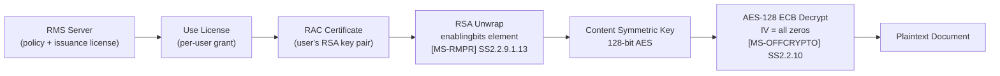
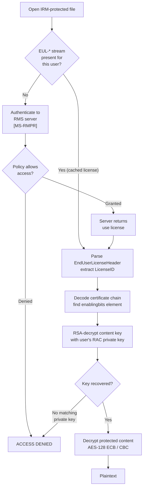
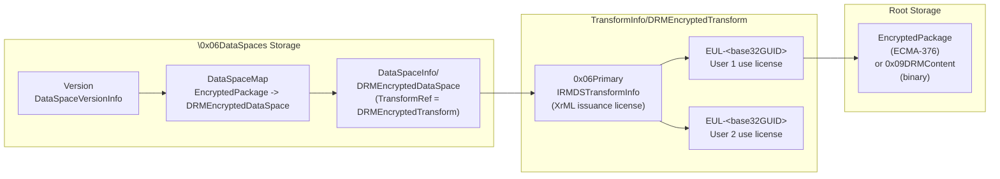

# IRM / RMS / Extensible (Certificate-Wrapped) Encryption

:white_circle: **PKI / Not Password** — non-password keying via RMS service, X.509 certificates, or pluggable COM modules

## Overview

- Content keys have full entropy and are never derived from a user password — protection is asymmetric (RSA) or service-gated, so there is no salt, spin count, or verifier to attack
- IRMDS wraps a symmetric content key to each authorized user's Rights Account Certificate (RAC) via RSA; the RMS server enforces policy before releasing a use license
- CertificateKeyEncryptor wraps the agile intermediate key to an X.509 public key, coexisting alongside a PasswordKeyEncryptor in the same agile XML
- Extensible Encryption delegates all crypto to an external COM module identified by GUID — the file carries only opaque provider data
- Used by: [Word](../../formats/word.md), [Excel](../../formats/excel.md), [PowerPoint](../../formats/powerpoint.md) (Office 2003+ for IRM, Office 2007+ for extensible/certificate)
- Spec: [MS-OFFCRYPTO] SS1.3.2, SS2.2–2.2.11, SS2.3.4.6, SS2.3.4.10; [MS-RMPR] for RMS protocol

## Key Delivery Flow



## Authorization Flow



## On-Disk Structure



## Quick Reference

| Parameter | IRMDS (RMS) | Extensible | CertificateKeyEncryptor |
|---|---|---|---|
| Key source | RMS server + RAC | External COM module | X.509 RSA key pair |
| Content cipher | AES-128, ECB (or CBC) | Module-defined | AES-CBC (agile) |
| Block size | 16 bytes | Module-defined | 16 bytes (agile default) |
| IV (ECB mode) | All zeros | N/A | N/A |
| IV (CBC mode) | LE32(byte_offset) in 16B, AES-ECB encrypted | N/A | Per-segment (agile SS2.3.4.12) |
| Key entropy | Full (server-generated) | Full (module-defined) | Full (random intermediate key) |
| Password? | No | No | No |
| Salt / Spin count? | No | No | No |
| Container | OLE CFB | OLE CFB | OLE CFB (agile XML) |
| Discriminator | `\0x06DataSpaces` + `DRMEncryptedTransform` | `\EncryptionInfo` vMinor=0x0003, fExternal=1 | Agile XML `keyEncryptor` URI `.../certificate` |

## Extraction Target

What a decoder needs from the OLE compound file to decrypt IRM-protected content:

| Field | Source Location | Type | Example |
|---|---|---|---|
| Issuance license (XrML) | `\0x06DataSpaces\TransformInfo\DRMEncryptedTransform\0x06Primary` | UTF-8-LP-P4 string | `<XrML>...</XrML>` |
| User license ID | `EUL-*` stream EndUserLicenseHeader.ID_String | base64 -> Unicode | `Windows:user@example.com` |
| Certificate chain XML | `EUL-*` stream (after header) | UTF-8-LP-P4 string | `<CERTIFICATECHAIN>...</CERTIFICATECHAIN>` |
| Encrypted content key | `enablingbits` element inside use license | RSA-encrypted bytes | (128-bit AES key, RSA-wrapped) |
| Plaintext length | First 8 bytes of `\EncryptedPackage` or `\0x09DRMContent` | u64 LE | `0x0000000000045A00` |
| Ciphertext | Remaining bytes of protected content stream | raw bytes | AES-128 ECB encrypted |

**AES-128 ECB parameters (content decryption):**

| Parameter | Value |
|---|---|
| Algorithm | AES |
| Key length | 128 bits (16 bytes) |
| Mode | ECB |
| IV | All zeros (16 bytes of 0x00) |
| Block size | 16 bytes |
| Padding | Ciphertext may exceed plaintext length; truncate to `Length` field |

**Python function signature this maps to:**

```python
def decrypt_irm_content(
    protected_stream: bytes,    # raw bytes from \EncryptedPackage or \0x09DRMContent
    content_key: bytes,         # 16-byte AES key from RSA-unwrapped enablingbits
    mode: str = "ECB",          # "ECB" (section 2.2.10) or "CBC" (section 4.1.3.5)
) -> bytes: ...

def obtain_content_key(
    eul_stream: bytes,          # raw bytes from EUL-<base32GUID> stream
    rac_private_key: object,    # user's RAC RSA private key (external to file)
) -> bytes: ...                 # returns 16-byte AES content key
```

---

## 1. What It Is and Where It Is Used

This document covers the three non-password content-key mechanisms defined in [MS-OFFCRYPTO]:

1. **Information Rights Management Data Space (IRMDS)** — an OLE compound file data-space transform structure that encrypts document content under a symmetric key distributed via Microsoft Rights Management Services (RMS). The content key is RSA-wrapped to each authorized user's Rights Account Certificate (RAC) public key and embedded in per-user End-User License (EUL) streams. Described in [MS-OFFCRYPTO] sections 1.3.2, 2.2 through 2.2.11, with security considerations in sections 4.1.2 and 4.1.3.5. Applicable to both Office binary documents (.doc, .xls, .ppt) and ECMA-376 documents (.docx, .xlsx, .pptx) [MS-OFFCRYPTO] section 2.2.

2. **Extensible Encryption** — a mechanism within the `\EncryptionInfo` stream that delegates all cryptographic operations to a user-provided external COM module identified by a GUID. The `\EncryptionInfo` stream carries `vMinor=0x0003` and the `fExternal` flag in `EncryptionHeaderFlags`, with all algorithm-identifying header fields zeroed. Described in [MS-OFFCRYPTO] sections 1.3.3.4, 2.3.4.6, 2.3.1, 2.3.2. Applicable to ECMA-376 documents [MS-OFFCRYPTO] section 2.3.4.6.

3. **CertificateKeyEncryptor** — an agile encryption `keyEncryptor` element that wraps the agile intermediate key with an X.509 certificate's RSA public key. This is a `keyEncryptor` within the agile encryption XML schema and may coexist with a `PasswordKeyEncryptor` in the same document. Described in [MS-OFFCRYPTO] section 2.3.4.10 (the `CT_CertificateKeyEncryptor` complex type).

Additionally, **LabelInfo** (sensitivity labels, [MS-OFFCRYPTO] sections 2.6, 3.12) is plaintext XML metadata carrying Microsoft Information Protection classification data. It is NOT an encryption mechanism and contains no secret material. It is documented here solely to prevent it being mistaken for a cryptographic structure.

- **Products:** IRMDS applies to all Office applications that support IRM policies (Office 2003 and later) [MS-OFFCRYPTO] section 5, product note <1>. Extensible encryption and `CertificateKeyEncryptor` are part of the ECMA-376 encryption framework (Office 2007 and later). All three mechanisms use OLE Compound File Binary (CFB) containers [MS-CFB].
- **Carrier formats:** see [../../formats/word.md](../../formats/word.md), [../../formats/excel.md](../../formats/excel.md), [../../formats/powerpoint.md](../../formats/powerpoint.md).
- **Sibling algorithm documents (password-based, for contrast):** [../password/ecma376-agile.md](../password/ecma376-agile.md), [../password/ecma376-standard.md](../password/ecma376-standard.md).

## 2. Profiles / Parameters Table

None of these mechanisms has a salt, a spin count, a password verifier, or a password-derived key. The "key protector" column replaces the KDF.

| # | Profile | Discriminator | Content-Key Protector | Bulk Cipher for Content | Spec Sections |
|---|---------|---------------|----------------------|------------------------|---------------|
| 1 | **IRMDS (RMS)** | `\0x06DataSpaces` storage present with `DRMEncryptedTransform` or `0x09DRMTransform` and `EUL-*` streams; no `\EncryptionInfo` with password verifier | Content symmetric key RSA-wrapped to each user's RMS RAC public key; released only by RMS server under policy; key embedded in `enablingbits` element of the use license ([MS-RMPR] section 2.2.9.1.13) | AES-128, 16-byte block, ECB, all-zero IV (section 2.2.10); CBC variant per section 4.1.3.5 | 1.3.2, 2.2–2.2.11, 4.1.2, 4.1.3.5 |
| 2 | **Extensible encryption** | `\EncryptionInfo` with `vMajor` in {0x0003, 0x0004}, `vMinor=0x0003`, `EncryptionHeaderFlags.fExternal=1`, all other header fields zero | External COM module identified by GUID (`EncryptionProvider@Id`); module consumes opaque `EncryptionProviderData` blob | Module-defined (unspecified in file) | 1.3.3.4, 2.3.1, 2.3.2, 2.3.4.6, 3.9 |
| 3 | **CertificateKeyEncryptor** | Agile `\EncryptionInfo` XML containing `<keyEncryptor uri=".../keyEncryptor/certificate">` | Agile intermediate key RSA-encrypted to an X.509 public key (`encryptedKeyValue`); private key never in file | Normal agile bulk cipher (AES-CBC with the recovered intermediate key, per section 2.3.4.15) | 2.3.4.10 |

- **Common properties:** container = OLE Compound File Binary [MS-CFB]; all integers little-endian [MS-OFFCRYPTO] section 1.3.6; content key has full entropy (not password-derived); protection is asymmetric (RSA) or external-service, never a low-entropy password.

## 3. Byte Layout / On-Disk Structures

### 3.1 Data Spaces Foundation Structures

All IRMDS and ECMA-376 encryption structures build on the data spaces storage hierarchy defined in [MS-OFFCRYPTO] section 2.1.

#### 3.1.1 UNICODE-LP-P4 (Length-Prefixed Padded Unicode String) [MS-OFFCRYPTO] section 2.1.2

| Field | Offset | Size | Type | Description |
|-------|--------|------|------|-------------|
| Length | 0 | 4 | u32 LE | Size in bytes of the Data field. MUST be a multiple of 2 bytes. |
| Data | 4 | Length | Unicode | Unicode string value. MUST NOT be null-terminated. |
| Padding | 4 + Length | 0 or 2 | bytes | Padding to make the total structure size a multiple of 4 bytes. If present, MUST be exactly 2 bytes of 0x00. |

#### 3.1.2 UTF-8-LP-P4 (Length-Prefixed UTF-8 String) [MS-OFFCRYPTO] section 2.1.3

| Field | Offset | Size | Type | Description |
|-------|--------|------|------|-------------|
| Length | 0 | 4 | u32 LE | Size in bytes of the Data field. |
| Data | 4 | Length | UTF-8 | UTF-8 string value. MUST NOT be null-terminated. If Length is 0x00000000, Data specifies a null string (total structure = 4 bytes). If Length is 0x00000004, Data specifies an empty string (total structure also 4 bytes). |
| Padding | 4 + Length | variable | bytes | Each byte MUST be 0x00. Pads so total structure size is a multiple of 4 bytes. |

#### 3.1.3 Version Structure [MS-OFFCRYPTO] section 2.1.4

| Field | Offset | Size | Type | Description |
|-------|--------|------|------|-------------|
| vMajor | 0 | 2 | u16 LE | Major version number. |
| vMinor | 2 | 2 | u16 LE | Minor version number. |

#### 3.1.4 DataSpaceVersionInfo [MS-OFFCRYPTO] section 2.1.5

Stored in `\0x06DataSpaces\Version` stream.

| Field | Offset | Size | Type | Description |
|-------|--------|------|------|-------------|
| FeatureIdentifier | 0 | variable | UNICODE-LP-P4 | MUST be "Microsoft.Container.DataSpaces". |
| ReaderVersion | variable | 4 | Version | vMajor MUST be 1, vMinor MUST be 0. |
| UpdaterVersion | variable | 4 | Version | vMajor MUST be 1, vMinor MUST be 0. |
| WriterVersion | variable | 4 | Version | vMajor MUST be 1, vMinor MUST be 0. |

#### 3.1.5 DataSpaceMap [MS-OFFCRYPTO] section 2.1.6

Stored in `\0x06DataSpaces\DataSpaceMap` stream.

| Field | Offset | Size | Type | Description |
|-------|--------|------|------|-------------|
| HeaderLength | 0 | 4 | u32 LE | Number of bytes before the first MapEntries entry. MUST be 0x00000008. |
| EntryCount | 4 | 4 | u32 LE | Number of DataSpaceMapEntry items in MapEntries. |
| MapEntries | 8 | variable | DataSpaceMapEntry[] | One or more DataSpaceMapEntry structures. |

#### 3.1.6 DataSpaceMapEntry [MS-OFFCRYPTO] section 2.1.6.1

| Field | Offset | Size | Type | Description |
|-------|--------|------|------|-------------|
| Length | 0 | 4 | u32 LE | Size in bytes of this DataSpaceMapEntry. |
| ReferenceComponentCount | 4 | 4 | u32 LE | Number of DataSpaceReferenceComponent items. |
| ReferenceComponents | 8 | variable | DataSpaceReferenceComponent[] | One or more reference components, listed most-general (storages) to most-specific (streams). |
| DataSpaceName | variable | variable | UNICODE-LP-P4 | Name of the data space definition (must match a stream name in `\0x06DataSpaces\DataSpaceInfo`). |

#### 3.1.7 DataSpaceReferenceComponent [MS-OFFCRYPTO] section 2.1.6.2

| Field | Offset | Size | Type | Description |
|-------|--------|------|------|-------------|
| ReferenceComponentType | 0 | 4 | u32 LE | 0x00000000 = stream, 0x00000001 = storage. |
| ReferenceComponent | 4 | variable | UNICODE-LP-P4 | Name of the stream or storage containing protected content. |

#### 3.1.8 DataSpaceDefinition [MS-OFFCRYPTO] section 2.1.7

Stored in streams within `\0x06DataSpaces\DataSpaceInfo` storage.

| Field | Offset | Size | Type | Description |
|-------|--------|------|------|-------------|
| HeaderLength | 0 | 4 | u32 LE | Bytes before TransformReferences. MUST be 0x00000008. |
| TransformReferenceCount | 4 | 4 | u32 LE | Number of transform references. |
| TransformReferences | 8 | variable | UNICODE-LP-P4[] | Transform names. MUST be stored in reverse order of application (when reversing transforms, apply in the listed order). Each name MUST match a child storage of `\0x06DataSpaces\TransformInfo`. |

#### 3.1.9 TransformInfoHeader [MS-OFFCRYPTO] section 2.1.8

Stored in `0x06Primary` streams within transform storages under `\0x06DataSpaces\TransformInfo`.

| Field | Offset | Size | Type | Description |
|-------|--------|------|------|-------------|
| TransformLength | 0 | 4 | u32 LE | Number of bytes in this structure before the TransformName field. |
| TransformType | 4 | 4 | u32 LE | MUST be 0x00000001. |
| TransformID | 8 | variable | UNICODE-LP-P4 | GUID identifier for the transform. |
| TransformName | variable | variable | UNICODE-LP-P4 | Friendly name of the transform. |
| ReaderVersion | variable | 4 | Version | Reader version. |
| UpdaterVersion | variable | 4 | Version | Updater version. |
| WriterVersion | variable | 4 | Version | Writer version. |

#### 3.1.10 ExtensibilityHeader [MS-OFFCRYPTO] section 2.2.5

| Field | Offset | Size | Type | Description |
|-------|--------|------|------|-------------|
| Length | 0 | 4 | u32 LE | Size of this structure. MUST be 0x00000004. |

### 3.2 IRMDS Structures (Profile 1: IRM / RMS)

#### 3.2.1 OLE Container Stream/Storage Paths

The following paths describe the complete set of storages and streams created by IRMDS [MS-OFFCRYPTO] sections 2.1.1, 2.2.1–2.2.11. Note: "0x06" and "0x09" in stream/storage names represent the literal ASCII characters with those hexadecimal values, not the text strings [MS-OFFCRYPTO] section 1.3.7.

**For ECMA-376 documents** [MS-OFFCRYPTO] sections 2.2.1, 2.2.2, 2.2.4:

| Path | Type | Contents |
|------|------|----------|
| `\0x06DataSpaces\Version` | stream | DataSpaceVersionInfo (section 3.1.4) |
| `\0x06DataSpaces\DataSpaceMap` | stream | DataSpaceMap with exactly one DataSpaceMapEntry: ReferenceComponent = "EncryptedPackage" (type 0x00000000 = stream), DataSpaceName = "DRMEncryptedDataSpace" |
| `\0x06DataSpaces\DataSpaceInfo\DRMEncryptedDataSpace` | stream | DataSpaceDefinition with exactly one TransformReference = "DRMEncryptedTransform" |
| `\0x06DataSpaces\TransformInfo\DRMEncryptedTransform\0x06Primary` | stream | IRMDSTransformInfo structure (section 3.2.2) |
| `\0x06DataSpaces\TransformInfo\DRMEncryptedTransform\EUL-<base32GUID>` | stream(s) | One or more End-User License streams (section 3.2.4) |
| `\0x06DataSpaces\TransformInfo\LabelInfo` | stream | (optional) Sensitivity label metadata when IRM is applied (section 2.6.2); plaintext XML, NOT encryption |
| `\EncryptedPackage` | stream | Protected Content stream (section 3.2.6) |

**For Office binary documents** [MS-OFFCRYPTO] sections 2.2.1, 2.2.2, 2.2.3:

| Path | Type | Contents |
|------|------|----------|
| `\0x06DataSpaces\Version` | stream | DataSpaceVersionInfo |
| `\0x06DataSpaces\DataSpaceMap` | stream | DataSpaceMap with at least one DataSpaceMapEntry: ReferenceComponent = "0x09DRMContent" (type 0x00000000 = stream), DataSpaceName = "0x09DRMDataSpace". Optionally a second entry: "0x09DRMViewerContent" / "0x09LZXDRMDataSpace". |
| `\0x06DataSpaces\DataSpaceInfo\0x09DRMDataSpace` | stream | DataSpaceDefinition with one TransformReference = "0x09DRMTransform" |
| `\0x06DataSpaces\DataSpaceInfo\0x09LZXDRMDataSpace` | stream | (optional) DataSpaceDefinition with two TransformReferences: "0x09DRMTransform", then "0x09LZXTransform" |
| `\0x06DataSpaces\TransformInfo\0x09DRMTransform\0x06Primary` | stream | IRMDSTransformInfo structure (section 3.2.2) |
| `\0x06DataSpaces\TransformInfo\0x09DRMTransform\EUL-<base32GUID>` | stream(s) | End-User License streams (section 3.2.4) |
| `\0x06DataSpaces\TransformInfo\0x09LZXTransform\0x06Primary` | stream | (optional) TransformInfoHeader for LZX compression (section 3.2.3) |
| `\0x09DRMContent` | stream | Protected Content stream (section 3.2.6) |
| `\0x09DRMViewerContent` | stream | (optional) Viewer Content stream (section 3.2.7) |

#### 3.2.2 IRMDSTransformInfo [MS-OFFCRYPTO] section 2.2.6

| Field | Offset | Size | Type | Description |
|-------|--------|------|------|-------------|
| TransformInfoHeader | 0 | variable | TransformInfoHeader | See section 3.1.9. Mandated values below. |
| ExtensibilityHeader | variable | 4 | ExtensibilityHeader | Length MUST be 0x00000004 (section 2.2.5). |
| XrMLLicense | variable | variable | UTF-8-LP-P4 | A valid XrML signed issuance license as specified in [MS-RMPR] section 2.2.9.9. MAY contain application-specific name-value attribute pairs `name` and `id` as part of the AUTHENTICATEDDATA element ([MS-RMPR] section 2.2.9.7.6). |

**Mandated TransformInfoHeader values (identical for both binary and ECMA-376)** [MS-OFFCRYPTO] sections 2.2.3, 2.2.4:

| TransformInfoHeader Field | Value |
|---------------------------|-------|
| TransformType | 0x00000001 |
| TransformID | `{C73DFACD-061F-43B0-8B64-0C620D2A8B50}` |
| TransformName | `Microsoft.Metadata.DRMTransform` |
| ReaderVersion | 1.0 |
| UpdaterVersion | 1.0 |
| WriterVersion | 1.0 |

#### 3.2.3 LZX Compression Transform (Optional) [MS-OFFCRYPTO] section 2.2.3

Present only for Office binary documents when a viewer content stream exists. Stored in `\0x06DataSpaces\TransformInfo\0x09LZXTransform\0x06Primary`.

| TransformInfoHeader Field | Value |
|---------------------------|-------|
| TransformType | 0x00000001 |
| TransformID | `{86DE7F2B-DDCE-486d-B016-405BBE82B8BC}` |
| TransformName | `Microsoft.Metadata.CompressionTransform` |
| ReaderVersion | 1.0 |
| UpdaterVersion | 1.0 |
| WriterVersion | 1.0 |

#### 3.2.4 End-User License Stream [MS-OFFCRYPTO] section 2.2.7

Stream name: `EUL-` prefix followed by a base-32-encoded GUID [MS-OFFCRYPTO] section 2.2.7.

The stream consists of an EndUserLicenseHeader (section 3.2.5) followed by a UTF-8-LP-P4 string containing XML specifying a certificate chain.

The certificate chain is constructed as follows [MS-OFFCRYPTO] section 2.2.7:

```
1. For each certificate element in the certificate chain from [MS-RMPR] section 2.2.3.2:
   a. The XrML content of the certificate element is encoded as Unicode.
   b. Each resulting string is base64-encoded.
   c. Each resulting base64 string is placed in a <CERTIFICATE> element.
2. The resulting <CERTIFICATE> elements are collected in a <CERTIFICATECHAIN> element.
3. The XML header <?xml version="1.0"?> is prefixed.
4. The resulting XML is stored as a UTF-8-LP-P4 string.
```

The certificate chain MUST include a use license whose `enablingbits` element contains the symmetric content key encrypted with the user's RAC public key [MS-RMPR] section 2.2.9.1.13. This is the sole copy of the content key in the file; it is asymmetrically wrapped and can only be unwrapped with the corresponding RAC private key.

#### 3.2.5 EndUserLicenseHeader [MS-OFFCRYPTO] section 2.2.9

| Field | Offset | Size | Type | Description |
|-------|--------|------|------|-------------|
| Length | 0 | 4 | u32 LE | Size of the EndUserLicenseHeader structure (includes both Length and ID_String). |
| ID_String | 4 | variable | UTF-8-LP-P4 | Base64-encoded Unicode LicenseID (section 3.2.5.1). |

#### 3.2.5.1 LicenseID [MS-OFFCRYPTO] section 2.2.8

A LicenseID is a Unicode string of the form `Windows:<emailaddr>` or `Passport:<emailaddr>`, where `emailaddr` is a valid email address as specified in [RFC2822].

#### 3.2.6 Protected Content Stream [MS-OFFCRYPTO] section 2.2.10

Contained in the root storage. Named `EncryptedPackage` for ECMA-376 documents or `\0x09DRMContent` for Office binary documents.

| Field | Offset | Size | Type | Description |
|-------|--------|------|------|-------------|
| Length | 0 | 8 | u64 LE | Size in bytes of the plaintext data stored encrypted in Contents. |
| Contents | 8 | variable | bytes | Protected content. MUST be encrypted/decrypted with the content symmetric key from the end-user license [MS-RMPR]. Cipher: **AES-128, 16-byte block size, ECB mode, initialization vector of all zeros** [MS-OFFCRYPTO] section 2.2.10. |

For the CBC mode variant, the IV construction is specified in [MS-OFFCRYPTO] section 4.1.3.5 — see section 5.2 below.

#### 3.2.7 Viewer Content Stream (Optional) [MS-OFFCRYPTO] section 2.2.11

Present only for Office binary documents when created. Named `\0x09DRMViewerContent`.

| Field | Offset | Size | Type | Description |
|-------|--------|------|------|-------------|
| Length | 0 | 8 | u64 LE | Size in bytes of the compressed plaintext data stored encrypted in Contents. |
| Contents | 8 | variable | bytes | MHTML representation of the document, encrypted as specified in [MS-RMPR]. Once decrypted, the plaintext MUST be decompressed with the LZX compression algorithm [MSDN-CAB]. |

### 3.3 Extensible Encryption Structures (Profile 2)

#### 3.3.1 `\EncryptionInfo` Stream (Extensible Encryption) [MS-OFFCRYPTO] section 2.3.4.6

| Field | Offset | Size | Type | Mandated Value |
|-------|--------|------|------|----------------|
| EncryptionVersionInfo.vMajor | 0 | 2 | u16 LE | MUST be 0x0003 or 0x0004. |
| EncryptionVersionInfo.vMinor | 2 | 2 | u16 LE | MUST be 0x0003 (this vMinor value is the extensible discriminator). |
| EncryptionHeader.Flags | 4 | 4 | u32 LE | Copy of the Flags from the EncryptionHeader. MUST have `fExternal` bit (bit 4) set to 1. All other bits MUST be 0. |
| EncryptionHeaderSize | 8 | 4 | u32 LE | Size in bytes of the EncryptionHeader field, including the GUID in CSPName. |
| EncryptionHeader | 12 | EncryptionHeaderSize | struct | See section 3.3.2. |
| EncryptionInfo (XML) | 12 + EncryptionHeaderSize | variable | Unicode string | EncryptionData XML element. First Unicode code point MUST be 0xFEFF. Schema in section 3.3.3. |
| EncryptionVerifier | after XML | variable | struct | EncryptionVerifier structure [MS-OFFCRYPTO] section 2.3.3. Present per layout, generated per section 2.3.4.8. However, because all algorithm-identifying fields are zero for `fExternal`, this verifier is not recomputable from a password. |

#### 3.3.2 EncryptionHeader (Extensible) [MS-OFFCRYPTO] sections 2.3.2, 2.3.4.6

| Field | Offset (relative) | Size | Type | Mandated Value (fExternal=1) |
|-------|--------------------|------|------|------------------------------|
| Flags | 0 | 4 | u32 LE | fExternal bit set (0x00000010), all other bits 0. |
| SizeExtra | 4 | 4 | u32 LE | 0x00000000. |
| AlgID | 8 | 4 | i32 LE | 0x00000000 ("Determined by the application", section 2.3.2). |
| AlgIDHash | 12 | 4 | i32 LE | 0x00000000 ("Determined by the application", section 2.3.2). |
| KeySize | 16 | 4 | u32 LE | 0x00000000. |
| ProviderType | 20 | 4 | u32 LE | 0x00000000. |
| Reserved1 | 24 | 4 | u32 LE | Undefined; MUST be ignored. |
| Reserved2 | 28 | 4 | u32 LE | 0x00000000; MUST be ignored. |
| CSPName | 32 | variable | UTF-16LE NUL-terminated | "A unique identifier of an encryption module" [MS-OFFCRYPTO] section 2.3.4.6. Not a CSP name in the usual sense; an opaque module identifier. |

- All key-material parameters are zero
- There is no salt, no key size, no hash algorithm, no iteration count in the file
- Everything needed to derive a key is delegated to the external module

#### 3.3.3 Extensible Provider XML Schema [MS-OFFCRYPTO] section 2.3.4.6

Namespace: `urn:schemas-microsoft-com:office:office`

```xml
<?xml version="1.0" encoding="utf-8"?>
<xs:schema targetNamespace="urn:schemas-microsoft-com:office:office"
  xmlns:xs="http://www.w3.org/2001/XMLSchema"
  elementFormDefault="qualified">
  <xs:element name="EncryptionData">
    <xs:complexType>
      <xs:sequence>
        <xs:element name="EncryptionProvider">
          <xs:complexType>
            <xs:sequence>
              <xs:element name="EncryptionProviderData">
                <xs:simpleType>
                  <xs:restriction base="xs:base64Binary"/>
                </xs:simpleType>
              </xs:element>
            </xs:sequence>
            <xs:attribute name="Id" use="required">
              <xs:simpleType>
                <xs:restriction base="xs:string">
                  <xs:pattern value="\{[0-9A-Fa-f]{8}\-[0-9A-Fa-f]{4}\-
                   [0-9A-Fa-f]{4}\-[0-9A-Fa-f]{4}\-[0-9A-Fa-f]{12}\}"/>
                </xs:restriction>
              </xs:simpleType>
            </xs:attribute>
            <xs:attribute name="Url" type="xs:anyURI" use="required"/>
          </xs:complexType>
        </xs:element>
      </xs:sequence>
    </xs:complexType>
  </xs:element>
</xs:schema>
```

| Element / Attribute | Parent | Description |
|---------------------|--------|-------------|
| EncryptionData | (root) | Container element. |
| EncryptionProvider | EncryptionData | Identifies the external cryptographic module. |
| EncryptionProvider@Id | — | GUID of the extensible encryption module, expressed as a string (e.g. `{05F17A8A-189E-42CD-9B21-E8F6B730EC8A}`). |
| EncryptionProvider@Url | — | URL where the extensible encryption module can be obtained. |
| EncryptionProviderData | EncryptionProvider | Base64-encoded data consumed by the external module. Opaque to the file format; module-defined. |

### 3.4 EncryptionHeaderFlags [MS-OFFCRYPTO] section 2.3.1

| Flag | Bit | Mask | Description |
|------|-----|------|-------------|
| Reserved1 (A) | 0 | 0x00000001 | MUST be 0, MUST be ignored. |
| Reserved2 (B) | 1 | 0x00000002 | MUST be 0, MUST be ignored. |
| fCryptoAPI (C) | 2 | 0x00000004 | CryptoAPI RC4 or ECMA-376 encryption. MUST be 1 unless fExternal is 1. If fExternal is 1, MUST be 0. |
| fDocProps (D) | 3 | 0x00000008 | MUST be 0 if document properties are encrypted (section 2.3.5.4). |
| fExternal (E) | 4 | 0x00000010 | MUST be 1 if extensible encryption is used. If 1, every other field in the structure MUST be 0. |
| fAES (F) | 5 | 0x00000020 | MUST be 1 if protected content is ECMA-376; if 1, fCryptoAPI MUST also be 1. |
| Unused | 6–31 | 0xFFFFFFC0 | Undefined, MUST be ignored. |

- **Reference Flags values:** standard/agile ECMA-376 = 0x00000024 (fCryptoAPI + fAES); extensible = 0x00000010 (fExternal only).

**Flags/AlgID combination table** [MS-OFFCRYPTO] section 2.3.2:

| fCryptoAPI | fAES | fExternal | AlgID | Algorithm |
|------------|------|-----------|-------|-----------|
| 0 | 0 | 1 | 0x00000000 | Determined by the application |
| 1 | 0 | 0 | 0x00000000 | RC4 |
| 1 | 0 | 0 | 0x00006801 | RC4 |
| 1 | 1 | 0 | 0x00000000 | 128-bit AES |
| 1 | 1 | 0 | 0x0000660E | 128-bit AES |
| 1 | 1 | 0 | 0x0000660F | 192-bit AES |
| 1 | 1 | 0 | 0x00006610 | 256-bit AES |

**AlgIDHash combination table** [MS-OFFCRYPTO] section 2.3.2:

| AlgIDHash | fExternal | Algorithm |
|-----------|-----------|-----------|
| 0x00000000 | 1 | Determined by the application |
| 0x00000000 | 0 | SHA-1 |
| 0x00008004 | 0 | SHA-1 |

### 3.5 CertificateKeyEncryptor Structure (Profile 3) [MS-OFFCRYPTO] section 2.3.4.10

This is a `keyEncryptor` element within the agile encryption XML (section 2.3.4.10). Its namespace URI is `http://schemas.microsoft.com/office/2006/keyEncryptor/certificate`.

```xml
<?xml version="1.0" encoding="utf-8"?>
<xs:schema attributeFormDefault="unqualified" elementFormDefault="qualified"
  targetNamespace="http://schemas.microsoft.com/office/2006/keyEncryptor/certificate"
  xmlns="http://schemas.microsoft.com/office/2006/keyEncryptor/certificate"
  xmlns:e="http://schemas.microsoft.com/office/2006/encryption"
  xmlns:xs="http://www.w3.org/2001/XMLSchema">
  <xs:import namespace="http://schemas.microsoft.com/office/2006/encryption"
    schemaLocation="encryptionInfo.xsd" />
  <xs:simpleType name="ST_PasswordKeyEncryptorUri">
    <xs:restriction base="xs:token">
      <xs:enumeration
        value="http://schemas.microsoft.com/office/2006/keyEncryptor/certificate" />
    </xs:restriction>
  </xs:simpleType>
  <xs:complexType name="CT_CertificateKeyEncryptor">
    <xs:attribute name="encryptedKeyValue" type="xs:base64Binary" use="required" />
    <xs:attribute name="X509Certificate" type="xs:base64Binary" use="required" />
    <xs:attribute name="certVerifier" type="xs:base64Binary" use="required" />
  </xs:complexType>
  <xs:element name="encryptedKey" type="CT_CertificateKeyEncryptor" />
</xs:schema>
```

| Attribute | Type | Description |
|-----------|------|-------------|
| encryptedKeyValue | xs:base64Binary | The agile intermediate key, RSA-encrypted with the public key in `X509Certificate` [MS-OFFCRYPTO] section 2.3.4.10. |
| X509Certificate | xs:base64Binary | DER-encoded X.509 certificate (public portion only). The certificate MUST contain only the public portion of the public-private key pair [MS-OFFCRYPTO] section 2.3.4.10. |
| certVerifier | xs:base64Binary | HMAC of the binary data obtained by base64-decoding the `X509Certificate` attribute. The hashing algorithm MUST be the one specified for the `Encryption.keyData` element. The secret key MUST be the intermediate key [MS-OFFCRYPTO] section 2.3.4.10. |

- **Intermediate key reset behavior** [MS-OFFCRYPTO] section 2.3.4.10: If the intermediate key is reset, any CertificateKeyEncryptor elements are also reset to contain the new intermediate key, except that the `certVerifier` attribute MUST match the value calculated using the current intermediate key to verify that the CertificateKeyEncryptor element actually encrypted the current intermediate key. If a CertificateKeyEncryptor element does not have a correct `certVerifier` attribute, it MUST be discarded.
- **Relationship to PasswordKeyEncryptor:** Exactly one PasswordKeyEncryptor MUST be present in a document using agile encryption. Zero or more CertificateKeyEncryptor elements are contained within the KeyEncryptors element. The intermediate key MUST be the same for all KeyEncryptor elements [MS-OFFCRYPTO] section 2.3.4.10. This means a document can carry both a password encryptor and a certificate encryptor wrapping the same intermediate key; the password path is documented in [../password/ecma376-agile.md](../password/ecma376-agile.md).

### 3.6 LabelInfo (Sensitivity Labels — NOT Encryption) [MS-OFFCRYPTO] sections 2.6, 3.12

LabelInfo is plaintext XML metadata carrying Microsoft Information Protection (MIP) sensitivity label data. It is NOT an encryption mechanism and contains no secret material.

**Location** [MS-OFFCRYPTO] section 2.6.2:
- When IRM is applied and a publishing license is present: stored in the `\0x06DataSpaces\TransformInfo` storage.
- When IRM is not applied: stored in the OPC package as a Sensitivity Label Information part ([MS-OI29500] section 3.4.1.5).

**Namespace:** `http://schemas.microsoft.com/office/2020/mipLabelMetadata` (prefix `clbl`).

Root element: `labelList` (type `CT_ClassificationLabelList`). Each `label` element (type `CT_ClassificationLabel`) has the following attributes [MS-OFFCRYPTO] section 2.6.5.4:

| Attribute | Type | Description |
|-----------|------|-------------|
| id | xsd:string | Unique identifier of the sensitivity label. |
| enabled | xsd:boolean | Whether the sensitivity label is enabled. |
| method | xsd:string | Assignment method ("Standard" or "Privileged"). Empty string if removed. |
| siteId | ST_ClassificationGuid | Azure AD site identifier for the label policy. |
| contentBits | xsd:unsignedInt (optional) | Bitmask: Header=1, Footer=2, Watermark=4, Encryption=8. |
| removed | xsd:boolean | Whether the label was removed (1) or is applied (0). |

## 4. Key Derivation

**There is no password key derivation function (KDF) for any mechanism in this document.** This is the fundamental distinction from the password-based encryption mechanisms:

- [ECMA-376 Agile](../password/ecma376-agile.md)
- [ECMA-376 Standard](../password/ecma376-standard.md)

### 4.1 IRMDS (Profile 1): Key Delivery via RMS

The content symmetric key is generated by the RMS publishing application and is never derived from a user secret. It is RSA-wrapped to each authorized user's RAC certificate and embedded in the EUL stream's certificate chain, specifically in the `enablingbits` element of the use license [MS-RMPR] section 2.2.9.1.13.

"Unlocking" the document is an authorization/PKI flow [MS-OFFCRYPTO] section 4.1.2, [MS-RMPR]:

```
function obtain_content_key_irm(eul_stream):
    header = parse_EndUserLicenseHeader(eul_stream)           # section 2.2.9
    license_id = base64_decode_unicode(header.ID_String)      # "Windows:<email>" or "Passport:<email>"
    cert_chain_xml = parse_UTF8_LP_P4(eul_stream, after=header)  # section 2.2.7
    # cert_chain_xml contains <?xml version="1.0"?><CERTIFICATECHAIN><CERTIFICATE>base64...</CERTIFICATE>...</CERTIFICATECHAIN>
    
    for each CERTIFICATE element in cert_chain_xml:
        cert_body = base64_decode(CERTIFICATE.text)           # yields Unicode XrML license
        xrml = parse_xrml(cert_body)
        if xrml contains enablingbits element:
            # enablingbits holds the content symmetric key, RSA-encrypted
            # with the user's RAC public key [MS-RMPR] section 2.2.9.1.13
            encrypted_content_key = extract_enablingbits(xrml)
            content_key = RSA_decrypt(encrypted_content_key, user_rac_private_key)
            return content_key   # 128-bit AES key

    # If no use license found or no matching RAC private key:
    # Must authenticate to RMS server to obtain a use license [MS-RMPR]
    return AUTHORIZATION_REQUIRED
```

### 4.2 Extensible Encryption (Profile 2): External COM Module

Key derivation is defined entirely by the external module named by `EncryptionProvider@Id`. The module consumes `EncryptionProviderData` plus whatever external state it chooses (a licensing server, a smartcard, a certificate, a hardware token). The file deliberately records `AlgID=0`, `AlgIDHash=0`, `KeySize=0`, `ProviderType=0`, `SizeExtra=0` and sets `fExternal=1`, with AlgIDHash meaning "Determined by the application" [MS-OFFCRYPTO] section 2.3.2.

```
function derive_key_extensible(encryption_info_stream):
    version = parse_version(encryption_info_stream)
    assert version.vMajor in {0x0003, 0x0004}
    assert version.vMinor == 0x0003

    hdr = parse_encryption_header(encryption_info_stream)
    assert hdr.Flags & 0x10 != 0         # fExternal MUST be set
    assert hdr.AlgID == 0x00000000       # "Determined by the application"
    assert hdr.AlgIDHash == 0x00000000   # "Determined by the application"
    assert hdr.KeySize == 0x00000000
    assert hdr.ProviderType == 0x00000000
    assert hdr.SizeExtra == 0x00000000

    xml = parse_provider_xml(encryption_info_stream)  # EncryptionData/EncryptionProvider
    # xml.Id  = GUID of the COM encryption module
    # xml.Url = URL where the module can be obtained
    # xml.EncryptionProviderData = opaque base64 blob

    module = load_external_module(xml.Id, download_from=xml.Url)
    key = module.DeriveOrFetchContentKey(base64_decode(xml.EncryptionProviderData))
    return key   # NOT a function of any password; no verifier to test against
```

- There is no salt, no iteration/spin count, no named block-key constant, no fixed cipher, no verifier that a password can reproduce.

### 4.3 CertificateKeyEncryptor (Profile 3): RSA-Wrapped Intermediate Key

The intermediate key is random and RSA-wrapped to an X.509 public key. Recovery requires the matching RSA private key.

```
function recover_intermediate_key_certificate(cert_key_encryptor, keydata):
    # cert_key_encryptor attributes from the agile XML:
    encrypted_key = base64_decode(cert_key_encryptor.encryptedKeyValue)
    cert_der = base64_decode(cert_key_encryptor.X509Certificate)
    stored_verifier = base64_decode(cert_key_encryptor.certVerifier)

    # Step 1: Verify the certVerifier [MS-OFFCRYPTO] section 2.3.4.10
    # Hash algorithm = keyData.hashAlgorithm (e.g. SHA-1, SHA-256, SHA-512)
    # Secret key = the intermediate key (which we are about to recover)
    # This creates a chicken-and-egg: certVerifier is checked AFTER recovery

    # Step 2: RSA-decrypt the intermediate key using the private key
    # The private key is in the recipient's certificate store / smartcard
    private_key = load_private_key_for(cert_der)   # external to the file
    intermediate_key = RSA_decrypt(encrypted_key, private_key)

    # Step 3: Verify certVerifier with the recovered intermediate key
    expected_verifier = HMAC(
        key=intermediate_key,
        message=cert_der,
        hash=keydata.hashAlgorithm
    )
    if stored_verifier != expected_verifier:
        # CertificateKeyEncryptor does not match current intermediate key
        # MUST be discarded [MS-OFFCRYPTO] section 2.3.4.10
        return DISCARD

    return intermediate_key
    # Use this intermediate key for agile decryption per section 2.3.4.15
```

## 5. Verification / Decryption

### 5.1 IRMDS Content Decryption [MS-OFFCRYPTO] section 2.2.10

Once the content symmetric key is obtained from the EUL stream (section 4.1), content decryption proceeds:

```
function decrypt_irm_content(protected_content_stream, content_key):
    # protected_content_stream is \EncryptedPackage (ECMA-376) or \0x09DRMContent (binary)
    plaintext_length = read_u64_LE(protected_content_stream)   # 8 bytes, section 2.2.10
    ciphertext = read_remaining(protected_content_stream)

    # ECB mode (section 2.2.10):
    # AES-128, 16-byte block size, ECB mode, IV = all zeros
    plaintext = AES_128_ECB_decrypt(
        key=content_key,           # 128-bit key from enablingbits
        data=ciphertext,
        block_size=16,
        iv=bytes(16)               # all zeros
    )
    return plaintext[:plaintext_length]   # trim to actual plaintext size
```

### 5.2 IRM CBC IV Construction [MS-OFFCRYPTO] section 4.1.3.5

For IRM documents using CBC encryption mode, the initialization vector is constructed as follows:

```
function generate_irm_cbc_iv(block_byte_offset, content_key):
    # block_byte_offset: the 0-based byte offset of the block start in the document stream
    # (NOT the block number; the actual byte offset)

    # Step 1: Create a 128-bit (16-byte) buffer
    iv_buffer = bytes(16)   # all zeros initially

    # Step 2: Cast the block starting offset as an unsigned 32-bit integer
    # Write it to the buffer in little-endian format as the first 4 bytes
    iv_buffer[0:4] = u32_to_LE(block_byte_offset)
    # Remaining 12 bytes stay zero

    # Step 3: Encrypt the buffer with AES ECB to produce the IV
    iv = AES_128_ECB_encrypt(
        key=content_key,
        data=iv_buffer,
        block_size=16
    )
    return iv   # Use this IV for AES-CBC encryption/decryption of this block
```

### 5.3 Extensible Encryption Verification

- There is no password verification procedure for extensible encryption
- The external COM module handles all verification internally
- The EncryptionVerifier structure is present in the stream layout [MS-OFFCRYPTO] section 2.3.4.6 but because all algorithm-identifying parameters (AlgID, AlgIDHash, KeySize) are zero, no standard password-verification algorithm applies

### 5.4 CertificateKeyEncryptor Verification [MS-OFFCRYPTO] section 2.3.4.10

The `certVerifier` attribute confirms that a CertificateKeyEncryptor element encrypted the current intermediate key:

```
function verify_cert_encryptor(cert_key_encryptor, intermediate_key, keydata):
    cert_der = base64_decode(cert_key_encryptor.X509Certificate)
    stored_verifier = base64_decode(cert_key_encryptor.certVerifier)

    expected_verifier = HMAC(
        key=intermediate_key,
        message=cert_der,
        hash_algorithm=keydata.hashAlgorithm   # from Encryption.keyData element
    )

    if stored_verifier != expected_verifier:
        # This CertificateKeyEncryptor MUST be discarded
        return false
    return true
```

- This is not a password check — it confirms the cert wraps the current intermediate key, guarding against stale CertificateKeyEncryptor elements after an intermediate key reset
- Once the intermediate key is recovered, the normal agile decryption flow applies: the encrypted package is decrypted in 4096-byte segments using AES-CBC, with per-segment IVs generated per [MS-OFFCRYPTO] section 2.3.4.12, and data integrity is verified per section 2.3.4.14
- See [../password/ecma376-agile.md](../password/ecma376-agile.md) for the agile decryption procedure details (the intermediate key is the same regardless of whether it was recovered from a PasswordKeyEncryptor or CertificateKeyEncryptor)

## 6. Reference Constants

### 6.1 EncryptionHeaderFlags Bit Positions [MS-OFFCRYPTO] section 2.3.1

| Flag | Bit | Mask | Notes |
|------|-----|------|-------|
| Reserved1 (A) | 0 | 0x00000001 | MUST be 0. |
| Reserved2 (B) | 1 | 0x00000002 | MUST be 0. |
| fCryptoAPI (C) | 2 | 0x00000004 | MUST be 0 when fExternal=1. |
| fDocProps (D) | 3 | 0x00000008 | 0 = doc props encrypted. |
| fExternal (E) | 4 | 0x00000010 | 1 = extensible encryption; forces all other fields 0. |
| fAES (F) | 5 | 0x00000020 | 1 = ECMA-376 content. |

### 6.2 Extensible EncryptionInfo Mandated Values [MS-OFFCRYPTO] section 2.3.4.6

| Field | Value |
|-------|-------|
| vMajor | 0x0003 or 0x0004 |
| vMinor | 0x0003 |
| Flags (at offset 4 and in header) | 0x00000010 (fExternal only) |
| SizeExtra | 0x00000000 |
| AlgID | 0x00000000 |
| AlgIDHash | 0x00000000 |
| KeySize | 0x00000000 |
| ProviderType | 0x00000000 |
| Reserved2 | 0x00000000 |
| EncryptionInfo XML first code point | 0xFEFF (BOM bytes FF FE) |

### 6.3 IRMDS Constants [MS-OFFCRYPTO] section 2.2

| Constant | Value | Source |
|----------|-------|--------|
| ExtensibilityHeader.Length | 0x00000004 | section 2.2.5 |
| TransformInfoHeader.TransformType | 0x00000001 | sections 2.2.3, 2.2.4 |
| DRM TransformID | `{C73DFACD-061F-43B0-8B64-0C620D2A8B50}` | sections 2.2.3, 2.2.4 |
| DRM TransformName | `Microsoft.Metadata.DRMTransform` | sections 2.2.3, 2.2.4 |
| LZX Compression TransformID | `{86DE7F2B-DDCE-486d-B016-405BBE82B8BC}` | section 2.2.3 |
| LZX Compression TransformName | `Microsoft.Metadata.CompressionTransform` | section 2.2.3 |
| All version fields (Reader/Updater/Writer) | 1.0 (vMajor=1, vMinor=0) | sections 2.2.3, 2.2.4 |
| DataSpaceVersionInfo.FeatureIdentifier | `Microsoft.Container.DataSpaces` | section 2.1.5 |
| DataSpaceMap.HeaderLength | 0x00000008 | section 2.1.6 |
| DataSpaceDefinition.HeaderLength | 0x00000008 | section 2.1.7 |

### 6.4 IRMDS Stream/Storage Name Constants

**ECMA-376 documents** [MS-OFFCRYPTO] sections 2.2.1, 2.2.2, 2.2.4:

| Name | Type | Description |
|------|------|-------------|
| `DRMEncryptedDataSpace` | DataSpaceName / DataSpaceInfo stream name | Data space name for ECMA-376 IRM |
| `DRMEncryptedTransform` | TransformInfo storage name | Transform storage for ECMA-376 IRM |
| `EncryptedPackage` | ReferenceComponent name | Protected content stream name |

**Office binary documents** [MS-OFFCRYPTO] sections 2.2.1, 2.2.2, 2.2.3:

| Name | Type | Description |
|------|------|-------------|
| `0x09DRMDataSpace` | DataSpaceName / DataSpaceInfo stream name | Data space name for binary IRM |
| `0x09DRMTransform` | TransformInfo storage name | Transform storage for binary IRM |
| `0x09DRMContent` | ReferenceComponent name | Protected content stream name |
| `0x09LZXDRMDataSpace` | DataSpaceName (optional) | Data space for compressed viewer content |
| `0x09DRMViewerContent` | ReferenceComponent name (optional) | Viewer content stream name |
| `0x09LZXTransform` | TransformInfo storage name (optional) | LZX compression transform storage |

### 6.5 IRM Content Cipher Constants [MS-OFFCRYPTO] sections 2.2.10, 4.1.3.5

| Parameter | Value |
|-----------|-------|
| Algorithm | AES-128 |
| Block size | 16 bytes |
| Mode (ECB variant) | ECB |
| IV (ECB variant) | All zeros (16 bytes of 0x00) |
| IV (CBC variant) | LE32(block_byte_offset) in bytes 0–3 of a 16-byte buffer (bytes 4–15 = 0x00), then AES-ECB-encrypted with the content key |

### 6.6 LicenseID String Format [MS-OFFCRYPTO] section 2.2.8

| Pattern | Description |
|---------|-------------|
| `Windows:<emailaddr>` | Windows-authenticated identity |
| `Passport:<emailaddr>` | Passport-authenticated identity |

Where `emailaddr` is a valid email address per [RFC2822].

### 6.7 EUL Stream Naming Convention [MS-OFFCRYPTO] section 2.2.7

Stream name = `EUL-` prefix + base-32-encoded GUID.

### 6.8 XML Namespaces

| Namespace URI | Used By |
|---------------|---------|
| `urn:schemas-microsoft-com:office:office` | Extensible encryption EncryptionData element (section 2.3.4.6) |
| `http://schemas.microsoft.com/office/2006/encryption` | Agile encryption root schema (section 2.3.4.10) |
| `http://schemas.microsoft.com/office/2006/keyEncryptor/certificate` | CertificateKeyEncryptor (section 2.3.4.10) |
| `http://schemas.microsoft.com/office/2006/keyEncryptor/password` | PasswordKeyEncryptor (section 2.3.4.10, contrast only) |
| `http://schemas.microsoft.com/office/2020/mipLabelMetadata` | LabelInfo sensitivity label metadata (section 2.6, prefix `clbl`) |

### 6.9 ECMA-376 Document Encryption DataSpaces Constants (Contrast) [MS-OFFCRYPTO] sections 2.3.4.1–2.3.4.3

When ECMA-376 standard/agile password encryption is used (NOT IRM or extensible), the DataSpaces plumbing uses:

| Name | Value |
|------|-------|
| DataSpaceName | `StrongEncryptionDataSpace` |
| TransformReference / storage name | `StrongEncryptionTransform` |
| TransformID | `{FF9A3F03-56EF-4613-BDD5-5A41C1D07246}` |
| TransformName | `Microsoft.Container.EncryptionTransform` |

### 6.10 AlgID Values [MS-OFFCRYPTO] section 2.3.2

| Value | Algorithm |
|-------|-----------|
| 0x00000000 | Determined by Flags (or by application when fExternal=1) |
| 0x00006801 | RC4 |
| 0x0000660E | 128-bit AES |
| 0x0000660F | 192-bit AES |
| 0x00006610 | 256-bit AES |

### 6.11 AlgIDHash Values [MS-OFFCRYPTO] section 2.3.2

| Value | fExternal | Algorithm |
|-------|-----------|-----------|
| 0x00000000 | 1 | Determined by the application |
| 0x00000000 | 0 | SHA-1 |
| 0x00008004 | 0 | SHA-1 |

### 6.12 ReferenceComponentType Values [MS-OFFCRYPTO] section 2.1.6.2

| Value | Meaning |
|-------|---------|
| 0x00000000 | Stream |
| 0x00000001 | Storage |

### 6.13 MsoDataStore Interop Storages [MS-OFFCRYPTO] sections 2.7, 2.7.1, 2.7.2

| Storage Name | Meaning When Present |
|--------------|----------------------|
| IsRedundantDataStorePromotion | MsoDataStore subordinate streams are identically represented in the encrypted content; safe to decrypt IRMDS and discard. |
| IsModifiedDataStorePromotion | MsoDataStore subordinate streams have been updated after initial IRMDS encryption; supersede the content in the encrypted streams. |

- Only one of these storages may be present at a time. Writers MUST NOT create both [MS-OFFCRYPTO] section 2.7.

### 6.14 EncryptedPropertyStreamInfo Structure [MS-OFFCRYPTO] section 2.10

Used by EncryptedSIHash (section 2.8) and EncryptedDSIHash (section 2.9) streams.

| Field | Offset | Size | Type | Description |
|-------|--------|------|------|-------------|
| StreamId | 0 | 1 | u8 | MUST be 0xAB. Invalid for all other values. |
| Version | 1 | 1 | u8 | 0x00 = current format. Ignore stream for any other value. |
| Checksum | 2 | 4 | u32 LE | CRC32 computed via MsoCrc32Compute ([MS-OSHARED] section 2.4.3) of the entire corresponding \x05SummaryInformation or \x05DocumentSummaryInformation stream contents. |
| Reserved | 6 | variable | — | Undefined, ignored if Version is 0x00. |

## 7. Security Considerations (From the Spec)

### 7.1 Information Rights Management [MS-OFFCRYPTO] section 4.1.2

"It is recommended that software components that implement the Information Rights Management (IRM) Data Space make a best effort to respect the licensing limitations applied to the protected content in the document." Security considerations concerning rights management are as described in [MS-RMPR].

### 7.2 IRM CBC IV Construction [MS-OFFCRYPTO] section 4.1.3.5

The IV for CBC mode in IRM-encrypted documents is constructed from the 0-based block starting byte-offset (not the block number) cast as a LE u32 in a 128-bit buffer, then AES-ECB-encrypted. See section 5.2 for the full procedure. Note that the spec explicitly uses the byte offset, not the block number.

### 7.3 Data Spaces [MS-OFFCRYPTO] section 4.1.1

No security considerations are stated for the data spaces structure itself.

### 7.4 ECMA-376 Encryption (General) [MS-OFFCRYPTO] section 4.1.3.1

- When setting algorithms for agile encryption, the SHA-2 series of hashing algorithms is preferred
- MD2, MD4, and MD5 are not recommended
- Older cipher algorithms such as DES are also not recommended [MS-OFFCRYPTO] section 4.1.3.1
- Passwords are limited to 255 Unicode code points [MS-OFFCRYPTO] section 4.1.3.1 (this applies to the password encryptor path, not the certificate or extensible paths)

### 7.5 Protected Streams Outside IRMDS

Applications store certain streams outside the protected content to preserve interoperability with applications that do not understand the IRMDS structure [MS-OFFCRYPTO] section 5, product note <1>. These include:

- `_signatures`
- `0x01CompObj`
- `Macros`
- `_VBA_PROJECT_CUR`
- `0x05SummaryInformation`
- `0x05DocumentSummaryInformation`
- `MsoDataStore`

These streams are not encrypted by the IRM transform.

## 8. Spec References

All section numbers refer to [MS-OFFCRYPTO] v20240820 unless otherwise noted.

| Section | Content |
|---------|---------|
| 1.3.1 | Data Spaces overview |
| 1.3.2 | Information Rights Management Data Space overview |
| 1.3.3.4 | ECMA-376 Document Encryption (standard, agile, extensible) |
| 1.3.6 | Byte ordering (little-endian) |
| 1.3.7 | String encoding (0x01/0x05/0x06/0x09 hex chars in names) |
| 1.3.8 | OLE Compound File path encoding |
| 2.1 | Data Spaces structures |
| 2.1.1 | File: required storages and streams |
| 2.1.2 | UNICODE-LP-P4 string format |
| 2.1.3 | UTF-8-LP-P4 string format |
| 2.1.4 | Version structure |
| 2.1.5 | DataSpaceVersionInfo |
| 2.1.6 | DataSpaceMap |
| 2.1.6.1 | DataSpaceMapEntry |
| 2.1.6.2 | DataSpaceReferenceComponent |
| 2.1.7 | DataSpaceDefinition |
| 2.1.8 | TransformInfoHeader |
| 2.1.9 | EncryptionTransformInfo |
| 2.2 | Information Rights Management Data Space |
| 2.2.1 | \0x06DataSpaces\DataSpaceMap Stream (binary and ECMA-376 variants) |
| 2.2.2 | \0x06DataSpaces\DataSpaceInfo Storage (binary and ECMA-376 variants) |
| 2.2.3 | \0x06DataSpaces\TransformInfo Storage for Office Binary Documents (0x09DRMTransform, 0x09LZXTransform) |
| 2.2.4 | \0x06DataSpaces\TransformInfo Storage for ECMA-376 Documents (DRMEncryptedTransform) |
| 2.2.5 | ExtensibilityHeader |
| 2.2.6 | IRMDSTransformInfo (TransformInfoHeader + ExtensibilityHeader + XrML license) |
| 2.2.7 | End-User License Stream (EUL- prefix, base32 GUID, certificate chain encoding) |
| 2.2.8 | LicenseID ("Windows:\<email\>" / "Passport:\<email\>") |
| 2.2.9 | EndUserLicenseHeader (Length + ID_String) |
| 2.2.10 | Protected Content Stream (AES-128, ECB, all-zero IV, 16-byte block) |
| 2.2.11 | Viewer Content Stream (optional MHTML, LZX-compressed, encrypted) |
| 2.3.1 | EncryptionHeaderFlags (fExternal bit definition) |
| 2.3.2 | EncryptionHeader (Flags/AlgID/AlgIDHash combination tables) |
| 2.3.3 | EncryptionVerifier |
| 2.3.4.6 | \EncryptionInfo Stream (Extensible Encryption): version, zeroed header, provider XML schema |
| 2.3.4.10 | \EncryptionInfo Stream (Agile Encryption): CT_CertificateKeyEncryptor schema, certVerifier HMAC |
| 2.6 | Sensitivity Labels (LabelInfo — NOT encryption) |
| 2.6.2 | LabelInfo Stream Locations |
| 2.6.4 | LabelInfo Stream Schema |
| 2.6.5.4 | CT_ClassificationLabel attributes |
| 2.7 | MsoDataStore |
| 2.7.1 | IsRedundantDataStorePromotion |
| 2.7.2 | IsModifiedDataStorePromotion |
| 2.8 | EncryptedSIHash Stream |
| 2.9 | EncryptedDSIHash Stream |
| 2.10 | EncryptedPropertyStreamInfo Structure |
| 3.1 | Version Stream example |
| 3.2 | DataSpaceMap Stream example |
| 3.3 | DRMEncryptedDataSpace Stream example |
| 3.4 | 0x06Primary Stream example (IRMDSTransformInfo) |
| 3.5 | EUL stream example (EndUserLicenseHeader + certificate chain) |
| 3.9 | \EncryptionInfo Stream (Third-Party Extensible Encryption) example |
| 3.12 | LabelInfo Stream examples |
| 4.1.2 | IRM security considerations |
| 4.1.3.5 | IRM CBC IV construction |
| 5 | Appendix A: Product Behavior (product notes <1>--<6> for IRM) |

**External specifications:**

| Spec | Content |
|------|---------|
| [MS-RMPR] | Rights Management Services Client-to-Server Protocol: certificate chains, enablingbits, RAC keys, use licenses, signed issuance licenses |
| [MS-RMPR] section 2.2.3.1, 2.2.3.2 | Certificate element, CertificateChain element |
| [MS-RMPR] section 2.2.9.1.13 | enablingbits element (RSA-encrypted content key) |
| [MS-RMPR] section 2.2.9.7.6 | AUTHENTICATEDDATA element (application-specific attributes) |
| [MS-RMPR] section 2.2.9.9 | Signed issuance license format |
| [MS-CFB] | Compound File Binary File Format (OLE structured storage) |
| [MS-OI29500] section 3.4.1.5 | Sensitivity Label Information OPC part |
| [MS-OSHARED] section 2.4.3 | MsoCrc32Compute algorithm |
| [MSDN-CAB] | Microsoft Cabinet Format (LZX compression for viewer content) |
| [RFC2822] | Internet Message Format (email address syntax for LicenseID) |
| [RFC3280] | X.509 PKI Certificate and CRL Profile |
| [RFC2104] | HMAC: Keyed-Hashing for Message Authentication |
| [RFC3447] | PKCS #1: RSA Cryptography Specifications |
