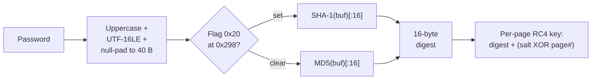

# MSISAM Page Encryption (Microsoft Money)

🔴 **Real Encryption** (MD5/SHA-1 + RC4) — per-page encryption in Microsoft Money 2002+ `.mny` files

## Overview

- MSISAM is the encryption provider for Microsoft Money 2002 and later (also configurable as a Jet 4.0 encryption provider for `.mdb` databases, though Access itself does not use it)
- The password protects actual ciphertext — pages 0 through 14 are RC4-encrypted with per-page keys derived from the password digest; pages 15+ are cleartext
- No published `[MS-*]` Open Specification exists for this format; all content is **UNCONFIRMED** community reverse-engineering from Jackcess (`MSISAMCryptCodecHandler.java`) and thewd-hub (`moneyCrk.cpp`)
- Used by: `.mny` (Microsoft Money 2002, 2003, 2004, 2005, 2006, 2007, Money Plus)
- Container: paged database file with `MSISAM Database` signature at header offset 0x04
- Recovery class: **CRACK** — the password hash must be brute-forced; no default password, no bypass
- Toolkit module: `crypto/msisam.py`

## KDF Pipeline



## Algorithm Detail

### 1. Password Normalisation

The password is uppercased (case-insensitive matching), encoded as UTF-16LE, and null-padded to exactly 40 bytes (0x28). Passwords longer than 20 characters (40 UTF-16LE bytes) are truncated.

### 2. Digest Computation

The 40-byte buffer is hashed with either MD5 (default) or SHA-1 (when flag bit 0x20 is set at header offset 0x298). The resulting digest is truncated to 16 bytes regardless of the algorithm — SHA-1's 20-byte output loses the last 4 bytes.

### 3. Header Region Deobfuscation

The header region at page 0 offsets 0x18..0x98 (128 bytes) is RC4-encrypted with the fixed key `C7 DA 39 6B`. This region contains the 8-byte salt at offset 0x72 (relative to page start) needed for password verification and per-page key derivation.

### 4. Password Verification

The verification check RC4-decrypts a 4-byte block at offset `0x2E9 + adjustment` using a 24-byte key composed of `digest[0:16] + salt[0x72:0x7A]`. The decrypted 4 bytes are compared against `salt[0x72:0x76]`. A match confirms the password.

The `adjustment` value is 0 for Money 2002 and earlier. For Money 2003+ (flag bit 0x08 at offset 0x298), it is the byte at decrypted offset 0x72 — the first byte of the salt itself.

### 5. Per-Page Key Derivation

Each encrypted page (0 through 14) uses a distinct RC4 key: `digest[0:16] + mixed_salt[4]`, where `mixed_salt = salt[0:4] XOR LE32(page_number)`. This gives 20 bytes of key material per page.

### 6. Encryption Scope

Only pages 0 through 14 (0x0E) are encrypted. Page 0 is partially encrypted (the header region at 0x18..0x98 uses the fixed RC4 key; the rest is cleartext or uses the password-derived key). Pages 15 and above are stored in cleartext.

## Flag Byte (Offset 0x298)

| Bit | Mask | Meaning |
|---|---|---|
| 1-2 | 0x06 | MSISAM encryption active (either bit set) |
| 3 | 0x08 | Money 2003+ format (verification offset adjusted by salt[0]) |
| 5 | 0x20 | Use SHA-1 instead of MD5 for the password digest |

## Hash Line Format

The toolkit emits a custom `$msisam$` line (no hashcat mode exists):

```
$msisam$<algo>$<salt_hex>$<crypt_check_hex>$<adjustment>
```

- `algo`: `1` for SHA-1, `0` for MD5
- `salt_hex`: 8-byte salt from offset 0x72 (hex-encoded)
- `crypt_check_hex`: 4-byte verification block from offset 0x2E9+adjustment (hex-encoded)
- `adjustment`: integer offset adjustment (0 for Money 2002, variable for 2003+)

## Sources

| Source | Role |
|---|---|
| Jackcess `MSISAMCryptCodecHandler.java` | Primary reference for the MSISAM encryption algorithm, flag definitions, and page-level key derivation |
| thewd-hub `moneyCrk.cpp` | Independent confirmation of the RC4 key composition and verification logic |
| Corpus: `money2008-pwd.mny` (password `TEST12345`) | Empirical verification of the complete pipeline |

## Known Limitations

- No hashcat or John the Ripper module exists for `$msisam$` — cracking requires a custom verifier or the toolkit's `verify_password()` function
- The encryption scope (pages 0-14 only) means most data pages in a large `.mny` file are cleartext; an investigator with filesystem access can read table data directly from pages 15+ without the password
- The flag byte at 0x298 is not formally specified; other bits may exist that affect behaviour on untested Money versions
