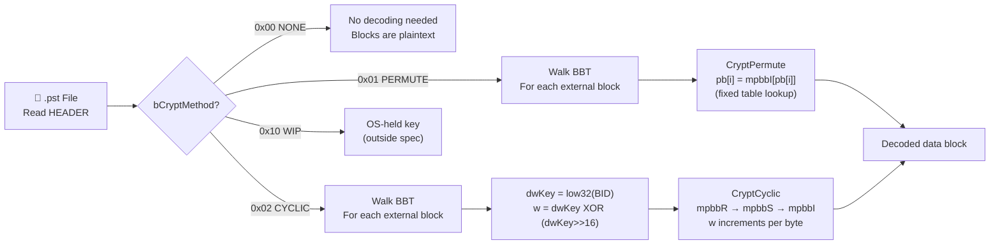
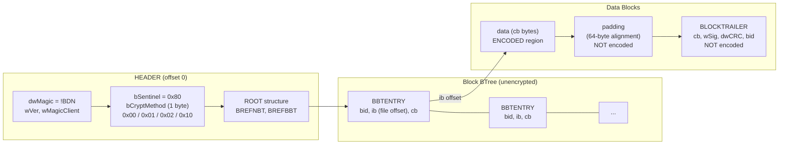

# PST Body Cipher (NDB Permute / Cyclic)

⚪ **Keyless Obfuscation** — non-password data-block encoding in Outlook Personal Folders (.pst) files

## Overview

- Per-file content obfuscation applied to end-user data blocks inside `.pst` files; no password, no key material stored in the file
- A single HEADER byte `bCryptMethod` selects one of four modes: no encoding (`0x00`), fixed monoalphabetic substitution (`0x01`, Permute), per-block keyed substitution stream (`0x02`, Cyclic), or WIP/EDP (`0x10`)
- Only external data blocks are encoded; the HEADER, allocation-metadata pages, and all BTree pages are stored without obfuscation
- Applies to both PST format variants: ANSI (Outlook 97-2002, `wVer` 14-15) and Unicode (Outlook 2003+, `wVer` >= 23)
- Used by: [Outlook](../../formats/outlook.md)
- Spec: [MS-PST] SS2.2.2.6 (HEADER), SS5.1 (CryptPermute), SS5.2 (CryptCyclic)

## Decode Flow



## On-Disk Structure



## Quick Reference

| Parameter | Value | Notes |
|---|---|---|
| bCryptMethod | 1 byte at offset 0x0201 (Unicode) / 0x01CD (ANSI) | Immediately after `bSentinel` (0x80) |
| Permute key | None (fixed table) | `mpbbR` encodes, `mpbbI` decodes |
| Cyclic key | `low32(BID)` per block | Public metadata from unencrypted BBT |
| Encoded region | `data` field only (up to 8176 B) | Padding and BLOCKTRAILER are never encoded |
| Internal blocks | Skipped (BID bit 1 = 1) | Only external data blocks are encoded |
| Password | N/A | Body cipher is independent of PST UI password |
| Strength | None ([MS-PST] SS4.1) | "only provide data obfuscation" |

## Extraction Target

What your code needs from the `.pst` file to decode all data blocks:

| Field | Source Location | Type | Example Value |
|---|---|---|---|
| `bCryptMethod` | HEADER offset 0x0201 (Unicode) / 0x01CD (ANSI) | uint8 | `0x02` (Cyclic) |
| `bSentinel` | HEADER offset 0x0200 (Unicode) / 0x01CC (ANSI) | uint8 | `0x80` (anchor) |
| `wVer` | HEADER offset 0x000A | uint16 LE | `23` (Unicode) |
| `BREFBBT` | HEADER ROOT structure | BID + IB | (locates BBT root page) |
| Per-block `bid` | BBTENTRY.BREF.bid in BBT | uint64 (Unicode) / uint32 (ANSI) | `0x0000_0084` |
| Per-block `ib` | BBTENTRY.BREF.ib in BBT | uint64 / uint32 | (absolute file offset) |
| Per-block `cb` | BBTENTRY.cb | uint16 | `4096` |
| BID `i` bit | `bid & 0x02` | flag | `0` = external (encode), `1` = internal (skip) |

**Python function signature this maps to:**

```python
def decode_pst_block(
    data: bytearray,  # raw data field bytes (cb bytes)
    crypt_method: int,  # from HEADER.bCryptMethod (0x00/0x01/0x02)
    bid: int,  # from BBTENTRY.BREF.bid (used as dwKey for cyclic)
    mpbb_crypt: bytes,  # 768-byte substitution table from [MS-PST] SS5.1
) -> bytearray: ...  # returns decoded data in-place
```

---

## 1. What It Is and Where It Is Used

- The PST body cipher is a per-file content obfuscation applied to end-user data blocks inside a Microsoft Outlook Personal Folders file (`.pst`).
- It is not password-derived and carries no cryptographic key material in the file.
- A single header byte, `bCryptMethod` ([MS-PST] section 2.2.2.6, HEADER structure), selects one of four modes: no encoding, a fixed monoalphabetic byte substitution (Permutative Encoding), a per-block keyed substitution stream (Cyclic Encoding), or Windows Information Protection (WIP/EDP) encryption.
- The first three modes are fully documented in [MS-PST]; the fourth delegates to the operating system.

The Permutative and Cyclic ciphers apply to both PST format variants: ANSI (Outlook 97-2002, `wVer` 14-15) and Unicode (Outlook 2003+, `wVer` >= 23) ([MS-PST] section 2.2.2.6). Only non-internal (external) data blocks are encoded; the HEADER, allocation-metadata pages (AMap, PMap, FMap, FPMap, DList), and BTree pages (NBT, BBT) are stored without obfuscation ([MS-PST] section 4.1, section 2.2.2.8.3.1.1).

[MS-PST] section 4.1 states: "This file format specification uses two keyless cipher algorithms to encode the data blocks in the PST. These algorithms only provide data obfuscation and can be conveniently decoded once the exact encoding algorithm is understood."

The PST body cipher is entirely distinct from the PST UI password (a CRC-32 hash stored as `PidTagPstPassword`, property tag `0x67FF`), which is documented in [MS-PST] section 2.4.3.3. The UI password does not key or gate the body cipher in any way ([MS-PST] section 4.2).

**Related documents:**

- [PST CRC-32 verifier](../password/pst-crc32.md) — the advisory UI password (separate from this cipher)
- [Outlook PST format](../../formats/outlook.md) — file-format context and container structure

**Governing spec sections:**

| Section | Content |
|---|---|
| [MS-PST] section 2.2.2.6 | HEADER structure: `bSentinel`, `bCryptMethod` field and selector table |
| [MS-PST] section 2.2.2.2 | BID (Block ID) structure |
| [MS-PST] section 2.2.2.8 | Blocks: data blocks, BLOCKTRAILER |
| [MS-PST] section 2.2.2.8.3.1 | Data Blocks |
| [MS-PST] section 2.2.2.8.3.1.1 | Data Block Encoding/Obfuscation |
| [MS-PST] section 2.2.2.7.7 | BTrees (NBT, BBT) |
| [MS-PST] section 2.2.2.7.7.3 | BBTENTRY (Leaf BBT Entry) |
| [MS-PST] section 4.1 | Strength of Encoded PST Data Blocks (security) |
| [MS-PST] section 4.2 | Strength of PST Password (security, UI password) |
| [MS-PST] section 5.1 | Permutative Encoding: `CryptPermute`, `mpbbCrypt[768]` |
| [MS-PST] section 5.2 | Cyclic Encoding: `CryptCyclic` |

## 2. Profiles / Parameters Table

The profile is selected by the single `bCryptMethod` byte in the HEADER. There is no hash, no salt, no iteration count, and no password-derived key in any profile ([MS-PST] section 4.1).

| `bCryptMethod` | Friendly name | Cipher type | Key input | Self-inverse? | Spec section |
|---|---|---|---|---|---|
| `0x00` | `NDB_CRYPT_NONE` | None | None | N/A | section 2.2.2.6 |
| `0x01` | `NDB_CRYPT_PERMUTE` | Fixed 256-byte monoalphabetic substitution | Fixed table `mpbbR` (encode) / `mpbbI` (decode) | No (`mpbbI = mpbbR^-1`; encode and decode use different tables) | section 5.1 |
| `0x02` | `NDB_CRYPT_CYCLIC` | Per-byte keyed substitution stream | Low 32 bits of the data block's BID (public BBT metadata, not a secret) | Yes (same function encodes and decodes) | section 5.2 |
| `0x10` | `NDB_CRYPT_EDPCRYPTED` | Windows Information Protection (WIP/EDP) | OS-held enterprise/user key, not in the file | N/A | section 2.2.2.6 |

Only non-internal (external) data blocks are encoded. Internal blocks (those with the `i` bit set in their BID, [MS-PST] section 2.2.2.2), the HEADER, allocation-metadata pages, and all BTree pages are stored without obfuscation ([MS-PST] section 4.1, section 2.2.2.8.3.1.1).

## 3. Byte Layout / On-Disk Structures

### 3.1 HEADER — `bCryptMethod` Location ([MS-PST] section 2.2.2.6)

The `bCryptMethod` field is located in the HEADER structure at file offset 0. The field immediately follows `bSentinel` (which MUST be `0x80`) and is preceded by the FMap (`rgbFM`, 128 bytes) and FPMap (`rgbFP`, 128 bytes) regions. The absolute offset is derivable from the spec-defined field sizes and ordering.

**Unicode HEADER** (partial, showing the relevant tail):

| Field | Offset | Size | Type | Description |
|---|---|---|---|---|
| `dwMagic` | 0x0000 | 4 | DWORD | MUST be `{ 0x21, 0x42, 0x44, 0x4E }` ("!BDN") |
| `dwCRCPartial` | 0x0004 | 4 | DWORD | CRC-32 of 471 bytes from `wMagicClient` |
| `wMagicClient` | 0x0008 | 2 | WORD | MUST be `{ 0x53, 0x4D }` |
| `wVer` | 0x000A | 2 | WORD | >= 23 for Unicode; 37 indicates WIP-capable |
| `wVerClient` | 0x000C | 2 | WORD | Client format version (19 for current spec) |
| `bPlatformCreate` | 0x000E | 1 | BYTE | MUST be 0x01 |
| `bPlatformAccess` | 0x000F | 1 | BYTE | MUST be 0x01 |
| `dwReserved1` | 0x0010 | 4 | DWORD | Reserved (zero) |
| `dwReserved2` | 0x0014 | 4 | DWORD | Reserved (zero) |
| `bidUnused` | 0x0018 | 8 | ULONGLONG | Unused padding (Unicode only) |
| `bidNextP` | 0x0020 | 8 | ULONGLONG | Next page BID |
| `dwUnique` | 0x0028 | 4 | DWORD | Monotonic modification counter |
| `rgnid[]` | 0x002C | 128 | NID[32] | NID counters per NID_TYPE |
| `qwUnused` | 0x00AC | 8 | ULONGLONG | MUST be zero (Unicode only) |
| `root` | 0x00B4 | 72 | ROOT | ROOT structure (section 2.2.2.5) |
| `dwAlign` | 0x00FC | 4 | DWORD | Alignment padding (Unicode only) |
| `rgbFM` | 0x0100 | 128 | BYTE[128] | Deprecated FMap (filled with 0xFF) |
| `rgbFP` | 0x0180 | 128 | BYTE[128] | Deprecated FPMap (filled with 0xFF) |
| **`bSentinel`** | **0x0200** | **1** | **BYTE** | **MUST be 0x80** |
| **`bCryptMethod`** | **0x0201** | **1** | **BYTE** | **Encoding selector (0x00/0x01/0x02/0x10)** |
| `rgbReserved` | 0x0202 | 2 | WORD | Reserved (zero) |
| `bidNextB` | 0x0204 | 8 | ULONGLONG | Next block BID (increments by 4) |
| `dwCRCFull` | 0x020C | 4 | DWORD | CRC-32 of 516 bytes from `wMagicClient` to `bidNextB` |
| `rgbReserved2` | 0x0210 | 3 | BYTE[3] | Reserved |
| `bReserved` | 0x0213 | 1 | BYTE | Reserved |
| `rgbReserved3` | 0x0214 | 32 | BYTE[32] | Reserved |

**ANSI HEADER** (partial, showing the relevant tail):

| Field | Offset | Size | Type | Description |
|---|---|---|---|---|
| `dwMagic` | 0x0000 | 4 | DWORD | MUST be `{ 0x21, 0x42, 0x44, 0x4E }` ("!BDN") |
| `dwCRCPartial` | 0x0004 | 4 | DWORD | CRC-32 of 471 bytes from `wMagicClient` |
| `wMagicClient` | 0x0008 | 2 | WORD | MUST be `{ 0x53, 0x4D }` |
| `wVer` | 0x000A | 2 | WORD | 14 or 15 for ANSI |
| `wVerClient` | 0x000C | 2 | WORD | Client format version |
| `bPlatformCreate` | 0x000E | 1 | BYTE | MUST be 0x01 |
| `bPlatformAccess` | 0x000F | 1 | BYTE | MUST be 0x01 |
| `dwReserved1` | 0x0010 | 4 | DWORD | Reserved (zero) |
| `dwReserved2` | 0x0014 | 4 | DWORD | Reserved (zero) |
| `bidNextB` | 0x0018 | 4 | DWORD | Next block BID (ANSI position) |
| `bidNextP` | 0x001C | 4 | DWORD | Next page BID |
| `dwUnique` | 0x0020 | 4 | DWORD | Monotonic modification counter |
| `rgnid[]` | 0x0024 | 128 | NID[32] | NID counters per NID_TYPE |
| `root` | 0x00A4 | 40 | ROOT | ROOT structure (ANSI, section 2.2.2.5) |
| `rgbFM` | 0x00CC | 128 | BYTE[128] | Deprecated FMap (filled with 0xFF) |
| `rgbFP` | 0x014C | 128 | BYTE[128] | Deprecated FPMap (filled with 0xFF) |
| **`bSentinel`** | **0x01CC** | **1** | **BYTE** | **MUST be 0x80** |
| **`bCryptMethod`** | **0x01CD** | **1** | **BYTE** | **Encoding selector (0x00/0x01/0x02/0x10)** |
| `rgbReserved` | 0x01CE | 2 | WORD | Reserved (zero) |
| `ullReserved` | 0x01D0 | 8 | ULONGLONG | Reserved (ANSI only) |
| `dwReserved` | 0x01D8 | 4 | DWORD | Reserved (ANSI only) |
| `rgbReserved2` | 0x01DC | 3 | BYTE[3] | Reserved |
| `bReserved` | 0x01DF | 1 | BYTE | Reserved |
| `rgbReserved3` | 0x01E0 | 32 | BYTE[32] | Reserved |

The absolute offsets are computed from the spec-defined field ordering and sizes in [MS-PST] section 2.2.2.6: **0x0201** (Unicode) and **0x01CD** (ANSI). The `bSentinel` field at `0x80` immediately preceding `bCryptMethod` serves as a reliable anchor byte.

### 3.2 BID (Block ID) Structure ([MS-PST] section 2.2.2.2)

The BID identifies every allocated block in the PST. It is the source of the Cyclic Encoding key.

**Unicode BID (8 bytes):**

| Bit(s) | Field | Description |
|---|---|---|
| 0 | `r` | Reserved. MUST be zero before BBT lookup |
| 1 | `i` | Internal flag: 1 = internal (metadata) block, 0 = external (data) block |
| 2-63 | `bidIndex` | Monotonically increasing unique block identifier |

**ANSI BID (4 bytes):**

| Bit(s) | Field | Description |
|---|---|---|
| 0 | `r` | Reserved. MUST be zero before BBT lookup |
| 1 | `i` | Internal flag: 1 = internal, 0 = external |
| 2-31 | `bidIndex` | Monotonically increasing unique block identifier |

Block BIDs (as used in section 2.2.2.8) reserve the two least significant bits for flags and increment by 4 each time a new one is assigned. Page BIDs (section 2.2.2.7) use all bits and increment by 1 ([MS-PST] section 2.2.2.2).

For CryptCyclic, `dwKey` is the **low DWORD of the BID** associated with the data block ([MS-PST] section 5.2). This is the full 32-bit value including the flag bits.

### 3.3 BBTENTRY (Leaf BBT Entry) ([MS-PST] section 2.2.2.7.7.3)

The BBT maps every allocated block to its file location. BBT entries for data blocks provide the BID (and thus the cyclic key) and the block's physical location. The BBT itself is stored unencrypted.

**Unicode BBTENTRY (24 bytes):**

| Field | Offset | Size | Type | Description |
|---|---|---|---|---|
| `BREF` | 0x00 | 16 | BREF | Contains the block's `bid` (8 bytes) and `ib` (8 bytes, absolute file offset) |
| `cb` | 0x10 | 2 | WORD | Byte count of raw data in the block (excluding trailer and padding) |
| `cRef` | 0x12 | 2 | WORD | Reference count |
| `dwPadding` | 0x14 | 4 | DWORD | Padding (zero) |

**ANSI BBTENTRY (12 bytes):**

| Field | Offset | Size | Type | Description |
|---|---|---|---|---|
| `BREF` | 0x00 | 8 | BREF | Contains the block's `bid` (4 bytes) and `ib` (4 bytes, absolute file offset) |
| `cb` | 0x08 | 2 | WORD | Byte count of raw data in the block |
| `cRef` | 0x0A | 2 | WORD | Reference count |

### 3.4 Data Block Layout ([MS-PST] section 2.2.2.8.3.1)

A data block is an external (non-internal) block containing higher-layer data. Its maximum size is 8192 bytes. The encoded region is only the `data` field; the `padding` and `blockTrailer` are never encoded ([MS-PST] section 2.2.2.8.3.1.1).

| Field | Size | Description |
|---|---|---|
| `data` | `cb` bytes (variable, up to 8176 bytes Unicode / 8180 bytes ANSI) | Payload data. **This is the encoded/decoded region.** |
| `padding` | Variable (0-63 bytes) | Alignment padding to make total size a multiple of 64. Not encoded. |
| `blockTrailer` | 16 bytes (Unicode) / 12 bytes (ANSI) | BLOCKTRAILER structure. Not encoded. |

**BLOCKTRAILER** ([MS-PST] section 2.2.2.8.1):

| Field | Size (both formats) | Description |
|---|---|---|
| `cb` | 2 bytes | Byte count of data (excluding trailer and padding) |
| `wSig` | 2 bytes | Block signature (section 5.5) |
| `dwCRC` | 4 bytes | CRC-32 of the `cb` bytes of raw data |
| `bid` | 8 bytes (Unicode) / 4 bytes (ANSI) | BID of the data block |

Note: in the Unicode BLOCKTRAILER, the field order is `cb`, `wSig`, `dwCRC`, `bid`. In ANSI, the order is `cb`, `wSig`, `bid`, `dwCRC` ([MS-PST] section 2.2.2.8.1).

The `dwCRC` in the BLOCKTRAILER is computed over the raw (encoded) data bytes, not the decoded plaintext. Encoding and decoding are performed in-place on the `data` field only ([MS-PST] section 2.2.2.8.3.1.1).

### 3.5 Which Blocks Are Encoded

Per [MS-PST] section 2.2.2.8.3.1.1: "A special case exists when a PST file is configured to encode its contents. In that case, the NDB Layer encodes the data field of data blocks to obfuscate the data using one of two keyless ciphers." And per [MS-PST] section 4.1: "only end-user data blocks are encoded in the PST. All the other infrastructure information, including the header, allocation metadata pages and BTree pages are stored without obfuscation."

The `i` bit (bit 1) of the BID distinguishes internal blocks from external data blocks ([MS-PST] section 2.2.2.2). Only blocks with `i = 0` (external / data blocks) are subject to encoding. Internal blocks (XBLOCKs, XXBLOCKs, SLBLOCKs, SIBLOCKs) have `i = 1` and are never encoded.

## 4. Key Derivation

There is no password, no salt, and no iterated KDF. The "key" for each mode is either fixed (Permute) or derived from public file metadata (Cyclic).

### 4.1 Mode Selection ([MS-PST] section 2.2.2.6)

```
FUNCTION select_cipher(header):
    m = header.bCryptMethod

    IF m == 0x00 (NDB_CRYPT_NONE):
        // Data blocks stored in the clear. No encoding.
        RETURN plaintext

    IF m == 0x01 (NDB_CRYPT_PERMUTE):
        // Key is the fixed mpbbCrypt table.
        // Encode with mpbbR (bytes 0-255), decode with mpbbI (bytes 512-767).
        RETURN permute

    IF m == 0x02 (NDB_CRYPT_CYCLIC):
        // Key is the low 32 bits of each block's BID, read from the BBT.
        RETURN cyclic

    IF m == 0x10 (NDB_CRYPT_EDPCRYPTED):
        // Key is held by the OS via Windows Information Protection.
        // Not derivable from the PST file.
        RETURN wip_encrypted
```

### 4.2 Permutative Key ([MS-PST] section 5.1)

No derivation. The encode table is `mpbbR` (bytes 0-255 of `mpbbCrypt`); the decode table is `mpbbI` (bytes 512-767 of `mpbbCrypt`). Both tables are fixed constants defined in the spec. `mpbbI` is the inverse permutation of `mpbbR`: for every byte value `x`, `mpbbI[mpbbR[x]] == x`.

### 4.3 Cyclic Key ([MS-PST] section 5.2)

For each data block:

```
// dwKey is the low DWORD of the block's BID.
// Per [MS-PST] section 5.2: "the value to use for dwKey is the
// lower DWORD of the BID associated with this data block."

dwKey = low32(block.BID)

// Derive the initial 16-bit mixer word:
w = (WORD)(dwKey XOR (dwKey >> 16))

// w then increments by 1 for every byte processed (see section 5).
```

The BID is public metadata stored in the unencrypted BBT ([MS-PST] section 2.2.2.7.7.3); it is not a secret.

### 4.4 Table Decomposition ([MS-PST] section 5.1)

The `mpbbCrypt` blob is 768 bytes consisting of three concatenated 256-byte substitution tables:

```
#define mpbbR   (mpbbCrypt)          // bytes   0-255:  forward substitution (encode)
#define mpbbS   (mpbbCrypt + 256)    // bytes 256-511:  involution (used in cyclic mixer)
#define mpbbI   (mpbbCrypt + 512)    // bytes 512-767:  inverse of mpbbR (decode)
```

Properties:
- `mpbbI[mpbbR[x]] == x` for all x in 0..255 (mpbbI is the inverse permutation of mpbbR)
- `mpbbS[mpbbS[x]] == x` for all x in 0..255 (mpbbS is a self-inverse involution)

These properties are what make CryptCyclic a symmetric (self-inverse) cipher: the composition `mpbbI(mpbbS(mpbbR(...)))` with the additive/subtractive mixer structure reverses itself when applied a second time with the same incrementing `w` value.

## 5. Verification / Decryption — Pseudocode

There is no verifier, no MAC, and no password check gating the body cipher. Decoding is unconditional: read the `bCryptMethod` byte, walk the BBT to locate non-internal data blocks, and apply the appropriate transform to each block's `data` field. The decoded result is the raw NDB/LTP layer data.

### 5.1 CryptPermute ([MS-PST] section 5.1)

Monoalphabetic byte substitution. `fEncrypt = TRUE` encodes (via `mpbbR`); `fEncrypt = FALSE` decodes (via `mpbbI`). The transform is applied in-place. The spec's DWORD-at-a-time loop is a speed optimization; semantically each byte is independently substituted.

```
FUNCTION CryptPermute(pv, cb, fEncrypt):
    // pv: pointer to data buffer
    // cb: byte count of data
    // fEncrypt: TRUE to encode, FALSE to decode

    pb = (byte *)pv
    pbTable = fEncrypt ? mpbbR : mpbbI

    // Simplified single-byte loop (equivalent to the spec's optimized version):
    FOR i = 0 TO cb - 1:
        pb[i] = pbTable[pb[i]]
```

The spec ([MS-PST] section 5.1) provides an optimized C++ implementation that aligns to DWORD boundaries and processes 4 bytes per iteration for performance. The algorithm is:

```c++
void CryptPermute(PVOID pv, int cb, BOOL fEncrypt)
{
    byte *      pb      = (byte *)pv;
    byte *      pbTable = fEncrypt ? mpbbR : mpbbI;
    const DWORD * pdw   = (const DWORD *) pv;
    DWORD       dwCurr;
    byte        b;

    if (cb >= sizeof(DWORD))
    {
        // Align to DWORD boundary
        while (0 != (((DWORD_PTR) pb) % sizeof(DWORD)))
        {
            *pb = pbTable[*pb];
            pb++;
            cb--;
        }
        pdw = (const DWORD *) pb;
        // Process 4 bytes at a time
        for (; cb >= 4; cb -= 4)
        {
            dwCurr = *pdw;
            b = (byte) (dwCurr & 0xFF);
            *pb = pbTable[b];
            pb++;
            dwCurr = dwCurr >> 8;
            b = (byte) (dwCurr & 0xFF);
            *pb = pbTable[b];
            pb++;
            dwCurr = dwCurr >> 8;
            b = (byte) (dwCurr & 0xFF);
            *pb = pbTable[b];
            pb++;
            dwCurr = dwCurr >> 8;
            b = (byte) (dwCurr & 0xFF);
            *pb = pbTable[b];
            pb++;
            pdw++;
        }
        pb = (byte *) pdw;
    }
    // Process remaining bytes
    for (; --cb >= 0; ++pb)
        *pb = pbTable[*pb];
}
```

### 5.2 CryptCyclic ([MS-PST] section 5.2)

Per-byte keyed substitution stream. **This is a symmetric cipher**: the same function with the same `dwKey` both encodes and decodes. The `dwKey` is the low DWORD of the block's BID.

```
FUNCTION CryptCyclic(pv, cb, dwKey):
    // pv: pointer to data buffer
    // cb: byte count of data
    // dwKey: low DWORD of the block's BID

    pb = (byte *)pv
    w = (WORD)(dwKey XOR (dwKey >> 16))    // initial 16-bit mixer

    FOR i = 0 TO cb - 1:
        b = pb[i]
        b = (byte)(b + (byte)w)             // add low byte of w
        b = mpbbR[b]                         // forward substitution
        b = (byte)(b + (byte)(w >> 8))       // add high byte of w
        b = mpbbS[b]                         // involution substitution
        b = (byte)(b - (byte)(w >> 8))       // subtract high byte of w
        b = mpbbI[b]                         // inverse substitution
        b = (byte)(b - (byte)w)             // subtract low byte of w
        pb[i] = b
        w = (WORD)(w + 1)                    // advance mixer every byte
```

The spec's C++ implementation ([MS-PST] section 5.2):

```c++
void CryptCyclic(PVOID pv, int cb, DWORD dwKey)
{
    byte * pb = (byte *)pv;
    byte b;
    WORD w;

    w = (WORD)(dwKey ^ (dwKey >> 16));

    while (--cb >= 0) {
        b = *pb;
        b = (byte)(b + (byte)w);
        b = mpbbR[b];
        b = (byte)(b + (byte)(w >> 8));
        b = mpbbS[b];
        b = (byte)(b - (byte)(w >> 8));
        b = mpbbI[b];
        b = (byte)(b - (byte)w);
        *pb++ = b;
        w = (WORD)(w + 1);
    }
}
```

**Self-inverse property:** CryptCyclic is its own inverse because:
1. The additive mixer `+w_lo / +w_hi` is reversed by the subtractive mixer `-w_hi / -w_lo` in the same pass.
2. `mpbbS` is an involution (`mpbbS[mpbbS[x]] == x`), so it reverses itself.
3. `mpbbI` is the inverse of `mpbbR`, so the forward-then-inverse substitution pair cancels.
4. The `w` increment sequence is deterministic from `dwKey`, producing the same sequence on both encode and decode.

Running CryptCyclic twice with the same `dwKey` on the same data returns the original bytes.

### 5.3 Complete Decode Procedure

```
FUNCTION decode_pst_blocks(pst_file):
    // 1. Read bCryptMethod from HEADER
    header = read_header(pst_file)
    method = header.bCryptMethod

    IF method == 0x00:  // NDB_CRYPT_NONE
        RETURN  // blocks are already plaintext

    IF method == 0x10:  // NDB_CRYPT_EDPCRYPTED
        ERROR "WIP-encrypted; requires OS-held key"

    // 2. Walk the BBT to find all non-internal data blocks
    bbt_root = header.root.BREFBBT
    FOR EACH bbtentry IN walk_bbt(pst_file, bbt_root):
        bid = bbtentry.BREF.bid
        ib  = bbtentry.BREF.ib    // absolute file offset
        cb  = bbtentry.cb          // data byte count

        // Skip internal blocks (i bit = 1)
        IF (bid & 0x02) != 0:
            CONTINUE

        // 3. Read the data portion of the block
        data = read_bytes(pst_file, offset=ib, length=cb)

        // 4. Decode in place
        IF method == 0x01:  // NDB_CRYPT_PERMUTE
            CryptPermute(data, cb, fEncrypt=FALSE)
        ELSE IF method == 0x02:  // NDB_CRYPT_CYCLIC
            dwKey = low32(bid)
            CryptCyclic(data, cb, dwKey)

        // 5. data now contains decoded NDB/LTP layer content
```

## 6. Reference Constants

### 6.1 bCryptMethod Selector Values ([MS-PST] section 2.2.2.6)

```
Value   Friendly name              Meaning
-----   -------------------------  --------------------------------------------------
0x00    NDB_CRYPT_NONE             Data blocks are not encoded.
0x01    NDB_CRYPT_PERMUTE          Encoded with the Permutation algorithm (section 5.1).
0x02    NDB_CRYPT_CYCLIC           Encoded with the Cyclic algorithm (section 5.2).
0x10    NDB_CRYPT_EDPCRYPTED       Encrypted with Windows Information Protection.
```

### 6.2 HEADER Anchors

```
bSentinel MUST = 0x80    (immediately precedes bCryptMethod)
bCryptMethod offset:     0x0201 (Unicode PST) / 0x01CD (ANSI PST)
dwMagic MUST = { 0x21, 0x42, 0x44, 0x4E }   ("!BDN")
wMagicClient MUST = { 0x53, 0x4D }
```

### 6.3 mpbbCrypt[768] — Full Substitution Table ([MS-PST] section 5.1)

Bytes 0-255 = `mpbbR` (forward/encode), bytes 256-511 = `mpbbS` (involution), bytes 512-767 = `mpbbI` (inverse/decode). Reproduced verbatim from the spec.

```
byte mpbbCrypt[] =
{
    // mpbbR: bytes 0-255 (forward substitution / encode table)
     65,  54,  19,  98, 168,  33, 110, 187,
    244,  22, 204,   4, 127, 100, 232,  93,
     30, 242, 203,  42, 116, 197,  94,  53,
    210, 149,  71, 158, 150,  45, 154, 136,
     76, 125, 132,  63, 219, 172,  49, 182,
     72,  95, 246, 196, 216,  57, 139, 231,
     35,  59,  56, 142, 200, 193, 223,  37,
    177,  32, 165,  70,  96,  78, 156, 251,
    170, 211,  86,  81,  69, 124,  85,   0,
      7, 201,  43, 157, 133, 155,   9, 160,
    143, 173, 179,  15,  99, 171, 137,  75,
    215, 167,  21,  90, 113, 102,  66, 191,
     38,  74, 107, 152, 250, 234, 119,  83,
    178, 112,   5,  44, 253,  89,  58, 134,
    126, 206,   6, 235, 130, 120,  87, 199,
    141,  67, 175, 180,  28, 212,  91, 205,
    226, 233,  39,  79, 195,   8, 114, 128,
    207, 176, 239, 245,  40, 109, 190,  48,
     77,  52, 146, 213,  14,  60,  34,  50,
    229, 228, 249, 159, 194, 209,  10, 129,
     18, 225, 238, 145, 131, 118, 227, 151,
    230,  97, 138,  23, 121, 164, 183, 220,
    144, 122,  92, 140,   2, 166, 202, 105,
    222,  80,  26,  17, 147, 185,  82, 135,
     88, 252, 237,  29,  55,  73,  27, 106,
    224,  41,  51, 153, 189, 108, 217, 148,
    243,  64,  84, 111, 240, 198, 115, 184,
    214,  62, 101,  24,  68,  31, 221, 103,
     16, 241,  12,  25, 236, 174,   3, 161,
     20, 123, 169,  11, 255, 248, 163, 192,
    162,   1, 247,  46, 188,  36, 104, 117,
     13, 254, 186,  47, 181, 208, 218,  61,

    // mpbbS: bytes 256-511 (involution substitution)
     20,  83,  15,  86, 179, 200, 122, 156,
    235, 101,  72,  23,  22,  21, 159,   2,
    204,  84, 124, 131,   0,  13,  12,  11,
    162,  98, 168, 118, 219, 217, 237, 199,
    197, 164, 220, 172, 133, 116, 214, 208,
    167, 155, 174, 154, 150, 113, 102, 195,
     99, 153, 184, 221, 115, 146, 142, 132,
    125, 165,  94, 209,  93, 147, 177,  87,
     81,  80, 128, 137,  82, 148,  79,  78,
     10, 107, 188, 141, 127, 110,  71,  70,
     65,  64,  68,   1,  17, 203,   3,  63,
    247, 244, 225, 169, 143,  60,  58, 249,
    251, 240,  25,  48, 130,   9,  46, 201,
    157, 160, 134,  73, 238, 111,  77, 109,
    196,  45, 129,  52,  37, 135,  27, 136,
    170, 252,   6, 161,  18,  56, 253,  76,
     66, 114, 100,  19,  55,  36, 106, 117,
    119,  67, 255, 230, 180,  75,  54,  92,
    228, 216,  53,  61,  69, 185,  44, 236,
    183,  49,  43,  41,   7, 104, 163,  14,
    105, 123,  24, 158,  33,  57, 190,  40,
     26,  91, 120, 245,  35, 202,  42, 176,
    175,  62, 254,   4, 140, 231, 229, 152,
     50, 149, 211, 246,  74, 232, 166, 234,
    233, 243, 213,  47, 112,  32, 242,  31,
      5, 103, 173,  85,  16, 206, 205, 227,
     39,  59, 218, 186, 215, 194,  38, 212,
    145,  29, 210,  28,  34,  51, 248, 250,
    241,  90, 239, 207, 144, 182, 139, 181,
    189, 192, 191,   8, 151,  30, 108, 226,
     97, 224, 198, 193,  89, 171, 187,  88,
    222,  95, 223,  96, 121, 126, 178, 138,

    // mpbbI: bytes 512-767 (inverse substitution / decode table)
     71, 241, 180, 230,  11, 106, 114,  72,
    133,  78, 158, 235, 226, 248, 148,  83,
    224, 187, 160,   2, 232,  90,   9, 171,
    219, 227, 186, 198, 124, 195,  16, 221,
     57,   5, 150,  48, 245,  55,  96, 130,
    140, 201,  19,  74, 107,  29, 243, 251,
    143,  38, 151, 202, 145,  23,   1, 196,
     50,  45, 110,  49, 149, 255, 217,  35,
    209,   0,  94, 121, 220,  68,  59,  26,
     40, 197,  97,  87,  32, 144,  61, 131,
    185,  67, 190, 103, 210,  70,  66, 118,
    192, 109,  91, 126, 178,  15,  22,  41,
     60, 169,   3,  84,  13, 218,  93, 223,
    246, 183, 199,  98, 205, 141,   6, 211,
    105,  92, 134, 214,  20, 247, 165, 102,
    117, 172, 177, 233,  69,  33, 112,  12,
    135, 159, 116, 164,  34,  76, 111, 191,
     31,  86, 170,  46, 179, 120,  51,  80,
    176, 163, 146, 188, 207,  25,  28, 167,
     99, 203,  30,  77,  62,  75,  27, 155,
     79, 231, 240, 238, 173,  58, 181,  89,
      4, 234,  64,  85,  37,  81, 229, 122,
    137,  56, 104,  82, 123, 252,  39, 174,
    215, 189, 250,   7, 244, 204, 142,  95,
    239,  53, 156, 132,  43,  21, 213, 119,
     52,  73, 182,  18,  10, 127, 113, 136,
    253, 157,  24,  65, 125, 147, 216,  88,
     44, 206, 254,  36, 175, 222, 184,  54,
    200, 161, 128, 166, 153, 152, 168,  47,
     14, 129, 101, 115, 228, 194, 162, 138,
    212, 225,  17, 208,   8, 139,  42, 242,
    237, 154, 100,  63, 193, 108, 249, 236
};
```

## 7. Security Considerations

The following security assessments are stated by the spec itself.

### 7.1 Strength of Encoded PST Data Blocks ([MS-PST] section 4.1)

> "This file format specification uses two keyless cipher algorithms to encode the data blocks in the PST. These algorithms only provide data obfuscation and can be conveniently decoded once the exact encoding algorithm is understood."
>
> "Moreover, only end-user data blocks are encoded in the PST. All the other infrastructure information, including the header, allocation metadata pages and BTree pages are stored without obfuscation."
>
> "In summary, the strength of the encoded PST data blocks provides no additional security beyond data obfuscation."

### 7.2 Strength of PST Password ([MS-PST] section 4.2)

The UI password (a separate mechanism from the body cipher, stored as `PidTagPstPassword`) is documented for completeness:

> "The PST Password, which is stored as a property value in the message store, is a superficial mechanism that requires the client implementation to enforce the stored password. Because the password itself is not used as a key to the encoding and decoding cipher algorithms, it does not provide any security benefit to preventing the PST data to be read by unauthorized parties."
>
> "Moreover, the password is stored as a CRC-32 hash of the original password string, which is prone to collisions and is relatively weak against a brute-force approach."

See [./pst-crc32.md](../password/pst-crc32.md) for the PST UI password algorithm.

### 7.3 NDB_CRYPT_EDPCRYPTED ([MS-PST] section 2.2.2.6)

The `NDB_CRYPT_EDPCRYPTED` (0x10) mode is the only profile that uses actual cryptographic protection. It delegates to Windows Information Protection (WIP/EDP), with keys held by the operating system and enterprise infrastructure. [MS-PST] section 2.2.2.6 notes that when `wVer` is 37, "it indicates that the file is written by an Outlook of version that supports Windows Information Protection (WIP). The data MAY have been protected by WIP." The WIP encryption mechanism itself is outside the scope of [MS-PST].

### 7.4 Summary of Security Properties

- The Permutative cipher is a fixed, keyless monoalphabetic substitution. It provides no confidentiality.
- The Cyclic cipher is keyed by the block's own BID, which is public metadata in the unencrypted BBT. It provides no confidentiality.
- Neither cipher is password-derived. The UI password (`PidTagPstPassword`) does not key or gate the body cipher.
- All file infrastructure (HEADER, AMap, PMap, FMap, FPMap, DList, NBT, BBT) is stored in the clear.

## 8. Spec References

| Reference | Content |
|---|---|
| [MS-PST] section 2.2.2.2 | BID (Block ID) structure: 64-bit (Unicode) / 32-bit (ANSI); `r` and `i` flag bits; source of cyclic `dwKey` |
| [MS-PST] section 2.2.2.4 | BREF structure: maps BID to absolute file offset |
| [MS-PST] section 2.2.2.5 | ROOT structure: contains BREFNBT and BREFBBT to locate the BTree roots |
| [MS-PST] section 2.2.2.6 | HEADER structure: `dwMagic`, `wVer`, `bSentinel` (0x80), `bCryptMethod` (selector table), field ordering |
| [MS-PST] section 2.2.2.7.7 | BTrees: NBT and BBT structures |
| [MS-PST] section 2.2.2.7.7.3 | BBTENTRY (Leaf BBT Entry): BREF, cb, cRef fields |
| [MS-PST] section 2.2.2.8 | Blocks: fundamental data storage units, 64-byte alignment, 8192-byte maximum |
| [MS-PST] section 2.2.2.8.1 | BLOCKTRAILER: cb, wSig, dwCRC, bid fields (not encoded) |
| [MS-PST] section 2.2.2.8.3.1 | Data Blocks: external blocks containing higher-layer data |
| [MS-PST] section 2.2.2.8.3.1.1 | Data Block Encoding/Obfuscation: only `data` field encoded; `padding` and `blockTrailer` are not |
| [MS-PST] section 2.4.3.3 | PST Password Security: `PidTagPstPassword` (CRC-32 hash, unrelated to body cipher) |
| [MS-PST] section 4.1 | Strength of Encoded PST Data Blocks: "two keyless cipher algorithms ... only provide data obfuscation" |
| [MS-PST] section 4.2 | Strength of PST Password: "superficial mechanism ... does not provide any security benefit" |
| [MS-PST] section 5.1 | Permutative Encoding: `CryptPermute` function, `mpbbCrypt[768]` table, `mpbbR`/`mpbbS`/`mpbbI` decomposition |
| [MS-PST] section 5.2 | Cyclic Encoding: `CryptCyclic` function, symmetric, `w = dwKey ^ (dwKey >> 16)`, per-byte w increment |

**Cross-references:**

- PST UI password (CRC-32): [pst-crc32.md](../password/pst-crc32.md)
- Outlook PST format overview: [outlook.md](../../formats/outlook.md)
- IRM/RMS encryption (a different non-password mechanism): [irm-rms-encryption.md](./irm-rms-encryption.md)
