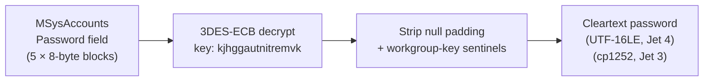
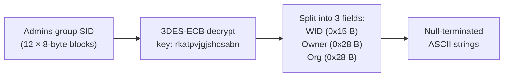
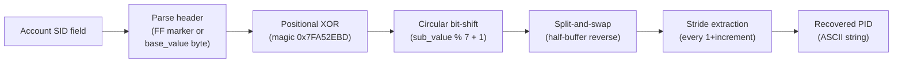

# Jet User-Level Security (ULS) — Workgroup Password and Identity Decode

🟢 **Cleartext / Decode** — 3DES-encrypted passwords and workgroup identity in Access `.mdw` workgroup files

## Overview

- Jet User-Level Security (ULS) is the per-user access-control system for Microsoft Access 97 through Access 2003. It was retired with Access 2007 (ACE engine) but `.mdw` files persist in legacy environments
- Passwords, workgroup identity (WID/owner/organisation), and Personal IDs (PID) are stored in the `MSysAccounts` system table of the workgroup information file (`.mdw` / `.mda`)
- All three are recoverable without brute-forcing — the 3DES keys are fixed constants embedded in `msjet40.dll`, and the PID obfuscation is a reversible positional transform
- No published `[MS-*]` Open Specification exists for ULS or the `.mdw` format; all content is **UNCONFIRMED** reverse-engineering from `msjet40.dll` disassembly and thewd-hub `aspwsupport.cpp` (v1.01)
- Used by: `.mdw` / `.mda` (Jet 3 = Access 95/97, Jet 4 = Access 2000-2003)
- Recovery class: **DECODE** — passwords are 3DES-encrypted with a fixed key; instant recovery
- Toolkit module: `crypto/uls.py`, `formats/mdw.py`

## Three Independent Ciphers

ULS uses three separate cryptographic constructions, each with its own fixed key:

### 1. User Passwords (3DES-EDE2-ECB)

- **Cipher:** Two-key Triple DES (EDE2) in ECB mode
- **Key:** `kjhggautnitremvk` (16 bytes / 128 bits) — hardcoded in `msjet40.dll`
- **Block size:** 8 bytes (DES block)
- **Field size:** 40 bytes (5 blocks) for Jet 4; 16 bytes (2 blocks) for Jet 3
- **Encoding:** UTF-16LE for Jet 4 (Access 2000+); cp1252 single-byte for Jet 3 (Access 95/97)
- **Sentinel:** Unused blocks contain the workgroup key constant `6952AD67F3D5E1E6`; decryption stops at the first sentinel block
- **Recovery:** Deterministic — the key is fixed and public. No password or secret needed.

### 2. Workgroup Identity (3DES-EDE2-ECB)

- **Cipher:** Two-key Triple DES (EDE2) in ECB mode
- **Key:** `rkatpvjgjshcsabn` (16 bytes / 128 bits) — hardcoded in `msjet40.dll`
- **Payload:** 96 bytes (12 blocks) embedded in the Admins group SID blob
- **Layout:** Three null-terminated ASCII strings packed sequentially:
  - Workgroup ID (WID): bytes 0x00-0x14 (21 bytes max)
  - Owner Name: bytes 0x15-0x3C (40 bytes max)
  - Organisation: bytes 0x3D-0x64 (40 bytes max)
- **SID skip:** Jet 4 skips the first 2 bytes (UTF-16LE char size); Jet 3 skips 1 byte

### 3. Personal ID / PID (Custom Obfuscation)

- **NOT 3DES** — a custom reversible obfuscation, not a standard cipher
- **Magic constant:** `0x7FA52EBD` — used to derive the per-position XOR byte: `(magic // sub_value) * position & 0xFF`
- **Three layers (applied in order, reversed for decode):**
  1. **Positional XOR:** Each byte XORed with `(xor_value * index) & 0xFF`
  2. **Circular bit-shift:** Right-rotate by `(sub_value % 7) + 1` bits across the entire buffer
  3. **Split-and-swap:** Buffer split at midpoint, halves exchanged
- After reversing, PID characters are extracted at stride positions: `recovered[i] = reversed_buf[i * (1 + increment)]`
- **Parameters:** `base_value` = PID length (from SID header), `sub_value` = total_length - base_value

## MDW File Structure

The `.mdw` workgroup file is a Jet database with a characteristic structure:

| Region | Offset | Description |
|---|---|---|
| Signature | 0x04 | `Jet System DB` (13 bytes) — identifies the file as a workgroup database |
| RC4-obfuscated header | 0x18..0x6E | 90 bytes, key `C7 DA 39 6B` — contains the encoding key at offset 0x3E |
| Jet version | 0x9C | `4.0` for Jet 4 (Access 2000+); absent/different for Jet 3 |
| Account section (Jet 4) | 0x15000 | 0x1500 bytes containing the serialised account table |
| Account section (Jet 3) | 0xE000 | 0x1500 bytes (same size, earlier offset) |

The account section contains a linked list of account records. Each record holds the account name, SID (containing the encrypted password and PID), and group membership flags. The section is RC4-encrypted with a 4-byte key derived from the encoding key at header offset 0x3E, combined through a brute-forced XOR search (the toolkit tests candidate keys against a CRC-check sentinel `01 01` at a known offset).

## Sources

| Source | Role |
|---|---|
| `msjet40.dll` disassembly | Original reverse-engineering of the 3DES keys, field layouts, and PID obfuscation |
| thewd-hub `aspwsupport.cpp` (v1.01) | Independent confirmation of all three decode algorithms; PID recovery algorithm ported from `recoverPID()` |
| Lab `.mdw` files (Access 2000, 2003, 2013) | Empirical verification: passwords, WIDs, PIDs confirmed byte-identical to the values entered in Access |

## Known Limitations

- Jet 3 (Access 95/97) support is confirmed against synthetic vectors but has limited real-world corpus coverage — the `.mdw` format changed between Jet 3 and Jet 4
- The account-section RC4 key recovery uses a brute-force search over the 4-byte encoding key space, guided by a `01 01` CRC sentinel; a corrupted or non-standard `.mdw` may fail this search
- Group membership is detected (Admins/Users/Guests) but individual object-level permissions (table/query/form ACLs) are not parsed — the toolkit recovers credentials, not the permission graph
- PID recovery is exact for standard-length PIDs (4-20 chars) but has not been tested with edge-case lengths outside that range
