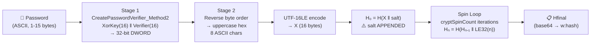
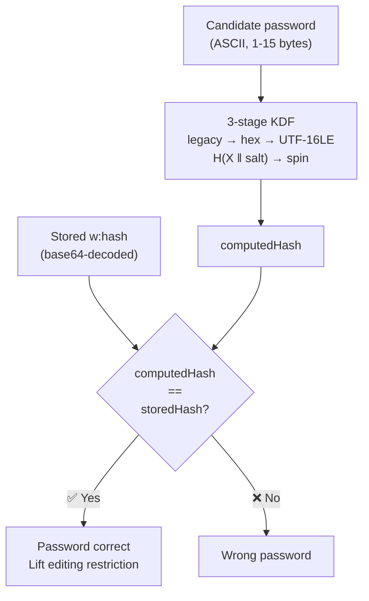
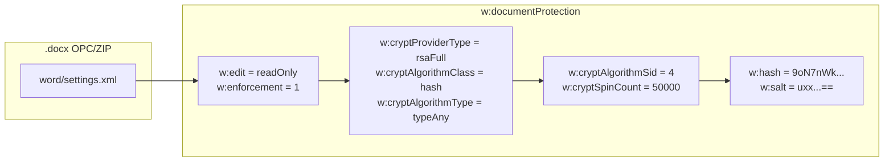

# Word 2007 Legacy-Derived documentProtection Hash

🔴 **Trivial Verifier** — hash-only editing-restriction gate with 2^32 effective pre-image space; document content is never encrypted

## Overview

- Three-stage KDF combining the pre-OOXML 32-bit legacy hash with a salted, iterated cryptographic digest; effective entropy is capped at 2^32 regardless of password strength
- Protects editing restrictions (`Restrict Editing` / `Protect Document`) and write-reservation gates in `.docx` OOXML containers; stored in `word/settings.xml` on `<w:documentProtection>` and `<w:writeProtection>`
- Three critical differences from the ISO variant: (1) a legacy 32-bit pre-stage compresses the password before hashing, (2) the salt is **appended** not prepended in the initial hash, (3) the password enters as single-byte ASCII (max 15 chars) not UTF-16LE
- Default output of Word 2007; also used by later Word versions unless `UseIsoPasswordVerifier` registry key is set to 1
- Used by: [Word](../../formats/word.md) (`.docx` editing restrictions and write protection)
- Spec: [MS-OE376] SS2.1.410; [MS-OFFCRYPTO] SS2.3.7.1, SS2.3.7.2, SS2.3.7.4

## KDF Pipeline



## Verification Flow



## On-Disk Structure



## Quick Reference

| Parameter | Default (Word 2007) | Legal Range |
|---|---|---|
| Hash | SHA-1 (`cryptAlgorithmSid=4`) | SID 1,2,3,4,12,13,14 |
| Cipher | none (hash-only verifier) | — |
| Spin Count | 50,000 | 0 — 5,000,000 |
| Salt | 16 bytes | variable |
| Password | ASCII, max 15 chars | 1 — 15 single-byte characters |
| Effective input space | 2^32 (legacy hash bottleneck) | — |
| Attribute schema | `crypt*` (legacy) | `*Value` (ISO) when registry override set |

## Extraction Target

Fields to extract from `<w:documentProtection>` in `word/settings.xml`:

| Field | XML Attribute | Type | Example |
|---|---|---|---|
| Salt | `w:salt` | base64 → bytes | `uxx...==` |
| Spin count | `w:cryptSpinCount` | decimal integer | `50000` |
| Algorithm SID | `w:cryptAlgorithmSid` | decimal integer | `4` |
| Stored hash | `w:hash` | base64 → digest bytes | `9oN7nWkCAyEZib1RomSJTjmPpCY=` |
| Edit mode | `w:edit` | enum string | `readOnly` |
| Enforcement | `w:enforcement` | boolean | `1` |

**`cryptAlgorithmSid` to hash mapping:**

| SID | Hash | Digest (bytes) |
|---|---|---|
| 1 | MD2 | 16 |
| 2 | MD4 | 16 |
| 3 | MD5 | 16 |
| 4 | SHA-1 | 20 |
| 12 | SHA-256 | 32 |
| 13 | SHA-384 | 48 |
| 14 | SHA-512 | 64 |

**Python function signature this maps to:**

```python
def crypt_protection_verify(
    password: str,  # ASCII, 1-15 characters
    salt: bytes,  # base64-decoded from w:salt
    spin_count: int,  # from w:cryptSpinCount
    sid: int,  # from w:cryptAlgorithmSid (4=SHA-1, 14=SHA-512, etc.)
    stored_hash: bytes,  # base64-decoded from w:hash
) -> bool: ...
```

---

## 1. What It Is and Where It Is Used

- The Word 2007 legacy-derived documentProtection hash is the password verifier Word 2007 writes when a user applies editing or formatting restrictions to a `.docx` document (the "Restrict Editing" / "Protect Document" feature).
- It appears in the OPC part `word/settings.xml` as attributes of the `<w:documentProtection>` element, using the `crypt*` attribute schema (`w:cryptAlgorithmSid`, `w:cryptSpinCount`, `w:hash`, `w:salt`, etc.).
- The same mechanism is used by `<w:writeProtection>` in `word/settings.xml` for the "password to modify" write-reservation gate, when the `crypt*` attributes are present.
- This construction is a three-stage key derivation function that differs from the clean ISO hash (documented in [iso-protection-hash.md](./iso-protection-hash.md)) in three critical ways:
  - **Legacy pre-stage:** inserts a 32-bit legacy hash before the iterated cryptographic hash
  - **Salt appended:** the initial hash is `H(X || salt)`, not `H(salt || password)` as in ISO
  - **ASCII password input:** the password enters as single-byte ASCII (max 15 chars), not as raw UTF-16LE
- The three stages are:
  1. **Stage 1 (legacy 32-bit hash):** The single-byte ASCII password is run through `CreatePasswordVerifier_Method2` ([MS-OFFCRYPTO] SS2.3.7.4), which combines the 16-bit XOR key from `CreateXorKey_Method1` ([MS-OFFCRYPTO] SS2.3.7.2) and the 16-bit verifier from `CreatePasswordVerifier_Method1` ([MS-OFFCRYPTO] SS2.3.7.1) into a single 32-bit DWORD.
  2. **Stage 2 (hex re-encode):** The reversed byte order of the DWORD is rendered as an 8-character uppercase hex string ([MS-OE376] SS2.1.410 note a).
  3. **Stage 3 (salted iterated hash):** That hex string is encoded as UTF-16LE (16 bytes) and hashed with the algorithm selected by `cryptAlgorithmSid` for `cryptSpinCount` iterations, with the salt appended ([MS-OE376] SS2.1.410 notes e, f, g).
- This is a hash-only verifier: the document body is never encrypted by this mechanism, so the editing restriction can be removed without the password by modifying the XML ([MS-OFFCRYPTO] SS4.1.4). The hash exists solely to verify the password when the user attempts to lift the restriction through the application's UI.

**Products and gates:** Word 2007 (all service packs: 2007, 2007 SP1, 2007 SP2) per [MS-OE376] SS2.1.410 note a. Later versions of Word also write this form when the `UseIsoPasswordVerifier` registry key is not set to 1 ([MS-OE376] SS2.1.410 note l). When that registry key is set, Word writes the ISO `*Value` attribute schema instead ([iso-protection-hash.md](./iso-protection-hash.md)).

**Spec sections:** [MS-OE376] SS2.1.410 (primary); [MS-OFFCRYPTO] SS2.3.7.1, SS2.3.7.2, SS2.3.7.4; [MS-OFFCRYPTO] SS1.3.4 (write protection overview); [MS-OFFCRYPTO] SS2.4.1 (ECMA-376 document write protection); [MS-OFFCRYPTO] SS4.1.4 (security considerations for document write protection); [MS-OI29500] SS2.1.402 (ISO variant for comparison).

**Container format:** See [word.md](../../formats/word.md) for the `.docx` OPC/ZIP container and part layout.

## 2. Profiles / Parameters

The construction is fixed; the only variable parameters are the hash function (selected by `w:cryptAlgorithmSid`) and the iteration count (`w:cryptSpinCount`). There is no cipher; the output is a bare digest compared for equality. Word 2007's writer default is SHA-1 (`cryptAlgorithmSid=4`).

| Profile | `cryptAlgorithmSid` | Hash Function `H` | Digest Width (bytes) | Cipher | `cryptSpinCount` Range |
|---|---|---|---|---|---|
| MD2 | 1 | MD2 (RFC 1319) | 16 | none | 0 — 5,000,000 |
| MD4 | 2 | MD4 (RFC 1320) | 16 | none | 0 — 5,000,000 |
| MD5 | 3 | MD5 (RFC 1321) | 16 | none | 0 — 5,000,000 |
| **SHA-1 (default)** | **4** | **SHA-1** | **20** | **none** | **0 — 5,000,000** |
| SHA-256 | 12 | SHA-256 | 32 | none | 0 — 5,000,000 |
| SHA-384 | 13 | SHA-384 | 48 | none | 0 — 5,000,000 |
| SHA-512 | 14 | SHA-512 | 64 | none | 0 — 5,000,000 |

- **`cryptAlgorithmSid` mapping:** Word only supports the values 1, 2, 3, 4, 12, 13, and 14 ([MS-OE376] SS2.1.410 note h). These correspond to the CryptoAPI `ALG_SID` identifiers. Values 5 through 11 and values above 14 are not supported by Word.
- **`cryptSpinCount` bounds:** Word only supports values between 0 and 5,000,000 inclusive ([MS-OE376] SS2.1.410 note j). The ISO variant documented in [MS-OI29500] SS2.1.402 note d permits a wider range of 0 to 10,000,000.
- **Password domain:** The password entering Stage 1 is a string of single-byte characters, with a maximum length of 15 characters ([MS-OFFCRYPTO] SS2.3.7.2, SS2.3.7.4). A minimum length of 1 is implied by the `InitialCode` table indexing (`InitialCode[Password.Length MINUS 1]`). The Unicode-to-single-byte conversion is specified in [MS-OFFCRYPTO] SS2.3.7.4: for each input Unicode character, copy the least significant byte into the single-byte string unless the least significant byte is 0x00, in which case copy the most significant byte. The resulting string is truncated to 15 characters. When writing files, this byte-extraction approach MUST be used; when reading, both this approach and LCID-based ANSI conversion MUST be tried ([MS-OFFCRYPTO] SS2.3.7.4).

## 3. `crypt*` Attributes vs `*Value` Attributes

The `<w:documentProtection>` element can carry two mutually exclusive attribute schemas ([MS-OE376] SS2.1.410 note l; [MS-OI29500] SS2.1.402 note f):

**Legacy `crypt*` attribute schema (this document):**

| Attribute | Type | Description |
|---|---|---|
| `w:cryptAlgorithmSid` | integer (decimal) | Selects the hash function `H` (see SS2) |
| `w:cryptSpinCount` | integer (decimal) | Number of hash iterations; range 0 — 5,000,000 |
| `w:hash` | base64 string | Stored final digest (full width of `H`) |
| `w:salt` | base64 string | Salt bytes (binary form used in hashing, not the base64 text) |
| `w:cryptProviderType` | string | Crypto provider type (e.g. `"rsaFull"`) |
| `w:cryptAlgorithmClass` | string | Algorithm class (e.g. `"hash"`) |
| `w:cryptAlgorithmType` | string | Algorithm type (e.g. `"typeAny"`) |
| `w:cryptProviderTypeExt` | integer | Extended provider type; required if `algIdExt` is used ([MS-OE376] SS2.1.410 note b) |
| `w:algIdExt` | integer | Extended algorithm ID for non-standard hash |
| `w:algIdExtSource` | string | Source of extended algorithm ID; Word restricts to `"wincrypt"` ([MS-OE376] SS2.1.410 note c) |
| `w:cryptProviderTypeExtSource` | string | Source of extended provider type; Word restricts to `"wincrypt"` ([MS-OE376] SS2.1.410 note d) |
| `w:edit` | enum | Restriction mode: `readOnly`, `comments`, `trackedChanges`, `forms` |
| `w:enforcement` | boolean | Whether protection is enforced; Word enforces even when omitted ([MS-OE376] SS2.1.410 note i) |

**ISO `*Value` attribute schema (see [iso-protection-hash.md](./iso-protection-hash.md)):**

| Attribute | Type | Description |
|---|---|---|
| `w:algorithmName` | string | Hash algorithm name (e.g. `"SHA-1"`, `"SHA-512"`) |
| `w:spinCount` | integer | Iteration count; range 0 — 10,000,000 |
| `w:hashValue` | base64 string | Stored final digest |
| `w:saltValue` | base64 string | Salt bytes |

Word writes the `crypt*` schema by default. When the registry key `HKCU/Software/Microsoft/Office/<VERSION>/Common/Security/UseIsoPasswordVerifier` is set to 1, Word writes the `*Value` (ISO) schema instead ([MS-OE376] SS2.1.410 note l; [MS-OI29500] SS2.1.402 note f). When both attribute sets are present on the same element, Word uses the `crypt*` (legacy) attributes and ignores the `*Value` attributes, since the AG_Password attribute group is the default determination mechanism and Word uses that group to decide whether to prompt for a password ([MS-OI29500] SS2.1.426 note a; [MS-OE376] SS2.1.438 note a).

If any attribute specified by AG_Password (the ISO schema) is present, Word requires these attributes to be present: `algorithmName`, `hashValue`, `spinCount`; otherwise Word will not open the file ([MS-OI29500] SS2.1.426 note c).

## 4. Byte Layout / On-Disk Structure

The verifier is stored as XML attributes, not a binary record. It lives in the OPC part `word/settings.xml` (a ZIP member of the `.docx`).

```xml
<w:documentProtection
    w:edit="readOnly"
    w:enforcement="1"
    w:cryptProviderType="rsaFull"
    w:cryptAlgorithmClass="hash"
    w:cryptAlgorithmType="typeAny"
    w:cryptAlgorithmSid="4"
    w:cryptSpinCount="50000"
    w:hash="9oN7nWkCAyEZib1RomSJTjmPpCY="
    w:salt="uxx...=="/>
```

**Encoding rules for the KDF:**

- The salt used in the hash computation is the **binary** form of the `w:salt` attribute (base64-decoded), never the base64 text string itself ([MS-OE376] SS2.1.410 note k).
- The spin counter mixed into each iteration round is a **little-endian 32-bit** unsigned integer.
- The intermediate value from Stage 2 is an **uppercase ASCII hex** string, encoded as **UTF-16LE** in Stage 3.
- The raw password never appears as UTF-16LE; it enters only through the single-byte legacy pre-stage. This is a key difference from the ISO variant, where the raw password is encoded directly as UTF-16LE.

## 5. Key Derivation — Ordered Steps

The three-stage KDF is specified across [MS-OE376] SS2.1.410 (notes a, e, f, g, k) and [MS-OFFCRYPTO] SS2.3.7.1, SS2.3.7.2, SS2.3.7.4. The stages are:

### Stage 1: Legacy 32-Bit Hash (`CreatePasswordVerifier_Method2`)

Compute a 32-bit DWORD from the single-byte ASCII password by combining the 16-bit XOR key (high word) and the 16-bit password verifier (low word).

```
FUNCTION CreatePasswordVerifier_Method1(Password)
    # [MS-OFFCRYPTO] §2.3.7.1
    # Password: ASCII string, 1..15 characters
    RETURNS 16-bit unsigned integer

    DECLARE Verifier AS 16-bit unsigned integer
    DECLARE PasswordArray AS array of 8-bit unsigned integers

    SET Verifier TO 0x0000
    SET PasswordArray TO (empty array of bytes)
    SET PasswordArray[0] TO Password.Length
    APPEND Password TO PasswordArray

    FOR EACH PasswordByte IN PasswordArray IN REVERSE ORDER
        IF (Verifier BITWISE AND 0x4000) IS 0x0000
            SET Intermediate1 TO 0
        ELSE
            SET Intermediate1 TO 1
        ENDIF
        SET Intermediate2 TO Verifier MULTIPLIED BY 2
        SET most significant bit of Intermediate2 TO 0
        SET Intermediate3 TO Intermediate1 BITWISE OR Intermediate2
        SET Verifier TO Intermediate3 BITWISE XOR PasswordByte
    ENDFOR

    RETURN Verifier BITWISE XOR 0xCE4B
END FUNCTION
```

```
FUNCTION CreateXorKey_Method1(Password)
    # [MS-OFFCRYPTO] §2.3.7.2
    # Password: ASCII string, 1..15 characters
    RETURNS 16-bit unsigned integer

    DECLARE XorKey AS 16-bit unsigned integer

    SET XorKey TO InitialCode[Password.Length MINUS 1]
    SET CurrentElement TO 0x00000068

    FOR EACH Char IN Password IN REVERSE ORDER
        FOR 7 iterations
            IF (Char BITWISE AND 0x40) IS NOT 0
                SET XorKey TO XorKey BITWISE XOR XorMatrix[CurrentElement]
            END IF
            SET Char TO Char MULTIPLIED BY 2
            DECREMENT CurrentElement
        END FOR
    END FOR

    RETURN XorKey
END FUNCTION
```

```
FUNCTION CreatePasswordVerifier_Method2(Password)
    # [MS-OFFCRYPTO] §2.3.7.4
    # Password: single-byte string, 1..15 characters
    RETURNS 32-bit unsigned integer

    DECLARE Verifier AS 32-bit unsigned integer
    DECLARE KeyHigh AS 16-bit unsigned integer
    DECLARE KeyLow AS 16-bit unsigned integer

    SET KeyHigh TO CreateXorKey_Method1(Password)
    SET KeyLow TO CreatePasswordVerifier_Method1(Password)

    SET most significant 16 bits of Verifier TO KeyHigh
    SET least significant 16 bits of Verifier TO KeyLow

    RETURN Verifier
END FUNCTION
```

### Stage 2: Reverse Byte Order and Hex Conversion

The 32-bit DWORD from Stage 1 is rendered in reversed byte order as an 8-character uppercase hexadecimal string ([MS-OE376] SS2.1.410 note a).

```
FUNCTION ReverseAndHex(dword)
    # The reversed byte order legacy hash is converted to its hex string representation.
    # Example from [MS-OE376] §2.1.410 note a:
    #   If the DWORD bytes in memory are [64, CE, ED, 7E],
    #   the reversed byte order is 7E ED CE 64,
    #   and the hex string is "7EEDCE64".
    
    SET byte0 TO (dword >> 24) AND 0xFF
    SET byte1 TO (dword >> 16) AND 0xFF
    SET byte2 TO (dword >>  8) AND 0xFF
    SET byte3 TO  dword        AND 0xFF

    # Render as uppercase hex: most significant byte first
    RETURN UPPERCASE_HEX(byte0) + UPPERCASE_HEX(byte1) +
           UPPERCASE_HEX(byte2) + UPPERCASE_HEX(byte3)
    # Result is 8 ASCII characters
END FUNCTION
```

### Stage 3: UTF-16LE Encode, Salt, and Iterate

The 8-character hex string from Stage 2 is encoded as UTF-16LE to produce a 16-byte block `X`. This block is then hashed with the cryptographic algorithm specified by `cryptAlgorithmSid`, with the salt appended and the result iterated for `cryptSpinCount` rounds.

```
FUNCTION DocumentProtectionHash(Password, salt, cryptAlgorithmSid, cryptSpinCount)
    # [MS-OE376] §2.1.410 notes a, e, f, g, k
    # Password: single-byte ASCII string, 1..15 characters
    # salt: binary bytes (base64-decoded from w:salt attribute)
    # cryptAlgorithmSid: integer selecting hash function H
    # cryptSpinCount: integer, 0..5,000,000

    SET H TO HashFunctionFor(cryptAlgorithmSid)

    # --- Stage 1: Legacy 32-bit hash ---
    SET L TO CreatePasswordVerifier_Method2(Password)

    # --- Stage 2: Reverse byte order, render as uppercase hex ---
    SET hexString TO ReverseAndHex(L)
    # hexString is 8 ASCII characters, e.g. "7EEDCE64"

    # --- Stage 3: UTF-16LE encode and iterate ---
    SET X TO UTF16LE_Encode(hexString)
    # X is 16 bytes
    # Example from [MS-OE376] §2.1.410 note a:
    #   "7EEDCE64" -> 37 00 45 00 45 00 44 00 43 00 45 00 36 00 34 00

    # Initial hash: salt is APPENDED to X
    # [MS-OE376] §2.1.410 note f: "Word appends the salt attribute to the password"
    # [MS-OE376] §2.1.410 note k: use binary form of salt, not base64 text
    SET H_init TO H(X || salt)

    # The initial hash is NOT counted as a spin iteration
    # [MS-OE376] §2.1.410 note g

    # Iterated hashing
    # [MS-OE376] §2.1.410 note e:
    #   H[n] = H(H[n-1], count)
    #   Count begins at 0x0 as little-endian 32-bit integer
    SET h TO H_init
    FOR count FROM 0 TO cryptSpinCount - 1
        SET h TO H(h || LE32(count))
    END FOR

    RETURN h
    # The result is base64-encoded and stored in w:hash
END FUNCTION
```

**Critical note on salt ordering:** This Word 2007 construction **appends** the salt to the password-derived block `X` in the initial hash: `H_init = H(X || salt)` ([MS-OE376] SS2.1.410 note f). This is the opposite of the ISO variant ([MS-OI29500] SS2.1.402 note a; [MS-OFFCRYPTO] SS2.4.2.4), where the salt is **prepended**: `H0 = H(salt || password)`. See [iso-protection-hash.md](./iso-protection-hash.md).

**Critical note on counter ordering:** The iteration counter is appended to the previous hash: `H_n = H(H_{n-1} || LE32(count))`. The counter is a little-endian 32-bit unsigned integer, starting at 0 and incrementing by 1. The initial hash `H_init` is not counted as a spin iteration; the first spin iteration uses `count = 0` and the last uses `count = cryptSpinCount - 1` ([MS-OE376] SS2.1.410 notes e, g).

## 6. Verification / Decryption Check

There is no decryption step. Verification is a recompute-and-compare operation: the candidate password is run through the full three-stage KDF (SS5) and the resulting digest is compared to the stored `w:hash` value across its full width (the digest width of the hash function selected by `cryptAlgorithmSid`). The `w:hash` attribute is the base64-encoded representation of the binary digest ([MS-OE376] SS2.1.410 note e).

```
FUNCTION VerifyDocumentProtection(candidatePassword, salt, cryptAlgorithmSid,
                                   cryptSpinCount, storedHash)
    # candidatePassword: single-byte string, 1..15 characters
    # salt: binary bytes (base64-decoded from w:salt)
    # storedHash: binary bytes (base64-decoded from w:hash)

    SET computedHash TO DocumentProtectionHash(candidatePassword, salt,
                                                cryptAlgorithmSid, cryptSpinCount)

    IF computedHash EQUALS storedHash
        # Password is correct; lift the editing restriction
        RETURN TRUE
    ELSE
        RETURN FALSE
    END IF
END FUNCTION
```

Password verification for write protection (`<w:writeProtection>` with `crypt*` attributes) uses the identical procedure ([MS-OFFCRYPTO] SS2.4.1; [MS-OE376] SS2.1.438).

## 7. Reference Constants

All legacy-stage constants are from [MS-OFFCRYPTO] SS2.3.7.2.

### `InitialCode` (15 x uint16) — [MS-OFFCRYPTO] SS2.3.7.2

Indexed by `Password.Length MINUS 1` (i.e., index 0 for a 1-character password, index 14 for a 15-character password):

```
InitialCode = (
    0xE1F0, 0x1D0F, 0xCC9C, 0x84C0, 0x110C,
    0x0E10, 0xF1CE, 0x313E, 0x1872, 0xE139,
    0xD40F, 0x84F9, 0x280C, 0xA96A, 0x4EC3
)
```

### `XorMatrix` (105 x uint16) — [MS-OFFCRYPTO] SS2.3.7.2

Walked downward from index `0x68` (decimal 104), 7 elements per password character:

```
XorMatrix = (
    0xAEFC, 0x4DD9, 0x9BB2, 0x2745, 0x4E8A, 0x9D14, 0x2A09,
    0x7B61, 0xF6C2, 0xFDA5, 0xEB6B, 0xC6F7, 0x9DCF, 0x2BBF,
    0x4563, 0x8AC6, 0x05AD, 0x0B5A, 0x16B4, 0x2D68, 0x5AD0,
    0x0375, 0x06EA, 0x0DD4, 0x1BA8, 0x3750, 0x6EA0, 0xDD40,
    0xD849, 0xA0B3, 0x5147, 0xA28E, 0x553D, 0xAA7A, 0x44D5,
    0x6F45, 0xDE8A, 0xAD35, 0x4A4B, 0x9496, 0x390D, 0x721A,
    0xEB23, 0xC667, 0x9CEF, 0x29FF, 0x53FE, 0xA7FC, 0x5FD9,
    0x47D3, 0x8FA6, 0x0F6D, 0x1EDA, 0x3DB4, 0x7B68, 0xF6D0,
    0xB861, 0x60E3, 0xC1C6, 0x93AD, 0x377B, 0x6EF6, 0xDDEC,
    0x45A0, 0x8B40, 0x06A1, 0x0D42, 0x1A84, 0x3508, 0x6A10,
    0xAA51, 0x4483, 0x8906, 0x022D, 0x045A, 0x08B4, 0x1168,
    0x76B4, 0xED68, 0xCAF1, 0x85C3, 0x1BA7, 0x374E, 0x6E9C,
    0x3730, 0x6E60, 0xDCC0, 0xA9A1, 0x4363, 0x86C6, 0x1DAD,
    0x3331, 0x6662, 0xCCC4, 0x89A9, 0x0373, 0x06E6, 0x0DCC,
    0x1021, 0x2042, 0x4084, 0x8108, 0x1231, 0x2462, 0x48C4
)
```

### `PadArray` (15 x uint8) — [MS-OFFCRYPTO] SS2.3.7.2

Used by `CreateXorArray_Method1` to pad passwords shorter than 15 characters (relevant to the XOR obfuscation array, not directly to this KDF's Stage 1 output, but part of the same SS2.3.7 family of procedures):

```
PadArray = (
    0xBB, 0xFF, 0xFF, 0xBA, 0xFF, 0xFF, 0xB9, 0x80,
    0x00, 0xBE, 0x0F, 0x00, 0xBF, 0x0F, 0x00
)
```

### Scalar Constants

| Constant | Value | Source | Usage |
|---|---|---|---|
| Final XOR magic | `0xCE4B` | [MS-OFFCRYPTO] SS2.3.7.1 | Last step of `CreatePasswordVerifier_Method1`: `RETURN Verifier BITWISE XOR 0xCE4B` |
| Carry-bit test mask | `0x4000` | [MS-OFFCRYPTO] SS2.3.7.1 | Tests bit 14 of Verifier in the rotate-XOR loop |
| Top-bit clear mask | `0x7FFF` | [MS-OFFCRYPTO] SS2.3.7.1 | Clears the most significant bit after left-shift (`Verifier MULTIPLIED BY 2`) |
| Per-char test bit | `0x40` | [MS-OFFCRYPTO] SS2.3.7.2 | Tests bit 6 of each password character in `CreateXorKey_Method1` |
| Starting matrix index | `0x68` (decimal 104) | [MS-OFFCRYPTO] SS2.3.7.2 | `CurrentElement` initial value for XorMatrix walk |
| Inner iterations per char | 7 | [MS-OFFCRYPTO] SS2.3.7.2 | Number of bit iterations per password character in `CreateXorKey_Method1` |
| Length byte prepend | `PasswordArray[0] = Password.Length` | [MS-OFFCRYPTO] SS2.3.7.1 | The password length is prepended as a byte before the verifier loop |

### `cryptAlgorithmSid` to Hash Function Mapping

The `cryptAlgorithmSid` attribute selects the hash function used in Stage 3. Word supports only the following values ([MS-OE376] SS2.1.410 note h):

| `cryptAlgorithmSid` | Hash Function | Digest Width (bytes) | Reference |
|---|---|---|---|
| 1 | MD2 | 16 | RFC 1319 |
| 2 | MD4 | 16 | RFC 1320 |
| 3 | MD5 | 16 | RFC 1321 |
| 4 | SHA-1 | 20 | ISO/IEC 10118-3:2004 |
| 12 | SHA-256 | 32 | ISO/IEC 10118-3:2004 |
| 13 | SHA-384 | 48 | ISO/IEC 10118-3:2004 |
| 14 | SHA-512 | 64 | ISO/IEC 10118-3:2004 |

## 8. Security Considerations

- **Document write protection is not a security mechanism.** Document write protection is meant to protect against accidental modification only. The write protection can easily be removed by using a binary editor ([MS-OFFCRYPTO] SS4.1.4).
- **Password length restricted to 15 characters.** Some file formats restrict password length to 15 characters. It is possible for multiple passwords to map to the same key when using document write protection ([MS-OFFCRYPTO] SS4.1.4).
- **Legacy pre-stage reduces effective entropy.** The 32-bit legacy hash in Stage 1 compresses the entire password into a single DWORD before the cryptographic hash is applied. The effective input to the cryptographic hash is always exactly 16 bytes (the UTF-16LE encoding of 8 hex characters), regardless of the original password length or content. This means the cryptographic hash iterates over at most 2^32 distinct inputs.
- **MD2, MD4, and MD5 have publicly known breaks.** The spec notes recommend that applications should avoid using these algorithms to store new hash values because of publicly known breaks ([MS-OE376] SS2.1.410; [MS-OI29500] SS2.1.402 note f).
- **No encryption of document content.** The editing restriction does not encrypt the document body. The document content is fully readable without the password. The `<w:documentProtection>` element is an enforcement flag with a verifier, not a content-protection mechanism.
- **Enforcement attribute behavior.** Word enforces protection even when the `w:enforcement` attribute is missing ([MS-OE376] SS2.1.410 note i), meaning the absence of this attribute does not disable protection.

## 9. Differences from the ISO Protection Hash

The following table summarizes the differences between this Word 2007 legacy-derived construction and the ISO protection hash ([iso-protection-hash.md](./iso-protection-hash.md)):

| Aspect | Word 2007 Legacy-Derived (this doc) | ISO Protection Hash ([iso-protection-hash.md](./iso-protection-hash.md)) |
|---|---|---|
| Attribute schema | `crypt*` (`w:cryptAlgorithmSid`, `w:hash`, `w:salt`, `w:cryptSpinCount`) | `*Value` (`w:algorithmName`, `w:hashValue`, `w:saltValue`, `w:spinCount`) |
| Legacy pre-stage | Yes: password -> 32-bit DWORD -> reversed hex -> UTF-16LE (16 bytes) | No: raw password encoded directly as UTF-16LE |
| Password input to hash | 16-byte UTF-16LE hex string derived from legacy hash | UTF-16LE encoding of the raw Unicode password |
| Salt ordering in initial hash | **Appended**: `H(X \|\| salt)` ([MS-OE376] SS2.1.410 note f) | **Prepended**: `H(salt \|\| password)` ([MS-OI29500] SS2.1.402 note a; [MS-OFFCRYPTO] SS2.4.2.4) |
| Hash function selection | Numeric `cryptAlgorithmSid` (CryptoAPI ALG_SID) | String `algorithmName` (e.g. `"SHA-1"`, `"SHA-512"`) |
| Iteration count range | 0 — 5,000,000 ([MS-OE376] SS2.1.410 note j) | 0 — 10,000,000 ([MS-OI29500] SS2.1.402 note d) |
| Password domain | Single-byte ASCII, 1–15 characters | Unicode, 1–255 characters ([MS-OFFCRYPTO] SS2.4.2.4) |
| Effective pre-image space | 2^32 (limited by the 32-bit legacy hash) | Full password entropy |
| Products | Word 2007 (default); later versions when `UseIsoPasswordVerifier` != 1 | Word 2010+ when `UseIsoPasswordVerifier` = 1 |
| Initial hash counted? | No ([MS-OE376] SS2.1.410 note g) | No ([MS-OI29500] SS2.1.402 note b) |
| Counter in iteration | LE32 appended: `H(H_{n-1} \|\| LE32(count))` | LE32 appended: `H(H_{n-1} \|\| LE32(iterator))` |
| Salt attribute form used | Binary (base64-decoded) ([MS-OE376] SS2.1.410 note k) | Binary (base64-decoded) ([MS-OI29500] SS2.1.402 note e) |

## 10. Spec References

### Primary Source

- **[MS-OE376] SS2.1.410** — Part 4 Section 2.15.1.28, documentProtection (Document Editing Restrictions). Defines the Word 2007 three-stage KDF, including: the legacy pre-stage with reversed byte order and uppercase hex conversion (note a), the hash computation with `H_init = H(X || salt)` (note e), salt appended (note f), initial hash not counted in spin count (note g), supported `cryptAlgorithmSid` values {1, 2, 3, 4, 12, 13, 14} (note h), `cryptSpinCount` range 0–5,000,000 (note j), binary form of salt used (note k), and the ISO `*Value` attribute alternative when `UseIsoPasswordVerifier` = 1 (note l). Applicable to Word 2007, 2007 SP1, 2007 SP2.

### Legacy Stage Sub-Procedures

- **[MS-OFFCRYPTO] SS2.3.7.1** — Binary Document Password Verifier Derivation Method 1 (`CreatePasswordVerifier_Method1`). Defines the 16-bit password verifier with the `0xCE4B` final XOR. Password: ASCII string. Used in XOR obfuscation and document write protection.
- **[MS-OFFCRYPTO] SS2.3.7.2** — Binary Document XOR Array Initialization Method 1 (`CreateXorArray_Method1`, `CreateXorKey_Method1`). Defines the `InitialCode[15]` table, `XorMatrix[105]` table, `PadArray[15]` array, and the 16-bit XOR key derivation. Password: ASCII, max 15 characters.
- **[MS-OFFCRYPTO] SS2.3.7.4** — Binary Document Password Verifier Derivation Method 2 (`CreatePasswordVerifier_Method2`). Defines the 32-bit password verifier as `(CreateXorKey_Method1(Password) << 16) | CreatePasswordVerifier_Method1(Password)`. Specifies Unicode-to-single-byte character conversion.

### Related Sections

- **[MS-OFFCRYPTO] SS1.3.4** — Write Protection. Overview of password-based write protection for Office binary documents.
- **[MS-OFFCRYPTO] SS2.4.1** — ECMA-376 Document Write Protection. References [ECMA-376] Part 4 Sections 2.15.1.28 and 2.15.1.94.
- **[MS-OFFCRYPTO] SS2.4.2.4** — ISO Write Protection Method. Defines the ISO password hashing algorithm with salt prepended (`H0 = H(salt + password)`) and spin count up to 10,000,000.
- **[MS-OFFCRYPTO] SS4.1.4** — Security Considerations for Document Write Protection. States that write protection is not a security mechanism and can be removed with a binary editor.
- **[MS-OI29500] SS2.1.402** — Part 1 Section 17.15.1.29, documentProtection (Document Editing Restrictions). ISO variant: salt prepended (note a), initial hash not counted (note b), enforcement when attribute missing (note c), `spinCount` 0–10,000,000 (note d), binary saltValue used (note e), ISO `*Value` attribute schema (note f).
- **[MS-OI29500] SS2.1.426** — Part 1 Section 17.15.1.93, writeProtection (Write Protection). Word uses AG_Password attribute group; requires `algorithmName`, `hashValue`, `spinCount` when any AG_Password attribute is present (note c).
- **[MS-OE376] SS2.1.438** — Part 4 Section 2.15.1.94, writeProtection (Write Protection). Same hash algorithm as documentProtection per cross-reference to SS2.15.1.28 notes b--h, j, k.

### Related Algorithm Documents

- [xor-obfuscation.md](./xor-obfuscation.md) — The XOR obfuscation construction that shares the Stage 1 sub-procedures (`CreatePasswordVerifier_Method1`, `CreateXorKey_Method1`, `CreatePasswordVerifier_Method2`) and owns the `InitialCode`/`XorMatrix`/`PadArray` tables.
- [iso-protection-hash.md](./iso-protection-hash.md) — The ISO/IEC 29500 protection hash: salt prepended, raw UTF-16LE password, `algorithmName` string, `spinCount` up to 10,000,000. Used by Word 2010+ when `UseIsoPasswordVerifier` = 1.

### Container Format

- [word.md](../../formats/word.md) — `.docx` OPC/ZIP container and part layout.
