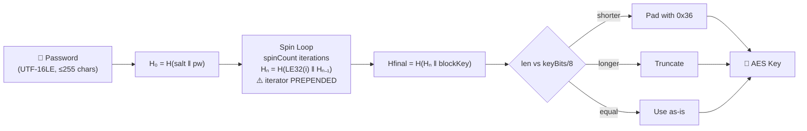
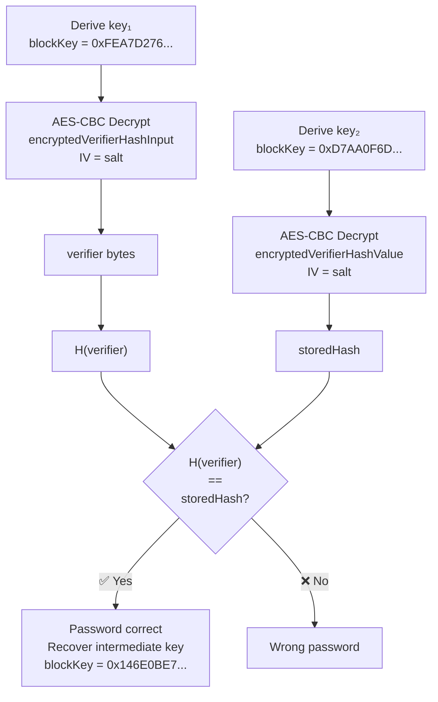
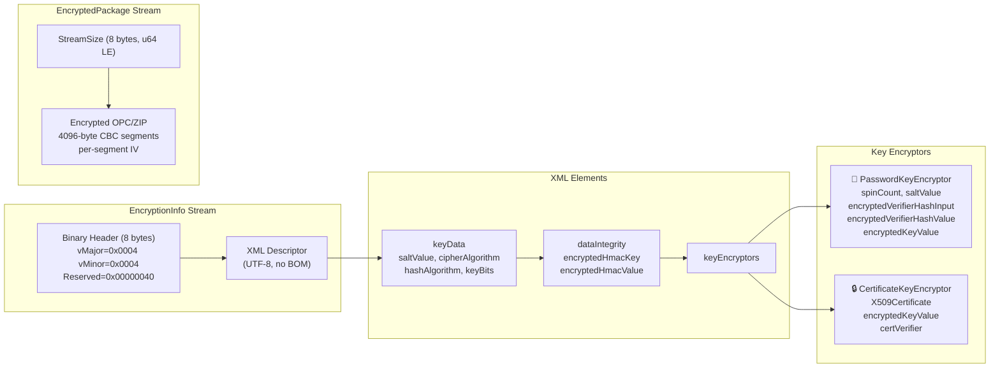

# ECMA-376 Agile Encryption

🔴 **Real Encryption** — password-based document-open encryption for OOXML containers (Office 2010+)

## Overview

- Current-generation encryption for all Office Open XML documents (`.docx`, `.xlsx`, `.pptx` and macro/template variants)
- XML-driven algorithm negotiation: hash, cipher, chaining mode, key length, salt, and spin count are all configurable per-file
- Supports both password and certificate key encryptors wrapping a single intermediate key
- Default since Office 2010; supersedes [ECMA-376 Standard Encryption](./ecma376-standard.md)
- Used by: [Word](../../formats/word.md), [Excel](../../formats/excel.md), [PowerPoint](../../formats/powerpoint.md), [OneNote](../../formats/onenote.md), [Access .accdb 2010+](../../formats/access.md)
- Spec: [MS-OFFCRYPTO] SS2.3.4.10–SS2.3.4.15

## KDF Pipeline



## Verification Flow



## On-Disk Structure



## Quick Reference

| Parameter | Office 2010 | Office 2013+ | Legal Range |
|---|---|---|---|
| Hash | SHA-1 (20 B) | SHA-512 (64 B) | 10 algorithms (see detail) |
| Cipher | AES-128-CBC | AES-256-CBC | 6 ciphers (RC4 MUST NOT) |
| Spin Count | 100,000 | 100,000 | 0–10,000,000 |
| Salt | 16 bytes | 16 bytes | 1–65,536 bytes |
| Key | 128 bits | 256 bits | ≥ 8 bits |
| Block Size | 16 | 16 | 2–4,096 |
| Password | UTF-16LE | UTF-16LE | ≤ 255 Unicode code points |

## Related Algorithms

| Algorithm | Relationship |
|---|---|
| [ECMA-376 Standard](./ecma376-standard.md) | Predecessor — AES-ECB, SHA-1 only, no integrity check |
| [RC4 CryptoAPI](./rc4-cryptoapi-sha1.md) | Binary document encryption (Office XP/2003) |
| [ISO Protection Hash](./iso-protection-hash.md) | Similar iterated hash but iterator **APPENDED** (not prepended) |
| [IRM/RMS](../non-password/irm-rms-encryption.md) | Certificate/RMS encryption for the same container |

## Extraction Target

What your code needs from the `<p:encryptedKey>` element in the `\EncryptionInfo` XML:

| Field | XML Attribute | Type | Example (Office 2013) |
|---|---|---|---|
| Salt | `saltValue` | base64 → 16 bytes | `Nqj8Y...==` |
| Spin count | `spinCount` | decimal integer | `100000` |
| Hash algorithm | `hashAlgorithm` | string | `SHA512` |
| Cipher algorithm | `cipherAlgorithm` | string | `AES` |
| Chaining mode | `cipherChaining` | string | `ChainingModeCBC` |
| Key bits | `keyBits` | decimal integer | `256` |
| Block size | `blockSize` | decimal integer | `16` |
| Hash size | `hashSize` | decimal integer | `64` |
| Encrypted verifier | `encryptedVerifierHashInput` | base64 → 16 bytes | |
| Encrypted verifier hash | `encryptedVerifierHashValue` | base64 → 32-64 bytes | |
| Encrypted key | `encryptedKeyValue` | base64 → 16-32 bytes | (for document decrypt) |

Also from the `<keyData>` element (for document decryption after password verified):

| Field | XML Attribute | Type | Purpose |
|---|---|---|---|
| Key data salt | `saltValue` | base64 | Segment IV generation |
| Key data key bits | `keyBits` | decimal | Intermediate key length |
| HMAC key | `encryptedHmacKey` (on `<dataIntegrity>`) | base64 | Integrity verification |
| HMAC value | `encryptedHmacValue` (on `<dataIntegrity>`) | base64 | Integrity verification |

**Python function signature this maps to:**

```python
def verify_agile_password(
    password: str,
    salt: bytes,           # from p:encryptedKey.saltValue
    spin_count: int,       # from p:encryptedKey.spinCount
    hash_algo: str,        # from p:encryptedKey.hashAlgorithm
    key_bits: int,         # from p:encryptedKey.keyBits
    block_size: int,       # from p:encryptedKey.blockSize
    encrypted_verifier: bytes,      # from p:encryptedKey.encryptedVerifierHashInput
    encrypted_verifier_hash: bytes, # from p:encryptedKey.encryptedVerifierHashValue
    cipher_algo: str = "AES",
    chaining: str = "ChainingModeCBC",
) -> bool: ...
```

---

## Specification Detail

### Identification

- On-disk signature: `vMajor=0x0004`, `vMinor=0x0004`, `Reserved=0x00000040` in the `\EncryptionInfo` stream
- Distinguishes from Standard Encryption (`vMinor=0x0002`) and Extensible Encryption (`vMinor=0x0003`)
- Default for all ECMA-376 documents created by Office 2010+ [MS-OFFCRYPTO, SS5 Appendix A, <18>]

### Legal Algorithm Values

#### Hash Algorithms (ST_HashAlgorithm) [MS-OFFCRYPTO, SS2.3.4.10]

| Value | Specification | Output size (bytes) |
|---|---|---|
| `SHA-1` | [RFC4634] | 20 |
| `SHA256` | [RFC4634] | 32 |
| `SHA384` | [RFC4634] | 48 |
| `SHA512` | [RFC4634] | 64 |
| `MD5` | MD5 | 16 |
| `MD4` | [RFC1320] | 16 |
| `MD2` | [RFC1319] | 16 |
| `RIPEMD-128` | [ISO/IEC 10118] | 16 |
| `RIPEMD-160` | [ISO/IEC 10118] | 20 |
| `WHIRLPOOL` | [ISO/IEC 10118] | 64 |

- Values not in this table MAY be used (<19>)
- The string MUST be at least 1 character [MS-OFFCRYPTO, SS2.3.4.10]

#### Cipher Algorithms (ST_CipherAlgorithm) [MS-OFFCRYPTO, SS2.3.4.10]

| Value | Specification | Notes |
|---|---|---|
| `AES` | AES (Rijndael) [FIPS197] | Recommended and default |
| `RC2` | [RFC2268] | Not recommended (<13>). Key < 128 bits may cause interop issues |
| `RC4` | — | **MUST NOT be used** |
| `DES` | [FIPS46-3] | Not recommended (<14>). KeyBits MUST be 64 for 56-bit encryption; key includes parity bits |
| `DESX` | [DRAFT-DESX] | Not recommended (<15>). May cause interop issues |
| `3DES` | [RFC1851] | KeyBits MUST be 192 for 168-bit encryption; key includes DES parity bits (<16>) |
| `3DES_112` | [RFC1851] | KeyBits MUST be 128 for 112-bit encryption; key includes DES parity bits (<17>) |

- Only block ciphers are supported
- Values not in this table MAY be used (<18>)

#### Cipher Chaining Modes (ST_CipherChaining) [MS-OFFCRYPTO, SS2.3.4.10]

| Value | Mode |
|---|---|
| `ChainingModeCBC` | Cipher Block Chaining (CBC) |
| `ChainingModeCFB` | Cipher Feedback Chaining (CFB), 8-bit window |

#### Simple-Type Bounds [MS-OFFCRYPTO, SS2.3.4.10]

| Simple type | XML type | Minimum | Maximum |
|---|---|---|---|
| `ST_SaltSize` | `xs:unsignedInt` | 1 | 65,536 |
| `ST_BlockSize` | `xs:unsignedInt` | 2 | 4,096 |
| `ST_KeyBits` | `xs:unsignedInt` | 8 | (unbounded) |
| `ST_HashSize` | `xs:unsignedInt` | 1 | 65,536 |
| `ST_SpinCount` | `xs:unsignedInt` | 0 | 10,000,000 |


### EncryptionInfo Stream Binary Header [MS-OFFCRYPTO, SS2.3.4.10]

| Field | Offset | Size | Type | Value / Meaning |
|---|---|---|---|---|
| `Version.vMajor` | 0 | 2 | uint16 LE | `0x0004` — agile encryption major version |
| `Version.vMinor` | 2 | 2 | uint16 LE | `0x0004` — agile encryption minor version |
| `Reserved` | 4 | 4 | uint32 LE | `0x00000040` — fixed reserved value identifying agile encryption |
| `XmlEncryptionDescriptor` | 8 | variable | UTF-8 XML | XML conforming to the encryption schema (see below) |

### XML Encryption Descriptor Schema [MS-OFFCRYPTO, SS2.3.4.10]

Namespace: `http://schemas.microsoft.com/office/2006/encryption`

```xml
<?xml version="1.0" encoding="utf-8"?>
<xs:schema attributeFormDefault="unqualified" elementFormDefault="qualified"
  targetNamespace="http://schemas.microsoft.com/office/2006/encryption"
  xmlns="http://schemas.microsoft.com/office/2006/encryption"
  xmlns:xs="http://www.w3.org/2001/XMLSchema">
 <xs:simpleType name="ST_SaltSize">
   <xs:restriction base="xs:unsignedInt">
     <xs:minInclusive value="1" />
     <xs:maxInclusive value="65536" />
   </xs:restriction>
 </xs:simpleType>
 <xs:simpleType name="ST_BlockSize">
   <xs:restriction base="xs:unsignedInt">
     <xs:minInclusive value="2" />
     <xs:maxInclusive value="4096" />
   </xs:restriction>
 </xs:simpleType>
 <xs:simpleType name="ST_KeyBits">
   <xs:restriction base="xs:unsignedInt">
     <xs:minInclusive value="8" />
   </xs:restriction>
 </xs:simpleType>
 <xs:simpleType name="ST_HashSize">
   <xs:restriction base="xs:unsignedInt">
     <xs:minInclusive value="1" />
     <xs:maxInclusive value="65536" />
   </xs:restriction>
 </xs:simpleType>
 <xs:simpleType name="ST_SpinCount">
   <xs:restriction base="xs:unsignedInt">
     <xs:minInclusive value="0" />
     <xs:maxInclusive value="10000000" />
   </xs:restriction>
 </xs:simpleType>
 <xs:simpleType name="ST_CipherAlgorithm">
   <xs:restriction base="xs:string">
     <xs:minLength value="1" />
   </xs:restriction>
 </xs:simpleType>
 <xs:simpleType name="ST_CipherChaining">
   <xs:restriction base="xs:string">
     <xs:minLength value="1" />
   </xs:restriction>
 </xs:simpleType>
 <xs:simpleType name="ST_HashAlgorithm">
   <xs:restriction base="xs:string">
     <xs:minLength value="1" />
   </xs:restriction>
 </xs:simpleType>
 <xs:complexType name="CT_KeyData">
   <xs:attribute name="saltSize" type="ST_SaltSize" use="required" />
   <xs:attribute name="blockSize" type="ST_BlockSize" use="required" />
   <xs:attribute name="keyBits" type="ST_KeyBits" use="required" />
   <xs:attribute name="hashSize" type="ST_HashSize" use="required" />
   <xs:attribute name="cipherAlgorithm" type="ST_CipherAlgorithm" use="required" />
   <xs:attribute name="cipherChaining" type="ST_CipherChaining" use="required" />
   <xs:attribute name="hashAlgorithm" type="ST_HashAlgorithm" use="required" />
   <xs:attribute name="saltValue" type="xs:base64Binary" use="required" />
 </xs:complexType>
 <xs:complexType name="CT_DataIntegrity">
   <xs:attribute name="encryptedHmacKey" type="xs:base64Binary" use="required" />
   <xs:attribute name="encryptedHmacValue" type="xs:base64Binary" use="required" />
 </xs:complexType>
 <xs:complexType name="CT_KeyEncryptor">
   <xs:sequence>
     <xs:any processContents="lax" />
   </xs:sequence>
   <xs:attribute name="uri" type="xs:token" />
 </xs:complexType>
 <xs:complexType name="CT_KeyEncryptors">
   <xs:sequence>
     <xs:element name="keyEncryptor" type="CT_KeyEncryptor"
       minOccurs="1" maxOccurs="unbounded" />
   </xs:sequence>
 </xs:complexType>
 <xs:complexType name="CT_Encryption">
   <xs:sequence>
     <xs:element name="keyData" type="CT_KeyData" minOccurs="1" maxOccurs="1" />
     <xs:element name="dataIntegrity" type="CT_DataIntegrity" minOccurs="0" maxOccurs="1" />
     <xs:element name="keyEncryptors" type="CT_KeyEncryptors" minOccurs="1" maxOccurs="1" />
   </xs:sequence>
 </xs:complexType>
 <xs:element name="encryption" type="CT_Encryption" />
</xs:schema>
```

#### XML Element Summary

- **`CT_Encryption` (`<encryption>`)** — root element [MS-OFFCRYPTO, SS2.3.4.10]:
  - `keyData` — one `CT_KeyData` MUST be present; specifies encryption parameters for the `EncryptedPackage`
  - `dataIntegrity` — one `CT_DataIntegrity` SHOULD be present (<20>); all Office-encrypted agile documents include it
  - `keyEncryptors` — one `CT_KeyEncryptors` sequence MUST be present
- **`CT_KeyData`** — describes the document-data encryption; attributes: `saltSize`, `blockSize`, `keyBits`, `hashSize`, `cipherAlgorithm`, `cipherChaining`, `hashAlgorithm`, `saltValue` (base64; decoded length MUST equal `saltSize`)
- **`CT_DataIntegrity`** — `encryptedHmacKey` + `encryptedHmacValue` (both base64); corruption detection per SS2.3.4.14
- **`CT_KeyEncryptor`** — wraps one key encryptor; `uri` attribute selects the sub-schema; at least one MUST be present; intermediate key MUST be the same across all encryptors
- **`CT_KeyEncryptors`** — sequence of `CT_KeyEncryptor` elements; exactly one MUST exist

### CT_PasswordKeyEncryptor Schema [MS-OFFCRYPTO, SS2.3.4.10]

URI: `http://schemas.microsoft.com/office/2006/keyEncryptor/password`

```xml
<?xml version="1.0" encoding="utf-8"?>
<xs:schema attributeFormDefault="unqualified" elementFormDefault="qualified"
  targetNamespace="http://schemas.microsoft.com/office/2006/keyEncryptor/password"
  xmlns="http://schemas.microsoft.com/office/2006/keyEncryptor/password"
  xmlns:e="http://schemas.microsoft.com/office/2006/encryption"
  xmlns:xs="http://www.w3.org/2001/XMLSchema">
 <xs:import namespace="http://schemas.microsoft.com/office/2006/encryption"
   schemaLocation="encryptionInfo.xsd" />
 <xs:simpleType name="ST_PasswordKeyEncryptorUri">
   <xs:restriction base="xs:token">
     <xs:enumeration
       value="http://schemas.microsoft.com/office/2006/keyEncryptor/password" />
   </xs:restriction>
 </xs:simpleType>
 <xs:complexType name="CT_PasswordKeyEncryptor">
   <xs:attribute name="saltSize" type="e:ST_SaltSize" use="required" />
   <xs:attribute name="blockSize" type="e:ST_BlockSize" use="required" />
   <xs:attribute name="keyBits" type="e:ST_KeyBits" use="required" />
   <xs:attribute name="hashSize" type="e:ST_HashSize" use="required" />
   <xs:attribute name="cipherAlgorithm" type="e:ST_CipherAlgorithm" use="required" />
   <xs:attribute name="cipherChaining" type="e:ST_CipherChaining" use="required" />
   <xs:attribute name="hashAlgorithm" type="e:ST_HashAlgorithm" use="required" />
   <xs:attribute name="saltValue" type="xs:base64Binary" use="required" />
   <xs:attribute name="spinCount" type="e:ST_SpinCount" use="required" />
   <xs:attribute name="encryptedVerifierHashInput" type="xs:base64Binary" use="required" />
   <xs:attribute name="encryptedVerifierHashValue" type="xs:base64Binary" use="required" />
   <xs:attribute name="encryptedKeyValue" type="xs:base64Binary" use="required" />
 </xs:complexType>
 <xs:element name="encryptedKey" type="CT_PasswordKeyEncryptor" />
</xs:schema>
```

#### CT_PasswordKeyEncryptor Attributes [MS-OFFCRYPTO, SS2.3.4.10, SS2.3.4.13]

| Attribute | Type | Description |
|---|---|---|
| `saltSize` | `ST_SaltSize` | Number of bytes in the binary form of `saltValue` |
| `blockSize` | `ST_BlockSize` | Block size for the PasswordKeyEncryptor cipher |
| `keyBits` | `ST_KeyBits` | Key length in bits for the PasswordKeyEncryptor cipher |
| `hashSize` | `ST_HashSize` | Output size in bytes of the hash algorithm |
| `cipherAlgorithm` | `ST_CipherAlgorithm` | Cipher algorithm; MUST equal `Encryption.keyData.cipherAlgorithm` |
| `cipherChaining` | `ST_CipherChaining` | Chaining mode |
| `hashAlgorithm` | `ST_HashAlgorithm` | Hash algorithm; MUST equal `Encryption.keyData.hashAlgorithm` |
| `saltValue` | `xs:base64Binary` | Randomly generated salt; decoded byte count MUST equal `saltSize` |
| `spinCount` | `ST_SpinCount` | Number of hash iterations (0 to 10,000,000) |
| `encryptedVerifierHashInput` | `xs:base64Binary` | Encrypted random verifier (for password verification) |
| `encryptedVerifierHashValue` | `xs:base64Binary` | Encrypted hash of the random verifier |
| `encryptedKeyValue` | `xs:base64Binary` | Encrypted intermediate key |

### CT_CertificateKeyEncryptor Schema [MS-OFFCRYPTO, SS2.3.4.10]

URI: `http://schemas.microsoft.com/office/2006/keyEncryptor/certificate`

```xml
<?xml version="1.0" encoding="utf-8"?>
<xs:schema attributeFormDefault="unqualified" elementFormDefault="qualified"
  targetNamespace="http://schemas.microsoft.com/office/2006/keyEncryptor/certificate"
  xmlns="http://schemas.microsoft.com/office/2006/keyEncryptor/certificate"
  xmlns:e="http://schemas.microsoft.com/office/2006/encryption"
  xmlns:xs="http://www.w3.org/2001/XMLSchema">
 <xs:import namespace="http://schemas.microsoft.com/office/2006/encryption"
   schemaLocation="encryptionInfo.xsd" />
 <xs:simpleType name="ST_PasswordKeyEncryptorUri">
   <xs:restriction base="xs:token">
     <xs:enumeration
       value="http://schemas.microsoft.com/office/2006/keyEncryptor/certificate" />
   </xs:restriction>
 </xs:simpleType>
 <xs:complexType name="CT_CertificateKeyEncryptor">
   <xs:attribute name="encryptedKeyValue" type="xs:base64Binary" use="required" />
   <xs:attribute name="X509Certificate" type="xs:base64Binary" use="required" />
   <xs:attribute name="certVerifier" type="xs:base64Binary" use="required" />
 </xs:complexType>
 <xs:element name="encryptedKey" type="CT_CertificateKeyEncryptor" />
</xs:schema>
```

#### CT_CertificateKeyEncryptor Attributes [MS-OFFCRYPTO, SS2.3.4.10]

| Attribute | Type | Description |
|---|---|---|
| `encryptedKeyValue` | `xs:base64Binary` | Intermediate key encrypted with the RSA public key from `X509Certificate` |
| `X509Certificate` | `xs:base64Binary` | DER-encoded X.509 certificate (public portion only) |
| `certVerifier` | `xs:base64Binary` | HMAC of the base64-decoded `X509Certificate`, using the `Encryption.keyData` hash algorithm, keyed with the intermediate key |

- If the intermediate key is reset, all CertificateKeyEncryptor elements MUST also be reset
- The `certVerifier` MUST match the value calculated using the current intermediate key; if it does not match, the CertificateKeyEncryptor MUST be discarded [MS-OFFCRYPTO, SS2.3.4.10]

### EncryptedPackage Stream [MS-OFFCRYPTO, SS2.3.4.4]

| Field | Offset | Size | Type | Description |
|---|---|---|---|---|
| `StreamSize` | 0 | 8 | uint64 LE | Number of bytes of unencrypted data (not including this field) |
| `EncryptedData` | 8 | variable | bytes | Encrypted payload, encrypted per SS2.3.4.15 |

- Actual stream size may be larger than `StreamSize` due to block-size padding of the final segment

### Data Spaces Infrastructure [MS-OFFCRYPTO, SS2.3.4.1–2.3.4.3]

- When agile encryption is used, `EncryptionName` in `\0x06DataSpaces\TransformInfo\StrongEncryptionTransform\0x06Primary` MUST be a null string (`0x00000000`) [MS-OFFCRYPTO, SS2.3.4.3]
- If algorithms in `EncryptionTransformInfo` differ from `\EncryptionInfo`, the `\EncryptionInfo` stream is authoritative [MS-OFFCRYPTO, SS2.3.4.3]


### Key Derivation: Encryption Key Generation [MS-OFFCRYPTO, SS2.3.4.11]

- Derived from PKCS#5 v2.0 [RFC2898] with adaptations
- Password MUST be UTF-16LE, no BOM, no NUL terminator
- Passwords limited to 255 Unicode code points [MS-OFFCRYPTO, SS4.1.3.1]

#### Full KDF Pseudocode

```
FUNCTION DeriveEncryptionKey
  PARAMETERS password, salt, spinCount, blockKey, keyBits, hashAlgorithm
  RETURNS encryption key as byte array

  // Step 1: Initial hash
  SET H = Hash(hashAlgorithm, salt + UTF16LE(password))

  // Step 2: Iterated hash -- iterator PREPENDED
  FOR iterator FROM 0 TO (spinCount - 1)
      SET iteratorBytes = UInt32ToLittleEndianBytes(iterator)    // 4 bytes
      SET H = Hash(hashAlgorithm, iteratorBytes + H)
  END FOR

  // Step 3: Final hash with block key
  SET Hfinal = Hash(hashAlgorithm, H + blockKey)

  // Step 4: Key sizing
  SET cbRequiredKeyLength = keyBits / 8
  IF Length(Hfinal) < cbRequiredKeyLength
      // Pad with 0x36
      SET Hfinal = Hfinal + Repeat(0x36, cbRequiredKeyLength - Length(Hfinal))
  ELSE IF Length(Hfinal) > cbRequiredKeyLength
      // Truncate
      SET Hfinal = Hfinal[0 .. cbRequiredKeyLength - 1]
  END IF

  RETURN Hfinal
END FUNCTION
```

**Critical implementation notes:**
- Iterator is an unsigned 32-bit integer, little-endian encoded (4 bytes), **PREPENDED** to the previous hash
- Iterator starts at `0x00000000`, last value = `spinCount - 1`
- ⚠️ **Contrast with [ISO Write Protection Hash](./iso-protection-hash.md):** agile PREPENDS the iterator (`LE32(i) ‖ Hₙ₋₁`); ISO APPENDS it (`Hₙ₋₁ ‖ LE32(i)`)
- The padding byte for short keys is `0x36` (not `0x00`) [MS-OFFCRYPTO, SS2.3.4.11]


### IV Generation [MS-OFFCRYPTO, SS2.3.4.12]

```
FUNCTION GenerateIV
  PARAMETERS keySalt, blockKey, blockSize, hashAlgorithm
  RETURNS initialization vector as byte array

  // Step 1: Compute base IV
  IF blockKey is provided
      SET IV = Hash(hashAlgorithm, keySalt + blockKey)
  ELSE
      SET IV = keySalt
  END IF

  // Step 2: Pad or truncate to blockSize
  IF Length(IV) < blockSize
      SET IV = IV + Repeat(0x36, blockSize - Length(IV))
  ELSE IF Length(IV) > blockSize
      SET IV = IV[0 .. blockSize - 1]
  END IF

  RETURN IV
END FUNCTION
```

- `keySalt` = binary form of the relevant `saltValue` attribute
- `blockKey` = purpose-specific constant (or absent → `IV = keySalt` before pad/truncate)
- Padding byte is `0x36`; result MUST be exactly `blockSize` bytes


### PasswordKeyEncryptor Generation [MS-OFFCRYPTO, SS2.3.4.13]

#### encryptedVerifierHashInput Generation

```
FUNCTION GenerateEncryptedVerifierHashInput
  PARAMETERS password, salt, spinCount, hashAlgorithm, cipherAlgorithm,
             cipherChaining, keyBits, blockSize, saltSize
  RETURNS base64-encoded encrypted verifier hash input

  // Step 1: Generate random verifier
  SET verifier = RandomBytes(saltSize)

  // Step 2: Derive encryption key using verifierHashInput block key
  SET blockKey = {0xFE, 0xA7, 0xD2, 0x76, 0x3B, 0x4B, 0x9E, 0x79}
  SET key = DeriveEncryptionKey(password, salt, spinCount, blockKey, keyBits, hashAlgorithm)

  // Step 3: Generate IV from PasswordKeyEncryptor.saltValue (no separate blockKey for IV)
  SET iv = GenerateIV(salt, null, blockSize, hashAlgorithm)
  // Note: IV = salt, padded/truncated to blockSize

  // Step 4: Pad verifier to blockSize multiple
  IF (Length(verifier) MOD blockSize) != 0
      SET verifier = verifier + Repeat(0x00, blockSize - (Length(verifier) MOD blockSize))
  END IF

  // Step 5: Encrypt
  SET encrypted = Encrypt(cipherAlgorithm, cipherChaining, key, iv, verifier)

  RETURN Base64Encode(encrypted)
END FUNCTION
```

#### encryptedVerifierHashValue Generation

```
FUNCTION GenerateEncryptedVerifierHashValue
  PARAMETERS password, salt, spinCount, hashAlgorithm, cipherAlgorithm,
             cipherChaining, keyBits, blockSize, verifier
  RETURNS base64-encoded encrypted verifier hash value

  // Step 1: Hash the random verifier from encryptedVerifierHashInput step 1
  SET verifierHash = Hash(hashAlgorithm, verifier)

  // Step 2: Derive encryption key using verifierHashValue block key
  SET blockKey = {0xD7, 0xAA, 0x0F, 0x6D, 0x30, 0x61, 0x34, 0x4E}
  SET key = DeriveEncryptionKey(password, salt, spinCount, blockKey, keyBits, hashAlgorithm)

  // Step 3: Generate IV from PasswordKeyEncryptor.saltValue
  SET iv = GenerateIV(salt, null, blockSize, hashAlgorithm)

  // Step 4: Pad hash to blockSize multiple
  IF (Length(verifierHash) MOD blockSize) != 0
      SET verifierHash = verifierHash + Repeat(0x00,
          blockSize - (Length(verifierHash) MOD blockSize))
  END IF

  // Step 5: Encrypt
  SET encrypted = Encrypt(cipherAlgorithm, cipherChaining, key, iv, verifierHash)

  RETURN Base64Encode(encrypted)
END FUNCTION
```

#### encryptedKeyValue Generation

```
FUNCTION GenerateEncryptedKeyValue
  PARAMETERS password, salt, spinCount, hashAlgorithm, cipherAlgorithm,
             cipherChaining, keyBits, blockSize, keyDataKeyBits
  RETURNS base64-encoded encrypted key value

  // Step 1: Generate random intermediate key
  SET intermediateKey = RandomBytes(keyDataKeyBits / 8)

  // Step 2: Derive encryption key using keyValue block key
  SET blockKey = {0x14, 0x6E, 0x0B, 0xE7, 0xAB, 0xAC, 0xD0, 0xD6}
  SET key = DeriveEncryptionKey(password, salt, spinCount, blockKey, keyBits, hashAlgorithm)

  // Step 3: Generate IV from PasswordKeyEncryptor.saltValue
  SET iv = GenerateIV(salt, null, blockSize, hashAlgorithm)

  // Step 4: Pad intermediate key to blockSize multiple
  IF (Length(intermediateKey) MOD blockSize) != 0
      SET intermediateKey = intermediateKey + Repeat(0x00,
          blockSize - (Length(intermediateKey) MOD blockSize))
  END IF

  // Step 5: Encrypt
  SET encrypted = Encrypt(cipherAlgorithm, cipherChaining, key, iv, intermediateKey)

  RETURN Base64Encode(encrypted)
END FUNCTION
```

#### Password Verification (Decryption) [MS-OFFCRYPTO, SS2.3.4.13]

```
FUNCTION VerifyPassword
  PARAMETERS password, passwordKeyEncryptor
  RETURNS boolean

  // Extract parameters from PasswordKeyEncryptor XML
  SET salt = Base64Decode(passwordKeyEncryptor.saltValue)
  SET spinCount = passwordKeyEncryptor.spinCount
  SET hashAlg = passwordKeyEncryptor.hashAlgorithm
  SET cipherAlg = passwordKeyEncryptor.cipherAlgorithm
  SET chaining = passwordKeyEncryptor.cipherChaining
  SET keyBits = passwordKeyEncryptor.keyBits
  SET blockSize = passwordKeyEncryptor.blockSize
  SET hashSize = passwordKeyEncryptor.hashSize

  // Step 1: Derive key for verifierHashInput
  SET blockKey1 = {0xFE, 0xA7, 0xD2, 0x76, 0x3B, 0x4B, 0x9E, 0x79}
  SET key1 = DeriveEncryptionKey(password, salt, spinCount, blockKey1, keyBits, hashAlg)

  // Step 2: Generate IV (from PasswordKeyEncryptor.saltValue, no blockKey)
  SET iv = GenerateIV(salt, null, blockSize, hashAlg)

  // Step 3: Decrypt encryptedVerifierHashInput
  SET encVerifier = Base64Decode(passwordKeyEncryptor.encryptedVerifierHashInput)
  SET decryptedVerifier = Decrypt(cipherAlg, chaining, key1, iv, encVerifier)

  // Step 4: Derive key for verifierHashValue
  SET blockKey2 = {0xD7, 0xAA, 0x0F, 0x6D, 0x30, 0x61, 0x34, 0x4E}
  SET key2 = DeriveEncryptionKey(password, salt, spinCount, blockKey2, keyBits, hashAlg)

  // Step 5: Decrypt encryptedVerifierHashValue
  SET encHash = Base64Decode(passwordKeyEncryptor.encryptedVerifierHashValue)
  SET decryptedHash = Decrypt(cipherAlg, chaining, key2, iv, encHash)

  // Step 6: Hash the decrypted verifier (use only saltSize bytes)
  SET computedHash = Hash(hashAlg, decryptedVerifier[0 .. saltSize - 1])

  // Step 7: Compare (use only hashSize bytes of decryptedHash)
  IF computedHash == decryptedHash[0 .. hashSize - 1]
      RETURN TRUE    // password is correct
  ELSE
      RETURN FALSE   // password is incorrect
  END IF
END FUNCTION
```

#### Intermediate Key Recovery

```
FUNCTION RecoverIntermediateKey
  PARAMETERS password, passwordKeyEncryptor
  RETURNS intermediate key as byte array

  SET salt = Base64Decode(passwordKeyEncryptor.saltValue)
  SET spinCount = passwordKeyEncryptor.spinCount
  SET hashAlg = passwordKeyEncryptor.hashAlgorithm
  SET cipherAlg = passwordKeyEncryptor.cipherAlgorithm
  SET chaining = passwordKeyEncryptor.cipherChaining
  SET keyBits = passwordKeyEncryptor.keyBits
  SET blockSize = passwordKeyEncryptor.blockSize

  // Derive key for encryptedKeyValue
  SET blockKey3 = {0x14, 0x6E, 0x0B, 0xE7, 0xAB, 0xAC, 0xD0, 0xD6}
  SET key3 = DeriveEncryptionKey(password, salt, spinCount, blockKey3, keyBits, hashAlg)

  // Generate IV
  SET iv = GenerateIV(salt, null, blockSize, hashAlg)

  // Decrypt intermediate key
  SET encKey = Base64Decode(passwordKeyEncryptor.encryptedKeyValue)
  SET intermediateKey = Decrypt(cipherAlg, chaining, key3, iv, encKey)

  // Truncate to KeyData.keyBits / 8 bytes
  SET intermediateKey = intermediateKey[0 .. (keyDataKeyBits / 8) - 1]

  RETURN intermediateKey
END FUNCTION
```


### DataIntegrity Generation [MS-OFFCRYPTO, SS2.3.4.14]

- Verifies encrypted data has not been tampered with
- Uses HMAC [RFC2104] keyed with a randomly generated salt
- The **entire** `\EncryptedPackage` stream (including the 8-byte `StreamSize` field) MUST be the HMAC message

```
FUNCTION GenerateDataIntegrity
  PARAMETERS intermediateKey, keyData, encryptedPackageStream
  RETURNS (encryptedHmacKey, encryptedHmacValue) as base64 strings

  SET keyDataSalt = Base64Decode(keyData.saltValue)
  SET blockSize = keyData.blockSize
  SET cipherAlg = keyData.cipherAlgorithm
  SET chaining = keyData.cipherChaining
  SET hashAlg = keyData.hashAlgorithm

  // Generate random HMAC salt
  SET hmacSalt = RandomBytes(keyData.saltSize)

  // Encrypt the HMAC salt
  SET blockKey1 = {0x5F, 0xB2, 0xAD, 0x01, 0x0C, 0xB9, 0xE1, 0xF6}
  SET iv1 = GenerateIV(keyDataSalt, blockKey1, blockSize, hashAlg)
  IF (Length(hmacSalt) MOD blockSize) != 0
      SET paddedSalt = hmacSalt + Repeat(0x00, blockSize - (Length(hmacSalt) MOD blockSize))
  ELSE
      SET paddedSalt = hmacSalt
  END IF
  SET encHmacKey = Encrypt(cipherAlg, chaining, intermediateKey, iv1, paddedSalt)
  SET encryptedHmacKey = Base64Encode(encHmacKey)

  // Compute HMAC of the entire EncryptedPackage stream (including StreamSize field)
  SET hmacValue = HMAC(hashAlg, hmacSalt, encryptedPackageStream)

  // Encrypt the HMAC value
  SET blockKey2 = {0xA0, 0x67, 0x7F, 0x02, 0xB2, 0x2C, 0x84, 0x33}
  SET iv2 = GenerateIV(keyDataSalt, blockKey2, blockSize, hashAlg)
  IF (Length(hmacValue) MOD blockSize) != 0
      SET paddedHmac = hmacValue + Repeat(0x00, blockSize - (Length(hmacValue) MOD blockSize))
  ELSE
      SET paddedHmac = hmacValue
  END IF
  SET encHmacValue = Encrypt(cipherAlg, chaining, intermediateKey, iv2, paddedHmac)
  SET encryptedHmacValue = Base64Encode(encHmacValue)

  RETURN (encryptedHmacKey, encryptedHmacValue)
END FUNCTION
```

#### DataIntegrity Verification (Decryption)

```
FUNCTION VerifyDataIntegrity
  PARAMETERS intermediateKey, keyData, encryptedPackageStream
  RETURNS boolean

  SET keyDataSalt = Base64Decode(keyData.saltValue)
  SET blockSize = keyData.blockSize
  SET cipherAlg = keyData.cipherAlgorithm
  SET chaining = keyData.cipherChaining
  SET hashAlg = keyData.hashAlgorithm

  // Decrypt HMAC salt
  SET blockKey1 = {0x5F, 0xB2, 0xAD, 0x01, 0x0C, 0xB9, 0xE1, 0xF6}
  SET iv1 = GenerateIV(keyDataSalt, blockKey1, blockSize, hashAlg)
  SET encHmacKey = Base64Decode(keyData.dataIntegrity.encryptedHmacKey)
  SET hmacSalt = Decrypt(cipherAlg, chaining, intermediateKey, iv1, encHmacKey)
  SET hmacSalt = hmacSalt[0 .. keyData.saltSize - 1]

  // Decrypt stored HMAC value
  SET blockKey2 = {0xA0, 0x67, 0x7F, 0x02, 0xB2, 0x2C, 0x84, 0x33}
  SET iv2 = GenerateIV(keyDataSalt, blockKey2, blockSize, hashAlg)
  SET encHmacValue = Base64Decode(keyData.dataIntegrity.encryptedHmacValue)
  SET storedHmac = Decrypt(cipherAlg, chaining, intermediateKey, iv2, encHmacValue)
  SET storedHmac = storedHmac[0 .. keyData.hashSize - 1]

  // Compute HMAC of EncryptedPackage (including StreamSize field)
  SET computedHmac = HMAC(hashAlg, hmacSalt, encryptedPackageStream)

  IF computedHmac == storedHmac
      RETURN TRUE
  ELSE
      RETURN FALSE
  END IF
END FUNCTION
```


### Data Encryption / Decryption [MS-OFFCRYPTO, SS2.3.4.15]

- `\EncryptedPackage` MUST be encrypted in **4096-byte segments** for near-random-access with CBC
- Each segment gets a unique IV from the zero-based segment index
- Segment number = 32-bit unsigned integer (LE), used as `blockKey` parameter to `GenerateIV`
- `KeyData.saltValue` is used as the `keySalt` parameter
- Final segment MUST be padded to `blockSize` multiple; any padding bytes are acceptable
- `StreamSize` specifies actual unencrypted byte count

#### Segment Encryption

```
FUNCTION EncryptPackage
  PARAMETERS plaintextPackage, intermediateKey, keyData
  RETURNS encrypted package stream (with StreamSize header)

  SET keyDataSalt = Base64Decode(keyData.saltValue)
  SET blockSize = keyData.blockSize
  SET cipherAlg = keyData.cipherAlgorithm
  SET chaining = keyData.cipherChaining
  SET hashAlg = keyData.hashAlgorithm
  SET segmentSize = 4096

  WRITE UInt64ToLittleEndianBytes(Length(plaintextPackage)) TO output

  SET segmentIndex = 0
  SET offset = 0
  WHILE offset < Length(plaintextPackage)
      SET remaining = Length(plaintextPackage) - offset
      IF remaining >= segmentSize
          SET segment = plaintextPackage[offset .. offset + segmentSize - 1]
      ELSE
          SET segment = plaintextPackage[offset .. offset + remaining - 1]
          IF (Length(segment) MOD blockSize) != 0
              SET segment = segment + Repeat(anyByte,
                  blockSize - (Length(segment) MOD blockSize))
          END IF
      END IF

      SET segmentBlockKey = UInt32ToLittleEndianBytes(segmentIndex)
      SET iv = GenerateIV(keyDataSalt, segmentBlockKey, blockSize, hashAlg)
      SET encryptedSegment = Encrypt(cipherAlg, chaining, intermediateKey, iv, segment)
      WRITE encryptedSegment TO output

      SET offset = offset + segmentSize
      SET segmentIndex = segmentIndex + 1
  END WHILE

  RETURN output
END FUNCTION
```

#### Segment Decryption

```
FUNCTION DecryptPackage
  PARAMETERS encryptedPackageStream, intermediateKey, keyData
  RETURNS decrypted package as byte array

  SET keyDataSalt = Base64Decode(keyData.saltValue)
  SET blockSize = keyData.blockSize
  SET cipherAlg = keyData.cipherAlgorithm
  SET chaining = keyData.cipherChaining
  SET hashAlg = keyData.hashAlgorithm
  SET segmentSize = 4096

  SET streamSize = ReadUInt64LittleEndian(encryptedPackageStream[0..7])
  SET encryptedData = encryptedPackageStream[8..]

  SET segmentIndex = 0
  SET offset = 0
  SET decrypted = empty byte array
  SET totalDecrypted = 0

  WHILE offset < Length(encryptedData) AND totalDecrypted < streamSize
      SET remaining = streamSize - totalDecrypted
      IF remaining >= segmentSize
          SET encSegSize = segmentSize
      ELSE
          SET encSegSize = remaining
          IF (encSegSize MOD blockSize) != 0
              SET encSegSize = encSegSize + (blockSize - (encSegSize MOD blockSize))
          END IF
      END IF

      SET encSegment = encryptedData[offset .. offset + encSegSize - 1]

      SET segmentBlockKey = UInt32ToLittleEndianBytes(segmentIndex)
      SET iv = GenerateIV(keyDataSalt, segmentBlockKey, blockSize, hashAlg)
      SET decSegment = Decrypt(cipherAlg, chaining, intermediateKey, iv, encSegment)

      SET bytesNeeded = Min(segmentSize, streamSize - totalDecrypted)
      APPEND decSegment[0 .. bytesNeeded - 1] TO decrypted

      SET totalDecrypted = totalDecrypted + bytesNeeded
      SET offset = offset + encSegSize
      SET segmentIndex = segmentIndex + 1
  END WHILE

  RETURN decrypted
END FUNCTION
```


### Complete Decryption Workflow

```
FUNCTION DecryptDocument
  PARAMETERS encryptionInfoStream, encryptedPackageStream, password
  RETURNS decrypted OPC package as byte array, or error

  // 1. Parse EncryptionInfo header
  SET vMajor = ReadUInt16LE(encryptionInfoStream[0..1])
  SET vMinor = ReadUInt16LE(encryptionInfoStream[2..3])
  SET reserved = ReadUInt32LE(encryptionInfoStream[4..7])
  ASSERT vMajor == 0x0004 AND vMinor == 0x0004 AND reserved == 0x00000040

  // 2. Parse XML descriptor
  SET xmlDescriptor = ParseXML(encryptionInfoStream[8..])
  SET keyData = xmlDescriptor.encryption.keyData
  SET dataIntegrity = xmlDescriptor.encryption.dataIntegrity
  SET passwordKeyEncryptor = FindPasswordKeyEncryptor(xmlDescriptor)

  // 3. Verify password
  IF NOT VerifyPassword(password, passwordKeyEncryptor)
      RETURN error("incorrect password")
  END IF

  // 4. Recover intermediate key
  SET intermediateKey = RecoverIntermediateKey(password, passwordKeyEncryptor)

  // 5. Verify data integrity
  IF dataIntegrity is present
      IF NOT VerifyDataIntegrity(intermediateKey, keyData, encryptedPackageStream)
          RETURN error("data integrity check failed")
      END IF
  END IF

  // 6. Decrypt package
  SET decryptedPackage = DecryptPackage(encryptedPackageStream, intermediateKey, keyData)

  RETURN decryptedPackage
END FUNCTION
```


### Appendix: Block Keys

#### PasswordKeyEncryptor Block Keys [MS-OFFCRYPTO, SS2.3.4.13]

| Purpose | Block key (hex bytes) | Used in section |
|---|---|---|
| `encryptedVerifierHashInput` | `0xFE 0xA7 0xD2 0x76 0x3B 0x4B 0x9E 0x79` | SS2.3.4.13 |
| `encryptedVerifierHashValue` | `0xD7 0xAA 0x0F 0x6D 0x30 0x61 0x34 0x4E` | SS2.3.4.13 |
| `encryptedKeyValue` | `0x14 0x6E 0x0B 0xE7 0xAB 0xAC 0xD0 0xD6` | SS2.3.4.13 |

#### DataIntegrity Block Keys [MS-OFFCRYPTO, SS2.3.4.14]

| Purpose | Block key (hex bytes) | Used in section |
|---|---|---|
| `encryptedHmacKey` | `0x5F 0xB2 0xAD 0x01 0x0C 0xB9 0xE1 0xF6` | SS2.3.4.14 |
| `encryptedHmacValue` | `0xA0 0x67 0x7F 0x02 0xB2 0x2C 0x84 0x33` | SS2.3.4.14 |

#### Other Constants

| Constant | Value | Used in |
|---|---|---|
| Key/IV padding byte | `0x36` | SS2.3.4.11 (key sizing), SS2.3.4.12 (IV padding) |
| Data padding before encryption | `0x00` | SS2.3.4.13 (verifier, hash, key padding to blockSize multiples) |


### Security Considerations [MS-OFFCRYPTO, SS4.1.3.1]

- **CBC and integrity mandatory:** agile encryption requires CBC and corruption detection (HMAC), unlike standard encryption which uses ECB and has no integrity check
- **Preferred hashes:** SHA-2 series preferred; MD2, MD4, MD5 not recommended
- **Deprecated ciphers:** DES not recommended; RC4 MUST NOT be used
- **Password limit:** 255 Unicode code points
- **RC2 interop:** key < 128 bits may cause interop issues across OS versions (<13>)
- **DES key encoding:** `keyBits` MUST be 64 for 56-bit encryption; decrypted key includes DES parity bits (<14>)
- **DESX interop:** may cause interop issues across OS versions (<15>)
- **3DES key encoding:** `keyBits` MUST be 192 (168-bit) or 128 (112-bit); decrypted key includes DES parity bits (<16>, <17>)
- **DataIntegrity element:** all Office-encrypted agile documents include it; schema allows absence for non-ECMA-376 applications (<20>)
- **Contrast with standard:** standard encryption lacks CBC and corruption detection; agile addresses both weaknesses


### Spec References

| Section | Title |
|---|---|
| [MS-OFFCRYPTO] SS1.3.3.4 | ECMA-376 Document Encryption overview |
| [MS-OFFCRYPTO] SS2.3.4 | ECMA-376 Document Encryption |
| [MS-OFFCRYPTO] SS2.3.4.1 | \0x06DataSpaces\DataSpaceMap Stream |
| [MS-OFFCRYPTO] SS2.3.4.2 | \0x06DataSpaces\DataSpaceInfo Storage |
| [MS-OFFCRYPTO] SS2.3.4.3 | \0x06DataSpaces\TransformInfo Storage |
| [MS-OFFCRYPTO] SS2.3.4.4 | \EncryptedPackage Stream |
| [MS-OFFCRYPTO] SS2.3.4.10 | \EncryptionInfo Stream (Agile Encryption) |
| [MS-OFFCRYPTO] SS2.3.4.11 | Encryption Key Generation (Agile Encryption) |
| [MS-OFFCRYPTO] SS2.3.4.12 | Initialization Vector Generation (Agile Encryption) |
| [MS-OFFCRYPTO] SS2.3.4.13 | PasswordKeyEncryptor Generation (Agile Encryption) |
| [MS-OFFCRYPTO] SS2.3.4.14 | DataIntegrity Generation (Agile Encryption) |
| [MS-OFFCRYPTO] SS2.3.4.15 | Data Encryption (Agile Encryption) |
| [MS-OFFCRYPTO] SS3.11 | PasswordKeyEncryptor (Agile Encryption) example |
| [MS-OFFCRYPTO] SS4.1.3.1 | Security Considerations: ECMA-376 Document Encryption |
| [MS-OFFCRYPTO] SS5, <13>–<20> | Product behavior notes for agile encryption |
| [ECMA-376] | Office Open XML File Formats |
| [RFC2898] | PKCS #5: Password-Based Cryptography Specification Version 2.0 |
| [RFC2104] | HMAC: Keyed-Hashing for Message Authentication |
| [FIPS197] | Advanced Encryption Standard (AES) |
| [RFC4634] | US Secure Hash Algorithms (SHA and HMAC-SHA) |
| [RFC1319] | The MD2 Message-Digest Algorithm |
| [RFC1320] | The MD4 Message-Digest Algorithm |
| [ISO/IEC 10118] | Information technology — Security techniques — Hash-functions |
| [RFC2268] | A Description of the RC2(r) Encryption Algorithm |
| [RFC1851] | The ESP Triple DES Transform |
| [DRAFT-DESX] | DESX algorithm |
| [BCMO800-38A] | Recommendation for Block Cipher Modes of Operation |
| [SP800-38A] | Recommendation for Block Cipher Modes of Operation: Methods and Techniques |
