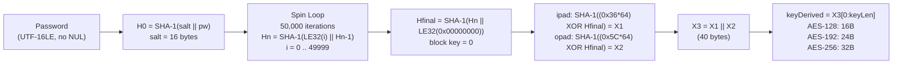
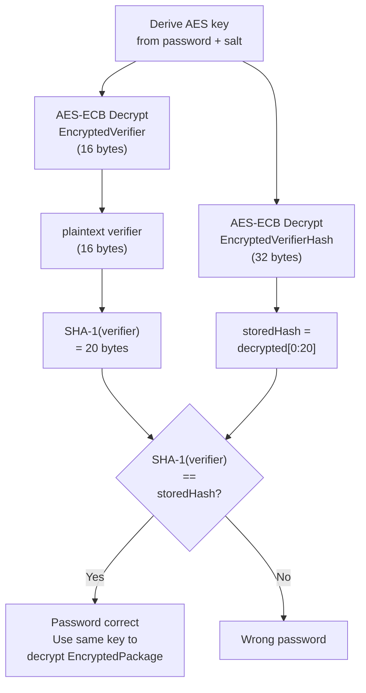
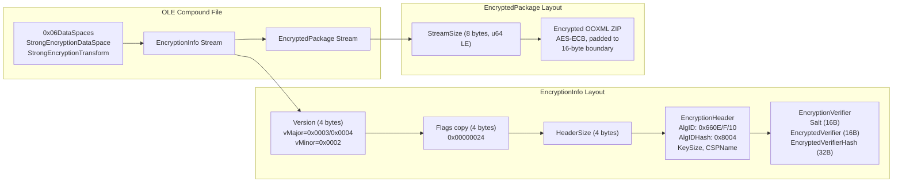

# ECMA-376 Standard Encryption

🟡 **Legacy Encryption** — password-based document-open encryption for OOXML containers (Office 2007 default, superseded by Agile)

## Overview

- Binary `EncryptionInfo` structure (not XML) with fixed algorithms: SHA-1 hash, AES cipher, ECB mode — no algorithm negotiation
- KDF is a bespoke 50,000-iteration SHA-1 construction with ipad/opad key expansion, loosely based on PKCS#5 v2.0 but not standard PBKDF2
- AES key lengths of 128, 192, or 256 bits; only the key size varies between profiles
- Default for Office 2007; Office 2010+ defaults to [ECMA-376 Agile Encryption](./ecma376-agile.md) but can still produce standard encryption in compatibility mode
- Used by: [Word](../../formats/word.md), [Excel](../../formats/excel.md), [PowerPoint](../../formats/powerpoint.md), [OneNote](../../formats/onenote.md)
- Spec: [MS-OFFCRYPTO] SS2.3.4.5--SS2.3.4.9

## KDF Pipeline



## Verification Flow



## On-Disk Structure



## Quick Reference

| Parameter | Value | Notes |
|---|---|---|
| Hash | SHA-1 (20 B) | Fixed, no alternatives |
| Cipher | AES-128 / AES-192 / AES-256 | ECB mode, fixed |
| Iteration Count | 50,000 | Counter 0..49999, LE32, prepended |
| Salt | 16 bytes | Random, in EncryptionVerifier.Salt |
| Block Key | 0x00000000 | Single scalar, appended to Hn |
| ipad / opad | 0x36 / 0x5C | 64-byte buffers XORed with Hfinal |
| Password | UTF-16LE, no NUL | Max 255 Unicode code points |
| vMinor | 0x0002 | Distinguishes from Agile (0x0004) |
| Flags | 0x00000024 | fCryptoAPI + fAES |

## Related Algorithms

| Algorithm | Relationship |
|---|---|
| [ECMA-376 Agile](./ecma376-agile.md) | Successor — CBC mode, configurable hash/cipher, XML descriptor |
| [RC4 CryptoAPI](./rc4-cryptoapi-sha1.md) | Shares EncryptionHeader/EncryptionVerifier structures; RC4 + un-iterated KDF |
| [RC4 MD5 Legacy](./rc4-md5-legacy.md) | 40-bit RC4 encryption for binary documents |
| [XOR Obfuscation](./xor-obfuscation.md) | Weakest legacy scheme |
| [ISO Protection Hash](./iso-protection-hash.md) | Similar iterated hash but iterator **APPENDED** (not prepended) |

## Extraction Target

Fields to extract from the `\EncryptionInfo` binary stream:

| Field | Source | Type | Example (AES-128) |
|---|---|---|---|
| Salt | `EncryptionVerifier.Salt` (offset +4 into verifier) | 16 raw bytes | `a3 f1 ...` (random) |
| Key size | `EncryptionHeader.KeySize` | u32 LE | `0x00000080` (128) |
| AlgID | `EncryptionHeader.AlgID` | s32 LE | `0x0000660E` |
| Encrypted verifier | `EncryptionVerifier.EncryptedVerifier` | 16 raw bytes | (ciphertext) |
| Encrypted verifier hash | `EncryptionVerifier.EncryptedVerifierHash` | 32 raw bytes | (ciphertext) |
| Verifier hash size | `EncryptionVerifier.VerifierHashSize` | u32 LE | `0x00000014` (20) |
| Version minor | `EncryptionVersionInfo.vMinor` | u16 LE | `0x0002` |

**Python function signatures:**

```python
def derive_standard_key(
    password: str,
    salt: bytes,  # EncryptionVerifier.Salt, 16 bytes
    key_bits: int,  # EncryptionHeader.KeySize: 128, 192, or 256
) -> bytes: ...  # Returns AES key (key_bits // 8 bytes)


def verify_standard(
    password: str,
    salt: bytes,  # EncryptionVerifier.Salt, 16 bytes
    key_bits: int,  # EncryptionHeader.KeySize
    enc_verifier: bytes,  # EncryptionVerifier.EncryptedVerifier, 16 bytes
    enc_verifier_hash: bytes,  # EncryptionVerifier.EncryptedVerifierHash, 32 bytes
) -> bool: ...  # True if password is correct
```

---

## 1. What it is and where it is used

- ECMA-376 Standard Encryption is one of the three sub-approaches defined under ECMA-376 Document Encryption in [MS-OFFCRYPTO] section 1.3.3.4
- Uses a binary `EncryptionInfo` structure (as opposed to the XML descriptor used by agile encryption)
- Derives an AES encryption key from a user-supplied password via 50,000 iterations of SHA-1
- Encrypts the entire OOXML package as a single stream using AES in ECB mode ([MS-OFFCRYPTO] section 2.3.4.7)
- Hash algorithm is fixed at SHA-1 and cipher is fixed at AES; no other algorithms are permitted ([MS-OFFCRYPTO] section 2.3.4.5)
- The KDF is described by the spec as "derived from PKCS #5: Password-Based Cryptography Version 2.0 [RFC2898]" but is not standard PBKDF2 — it is a bespoke iterated SHA-1 construction with an ipad/opad key-expansion step ([MS-OFFCRYPTO] section 2.3.4.7)

Standard encryption protects the document-open (read) password for ECMA-376 [ECMA-376] documents:

- Office Open XML files (`.docx`, `.xlsx`, `.pptx` and their macro-enabled counterparts `.docm`, `.xlsm`, `.pptm`) stored as encrypted OLE Compound File Binary (CFB) containers
- Does not protect modify/write-reservation passwords, sheet/workbook protection, or VBA project passwords (those are separate mechanisms)
- When standard encryption is applied, the on-disk file is not a ZIP/OPC package but an OLE compound file ([MS-CFB]) whose root storage contains the `\EncryptionInfo` and `\EncryptedPackage` streams along with the `\0x06DataSpaces` storage ([MS-OFFCRYPTO] section 2.3.4)

Products that use standard encryption:

- Office 2007 writes standard encryption by default for password-protected OOXML files
- Office 2010 and later default to agile encryption ([ecma376-agile.md](./ecma376-agile.md)) but can produce standard encryption when explicitly selected or when compatibility mode dictates ([MS-OFFCRYPTO] section 2.3.4.5, note <9>)
- Third-party producers (Apache POI, LibreOffice, custom OOXML implementations) may also emit standard encryption
- The same standard KDF and verifier path is reused by OneNote password protection ([onenote.md](../../formats/onenote.md))
- For format-level details of where each application stores its password protection trigger, see [word.md](../../formats/word.md), [excel.md](../../formats/excel.md), and [powerpoint.md](../../formats/powerpoint.md)

Related schemes:

- Successor: agile encryption ([ecma376-agile.md](./ecma376-agile.md), [MS-OFFCRYPTO] section 2.3.4.10)
- Predecessors replaced by standard encryption: CryptoAPI RC4 ([rc4-cryptoapi-sha1.md](./rc4-cryptoapi-sha1.md), section 2.3.5), 40-bit RC4 ([rc4-md5-legacy.md](./rc4-md5-legacy.md), section 2.3.6), XOR obfuscation ([xor-obfuscation.md](./xor-obfuscation.md), section 2.3.7)
- Extensible (third-party) encryption ([MS-OFFCRYPTO] section 2.3.4.6) is a distinct sub-approach using a custom CSP and is not covered by this document

## 2. Profiles / parameters

All profiles share the same KDF (SHA-1, 50000-round iteration, ipad/opad key expansion), the same salt size (16 bytes), the same verifier hash algorithm (SHA-1, 20-byte output), and AES in ECB mode. They differ only in the AES key length. Standard encryption is AES-only and SHA-1-only: `AlgID` MUST be one of the AES values and `AlgIDHash` MUST be 0x00008004 ([MS-OFFCRYPTO] section 2.3.4.5).

| Parameter | AES-128 | AES-192 | AES-256 | Spec reference |
|---|---|---|---|---|
| Hash algorithm | SHA-1 | SHA-1 | SHA-1 | section 2.3.4.5, 2.3.4.7 |
| `AlgIDHash` | 0x00008004 | 0x00008004 | 0x00008004 | section 2.3.2 |
| Iteration count | 50000 | 50000 | 50000 | section 2.3.4.7 |
| Cipher | AES-128 | AES-192 | AES-256 | section 2.3.4.5 |
| Cipher mode | ECB | ECB | ECB | section 2.3.4.7 |
| `AlgID` | 0x0000660E | 0x0000660F | 0x00006610 | section 2.3.2 |
| `KeySize` (bits) | 0x00000080 (128) | 0x000000C0 (192) | 0x00000100 (256) | section 2.3.2 |
| Derived key length (bytes) | 16 | 24 | 32 | section 2.3.4.7 |
| Key material used | `X1[0:16]` | `X1[0:20] + X2[0:4]` | `X1[0:20] + X2[0:12]` | section 2.3.4.7 |
| `ProviderType` | 0x00000018 | 0x00000018 | 0x00000018 | section 2.3.2, note <8> |
| Salt size | 16 bytes | 16 bytes | 16 bytes | section 2.3.3 |
| `SaltSize` field | 0x00000010 | 0x00000010 | 0x00000010 | section 2.3.3 |
| `VerifierHashSize` | 0x00000014 (20) | 0x00000014 (20) | 0x00000014 (20) | section 2.3.3 |
| `EncryptedVerifier` size | 16 bytes | 16 bytes | 16 bytes | section 2.3.3 |
| `EncryptedVerifierHash` size | 32 bytes | 32 bytes | 32 bytes | section 2.3.3 |

`EncryptionVersionInfo` version values:

- `vMajor` MUST be 0x0002, 0x0003, or 0x0004; `vMinor` MUST be 0x0002 ([MS-OFFCRYPTO] section 2.3.4.5)
- The `vMinor` value 0x0002 distinguishes standard encryption from agile encryption (`vMinor` 0x0004, [MS-OFFCRYPTO] section 2.3.4.10)
- Office 2007 RTM writes `vMajor` 0x0003; Office 2007 SP2, Office 2010, and Office 2013 write `vMajor` 0x0004 ([MS-OFFCRYPTO] section 2.3.4.5, note <9>)

Password character encoding:

- Passwords MUST be provided as an array of Unicode characters ([MS-OFFCRYPTO] section 2.3.4.7), in practice UTF-16LE with no trailing NUL terminator hashed
- Passwords are limited to 255 Unicode code points ([MS-OFFCRYPTO] section 4.1.3.1)
- Additional limitations on the length and characters are implementation-dependent ([MS-OFFCRYPTO] section 2.3.4.7)

## 3. On-disk structure and byte layout

### 3.1 OLE Compound File container

An encrypted ECMA-376 document is stored as an OLE compound file ([MS-CFB]) rather than a ZIP/OPC package. The container uses the data spaces construct ([MS-OFFCRYPTO] section 2.1) and MUST contain the following root-level streams and storages ([MS-OFFCRYPTO] sections 2.3.4.1–2.3.4.5):

- `\0x06DataSpaces` storage — data space metadata (section 2.1.1)
- `\EncryptionInfo` stream — cryptographic parameters (section 2.3.4.5)
- `\EncryptedPackage` stream — the encrypted OOXML ZIP payload (section 2.3.4.4)

All multi-byte integer values in these structures are little-endian ([MS-OFFCRYPTO] section 1.3.6).

### 3.2 DataSpaces structure for ECMA-376 encryption

The `\0x06DataSpaces` storage MUST be populated as follows ([MS-OFFCRYPTO] sections 2.3.4.1–2.3.4.3):

**DataSpaceMap** ([MS-OFFCRYPTO] section 2.3.4.1): The `\0x06DataSpaces\DataSpaceMap` stream MUST contain a `DataSpaceMap` structure (section 2.1.6) containing exactly one `DataSpaceMapEntry` (section 2.1.6.1). The entry MUST have `DataSpaceName` equal to `"StrongEncryptionDataSpace"` and exactly one `ReferenceComponents` entry with name `"EncryptedPackage"` and type 0x00000000 (stream).

**DataSpaceInfo** ([MS-OFFCRYPTO] section 2.3.4.2): The `\0x06DataSpaces\DataSpaceInfo` storage MUST contain a stream named `"StrongEncryptionDataSpace"` with a `DataSpaceDefinition` structure (section 2.1.7) having exactly one `TransformReferences` entry: `"StrongEncryptionTransform"`.

**TransformInfo** ([MS-OFFCRYPTO] section 2.3.4.3): The `\0x06DataSpaces\TransformInfo` storage MUST contain a storage named `"StrongEncryptionTransform"` with a `"0x06Primary"` stream containing an `IRMDSTransformInfo` structure (section 2.2.6) with the following fixed values:

| Field | Value | Spec reference |
|---|---|---|
| `TransformInfoHeader.TransformType` | 0x00000001 | section 2.3.4.3 |
| `TransformInfoHeader.TransformID` | `"{FF9A3F03-56EF-4613-BDD5-5A41C1D07246}"` | section 2.3.4.3 |
| `TransformInfoHeader.TransformName` | `"Microsoft.Container.EncryptionTransform"` | section 2.3.4.3 |
| `TransformInfoHeader.ReaderVersion` | `"1.0"` | section 2.3.4.3 |
| `TransformInfoHeader.UpdaterVersion` | `"1.0"` | section 2.3.4.3 |
| `TransformInfoHeader.WriterVersion` | `"1.0"` | section 2.3.4.3 |

Following the `IRMDSTransformInfo` structure, an `EncryptionTransformInfo` structure (section 2.1.9) MUST exist specifying the encryption algorithm. However, if the algorithms specified in `EncryptionTransformInfo` differ from those in the `\EncryptionInfo` stream, the `\EncryptionInfo` stream MUST be considered authoritative ([MS-OFFCRYPTO] section 2.3.4.3).

**EncryptionTransformInfo structure** ([MS-OFFCRYPTO] section 2.1.9):

| Field | Size | Value | Meaning |
|---|---|---|---|
| `EncryptionName` | variable (UTF-8-LP-P4) | `"AES 128"`, `"AES 192"`, or `"AES 256"` | Encryption algorithm name |
| `EncryptionBlockSize` | 4 bytes | 0x00000010 (16) | AES block size |
| `CipherMode` | 4 bytes | 0x00000000 | Reserved (not CBC/CFB; ECB mode is specified elsewhere) |
| `Reserved` | 4 bytes | 0x00000004 | Reserved |

### 3.3 `\EncryptionInfo` stream layout (Standard Encryption) — [MS-OFFCRYPTO] section 2.3.4.5

| Field | Offset | Size (bytes) | Type | Meaning |
|---|---|---|---|---|
| `EncryptionVersionInfo.vMajor` | 0 | 2 | u16 LE | MUST be 0x0002, 0x0003, or 0x0004 |
| `EncryptionVersionInfo.vMinor` | 2 | 2 | u16 LE | MUST be 0x0002 |
| `EncryptionHeader.Flags` (copy) | 4 | 4 | u32 LE | Copy of `Flags` from the `EncryptionHeader` that follows |
| `EncryptionHeaderSize` | 8 | 4 | u32 LE | Size in bytes of the `EncryptionHeader` structure that follows |
| `EncryptionHeader` | 12 | `EncryptionHeaderSize` | struct | See section 3.4 |
| `EncryptionVerifier` | 12 + `EncryptionHeaderSize` | 72 | struct | See section 3.5 |

### 3.4 `EncryptionHeader` structure — [MS-OFFCRYPTO] section 2.3.2

Offsets are relative to the start of the `EncryptionHeader` (stream offset 12).

| Field | Offset | Size (bytes) | Type | Value for standard AES |
|---|---|---|---|---|
| `Flags` | 0 | 4 | u32 LE (EncryptionHeaderFlags) | `fCryptoAPI` and `fAES` bits MUST be set; `fDocProps` MUST be 0 |
| `SizeExtra` | 4 | 4 | u32 LE | MUST be 0x00000000 |
| `AlgID` | 8 | 4 | s32 LE | 0x0000660E (AES-128), 0x0000660F (AES-192), or 0x00006610 (AES-256) |
| `AlgIDHash` | 12 | 4 | s32 LE | MUST be 0x00008004 (SHA-1) |
| `KeySize` | 16 | 4 | u32 LE | 0x00000080 (128), 0x000000C0 (192), or 0x00000100 (256) |
| `ProviderType` | 20 | 4 | u32 LE | SHOULD be 0x00000018 (AES) |
| `Reserved1` | 24 | 4 | u32 LE | Undefined, MUST be ignored |
| `Reserved2` | 28 | 4 | u32 LE | MUST be 0x00000000, MUST be ignored |
| `CSPName` | 32 | variable | UTF-16LE, NUL-terminated | SHOULD be `"Microsoft Enhanced RSA and AES Cryptographic Provider"` or `"Microsoft Enhanced RSA and AES Cryptographic Provider (Prototype)"` (notes <10>, <11>) |

#### 3.4.1 `EncryptionHeaderFlags` bit layout — [MS-OFFCRYPTO] section 2.3.1

The `Flags` field is a 32-bit little-endian value with the following bit definitions (LSB-first ordering as presented in the spec):

| Bit position | Name | Standard AES value | Meaning |
|---|---|---|---|
| 0 (A) | `Reserved1` | 0 | MUST be 0, MUST be ignored |
| 1 (B) | `Reserved2` | 0 | MUST be 0, MUST be ignored |
| 2 (C) | `fCryptoAPI` | 1 | MUST be 1 unless `fExternal` is 1 |
| 3 (D) | `fDocProps` | 0 | MUST be 0 if document properties are encrypted |
| 4 (E) | `fExternal` | 0 | MUST be 1 if extensible encryption is used; if 1, all other bits MUST be 0 |
| 5 (F) | `fAES` | 1 | MUST be 1 if protected content is an ECMA-376 document; if set, `fCryptoAPI` MUST also be 1 |
| 6–31 | `Unused` | 0 | Undefined, MUST be ignored |

For standard AES encryption, the combined `Flags` value is 0x00000024 (`fCryptoAPI` | `fAES` = bits 2 and 5 set).

#### 3.4.2 `AlgID` and `Flags` valid combinations for standard encryption — [MS-OFFCRYPTO] section 2.3.2

| `Flags.fCryptoAPI` | `Flags.fAES` | `Flags.fExternal` | `AlgID` | Algorithm |
|---|---|---|---|---|
| 1 | 1 | 0 | 0x00000000 | 128-bit AES (determined by Flags) |
| 1 | 1 | 0 | 0x0000660E | 128-bit AES |
| 1 | 1 | 0 | 0x0000660F | 192-bit AES |
| 1 | 1 | 0 | 0x00006610 | 256-bit AES |

#### 3.4.3 `AlgIDHash` values — [MS-OFFCRYPTO] section 2.3.2

| `AlgIDHash` | `Flags.fExternal` | Algorithm |
|---|---|---|
| 0x00000000 | 0 | SHA-1 |
| 0x00008004 | 0 | SHA-1 |
| 0x00000000 | 1 | Determined by the application (extensible encryption only) |

#### 3.4.4 `KeySize` values — [MS-OFFCRYPTO] section 2.3.2

| Algorithm | `KeySize` value(s) | Notes |
|---|---|---|
| Any | 0x00000000 | Determined by `Flags` |
| AES | 0x00000080, 0x000000C0, 0x00000100 | 128-bit, 192-bit, or 256-bit |

`KeySize` MUST be a multiple of 8 bits. If `Flags` does not have `fCryptoAPI` set, `KeySize` MUST be 0x00000000 ([MS-OFFCRYPTO] section 2.3.2).

#### 3.4.5 `ProviderType` values — [MS-OFFCRYPTO] section 2.3.2

| Algorithm | Value |
|---|---|
| Any | 0x00000000 (determined by Flags) |
| RC4 | 0x00000001 |
| AES | 0x00000018 |

If `Flags` does not have `fCryptoAPI` set, `ProviderType` MUST be 0x00000000 ([MS-OFFCRYPTO] section 2.3.2).

### 3.5 `EncryptionVerifier` structure — [MS-OFFCRYPTO] section 2.3.3

Offsets are relative to the start of the `EncryptionVerifier` (stream offset 12 + `EncryptionHeaderSize`).

| Field | Offset | Size (bytes) | Type | Meaning |
|---|---|---|---|---|
| `SaltSize` | 0 | 4 | u32 LE | MUST be 0x00000010 (16) |
| `Salt` | 4 | 16 | byte[16] | Random salt used during password hash generation; MUST NOT be the same data used for the verifier |
| `EncryptedVerifier` | 20 | 16 | byte[16] | Random 16-byte `Verifier` value encrypted using the derived key (one AES block) |
| `VerifierHashSize` | 36 | 4 | u32 LE | Number of bytes needed to contain the hash of the `Verifier`; MUST be 0x00000014 (20) for SHA-1 |
| `EncryptedVerifierHash` | 40 | 32 | byte[32] | Encrypted hash of the `Verifier` value; for AES, MUST be 32 bytes (two AES blocks); only the first `VerifierHashSize` bytes of the decrypted value are meaningful |

The `EncryptionVerifier` for AES is always 72 bytes total: 4 + 16 + 16 + 4 + 32 = 72 ([MS-OFFCRYPTO] section 2.3.3).

### 3.6 `\EncryptedPackage` stream — [MS-OFFCRYPTO] section 2.3.4.4

| Field | Offset | Size (bytes) | Type | Meaning |
|---|---|---|---|---|
| `StreamSize` | 0 | 8 | u64 LE | Number of bytes of plaintext data encrypted within `EncryptedData`, not including the size of `StreamSize` itself |
| `EncryptedData` | 8 | variable | byte[] | The encrypted OOXML ZIP package, encrypted using the algorithm specified in `\EncryptionInfo` |

The actual size of the `\EncryptedPackage` stream can be larger than `StreamSize + 8` because the ciphertext is padded to a multiple of the encryption block size (16 bytes for AES) ([MS-OFFCRYPTO] section 2.3.4.4).

## 4. Key derivation — [MS-OFFCRYPTO] section 2.3.4.7

The encryption key for ECMA-376 standard encryption MUST be generated using the following method, which the spec describes as derived from PKCS #5 v2.0 [RFC2898]. Let `H()` be SHA-1 (as determined by `EncryptionHeader.AlgIDHash`), let `Hn` be the hash data of the nth iteration, and let `+` represent concatenation.

### 4.1 Initial password hash

The password MUST be provided as an array of Unicode characters (UTF-16LE, no trailing NUL). The initial password hash is:

```
H0 = H(salt + password)
```

where `salt` is the 16-byte random value stored in `EncryptionVerifier.Salt` ([MS-OFFCRYPTO] section 2.3.4.7). The salt MUST be 16 bytes and MUST be stored in the `EncryptionVerifier.Salt` field.

### 4.2 Iterated hashing (50000 iterations)

The hash is iterated using the following approach:

```
Hn = H(iterator + H(n-1))
```

where `iterator` is an unsigned 32-bit value, encoded as 4 bytes in little-endian byte order, that is initially set to 0x00000000 and incremented monotonically on each iteration until 50000 iterations have been performed. The value of `iterator` on the last iteration MUST be 49999 ([MS-OFFCRYPTO] section 2.3.4.7). The `iterator` value is prepended (not appended) to the previous hash output, making each iteration's input exactly 24 bytes (4-byte counter + 20-byte SHA-1 digest).

### 4.3 Final hash with block number

After the 50000th iteration, the final hash data is produced by appending the block number:

```
Hfinal = H(Hn + block)
```

where `block` is the 4-byte little-endian encoding of block number 0x00000000 ([MS-OFFCRYPTO] section 2.3.4.7). The input to this hash is 24 bytes (20-byte iterated hash + 4-byte block number). The encryption algorithm MUST be specified in `EncryptionHeader.AlgID` and MUST use ECB mode ([MS-OFFCRYPTO] section 2.3.4.7).

### 4.4 Key expansion (ipad/opad derivation)

The encryption key is derived from `Hfinal` as follows ([MS-OFFCRYPTO] section 2.3.4.7):

1. Let `cbRequiredKeyLength` be the required key length in bytes for the encryption algorithm as specified by the `EncryptionHeader` structure. Note that `cbRequiredKeyLength` MUST be less than or equal to 40.

2. Let `cbHash` be the number of bytes output by the hashing algorithm H. For SHA-1, `cbHash` = 20.

3. Form a 64-byte buffer by repeating the constant 0x36 sixty-four times. XOR `Hfinal` into the first `cbHash` bytes of this buffer. Compute a hash of the resulting 64-byte buffer using hashing algorithm H. This yields a hash value of length `cbHash`. Let the resulting value be called `X1`.

4. Form another 64-byte buffer by repeating the constant 0x5C sixty-four times. XOR `Hfinal` into the first `cbHash` bytes of this buffer. Compute a hash of the resulting 64-byte buffer using hashing algorithm H. This yields a hash value of length `cbHash`. Let the resulting value be called `X2`.

5. Concatenate `X1` with `X2` to form `X3`, which will yield a value twice the length of `cbHash` (40 bytes).

6. Let `keyDerived` be equal to the first `cbRequiredKeyLength` bytes of `X3`.

### 4.5 Full key derivation pseudocode

```
# ECMA-376 Standard Encryption Key Derivation
# Per [MS-OFFCRYPTO] section 2.3.4.7
#
# Inputs:
#   password  -- the user password (string)
#   salt      -- 16 bytes from EncryptionVerifier.Salt
#   key_bits  -- key size in bits: 128, 192, or 256 (from EncryptionHeader.KeySize)
#
# Output:
#   keyDerived -- the AES encryption key (key_bits / 8 bytes)

func derive_key(password, salt, key_bits):
    # Step 1: Encode password as UTF-16LE, no trailing NUL
    pw = encode_utf16le(password)

    # Step 2: Initial hash -- H0 = H(salt + password)
    # salt is 16 bytes, pw is 2 * len(password) bytes
    h = SHA1(salt || pw)                          # 20-byte digest

    # Step 3: Iterated hashing -- 50000 iterations
    # iterator is a 4-byte unsigned integer, little-endian
    # iterator starts at 0, increments to 49999
    for i in 0 .. 49999:
        h = SHA1(le32(i) || h)                    # 4-byte LE counter prepended to 20-byte digest
                                                  # input to each SHA-1 is exactly 24 bytes

    # Step 4: Final hash with block number 0
    # Hfinal = H(Hn + block), block = 0x00000000 LE
    h_final = SHA1(h || le32(0x00000000))         # 20-byte + 4-byte = 24-byte input

    # Step 5: Key expansion via ipad/opad
    cbHash = 20                                   # SHA-1 output size
    cbRequiredKeyLength = key_bits / 8            # 16, 24, or 32 bytes

    # X1: ipad expansion
    buf_ipad = bytes([0x36] * 64)                 # 64-byte buffer filled with 0x36
    for k in 0 .. (cbHash - 1):
        buf_ipad[k] = buf_ipad[k] XOR h_final[k] # XOR Hfinal into first cbHash bytes
    X1 = SHA1(buf_ipad)                           # 20-byte digest

    # X2: opad expansion
    buf_opad = bytes([0x5C] * 64)                 # 64-byte buffer filled with 0x5C
    for k in 0 .. (cbHash - 1):
        buf_opad[k] = buf_opad[k] XOR h_final[k] # XOR Hfinal into first cbHash bytes
    X2 = SHA1(buf_opad)                           # 20-byte digest

    # X3: concatenation
    X3 = X1 || X2                                 # 40 bytes total

    # Step 6: Truncate to required key length
    keyDerived = X3[0 : cbRequiredKeyLength]
    # AES-128: X3[0:16]  = X1[0:16]
    # AES-192: X3[0:24]  = X1[0:20] + X2[0:4]
    # AES-256: X3[0:32]  = X1[0:20] + X2[0:12]

    return keyDerived
```

### 4.6 Endianness note

SHA-1 processes big-endian 32-bit words internally per FIPS 180, but the `iterator` counter and block number values fed into the hash input message are 4-byte little-endian values as specified by [MS-OFFCRYPTO] section 2.3.4.7. These are not SHA-1 internal state values but data bytes in the hash input stream.

## 5. Password verifier generation — [MS-OFFCRYPTO] section 2.3.4.8

The password verifier uses the `EncryptionVerifier` structure ([MS-OFFCRYPTO] section 2.3.3). The `EncryptionVerifier` MUST be set using the following process ([MS-OFFCRYPTO] section 2.3.3):

```
# Password Verifier Generation
# Per [MS-OFFCRYPTO] sections 2.3.3 and 2.3.4.8
#
# Inputs:
#   password  -- the user password
#   salt      -- 16 random bytes (same salt used in key generation)
#   key_bits  -- 128, 192, or 256
#
# Outputs:
#   EncryptionVerifier structure fields

func generate_verifier(password, salt, key_bits):
    # Step 1: Generate random salt, write to EncryptionVerifier.Salt
    # salt = random_bytes(16)
    # (salt is also used in key derivation)

    # Step 2: Derive the encryption key from password and salt, block number 0
    key = derive_key(password, salt, key_bits)

    # Step 3: Generate 16 bytes of random data as the Verifier
    verifier = random_bytes(16)

    # Step 4: Encrypt the Verifier, write to EncryptedVerifier
    encrypted_verifier = AES_ECB_encrypt(key, verifier)        # 16 bytes (one AES block)

    # Step 5: Write the hash size
    verifier_hash_size = 20                                     # SHA-1 output length

    # Step 6: Hash the Verifier
    verifier_hash = SHA1(verifier)                              # 20 bytes

    # Step 7: Encrypt the hash, zero-padded to 32 bytes, write to EncryptedVerifierHash
    padded_hash = verifier_hash || bytes([0x00] * 12)           # pad to 32 bytes (two AES blocks)
    encrypted_verifier_hash = AES_ECB_encrypt(key, padded_hash) # 32 bytes

    # Store in EncryptionVerifier structure:
    #   SaltSize            = 0x00000010
    #   Salt                = salt (16 bytes)
    #   EncryptedVerifier   = encrypted_verifier (16 bytes)
    #   VerifierHashSize    = 0x00000014 (20)
    #   EncryptedVerifierHash = encrypted_verifier_hash (32 bytes)

    return (salt, encrypted_verifier, verifier_hash_size, encrypted_verifier_hash)
```

The password verifier `Salt` field MUST be equal to the salt created during password key generation ([MS-OFFCRYPTO] section 2.3.4.8). The `Salt` MUST NOT be the same data used for the verifier stored encrypted in the `EncryptedVerifier` field ([MS-OFFCRYPTO] section 2.3.3).

## 6. Password verification / decryption check — [MS-OFFCRYPTO] section 2.3.4.9

Passwords MUST be verified using the following steps ([MS-OFFCRYPTO] section 2.3.4.9):

```
# Password Verification (Standard Encryption)
# Per [MS-OFFCRYPTO] section 2.3.4.9
#
# Inputs:
#   password              -- candidate password
#   salt                  -- EncryptionVerifier.Salt (16 bytes)
#   key_bits              -- EncryptionHeader.KeySize (128, 192, or 256)
#   encrypted_verifier    -- EncryptionVerifier.EncryptedVerifier (16 bytes)
#   encrypted_hash        -- EncryptionVerifier.EncryptedVerifierHash (32 bytes)
#   verifier_hash_size    -- EncryptionVerifier.VerifierHashSize (20)
#
# Output:
#   True if password is correct, False otherwise

func verify_password(password, salt, key_bits, encrypted_verifier, encrypted_hash, verifier_hash_size):
    # Step 1: Generate an encryption key as specified in section 2.3.4.7
    key = derive_key(password, salt, key_bits)

    # Step 2: Decrypt the EncryptedVerifier to obtain the Verifier value
    # The resulting Verifier value MUST be an array of 16 bytes
    verifier = AES_ECB_decrypt(key, encrypted_verifier)         # 16 bytes

    # Step 3: Decrypt the EncryptedVerifierHash to obtain the hash of the Verifier
    # The number of bytes used by the encrypted Verifier hash MUST be 32
    # The number of bytes used by the decrypted Verifier hash is given by
    # VerifierHashSize, which MUST be 20
    decrypted_hash = AES_ECB_decrypt(key, encrypted_hash)       # 32 bytes
    stored_hash = decrypted_hash[0 : verifier_hash_size]        # first 20 bytes

    # Step 4: Calculate the SHA-1 hash of the Verifier from step 2
    calculated_hash = SHA1(verifier)                             # 20 bytes

    # Step 5: Compare the results of step 3 and step 4
    # If the two hash values do not match, the password is incorrect
    return (calculated_hash == stored_hash)                      # 160-bit comparison
```

### 6.1 Decryption of `\EncryptedPackage`

Once the password is verified, the same derived key is used to decrypt the `\EncryptedPackage` stream. The `EncryptedData` field (starting at offset 8 of the stream, after the 8-byte `StreamSize` field) is decrypted using AES-ECB with `keyDerived`. After decryption, only the first `StreamSize` bytes of the plaintext constitute the original OOXML ZIP package; any trailing bytes from the final AES block's padding MUST be discarded ([MS-OFFCRYPTO] section 2.3.4.4).

## 7. Reference constants

Every constant required to implement ECMA-376 standard encryption:

| Constant | Value | Spec reference |
|---|---|---|
| Iteration count | 50000 (counter values 0 through 49999) | [MS-OFFCRYPTO] section 2.3.4.7 |
| Block number for `Hfinal` | 0x00000000 (4-byte little-endian, appended to iterated hash) | [MS-OFFCRYPTO] section 2.3.4.7 |
| ipad byte | 0x36, repeated 64 times | [MS-OFFCRYPTO] section 2.3.4.7 step 3 |
| opad byte | 0x5C, repeated 64 times | [MS-OFFCRYPTO] section 2.3.4.7 step 4 |
| ipad/opad buffer size | 64 bytes | [MS-OFFCRYPTO] section 2.3.4.7 |
| `cbHash` (SHA-1 output length) | 20 bytes | [MS-OFFCRYPTO] section 2.3.4.7 step 2 |
| Maximum `cbRequiredKeyLength` | 40 bytes | [MS-OFFCRYPTO] section 2.3.4.7 step 1 |
| `SaltSize` | 0x00000010 (16 bytes) | [MS-OFFCRYPTO] section 2.3.3 |
| `VerifierHashSize` (SHA-1) | 0x00000014 (20 bytes) | [MS-OFFCRYPTO] section 2.3.3 |
| `EncryptedVerifier` size | 16 bytes (one AES block) | [MS-OFFCRYPTO] section 2.3.3 |
| `EncryptedVerifierHash` size (AES) | 32 bytes (two AES blocks) | [MS-OFFCRYPTO] section 2.3.3 |
| `AlgIDHash` for SHA-1 | 0x00008004 | [MS-OFFCRYPTO] section 2.3.2 |
| `AlgID` for AES-128 | 0x0000660E | [MS-OFFCRYPTO] section 2.3.2 |
| `AlgID` for AES-192 | 0x0000660F | [MS-OFFCRYPTO] section 2.3.2 |
| `AlgID` for AES-256 | 0x00006610 | [MS-OFFCRYPTO] section 2.3.2 |
| `AlgID` for RC4 | 0x00006801 | [MS-OFFCRYPTO] section 2.3.2 |
| `KeySize` for AES-128 | 0x00000080 (128 bits) | [MS-OFFCRYPTO] section 2.3.2 |
| `KeySize` for AES-192 | 0x000000C0 (192 bits) | [MS-OFFCRYPTO] section 2.3.2 |
| `KeySize` for AES-256 | 0x00000100 (256 bits) | [MS-OFFCRYPTO] section 2.3.2 |
| `ProviderType` for AES | 0x00000018 | [MS-OFFCRYPTO] section 2.3.2 |
| `ProviderType` for RC4 | 0x00000001 | [MS-OFFCRYPTO] section 2.3.2 |
| `Flags` for standard AES | 0x00000024 (`fCryptoAPI` \| `fAES`) | [MS-OFFCRYPTO] section 2.3.1 |
| `SizeExtra` | 0x00000000 | [MS-OFFCRYPTO] section 2.3.2 |
| `EncryptionVersionInfo.vMinor` (standard) | 0x0002 | [MS-OFFCRYPTO] section 2.3.4.5 |
| `EncryptionVersionInfo.vMinor` (agile) | 0x0004 | [MS-OFFCRYPTO] section 2.3.4.10 |
| `TransformType` | 0x00000001 | [MS-OFFCRYPTO] section 2.3.4.3 |
| `TransformID` | `"{FF9A3F03-56EF-4613-BDD5-5A41C1D07246}"` | [MS-OFFCRYPTO] section 2.3.4.3 |
| `EncryptionBlockSize` (AES) | 0x00000010 (16 bytes) | [MS-OFFCRYPTO] section 2.1.9 |
| `DataSpaceName` | `"StrongEncryptionDataSpace"` | [MS-OFFCRYPTO] section 2.3.4.1 |
| `TransformReference` | `"StrongEncryptionTransform"` | [MS-OFFCRYPTO] section 2.3.4.2 |
| Maximum password length | 255 Unicode code points | [MS-OFFCRYPTO] section 4.1.3.1 |
| SHA-1 initial hash values | H0=0x67452301, H1=0xEFCDAB89, H2=0x98BADCFE, H3=0x10325476, H4=0xC3D2E1F0 | FIPS 180 |

### 7.1 Constants that belong to other algorithms

The following constants are defined in [MS-OFFCRYPTO] but do NOT apply to standard encryption:

- The agile encryption block-key constants (e.g., `\xfe\xa7\xd2\x76...` for `verifierHashInput`, `\xd7\xaa\x0f\x6d...` for `verifierHashValue`, `\x14\x6e\x0b\xe7...` for `encryptedKeyValue`) belong to agile encryption ([MS-OFFCRYPTO] section 2.3.4.13; see [ecma376-agile.md](./ecma376-agile.md)).
- The `InitialCodeArray`, `XorMatrix`, `PadArray`, and 0xCE4B password verifier constant belong to XOR obfuscation ([MS-OFFCRYPTO] sections 2.3.7.1–2.3.7.2; see [xor-obfuscation.md](./xor-obfuscation.md)).
- The `mpbbCrypt` permutation array belongs to 40-bit RC4 encryption ([MS-OFFCRYPTO] section 2.3.6.2; see [rc4-md5-legacy.md](./rc4-md5-legacy.md)).

The only "block key" in standard encryption is the scalar value 0x00000000 appended in the `Hfinal` computation step ([MS-OFFCRYPTO] section 2.3.4.7).

## 8. Security considerations — [MS-OFFCRYPTO] section 4.1.3.1

- **No CBC mode, no corruption detection.** Standard encryption does not support CBC and has no provision for detecting corruption. AES in ECB mode is not known to be subject to bit-flipping attacks, but agile encryption addresses this by requiring CBC and corruption detection ([MS-OFFCRYPTO] section 4.1.3.1).
- **ECB mode weakness.** Identical plaintext blocks encrypt to identical ciphertext blocks — an inherent property of ECB mode ([SP800-38A]). The spec acknowledges AES-ECB "is not known to be subject to bit-flipping attacks" but ECB does not provide semantic security.
- **SHA-1 only.** The hash algorithm is fixed at SHA-1; no SHA-2 option exists. The spec recommends SHA-2 for agile encryption ([MS-OFFCRYPTO] section 4.1.3.1), reinforcing that SHA-1 is not preferred for newer implementations.
- **Password length limitation.** Passwords are limited to 255 Unicode code points ([MS-OFFCRYPTO] section 4.1.3.1). Additional limitations on length and characters are implementation-dependent ([MS-OFFCRYPTO] section 2.3.4.7).
- **Non-standard KDF.** While the spec states the key generation method "is derived from PKCS #5: Password-Based Cryptography Version 2.0 [RFC2898]" ([MS-OFFCRYPTO] section 2.3.4.7), the actual construction differs from standard PBKDF2/HMAC-SHA1: the counter is prepended rather than appended per HMAC conventions, there is no HMAC key schedule, and the ipad/opad expansion is applied only once at the end rather than on every iteration.

## 9. Spec references

| Section | Title | Content |
|---|---|---|
| [MS-OFFCRYPTO] section 1.3.3.4 | ECMA-376 Document Encryption | Overview of the three ECMA-376 encryption sub-approaches (standard, agile, extensible) |
| [MS-OFFCRYPTO] section 1.3.6 | Byte Ordering | All data in this format is little-endian |
| [MS-OFFCRYPTO] section 2.1.9 | EncryptionTransformInfo | `EncryptionName`, `EncryptionBlockSize`, `CipherMode`, `Reserved` fields for the transform |
| [MS-OFFCRYPTO] section 2.3.1 | EncryptionHeaderFlags | Bit definitions for `Flags`: `fCryptoAPI`, `fDocProps`, `fExternal`, `fAES` |
| [MS-OFFCRYPTO] section 2.3.2 | EncryptionHeader | `Flags`, `SizeExtra`, `AlgID`, `AlgIDHash`, `KeySize`, `ProviderType`, `CSPName` field definitions and value tables |
| [MS-OFFCRYPTO] section 2.3.3 | EncryptionVerifier | `SaltSize`, `Salt`, `EncryptedVerifier`, `VerifierHashSize`, `EncryptedVerifierHash` field definitions and verifier generation procedure |
| [MS-OFFCRYPTO] section 2.3.4 | ECMA-376 Document Encryption | Container-level requirements for encrypted ECMA-376 documents |
| [MS-OFFCRYPTO] section 2.3.4.1 | DataSpaceMap Stream | `DataSpaceName` = `"StrongEncryptionDataSpace"`, `ReferenceComponent` = `"EncryptedPackage"` |
| [MS-OFFCRYPTO] section 2.3.4.2 | DataSpaceInfo Storage | `TransformReference` = `"StrongEncryptionTransform"` |
| [MS-OFFCRYPTO] section 2.3.4.3 | TransformInfo Storage | `TransformID` = `"{FF9A3F03-56EF-4613-BDD5-5A41C1D07246}"`, `TransformName` = `"Microsoft.Container.EncryptionTransform"`, followed by `EncryptionTransformInfo` |
| [MS-OFFCRYPTO] section 2.3.4.4 | `\EncryptedPackage` Stream | `StreamSize` (u64 LE) + `EncryptedData` structure |
| [MS-OFFCRYPTO] section 2.3.4.5 | `\EncryptionInfo` Stream (Standard Encryption) | Version words (`vMajor` = 0x0002/0x0003/0x0004, `vMinor` = 0x0002), `EncryptionHeader.Flags` copy, `EncryptionHeaderSize`, `EncryptionHeader`, `EncryptionVerifier`; mandated AES `AlgID` and SHA-1 `AlgIDHash` values |
| [MS-OFFCRYPTO] section 2.3.4.6 | `\EncryptionInfo` Stream (Extensible Encryption) | Third-party CSP encryption; `vMinor` = 0x0003; not applicable to standard encryption |
| [MS-OFFCRYPTO] section 2.3.4.7 | ECMA-376 Document Encryption Key Generation (Standard Encryption) | Full KDF: `H0 = H(salt+password)`, 50000 iterations with LE32 counter prepended, `Hfinal = H(Hn+block)` with block=0, ipad/opad key expansion (0x36/0x5C), `X1`/`X2`/`X3` concatenation, `keyDerived` truncation, ECB mode |
| [MS-OFFCRYPTO] section 2.3.4.8 | Password Verifier Generation (Standard Encryption) | Verifier encrypted under key derived with block number 0 |
| [MS-OFFCRYPTO] section 2.3.4.9 | Password Verification (Standard Encryption) | Decrypt `EncryptedVerifier` (16 bytes) and `EncryptedVerifierHash` (32 bytes, first 20 used), compare SHA-1 of verifier against stored hash |
| [MS-OFFCRYPTO] section 2.3.4.10 | `\EncryptionInfo` Stream (Agile Encryption) | Agile encryption descriptor; `vMinor` = 0x0004; see [ecma376-agile.md](./ecma376-agile.md) |
| [MS-OFFCRYPTO] section 4.1.3.1 | ECMA-376 Document Encryption (Security) | No CBC / no corruption detection in standard encryption; SHA-2 preferred for agile; password limit 255 code points |
| [RFC2898] | PKCS #5 v2.0 | Referenced as the basis for the key derivation method |
| [FIPS 197] | AES | Advanced Encryption Standard specification |
| [RFC4634] | SHA and HMAC-SHA | SHA-1 specification |
| [SP800-38A] | Block Cipher Modes of Operation | ECB and CBC mode specifications |
| [ECMA-376] | Office Open XML File Formats | ECMA-376 standard, Part 2 Annex C Table C-5 bit 0 defines password encryption |
| [MS-CFB] | Compound File Binary File Format | OLE compound file container format |

### Cross-references within this collection

| Related document | Relationship |
|---|---|
| [ecma376-agile.md](./ecma376-agile.md) | Successor scheme (Office 2010+ default); uses XML descriptor, CBC mode, configurable hash/cipher; `vMinor` = 0x0004 |
| [rc4-cryptoapi-sha1.md](./rc4-cryptoapi-sha1.md) | CryptoAPI RC4 encryption ([MS-OFFCRYPTO] section 2.3.5); shares the `EncryptionHeader`/`EncryptionVerifier` structures but uses RC4 and un-iterated KDF |
| [rc4-md5-legacy.md](./rc4-md5-legacy.md) | 40-bit RC4 encryption ([MS-OFFCRYPTO] section 2.3.6); legacy binary document encryption |
| [xor-obfuscation.md](./xor-obfuscation.md) | XOR obfuscation ([MS-OFFCRYPTO] section 2.3.7); weakest legacy scheme |
| [word.md](../../formats/word.md) | Word format-level details for password protection triggers |
| [excel.md](../../formats/excel.md) | Excel format-level details for password protection triggers |
| [powerpoint.md](../../formats/powerpoint.md) | PowerPoint format-level details for password protection triggers |
| [onenote.md](../../formats/onenote.md) | OneNote reuses the standard KDF/verifier path |
| [irm-rms-encryption.md](../non-password/irm-rms-encryption.md) | IRM/RMS encryption ([MS-OFFCRYPTO] section 2.2); certificate-based, not password-based |
