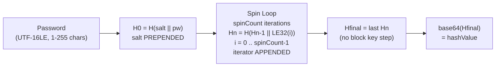
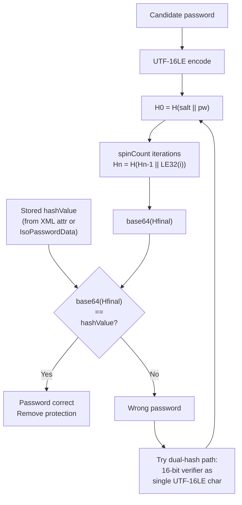
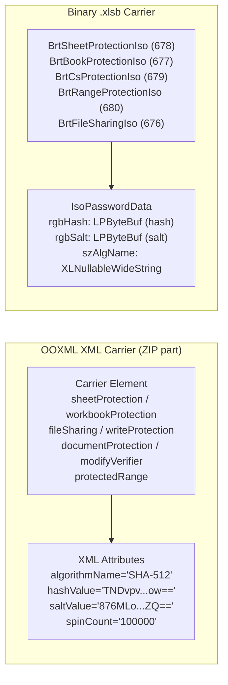

# ISO Write/Sheet/Workbook Protection Hash

⚪ **Edit Barrier Only** — iterated cryptographic hash verifier (salted, no encryption); gates editing, not confidentiality

## Overview

- Single password verifier for document-level editing, write, and modify protection across all OOXML (`.docx`, `.xlsx`, `.pptx` and macro/template variants) and binary `.xlsb` documents
- Produces a verifier digest only — the document body remains plaintext (ZIP or BIFF12), and all parameters (salt, spin count, algorithm name, hash value) are stored in the clear
- Supports 10 hash algorithms (`SHA-512` default in modern Office, `SHA-1` spec default); no cipher, no key — the KDF output is compared directly against the stored `hashValue`
- **CRITICAL**: uses iterator **APPENDED** (`Hn = H(Hn-1 || LE32(i))`), the opposite of [ECMA-376 Agile Encryption](./ecma376-agile.md) which **PREPENDS** (`Hn = H(LE32(i) || Hn-1)`) — confusing the order is the most common implementation error
- Used by: [Word](../../formats/word.md), [Excel](../../formats/excel.md), [PowerPoint](../../formats/powerpoint.md)
- Spec: [MS-OFFCRYPTO] section 2.4.2.4; [MS-XLSB] section 2.2.10

## KDF Pipeline



## Verification Flow



## On-Disk Structure



## Quick Reference

| Parameter | Default | Legal Range |
|---|---|---|
| Hash Algorithm | SHA-1 (spec default) | `MD2`, `MD4`, `MD5`, `RIPEMD-128`, `RIPEMD-160`, `SHA-1`, `SHA-256`, `SHA-384`, `SHA-512`, `WHIRLPOOL` |
| Spin Count | 100,000 (Office) | 0 — 10,000,000 (Word max: 5,000,000) |
| Salt | 16 bytes (typical) | up to 65,536 bytes |
| Password | UTF-16LE | 1 — 255 Unicode characters |
| Iterator encoding | LE32, starts at 0 | **APPENDED** after prior digest |
| Final step | `Hfinal = last Hn` | No block key (contrast with agile) |
| Cipher | None | Verifier only, no encryption |
| Comparison | `base64(Hfinal) == hashValue` | Full digest width |

## Related Algorithms

| Algorithm | Relationship |
|---|---|
| [ECMA-376 Agile](./ecma376-agile.md) | Same initial hash but iterator **PREPENDED** + block key final step |
| [XOR Obfuscation](./xor-obfuscation.md) | Legacy 16-bit verifier; feeds the dual-hash path |
| [Word 2007 documentProtection](./word2007-documentprotection.md) | Legacy three-stage KDF with `cryptAlgorithmSid`; salt APPENDED |
| [ECMA-376 Standard](./ecma376-standard.md) | Document-open encryption predecessor |

## Extraction Target

What your code needs from the carrier element's XML attributes (or `IsoPasswordData` in `.xlsb`):

| Field | XML Attribute | Type | Example |
|---|---|---|---|
| Salt | `saltValue` | base64 -> bytes (typically 16) | `876MLoKTq42+/DLp415iZQ==` |
| Spin count | `spinCount` | decimal integer | `100000` |
| Hash algorithm | `algorithmName` | string | `SHA-512` |
| Stored hash | `hashValue` | base64 -> digest bytes | `TNDvpvYyvlSUy97UOLKNhX...ow==` |

For `<workbookProtection>`, the attributes are prefixed: `workbookAlgorithmName`/`workbookHashValue`/`workbookSaltValue`/`workbookSpinCount` (structure/windows) and `revisionsAlgorithmName`/`revisionsHashValue`/`revisionsSaltValue`/`revisionsSpinCount` (revision tracking).

For `.xlsb`, the same four values are inside the `IsoPasswordData` structure embedded in `Brt*Iso` records:

| Field | Binary Field | Type | Layout |
|---|---|---|---|
| Hash | `rgbHash` | `LPByteBuf` | 4-byte LE length + raw bytes |
| Salt | `rgbSalt` | `LPByteBuf` | 4-byte LE length + raw bytes |
| Algorithm name | `szAlgName` | `XLNullableWideString` | 4-byte LE char count + UTF-16LE |
| Spin count | `dwSpinCount` | u32 LE | 4 bytes at record offset 0 |

**Python function signature this maps to:**

```python
def verify_iso_protection(
    password: str,
    salt: bytes,           # from saltValue (base64-decoded)
    spin_count: int,       # from spinCount
    algo: str,             # from algorithmName (e.g. "SHA-512")
    stored_hash: bytes,    # from hashValue (base64-decoded)
) -> bool: ...
```

---

## 1. What it is and where it is used

The ISO Write Protection Method is the single password verifier for document-level editing, write, and modify protection across OOXML (OPC/ZIP) and binary (.xlsb) Office documents. It is defined normatively in [MS-OFFCRYPTO] section 2.4.2.4 and is designed to be compatible with ISO/IEC 29500 ([ISO/IEC29500-1:2016] sections 18.2.12, 18.2.29, 18.3.1.71, 18.3.1.84, 18.3.1.85) as stated in [MS-XLSB] section 2.2.10.

- The algorithm produces a verifier only: the password gates editing, it does not encrypt the document body
- The package remains a plaintext ZIP (or plaintext BIFF12 records in .xlsb)
- The salt, spin count, algorithm name, and hash value are all stored in the clear within XML attributes or binary record fields

This verifier backs the following Office protection features:

- Word "Read-only recommended / password to modify" (`<w:writeProtection>` in `word/settings.xml`)
- Word "Restrict Editing" enforcement (`<w:documentProtection>` in `word/settings.xml`)
- Excel "Protect Sheet" (`<sheetProtection>` in `xl/worksheets/sheetN.xml`)
- Excel "Protect Chart Sheet" (`<sheetProtection>` in `xl/chartsheets/sheetN.xml`)
- Excel "Protect Workbook Structure/Windows" (`<workbookProtection>` in `xl/workbook.xml`)
- Excel "Allow users to edit ranges" (`<protectedRange>` in `xl/worksheets/sheetN.xml`)
- Excel "Password to modify / write reservation" (`<fileSharing>` in `xl/workbook.xml`)
- PowerPoint "Modify password" (`<p:modifyVerifier>` in `ppt/presentation.xml`)
- All of the above in .xlsb binary form via `BrtSheetProtectionIso`, `BrtBookProtectionIso`, `BrtCsProtectionIso`, `BrtRangeProtectionIso`, `BrtFileSharingIso` records ([MS-XLSB] section 2.2.10)

The ISO verifier is emitted only when the registry key `HKCU\Software\Microsoft\Office\<VERSION>\Common\Security\UseIsoPasswordVerifier` is set to 1 ([MS-OE376] section 2.1.438 note b, section 2.1.621 note e, section 2.1.681 note b, section 2.1.682 note b; [MS-OI29500] section 2.1.402 note f, section 2.1.426 note b, section 2.1.573 note c, section 2.1.586 notes d and e, section 2.1.643 note d, section 2.1.653 note b, section 2.1.654 note b, section 2.1.1104 note f). When the key is not set, Office writes the legacy dialect instead (see section 6.1 below).

Products: Word (.docx/.docm/.dotx), Excel (.xlsx/.xlsm/.xltx/.xltm/.xlsb), PowerPoint (.pptx/.pptm). See `../../formats/word.md`, `../../formats/excel.md`, `../../formats/powerpoint.md`.

Related algorithms:
- The document-open agile encryption KDF (`./ecma376-agile.md`) uses the same `H(salt + password)` initial hash but **prepends** the iterator and appends a block key — the opposite per-round order and an additional final step
- The legacy 16-bit XOR verifier (`./xor-obfuscation.md`, `CreatePasswordVerifier_Method1`) is the pre-ISO binary carrier verifier
- The legacy Word `documentProtection` dialect uses `cryptAlgorithmSid`/`cryptSpinCount`/`hash`/`salt` attributes with a different three-stage algorithm (see section 6.1 and `./word2007-documentprotection.md`)

## 2. Profiles / parameters

All profiles share one KDF (section 5). They differ only in the hash primitive named by `algorithmName` and therefore digest width. There is no cipher and no key: the KDF output is the stored verifier digest compared to `hashValue`.

### 2.1 Reserved `algorithmName` values

The following values are reserved by [MS-OFFCRYPTO] section 2.4.2.4. Values not in this table MAY be used if the OS can resolve them; a compliant implementation is not required to support all defined values ([MS-OFFCRYPTO] section 2.4.2.4, note <27>).

| `algorithmName` | Digest bytes | Reference |
|---|---|---|
| `MD2` | 16 | RFC 1319 |
| `MD4` | 16 | RFC 1320 |
| `MD5` | 16 | RFC 1321 |
| `RIPEMD-128` | 16 | ISO/IEC 10118-3:2004 |
| `RIPEMD-160` | 20 | ISO/IEC 10118-3:2004 |
| `SHA-1` | 20 | RFC 4634 / ISO/IEC 10118-3:2004 |
| `SHA-256` | 32 | RFC 4634 / ISO/IEC 10118-3:2004 |
| `SHA-384` | 48 | RFC 4634 / ISO/IEC 10118-3:2004 |
| `SHA-512` | 64 | RFC 4634 / ISO/IEC 10118-3:2004 |
| `WHIRLPOOL` | 64 | ISO/IEC 10118-3:2004 |

Note: [MS-OE376] sections 2.1.410/2.1.438/2.1.621/2.1.681/2.1.682 and [MS-OI29500] sections 2.1.402/2.1.426/2.1.573/2.1.586/2.1.643/2.1.653/2.1.654/2.1.1104 all repeat the same reserved set and add the advisories: "It is recommended that applications should avoid using [MD2/MD4/MD5/RIPEMD-128] to store new hash values, because of publicly known breaks."

### 2.2 Parameter bounds

| Parameter | Minimum | Maximum | Source |
|---|---|---|---|
| Password length | 1 Unicode character | 255 Unicode characters | [MS-OFFCRYPTO] section 2.4.2.4 |
| Salt size | (not specified) | 65,536 bytes | [MS-OFFCRYPTO] section 2.4.2.4 |
| SpinCount | 0 | 10,000,000 | [MS-OFFCRYPTO] section 2.4.2.4; [MS-XLSX] section 2.6.56 |
| SpinCount (Word) | 0 | 5,000,000 | [MS-OE376] section 2.1.410 note j; [MS-OI29500] section 2.1.402 note d |
| `algorithmName` length | 1 character | (not specified) | [MS-OFFCRYPTO] section 2.4.2.4 |

### 2.3 Default primitive

SHA-1 is the default hashing algorithm if no other algorithms have been configured ([MS-OFFCRYPTO] note <27>: "SHA-1 is the default hashing algorithm if no other algorithms have been configured").

## 3. Byte layout / on-disk structure

### 3.1 OOXML XML carrier elements

The verifier is stored as a set of XML attributes within an element in a package part. Password character encoding is UTF-16LE, no BOM, no NUL terminator. The only integer whose byte order matters on the wire is the per-round iterator, serialized as a 4-byte little-endian unsigned integer ([MS-OFFCRYPTO] section 1.3.6: "All data and structures in this file format are assumed to be in little-endian format").

#### 3.1.1 Carrier element summary

| Carrier element | Package part | Application | Protection gate |
|---|---|---|---|
| `<sheetProtection>` | `xl/worksheets/sheetN.xml` | Excel | Protect Sheet (worksheet) |
| `<sheetProtection>` | `xl/chartsheets/sheetN.xml` | Excel | Protect Sheet (chart sheet) |
| `<protectedRange>` within `<protectedRanges>` | `xl/worksheets/sheetN.xml` | Excel | Allow Edit Ranges (per-range password) |
| `<workbookProtection>` | `xl/workbook.xml` | Excel | Protect Workbook Structure/Windows; shared-workbook revisions |
| `<fileSharing>` | `xl/workbook.xml` | Excel | Modify / write-reservation ("password to modify") |
| `<w:writeProtection>` | `word/settings.xml` | Word | Read-only-recommended / password-to-modify |
| `<w:documentProtection>` | `word/settings.xml` | Word | Restrict Editing (read-only/comments/forms/tracked changes) |
| `<p:modifyVerifier>` | `ppt/presentation.xml` | PowerPoint | Modify password |

#### 3.1.2 XML attribute field table

| Attribute | Wire form | Decoded size | Type | Meaning | Source |
|---|---|---|---|---|---|
| `algorithmName` | `ST_Xstring` (UTF-8) | variable | enum string | Hash primitive selector (see section 2.1 table) | [MS-OFFCRYPTO] section 2.4.2.4 |
| `saltValue` | `base64Binary` | variable (typically 16 bytes; max 65,536 bytes) | raw bytes | Random salt prepended to the UTF-16LE password before the initial hash | [MS-OFFCRYPTO] section 2.4.2.4; [MS-OE376] section 2.1.438: "pre-pended" |
| `hashValue` | `base64Binary` | digest length per `algorithmName` | raw digest bytes | Stored final hash `Hfinal`; equality target for verification | [MS-OFFCRYPTO] section 2.4.2.4 |
| `spinCount` | decimal integer (`unsignedInt`) | n/a | unsigned 32-bit | Iteration count for the hash loop | [MS-OFFCRYPTO] section 2.4.2.4 |
| `password` (legacy) | `ST_UnsignedShortHex` (4 hex digits) | 2 bytes | 16-bit verifier | Mutually exclusive legacy verifier; MUST NOT be present if `algorithmName` is present | [MS-XLSX] section 2.6.56 |

Notes on specific carriers:

- `<workbookProtection>` carries two independent quartets: `workbookAlgorithmName`/`workbookHashValue`/`workbookSaltValue`/`workbookSpinCount` (structure/windows protection) and `revisionsAlgorithmName`/`revisionsHashValue`/`revisionsSaltValue`/`revisionsSpinCount` (revision tracking protection). Each pair is computed independently by the same KDF ([MS-OI29500] section 2.1.586 notes d and e; [MS-OE376] section 2.1.621 notes e and f).
- `<fileSharing>` stores the hash in `hashValue`; if `hashValue` is omitted, the `reservationPassword` attribute contains the legacy 16-bit hash instead ([MS-OI29500] section 2.1.573; [MS-OE376] section 2.1.438).
- `<w:writeProtection>`: if any attribute from the ISO quartet (`algorithmName`, `hashValue`, `spinCount`) is present, Word requires all three to be present; otherwise Word will not open the file ([MS-OI29500] section 2.1.426 note c).
- `<w:documentProtection>`: when both legacy attributes (`cryptAlgorithmSid`/`hash`/`salt`/`cryptSpinCount`) and ISO attributes (`algorithmName`/`hashValue`/`saltValue`/`spinCount`) are present, Word ignores the ISO attributes and uses the legacy set ([MS-OI29500] section 2.1.1775: "Word ignores the additional attributes (algorithmName, hasValue, saltValue, and spinCount) when attributes from [ISO/IEC-29500-1] section 17.15.1.93 are present").
- `<protectedRange>`: attribute `name` MUST be unique within the parent element collection, start with a letter, and contain only letters, numbers, spaces, underscores, periods, backslashes, or question marks; length 1-255 characters ([MS-OI29500] section 2.1.643 notes a and c; [MS-XLSX] section 2.6.56).

#### 3.1.3 XML examples

Excel worksheet (ISO verifier):

```xml
<sheetProtection algorithmName="SHA-512"
                 hashValue="TNDvpvYyvlSUy97UOLKNhXynhUDDA7H8kLql0ISH5SxcP6hbthdjaTo4Z3/MU0dcR2SAd+AduYb3TB5CLZ8+ow=="
                 saltValue="876MLoKTq42+/DLp415iZQ=="
                 spinCount="100000"
                 sheet="1" objects="1" scenarios="1"/>
```

Word write protection (ISO dialect):

```xml
<w:writeProtection
    w:algorithmName="SHA-512"
    w:hashValue="TNDvpvYyvlSUy97UOLKNhXynhUDDA7H8kLql0ISH5SxcP6hbthdjaTo4Z3/MU0dcR2SAd+AduYb3TB5CLZ8+ow=="
    w:saltValue="876MLoKTq42+/DLp415iZQ=="
    w:spinCount="100000"/>
```

Spec example from [MS-OE376] section 2.1.438/2.1.621/2.1.681 and [MS-OI29500] section 2.1.402/2.1.426/2.1.573/2.1.586/2.1.643/2.1.653/2.1.654/2.1.1104:

```xml
<... algorithmName="SHA-1" hashValue="9oN7nWkCAyEZib1RomSJTjmPpCY=" />
```

#### 3.1.4 CT_ProtectedRange XML Schema

From [MS-XLSX] section 2.6.56:

```xml
<xsd:complexType name="CT_ProtectedRange">
  <xsd:sequence maxOccurs="1">
    <xsd:element ref="xm:sqref" minOccurs="1" maxOccurs="1"/>
  </xsd:sequence>
  <xsd:attribute name="password" type="x:ST_UnsignedShortHex" use="optional"/>
  <xsd:attribute name="algorithmName" type="x:ST_Xstring" use="optional"/>
  <xsd:attribute name="hashValue" type="xsd:base64Binary" use="optional"/>
  <xsd:attribute name="saltValue" type="xsd:base64Binary" use="optional"/>
  <xsd:attribute name="spinCount" type="xsd:unsignedInt" use="optional"/>
  <xsd:attribute name="name" type="x:ST_Xstring" use="required"/>
  <xsd:attribute name="securityDescriptor" type="xsd:string" use="optional"/>
</xsd:complexType>
```

If `algorithmName` is present, `hashValue`, `saltValue`, and `spinCount` MUST also be present. `algorithmName` MUST NOT be present if `password` is present ([MS-XLSX] section 2.6.56).

### 3.2 Binary .xlsb carrier

The binary Excel variant carries the identical four values inside binary records that embed the `IsoPasswordData` structure ([MS-XLSB] section 2.5.80). The following records use this structure:

| Record | Record type number | Purpose | Spec section |
|---|---|---|---|
| `BrtSheetProtectionIso` | 678 | Sheet protection (worksheet/dialog/macro) | [MS-XLSB] section 2.4.784 |
| `BrtBookProtectionIso` | 677 | Workbook structure/window protection | [MS-XLSB] section 2.4.309 |
| `BrtCsProtectionIso` | 679 | Chart sheet protection | [MS-XLSB] section 2.4.343 |
| `BrtRangeProtectionIso` | 680 | Protected range | [MS-XLSB] section 2.4.756 |
| `BrtFileSharingIso` | 676 | File sharing / write reservation | [MS-XLSB] section 2.4.672 |

#### 3.2.1 BrtSheetProtectionIso record layout

From [MS-XLSB] section 2.4.784:

| Field | Offset | Size | Type | Meaning |
|---|---|---|---|---|
| `dwSpinCount` | 0 | 4 | unsigned 32-bit LE | Iteration count for hash loop; MUST NOT exceed 10,000,000 |
| `fLocked` | 4 | 4 | Boolean (32-bit) | Worksheet/macro sheet protection enabled (0 or 1) |
| `fObjects` | 8 | 4 | Boolean (32-bit) | Allow editing of objects (0 or 1) |
| `fScenarios` | 12 | 4 | Boolean (32-bit) | Allow editing of scenarios (0 or 1) |
| `fFormatCells` | 16 | 4 | Boolean (32-bit) | Allow formatting of cells |
| `fFormatColumns` | 20 | 4 | Boolean (32-bit) | Allow formatting of columns |
| `fFormatRows` | 24 | 4 | Boolean (32-bit) | Allow formatting of rows |
| `fInsertColumns` | 28 | 4 | Boolean (32-bit) | Allow insertion of columns |
| `fInsertRows` | 32 | 4 | Boolean (32-bit) | Allow insertion of rows |
| `fInsertHyperlinks` | 36 | 4 | Boolean (32-bit) | Allow insertion of hyperlinks |
| `fDeleteColumns` | 40 | 4 | Boolean (32-bit) | Allow deletion of columns |
| `fDeleteRows` | 44 | 4 | Boolean (32-bit) | Allow deletion of rows |
| `fSelLockedCells` | 48 | 4 | Boolean (32-bit) | Allow selection of locked cells |
| `fSort` | 52 | 4 | Boolean (32-bit) | Allow sorting |
| `fAutoFilter` | 56 | 4 | Boolean (32-bit) | Allow AutoFilter |
| `fPivotTables` | 60 | 4 | Boolean (32-bit) | Allow use of PivotTables |
| `fSelUnlockedCells` | 64 | 4 | Boolean (32-bit) | Allow selection of unlocked cells |
| `ipdPasswordData` | 68 | variable | `IsoPasswordData` | Salt, hash algorithm, and password hash |

A `BrtSheetProtectionIso` record MUST be immediately followed by a `BrtSheetProtection` record whose `protpwd` field value MUST be 0x0000 and whose protection-option boolean fields MUST have the same values as the corresponding fields in the `BrtSheetProtectionIso` record ([MS-XLSB] section 2.4.784).

#### 3.2.2 IsoPasswordData structure

From [MS-XLSB] section 2.5.80:

| Field | Type | Layout | Meaning |
|---|---|---|---|
| `rgbHash` | `LPByteBuf` ([MS-XLSB] section 2.5.91) | 4-byte LE length prefix `cb`, then `cb` raw bytes | Password hash `Hfinal`; equivalent to `hashValue`. Size depends on algorithm (20 for SHA-1, 64 for SHA-512, etc.). If nonzero, `szAlgName` MUST contain at least one character. |
| `rgbSalt` | `LPByteBuf` | 4-byte LE length prefix, then raw bytes | Salt bytes; equivalent to `saltValue`. If nonzero, `rgbHash` and `szAlgName` MUST also be non-empty. |
| `szAlgName` | `XLNullableWideString` ([MS-XLSB] section 2.5.167) | 4-byte LE character count, then UTF-16LE characters | Hash algorithm name; equivalent to `algorithmName`. If nonzero, `rgbHash` MUST also be non-empty. |

The `IsoPasswordData` structure is the variable-sized payload that all five `Brt*Iso` records share. The hash is computed using the Strong Password Verifier Algorithm ([MS-XLSB] section 2.2.10), which delegates to [MS-OFFCRYPTO] section 2.4.2.4.

## 4. Password character encoding

- The password is encoded as UTF-16LE bytes (2 bytes per character, low byte first), with no BOM and no NUL terminator, before being passed to the initial hash ([MS-OFFCRYPTO] section 2.4.2.4: "An array of Unicode characters specifying the write protection password")
- For the legacy 16-bit verifier path used in the Password Verifier Algorithm ([MS-XLSB] section 2.2.9), the Unicode password string is first converted to a new character string in the ANSI codepage of the current system using the algorithm specified in the `revisionsPassword` attribute in [ISO/IEC29500-1:2016] section 18.2.29, then that ANSI string is input to `CreatePasswordVerifier_Method1` ([MS-OFFCRYPTO] section 2.3.7.1)

## 5. Key derivation — ordered steps with pseudocode

Authoritative definition: [MS-OFFCRYPTO] section 2.4.2.4 "ISO Write Protection Method". There is no key and no cipher; the KDF output is the verifier digest compared to `hashValue`.

### 5.1 Parameters

- `Password`: array of Unicode characters, 1-255 characters ([MS-OFFCRYPTO] section 2.4.2.4)
- `AlgorithmName`: Unicode string naming the hash algorithm ([MS-OFFCRYPTO] section 2.4.2.4)
- `Salt`: array of bytes, max 65,536 bytes. For new passwords, MUST be generated using an arbitrary pseudorandom function. For verification, use the stored salt. ([MS-OFFCRYPTO] section 2.4.2.4)
- `SpinCount`: unsigned 32-bit integer, max 10,000,000 ([MS-OFFCRYPTO] section 2.4.2.4)

### 5.2 Algorithm

Let `H()` be the hash function specified by `AlgorithmName`. Let `iterator` be an unsigned 32-bit integer. Let `Hn` be the hash data of the nth iteration. Let `+` represent concatenation.

**Step 1 — Initial hash (salt PREPENDED):**

```
H0 = H(salt + password)
```

The salt is prepended to the UTF-16LE-encoded password ([MS-OFFCRYPTO] section 2.4.2.4: "H0 = H(salt + password)"; [MS-OE376] section 2.1.438: "random bytes that are pre-pended to the user-supplied password"; [MS-OI29500] section 2.1.402 note a: "Word prepends the salt attribute to the password"; [MS-OI29500] section 2.1.402 note e: "Word prepends the binary form of the saltValue attribute and not the base64 string representation when hashing").

The initial hash is NOT counted as a spin round ([MS-OE376] section 2.1.410 note g: "the initial hash of the password with the salt not be considered in the count"; [MS-OI29500] section 2.1.402 note b; [MS-OI29500] section 2.1.1104 note d).

**Step 2 — Iterated hash (iterator APPENDED):**

```
Hn = H(Hn-1 + iterator)
```

where `iterator` is initially set to 0 and incremented monotonically on each iteration until `SpinCount` iterations have been performed ([MS-OFFCRYPTO] section 2.4.2.4). The iterator is encoded as a little-endian 32-bit unsigned integer and is APPENDED after the previous digest ([MS-OE376] section 2.1.410 note e: "Count shall begin with 0x0 and is expressed as a little-endian 32-bit integer"; [MS-OI29500] section 2.1.1104 note b). The value of `iterator` on the last iteration MUST be one less than `SpinCount` ([MS-OFFCRYPTO] section 2.4.2.4).

**Step 3 — Final hash:**

```
Hfinal = H(SpinCount-1)
```

The final hash is the result of the last iteration. `hashValue = base64(Hfinal)`.

### 5.3 Pseudocode

```
FUNCTION IsoProtectionHash(Password, AlgorithmName, Salt, SpinCount)
    PARAMETERS
        Password:       array of Unicode characters (1..255 chars)
        AlgorithmName:  Unicode string naming the hash algorithm
        Salt:           array of bytes (max 65,536 bytes)
        SpinCount:      unsigned 32-bit integer (max 10,000,000)
    RETURNS
        array of bytes (digest length depends on AlgorithmName)

    LET H() be the hash function specified by AlgorithmName
    LET pw = Password encoded as UTF-16LE bytes (no BOM, no NUL terminator)

    REM Step 1: Initial hash -- salt PREPENDED to password
    SET H0 = H(Salt + pw)

    REM Step 2: Iterated hash -- iterator APPENDED after previous digest
    SET Hn = H0
    FOR iterator = 0 TO SpinCount - 1
        SET iteratorBytes = iterator encoded as 4-byte little-endian unsigned integer
        SET Hn = H(Hn + iteratorBytes)
    ENDFOR

    REM Step 3: Final hash
    RETURN Hn
END FUNCTION
```

Per-round message size = `digestLength + 4` bytes. For SHA-512: 64 + 4 = 68 bytes (fits in one 1024-bit SHA-512 block). For SHA-1: 20 + 4 = 24 bytes (fits in one 512-bit SHA-1 block).

### 5.4 Python reference implementation

```python
import hashlib
import struct

HASH_FUNCTIONS = {
    "MD2":        None,          # not in hashlib; requires a third-party provider
    "MD4":        "md4",
    "MD5":        "md5",
    "RIPEMD-128": None,          # not in hashlib; requires a third-party provider
    "RIPEMD-160": "ripemd160",
    "SHA-1":      "sha1",
    "SHA-256":    "sha256",
    "SHA-384":    "sha384",
    "SHA-512":    "sha512",
    "WHIRLPOOL":  "whirlpool",
}

def iso_protection_hash(password: str, salt: bytes,
                        spin_count: int, algorithm_name: str) -> bytes:
    """Compute the ISO Write Protection hash per [MS-OFFCRYPTO] section 2.4.2.4."""
    hash_name = HASH_FUNCTIONS[algorithm_name]
    pw = password.encode("utf-16-le")                     # UTF-16LE, no BOM, no NUL
    h = hashlib.new(hash_name, salt + pw).digest()        # H0 = H(salt || pw)
    for i in range(spin_count):                           # i = 0 .. spin_count-1
        h = hashlib.new(hash_name,
                        h + struct.pack("<I", i)).digest() # Hn = H(Hn-1 || LE32(i))
    return h                                               # Hfinal
```

### 5.5 Contrast with agile encryption KDF

The ISO write-protection method and the agile encryption KDF ([MS-OFFCRYPTO] section 2.3.4.11; see `./ecma376-agile.md`) both start from `H(salt + password)` but differ in two critical ways:

| Aspect | ISO protection (this document) | Agile encryption (`./ecma376-agile.md`) |
|---|---|---|
| Per-round order | `Hn = H(Hn-1 + iterator)` — iterator **APPENDED** | `Hn = H(iterator + Hn-1)` — iterator **PREPENDED** |
| Final step | `Hfinal = Hn` (no block key) | `Hfinal = H(Hn + blockKey)` |
| Iterator encoding | 4-byte LE unsigned integer | 4-byte LE unsigned integer |
| Purpose | Verifier only (no encryption) | Derives encryption key material |

Confusing the per-round order is the single most common implementation error.

## 6. Verification procedure — pseudocode

There is no decryption step. Verification is a byte-for-byte comparison of the recomputed digest against the stored `hashValue` over the full digest width.

```
FUNCTION VerifyProtectionPassword(Candidate, AlgorithmName,
                                  SaltValue_base64, HashValue_base64, SpinCount)
    RETURNS Boolean

    SET salt = base64Decode(SaltValue_base64)
    SET storedHash = base64Decode(HashValue_base64)
    SET computedHash = IsoProtectionHash(Candidate, AlgorithmName, salt, SpinCount)
    RETURN constantTimeEqual(computedHash, storedHash)
END FUNCTION
```

Acceptance criterion: "If the two values match, the protection shall no longer be enforced" ([MS-XLSX] section 2.6.56; [MS-OE376] section 2.1.681).

Because the comparison is over the full cryptographic digest width (SHA-512 = 512 bits, SHA-1 = 160 bits, etc.), false positives are cryptographically negligible. This contrasts with the legacy 16-bit verifier, which collides trivially.

### 6.1 Dual-hash caveat

From [MS-XLSX] section 2.6.56: "Password hashes are computed by the algorithm specified in [MS-OFFCRYPTO] section 2.4.2.4. Under circumstances as specified in [MS-OFFCRYPTO] section 1.3.4, the password is first converted to a 16-bit verifier value and reinterpreted as a single Unicode character, which is then passed to the algorithm specified in [MS-OFFCRYPTO] section 2.4.2.4. There is no way to determine which method was used to generate a hash without knowledge of the password; it is necessary to compute both hashes to verify the password."

This is mirrored in [MS-XLSB] section 2.2.10: "Under some circumstances, the password is first converted to a 16-bit verifier value as specified by the Password Verifier Algorithm (section 2.2.9) and reinterpreted as a single Unicode character, which is then passed to the algorithm specified in [MS-OFFCRYPTO] section 2.4.2.4 ISO Write Protection Method."

The 16-bit verifier is computed by `CreatePasswordVerifier_Method1` ([MS-OFFCRYPTO] section 2.3.7.1; see section 7.2 below). The resulting 16-bit value is treated as a single Unicode code point and encoded as a single UTF-16LE character (2 bytes), which becomes the "password" input to the ISO KDF. A complete verification implementation must test both the direct-password path and the 16-bit-verifier-as-single-character path.

The two-stage conversion is described in [MS-XLSB] section 2.2.9: "First, the provided Unicode password string is converted to a new character string in the ANSI codepage of the current system using the algorithm specified in the revisionsPassword attribute in [ISO/IEC29500-1:2016] section 18.2.29. Second, this string is input into the XOR obfuscation algorithm specified in [MS-OFFCRYPTO] section 2.3.7.1 to produce a 16-bit password verifier value."

### 6.2 Legacy Word documentProtection dialect

When Office writes the pre-ISO attributes (`w:cryptAlgorithmSid`/`w:cryptSpinCount`/`w:hash`/`w:salt` on `<w:documentProtection>`), the algorithm differs from the clean iterated hash above. Per [MS-OE376] section 2.1.410:

- Note a: Word adds a third stage where the reversed byte order legacy hash from the second stage is converted to a Unicode hex string representation, and that value is hashed as defined by the attribute values.
- Note e: `H[init] = H(password, salt)`, followed by `cryptSpinCount` cycles where `H[n] = H(H[n-1], count)`. Count begins at 0x0 as a little-endian 32-bit integer.
- Note f: "Word appends the salt attribute to the password" — the opposite salt order from the ISO method where salt is prepended.
- Note g: "the initial hash of the password with the salt not be considered in the count"
- Note h: Word only supports `cryptAlgorithmSid` values 1, 2, 3, 4, 12, 13, and 14.
- Note j: Word only supports `cryptSpinCount` values between 0 and 5,000,000.
- Note k: "Word appends the binary form of the salt attribute and not the base64 string representation when hashing."

When both legacy and ISO attributes are present on `<w:writeProtection>`, Word ignores the ISO attributes ([MS-OI29500] section 2.1.1775: "Word ignores the additional attributes (algorithmName, hasValue, saltValue, and spinCount) when attributes from [ISO/IEC-29500-1] section 17.15.1.93 are present").

PowerPoint's legacy `modifyVerifier` uses `cryptAlgorithmSid` values 1, 2, 3, 4, 12, 13, and 14 ([MS-OI29500] section 2.1.1104 note e) and follows the same pattern ([MS-OI29500] section 2.1.1104 note b).

For the full legacy Word/PowerPoint algorithm, see `./word2007-documentprotection.md`.

## 7. Reference constants

This verifier needs no block keys and no cipher constants. The complete constant set is:

### 7.1 KDF constants

| Constant | Value | Source |
|---|---|---|
| Counter start value | `0x00000000` (0) | [MS-OE376] section 2.1.410 note e; [MS-OI29500] section 2.1.1104 note b; [MS-OFFCRYPTO] section 2.4.2.4 |
| Counter encoding | little-endian unsigned 32-bit integer, APPENDED after prior digest | [MS-OE376] section 2.1.410 note e; [MS-OFFCRYPTO] section 2.4.2.4 |
| Counter on last iteration | `SpinCount - 1` | [MS-OFFCRYPTO] section 2.4.2.4 |
| SpinCount hard maximum | 10,000,000 | [MS-OFFCRYPTO] section 2.4.2.4; [MS-XLSX] section 2.6.56 |
| SpinCount Word maximum | 5,000,000 | [MS-OE376] section 2.1.410 note j; [MS-OI29500] section 2.1.402 note d |
| Salt maximum size | 65,536 bytes | [MS-OFFCRYPTO] section 2.4.2.4 |
| Password length range | 1 to 255 Unicode characters | [MS-OFFCRYPTO] section 2.4.2.4 |
| Default hash primitive | SHA-1 | [MS-OFFCRYPTO] note <27> |
| Password encoding | UTF-16LE, no BOM, no NUL terminator | [MS-OFFCRYPTO] section 2.4.2.4 |

### 7.2 CreatePasswordVerifier_Method1 (for the dual-hash path)

From [MS-OFFCRYPTO] section 2.3.7.1. This produces the 16-bit verifier used in the dual-hash path described in section 6.1 above, as well as in XOR obfuscation (`./xor-obfuscation.md`) and binary document write protection methods 1 and 2.

Final XOR constant: `0xCE4B` ([MS-OFFCRYPTO] section 2.3.7.1).

```
FUNCTION CreatePasswordVerifier_Method1
    PARAMETERS Password    (ASCII string)
    RETURNS 16-bit unsigned integer

    DECLARE Verifier AS 16-bit unsigned integer
    DECLARE PasswordArray AS array of 8-bit unsigned integers

    SET Verifier TO 0x0000
    SET PasswordArray TO (empty array of bytes)
    SET PasswordArray[0] TO Password.Length
    APPEND Password TO PasswordArray

    FOR EACH PasswordByte IN PasswordArray IN REVERSE ORDER
        IF (Verifier BITWISE AND 0x4000) is 0x0000
            SET Intermediate1 TO 0
        ELSE
            SET Intermediate1 TO 1
        ENDIF
        SET Intermediate2 TO Verifier MULTIPLIED BY 2
        SET most significant bit of Intermediate2 TO 0
        SET Intermediate3 TO Intermediate1 BITWISE OR Intermediate2
        SET Verifier TO Intermediate3 BITWISE XOR PasswordByte
    ENDFOR

    RETURN Verifier BITWISE XOR 0xCE4B
END FUNCTION
```

### 7.3 algorithmName digest lengths

Reproduced from section 2.1 for reference:

| `algorithmName` | Digest bytes |
|---|---|
| `MD2` | 16 |
| `MD4` | 16 |
| `MD5` | 16 |
| `RIPEMD-128` | 16 |
| `RIPEMD-160` | 20 |
| `SHA-1` | 20 |
| `SHA-256` | 32 |
| `SHA-384` | 48 |
| `SHA-512` | 64 |
| `WHIRLPOOL` | 64 |

## 8. Security considerations

### 8.1 Write protection is not a security mechanism

[MS-OFFCRYPTO] section 4.1.4: "Document write protection is not considered to be a security mechanism, and the write protection can easily be removed by using a binary editor. Document write protection is meant to protect against accidental modification only."

[MS-XLSB] section 4: "The password verifier features available in the file format (see section 2.2.9 and section 2.2.10) are used to prevent accidental modification, rather than being used as security features. It is possible to remove the passwords by removing the records containing the verifier values."

[MS-XLSB] section 2.2.10: "This password hash is used to prevent accidental editing, and is not designed to be used as a security feature."

### 8.2 Plaintext password storage in binary formats

[MS-OFFCRYPTO] section 4.1.4: "Document write protection methods 1 (section 2.4.2.1) and 3 (section 2.4.2.3) both embed the password in plaintext into the file."

[MS-OFFCRYPTO] section 2.4.2.1: Binary documents conforming to [MS-DOC] MUST store the write protection password in the file in plaintext.

[MS-OFFCRYPTO] section 2.4.2.3: Binary documents conforming to [MS-PPT] MUST store the write protection password in plaintext. When encrypted without a user-supplied password, the fixed default password `"\x2f\x30\x31\x48\x61\x6e\x6e\x65\x73\x20\x52\x75\x65\x73\x63\x68\x65\x72\x2f\x30\x31"` is used.

### 8.3 Password length restrictions and collisions

[MS-OFFCRYPTO] section 4.1.4: "Some file formats, such as those described in [MS-DOC] and [MS-XLS], restrict password length to 15 characters. It is possible for multiple passwords to map to the same key when using document write protection method 2 (section 2.4.2.2)."

### 8.4 Unicode-to-ANSI conversion weakness

[MS-XLSB] section 4: "The translation of passwords from a double-byte Unicode string to a new character string in the ANSI codepage of the current system converts any Unicode character that cannot be mapped to the ANSI codepage of the current system to the 0x3F character in that codepage ([ISO/IEC29500-1:2016], section 18.2.29). Replacing these characters with 0x3F when the hash is verified will generate positive hash value matches. In certain locales this can be a significant portion of the everyday character set."

### 8.5 Deprecated hash algorithms

[MS-OE376] sections 2.1.410/2.1.438/2.1.621/2.1.681/2.1.682 and [MS-OI29500] sections 2.1.402/2.1.426/2.1.573/2.1.586/2.1.643/2.1.653/2.1.654/2.1.1104 note for MD2, MD4, MD5, and RIPEMD-128: "It is recommended that applications should avoid using this algorithm to store new hash values, because of publicly known breaks."

### 8.6 Word enforcement attribute behavior

[MS-OE376] section 2.1.410 note i and [MS-OI29500] section 2.1.402 note c: "Word enforces protection when this [enforcement] attribute is missing." This means that omitting the `enforcement` attribute does not disable protection in Word, contrary to what the standard states.

### 8.7 Dialog sheet protection constraints

For a `dialogsheet` parent element, Office requires that the dialog sheet is protected when the `objects` and `scenarios` attributes are true, and not protected when both are false. No other combination is allowed. The `sheet` attribute is always true and all other attributes are their default value ([MS-OI29500] section 2.1.654 note a; [MS-OE376] section 2.1.681 note a).

## 9. Spec references

### 9.1 Primary algorithm definition

- [MS-OFFCRYPTO] section 2.4.2.4 — "ISO Write Protection Method": authoritative KDF definition with `H0 = H(salt + password)`, `Hn = H(Hn-1 + iterator)`, iterator 0-based LE, last value `SpinCount-1`; `AlgorithmName` reserved table; salt max 65,536 bytes; `SpinCount` max 10,000,000; password 1-255 Unicode characters
- [MS-OFFCRYPTO] note <27> — SHA-1 default: "SHA-1 is the default hashing algorithm if no other algorithms have been configured"

### 9.2 Write protection overview and binary methods

- [MS-OFFCRYPTO] section 1.3.4 — Write protection overview (binary formats: .xls uses 16-bit verifier + encryption, .doc stores plaintext, .ppt stores plaintext + optional encryption)
- [MS-OFFCRYPTO] section 2.4 — Document Write Protection (umbrella section)
- [MS-OFFCRYPTO] section 2.4.1 — ECMA-376 Document Write Protection (pointer to ECMA-376 Part 4 sections 2.15.1.28, 2.15.1.94, 3.2.12, 4.3.1.17)
- [MS-OFFCRYPTO] section 2.4.2 — Binary Document Write Protection (methods 1-3 for .doc/.xls/.ppt)
- [MS-OFFCRYPTO] section 2.4.2.4 — ISO Write Protection Method (this algorithm)

### 9.3 16-bit verifier (dual-hash path)

- [MS-OFFCRYPTO] section 2.3.7.1 — `CreatePasswordVerifier_Method1` (16-bit verifier, `0xCE4B` XOR)
- [MS-OFFCRYPTO] section 1.3.6 — Little-endian byte ordering

### 9.4 Security

- [MS-OFFCRYPTO] section 4.1.4 — Document Write Protection security considerations
- [MS-XLSB] section 4 — Security Considerations (password verifier not a security feature; Unicode-to-ANSI weakness)

### 9.5 ECMA-376 carrier elements (Word)

- [MS-OE376] section 2.1.410 — `documentProtection` (Part 4 section 2.15.1.28): legacy three-stage KDF notes (a, e-k), `cryptAlgorithmSid` supported values, `spinCount` Word clamp 0-5,000,000, salt-append for legacy dialect, ISO attribute table
- [MS-OE376] section 2.1.438 — `writeProtection` (Part 4 section 2.15.1.94): ISO attribute table, `saltValue` "pre-pended", `UseIsoPasswordVerifier` registry key gate
- [MS-OI29500] section 2.1.402 — `documentProtection` (Part 1 section 17.15.1.29): salt prepend, spinCount initial-hash exclusion, enforcement behavior, spinCount 0-10,000,000, saltValue binary form, ISO attribute table
- [MS-OI29500] section 2.1.426 — `writeProtection` (Part 1 section 17.15.1.93): ISO attribute table, `UseIsoPasswordVerifier` gate, required attributes (`algorithmName`, `hashValue`, `spinCount`)
- [MS-OI29500] section 2.1.1775 — Part 4 section 14.8.2.5: Word ignores ISO attributes when legacy attributes are present

### 9.6 ECMA-376 carrier elements (Excel)

- [MS-OE376] section 2.1.621 — `workbookProtection` (Part 4 section 3.2.29): ISO attribute table, `UseIsoPasswordVerifier` gate, structure/window vs. revision password distinction
- [MS-OE376] section 2.1.681 — `sheetProtection` (Part 4 section 3.3.1.81, Sheet Protection Options): ISO attribute table, `UseIsoPasswordVerifier` gate, dialog sheet constraints
- [MS-OE376] section 2.1.682 — `sheetProtection` (Part 4 section 3.3.1.82, Chart Sheet Protection): ISO attribute table, `UseIsoPasswordVerifier` gate
- [MS-OI29500] section 2.1.573 — `fileSharing` (Part 1 section 18.2.12): ISO attribute table, `UseIsoPasswordVerifier` gate, `userName` length 1-54 characters
- [MS-OI29500] section 2.1.586 — `workbookProtection` (Part 1 section 18.2.29): ISO attribute table, `UseIsoPasswordVerifier` gate, dual password quartets (workbook + revisions)
- [MS-OI29500] section 2.1.643 — `protectedRange` (Part 1 section 18.3.1.71): ISO attribute table, `UseIsoPasswordVerifier` gate, name constraints
- [MS-OI29500] section 2.1.653 — `sheetProtection` (Part 1 section 18.3.1.84, Chart Sheet Protection): ISO attribute table, `UseIsoPasswordVerifier` gate
- [MS-OI29500] section 2.1.654 — `sheetProtection` (Part 1 section 18.3.1.85, Sheet Protection Options): ISO attribute table, `UseIsoPasswordVerifier` gate, dialog sheet constraints

### 9.7 ECMA-376 carrier elements (PowerPoint)

- [MS-OI29500] section 2.1.1104 — `modifyVerifier` (Part 1 section 19.2.1.19): ISO attribute table, `cryptAlgorithmSid` values 1/2/3/4/12/13/14 for legacy, `UseIsoPasswordVerifier` gate, salt as base64-encoded random data (typically 16 bytes)

### 9.8 Excel extensions (OOXML and binary)

- [MS-XLSX] section 2.6.55 — `CT_ProtectedRanges`: container for protected range elements
- [MS-XLSX] section 2.6.56 — `CT_ProtectedRange`: XML schema with `password`/`algorithmName`/`hashValue`/`saltValue`/`spinCount` attributes; hash computation reference to [MS-OFFCRYPTO] section 2.4.2.4; dual-hash caveat; `spinCount` max 10,000,000
- [MS-XLSB] section 2.2.9 — Password Verifier Algorithm (16-bit legacy verifier for binary carriers)
- [MS-XLSB] section 2.2.10 — Strong Password Verifier Algorithm (ISO-compatible hash for binary carriers)
- [MS-XLSB] section 2.4.784 — `BrtSheetProtectionIso` record layout
- [MS-XLSB] section 2.4.309 — `BrtBookProtectionIso` record
- [MS-XLSB] section 2.4.343 — `BrtCsProtectionIso` record
- [MS-XLSB] section 2.4.756 — `BrtRangeProtectionIso` record
- [MS-XLSB] section 2.4.672 — `BrtFileSharingIso` record
- [MS-XLSB] section 2.5.80 — `IsoPasswordData` structure
- [MS-XLSB] section 2.5.91 — `LPByteBuf` (length-prefixed byte buffer)
- [MS-XLSB] section 2.5.167 — `XLNullableWideString`

### 9.9 Related algorithm documents

- `./ecma376-agile.md` — ECMA-376 Agile Encryption (document-open, prepended iterator, block key)
- `./ecma376-standard.md` — ECMA-376 Standard Encryption
- `./xor-obfuscation.md` — XOR Obfuscation and legacy 16-bit verifier (`CreatePasswordVerifier_Method1`)
- `./word2007-documentprotection.md` — Word 2007 documentProtection legacy dialect (three-stage KDF with `cryptAlgorithmSid`)
- `../non-password/irm-rms-encryption.md` — IRM/RMS encryption (separate protection mechanism)
- `../../formats/word.md` — Word format reference
- `../../formats/excel.md` — Excel format reference
- `../../formats/powerpoint.md` — PowerPoint format reference
