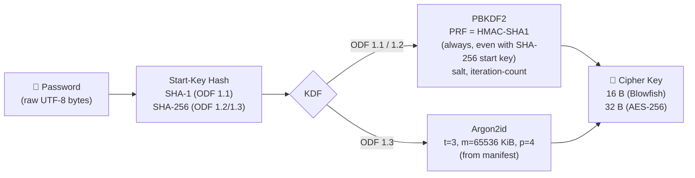
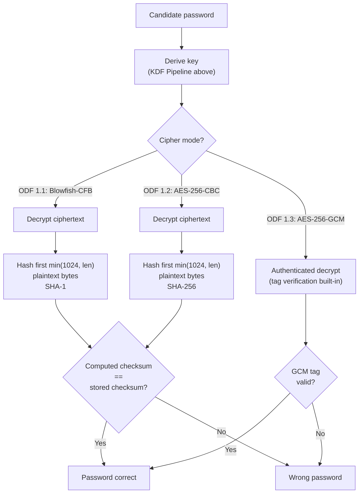
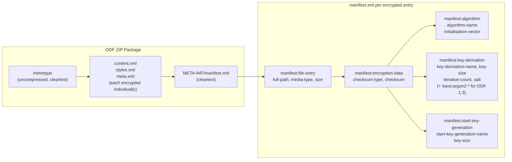

# OpenDocument (ODF) Encryption

🟡 **Real Encryption (variable strength)** — password-based per-stream encryption for ODF packages; ODF 1.1 is weak (Blowfish/1024 iterations), ODF 1.2 is moderate (AES-256/100K PBKDF2), ODF 1.3 is strong (AES-256-GCM/Argon2id)

## Overview

- Document-open encryption for all OpenDocument Format files (`.odt`, `.ods`, `.odp`, `.odg`, `.odb`, `.odf` and template variants `.ott`, `.ots`, `.otp`, `.otg`)
- Three distinct profiles tied to ODF versions: ODF 1.1 (Blowfish-CFB/SHA-1/PBKDF2), ODF 1.2 (AES-256-CBC/SHA-256/PBKDF2), ODF 1.3 (AES-256-GCM/SHA-256/Argon2id)
- Per-stream encryption: each package member is individually encrypted; ZIP directory, filenames, and `META-INF/manifest.xml` remain in cleartext
- Password encoded as raw UTF-8 bytes (not UTF-16LE) — the single biggest divergence from all MS Office encryption formats
- Microsoft Office does not implement ODF encryption in any version (Office 2007 through Office 365)
- Used by: [OpenDocument](../../formats/opendocument.md) (LibreOffice, Apache OpenOffice, Calligra, GNOME Documents)
- Spec: OASIS ODF 1.1 SS17.3–17.7, ODF 1.2 Part 3 SS3.4, ODF 1.3 Part 2 SS3.4; `[MS-OODF*]` documents confirm "not supported" only

## KDF Pipeline



## Verification Flow



## On-Disk Structure



## Quick Reference

| Parameter | ODF 1.1 | ODF 1.2 | ODF 1.3 |
|---|---|---|---|
| Start-Key Hash | SHA-1 (20 B) | SHA-256 (32 B) | SHA-256 (32 B) |
| KDF | PBKDF2 (HMAC-SHA1) | PBKDF2 (HMAC-SHA1) | Argon2id |
| Iterations | 1024 | 100,000 | t=3, m=64 MiB, p=4 |
| Cipher | Blowfish / CFB-64 | AES-256 / CBC | AES-256 / GCM |
| Key Size | 16 bytes (128-bit) | 32 bytes (256-bit) | 32 bytes (256-bit) |
| IV Size | 8 bytes | 16 bytes | 12 bytes (nonce) |
| Salt | 16 bytes | 16 bytes | 16 bytes |
| Verification | SHA-1/1K checksum | SHA-256/1K checksum | GCM auth tag (16 B) |
| Password | UTF-8 | UTF-8 | UTF-8 |
| Container | ZIP (ODF) | ZIP (ODF) | ZIP (ODF) |

## Extraction Target

Fields to extract from `META-INF/manifest.xml` for the first encrypted `<manifest:file-entry>`:

| Field | Manifest Element | Manifest Attribute | Type | Example (ODF 1.2) |
|---|---|---|---|---|
| Salt | `manifest:key-derivation` | `manifest:salt` | base64 -> 16 bytes | `Nqj8Y...==` |
| Iteration count | `manifest:key-derivation` | `manifest:iteration-count` | decimal integer | `100000` |
| Key size | `manifest:key-derivation` | `manifest:key-size` | decimal integer | `32` |
| IV | `manifest:algorithm` | `manifest:initialisation-vector` | base64 -> 8/16/12 bytes | `A1B2C3...==` |
| Cipher name | `manifest:algorithm` | `manifest:algorithm-name` | URI string | `urn:oasis:...:aes256-cbc` |
| Checksum | `manifest:encryption-data` | `manifest:checksum` | base64 -> 20/32 bytes | `xYz9...==` |
| Checksum type | `manifest:encryption-data` | `manifest:checksum-type` | URI string | `urn:oasis:...:sha256-1k` |
| Start-key algo | `manifest:start-key-generation` | `manifest:start-key-generation-name` | URI string | `http://...xmldsig#sha256` |
| Ciphertext | (raw ZIP entry bytes) | n/a | raw bytes | (encrypted stream) |
| Uncompressed size | `manifest:file-entry` | `manifest:size` | decimal integer | `27017` |

ODF 1.3 additional fields (Argon2id):

| Field | Manifest Element | Manifest Attribute | Type | Example |
|---|---|---|---|---|
| Argon2 time cost | `manifest:key-derivation` | `loext:argon2-iterations` | decimal integer | `3` |
| Argon2 memory cost | `manifest:key-derivation` | `loext:argon2-memory` | decimal integer | `65536` |
| Argon2 parallelism | `manifest:key-derivation` | `loext:argon2-lanes` | decimal integer | `4` |

**Python function signature this maps to:**

```python
def verify_odf(
    password: str,
    salt: bytes,              # from manifest:key-derivation.salt
    iterations: int,          # from manifest:key-derivation.iteration-count
    iv: bytes,                # from manifest:algorithm.initialisation-vector
    ciphertext: bytes,        # raw ZIP entry bytes for the encrypted stream
    stored_checksum: bytes,   # from manifest:encryption-data.checksum
    profile: str,             # "odf11" | "odf12" | "odf13"
) -> bool: ...
```

---

## 1. What it is and where it is used

Password-based per-stream encryption for OpenDocument Format packages, defined by OASIS ODF Parts 1 and 3 (not by Microsoft). The `[MS-OODF*]` specifications document only Microsoft's implementation notes, which uniformly state that ODF encryption is not supported.

ODF encryption is the document-open protection mechanism for OpenDocument Format files (`.odt`, `.ods`, `.odp`, `.odg`, `.odb`, `.odf` and their template variants `.ott`, `.ots`, `.otp`, `.otg`). See [opendocument.md](../../formats/opendocument.md) for the container and gate details. The encryption scheme is defined by the OASIS OpenDocument Format specification, not by Microsoft's Open Specifications. The `[MS-OODF*]` family of documents (`[MS-OODF]`, `[MS-OODF2]`, `[MS-OODF3]`, `[MS-OODF13]`, `[MS-OODF14]`) serve exclusively as implementation-support matrices: they enumerate each OASIS ODF section and state whether Microsoft Office supports it. For encryption, the answer is uniformly "not supported."

**Microsoft Office support status per `[MS-OODF*]`:**

| MS Spec | OASIS Section | Product | Statement |
|---|---|---|---|
| `[MS-OODF] §2.1.981` | ODF 1.1 §17.3, Encryption | Word/Excel/PowerPoint 2007 | "This is not supported" |
| `[MS-OODF] §2.1.989–2.1.991` | ODF 1.1 §17.7.4 Encryption Data, §17.7.5 Algorithm, §17.7.6 Key Derivation | Word/Excel/PowerPoint 2007 | "This is not supported" |
| `[MS-OODF2] §2.1.955` | ODF 1.1 v2 §17.3, Encryption | Word/Excel/PowerPoint 2010/2013/2016/2019 | "This is not supported" |
| `[MS-OODF2] §2.1.963–2.1.965` | ODF 1.1 v2 §17.7.4 Encryption Data, §17.7.5 Algorithm, §17.7.6 Key Derivation | Word/Excel/PowerPoint 2010/2013/2016/2019 | "This is not supported" |
| `[MS-OODF13] §2.1.1346` | ODF 1.3 Part 2 §3.4, Encryption | Word/Excel/PowerPoint 2013 or later | "Encryption is not supported for ODF file types" |
| `[MS-OODF13] §2.1.1347` | ODF 1.3 Part 2 §3.9, Interactions Between Encryption and Digital Signatures | Word/Excel/PowerPoint 2013 or later | "Encryption is not supported for ODF file types" |
| `[MS-OODF13] §2.1.1348` | ODF 1.3 Part 2 §4.16.3, manifest:checksum-type | Word/Excel/PowerPoint 2013 or later | "This attribute is not supported" |
| `[MS-OODF13] §2.1.1349–2.1.1357` | ODF 1.3 Part 2 §4.8–4.17 (encrypted-key, encryption-method, keyinfo, PGPData, PGPKeyID, PGPKeyPacket, CipherData, CipherValue, PGPAlgorithm) | Word/Excel/PowerPoint 2013 or later | "This element/attribute is not supported" |
| `[MS-OODF14] §2.1.1364` | ODF 1.4 Part 2 §3.4, Encryption | Word/Excel/PowerPoint 2013 or later | "Encryption is not supported for ODF file types" |
| `[MS-OODF14] §2.1.1365` | ODF 1.4 Part 2 §3.9, Interactions Between Encryption and Digital Signatures | Word/Excel/PowerPoint 2013 or later | "Encryption is not supported for ODF file types" |
| `[MS-OODF14] §2.1.1366–2.1.1375` | ODF 1.4 Part 2 §4.8–4.17 (all encryption manifest elements/attributes) | Word/Excel/PowerPoint 2013 or later | "This element/attribute is not supported" |

Because the `[MS-OODF*]` specs reproduce no algorithm details, byte layouts, URI literals, or cryptographic constants, the remainder of this document derives from the authoritative OASIS specifications (ODF 1.1 §17.3–17.7, ODF 1.2/1.3 Part 3 §3.4 and Part 2 §4.8–4.17) and from the W3C and IETF standards those sections reference (RFC 2898 for PBKDF2, RFC 9106 for Argon2). Every claim below is attributed to the OASIS spec section it comes from; the `[MS-OODF*]` citations are limited to the "not supported" confirmations already tabulated above.

The scheme derives a symmetric key from the password through a start-key hash followed by a key-stretch (PBKDF2-HMAC-SHA1, or Argon2id in ODF 1.3), decrypts each package member stream, and confirms the guess by re-hashing the decrypted plaintext against a stored checksum (or, for AES-GCM in ODF 1.3, by verifying the GCM authentication tag). One password gates the entire package; there is no separate modify/write password, per-sheet protection hash, or macro-vault password in this container.

This algorithm is unrelated to ECMA-376 / `[MS-OFFCRYPTO]` encryption ([ecma376-agile.md](./ecma376-agile.md), [ecma376-standard.md](./ecma376-standard.md), [rc4-cryptoapi-sha1.md](./rc4-cryptoapi-sha1.md), [rc4-md5-legacy.md](./rc4-md5-legacy.md), [xor-obfuscation.md](./xor-obfuscation.md)). Those formats use OLE/CFB containers, UTF-16LE password encoding, and the `\EncryptionInfo` / `\EncryptedPackage` stream structure. ODF uses a ZIP container, UTF-8 password encoding, and per-stream encryption with parameters in `META-INF/manifest.xml`.

## 2. Profiles / parameters

ODF encryption has three concrete profiles, each bound to an ODF version. The OASIS schema defines the start-key, KDF, cipher, and checksum axes independently, so a manifest may legally combine them in ways not shown below; however, the three rows represent the standard combinations produced by conforming implementations.

| Profile | ODF version | Start-key hash | KDF (PRF) | Default iterations | Key size | Cipher / mode | IV size | Checksum | Password encoding |
|---|---|---|---|---|---|---|---|---|---|
| **ODF 1.1** | ODF 1.1 (OASIS 2007) §17.3 | SHA-1 (20 bytes) | PBKDF2 (HMAC-SHA1) | 1024 | 16 bytes | Blowfish / CFB-64 | 8 bytes | SHA-1/1K (20 bytes) | UTF-8 |
| **ODF 1.2** | ODF 1.2 Part 3 §3.4 | SHA-256 (32 bytes) | PBKDF2 (HMAC-SHA1) | 100000 | 32 bytes | AES-256 / CBC | 16 bytes | SHA-256/1K (32 bytes) | UTF-8 |
| **ODF 1.3** | ODF 1.3 Part 2 §3.4 | SHA-256 (32 bytes) | Argon2id (t=3, m=65536 KiB, p=4) | t/m/p from manifest | 32 bytes | AES-256 / GCM | 12 bytes (nonce) | GCM auth tag (16 bytes) | UTF-8 |

Key cross-profile facts:

- The PBKDF2 PRF is always HMAC-SHA1, even in the ODF 1.2 profile where SHA-256 is used for the start-key pre-hash and the checksum. SHA-256 is never the PBKDF2 PRF. Per OASIS ODF 1.2 Part 3 §3.4.2 and RFC 2898 §5.2.
- The PBKDF2 salt is 16 bytes in every profile. Per OASIS ODF 1.2 Part 3 §3.4.2.
- The password is encoded as its raw UTF-8 bytes, not UTF-16LE. No BOM, no NUL terminator, no length prefix. This is the single biggest divergence from MS Office encryption formats ([ecma376-agile.md](./ecma376-agile.md), [ecma376-standard.md](./ecma376-standard.md)), which uniformly use UTF-16LE. Per OASIS ODF 1.2 Part 3 §3.4.2.
- The iteration-count attribute is a decimal integer in the manifest XML. Per OASIS ODF 1.2 Part 3 §4.8.4.
- For ODF 1.3, the Argon2id parameters (time cost, memory cost in KiB, parallelism lanes) are carried as separate manifest attributes. Per ODF 1.3 Part 2 §3.4 and the LibreOffice ODF 1.3 extended manifest namespace.

## 3. Byte layout / where the material lives

### 3.1 Container structure

The container is ODF-ZIP: a plain ZIP archive whose first entry is an uncompressed `mimetype` member. There is no OLE/CFB compound file, no OPC `[Content_Types].xml`, and no monolithic `EncryptedPackage` blob. Per OASIS ODF 1.1 §17.2 and ODF 1.2 Part 3 §2.

### 3.2 Per-stream encryption

Encryption is per-stream: each non-metadata member (`content.xml`, `styles.xml`, `meta.xml`, embedded objects, images) is individually DEFLATE-compressed (raw deflate, no zlib wrapper) and then encrypted in place within the ZIP archive. The ZIP central directory, the `mimetype` member, the member file names, and `META-INF/manifest.xml` itself all remain in cleartext. Per OASIS ODF 1.1 §17.3 and ODF 1.2 Part 3 §3.4.

### 3.3 Manifest XML structure

All cryptographic parameters are XML attributes on elements within `META-INF/manifest.xml`, namespaced as `urn:oasis:names:tc:opendocument:xmlns:manifest:1.0`. Each encrypted stream has its own `<manifest:file-entry>` containing a `<manifest:encryption-data>` element with child elements for the algorithm, key derivation, and (in ODF 1.2+) start-key generation. Per OASIS ODF 1.1 §17.7 and ODF 1.2 Part 3 §4.

Representative ODF 1.2 manifest fragment:

```xml
<manifest:file-entry manifest:full-path="content.xml"
                     manifest:media-type="text/xml"
                     manifest:size="27017">
  <manifest:encryption-data
      manifest:checksum-type="urn:oasis:names:tc:opendocument:xmlns:manifest:1.0#sha256-1k"
      manifest:checksum="BASE64_ENCODED_32_BYTES">
    <manifest:algorithm
        manifest:algorithm-name="urn:oasis:names:tc:opendocument:xmlns:manifest:1.0#aes256-cbc"
        manifest:initialisation-vector="BASE64_ENCODED_16_BYTES"/>
    <manifest:key-derivation
        manifest:key-derivation-name="PBKDF2"
        manifest:key-size="32"
        manifest:iteration-count="100000"
        manifest:salt="BASE64_ENCODED_16_BYTES"/>
    <manifest:start-key-generation
        manifest:start-key-generation-name="http://www.w3.org/2000/09/xmldsig#sha256"
        manifest:key-size="32"/>
  </manifest:encryption-data>
</manifest:file-entry>
```

Representative ODF 1.1 manifest fragment (the `<manifest:start-key-generation>` element is absent; SHA-1 is implicit):

```xml
<manifest:file-entry manifest:full-path="content.xml"
                     manifest:media-type="text/xml"
                     manifest:size="12345">
  <manifest:encryption-data
      manifest:checksum-type="SHA1/1K"
      manifest:checksum="BASE64_ENCODED_20_BYTES">
    <manifest:algorithm
        manifest:algorithm-name="Blowfish CFB"
        manifest:initialisation-vector="BASE64_ENCODED_8_BYTES"/>
    <manifest:key-derivation
        manifest:key-derivation-name="PBKDF2"
        manifest:key-size="16"
        manifest:iteration-count="1024"
        manifest:salt="BASE64_ENCODED_16_BYTES"/>
  </manifest:encryption-data>
</manifest:file-entry>
```

Representative ODF 1.3 manifest fragment (Argon2id + AES-256-GCM):

```xml
<manifest:file-entry manifest:full-path="content.xml"
                     manifest:media-type="text/xml"
                     manifest:size="27017">
  <manifest:encryption-data>
    <manifest:algorithm
        manifest:algorithm-name="http://www.w3.org/2009/xmlenc11#aes256-gcm"
        manifest:initialisation-vector="BASE64_ENCODED_12_BYTES"/>
    <manifest:key-derivation
        manifest:key-derivation-name="urn:org:documentfoundation:names:experimental:office:manifest:argon2id"
        manifest:key-size="32"
        loext:argon2-iterations="3"
        loext:argon2-memory="65536"
        loext:argon2-lanes="4"
        manifest:salt="BASE64_ENCODED_16_BYTES"/>
    <manifest:start-key-generation
        manifest:start-key-generation-name="http://www.w3.org/2000/09/xmldsig#sha256"
        manifest:key-size="32"/>
  </manifest:encryption-data>
</manifest:file-entry>
```

### 3.4 Manifest field table

All Base64-encoded values decode to raw byte strings consumed verbatim. The `iteration-count` and `key-size` values are decimal ASCII text. There is no container-level byte-order concern since there is no binary header.

| Field | Manifest element | Manifest attribute | Decoded size | Encoding | Meaning |
|---|---|---|---|---|---|
| Cipher identifier | `manifest:algorithm` | `manifest:algorithm-name` | n/a | URI or short string | Identifies the cipher: Blowfish CFB, AES-256-CBC, or AES-256-GCM |
| Initialization vector | `manifest:algorithm` | `manifest:initialisation-vector` | 8 (Blowfish) / 16 (AES-CBC) / 12 (AES-GCM) | Base64 -> raw bytes | CFB feedback register initial value / CBC IV / GCM nonce |
| Checksum type | `manifest:encryption-data` | `manifest:checksum-type` | n/a | URI or short string | SHA-1/1K, SHA-256/1K, or (for GCM) absent/unused |
| Checksum value | `manifest:encryption-data` | `manifest:checksum` | 20 (SHA-1) / 32 (SHA-256) | Base64 -> raw bytes | Digest of the first min(1024, len) plaintext bytes |
| KDF identifier | `manifest:key-derivation` | `manifest:key-derivation-name` | n/a | String literal | `PBKDF2` or `urn:org:documentfoundation:names:experimental:office:manifest:argon2id` |
| Salt | `manifest:key-derivation` | `manifest:salt` | 16 (typical) | Base64 -> raw bytes | PBKDF2 or Argon2 salt |
| Iteration count | `manifest:key-derivation` | `manifest:iteration-count` | n/a | Decimal ASCII | PBKDF2 rounds (1024 or 100000 typical) |
| Key size | `manifest:key-derivation` | `manifest:key-size` | n/a | Decimal ASCII | Derived key length in bytes: 16 (Blowfish) or 32 (AES) |
| Start-key algorithm | `manifest:start-key-generation` | `manifest:start-key-generation-name` | n/a | URI string | SHA-1 or SHA-256 pre-hash of the password |
| Start-key size | `manifest:start-key-generation` | `manifest:key-size` | n/a | Decimal ASCII | 20 (SHA-1) or 32 (SHA-256) |
| Argon2 time cost | `manifest:key-derivation` | `loext:argon2-iterations` | n/a | Decimal ASCII | Argon2id passes (typically 3) |
| Argon2 memory cost | `manifest:key-derivation` | `loext:argon2-memory` | n/a | Decimal ASCII | Argon2id memory in KiB (typically 65536 = 64 MiB) |
| Argon2 parallelism | `manifest:key-derivation` | `loext:argon2-lanes` | n/a | Decimal ASCII | Argon2id lanes (typically 4) |
| Uncompressed size | `manifest:file-entry` | `manifest:size` | n/a | Decimal ASCII | Size of the original uncompressed plaintext before DEFLATE+encryption |
| Ciphertext | (raw ZIP entry bytes) | n/a | file size | Raw bytes | Encrypted DEFLATE-compressed stream |

Per OASIS ODF 1.1 §17.7.3–17.7.6, ODF 1.2 Part 3 §4.4–4.8, and ODF 1.3 Part 2 §4.8–4.17.

### 3.5 Manifest URI/name literals

The following URI strings identify each algorithm component in the manifest. Per OASIS ODF 1.1 §17.7.5–17.7.6, ODF 1.2 Part 3 §4.6–4.8, and ODF 1.3 Part 2.

**`manifest:algorithm-name` values:**

| Value | Cipher |
|---|---|
| `Blowfish CFB` | Blowfish in CFB-64 mode (ODF 1.1) |
| `urn:oasis:names:tc:opendocument:xmlns:manifest:1.0#blowfish` | Blowfish in CFB-64 mode (alternate URI form) |
| `urn:oasis:names:tc:opendocument:xmlns:manifest:1.0#aes256-cbc` | AES-256 in CBC mode (ODF 1.2) |
| `http://www.w3.org/2009/xmlenc11#aes256-gcm` | AES-256 in GCM mode (ODF 1.3) |

**`manifest:checksum-type` values:**

| Value | Checksum |
|---|---|
| `SHA1/1K` | SHA-1 over the first min(1024, len) plaintext bytes (ODF 1.1) |
| `urn:oasis:names:tc:opendocument:xmlns:manifest:1.0#sha256-1k` | SHA-256 over the first min(1024, len) plaintext bytes (ODF 1.2) |
| `urn:oasis:names:tc:opendocument:xmlns:manifest:1.0#sha1-1k` | SHA-1 over the first min(1024, len) plaintext bytes (alternate URI) |
| `urn:oasis:names:tc:opendocument:xmlns:manifest:1.0#sha256` | SHA-256 over the full plaintext (non-`/1K` variant) |
| `urn:oasis:names:tc:opendocument:xmlns:manifest:1.0#sha1` | SHA-1 over the full plaintext (non-`/1K` variant) |

**`manifest:key-derivation-name` values:**

| Value | KDF |
|---|---|
| `PBKDF2` | PBKDF2 per RFC 2898 §5.2 |
| `urn:org:documentfoundation:names:experimental:office:manifest:argon2id` | Argon2id per RFC 9106 (ODF 1.3) |

**`manifest:start-key-generation-name` values:**

| Value | Start-key hash |
|---|---|
| `http://www.w3.org/2000/09/xmldsig#sha1` | SHA-1 (explicit in ODF 1.2+; implicit/absent in ODF 1.1) |
| `http://www.w3.org/2000/09/xmldsig#sha256` | SHA-256 (ODF 1.2+) |
| (absent) | SHA-1 (implicit, ODF 1.1) |

**Manifest namespace:**

| Value | Usage |
|---|---|
| `urn:oasis:names:tc:opendocument:xmlns:manifest:1.0` | Primary namespace for all `manifest:` prefixed elements and attributes |
| `urn:org:documentfoundation:names:experimental:office:xmlns:loext:1.0` | Extended namespace for LibreOffice Argon2 attributes (`loext:argon2-iterations`, etc.) |

## 4. Key derivation — ordered steps with fenced pseudocode

The key derivation chain always has three stages: (1) start-key hash of the password, (2) key stretch via PBKDF2 or Argon2id, (3) symmetric cipher key output. Per OASIS ODF 1.1 §17.3 and ODF 1.2 Part 3 §3.4.

### 4.1 ODF 1.1 profile (Blowfish-CFB, PBKDF2)

```text
function derive_key_odf11(password_utf8, salt16, iteration_count):
    # Step 1: Start-key hash (OASIS ODF 1.1 §17.3)
    # Hash the raw UTF-8 password bytes with SHA-1.
    # No BOM, no NUL terminator, no UTF-16LE conversion.
    startKey = SHA1(password_utf8)                  # 20 bytes output

    # Step 2: PBKDF2 key stretch (RFC 2898 §5.2)
    # PRF is ALWAYS HMAC-SHA1.
    # password input to PBKDF2 is the startKey, NOT the raw password.
    # dkLen = 16 (Blowfish key size).
    # Since dkLen(16) <= hLen(20), PBKDF2 emits exactly one block
    # (block index INT(1) = 0x00000001, big-endian), truncated to 16 bytes.
    derivedKey = PBKDF2(
        PRF            = HMAC-SHA1,
        password       = startKey,                  # 20-byte start key
        salt           = salt16,                    # 16-byte salt from manifest
        c              = iteration_count,           # typically 1024
        dkLen          = 16                          # Blowfish key size
    )

    return derivedKey                               # 16 bytes
```

### 4.2 ODF 1.2 profile (AES-256-CBC, PBKDF2)

```text
function derive_key_odf12(password_utf8, salt16, iteration_count):
    # Step 1: Start-key hash (OASIS ODF 1.2 Part 3 §3.4.2)
    # Hash the raw UTF-8 password bytes with SHA-256.
    startKey = SHA256(password_utf8)                 # 32 bytes output

    # Step 2: PBKDF2 key stretch (RFC 2898 §5.2)
    # PRF is ALWAYS HMAC-SHA1, even though SHA-256 is used for the start key.
    # dkLen = 32 (AES-256 key size).
    # Since dkLen(32) > hLen(20), PBKDF2 emits TWO 20-byte blocks:
    #   Block 1: index INT(1) = 0x00000001 (big-endian)
    #   Block 2: index INT(2) = 0x00000002 (big-endian)
    # The 32-byte key is the first 32 bytes of (T1 || T2),
    # i.e., all 20 bytes of T1 concatenated with the first 12 bytes of T2.
    derivedKey = PBKDF2(
        PRF            = HMAC-SHA1,
        password       = startKey,                  # 32-byte start key
        salt           = salt16,                    # 16-byte salt from manifest
        c              = iteration_count,           # typically 100000
        dkLen          = 32                          # AES-256 key size
    )

    return derivedKey                               # 32 bytes
```

### 4.3 PBKDF2 internals (both ODF 1.1 and ODF 1.2)

The PBKDF2 function per RFC 2898 §5.2, expanded to show all intermediate values. The PRF is always HMAC-SHA1 (RFC 2104 with SHA-1).

```text
function PBKDF2_HMAC_SHA1(startKey, salt, c, dkLen):
    hLen = 20                                       # SHA-1 output length
    nBlocks = ceil(dkLen / hLen)                    # 1 for ODF 1.1, 2 for ODF 1.2

    DK = empty byte string
    for i in 1 .. nBlocks:
        # Block index as 4-byte big-endian integer (1-based)
        # INT(1) = 0x00000001, INT(2) = 0x00000002
        blockIndex = BE32(i)

        # First iteration: HMAC over salt concatenated with block index
        U_1 = HMAC_SHA1(key = startKey, message = salt || blockIndex)
        T = U_1                                     # 20 bytes

        # Subsequent iterations: HMAC over previous U
        for j in 2 .. c:
            U_j = HMAC_SHA1(key = startKey, message = U_{j-1})
            T = T XOR U_j                           # 20-byte XOR accumulate

        DK = DK || T                                # Append 20-byte block

    return DK[0 : dkLen]                            # Truncate to requested length
```

HMAC-SHA1 internals: SHA-1 block size is 64 bytes. If the key (startKey) exceeds 64 bytes, it is first hashed with SHA-1 to produce a 20-byte key. The key is then padded with zeros to 64 bytes. The inner hash computes `SHA1((key XOR ipad) || message)` and the outer hash computes `SHA1((key XOR opad) || inner_hash)`, where `ipad = 0x36` repeated 64 times and `opad = 0x5C` repeated 64 times. Per RFC 2104 §2.

### 4.4 ODF 1.3 profile (AES-256-GCM, Argon2id)

```text
function derive_key_odf13(password_utf8, salt, t_cost, m_cost_KiB, lanes):
    # Step 1: Start-key hash (ODF 1.3 Part 2 §3.4)
    # SHA-256 of the raw UTF-8 password bytes.
    startKey = SHA256(password_utf8)                 # 32 bytes

    # Step 2: Argon2id key stretch (RFC 9106)
    # Replaces PBKDF2. Parameters from manifest attributes.
    # The Argon2id variant combines data-independent (Argon2i) addressing
    # in the first pass's first two slices with data-dependent (Argon2d)
    # addressing elsewhere.
    derivedKey = Argon2id(
        password       = startKey,                  # 32-byte start key
        salt           = salt,                      # from manifest
        t              = t_cost,                    # time cost (passes), typically 3
        m              = m_cost_KiB,                # memory cost in KiB, typically 65536 (64 MiB)
        p              = lanes,                     # parallelism lanes, typically 4
        tag_length     = 32,                        # = manifest:key-size for AES-256
        version        = 0x13                       # Argon2 v1.3
    )

    return derivedKey                               # 32 bytes
```

Per ODF 1.3 Part 2 §3.4, RFC 9106, and the LibreOffice extended manifest namespace. The default Argon2id parameters (t=3, m=65536, p=4) are carried as `loext:argon2-iterations`, `loext:argon2-memory`, and `loext:argon2-lanes` attributes on the `<manifest:key-derivation>` element.

## 5. Verification / decryption check — fenced pseudocode

There is no stored "encryptedVerifier / encryptedVerifierHash" pair as in the MS Office agile encryption scheme ([ecma376-agile.md](./ecma376-agile.md)). Instead, a candidate password is verified by decrypting the stored ciphertext and recomputing a checksum over the first min(1024, length) bytes of the resulting plaintext. For ODF 1.3 AES-GCM, the GCM authentication tag provides verification instead.

### 5.1 ODF 1.1 and ODF 1.2 verification (checksum-based)

```text
function verify_odf_pbkdf2(password_utf8, profile, salt16, iteration_count,
                           iv, ciphertext, stored_checksum):
    # Step 1: Derive the key (Section 4 above)
    if profile == ODF_1_2:
        key = derive_key_odf12(password_utf8, salt16, iteration_count)
    else:  # ODF_1_1
        key = derive_key_odf11(password_utf8, salt16, iteration_count)

    # Step 2: Decrypt the ciphertext
    if profile == ODF_1_2:
        plaintext = AES256_CBC_decrypt(key, iv, ciphertext)
    else:  # ODF_1_1
        plaintext = Blowfish_CFB64_decrypt(key, iv, ciphertext)

    # Step 3: Compute the "/1K" checksum
    # The checksum covers the first min(1024, len(plaintext)) bytes
    # of the decrypted (still DEFLATE-compressed) data.
    n = min(1024, len(plaintext))

    if profile == ODF_1_2:
        computed_checksum = SHA256(plaintext[0 : n])     # 32 bytes
    else:  # ODF_1_1
        computed_checksum = SHA1(plaintext[0 : n])       # 20 bytes

    # Step 4: Full-width comparison
    return computed_checksum == stored_checksum
```

Per OASIS ODF 1.1 §17.3 and ODF 1.2 Part 3 §3.4.

The plaintext after decryption is the raw DEFLATE-compressed stream, not the decompressed XML. The checksum is over the compressed bytes. Do not inflate before hashing.

### 5.2 Blowfish-CFB-64 decryption detail

Blowfish in CFB mode uses the full 8-byte (64-bit) feedback register. The encrypt direction of the Blowfish block cipher is used even during decryption (this is a property of CFB mode: the cipher always runs in the encrypt direction, and the XOR with the plaintext/ciphertext provides the directionality).

```text
function blowfish_cfb64_decrypt(key16, iv8, ciphertext):
    BF = blowfish_key_schedule(key16)               # Standard 16-byte Blowfish key expansion
    feedback = iv8                                  # 8-byte initialization vector
    plaintext = empty byte string

    for each 8-byte block in ciphertext:            # last block may be < 8 bytes
        keystream = BF.encrypt_block(feedback)      # ENCRYPT direction (CFB property)
        pt_block = XOR(block, keystream[0 : len(block)])
        plaintext = plaintext || pt_block
        feedback = block                            # Feed CIPHERTEXT into the register

    return plaintext
```

Per OASIS ODF 1.1 §17.7.5. The Blowfish key schedule uses the standard 16-round Feistel network with the P-array initialized from the fractional digits of pi, then XORed with the key bytes (cycling the 16-byte key over the 18 P-array entries), followed by successive encryption of the P-array and S-box entries.

### 5.3 AES-256-CBC decryption detail

Standard AES-256 in CBC mode. Each ciphertext block is decrypted with the AES block cipher in the decrypt direction, then XORed with the previous ciphertext block (or the IV for the first block).

```text
function aes256_cbc_decrypt(key32, iv16, ciphertext):
    plaintext = empty byte string

    prev_ct_block = iv16                            # 16-byte IV
    for each 16-byte block in ciphertext:
        decrypted = AES256_block_decrypt(key32, block)
        pt_block = XOR(decrypted, prev_ct_block)
        plaintext = plaintext || pt_block
        prev_ct_block = block                       # Previous ciphertext block for chaining

    return plaintext
```

Per OASIS ODF 1.2 Part 3 §3.4 and NIST SP 800-38A §6.2.

### 5.4 ODF 1.3 verification (AES-256-GCM, tag-based)

AES-256-GCM is an authenticated encryption mode. Verification uses the GCM authentication tag rather than a plaintext checksum. The `manifest:checksum` and `manifest:checksum-type` attributes are not used for GCM-encrypted streams.

```text
function verify_odf13_gcm(password_utf8, salt, t_cost, m_cost_KiB, lanes,
                          nonce12, ciphertext_with_tag):
    # Step 1: Derive the key
    key = derive_key_odf13(password_utf8, salt, t_cost, m_cost_KiB, lanes)

    # Step 2: Split ciphertext and authentication tag
    # The GCM tag (16 bytes) is appended to the ciphertext.
    tag = ciphertext_with_tag[len(ciphertext_with_tag) - 16 :]
    ciphertext = ciphertext_with_tag[: len(ciphertext_with_tag) - 16]

    # Step 3: AES-256-GCM authenticated decryption
    # If the tag does not verify, the password is wrong.
    # GCM combines CTR-mode encryption with GHASH-based authentication.
    plaintext, tag_valid = AES256_GCM_decrypt(
        key    = key,                               # 32-byte derived key
        nonce  = nonce12,                           # 12-byte nonce from manifest
        ciphertext = ciphertext,
        aad    = empty,                             # no additional authenticated data
        tag    = tag                                 # 16-byte authentication tag
    )

    return tag_valid                                # True if password is correct
```

Per ODF 1.3 Part 2 §3.4 and NIST SP 800-38D.

## 6. Reference constants

ODF encryption uses no MS-OFFCRYPTO constants. The agile block keys (`0xfea7d276...`, `0xd7aa0f6d...`, `0x146e0be7...`), CryptoAPI verifier constants (`0xCE4B`), XOR-obfuscation tables (`XorMatrix`, `InitialCode`, `PadArray`, `mpbbCrypt`), and algorithm-ID words (`0x6801`, `0x660E`, `0x660F`, `0x6610`) all belong to `[MS-OFFCRYPTO]` and do not apply here. See [ecma376-agile.md](./ecma376-agile.md), [ecma376-standard.md](./ecma376-standard.md), [rc4-cryptoapi-sha1.md](./rc4-cryptoapi-sha1.md), [rc4-md5-legacy.md](./rc4-md5-legacy.md), and [xor-obfuscation.md](./xor-obfuscation.md) for those constants.

### 6.1 PBKDF2 structural constants

| Constant | Value | Source |
|---|---|---|
| PBKDF2 block index 1 | `INT(1) = 0x00000001` (big-endian) | RFC 2898 §5.2 |
| PBKDF2 block index 2 | `INT(2) = 0x00000002` (big-endian) | RFC 2898 §5.2 |
| HMAC-SHA1 inner pad (ipad) | `0x36` repeated 64 times | RFC 2104 §2 |
| HMAC-SHA1 outer pad (opad) | `0x5C` repeated 64 times | RFC 2104 §2 |
| SHA-1 block size | 64 bytes | FIPS 180-4 |
| SHA-1 digest size | 20 bytes | FIPS 180-4 |
| SHA-256 block size | 64 bytes | FIPS 180-4 |
| SHA-256 digest size | 32 bytes | FIPS 180-4 |

### 6.2 Profile-specific constants

| Constant | ODF 1.1 | ODF 1.2 | ODF 1.3 |
|---|---|---|---|
| Start-key hash | SHA-1 (20 bytes) | SHA-256 (32 bytes) | SHA-256 (32 bytes) |
| PBKDF2 PRF | HMAC-SHA1 | HMAC-SHA1 | n/a (Argon2id) |
| Default iteration count | 1024 | 100000 | n/a (t/m/p params) |
| Derived key size | 16 bytes | 32 bytes | 32 bytes |
| Cipher / mode | Blowfish / CFB-64 | AES-256 / CBC | AES-256 / GCM |
| Blowfish rounds | 16 (standard Feistel) | n/a | n/a |
| IV size | 8 bytes | 16 bytes | 12 bytes (GCM nonce) |
| Salt size | 16 bytes | 16 bytes | 16 bytes |
| Checksum hash | SHA-1 | SHA-256 | GCM auth tag (16 bytes) |
| Checksum scope | First min(1024, len) bytes | First min(1024, len) bytes | Full ciphertext (tag-based) |

### 6.3 Blowfish constants

The Blowfish P-array is initialized with 18 32-bit values derived from the fractional digits of pi:

```c
uint32_t P[18] = {
    0x243F6A88, 0x85A308D3, 0x13198A2E, 0x03707344,
    0xA4093822, 0x299F31D0, 0x082EFA98, 0xEC4E6C89,
    0x452821E6, 0x38D01377, 0xBE5466CF, 0x34E90C6C,
    0xC0AC29B7, 0xC97C50DD, 0x3F84D5B5, 0xB5470917,
    0x9216D5D9, 0x8979FB1B
};
```

The four 256-entry S-boxes (`S0` through `S3`) are the standard, unmodified Blowfish S-boxes (further hexadecimal digits of pi). These 1024 constants are identical to every standard Blowfish implementation and are not ODF-specific. The key schedule XORs the 16-byte key (cycling) over the P-array entries, then re-encrypts all P and S-box entries through successive Blowfish block encryptions starting from an all-zero input. No ODF-specific tweak is applied to the schedule.

### 6.4 SHA-1 initialization vector

Per FIPS 180-4 §5.3.1:

```c
uint32_t H0[5] = {
    0x67452301, 0xEFCDAB89, 0x98BADCFE, 0x10325476, 0xC3D2E1F0
};
```

### 6.5 SHA-256 initialization vector

Per FIPS 180-4 §5.3.3:

```c
uint32_t H0[8] = {
    0x6A09E667, 0xBB67AE85, 0x3C6FF53A, 0xA54FF53A,
    0x510E527F, 0x9B05688C, 0x1F83D9AB, 0x5BE0CD19
};
```

### 6.6 Argon2id constants (ODF 1.3)

Per RFC 9106 and the LibreOffice default configuration:

| Parameter | Default value | Manifest attribute |
|---|---|---|
| Argon2 variant | Argon2id (type = 2) | Encoded in the KDF name URI |
| Time cost (t) | 3 passes | `loext:argon2-iterations` |
| Memory cost (m) | 65536 KiB (64 MiB) | `loext:argon2-memory` |
| Parallelism (p) | 4 lanes | `loext:argon2-lanes` |
| Tag length | 32 bytes | `manifest:key-size` |
| Argon2 version | 0x13 (v1.3) | Implicit |

## 7. Password character encoding

The password is hashed as its raw bytes in UTF-8 encoding. Per OASIS ODF 1.2 Part 3 §3.4.2:

- Encoding: UTF-8 (not UTF-16LE)
- No BOM prefix
- No NUL terminator
- No length prefix
- Non-ASCII characters are encoded per standard UTF-8 multi-byte sequences

This is the most significant divergence from all MS Office password-based encryption formats, which uniformly encode the password as UTF-16LE. For the comparison, see [ecma376-agile.md](./ecma376-agile.md) (UTF-16LE), [ecma376-standard.md](./ecma376-standard.md) (UTF-16LE), [rc4-cryptoapi-sha1.md](./rc4-cryptoapi-sha1.md) (UTF-16LE), [rc4-md5-legacy.md](./rc4-md5-legacy.md) (UTF-16LE), and [xor-obfuscation.md](./xor-obfuscation.md) (single-byte codepage).

## 8. Security considerations

### 8.1 Per-stream encryption leaves metadata exposed

The ZIP central directory, file names, `mimetype` entry, and `META-INF/manifest.xml` are not encrypted. An observer can determine the file type, the names and sizes of encrypted members, the encryption parameters (algorithm, iteration count, salt, IV), and the checksum value without knowing the password. Per OASIS ODF 1.1 §17.3 and ODF 1.2 Part 3 §3.4.

### 8.2 ODF 1.1 iteration count is low

The default ODF 1.1 iteration count of 1024 provides minimal key-stretching resistance. Each password guess requires only 1024 HMAC-SHA1 evaluations (2048 SHA-1 compressions) per PBKDF2 block, making brute-force attacks feasible at high throughput. Per OASIS ODF 1.1 §17.7.6.

### 8.3 PBKDF2 PRF is HMAC-SHA1 regardless of start-key hash

Even in the ODF 1.2 profile where the start-key uses SHA-256 and the checksum uses SHA-256, the PBKDF2 PRF remains HMAC-SHA1 (20-byte output per iteration). For 32-byte keys (AES-256), this forces two PBKDF2 blocks, doubling the HMAC invocations per guess compared to a single block. The start-key hash selection does not upgrade the PRF. Per OASIS ODF 1.2 Part 3 §3.4.2 and RFC 2898 §5.2.

### 8.4 Checksum is over compressed plaintext

The SHA/1K checksum is computed over the DEFLATE-compressed stream, not the decompressed XML content. The "/1K" suffix indicates that only the first min(1024, length) bytes are included in the checksum computation. Per OASIS ODF 1.2 Part 3 §3.4.

### 8.5 GCM provides authenticated encryption (ODF 1.3)

The ODF 1.3 AES-256-GCM profile provides authenticated encryption, meaning that both confidentiality and integrity are verified through the GCM authentication tag. Unlike the checksum-based verification of ODF 1.1/1.2, the GCM tag is computed over the entire ciphertext (not just the first 1024 bytes) and cannot be separated from the decryption process. An incorrect password produces a tag mismatch. Per ODF 1.3 Part 2 §3.4 and NIST SP 800-38D.

### 8.6 Argon2id provides memory-hard key stretching (ODF 1.3)

The ODF 1.3 Argon2id KDF replaces PBKDF2-HMAC-SHA1 with a memory-hard function that resists GPU and ASIC acceleration. The default parameters (t=3, m=65536 KiB, p=4) require 64 MiB of memory per evaluation, making massively parallel attacks significantly more expensive than against PBKDF2. Per ODF 1.3 Part 2 §3.4 and RFC 9106.

### 8.7 Microsoft Office does not implement ODF encryption

Microsoft Office (Word, Excel, PowerPoint) does not produce or consume ODF-encrypted files in any version from Office 2007 through Office 365. If a user saves an ODF file with encryption in a non-Microsoft application and then attempts to open it in Microsoft Office, the file will not be readable. Per `[MS-OODF] §2.1.981`, `[MS-OODF2] §2.1.955`, `[MS-OODF13] §2.1.1346`, `[MS-OODF14] §2.1.1364`.

### 8.8 PGP-based encryption

ODF 1.3 Part 2 §4.8–4.17 also defines a PGP-based encryption mechanism using the `manifest:encrypted-key`, `manifest:encryption-method`, `manifest:keyinfo`, `manifest:PGPData`, `manifest:PGPKeyID`, `manifest:PGPKeyPacket`, `manifest:CipherData`, `manifest:CipherValue`, and `manifest:PGPAlgorithm` elements. This allows encrypting the symmetric key with a PGP public key instead of (or in addition to) deriving it from a password. Microsoft Office does not support any of these elements. Per `[MS-OODF13] §2.1.1349–2.1.1357` and `[MS-OODF14] §2.1.1367–2.1.1375`.

## 9. Spec references

### 9.1 Authoritative source (OASIS)

The OASIS ODF specifications are the authoritative source for ODF encryption. The `[MS-OODF*]` documents contain no algorithm details, byte layouts, constants, or URI literals; they serve only as implementation-support matrices.

| Spec | Sections | Content |
|---|---|---|
| OASIS ODF 1.1 (1 Feb 2007) | §17.2 Zip File Structure | Container format |
| | §17.3 Encryption | Encryption overview, per-stream encryption, password hashing |
| | §17.7 Manifest File | Manifest structure |
| | §17.7.3 File Entry | `<manifest:file-entry>` element |
| | §17.7.4 Encryption Data | `<manifest:encryption-data>`, checksum-type, checksum attributes |
| | §17.7.5 Algorithm | `<manifest:algorithm>`, algorithm-name, initialisation-vector attributes |
| | §17.7.6 Key Derivation | `<manifest:key-derivation>`, PBKDF2 parameters |
| OASIS ODF 1.2 Part 3: Packages | §3.4 Encryption | Updated encryption with AES-256-CBC, SHA-256, 100000-iteration PBKDF2 |
| | §3.4.1 Encryption Manifest | Manifest structure for encrypted packages |
| | §3.4.2 Key Derivation | PBKDF2 with HMAC-SHA1 PRF, start-key pre-hash |
| | §4.4–4.8 Element/Attribute definitions | Detailed schema for encryption-data, algorithm, key-derivation, start-key-generation |
| OASIS ODF 1.3 Part 2 | §3.4 Encryption | Argon2id KDF, AES-256-GCM, PGP-based encryption |
| | §3.9 Interactions Between Encryption and Digital Signatures | Signing encrypted packages |
| | §4.8–4.17 Element/Attribute definitions | manifest:encrypted-key, encryption-method, keyinfo, PGPData, CipherData, CipherValue, PGPAlgorithm |

### 9.2 RFC and NIST standards

| Spec | Content |
|---|---|
| RFC 2898 §5.2 | PBKDF2 key derivation function |
| RFC 2104 §2 | HMAC construction |
| RFC 9106 | Argon2 memory-hard function (Argon2d, Argon2i, Argon2id) |
| FIPS 180-4 | SHA-1 and SHA-256 hash functions |
| NIST SP 800-38A §6.2 | CBC mode of operation |
| NIST SP 800-38D | GCM mode of operation |

### 9.3 Microsoft Open Specifications (`[MS-OODF*]`)

These documents contain implementation-support statements only. No algorithm details, byte layouts, constants, or URI literals are reproduced in any `[MS-OODF*]` document.

| MS Spec | Section | Statement |
|---|---|---|
| `[MS-OODF]` (ODF 1.1) | §2.1.981 (ODF §17.3 Encryption) | Not supported in Word/Excel/PowerPoint 2007 |
| `[MS-OODF]` | §2.1.989 (ODF §17.7.4 Encryption Data) | Not supported in Word/Excel/PowerPoint 2007 |
| `[MS-OODF]` | §2.1.990 (ODF §17.7.5 Algorithm) | Not supported in Word/Excel/PowerPoint 2007 |
| `[MS-OODF]` | §2.1.991 (ODF §17.7.6 Key Derivation) | Not supported in Word/Excel/PowerPoint 2007 |
| `[MS-OODF2]` (ODF 1.1 v2) | §2.1.955 (ODF §17.3 Encryption) | Not supported in Word/Excel/PowerPoint 2010/2013/2016/2019 |
| `[MS-OODF2]` | §2.1.963 (ODF §17.7.4 Encryption Data) | Not supported in Word/Excel/PowerPoint 2010/2013/2016/2019 |
| `[MS-OODF2]` | §2.1.964 (ODF §17.7.5 Algorithm) | Not supported in Word/Excel/PowerPoint 2010/2013/2016/2019 |
| `[MS-OODF2]` | §2.1.965 (ODF §17.7.6 Key Derivation) | Not supported in Word/Excel/PowerPoint 2010/2013/2016/2019 |
| `[MS-OODF13]` (ODF 1.3) | §2.1.1346 (Part 2 §3.4 Encryption) | Not supported in Word/Excel/PowerPoint 2013 or later |
| `[MS-OODF13]` | §2.1.1347 (Part 2 §3.9 Encryption + Digital Signatures) | Not supported in Word/Excel/PowerPoint 2013 or later |
| `[MS-OODF13]` | §2.1.1348 (Part 2 §4.16.3 manifest:checksum-type) | Not supported in Word/Excel/PowerPoint 2013 or later |
| `[MS-OODF13]` | §2.1.1349–2.1.1357 (Part 2 §4.8–4.17) | All encryption elements/attributes not supported |
| `[MS-OODF14]` (ODF 1.4) | §2.1.1364 (Part 2 §3.4 Encryption) | Not supported in Word/Excel/PowerPoint 2013 or later |
| `[MS-OODF14]` | §2.1.1365 (Part 2 §3.9 Encryption + Digital Signatures) | Not supported in Word/Excel/PowerPoint 2013 or later |
| `[MS-OODF14]` | §2.1.1366–2.1.1375 (Part 2 §4.8–4.17) | All encryption elements/attributes not supported |

### 9.4 Cross-references to sibling algorithm documents

| Document | Relationship |
|---|---|
| [ecma376-agile.md](./ecma376-agile.md) | ECMA-376 Agile Encryption (OLE/CFB, UTF-16LE, `[MS-OFFCRYPTO]`) — unrelated algorithm family |
| [ecma376-standard.md](./ecma376-standard.md) | ECMA-376 Standard Encryption (OLE/CFB, UTF-16LE, `[MS-OFFCRYPTO]`) — unrelated algorithm family |
| [rc4-cryptoapi-sha1.md](./rc4-cryptoapi-sha1.md) | RC4 CryptoAPI Encryption (OLE/CFB, UTF-16LE, `[MS-OFFCRYPTO]`) — unrelated algorithm family |
| [rc4-md5-legacy.md](./rc4-md5-legacy.md) | RC4 Legacy Encryption (OLE/CFB, single-byte, `[MS-OFFCRYPTO]`) — unrelated algorithm family |
| [xor-obfuscation.md](./xor-obfuscation.md) | XOR Obfuscation (OLE/CFB, single-byte, `[MS-OFFCRYPTO]`) — unrelated algorithm family |
| [iso-protection-hash.md](./iso-protection-hash.md) | ISO Write/Sheet Protection Hash (`[MS-OFFCRYPTO]`) — unrelated (verifier, not encryption) |
| [opendocument.md](../../formats/opendocument.md) | OpenDocument container format reference |
