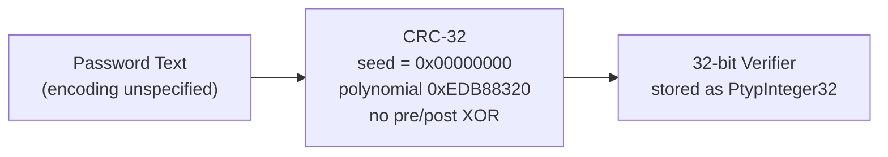
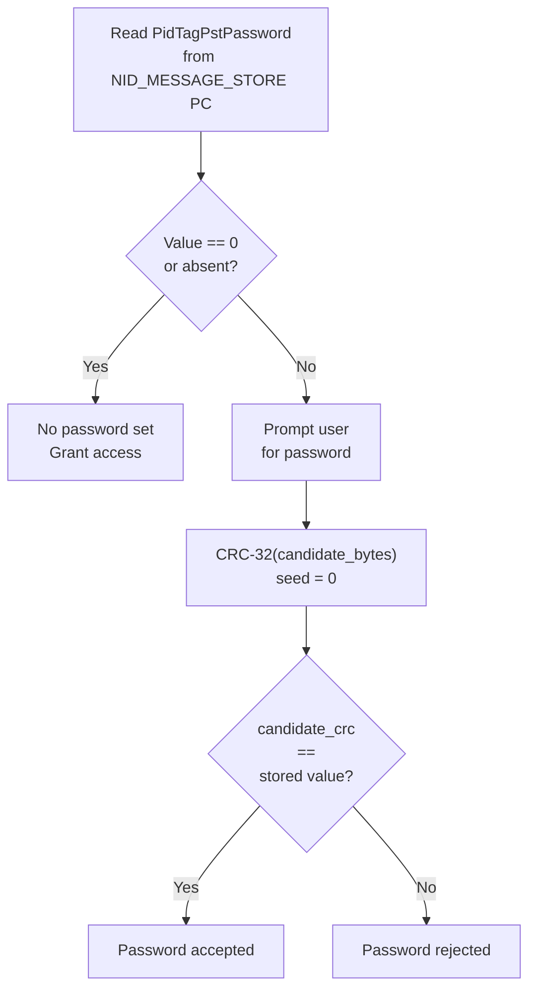
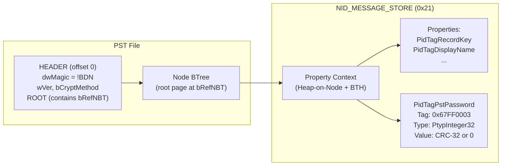

# Outlook PST Password (CRC-32 Verifier)

⚪ **Advisory Only** — UI-level access gate with no cryptographic protection; the CRC-32 verifier encrypts nothing and is trivially bypassed

## Overview

- Optional password gate on Outlook Personal Folders files (`.pst`) — Outlook prompts for a password before mounting the store, but the data remains fully readable without it
- Stores a single CRC-32 checksum of the password text as `PidTagPstPassword` (`0x67FF0003`) on the message store node; the password is never used as cipher key material
- No salt, no iteration, no pre-image resistance — the 32-bit CRC is prone to collisions and trivially brute-forced per the spec's own security assessment ([MS-PST] section 4.2)
- Identical algorithm across both PST variants: ANSI (`wVer` 14-15, Outlook 97-2002) and Unicode (`wVer` >= 23, Outlook 2003+)
- Used by: [Outlook PST](../../formats/outlook.md)
- Spec: [MS-PST] sections 2.4.3.3, 4.2, 5.3

## KDF Pipeline



No key is derived. No cipher key is produced. The CRC-32 output is stored directly as `PidTagPstPassword` and used only for a UI-level equality check.

## Verification Flow



## On-Disk Structure



## Quick Reference

| Parameter | Value | Notes |
|---|---|---|
| Algorithm | CRC-32 (IEEE 802.3 reflected) | Polynomial `0xEDB88320` |
| Seed | `0x00000000` | No pre-inversion |
| Final XOR | None | No post-inversion |
| Salt | None | — |
| Iterations | 1 | Single CRC pass |
| Output | 32 bits | `PtypInteger32` DWORD |
| Key derivation | None | No cipher key produced |
| Property tag | `0x67FF0003` | `PidTagPstPassword` |
| Store node | `NID_MESSAGE_STORE` (`0x21`) | Property Context lookup |
| Encoding | Unspecified by spec | See section 5.4 below |

## Extraction Target

Fields to extract from the PST file:

| Field | Source Location | Type | Example Value |
|---|---|---|---|
| PST version | `HEADER.wVer` | WORD | `23` (Unicode PST) |
| Crypt method | `HEADER.bCryptMethod` | BYTE | `0x01` (Permutative) |
| Password verifier | `PidTagPstPassword` in `NID_MESSAGE_STORE` PC | DWORD (LE) | `0x3D7512A9` |
| No-password sentinel | Same property, value `0` or absent | DWORD | `0x00000000` |

**Python function signatures:**

```python
def compute_pst_crc32(password_bytes: bytes) -> int:
    """Compute CRC-32 verifier per [MS-PST] section 5.3.

    Uses seed=0, polynomial 0xEDB88320, no pre/post XOR.
    NOT equivalent to zlib.crc32() which applies 0xFFFFFFFF pre/post.
    """
    ...

def check_pst_password(password_bytes: bytes, stored_value: int) -> bool:
    """Check candidate password against stored PidTagPstPassword.

    Returns True if stored_value is 0 (no password) or if
    compute_pst_crc32(password_bytes) == stored_value.
    Per [MS-PST] section 2.4.3.3.
    """
    ...
```

---

## 1. What It Is and Where It Is Used

- The PST password is an optional advisory gate on Microsoft Outlook Personal Folders files (`.pst`); when present, Outlook prompts the user for a password before mounting the store
- The spec is unambiguous that this provides zero data protection: per [MS-PST] section 2.4.3.3, "the PST password is just implemented at the UI level, meaning that the password is only required to gain access of the PST through the UI. The password itself is not used to secure the PST data in any way."
- The mechanism stores a single CRC-32 hash of the password text as a 32-bit integer property (`PidTagPstPassword`, property tag `0x67FF0003`) on the message store node (`NID_MESSAGE_STORE`, NID `0x21`)
- The password itself is never stored, and the CRC-32 value is never used as a cipher key or key-derivation input
- This verifier applies to both PST container variants: ANSI (Outlook 97-2002, `wVer` 14-15) and Unicode (Outlook 2003+, `wVer` >= 23); both use the identical CRC-32 algorithm from [MS-PST] section 5.3 with seed zero
- The ANSI/Unicode distinction affects only container-level field widths (BIDs, IBs, ROOT structure size), not the password verifier computation
- PST content-level obfuscation (the body cipher controlled by `HEADER.bCryptMethod`) is a completely independent mechanism that does not take any password input; it is documented separately in [../non-password/pst-body-cipher.md](../non-password/pst-body-cipher.md)
- File-format context is in [../../formats/outlook.md](../../formats/outlook.md)

**Spec sections:** [MS-PST] sections 2.4.3.3 (PST Password Security), 4.2 (Strength of PST Password), 5.3 (CRC Calculation), 2.4.3 and 2.4.3.1 (Message Store), 2.2.2.6 (HEADER structure).

## 2. Profiles / Parameters

There is a single algorithm profile. The ANSI and Unicode PST variants differ only in their container-level structures, not in the verifier computation or interpretation.

| Parameter | Value | Spec Reference |
|---|---|---|
| Algorithm | CRC-32 (IEEE 802.3 reflected polynomial `0xEDB88320`) | [MS-PST] section 5.3 |
| Seed (initial CRC value) | `0x00000000` | [MS-PST] section 5.3 ("MUST be zero in the context of this document") |
| Pre-inversion | None (seed is `0`, not `0xFFFFFFFF`) | [MS-PST] section 5.3 (ComputeCRC code) |
| Post-inversion (final XOR) | None | [MS-PST] section 5.3 (ComputeCRC code) |
| Salt | None | [MS-PST] section 2.4.3.3 |
| Iterations | 1 (single CRC pass) | [MS-PST] section 2.4.3.3 |
| Output size | 32 bits (DWORD, stored as `PtypInteger32`) | [MS-PST] section 2.1.2, [MS-OXPROPS] |
| Key derivation | None; no cipher key is derived from the password | [MS-PST] section 2.4.3.3, section 4.2 |
| Property tag | `0x67FF0003` (`PidTagPstPassword`, `PtypInteger32`) | [MS-PST] section 2.1.2 |
| Store location | PC of `NID_MESSAGE_STORE` (`0x21`) | [MS-PST] section 2.4.3.3, section 2.4.1 |
| ANSI PST (`wVer` 14-15) | Same CRC-32 computation | [MS-PST] section 2.2.2.6 |
| Unicode PST (`wVer` >= 23) | Same CRC-32 computation | [MS-PST] section 2.2.2.6 |

**Important:** The CRC-32 as implemented by [MS-PST] section 5.3 does NOT apply the standard pre/post XOR with `0xFFFFFFFF` that is conventional in zlib/gzip CRC-32. The seed is zero and the return value is the raw CRC accumulator with no final complement. This means the output differs from what `zlib.crc32()` or similar standard library functions produce for the same input.

## 3. Byte Layout / On-Disk Structure

### 3.1 PidTagPstPassword Property

The password verifier is a single tagged property on the message store node. It is stored in the Property Context (PC) of `NID_MESSAGE_STORE`, not in an OLE stream or HEADER field.

| Field | Value | Type | Size | Meaning |
|---|---|---|---|---|
| Property ID | `0x67FF` | WORD | 2 bytes | `PidTagPstPassword` identifier |
| Property Type | `0x0003` | WORD | 2 bytes | `PtypInteger32` |
| Full property tag | `0x67FF0003` | DWORD | 4 bytes | Combined tag for BTH key lookup |
| Property value | `CRC-32(password_bytes)` or `0x00000000` | DWORD (little-endian) | 4 bytes | The stored verifier; `0` means no password |

Per [MS-PST] section 2.4.3.3: "if the property exists and is nonzero, implementations SHOULD prompt the end user for a password, compute the CRC-32 hash of the user password, and verify it against the value stored in PidTagPstPassword. Implementations MUST enforce the PST Password check if a nonzero value for PidTagPstPassword is set in the message store."

A value of `0x00000000` means no password is set. The property may also be absent entirely, which is equivalent to "no password."

### 3.2 Message Store Location

The message store PC is reached via the NDB layer. Its location chain is:

1. **HEADER** (file offset 0) — contains the ROOT structure ([MS-PST] section 2.2.2.6)
2. **ROOT** — contains `bRefNBT` (BREF pointing to the root page of the Node BTree) ([MS-PST] section 2.2.2.5)
3. **NBT** (Node BTree) — locate the entry with NID = `NID_MESSAGE_STORE` (`0x21`) ([MS-PST] section 2.4.1)
4. **NBTENTRY** for `0x21` — contains `bidData` (BID of the data block) and `bidSub` (BID of subnode BTree) ([MS-PST] section 2.2.2.7.7.4)
5. **Data block** — contains the HN (Heap-on-Node) with the PC's BTHHEADER, which indexes all properties including `0x67FF0003` ([MS-PST] section 2.3.3)

### 3.3 HEADER Structure Context (bCryptMethod)

The HEADER field `bCryptMethod` ([MS-PST] section 2.2.2.6) controls the body cipher for NDB data blocks, which is entirely independent of the PST password.

| `bCryptMethod` Value | Name | Meaning | Relevance to Password |
|---|---|---|---|
| `0x00` | `NDB_CRYPT_NONE` | Data blocks are not encoded | None; password CRC is unaffected |
| `0x01` | `NDB_CRYPT_PERMUTE` | Encoded with the Permutative algorithm ([MS-PST] section 5.1) | None; password CRC is unaffected |
| `0x02` | `NDB_CRYPT_CYCLIC` | Encoded with the Cyclic algorithm ([MS-PST] section 5.2) | None; password CRC is unaffected |
| `0x10` | `NDB_CRYPT_EDPCRYPTED` | Encrypted with Windows Information Protection | None; password CRC is unaffected |

The body cipher is documented in [../non-password/pst-body-cipher.md](../non-password/pst-body-cipher.md).

### 3.4 Message Store Required Properties

Per [MS-PST] section 2.4.3.1, the following properties MUST be present in any valid message store PC. `PidTagPstPassword` is NOT in this required set; it is optional.

| Property ID | Property Type | Friendly Name | Description |
|---|---|---|---|
| `0x0FF9` | `PtypBinary` | `PidTagRecordKey` | Record key (Provider UID of this PST) |
| `0x3001` | `PtypString` | `PidTagDisplayName` | Display name of PST |
| `0x35E0` | `PtypBinary` | `PidTagIpmSubTreeEntryId` | EntryID of the Root Mailbox Folder object |
| `0x35E3` | `PtypBinary` | `PidTagIpmWastebasketEntryId` | EntryID of the Deleted Items Folder object |
| `0x35E7` | `PtypBinary` | `PidTagFinderEntryId` | EntryID of the search Folder object |

The full property tag table including `PidTagPstPassword` (`0x67FF`, `PtypInteger32`) is in [MS-PST] section 2.1.2.

## 4. Key Derivation

There is no key derivation. No cipher key is produced, no salt is used, and no iteration occurs. The CRC-32 is a one-pass checksum of the password text, stored as a 32-bit integer. The password plays no role in any encryption or decryption operation within the PST file.

## 5. CRC-32 Computation — Ordered Steps with Pseudocode

The CRC-32 algorithm used for the password verifier is the same `ComputeCRC` function defined in [MS-PST] section 5.3, which is also used for all other CRC checksums in the PST format (page trailer CRCs in `PAGETRAILER.dwCRC`, block trailer CRCs in `BLOCKTRAILER.dwCRC`, and HEADER CRCs `dwCRCPartial` / `dwCRCFull`).

### 5.1 Algorithm Steps

1. Accept the password text as a byte sequence `pv` of length `cbLength`. (See section 5.3 below for encoding considerations.)
2. Initialize the CRC accumulator `dwCRC` to `0` (the seed value, which [MS-PST] section 5.3 states "MUST be zero in the context of this document").
3. For each byte in the input, update the CRC using the reflected table-driven algorithm.
4. The final value of `dwCRC` is the verifier. Store it (or compare it) as a `PtypInteger32` in `PidTagPstPassword`.

### 5.2 Pseudocode — Simplified Byte-at-a-Time Form

The following is the essential algorithm extracted from [MS-PST] section 5.3. The full spec implementation includes an 8-byte-at-a-time slicing optimization using eight lookup tables (`CrcTableOffset32` through `CrcTableOffset88`), but for password-length inputs the byte-at-a-time loop is functionally equivalent and sufficient.

```
FUNCTION ComputeCRC(dwCRC, pv, cbLength):
    // [MS-PST] §5.3
    // dwCRC: initial seed, MUST be 0 for all uses in this document
    // pv:    pointer to the data buffer
    // cbLength: number of bytes to process

    FOR i = 0 TO cbLength - 1:
        dwCRC = CrcTableOffset32[(dwCRC XOR pv[i]) AND 0x000000FF] XOR (dwCRC >> 8)

    RETURN dwCRC
```

### 5.3 Pseudocode — Full Spec Implementation with Slicing-by-8 Optimization

The complete `ComputeCRC` function from [MS-PST] section 5.3 processes 8 aligned bytes per iteration using eight pre-computed lookup tables (`CrcTableOffset32` through `CrcTableOffset88`). This is the canonical form that implementations SHOULD use for performance on bulk data (page CRCs, block CRCs). For password verification, inputs are short enough that only the byte-at-a-time paths execute.

```
FUNCTION ComputeCRC(dwCRC, pv, cbLength):
    // [MS-PST] §5.3 -- full slicing-by-8 implementation
    pbBuffer = pv

    // Compute alignment parameters
    cbAlignedOffset = (cbLength < 4) ? 0 : ((DWORD_PTR)pv MOD 4)
    cbInitialUnalignedBytes = (cbAlignedOffset == 0) ? 0 : (4 - cbAlignedOffset)
    cbRunningLength = (cbLength < 4) ? 0 : (((cbLength - cbInitialUnalignedBytes) / 8) * 8)
    cbEndUnalignedBytes = cbLength - cbInitialUnalignedBytes - cbRunningLength

    // Process initial unaligned bytes (byte-at-a-time)
    FOR i = 0 TO cbInitialUnalignedBytes - 1:
        dwCRC = CrcTableOffset32[(dwCRC XOR pbBuffer[0]) AND 0xFF] XOR (dwCRC >> 8)
        pbBuffer = pbBuffer + 1

    // Process aligned 8-byte chunks (slicing-by-8)
    FOR i = 0 TO (cbRunningLength / 8) - 1:
        dwCRC = dwCRC XOR *(DWORD*)pbBuffer
        dwCRC = CrcTableOffset88[ dwCRC        AND 0xFF] XOR
                CrcTableOffset80[(dwCRC >>  8) AND 0xFF] XOR
                CrcTableOffset72[(dwCRC >> 16) AND 0xFF] XOR
                CrcTableOffset64[(dwCRC >> 24) AND 0xFF]
        pbBuffer = pbBuffer + 4

        dw2nd32 = *(DWORD*)pbBuffer
        dwCRC = dwCRC XOR
                CrcTableOffset56[ dw2nd32        AND 0xFF] XOR
                CrcTableOffset48[(dw2nd32 >>  8) AND 0xFF] XOR
                CrcTableOffset40[(dw2nd32 >> 16) AND 0xFF] XOR
                CrcTableOffset32[(dw2nd32 >> 24) AND 0xFF]
        pbBuffer = pbBuffer + 4

    // Process remaining unaligned bytes (byte-at-a-time)
    FOR i = 0 TO cbEndUnalignedBytes - 1:
        dwCRC = CrcTableOffset32[(dwCRC XOR pbBuffer[0]) AND 0xFF] XOR (dwCRC >> 8)
        pbBuffer = pbBuffer + 1

    RETURN dwCRC
```

### 5.4 Password Encoding

**UNCONFIRMED by the spec.** [MS-PST] section 2.4.3.3 refers only to "the password text" and "the CRC-32 hash of the password text" without specifying the character encoding used to convert the password string to bytes before CRC computation. The spec does not state whether the password is encoded as ANSI/MBCS (the system's active code page), UTF-8, UTF-16LE, or some other encoding, nor whether a null terminator is included in the CRC input.

## 6. Verification Procedure — Pseudocode

The verification check is a direct 32-bit integer comparison. No decryption occurs.

```
FUNCTION VerifyPstPassword(candidate_password_bytes, cbLength, stored_value):
    // [MS-PST] §2.4.3.3
    // stored_value: PidTagPstPassword from the message store PC (NID 0x21)

    IF stored_value == 0x00000000:
        // No password set; grant access without prompting
        RETURN ACCESS_GRANTED

    candidate_crc = ComputeCRC(0, candidate_password_bytes, cbLength)

    IF candidate_crc == stored_value:
        RETURN ACCESS_GRANTED
    ELSE:
        RETURN ACCESS_DENIED
```

Per [MS-PST] section 2.4.3.3:
- If `PidTagPstPassword` does not exist or is zero, no password check is performed.
- If `PidTagPstPassword` exists and is nonzero, implementations SHOULD prompt for a password and MUST enforce the check.

## 7. Reference Constants

### 7.1 Property and Node Constants

| Constant | Value | Spec Reference |
|---|---|---|
| `PidTagPstPassword` property ID | `0x67FF` | [MS-PST] section 2.1.2 |
| `PtypInteger32` property type | `0x0003` | [MS-PST] section 2.1.1; [MS-OXCDATA] |
| Full property tag | `0x67FF0003` | Combined |
| `NID_MESSAGE_STORE` | `0x21` | [MS-PST] section 2.4.1 |
| CRC-32 seed | `0x00000000` | [MS-PST] section 5.3 |
| "No password" sentinel | `0x00000000` | [MS-PST] section 2.4.3.3 |

### 7.2 CrcTableOffset32[256] — Complete Table

The primary CRC-32 lookup table from [MS-PST] section 5.3. This is the standard IEEE 802.3 reflected CRC-32 table generated from polynomial `0xEDB88320` (the bit-reversal of `0x04C11DB7`). Reproduced verbatim from the spec.

```
CrcTableOffset32[256] = {
    0x00000000, 0x77073096, 0xEE0E612C, 0x990951BA, 0x076DC419, 0x706AF48F, 0xE963A535, 0x9E6495A3,
    0x0EDB8832, 0x79DCB8A4, 0xE0D5E91E, 0x97D2D988, 0x09B64C2B, 0x7EB17CBD, 0xE7B82D07, 0x90BF1D91,
    0x1DB71064, 0x6AB020F2, 0xF3B97148, 0x84BE41DE, 0x1ADAD47D, 0x6DDDE4EB, 0xF4D4B551, 0x83D385C7,
    0x136C9856, 0x646BA8C0, 0xFD62F97A, 0x8A65C9EC, 0x14015C4F, 0x63066CD9, 0xFA0F3D63, 0x8D080DF5,
    0x3B6E20C8, 0x4C69105E, 0xD56041E4, 0xA2677172, 0x3C03E4D1, 0x4B04D447, 0xD20D85FD, 0xA50AB56B,
    0x35B5A8FA, 0x42B2986C, 0xDBBBC9D6, 0xACBCF940, 0x32D86CE3, 0x45DF5C75, 0xDCD60DCF, 0xABD13D59,
    0x26D930AC, 0x51DE003A, 0xC8D75180, 0xBFD06116, 0x21B4F4B5, 0x56B3C423, 0xCFBA9599, 0xB8BDA50F,
    0x2802B89E, 0x5F058808, 0xC60CD9B2, 0xB10BE924, 0x2F6F7C87, 0x58684C11, 0xC1611DAB, 0xB6662D3D,
    0x76DC4190, 0x01DB7106, 0x98D220BC, 0xEFD5102A, 0x71B18589, 0x06B6B51F, 0x9FBFE4A5, 0xE8B8D433,
    0x7807C9A2, 0x0F00F934, 0x9609A88E, 0xE10E9818, 0x7F6A0DBB, 0x086D3D2D, 0x91646C97, 0xE6635C01,
    0x6B6B51F4, 0x1C6C6162, 0x856530D8, 0xF262004E, 0x6C0695ED, 0x1B01A57B, 0x8208F4C1, 0xF50FC457,
    0x65B0D9C6, 0x12B7E950, 0x8BBEB8EA, 0xFCB9887C, 0x62DD1DDF, 0x15DA2D49, 0x8CD37CF3, 0xFBD44C65,
    0x4DB26158, 0x3AB551CE, 0xA3BC0074, 0xD4BB30E2, 0x4ADFA541, 0x3DD895D7, 0xA4D1C46D, 0xD3D6F4FB,
    0x4369E96A, 0x346ED9FC, 0xAD678846, 0xDA60B8D0, 0x44042D73, 0x33031DE5, 0xAA0A4C5F, 0xDD0D7CC9,
    0x5005713C, 0x270241AA, 0xBE0B1010, 0xC90C2086, 0x5768B525, 0x206F85B3, 0xB966D409, 0xCE61E49F,
    0x5EDEF90E, 0x29D9C998, 0xB0D09822, 0xC7D7A8B4, 0x59B33D17, 0x2EB40D81, 0xB7BD5C3B, 0xC0BA6CAD,
    0xEDB88320, 0x9ABFB3B6, 0x03B6E20C, 0x74B1D29A, 0xEAD54739, 0x9DD277AF, 0x04DB2615, 0x73DC1683,
    0xE3630B12, 0x94643B84, 0x0D6D6A3E, 0x7A6A5AA8, 0xE40ECF0B, 0x9309FF9D, 0x0A00AE27, 0x7D079EB1,
    0xF00F9344, 0x8708A3D2, 0x1E01F268, 0x6906C2FE, 0xF762575D, 0x806567CB, 0x196C3671, 0x6E6B06E7,
    0xFED41B76, 0x89D32BE0, 0x10DA7A5A, 0x67DD4ACC, 0xF9B9DF6F, 0x8EBEEFF9, 0x17B7BE43, 0x60B08ED5,
    0xD6D6A3E8, 0xA1D1937E, 0x38D8C2C4, 0x4FDFF252, 0xD1BB67F1, 0xA6BC5767, 0x3FB506DD, 0x48B2364B,
    0xD80D2BDA, 0xAF0A1B4C, 0x36034AF6, 0x41047A60, 0xDF60EFC3, 0xA867DF55, 0x316E8EEF, 0x4669BE79,
    0xCB61B38C, 0xBC66831A, 0x256FD2A0, 0x5268E236, 0xCC0C7795, 0xBB0B4703, 0x220216B9, 0x5505262F,
    0xC5BA3BBE, 0xB2BD0B28, 0x2BB45A92, 0x5CB36A04, 0xC2D7FFA7, 0xB5D0CF31, 0x2CD99E8B, 0x5BDEAE1D,
    0x9B64C2B0, 0xEC63F226, 0x756AA39C, 0x026D930A, 0x9C0906A9, 0xEB0E363F, 0x72076785, 0x05005713,
    0x95BF4A82, 0xE2B87A14, 0x7BB12BAE, 0x0CB61B38, 0x92D28E9B, 0xE5D5BE0D, 0x7CDCEFB7, 0x0BDBDF21,
    0x86D3D2D4, 0xF1D4E242, 0x68DDB3F8, 0x1FDA836E, 0x81BE16CD, 0xF6B9265B, 0x6FB077E1, 0x18B74777,
    0x88085AE6, 0xFF0F6A70, 0x66063BCA, 0x11010B5C, 0x8F659EFF, 0xF862AE69, 0x616BFFD3, 0x166CCF45,
    0xA00AE278, 0xD70DD2EE, 0x4E048354, 0x3903B3C2, 0xA7672661, 0xD06016F7, 0x4969474D, 0x3E6E77DB,
    0xAED16A4A, 0xD9D65ADC, 0x40DF0B66, 0x37D83BF0, 0xA9BCAE53, 0xDEBB9EC5, 0x47B2CF7F, 0x30B5FFE9,
    0xBDBDF21C, 0xCABAC28A, 0x53B39330, 0x24B4A3A6, 0xBAD03605, 0xCDD70693, 0x54DE5729, 0x23D967BF,
    0xB3667A2E, 0xC4614AB8, 0x5D681B02, 0x2A6F2B94, 0xB40BBE37, 0xC30C8EA1, 0x5A05DF1B, 0x2D02EF8D
};
```

Confirmation that this is the standard IEEE 802.3 reflected CRC-32 table: entry `[0]` = `0x00000000`, entry `[1]` = `0x77073096`, and the generator polynomial `0xEDB88320` appears at index 128 (`CrcTableOffset32[128]` = `0xEDB88320`). The polynomial `0xEDB88320` is the bit-reversal of the IEEE 802.3 generator `0x04C11DB7`.

### 7.3 Slicing-by-8 Acceleration Tables

The full `ComputeCRC` implementation in [MS-PST] section 5.3 defines seven additional 256-entry lookup tables for its 8-byte-at-a-time slicing optimization:

- `CrcTableOffset40[256]`
- `CrcTableOffset48[256]`
- `CrcTableOffset56[256]`
- `CrcTableOffset64[256]`
- `CrcTableOffset72[256]`
- `CrcTableOffset80[256]`
- `CrcTableOffset88[256]`

These tables are derived deterministically from `CrcTableOffset32` and the reflected polynomial `0xEDB88320`. They are used together to process 8 bytes per loop iteration (see section 5.3 above). For password verification with short inputs, these tables are not exercised; only `CrcTableOffset32` is used in the byte-at-a-time fallback path. The complete table values are given verbatim in [MS-PST] section 5.3 (pages 175-183 of the specification).

First entry of each table for cross-validation (all tables have `[0]` = `0x00000000`):

| Table | Entry [1] | Spec Reference |
|---|---|---|
| `CrcTableOffset32` | `0x77073096` | [MS-PST] section 5.3 |
| `CrcTableOffset40` | `0x191B3141` | [MS-PST] section 5.3 |
| `CrcTableOffset48` | `0x01C26A37` | [MS-PST] section 5.3 |
| `CrcTableOffset56` | `0xB8BC6765` | [MS-PST] section 5.3 |
| `CrcTableOffset64` | `0x3D6029B0` | [MS-PST] section 5.3 |
| `CrcTableOffset72` | `0xCB5CD3A5` | [MS-PST] section 5.3 |
| `CrcTableOffset80` | `0xA6770BB4` | [MS-PST] section 5.3 |
| `CrcTableOffset88` | `0xCCAA009E` | [MS-PST] section 5.3 |

### 7.4 HEADER Magic Values

For context when parsing PST files to locate the message store:

| Constant | Value | Spec Reference |
|---|---|---|
| `dwMagic` | `{ 0x21, 0x42, 0x44, 0x4E }` ("!BDN") | [MS-PST] section 2.2.2.6 |
| `wMagicClient` | `{ 0x53, 0x4D }` ("SM") | [MS-PST] section 2.2.2.6 |
| `bSentinel` | `0x80` | [MS-PST] section 2.2.2.6 |
| `wVer` (ANSI) | 14 or 15 | [MS-PST] section 2.2.2.6 |
| `wVer` (Unicode) | >= 23 | [MS-PST] section 2.2.2.6 |
| `wVer` (WIP-capable) | 37 | [MS-PST] section 2.2.2.6 |
| `bPlatformCreate` | `0x01` | [MS-PST] section 2.2.2.6 |
| `bPlatformAccess` | `0x01` | [MS-PST] section 2.2.2.6 |

### 7.5 Special NID Values

| Value | Name | Description | Spec Reference |
|---|---|---|---|
| `0x21` | `NID_MESSAGE_STORE` | Message store node | [MS-PST] section 2.4.1 |
| `0x61` | `NID_NAME_TO_ID_MAP` | Named Properties Map | [MS-PST] section 2.4.1 |
| `0x122` | `NID_ROOT_FOLDER` | Root Mailbox Folder object | [MS-PST] section 2.4.1 |

## 8. Security Considerations

The following security assessments are stated directly by the specification itself.

**[MS-PST] section 4.2, "Strength of PST Password":** "The PST Password, which is stored as a property value in the message store, is a superficial mechanism that requires the client implementation to enforce the stored password. Because the password itself is not used as a key to the encoding and decoding cipher algorithms, it does not provide any security benefit to preventing the PST data to be read by unauthorized parties."

**[MS-PST] section 4.2 (continued):** "Moreover, the password is stored as a CRC-32 hash of the original password string, which is prone to collisions and is relatively weak against a brute-force approach."

**[MS-PST] section 2.4.3.3:** "In practice, the PST password is just implemented at the UI level, meaning that the password is only required to gain access of the PST through the UI. The password itself is not used to secure the PST data in any way."

**[MS-PST] section 4.1, "Strength of Encoded PST Data Blocks"** (regarding the separate body cipher, not the password): "This file format specification uses two keyless cipher algorithms to encode the data blocks in the PST. These algorithms only provide data obfuscation and can be conveniently decoded once the exact encoding algorithm is understood." And: "the strength of the encoded PST data blocks provides no additional security beyond data obfuscation."

In summary:
- The PST password provides no data confidentiality
- The CRC-32 verifier is a 32-bit value with no salt, no iteration, and no pre-image resistance
- The body cipher (`bCryptMethod`) is a separate keyless obfuscation that also provides no meaningful security
- Neither mechanism uses the password as cryptographic key material

## 9. Spec References

| Section | Title | Content Relevant Here |
|---|---|---|
| [MS-PST] section 2.1.2 | Properties | Property tag table including `PidTagPstPassword` (`0x67FF`, `PtypInteger32`) |
| [MS-PST] section 2.2.2.5 | ROOT | ROOT structure containing NBT/BBT BREFs used to locate the message store |
| [MS-PST] section 2.2.2.6 | HEADER | PST file header with `bCryptMethod`, `wVer`, magic values, ROOT embed |
| [MS-PST] section 2.4.1 | Special Internal NIDs | `NID_MESSAGE_STORE = 0x21` and other reserved NIDs |
| [MS-PST] section 2.4.3 | Message Store | Message store as a PC on `NID_MESSAGE_STORE`; "any valid PST MUST have exactly one message store node" |
| [MS-PST] section 2.4.3.1 | Minimum Set of Required Properties | Five required properties of a message store PC (PidTagPstPassword is not among them) |
| [MS-PST] section 2.4.3.3 | PST Password Security | UI-only password gate; CRC-32 of password text stored in `PidTagPstPassword`; enforcement requirements |
| [MS-PST] section 4.1 | Strength of Encoded PST Data Blocks | Body cipher provides only data obfuscation |
| [MS-PST] section 4.2 | Strength of PST Password | Password is "superficial"; CRC-32 is "prone to collisions and is relatively weak against a brute-force approach" |
| [MS-PST] section 5.3 | CRC Calculation | Full `ComputeCRC` algorithm with `CrcTableOffset32` through `CrcTableOffset88`; seed MUST be zero |

**Related documents:**

- [../non-password/pst-body-cipher.md](../non-password/pst-body-cipher.md) — PST NDB block cipher (`NDB_CRYPT_PERMUTE` / `NDB_CRYPT_CYCLIC`), the independent keyless obfuscation layer
- [../../formats/outlook.md](../../formats/outlook.md) — Outlook PST file format overview and container structure
