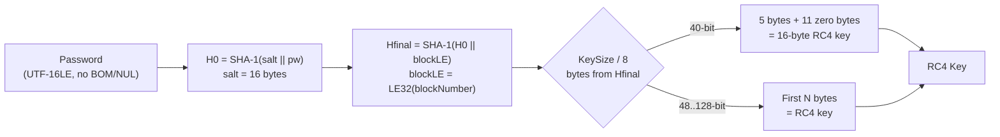
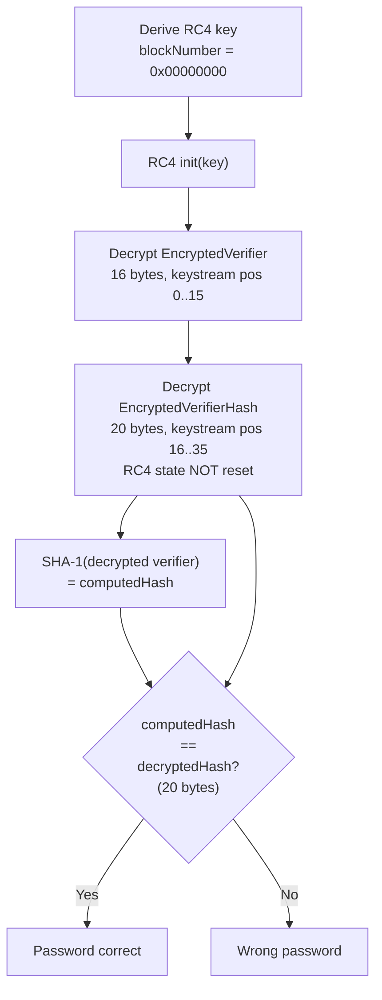
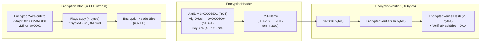
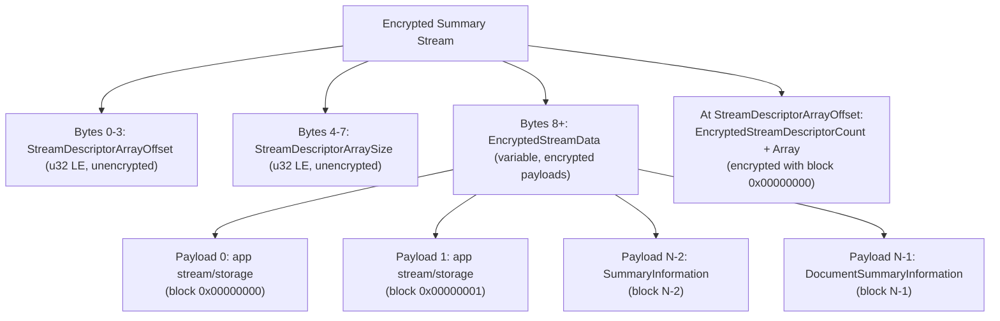

# RC4 CryptoAPI Encryption (SHA-1 + RC4, Office Binary Documents)

🔴 **Broken Encryption** — un-iterated SHA-1 KDF with RC4 stream cipher; no integrity protection, known keystream-reuse attacks

## Overview

- Document-open password encryption for OLE2 binary formats (`.doc`, `.xls`, `.ppt`) produced by Office XP through Office 2003; readable by Office 2007+ for backward compatibility
- Key derivation is a single un-iterated SHA-1 over `salt || password`, mixed with a 4-byte block number — no key stretching at all
- RC4 stream cipher with configurable key length (40–128 bits); 40-bit keys are brute-forcible on the key itself without knowing the password
- Spec explicitly labels this scheme "not recommended" and "considered insecure" ([MS-OFFCRYPTO] SS4.1.3.2)
- Used by: [Word .doc](../../formats/word.md), [Excel .xls](../../formats/excel.md), [PowerPoint .ppt](../../formats/powerpoint.md)
- Spec: [MS-OFFCRYPTO] SS2.3.5

## KDF Pipeline



## Verification Flow



## On-Disk Structure



## Quick Reference

| Parameter | Value | Spec Reference |
|---|---|---|
| Hash | SHA-1 (20 bytes) | [MS-OFFCRYPTO] SS2.3.2 |
| Cipher | RC4 | [MS-OFFCRYPTO] SS2.3.2 |
| KDF Iterations | **None** (single-pass SHA-1) | [MS-OFFCRYPTO] SS2.3.5.2 |
| Key Size | 40–128 bits (8-bit steps; 0 = 40) | [MS-OFFCRYPTO] SS2.3.2 |
| Salt | 16 bytes (fixed) | [MS-OFFCRYPTO] SS2.3.3 |
| Password | UTF-16LE, no BOM/NUL, <=255 chars | [MS-OFFCRYPTO] SS2.3.5.2 |
| Verifier | 16 bytes random + 20 bytes SHA-1 hash | [MS-OFFCRYPTO] SS2.3.3 |
| Version | vMajor 2–4, vMinor 2 | [MS-OFFCRYPTO] SS2.1.4 |

## Extraction Target

What your code needs from the EncryptionHeader + EncryptionVerifier structures in the CFB encryption blob:

| Field | Source | Type | Example |
|---|---|---|---|
| Salt | `EncryptionVerifier.Salt` | 16 bytes | (random) |
| Key size | `EncryptionHeader.KeySize` | u32 LE (bits) | `0x00000080` (128) |
| AlgID | `EncryptionHeader.AlgID` | u32 LE | `0x00006801` (RC4) |
| AlgIDHash | `EncryptionHeader.AlgIDHash` | u32 LE | `0x00008004` (SHA-1) |
| Encrypted verifier | `EncryptionVerifier.EncryptedVerifier` | 16 bytes | (ciphertext) |
| Encrypted verifier hash | `EncryptionVerifier.EncryptedVerifierHash` | 20 bytes | (ciphertext) |
| vMajor | `EncryptionVersionInfo.vMajor` | u16 LE | `0x0003` |
| vMinor | `EncryptionVersionInfo.vMinor` | u16 LE | `0x0002` |

**Python function signatures this maps to:**

```python
def derive_rc4_cryptoapi_key(
    password: str,
    salt: bytes,      # EncryptionVerifier.Salt (16 bytes)
    key_bits: int,     # EncryptionHeader.KeySize
    block: int,        # block number (0 for verifier)
) -> bytes: ...

def verify_rc4_cryptoapi(
    password: str,
    salt: bytes,                  # EncryptionVerifier.Salt (16 bytes)
    key_bits: int,                # EncryptionHeader.KeySize
    enc_verifier: bytes,          # EncryptionVerifier.EncryptedVerifier (16 bytes)
    enc_verifier_hash: bytes,     # EncryptionVerifier.EncryptedVerifierHash (20 bytes)
) -> bool: ...
```

---

## Specification Detail

### Identification

- Classification: document-open password encryption for OLE2 binary formats (`.doc`, `.xls`, `.ppt`)
- On-disk signature: `vMajor` in {`0x0002`, `0x0003`, `0x0004`}, `vMinor = 0x0002`
- Distinguishes from legacy RC4 (`vMinor=0x0001`) and agile encryption (`vMinor=0x0004`)
- Distinct from [Office Binary Document RC4 Encryption](./rc4-md5-legacy.md) (MD5-based), [XOR Obfuscation](./xor-obfuscation.md), and the AES-based [ECMA-376 Standard](./ecma376-standard.md) / [Agile](./ecma376-agile.md) schemes
- The secret protected is the **document-open password** — not the Word write-reservation password, not Excel sheet/workbook protection, and not a VBA macro password

### Products and gates

| Application | File extension | CFB stream holding the encryption blob | Spec reference |
|---|---|---|---|
| Word 97-2003 | `.doc` | `1Table` or `0Table` stream (selected by `FibBase.fWhichTblStm`); the blob follows the FIB in that table stream. `WordDocument` stream `FibBase.fEncrypted=1`, `fObfuscation=0` signals CryptoAPI RC4. | [MS-DOC] |
| Excel 97-2003 | `.xls` | `Workbook` stream, inside the **FilePass** record (record type `0x002F`). The `wEncryptionType` field value of 1 indicates RC4; then `EncryptionVersionInfo.vMajor >= 2` distinguishes CryptoAPI from legacy RC4. | [MS-XLS] |
| PowerPoint 97-2003 | `.ppt` | `Current User` stream provides `offsetToCurrentEdit`; follow the edit chain in `PowerPoint Document` stream to the `UserEditAtom`, which points to a `CryptSession10Container` holding the encryption blob. | [MS-PPT] |

**See also** (format-specific placement details):

- [../../formats/word.md](../../formats/word.md)
- [../../formats/excel.md](../../formats/excel.md)
- [../../formats/powerpoint.md](../../formats/powerpoint.md)

Regardless of application, the on-disk layout of the encryption blob is identical once located ([MS-OFFCRYPTO] section 2.3.5.1).

## 2. Profiles / parameters

- All profiles share one algorithm; they differ only in `KeySize`, the RC4 key length in bits
- The hash algorithm is always SHA-1, and the cipher is always RC4
- The KDF is un-iterated (exactly two SHA-1 computations per candidate: one for `H0`, one for `Hfinal`)

| Parameter | Value / range | Spec reference |
|---|---|---|
| Hash algorithm (`AlgIDHash`) | SHA-1 (`0x00008004`) | [MS-OFFCRYPTO] section 2.3.2 |
| Cipher algorithm (`AlgID`) | RC4 (`0x00006801`) | [MS-OFFCRYPTO] section 2.3.2 |
| KDF iterations | None (single-pass SHA-1) | [MS-OFFCRYPTO] section 2.3.5.2 |
| Key size (`KeySize`) | 40 bits (`0x00000028`) through 128 bits (`0x00000080`), in 8-bit increments. A value of `0x00000000` MUST be interpreted as 40 bits (`0x00000028`). | [MS-OFFCRYPTO] section 2.3.2 |
| Salt size | 16 bytes (fixed) | [MS-OFFCRYPTO] section 2.3.3 |
| Verifier hash size | 20 bytes (SHA-1 output) | [MS-OFFCRYPTO] section 2.3.3 |
| Password encoding | UTF-16LE, no BOM, no NUL terminator | [MS-OFFCRYPTO] section 2.3.5.2 |
| Maximum password length | 255 Unicode characters (unless further restricted by application) | [MS-OFFCRYPTO] section 2.3.5.2 |
| ProviderType | `0x00000001` (RC4) | [MS-OFFCRYPTO] section 2.3.5.1 |

### CSP names ([MS-OFFCRYPTO] section 2.3.5.1 note <22>)

The `CSPName` field MUST name a recognized Cryptographic Service Provider that supports RC4 and SHA-1 with the specified `KeySize`. Common values:

| CSP name | Maximum key length |
|---|---|
| `Microsoft Base Cryptographic Provider v1.0` | 56 bits |
| `Microsoft Enhanced Cryptographic Provider v1.0` | 128 bits |
| `Microsoft Enhanced RSA and AES Cryptographic Provider` | 128 bits |

On non-Windows systems the CSP name is ignored when opening a file; the algorithm and key length are determined by `AlgID` and `KeySize` ([MS-OFFCRYPTO] section 2.3.2 note <8>).

## 3. Byte layout / on-disk structures

All multi-byte fields are **little-endian** ([MS-OFFCRYPTO] section 1.3.6).

### 3.1 RC4 CryptoAPI Encryption Header stream ([MS-OFFCRYPTO] section 2.3.5.1)

The encryption blob stored in the application-specific CFB stream has the following top-level layout:

| Field | Offset | Size | Type | Description |
|---|---|---|---|---|
| `EncryptionVersionInfo` | 0 | 4 | Version (section 2.1.4) | `vMajor` (u16 LE) followed by `vMinor` (u16 LE). |
| `EncryptionHeader.Flags` | 4 | 4 | u32 LE (EncryptionHeaderFlags) | A copy of the `Flags` field from the EncryptionHeader structure. |
| `EncryptionHeaderSize` | 8 | 4 | u32 LE | Size in bytes of the EncryptionHeader structure that follows. |
| `EncryptionHeader` | 12 | variable | EncryptionHeader (section 2.3.2) | Encryption parameters (see section 3.2 below). |
| `EncryptionVerifier` | 12 + EncryptionHeaderSize | variable | EncryptionVerifier (section 2.3.3) | Password verifier data (see section 3.4 below). |

### 3.2 Version structure ([MS-OFFCRYPTO] section 2.1.4)

| Field | Offset | Size | Type | Values for RC4 CryptoAPI |
|---|---|---|---|---|
| `vMajor` | 0 | 2 | u16 LE | MUST be `0x0002`, `0x0003`, or `0x0004`. Office 2003 writes `0x0002`; Office 2007 / SP1 writes `0x0003`; Office 2007 SP2 / 2010 / 2013 writes `0x0004` (note <21>). |
| `vMinor` | 2 | 2 | u16 LE | MUST be `0x0002`. This distinguishes CryptoAPI encryption from legacy RC4 (vMinor=0x0001) and agile encryption (vMinor=0x0004). |

### 3.3 EncryptionHeaderFlags ([MS-OFFCRYPTO] section 2.3.1)

The `Flags` field is a 32-bit value with the following bit layout:

| Bit | Name | Description |
|---|---|---|
| 0 | Reserved1 | MUST be 0, MUST be ignored. |
| 1 | Reserved2 | MUST be 0, MUST be ignored. |
| 2 | fCryptoAPI | MUST be 1 for CryptoAPI RC4 and ECMA-376 encryption. MUST be 0 if `fExternal` is 1. |
| 3 | fDocProps | MUST be 0 if document properties are encrypted. Set to 1 if document properties are NOT encrypted (section 2.3.5.4). |
| 4 | fExternal | MUST be 1 if extensible encryption is used. For RC4 CryptoAPI, MUST be 0. |
| 5 | fAES | MUST be 1 if the protected content is an ECMA-376 document. For RC4 CryptoAPI (binary documents), MUST be 0. |
| 6-31 | Unused | Undefined, MUST be ignored. |

For RC4 CryptoAPI encryption: `fCryptoAPI` = 1, `fAES` = 0, `fExternal` = 0. The minimum valid `Flags` value is `0x00000004` (fCryptoAPI only); with fDocProps set it becomes `0x0000000C`.

### 3.4 EncryptionHeader ([MS-OFFCRYPTO] section 2.3.2)

| Field | Offset (within EncryptionHeader) | Size | Type | Required value for RC4 CryptoAPI |
|---|---|---|---|---|
| `Flags` | 0 | 4 | u32 LE (EncryptionHeaderFlags) | `fCryptoAPI` MUST be set. `fAES` MUST be 0. `fExternal` MUST be 0. `fDocProps` set if document properties are NOT encrypted. |
| `SizeExtra` | 4 | 4 | u32 LE | MUST be `0x00000000`. |
| `AlgID` | 8 | 4 | i32 LE | MUST be `0x00006801` (RC4). |
| `AlgIDHash` | 12 | 4 | i32 LE | MUST be `0x00008004` (SHA-1). |
| `KeySize` | 16 | 4 | u32 LE | RC4 key length in bits. Range `0x00000028` (40) through `0x00000080` (128), in multiples of 8. `0x00000000` MUST be interpreted as `0x00000028` (40). |
| `ProviderType` | 20 | 4 | u32 LE | MUST be `0x00000001` (RC4). |
| `Reserved1` | 24 | 4 | u32 LE | Undefined, MUST be ignored. |
| `Reserved2` | 28 | 4 | u32 LE | MUST be `0x00000000`, MUST be ignored. |
| `CSPName` | 32 | variable | UTF-16LE, NUL-terminated | Name of the Cryptographic Service Provider. |

#### AlgID valid combinations ([MS-OFFCRYPTO] section 2.3.2)

| `Flags.fCryptoAPI` | `Flags.fAES` | `Flags.fExternal` | `AlgID` | Algorithm |
|---|---|---|---|---|
| 1 | 0 | 0 | `0x00000000` | RC4 |
| 1 | 0 | 0 | `0x00006801` | RC4 |

#### AlgIDHash valid combinations ([MS-OFFCRYPTO] section 2.3.2)

| `AlgIDHash` | `Flags.fExternal` | Algorithm |
|---|---|---|
| `0x00000000` | 0 | SHA-1 |
| `0x00008004` | 0 | SHA-1 |

### 3.5 EncryptionVerifier ([MS-OFFCRYPTO] section 2.3.3)

For RC4 encryption, the `EncryptedVerifierHash` field is exactly 20 bytes (the SHA-1 output size). For AES encryption it would be 32 bytes (padded to AES block size), but that does not apply here.

| Field | Offset (within EncryptionVerifier) | Size | Type | Description |
|---|---|---|---|---|
| `SaltSize` | 0 | 4 | u32 LE | MUST be `0x00000010` (16). |
| `Salt` | 4 | 16 | bytes | Randomly generated salt value. MUST NOT be the same data as the Verifier. Fed to SHA-1 exactly as stored (byte order preserved). |
| `EncryptedVerifier` | 20 | 16 | bytes | The randomly generated 16-byte Verifier, encrypted with RC4 using the block-0 key. |
| `VerifierHashSize` | 36 | 4 | u32 LE | MUST be `0x00000014` (20) for SHA-1. |
| `EncryptedVerifierHash` | 40 | 20 | bytes | SHA-1 hash of the Verifier (20 bytes), encrypted with RC4 using the same keystream that encrypted the Verifier (the RC4 state is NOT reset between the two encryptions). |

Total EncryptionVerifier size for RC4: 60 bytes.

### 3.6 EncryptedStreamDescriptor ([MS-OFFCRYPTO] section 2.3.5.3)

When an RC4 CryptoAPI Encrypted Summary Stream (section 2.3.5.4) is present, each encrypted stream or storage within it is described by this structure:

| Field | Offset | Size | Type | Description |
|---|---|---|---|---|
| `StreamOffset` | 0 | 4 | u32 LE | Offset in bytes within the summary stream where the encrypted data begins. |
| `StreamSize` | 4 | 4 | u32 LE | Size in bytes of the encrypted data. |
| `Block` | 8 | 2 | u16 LE | Block number used to derive the encryption key for this encrypted stream. |
| `NameSize` | 10 | 1 | u8 | Number of characters in `StreamName`, not including the terminating NUL. |
| `fStream` (bit 0 of byte 11) | 11 | 1 bit | bit | MUST be 1 if the encrypted data is a stream; 0 if it is a storage. |
| `Reserved1` (bit 1 of byte 11) | 11 | 1 bit | bit | MUST be 0, MUST be ignored. |
| `Unused` (bits 2-7 of byte 11) | 11 | 6 bits | bits | MUST be ignored. |
| `Reserved2` | 12 | 4 | u32 LE | MUST be ignored. |
| `StreamName` | 16 | variable | UTF-16LE, NUL-terminated | Name of the stream or storage. |

### 3.7 RC4 CryptoAPI Encrypted Summary Stream ([MS-OFFCRYPTO] section 2.3.5.4)

| Field | Offset | Size | Type | Description |
|---|---|---|---|---|
| `StreamDescriptorArrayOffset` | 0 | 4 | u32 LE | Offset within this stream where `EncryptedStreamDescriptorCount` begins. |
| `StreamDescriptorArraySize` | 4 | 4 | u32 LE | Size in bytes of the `EncryptedStreamDescriptorArray`. |
| `EncryptedStreamData` | 8 | variable | bytes | One or more encrypted streams, concatenated. |
| `EncryptedStreamDescriptorCount` | (at `StreamDescriptorArrayOffset`) | 4 | u32 LE (encrypted) | Count of EncryptedStreamDescriptor structures. Encrypted with block number `0x00000000`. |
| `EncryptedStreamDescriptorArray` | (follows count) | variable | EncryptedStreamDescriptor[] (encrypted) | Descriptors for each encrypted stream/storage. Encrypted with block number `0x00000000`. |

The encrypted summary stream MAY be created by the application (note <23>). When present, `\0x05DocumentSummaryInformation` MUST exist and contain no properties, and `\0x05SummaryInformation` MUST NOT be present ([MS-OFFCRYPTO] section 2.3.5.4).

## 4. Key derivation ([MS-OFFCRYPTO] section 2.3.5.2)

Let `H()` be the SHA-1 hashing algorithm (as specified by `AlgIDHash = 0x00008004`), and `+` / `||` represent byte concatenation.

- The password MUST be provided as an array of Unicode characters encoded as UTF-16LE, with no BOM and no terminating NUL character
- The maximum password length is 255 Unicode characters unless further restricted by the application (see [MS-DOC], [MS-XLS], [MS-PPT])
- The hash is NOT iterated ([MS-OFFCRYPTO] section 2.3.5.2, section 4.1.3.2)

### Step-by-step procedure

1. Encode the password as UTF-16LE bytes. Call this `P`.
2. Compute `H0 = SHA1(Salt || P)` where `Salt` is the 16-byte value from `EncryptionVerifier.Salt`. The salt PRECEDES the password.
3. Compute `Hfinal = SHA1(H0 || blockNumber)` where `blockNumber` is a 32-bit unsigned integer in little-endian byte order, provided by the application.
4. Let `keyLength` be the key length in bits from `EncryptionHeader.KeySize`.
5. Take the first `keyLength / 8` bytes of `Hfinal` as the derived key material.
6. **40-bit special case:** If `keyLength` is exactly 40 bits, the encryption key MUST be composed of the first 40 bits (5 bytes) of `Hfinal` followed by 88 bits (11 bytes) set to zero, creating a 128-bit RC4 key.
7. For all other key lengths (48 through 128 bits), the key is simply the first `keyLength / 8` bytes of `Hfinal`. Since SHA-1 produces 160 bits and the maximum RC4 key length is 128 bits, `keyLength` is always less than or equal to 128 bits.

```
function derive_rc4_key(password, salt, keyBits, blockNumber):
    # Step 1: encode password
    P = encode_utf16le(password)           # no BOM, no NUL terminator

    # Step 2: initial hash (salt FIRST)
    H0 = SHA1(salt || P)                   # 20 bytes

    # Step 3: mix in block number
    blockLE = uint32_to_le_bytes(blockNumber)   # 4 bytes, little-endian
    Hfinal = SHA1(H0 || blockLE)           # 20 bytes

    # Steps 4-7: extract key material
    nBytes = keyBits / 8
    keyMaterial = Hfinal[0 : nBytes]

    if keyBits == 40:
        # 40-bit: 5 real bytes + 11 zero bytes = 16-byte RC4 key
        rc4Key = keyMaterial + bytes(11)   # 11 zero bytes
    else:
        rc4Key = keyMaterial               # e.g. 16 bytes for 128-bit

    return rc4Key
```

### Block number semantics

The `blockNumber` parameter controls per-region keying:

- **Verifier:** `blockNumber = 0x00000000` is used for both password verifier generation and verification ([MS-OFFCRYPTO] section 2.3.5.5, 2.3.5.6).
- **Document data (Word, Excel):** The document body is divided into 512-byte blocks. Each block uses a sequential block number (0, 1, 2, ...) to derive an independent RC4 key via step 3 above, with the same `H0` value.
- **Document data (PowerPoint):** PowerPoint uses the persist-object ID as the block number rather than a sequential 512-byte block index ([MS-PPT]).
- **Encrypted Summary Stream:** Streams and storages within the encrypted summary stream use the block numbers specified by the `EncryptedStreamDescriptor.Block` field, or `0x00000000` for the descriptor array itself ([MS-OFFCRYPTO] section 2.3.5.4).

## 5. Password verifier generation ([MS-OFFCRYPTO] section 2.3.5.5)

The verifier is created during document encryption using the `EncryptionVerifier` structure ([MS-OFFCRYPTO] section 2.3.3):

```
function generate_verifier(password, salt, keyBits):
    # 1. Generate 16 bytes of random data as the Salt (already in EncryptionVerifier.Salt)
    # 2. Derive the RC4 key with blockNumber = 0
    rc4Key = derive_rc4_key(password, salt, keyBits, blockNumber=0)

    # 3. Generate 16 bytes of random data as the Verifier
    verifier = random_bytes(16)

    # 4. Initialize RC4 with rc4Key and encrypt the Verifier
    rc4State = RC4_init(rc4Key)
    encryptedVerifier = RC4_encrypt(rc4State, verifier)   # 16 bytes

    # 5. Compute SHA-1 hash of the Verifier
    verifierHash = SHA1(verifier)                          # 20 bytes

    # 6. Encrypt the hash using the SAME RC4 keystream (state NOT reset)
    encryptedVerifierHash = RC4_encrypt(rc4State, verifierHash)  # 20 bytes

    # 7. Store fields:
    #    SaltSize         = 0x00000010
    #    Salt             = salt
    #    EncryptedVerifier = encryptedVerifier
    #    VerifierHashSize = 0x00000014
    #    EncryptedVerifierHash = encryptedVerifierHash
```

The RC4 decryption stream MUST NOT be reset between encrypting the Verifier and encrypting the Verifier hash. This means the keystream is continuous: bytes 0-15 encrypt the Verifier, bytes 16-35 encrypt the Verifier hash.

## 6. Password verification ([MS-OFFCRYPTO] section 2.3.5.6)

A candidate password is verified by decrypting the stored verifier material and recomputing the hash:

```
function verify_password(password, salt, keyBits, encryptedVerifier, encryptedVerifierHash):
    # Step 1: Derive the RC4 key with blockNumber = 0
    rc4Key = derive_rc4_key(password, salt, keyBits, blockNumber=0)

    # Step 2: Decrypt EncryptedVerifier (16 bytes)
    rc4State = RC4_init(rc4Key)
    verifier = RC4_decrypt(rc4State, encryptedVerifier)        # 16 bytes, keystream pos 0..15

    # Step 3: Decrypt EncryptedVerifierHash (20 bytes) -- DO NOT reset RC4 state
    verifierHashStored = RC4_decrypt(rc4State, encryptedVerifierHash)  # 20 bytes, keystream pos 16..35

    # Step 4: Compute SHA-1 hash of the decrypted Verifier
    verifierHashComputed = SHA1(verifier)                       # 20 bytes

    # Step 5: Compare
    if verifierHashComputed == verifierHashStored:
        return PASSWORD_CORRECT
    else:
        return PASSWORD_INCORRECT
```

- The comparison covers all 20 bytes (160 bits) of the SHA-1 hash
- The RC4 decryption stream MUST NOT be reset between the two decryption operations in steps 2 and 3 ([MS-OFFCRYPTO] section 2.3.5.6)
- The keystream is continuous across both decryptions

### Document data decryption

Once the password is verified, document data is decrypted by deriving independent RC4 keys for each 512-byte block (or per persist-object for PowerPoint) using the appropriate `blockNumber`. Each block's RC4 state is initialized independently from its derived key. See the block number semantics in section 4 above.

### Encrypted Summary Stream decryption ([MS-OFFCRYPTO] section 2.3.5.4)

To read the encrypted summary stream:

1. Read `StreamDescriptorArrayOffset` and `StreamDescriptorArraySize` from the first 8 bytes (unencrypted).
2. Derive an RC4 key with `blockNumber = 0x00000000`.
3. Decrypt the `EncryptedStreamDescriptorCount` and `EncryptedStreamDescriptorArray` at the offset specified by `StreamDescriptorArrayOffset`.
4. For each `EncryptedStreamDescriptor`, derive an RC4 key using the `Block` field value as the `blockNumber`, and decrypt the corresponding data at the specified `StreamOffset`.

## 7. Worked example ([MS-OFFCRYPTO] section 3.6)

The spec provides an example of an `EncryptionHeader` structure used by RC4 CryptoAPI encryption, shown as a hex dump:

```
04 00 00 00  00 00 00 00  01 68 00 00  04 80 00 00
28 00 00 00  01 00 00 00  B0 0A 86 02  00 00 00 00
4D 00 69 00  63 00 72 00  6F 00 73 00  6F 00 66 00
74 00 20 00  42 00 61 00  73 00 65 00  20 00 43 00
72 00 79 00  70 00 74 00  6F 00 67 00  72 00 61 00
70 00 68 00  69 00 63 00  20 00 50 00  72 00 6F 00
76 00 69 00  64 00 65 00  72 00 20 00  76 00 31 00
2E 00 30 00  00 00
```

Decoded field values:

| Field | Hex value | Interpretation |
|---|---|---|
| `Flags` | `04 00 00 00` | `0x00000004` — `fCryptoAPI` bit set (bit 2). |
| `SizeExtra` | `00 00 00 00` | `0x00000000` (reserved, must be zero). |
| `AlgID` | `01 68 00 00` | `0x00006801` — RC4 encryption. |
| `AlgIDHash` | `04 80 00 00` | `0x00008004` — SHA-1 hashing. |
| `KeySize` | `28 00 00 00` | `0x00000028` — 40-bit key. |
| `ProviderType` | `01 00 00 00` | `0x00000001` — RC4 provider type. |
| `Reserved1` | `B0 0A 86 02` | `0x02860AB0` (undefined, ignored). |
| `Reserved2` | `00 00 00 00` | `0x00000000` (must be zero). |
| `CSPName` | `4D 00 69 00 ...` | `"Microsoft Base Cryptographic Provider v1.0"` (UTF-16LE, NUL-terminated). |

## 8. Reference constants

### Algorithm identifiers ([MS-OFFCRYPTO] section 2.3.2)

```
AlgID         = 0x00006801   (RC4)
AlgIDHash     = 0x00008004   (SHA-1)
ProviderType  = 0x00000001   (RC4)
SizeExtra     = 0x00000000   (MUST be zero)
Reserved2     = 0x00000000   (MUST be zero)
```

### Version words ([MS-OFFCRYPTO] section 2.3.5.1)

```
vMajor ∈ {0x0002, 0x0003, 0x0004}
vMinor = 0x0002
```

### EncryptionHeaderFlags for RC4 CryptoAPI

```
fCryptoAPI = 1   (bit 2)
fAES       = 0   (bit 5)
fExternal  = 0   (bit 4)
fDocProps  = 0 or 1   (bit 3; 0 = doc props encrypted, 1 = not encrypted)
```

### KeySize range ([MS-OFFCRYPTO] section 2.3.2)

```
Minimum: 0x00000028 (40 bits)
Maximum: 0x00000080 (128 bits)
Step:    8 bits
Default: 0x00000000 is interpreted as 0x00000028 (40 bits)
```

### Verifier fixed sizes ([MS-OFFCRYPTO] section 2.3.3)

```
SaltSize              = 0x00000010 (16 bytes)
VerifierHashSize      = 0x00000014 (20 bytes, SHA-1 output)
EncryptedVerifier     = 16 bytes
EncryptedVerifierHash = 20 bytes (for RC4; would be 32 for AES)
```

### KDF constants

```
Verifier block number = 0x00000000 (4-byte little-endian u32)
40-bit zero pad       = 11 bytes of 0x00 appended to 5 key bytes (forming 16-byte RC4 key)
```

### SHA-1 initial hash values ([RFC 3174])

```
h0 = 0x67452301
h1 = 0xEFCDAB89
h2 = 0x98BADCFE
h3 = 0x10325476
h4 = 0xC3D2E1F0
```

### SHA-1 round constants ([RFC 3174])

```
K0 = 0x5A827999   (rounds 0-19)
K1 = 0x6ED9EBA1   (rounds 20-39)
K2 = 0x8F1BBCDC   (rounds 40-59)
K3 = 0xCA62C1D6   (rounds 60-79)
```

## 8A. Encrypted Summary Stream Mechanism [MS-OFFCRYPTO section 2.3.5.4]

### What it is

When RC4 CryptoAPI encryption is used and `fDocProps = 0` (document properties ARE encrypted), the application MAY (note <23>) create an **Encrypted Summary Stream** — a dedicated stream that bundles the `\0x05SummaryInformation` stream, the `\0x05DocumentSummaryInformation` stream, and optionally other application-provided streams and storages into a single encrypted container. Each constituent stream or storage is encrypted independently with its own block number for key derivation, and the entire set is described by an array of `EncryptedStreamDescriptor` structures (section 2.3.5.3) that is itself encrypted with block number `0x00000000`.

When the encrypted summary stream IS present, two constraints apply to the outer CFB container:

- `\0x05DocumentSummaryInformation` MUST exist in the outer container but MUST contain no properties (an empty shell conforming to [MS-OSHARED] section 2.3.3.2).
- `\0x05SummaryInformation` MUST NOT exist in the outer container.

The name of the encrypted summary stream is application-defined (it is not a fixed well-known name).

### Encrypted Summary Stream Creation (8-step procedure) [MS-OFFCRYPTO section 2.3.5.4]

The spec prescribes the following 8-step procedure for writing the encrypted summary stream. `BlockNumber` is a running counter that starts at `0x00000000` and is incremented for each encrypted payload.

1. **Reserve header space.** Seek forward 8 bytes from the start of the stream to leave room for the `StreamDescriptorArrayOffset` and `StreamDescriptorArraySize` fields (written last, in step 8). Set `BlockNumber = 0x00000000`.

2. **Encrypt application-provided streams and storages.** For each additional stream or storage the application wants to include:
   - **Stream data:** retrieve the stream contents, derive an RC4 key using the current `BlockNumber`, encrypt the data, and write the ciphertext into the encrypted summary stream.
   - **Storage data:** serialize the storage to a byte stream as a CFB file ([MS-CFB]), derive an RC4 key using `BlockNumber`, encrypt the serialized bytes, and write the ciphertext.
   - Populate the corresponding `EncryptedStreamDescriptor` fields (offset, size, block, name, fStream) but do NOT write the descriptor yet.
   - Increment `BlockNumber`.

3. **Encrypt SummaryInformation.** Generate or retrieve the full `\0x05SummaryInformation` stream contents. Derive an RC4 key using `BlockNumber`, encrypt the data, and append the ciphertext. Increment `BlockNumber`.

4. **Record the SummaryInformation descriptor.** Populate the `EncryptedStreamDescriptor` for `\0x05SummaryInformation` (do not write it yet).

5. **Encrypt DocumentSummaryInformation.** Generate or retrieve the `\0x05DocumentSummaryInformation` stream contents. Derive an RC4 key using `BlockNumber`, encrypt the data, and append the ciphertext immediately after step 3's data.

6. **Record the DocumentSummaryInformation descriptor.** Populate the `EncryptedStreamDescriptor` for `\0x05DocumentSummaryInformation` (do not write it yet).

7. **Write the descriptor array.** Concatenate `EncryptedStreamDescriptorCount` (u32 LE, the total number of descriptors) and all `EncryptedStreamDescriptor` structures. Derive an RC4 key with `blockNumber = 0x00000000`, encrypt the concatenation, and write the ciphertext at the current position in the stream.

8. **Backfill the header.** Write `StreamDescriptorArrayOffset` (offset where step 7's ciphertext starts) and `StreamDescriptorArraySize` (byte size of step 7's ciphertext) into the first 8 bytes of the stream. These two fields are stored **unencrypted**.

Note that `BlockNumber` is incremented per encrypted payload in steps 2-5 (giving each stream/storage its own key), but the descriptor array in step 7 is always encrypted with block `0x00000000` regardless of how many payloads preceded it.

### Encrypted Summary Stream Structure Diagram



## 8B. EncryptedSIHash / EncryptedDSIHash Streams [MS-OFFCRYPTO sections 2.8-2.10]

### Purpose

The `EncryptedSIHash` and `EncryptedDSIHash` streams are CRC32-based integrity markers used specifically in IRM-protected (Information Rights Management) files. They exist as children of the root storage and serve a single purpose: allowing a process to determine whether the unencrypted `\0x05SummaryInformation` or `\0x05DocumentSummaryInformation` stream in the outer container is still in sync with the corresponding encrypted properties inside the IRMDS (IRM Data Space) structure.

- **EncryptedSIHash** ([MS-OFFCRYPTO] section 2.8): tracks the `\0x05SummaryInformation` stream.
- **EncryptedDSIHash** ([MS-OFFCRYPTO] section 2.9): tracks the `\0x05DocumentSummaryInformation` stream.

Both streams MUST only be present on encrypted files. If a writer does not write the corresponding property stream, it MUST NOT write the hash stream either. If the property stream is updated without an associated change to the encrypted properties inside the IRMDS compound file, the hash stream MUST NOT be updated.

The practical use: a reader checks whether the hash stream is present and whether its CRC32 matches the computed CRC32 of the corresponding property stream. If both conditions hold, the reader can safely decrypt the IRMDS and discard the outer property stream (which is an unencrypted summary that may be stale or a deliberate placeholder).

### EncryptedPropertyStreamInfo Structure [MS-OFFCRYPTO section 2.10]

Both `EncryptedSIHash` and `EncryptedDSIHash` streams are composed entirely of a single `EncryptedPropertyStreamInfo` structure:

| Field | Size | Type | Description |
|---|---|---|---|
| `StreamId` | 1 | u8 | MUST be `0xAB`. The structure is invalid for any other value. |
| `Version` | 1 | u8 | Schema version. `0x00` indicates the format described here. Readers MUST ignore the stream if any other value is present. |
| `Checksum` | 4 | u32 LE | CRC32 of the entire contents of the corresponding `\0x05SummaryInformation` or `\0x05DocumentSummaryInformation` stream, computed using the `MsoCrc32Compute` algorithm ([MS-OSHARED] section 2.4.3). |
| `Reserved` | variable | bytes | Undefined; MUST be ignored when `Version` is `0x00`. Reserved for future use. |

These streams are NOT part of the RC4 CryptoAPI encryption mechanism itself — they are an IRM-layer integrity feature. They do not carry key material or encrypted content. Their relevance to password-based encryption implementations is limited: a decoder that handles only password encryption (not IRM) can safely ignore them, but a comprehensive CFB parser should recognize their names and purpose.

## 8C. Key Stream Reuse Security Note [MS-OFFCRYPTO section 4.1.3.2]

The spec explicitly warns about key stream reuse within the Encrypted Summary Stream:

> Key stream reuse occurs multiple times within the RC4 CryptoAPI Encrypted Summary stream.

This occurs because the descriptor array (`EncryptedStreamDescriptorCount` + `EncryptedStreamDescriptorArray`) is encrypted with block number `0x00000000` (step 7 of the creation procedure), which is the SAME block number used to encrypt the first application-provided stream or storage in step 2. Since identical block numbers produce identical RC4 keys, and both payloads start their encryption from RC4 keystream position 0, an attacker who knows (or can guess) the plaintext of either payload can XOR out the keystream and directly recover the other.

The SummaryInformation and DocumentSummaryInformation streams are particularly vulnerable because their structure follows the well-known OLE property set format ([MS-OLEPS]), giving an attacker substantial known-plaintext material. The descriptor array itself has a partially predictable structure (stream names like `\0x05SummaryInformation` are fixed, offsets and sizes are constrained by the stream layout).

This weakness compounds the broader keystream-reuse problem in RC4 CryptoAPI encryption noted in section 9 below: document data streams also suffer from block-number collisions, and the lack of any integrity protection means an attacker can silently modify ciphertext via bit-flipping without detection.

## 9. Security considerations ([MS-OFFCRYPTO] section 4.1.3.2)

The spec explicitly states that this encryption method "is not recommended and ought to be used only when backward compatibility is required" and "is considered insecure." Known cryptographic weaknesses:

1. **No key stretching:** The KDF ([MS-OFFCRYPTO] section 2.3.5.2) is weak because of the lack of a repeated iteration mechanism, and the password might be subject to rapid brute-force attacks ([MS-OFFCRYPTO] section 4.1.3.2).
2. **No RC4 keystream drop:** Encryption begins with the first byte of the RC4 keystream and does not throw away an initial range as is recommended to overcome a known weakness in the RC4 PRNG ([MS-OFFCRYPTO] section 4.1.3.2).
3. **No integrity protection:** No provision is made for detecting corruption within the encryption stream, which exposes encrypted data to bit-flipping attacks ([MS-OFFCRYPTO] section 4.1.3.2).
4. **Small key brute-force:** When used with small key lengths (such as 40-bit), brute-force attacks on the key without knowing the password are possible ([MS-OFFCRYPTO] section 4.1.3.2).
5. **Unencrypted streams:** Some streams are not encrypted ([MS-OFFCRYPTO] section 4.1.3.2).
6. **Keystream reuse in document data:** Key stream reuse can occur in document data streams, potentially with known plaintext, implying that certain portions of encrypted data can be either directly extracted or trivially retrieved ([MS-OFFCRYPTO] section 4.1.3.2).
7. **Keystream reuse in encrypted summary stream:** Key stream reuse occurs multiple times within the RC4 CryptoAPI Encrypted Summary stream ([MS-OFFCRYPTO] section 4.1.3.2).
8. **Document property leakage:** Document properties might not be encrypted, which could result in information leakage ([MS-OFFCRYPTO] section 4.1.3.2). The `fDocProps` flag in `EncryptionHeaderFlags` controls whether document properties are encrypted.

Additionally, the maximum password length is limited to 255 Unicode characters ([MS-OFFCRYPTO] section 4.1.3.2).

## 10. Spec references

| Section | Title | Content |
|---|---|---|
| [MS-OFFCRYPTO] section 1.3.3.3 | CryptoAPI RC4 Encryption | Overview of the scheme. |
| [MS-OFFCRYPTO] section 2.1.4 | Version | Version structure (vMajor/vMinor, little-endian u16). |
| [MS-OFFCRYPTO] section 2.3.1 | EncryptionHeaderFlags | Bit layout: Reserved1, Reserved2, fCryptoAPI, fDocProps, fExternal, fAES. |
| [MS-OFFCRYPTO] section 2.3.2 | EncryptionHeader | AlgID, AlgIDHash, KeySize, ProviderType, CSPName field table and valid combinations. |
| [MS-OFFCRYPTO] section 2.3.3 | EncryptionVerifier | SaltSize, Salt, EncryptedVerifier, VerifierHashSize, EncryptedVerifierHash. For RC4 the encrypted hash is 20 bytes. |
| [MS-OFFCRYPTO] section 2.3.5 | Office Binary Document RC4 CryptoAPI Encryption | Scheme overview; references [MS-DOC], [MS-XLS], [MS-PPT] for stream placement. |
| [MS-OFFCRYPTO] section 2.3.5.1 | RC4 CryptoAPI Encryption Header | Top-level blob layout: EncryptionVersionInfo + Flags copy + HeaderSize + Header + Verifier. Version constraints and required field values. |
| [MS-OFFCRYPTO] section 2.3.5.2 | RC4 CryptoAPI Encryption Key Generation | KDF: H0=SHA1(salt+password), Hfinal=SHA1(H0+block), key truncation, 40-bit zero-pad rule. Hash is NOT iterated. |
| [MS-OFFCRYPTO] section 2.3.5.3 | RC4 CryptoAPI EncryptedStreamDescriptor | Structure for describing encrypted streams within the Encrypted Summary Stream. |
| [MS-OFFCRYPTO] section 2.3.5.4 | RC4 CryptoAPI Encrypted Summary Stream | Layout of the encrypted summary stream; construction procedure; block number assignments. |
| [MS-OFFCRYPTO] section 2.3.5.5 | Password Verifier Generation | Verifier creation: random verifier, SHA-1 hash, RC4 encrypt both with continuous keystream, block 0. |
| [MS-OFFCRYPTO] section 2.3.5.6 | Password Verification | Verification procedure: decrypt verifier and hash (continuous keystream), compare SHA-1(verifier) with decrypted hash. |
| [MS-OFFCRYPTO] section 3.6 | EncryptionHeader Structure (example) | Worked hex dump of an EncryptionHeader for RC4 CryptoAPI with 40-bit key. |
| [MS-OFFCRYPTO] section 3.7 | EncryptionVerifier Structure (example) | Worked hex dump of an EncryptionVerifier (uses AES in the example, but field layout identical). |
| [MS-OFFCRYPTO] section 4.1.3.2 | Office Binary Document RC4 CryptoAPI Encryption (security) | Security weaknesses: no iteration, no RC4 drop, 40-bit key brute-force, keystream reuse, bit-flipping, property leakage. |
| [MS-OFFCRYPTO] note <8> | Product Behavior | CSP interoperability: Base provider limited to 56-bit; Enhanced provider supports 128-bit. |
| [MS-OFFCRYPTO] note <21> | Product Behavior | vMajor values per Office version: 0x0002 (Office 2003), 0x0003 (Office 2007/SP1), 0x0004 (Office 2007 SP2+). |
| [MS-OFFCRYPTO] note <22> | Product Behavior | CSP requirements and recommended providers for CryptoAPI RC4. |
| [MS-OFFCRYPTO] section 2.8 | EncryptedSIHash Stream | CRC32 integrity marker for `\0x05SummaryInformation` in IRM-protected files. |
| [MS-OFFCRYPTO] section 2.9 | EncryptedDSIHash Stream | CRC32 integrity marker for `\0x05DocumentSummaryInformation` in IRM-protected files. |
| [MS-OFFCRYPTO] section 2.10 | EncryptedPropertyStreamInfo Structure | Structure composing the EncryptedSIHash / EncryptedDSIHash streams: StreamId (`0xAB`), Version, CRC32 Checksum, Reserved. |
| [MS-OFFCRYPTO] note <23> | Product Behavior | Encrypted summary stream creation is optional (MAY). |
| [MS-DOC] | Word (.doc) Binary File Format | Placement of encryption blob in Table stream; FIB flags for encryption detection. |
| [MS-XLS] | Excel Binary File Format (.xls) Structure | FilePass record (0x002F) in Workbook stream. |
| [MS-PPT] | PowerPoint (.ppt) Binary File Format | CryptSession10Container via Current User / UserEditAtom chain; persist-object ID as block number. |
| [MS-CFB] | Compound File Binary File Format | OLE2 container structure. |

### Cross-references to sibling documents

- Legacy MD5 + RC4 encryption: [rc4-md5-legacy.md](./rc4-md5-legacy.md)
- XOR obfuscation: [xor-obfuscation.md](./xor-obfuscation.md)
- ECMA-376 Standard Encryption (AES + SHA-1): [ecma376-standard.md](./ecma376-standard.md)
- ECMA-376 Agile Encryption: [ecma376-agile.md](./ecma376-agile.md)
- IRM / RMS encryption: [../non-password/irm-rms-encryption.md](../non-password/irm-rms-encryption.md)
- Format docs: [../../formats/word.md](../../formats/word.md), [../../formats/excel.md](../../formats/excel.md), [../../formats/powerpoint.md](../../formats/powerpoint.md)
