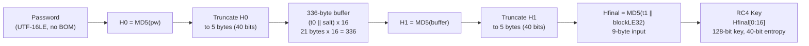
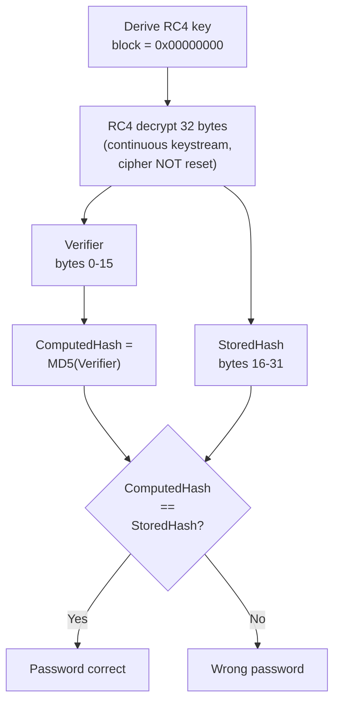
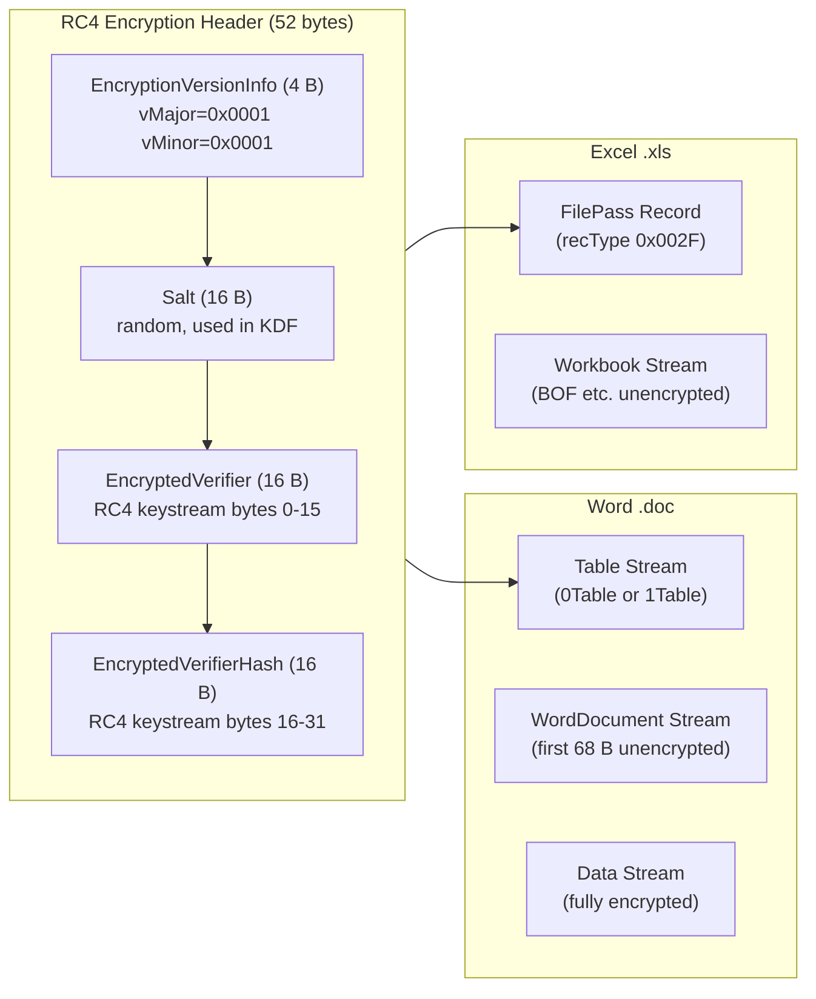

# MD5 + RC4-40 Document Encryption (Office 97/2000 Legacy)

🟢 **Weak Encryption** — 40-bit effective key, un-iterated MD5, easily reversible per [MS-OFFCRYPTO] SS4.1.3.3

## Overview

- Legacy 40-bit RC4 password-to-open encryption for Office binary documents (`.doc`, `.xls`), predating both the CryptoAPI and OOXML-era AES schemes
- Password hashed with MD5 and truncated to 5 bytes (40 bits) at two stages, making the effective keyspace 2^40 regardless of password complexity
- Un-iterated KDF with no spin count; the "16 times" replication is buffer duplication within a single MD5 call, not PBKDF iteration
- RC4 verifier and verifier hash encrypted as one continuous 32-byte keystream (cipher state NOT reset between the two fields)
- Used by: [Word 97/2000](../../formats/word.md), [Excel 97/2000](../../formats/excel.md)
- Spec: [MS-OFFCRYPTO] SS2.3.6, SS2.3.6.1--SS2.3.6.4, SS4.1.3.3

## KDF Pipeline



## Verification Flow



## On-Disk Structure



## Quick Reference

| Parameter | Value | Source |
|---|---|---|
| Hash | MD5 (128-bit output) | [MS-OFFCRYPTO] SS2.3.6.2 |
| Cipher | RC4 (128-bit key schedule) | [MS-OFFCRYPTO] SS2.3.6.2 |
| Effective key strength | 40 bits (double 5-byte truncation) | [MS-OFFCRYPTO] SS4.1.3.3 |
| Salt | 16 bytes (random) | [MS-OFFCRYPTO] SS2.3.6.2 |
| Password encoding | UTF-16LE, no BOM, no NUL | [MS-OFFCRYPTO] SS2.3.6.2 |
| Max password length | 255 Unicode characters | [MS-OFFCRYPTO] SS2.3.6.2 |
| Spin / iteration count | None (un-iterated) | [MS-OFFCRYPTO] SS4.1.3.3 |
| Verifier block number | 0x00000000 | [MS-OFFCRYPTO] SS2.3.6.2 |
| Version discriminator | vMajor=0x0001, vMinor=0x0001 | [MS-OFFCRYPTO] SS2.3.6.1 |

## Extraction Target

Fields to extract from the RC4 Encryption Header (52-byte structure in the Table stream or FilePass record):

| Field | Offset / Source | Type | Example |
|---|---|---|---|
| `vMajor` | 0x00 (2 B) | uint16 LE | `0x0001` |
| `vMinor` | 0x02 (2 B) | uint16 LE | `0x0001` |
| `Salt` | 0x04 (16 B) | byte[16] | `C4 DC 85 69 91 13 EC 1C F1 E5 29 06 0E 49 00 B3` |
| `EncryptedVerifier` | 0x14 (16 B) | byte[16] | `F3 53 BB 80 36 63 CD E3 DD F2 D1 CB 10 23 9B 5A` |
| `EncryptedVerifierHash` | 0x24 (16 B) | byte[16] | `39 8F EA C2 43 EC F4 4B 9A 62 29 1B 1A 4C 9D CD` |

**Python function signatures:**

```python
def derive_rc4_md5_key(
    password: str,
    salt: bytes,  # 16 bytes from header offset 0x04
    block: int,  # 0x00000000 for verifier, incrementing for content
) -> bytes:
    """Derive a 128-bit RC4 key (40-bit effective entropy).

    Per [MS-OFFCRYPTO] SS2.3.6.2.
    """
    ...


def verify_rc4_md5(
    password: str,
    salt: bytes,  # 16 bytes from header offset 0x04
    enc_verifier: bytes,  # 16 bytes from header offset 0x14
    enc_verifier_hash: bytes,  # 16 bytes from header offset 0x24
) -> bool:
    """Check a candidate password against the RC4 Encryption Header.

    Derives the block-0 key, RC4-decrypts the 32-byte verifier+hash
    as one continuous keystream, and compares MD5(verifier) to the
    stored hash. Per [MS-OFFCRYPTO] SS2.3.6.4.
    """
    ...
```

---

## 1. What It Is and Where It Is Used

Office Binary Document RC4 Encryption is the legacy 40-bit RC4 password-to-open scheme for pre-CryptoAPI Microsoft Office binary documents ([MS-OFFCRYPTO] section 2.3.6):

- Encrypts document streams in place — the storages and streams used by the application are not altered in structure, only in content ([MS-OFFCRYPTO] section 2.3.6: "Office binary document RC4 encryption does not alter the storages and streams used. If a stream is encrypted, it is encrypted in place.")
- Password is encoded as UTF-16LE and hashed with MD5; the derived key material is truncated to 5 bytes (40 bits) at two separate stages, then a final MD5 produces a 128-bit value used as the RC4 key
- A 16-byte random verifier and its MD5 hash, both encrypted under the derived key, serve as the password check

This scheme is described in [MS-OFFCRYPTO] sections 2.3.6, 2.3.6.1, 2.3.6.2, 2.3.6.3, and 2.3.6.4. It predates both the RC4 CryptoAPI SHA-1 scheme and the OOXML Standard/Agile AES schemes. It is entirely distinct from XOR obfuscation.

**Sibling algorithm documents:**

- [RC4 CryptoAPI SHA-1](./rc4-cryptoapi-sha1.md) — [MS-OFFCRYPTO] section 2.3.5
- [ECMA-376 Standard](./ecma376-standard.md) — [MS-OFFCRYPTO] section 2.3.4
- [ECMA-376 Agile](./ecma376-agile.md) — [MS-OFFCRYPTO] section 2.3.4
- [XOR Obfuscation](./xor-obfuscation.md) — [MS-OFFCRYPTO] section 2.3.7

Products and formats that use this scheme:

- **Word 97/2000 (`.doc`):** The RC4 Encryption Header is stored in the Table stream (`0Table` or `1Table`, selected by `FibBase.fWhichTblStm`). `FibBase.fEncrypted = 1` and `FibBase.fObfuscated = 0` signal 40-bit RC4 encryption as opposed to XOR obfuscation. The body of the Table stream (beyond the header), the WordDocument stream past the first 68 bytes, and the entire Data stream are encrypted in 512-byte blocks with incrementing block numbers ([MS-DOC] sections 2.1.2, 2.2.6.2). See [../../formats/word.md](../../formats/word.md).
- **Excel 97/2000 (`.xls`):** The `FilePass` record (`recType 0x002F`) in the Workbook stream selects the encryption method; when it selects RC4 (type 1), the header follows the section 2.3.6.1 layout. `FilePass`, `BOF`, and a handful of other records remain unencrypted ([MS-XLS] section 2.4.117). See [../../formats/excel.md](../../formats/excel.md).

The secret protected is the document-open password only. This scheme does not cover modify/write-reservation passwords, sheet/workbook protection, or VBA macro passwords.

The scheme is identified on disk by `EncryptionVersionInfo` with `vMajor = 0x0001` and `vMinor = 0x0001` ([MS-OFFCRYPTO] section 2.3.6.1). This distinguishes it from the RC4 CryptoAPI scheme, which uses `vMajor` in {`0x0002`, `0x0003`, `0x0004`} with `vMinor = 0x0002`, and from the ECMA-376 Agile scheme, which uses `vMajor = 0x0004` with `vMinor = 0x0004`.

## 2. Profiles / Parameters

There is exactly one cryptographic profile defined by this scheme. No algorithm negotiation, no variable key sizes, and no iteration/spin count exist.

| Parameter | Value | Source |
|---|---|---|
| Hash algorithm | MD5 (128-bit output) | [MS-OFFCRYPTO] section 2.3.6.2 |
| Stream cipher | RC4 | [MS-OFFCRYPTO] section 2.3.6.2 |
| Password encoding | UTF-16LE (no BOM, no NUL terminator) | [MS-OFFCRYPTO] section 2.3.6.2 |
| Maximum password length | 255 Unicode characters (unless the application imposes a lower limit) | [MS-OFFCRYPTO] section 2.3.6.2 |
| Salt size | 16 bytes (randomly generated) | [MS-OFFCRYPTO] section 2.3.6.2 |
| Hash truncation length | 5 bytes (40 bits), applied twice | [MS-OFFCRYPTO] section 2.3.6.2 |
| Intermediate buffer size | 336 bytes (21-byte block replicated 16 times) | [MS-OFFCRYPTO] section 2.3.6.2 |
| Block number (verifier) | `0x00000000` (32-bit unsigned, little-endian) | [MS-OFFCRYPTO] section 2.3.6.2 |
| RC4 key length | 128 bits (first 16 bytes of Hfinal) | [MS-OFFCRYPTO] section 2.3.6.2 |
| Effective key strength | 40 bits | [MS-OFFCRYPTO] section 4.1.3.3 |
| Iteration / spin count | None (un-iterated) | [MS-OFFCRYPTO] section 4.1.3.3 |
| Verifier size | 16 bytes | [MS-OFFCRYPTO] section 2.3.6.1 |
| Verifier hash size | 16 bytes (MD5 output) | [MS-OFFCRYPTO] section 2.3.6.1 |
| `EncryptionVersionInfo.vMajor` | `0x0001` | [MS-OFFCRYPTO] section 2.3.6.1 |
| `EncryptionVersionInfo.vMinor` | `0x0001` | [MS-OFFCRYPTO] section 2.3.6.1 |

## 3. Byte Layout / On-Disk Structure

The RC4 Encryption Header is a fixed 52-byte structure ([MS-OFFCRYPTO] section 2.3.6.1). All multi-byte integer fields are little-endian. The salt, verifier, and verifier-hash fields are opaque byte arrays (no endianness interpretation).

### 3.1 RC4 Encryption Header (52 bytes)

| Field | Offset | Size (bytes) | Type / Endianness | Value / Meaning |
|---|---|---|---|---|
| `EncryptionVersionInfo.vMajor` | 0x00 | 2 | uint16, LE | MUST be `0x0001`. Identifies the Office Binary Document RC4 Encryption scheme. |
| `EncryptionVersionInfo.vMinor` | 0x02 | 2 | uint16, LE | MUST be `0x0001`. Together with `vMajor = 0x0001`, this uniquely identifies the 40-bit RC4/MD5 scheme. |
| `Salt` | 0x04 | 16 | byte[16] | A randomly generated salt value used during key derivation. MUST NOT be the same data used for the verifier stored in `EncryptedVerifier`. |
| `EncryptedVerifier` | 0x14 | 16 | byte[16] | A 16-byte random verifier encrypted using a 40-bit RC4 cipher initialized per section 2.3.6.2, with block number `0x00000000`. |
| `EncryptedVerifierHash` | 0x24 | 16 | byte[16] | The MD5 hash of the plaintext verifier, encrypted using the same RC4 keystream as the `EncryptedVerifier` (the RC4 cipher state is NOT reset between the two fields). |

Total structure size: 4 + 16 + 16 + 16 = **52 bytes**.

### 3.2 Container Placement

The RC4 Encryption Header is embedded within an application-specific stream of the OLE Compound File Binary ([MS-CFB]) container:

- **Word (`.doc`):** The header occupies the first `FibBase.lKey` bytes of the Table stream (`0Table` or `1Table`, selected by `FibBase.fWhichTblStm`). It is stored unencrypted. The remainder of the Table stream, the WordDocument stream past the first 68 bytes, and the entire Data stream are encrypted in 512-byte blocks, each block using a key derived with an incrementing block number ([MS-DOC] sections 2.1.2, 2.2.6.2). See [../../formats/word.md](../../formats/word.md).
- **Excel (`.xls`):** The `FilePass` record ([MS-XLS] section 2.4.117) in the Workbook stream carries the encryption header following the section 2.3.6.1 layout. `FilePass`, `BOF`, and selected other records remain unencrypted. See [../../formats/excel.md](../../formats/excel.md).

### 3.3 Worked Example (from [MS-OFFCRYPTO] Section 3.10.1)

The following hex dump is a complete RC4 Encryption Header as given in the spec example:

```
00001200: 01 00 01 00 C4 DC 85 69  91 13 EC 1C F1 E5 29 06
00001210: 0E 49 00 B3 F3 53 BB 80  36 63 CD E3 DD F2 D1 CB
00001220: 10 23 9B 5A 39 8F EA C2  43 EC F4 4B 9A 62 29 1B
00001230: 1A 4C 9D CD
```

Parsed fields:

| Field | Hex bytes | Interpretation |
|---|---|---|
| `vMajor` | `01 00` | `0x0001` |
| `vMinor` | `01 00` | `0x0001` |
| `Salt` | `C4 DC 85 69 91 13 EC 1C F1 E5 29 06 0E 49 00 B3` | Random 16-byte salt |
| `EncryptedVerifier` | `F3 53 BB 80 36 63 CD E3 DD F2 D1 CB 10 23 9B 5A` | Verifier encrypted with RC4 (block 0) |
| `EncryptedVerifierHash` | `39 8F EA C2 43 EC F4 4B 9A 62 29 1B 1A 4C 9D CD` | MD5(Verifier) encrypted with RC4 (continuous keystream) |

## 4. Key Derivation

The encryption key derivation algorithm is specified in [MS-OFFCRYPTO] section 2.3.6.2. Let `H()` denote the MD5 hashing algorithm, `+` or `||` denote byte concatenation. The password MUST be provided as an array of Unicode characters encoded as UTF-16LE ([MS-OFFCRYPTO] section 2.3.6.2). Limitations on the length and character set are implementation-dependent; unless otherwise specified, the maximum password length MUST be 255 Unicode characters ([MS-OFFCRYPTO] section 2.3.6.2). Application-specific limits may apply ([MS-DOC], [MS-XLS]).

### 4.1 Algorithm Steps

**Step 1 — Encode the password.** Convert the password string to UTF-16LE bytes (little-endian, no BOM, no NUL terminator). This is the input `password_bytes`.

**Step 2 — Compute initial hash H0 and truncate.** Compute the MD5 hash of the UTF-16LE password bytes:

```
H0 = MD5(password_bytes)
```

Take the first 5 bytes of H0 as `TruncatedHash`:

```
TruncatedHash = H0[0:5]
```

This is the first 40-bit truncation ([MS-OFFCRYPTO] section 2.3.6.2: "Let TruncatedHash be the first 5 bytes of H0.").

**Step 3 — Build the 336-byte IntermediateBuffer.** Form a 21-byte block by concatenating `TruncatedHash` (5 bytes) with the `Salt` (16 bytes):

```
block21 = TruncatedHash + Salt    (5 + 16 = 21 bytes)
```

Initialize `IntermediateBuffer` by repeating this 21-byte block 16 times:

```
IntermediateBuffer = block21 * 16    (21 * 16 = 336 bytes)
```

([MS-OFFCRYPTO] section 2.3.6.2: "Let IntermediateBuffer be a 336-byte buffer. Form a 21-byte buffer by concatenating TruncatedHash plus the salt. Initialize IntermediateBuffer by copying the 21-byte buffer into IntermediateBuffer a total of 16 times.")

Note: the order is `TruncatedHash || Salt`, not `Salt || TruncatedHash`.

**Step 4 — Compute H1 and truncate.** Compute the MD5 hash of the 336-byte IntermediateBuffer:

```
H1 = MD5(IntermediateBuffer)
```

Take the first 5 bytes of H1 as the second `TruncatedHash`:

```
TruncatedHash = H1[0:5]
```

This is the second 40-bit truncation ([MS-OFFCRYPTO] section 2.3.6.2: "Let TruncatedHash be the first 5 bytes of H1.").

**Step 5 — Compute Hfinal with the block number.** Concatenate the second `TruncatedHash` (5 bytes) with the block number (a 32-bit unsigned integer serialized as 4 bytes in little-endian order):

```
Hfinal = MD5(TruncatedHash + block_bytes)    (5 + 4 = 9 byte input)
```

The block number is provided by the application. For the password verifier, the block number MUST be `0x00000000`. For encrypting/decrypting document content, the block number increments per block ([MS-OFFCRYPTO] section 2.3.6.2: "The block number MUST be a 32-bit unsigned value provided by the application.").

**Step 6 — Extract the RC4 key.** The first 128 bits (16 bytes) of `Hfinal` are used as the derived RC4 encryption key ([MS-OFFCRYPTO] section 2.3.6.2: "The first 128 bits of Hfinal MUST then be used as the derived encryption key."). The encryption algorithm MUST be RC4.

### 4.2 Complete KDF Pseudocode

```
FUNCTION derive_rc4_key(password_string, salt, block_number)
    # Step 1: Encode password as UTF-16LE
    password_bytes = UTF16LE_encode(password_string)

    # Step 2: Initial hash, first 5-byte truncation
    H0 = MD5(password_bytes)
    TruncatedHash_0 = H0[0:5]                              # 40 bits

    # Step 3: Build 336-byte IntermediateBuffer
    block21 = TruncatedHash_0 + salt                        # 5 + 16 = 21 bytes
    IntermediateBuffer = empty
    REPEAT 16 TIMES:
        IntermediateBuffer = IntermediateBuffer + block21    # 21 * 16 = 336 bytes

    # Step 4: Second hash, second 5-byte truncation
    H1 = MD5(IntermediateBuffer)
    TruncatedHash_1 = H1[0:5]                              # 40 bits

    # Step 5: Final hash with block number
    block_bytes = UINT32_TO_LE_BYTES(block_number)          # 4 bytes, little-endian
    Hfinal = MD5(TruncatedHash_1 + block_bytes)             # 9-byte input

    # Step 6: RC4 key is first 16 bytes of Hfinal
    rc4_key = Hfinal[0:16]                                  # 128-bit RC4 key

    RETURN rc4_key
END FUNCTION
```

### 4.3 Why the Effective Key Strength Is 40 Bits

Although the RC4 cipher is initialized with a full 128-bit (16-byte) key, the effective key strength is only 40 bits. This is because both intermediate hash values (H0 and H1) are truncated to 5 bytes before further processing. The value `TruncatedHash_1` (5 bytes = 40 bits) fully determines `Hfinal` for any given block number; therefore, at most 2^40 distinct RC4 keys exist across all possible passwords ([MS-OFFCRYPTO] section 4.1.3.3: "While the derived encryption key is actually 128 bits, the input used to derive the key is fixed at 40 bits"). The "40-bit RC4" label refers to this effective entropy, not the number of bytes loaded into the RC4 key schedule.

### 4.4 RC4 Cipher (Standard KSA/PRGA)

The RC4 cipher used is the standard Rivest Cipher 4 stream cipher with a 128-bit key schedule (16-byte key). No initial keystream bytes are discarded ([MS-OFFCRYPTO] section 4.1.3.3: "Encryption begins with the first byte, and does not throw away an initial range as is recommended to overcome a known weakness in the RC4 pseudorandom number generator.").

```
FUNCTION RC4(key, data)
    # Key Scheduling Algorithm (KSA)
    S = [0, 1, 2, ..., 255]                                # Identity permutation
    j = 0
    FOR i = 0 TO 255:
        j = (j + S[i] + key[i MOD length(key)]) MOD 256
        SWAP(S[i], S[j])
    END FOR

    # Pseudo-Random Generation Algorithm (PRGA)
    i = 0
    j = 0
    output = empty
    FOR EACH byte b IN data:
        i = (i + 1) MOD 256
        j = (j + S[i]) MOD 256
        SWAP(S[i], S[j])
        k = S[(S[i] + S[j]) MOD 256]
        output = output + (b XOR k)
    END FOR

    RETURN output
END FUNCTION
```

### 4.5 Block Number Semantics

The block number is a 32-bit unsigned integer that varies depending on what is being encrypted or decrypted:

- **Block number `0x00000000`:** Used for the password verifier (both `EncryptedVerifier` and `EncryptedVerifierHash` use a key derived with this block number) ([MS-OFFCRYPTO] section 2.3.6.2).
- **Incrementing block numbers:** For document content, the application provides an incrementing block number for each block of the encrypted stream. In Word, this increments per 512-byte block of the encrypted document streams ([MS-DOC] section 2.2.6.2).

A new RC4 key is derived (by repeating step 5 with the new block number) for each block of document content. The key derivation from step 1 through step 4 (`TruncatedHash_1`) is constant for a given password and salt; only the final MD5 in step 5 varies per block.

## 5. Password Verifier Generation

The password verifier generation procedure is specified in [MS-OFFCRYPTO] section 2.3.6.3. It produces the `EncryptedVerifier` and `EncryptedVerifierHash` fields stored in the RC4 Encryption Header (section 2.3.6.1).

```
FUNCTION generate_password_verifier(password_string, salt)
    # Step 1: Derive the RC4 key with block number 0
    rc4_key = derive_rc4_key(password_string, salt, 0x00000000)

    # Step 2: Generate a random 16-byte verifier
    Verifier = RANDOM_BYTES(16)

    # Step 3: Compute the MD5 hash of the verifier
    VerifierHash = MD5(Verifier)                              # 16 bytes

    # Step 4: Encrypt verifier and hash as one continuous RC4 stream
    # The RC4 decryption stream MUST NOT be reset between the two fields
    # [MS-OFFCRYPTO] section 2.3.6.3
    plaintext = Verifier + VerifierHash                       # 32 bytes
    ciphertext = RC4(rc4_key, plaintext)                      # 32 bytes, continuous keystream

    # Step 5: Store the fields
    EncryptedVerifier     = ciphertext[0:16]
    EncryptedVerifierHash = ciphertext[16:32]

    RETURN (salt, EncryptedVerifier, EncryptedVerifierHash)
END FUNCTION
```

The critical requirement is that the RC4 cipher state MUST NOT be reset between encrypting the verifier and encrypting the verifier hash ([MS-OFFCRYPTO] section 2.3.6.3: "The RC4 decryption stream MUST NOT be reset between decrypting EncryptedVerifier and EncryptedVerifierHash."). The `EncryptedVerifier` consumes RC4 keystream bytes 0 through 15, and `EncryptedVerifierHash` consumes keystream bytes 16 through 31, all from the same initialized RC4 state.

## 6. Password Verification

The password verification procedure is specified in [MS-OFFCRYPTO] section 2.3.6.4.

### 6.1 Algorithm Steps

1. Generate an encryption key as specified in section 2.3.6.2, using a block number of `0x00000000` ([MS-OFFCRYPTO] section 2.3.6.4 step 1).
2. Decrypt the `EncryptedVerifier` field of the RC4 Encryption Header to obtain the `Verifier` value. The resulting `Verifier` MUST be an array of 16 bytes ([MS-OFFCRYPTO] section 2.3.6.4 step 2).
3. Decrypt the `EncryptedVerifierHash` field of the RC4 Encryption Header to obtain the hash of the `Verifier`. The number of bytes used by the encrypted verifier hash MUST be 16 ([MS-OFFCRYPTO] section 2.3.6.4 step 3).
4. Calculate the MD5 hash of the `Verifier` obtained in step 2 ([MS-OFFCRYPTO] section 2.3.6.4 step 4).
5. Compare the results of step 3 and step 4. If the two hash values do not match, the password is incorrect ([MS-OFFCRYPTO] section 2.3.6.4 step 5).

The RC4 decryption stream MUST NOT be reset between decrypting `EncryptedVerifier` and `EncryptedVerifierHash` ([MS-OFFCRYPTO] section 2.3.6.4).

### 6.2 Verification Pseudocode

```
FUNCTION verify_password(password_string, salt, EncryptedVerifier, EncryptedVerifierHash)
    # Step 1: Derive RC4 key with block number 0
    rc4_key = derive_rc4_key(password_string, salt, 0x00000000)

    # Steps 2-3: Decrypt both fields with one continuous RC4 keystream
    ciphertext = EncryptedVerifier + EncryptedVerifierHash    # 32 bytes
    plaintext = RC4(rc4_key, ciphertext)                      # 32 bytes, continuous

    Verifier     = plaintext[0:16]                            # decrypted verifier
    StoredHash   = plaintext[16:32]                           # decrypted MD5(Verifier)

    # Step 4: Compute MD5 of the decrypted verifier
    ComputedHash = MD5(Verifier)                              # 16 bytes

    # Step 5: Compare
    IF ComputedHash == StoredHash THEN                        # full 128-bit comparison
        RETURN TRUE                                           # password is correct
    ELSE
        RETURN FALSE                                          # password is incorrect
    END IF
END FUNCTION
```

### 6.3 Document Content Decryption

To decrypt actual document content (beyond verification), the same key derivation is used but with the appropriate block number for each 512-byte block of the encrypted stream. For each block:

```
FUNCTION decrypt_block(password_string, salt, block_number, encrypted_block)
    rc4_key = derive_rc4_key(password_string, salt, block_number)
    plaintext_block = RC4(rc4_key, encrypted_block)
    RETURN plaintext_block
END FUNCTION
```

Each block uses a freshly derived key (a new `Hfinal` from step 5) and a freshly initialized RC4 state. The block number is typically the zero-based index of the 512-byte block within the encrypted stream.

## 7. Reference Constants

Every magic value, fixed parameter, and constant defined by the spec for this scheme:

### 7.1 On-Disk Discriminator

| Constant | Value | Source |
|---|---|---|
| `EncryptionVersionInfo.vMajor` | `0x0001` | [MS-OFFCRYPTO] section 2.3.6.1 |
| `EncryptionVersionInfo.vMinor` | `0x0001` | [MS-OFFCRYPTO] section 2.3.6.1 |

This version pair is the sole on-disk identifier of the 40-bit RC4/MD5 scheme. Any other `vMajor`/`vMinor` combination selects a different scheme.

### 7.2 KDF Constants

| Constant | Value | Meaning | Source |
|---|---|---|---|
| Truncation length | 5 bytes (40 bits) | Applied to both H0 and H1 | [MS-OFFCRYPTO] section 2.3.6.2 |
| 21-byte block composition | `TruncatedHash(5) + Salt(16)` | The unit replicated into the IntermediateBuffer | [MS-OFFCRYPTO] section 2.3.6.2 |
| IntermediateBuffer size | 336 bytes | 21-byte block replicated 16 times: 21 * 16 = 336 | [MS-OFFCRYPTO] section 2.3.6.2 |
| Replication count | 16 | Number of times the 21-byte block is copied | [MS-OFFCRYPTO] section 2.3.6.2 |
| Block number (verifier) | `0x00000000` | 32-bit unsigned, little-endian, appended after TruncatedHash_1 | [MS-OFFCRYPTO] section 2.3.6.2 |
| Final MD5 input size | 9 bytes | TruncatedHash_1(5) + block_number(4) | [MS-OFFCRYPTO] section 2.3.6.2 |
| RC4 key length | 16 bytes (128 bits) | First 128 bits of Hfinal | [MS-OFFCRYPTO] section 2.3.6.2 |

### 7.3 Salt and Verifier Constants

| Constant | Value | Source |
|---|---|---|
| Salt size | 16 bytes | [MS-OFFCRYPTO] section 2.3.6.2 |
| Verifier size | 16 bytes | [MS-OFFCRYPTO] section 2.3.6.1 |
| VerifierHash size | 16 bytes (MD5 output) | [MS-OFFCRYPTO] section 2.3.6.1 |
| EncryptedVerifier size | 16 bytes | [MS-OFFCRYPTO] section 2.3.6.1 |
| EncryptedVerifierHash size | 16 bytes | [MS-OFFCRYPTO] section 2.3.6.1 |
| Total header size | 52 bytes | 4 (version) + 16 (salt) + 16 (enc. verifier) + 16 (enc. verifier hash) |

### 7.4 MD5 Initial Values

The MD5 hash algorithm uses the standard initialization vector defined in [RFC 1321]:

| Register | Initial value |
|---|---|
| A | `0x67452301` |
| B | `0xEFCDAB89` |
| C | `0x98BADCFE` |
| D | `0x10325476` |

No custom or modified constants are used. The MD5 algorithm is applied in its standard form throughout this scheme.

### 7.5 RC4 State Initialization

The RC4 S-box is initialized to the identity permutation `S[i] = i` for `i = 0..255`, then permuted by the standard Key Scheduling Algorithm (KSA) with the 16-byte key. No keystream bytes are discarded before use.

### 7.6 Constants That Do NOT Apply

The following constants belong to sibling schemes and must not be confused with this scheme:

- `AlgID = 0x00006801` (RC4) and `AlgIDHash = 0x00008004` (SHA-1) are fields of the `EncryptionHeader` structure used by the RC4 CryptoAPI scheme ([MS-OFFCRYPTO] section 2.3.5). They are absent from the section 2.3.6 RC4 Encryption Header.
- `EncryptionHeaderFlags` (`fCryptoAPI`, `fAES`, etc.) belong to the `EncryptionHeader` structure ([MS-OFFCRYPTO] section 2.3.1) used by sections 2.3.4 and 2.3.5. They are absent from this scheme.
- `SaltSize` and `VerifierHashSize` fields exist in the `EncryptionVerifier` structure ([MS-OFFCRYPTO] section 2.3.3) used by sections 2.3.4 and 2.3.5. They are absent from this scheme's fixed-layout header.
- `0xCE4B`, `XorMatrix`, `InitialCode`, `PadArray`, `mpbbCrypt`, and related tables belong to XOR obfuscation ([MS-OFFCRYPTO] section 2.3.7).
- Agile encryption block keys (`0xfea7d276...`, `0xd7aa0f6d...`, `0x146e0be7...`), AES `AlgID` values (`0x660E`, `0x660F`, `0x6610`), spin counts (default 100,000), and HMAC constructs belong to the OOXML AES schemes ([MS-OFFCRYPTO] section 2.3.4).

## 8. Security Considerations

The following security considerations are stated directly in [MS-OFFCRYPTO] section 4.1.3.3:

- **Not recommended:** "The Office binary document RC4 encryption method is not recommended, and ought to be used only when backward compatibility is required" ([MS-OFFCRYPTO] section 4.1.3.3).
- **Password length limit:** "Passwords are limited to 255 Unicode characters" ([MS-OFFCRYPTO] section 4.1.3.3).

Known cryptographic weaknesses enumerated by the spec:

1. **Un-iterated KDF.** "The key derivation algorithm is not an iterated hash, as described in [RFC2898], which allows brute-force attacks against the password to be performed rapidly" ([MS-OFFCRYPTO] section 4.1.3.3). There is no spin count or iteration; the "16 times" replication is buffer duplication within a single MD5 call, not a PBKDF iteration.
2. **No initial keystream discard.** "Encryption begins with the first byte, and does not throw away an initial range as is recommended to overcome a known weakness in the RC4 pseudorandom number generator" ([MS-OFFCRYPTO] section 4.1.3.3). Modern RC4 usage typically discards the first 256 or more keystream bytes to mitigate known biases in early output.
3. **No integrity protection.** "No provision is made for detecting corruption within the encryption stream, which exposes encrypted data to bit-flipping attacks" ([MS-OFFCRYPTO] section 4.1.3.3). There is no MAC or HMAC over the encrypted content.
4. **40-bit effective key strength.** "While the derived encryption key is actually 128 bits, the input used to derive the key is fixed at 40 bits, and current hardware enables brute-force attacks on the encryption key without knowing the password in a relatively short period of time so that even if the password cannot easily be recovered, the information could still be disclosed" ([MS-OFFCRYPTO] section 4.1.3.3). The double 5-byte truncation reduces the key space to 2^40 regardless of password complexity.
5. **Partial encryption.** "Some streams might not be encrypted" ([MS-OFFCRYPTO] section 4.1.3.3). In Word, the first 68 bytes of the WordDocument stream and the encryption header itself remain in the clear; in Excel, `BOF`, `FilePass`, and certain other records are unencrypted.
6. **Keystream reuse risk.** "Depending on the application, key stream reuse could occur, potentially with known plaintext, implying that certain portions of encrypted data could be either directly extracted or easily retrieved" ([MS-OFFCRYPTO] section 4.1.3.3).
7. **Document property leakage.** "Document properties might not be encrypted, which could result in information leakage" ([MS-OFFCRYPTO] section 4.1.3.3).

**Conclusion from the spec.** "Because of the cryptographic weaknesses of the Office Binary Document RC4 Encryption, it is considered easily reversible and therefore is not recommended when storing sensitive materials" ([MS-OFFCRYPTO] section 4.1.3.3).

## 9. Spec References

| Section | Title | Content |
|---|---|---|
| [MS-OFFCRYPTO] section 1.3.3.2 | 40-bit RC4 Encryption (overview) | "40-bit RC4 encryption is performed on portions of Office binary documents." |
| [MS-OFFCRYPTO] section 2.3.6 | Office Binary Document RC4 Encryption | Scheme overview; "does not alter the storages and streams used." |
| [MS-OFFCRYPTO] section 2.3.6.1 | RC4 Encryption Header | 52-byte structure: `EncryptionVersionInfo` (vMajor=1, vMinor=1), `Salt[16]`, `EncryptedVerifier[16]`, `EncryptedVerifierHash[16]`. |
| [MS-OFFCRYPTO] section 2.3.6.2 | Encryption Key Derivation | Complete KDF: H0=MD5(pw), truncate to 5 bytes, 336-byte buffer (21*16), H1=MD5(buffer), truncate to 5 bytes, Hfinal=MD5(truncated+block), key=Hfinal[0:16]. |
| [MS-OFFCRYPTO] section 2.3.6.3 | Password Verifier Generation | Verifier encrypted with block 0 key; "RC4 decryption stream MUST NOT be reset between EncryptedVerifier and EncryptedVerifierHash." |
| [MS-OFFCRYPTO] section 2.3.6.4 | Password Verification | 5-step verification procedure; continuous RC4 keystream requirement restated. |
| [MS-OFFCRYPTO] section 3.10 | Office Binary Document RC4 Encryption (example) | Worked hex dump of a 52-byte header. |
| [MS-OFFCRYPTO] section 3.10.1 | Encryption Header (example) | Field-by-field breakdown of the example header bytes. |
| [MS-OFFCRYPTO] section 4.1.3.3 | Office Binary Document RC4 Encryption (security) | Seven enumerated cryptographic weaknesses; "considered easily reversible." |
| [MS-DOC] section 2.1.2 | File structure | `FibBase.fEncrypted`, `FibBase.fObfuscated`, table stream selection. |
| [MS-DOC] section 2.2.6.2 | Encryption details | 512-byte block encryption with incrementing block numbers. |
| [MS-XLS] section 2.4.117 | FilePass record | Record carrying the encryption header for Excel binary files. |
| [RFC 1321] | The MD5 Message-Digest Algorithm | MD5 specification referenced by [MS-OFFCRYPTO] section 1.1 glossary. |

**Cross-references to sibling algorithm documents:**

- [RC4 CryptoAPI SHA-1](./rc4-cryptoapi-sha1.md) — section 2.3.5
- [ECMA-376 Standard Encryption](./ecma376-standard.md) — section 2.3.4.5–2.3.4.9
- [ECMA-376 Agile Encryption](./ecma376-agile.md) — section 2.3.4.10–2.3.4.15
- [XOR Obfuscation](./xor-obfuscation.md) — section 2.3.7

**Cross-references to format documents:**

- [Word .doc](../../formats/word.md)
- [Excel .xls](../../formats/excel.md)
