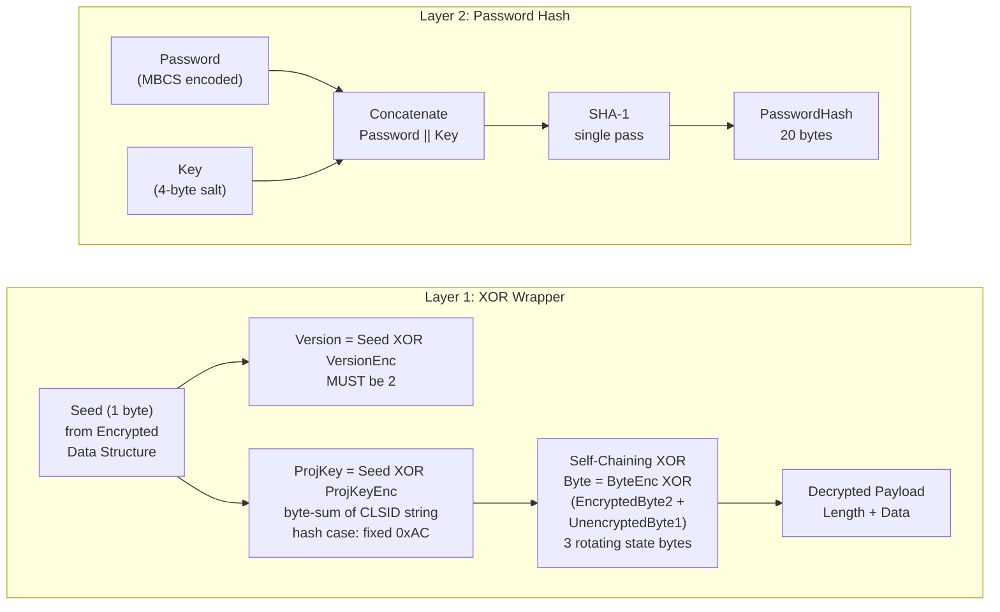
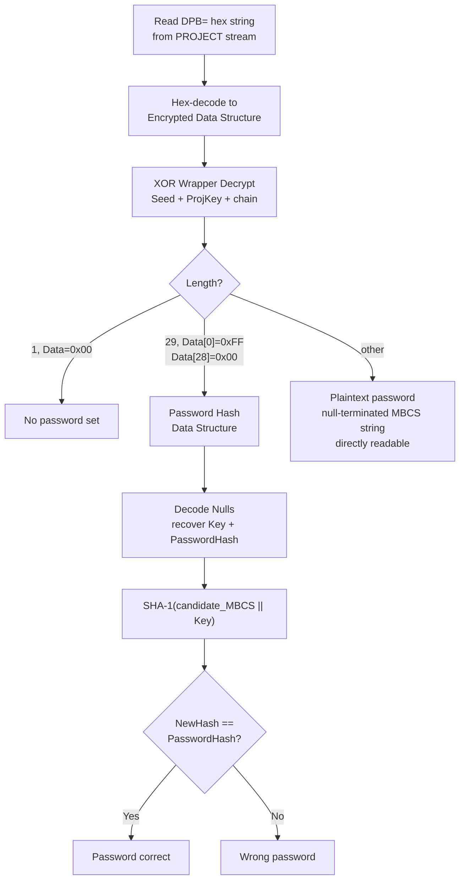
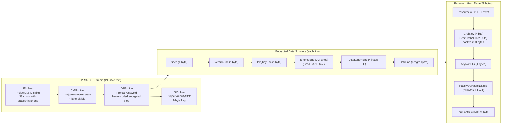
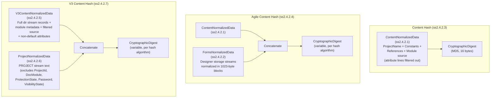

# VBA Project Password (DPB Obfuscation + SHA-1 Hash Verifier)

⚪ **UI-Only Obfuscation** — reversible XOR wrapper gating the VBE editor; macro source code is NOT encrypted

## Overview

- "Lock project for viewing" password set in the Visual Basic Editor — controls only the VBE UI, not access to the underlying macro source code (stored compressed but unencrypted in module streams)
- Two-layer scheme: a reversible self-chaining XOR obfuscation wrapper ([MS-OVBA] ss2.4.3) around either a single-pass SHA-1 password hash or a plaintext password string
- Password encoded as MBCS (per PROJECTCODEPAGE code page, typically Windows-1252), not UTF-16LE — unique among Office password mechanisms
- Identical format across VBA6 (Office 2000-2003) and VBA7 (Office 2007+), in both legacy binary and OOXML containers
- Used by: [Word](../../formats/word.md) (.doc/.docm), [Excel](../../formats/excel.md) (.xls/.xlsm), [PowerPoint](../../formats/powerpoint.md) (.ppt/.pptm), [Access](../../formats/access.md) (.mdb/.accdb)
- Spec: [MS-OVBA] ss2.3.1.15-ss2.3.1.17, ss2.4.3, ss2.4.4

## KDF Pipeline



## Verification Flow



## On-Disk Structure



## Quick Reference

| Parameter | Value | Notes |
|---|---|---|
| Wrapper | Self-chaining XOR | Reversible; Seed, Version, ProjKey all in-file |
| Version | 2 (fixed) | `Seed XOR VersionEnc`, MUST be 2 |
| ProjKey (hash case) | 0xAC (fixed) | CLSID forced to all-zeros |
| Hash | SHA-1, single pass | No iteration, no key stretching |
| Salt | 4-byte `Key` | Appended after MBCS password bytes |
| Digest | 20 bytes (160-bit) | Full SHA-1 output |
| Password Encoding | MBCS (code page from PROJECTCODEPAGE) | NOT UTF-16LE |
| Hash Struct Size | 29 bytes | Reserved + GrbitKey/GrbitHashNull + KeyNoNulls + PasswordHashNoNulls + Terminator |
| Plaintext Case | VBA 5.0 (MAY\<6\>) | Null-terminated MBCS string under same XOR wrapper |

## Extraction Target

Fields to extract from the `PROJECT` stream within the VBA project storage:

| Field | Source Location | Type | Example |
|---|---|---|---|
| ProjectCLSID | `ID=` line in PROJECT stream | 38-char GUID string | `{00000000-0000-0000-0000-000000000000}` |
| DPB blob | `DPB=` line in PROJECT stream | hex string -> bytes | `0E0CD1ECDFF4E7F5E7F5E7` |
| Code page | PROJECTCODEPAGE record in dir stream | uint16 (record Id 0x0003) | `1252` (Windows-1252) |
| Key (after decrypt) | Password Hash Data Structure bytes 4-7 | 4 bytes (after Decode Nulls) | `\xA9\x33\x02\x00` |
| PasswordHash (after decrypt) | Password Hash Data Structure bytes 8-27 | 20 bytes (after Decode Nulls) | (SHA-1 digest) |
| GrbitKey | Password Hash Data Structure byte 1 high nibble | 4 bits | `0xF` (all non-null) |
| GrbitHashNull | Password Hash Data Structure bytes 1-3 low 20 bits | 20 bits | (per-byte null flags) |
| CMG blob | `CMG=` line in PROJECT stream | hex string -> bytes | `0705D8E3D8EDDBF1DBF1DBF1DBF1` |
| GC blob | `GC=` line in PROJECT stream | hex string -> bytes | `1517CAF1D6F9D7F9D706` |

**Python function signatures this maps to:**

```python
def vba_decrypt_dpb(
    enc_bytes: bytes,  # hex-decoded DPB= value
) -> tuple[int, int, int, bytes]:
    """Decrypt the DPB XOR wrapper.

    Returns (version, projkey, length, data) where:
      - version: MUST be 2
      - projkey: byte-sum of CLSID (0xAC for hash case)
      - length: payload byte count
      - data: decrypted payload bytes
    """
    ...


def verify_vba_password(
    candidate: str,  # password to test
    key: bytes,  # 4-byte Key from Password Hash Data Structure
    stored_hash: bytes,  # 20-byte PasswordHash from Password Hash Data Structure
    codepage: int = 1252,  # from PROJECTCODEPAGE record in dir stream
) -> bool:
    """Verify a candidate password against a stored VBA project password hash.

    Encodes candidate as MBCS using codepage, computes SHA-1(encoded || key),
    and compares against stored_hash.
    """
    ...
```

---

## 1. What It Is and Where It Is Used

- The VBA project password is the "Lock project for viewing" password set in the Visual Basic Editor (Tools > VBAProject Properties > Protection tab). It controls whether the VBE user interface grants access to view the project's macro source code.
- It is not a document-open password, not a workbook/sheet protection password, and not a write-reservation password.
- The macro source code itself is stored compressed but unencrypted in the module streams within the VBA storage ([MS-OVBA] ss2.2.5, ss2.3.4.3); the password gates only the editor UI, not the underlying data.
- The password material is carried in the `PROJECT` stream ([MS-OVBA] ss2.2.7, ss2.3.1), an INI-style text stream within the Project Root Storage ([MS-OVBA] ss2.2.1) of a VBA project's OLE compound file ([MS-CFB]).
- Three lines in this stream carry obfuscated protection data using the same reversible Data Encryption algorithm ([MS-OVBA] ss2.4.3): `CMG=` (ProjectProtectionState, ss2.3.1.15), `DPB=` (ProjectPassword, ss2.3.1.16), and `GC=` (ProjectVisibilityState, ss2.3.1.17).
- A fourth line, `ID=` (ProjectId, ss2.3.1.2), supplies the CLSID string used to derive the `ProjKey` checksum for the obfuscation wrapper.
- This format applies to VBA projects embedded in all Office applications that host VBA, spanning Office 97 through Office LTSC 2024 ([MS-OVBA] ss5 Appendix A).
- In legacy binary formats (.xls, .doc, .ppt), the OLE compound file is the document file itself. In OOXML formats (.xlsm, .docm, .pptm), the VBA project is an embedded binary blob within the OPC/ZIP package (e.g. `xl/vbaProject.bin`, `word/vbaProject.bin`, `ppt/vbaProject.bin`). The password scheme is identical in both cases; VBA6 (Office 2000-2003) and VBA7 (Office 2007+) use the same format.
- See also: [excel.md](../../formats/excel.md), [word.md](../../formats/word.md), [powerpoint.md](../../formats/powerpoint.md), [access.md](../../formats/access.md).
- The password character encoding uses MBCS (multibyte character set) per the code page specified by the PROJECTCODEPAGE record in the dir stream ([MS-OVBA] ss2.3.4.2.1.5, ss2.4.4.4), not UTF-16LE as used by [MS-OFFCRYPTO] document-open passwords. On Western installations this is typically Windows-1252; on East Asian installations it may be code page 932, 936, 949, or 950.
- Related algorithm documents: [rc4-md5-legacy.md](./rc4-md5-legacy.md), [xor-obfuscation.md](./xor-obfuscation.md), [ecma376-standard.md](./ecma376-standard.md), [ecma376-agile.md](./ecma376-agile.md) (all document-open passwords, distinct from this VBA project password). Related non-password encryption: [irm-rms-encryption.md](../non-password/irm-rms-encryption.md).

## 2. Profiles / Parameters

There is one obfuscation wrapper algorithm with three `DPB` payload cases and two sibling protection lines that use the same wrapper. VBA6 and VBA7 use the identical scheme.

| Profile / Case | Wrapper | Inner Data | Hash | Salt | Iterations | Digest Size | Encoding |
|---|---|---|---|---|---|---|---|
| `DPB` — hash case (SHOULD, ss2.3.1.16) | Seeded self-chaining XOR (ss2.4.3), `Version=2`, `ProjKey=0xAC` | Password Hash Data Structure (ss2.4.4.1), 29 bytes | SHA-1, single pass ([RFC3174]) | 4-byte `Key`, appended after password | 1 | 20-byte (160-bit) digest | MBCS per PROJECTCODEPAGE |
| `DPB` — plaintext case (MAY\<6\>, ss2.3.1.16) | Same wrapper, `ProjKey` = real CLSID byte-sum | Null-terminated MBCS password string | None | None | None | None | MBCS per PROJECTCODEPAGE |
| `DPB` — no-password case (ss2.3.1.16) | Same wrapper | `Length=1`, `Data=0x00` | None | None | None | None | None |
| `CMG` — ProjectProtectionState (ss2.3.1.15) | Same wrapper | 4-byte protection bitfield | None | None | None | None | None |
| `GC` — ProjectVisibilityState (ss2.3.1.17) | Same wrapper | 1-byte visibility flag | None | None | None | None | None |

The MAY\<6\> product behavior note ([MS-OVBA] ss5) specifies: "VBA 5.0 will save the encrypted plain text password." Implementations conforming to later versions SHOULD store the password hash (ss2.3.1.16).

## 3. Byte Layout / On-Disk Structures

### 3.1 PROJECT Stream Protection Lines

The `PROJECT` stream ([MS-OVBA] ss2.3.1) is an MBCS text blob containing INI-style property lines. The protection-relevant lines and their ABNF definitions are:

| Line (Property) | Spec Section | ABNF | Hex Length Constraint | Decodes To |
|---|---|---|---|---|
| `ID="<GUID>"` (ProjectId) | ss2.3.1.2 | `ProjectId = "ID=" DQUOTE ProjectCLSID DQUOTE NWLN` | 38-char GUID string | CLSID text that seeds `ProjKey` |
| `CMG="<hex>"` (ProjectProtectionState) | ss2.3.1.15 | `EncryptedState = 22*28HEXDIG` | 11-14 bytes decoded | 4-byte protection bitfield |
| `DPB="<hex>"` (ProjectPassword) | ss2.3.1.16 | `EncryptedPassword = 16*HEXDIG` | 8+ bytes decoded | Password hash struct, plaintext password, or no-password sentinel |
| `GC="<hex>"` (ProjectVisibilityState) | ss2.3.1.17 | `EncryptedProjectVisibility = 16*22HEXDIG` | 8-11 bytes decoded | 1-byte visibility flag |

**ProjectId.ProjectCLSID** ([MS-OVBA] ss2.3.1.2): MUST be `{00000000-0000-0000-0000-000000000000}` when ProjectPassword (ss2.3.1.16) specifies a password hash. When the password is stored as plaintext or when there is no password, the CLSID is the project's actual Automation type library CLSID.

**ProjectProtectionState Data** ([MS-OVBA] ss2.3.1.15): The decrypted 4-byte value has the following bit layout:

| Bit | Name | Meaning |
|---|---|---|
| 0 | fUserProtected | The user elected to protect the VBA project |
| 1 | fHostProtected | The VBA host application elected to protect the VBA project |
| 2 | fVBEProtected | The VBA project editor elected to protect the VBA project |
| 3-31 | Reserved | MUST be 0, MUST be ignored |

The Data parameter for ProjectProtectionState SHOULD be four bytes specifying the protection state. MAY\<5\> be 0x00000000 (VBA 5.0 saves 0x00000000 regardless of protection state). The Length parameter MUST be 4 ([MS-OVBA] ss2.3.1.15).

**ProjectVisibilityState Data** ([MS-OVBA] ss2.3.1.17): The decrypted 1-byte value is either `0x00` (VBA project is NOT visible; fVBEProtected MUST be TRUE) or `0xFF` (VBA project is visible). Default is `0xFF`. The Length parameter MUST be 1.

### 3.2 Encrypted Data Structure ([MS-OVBA] ss2.4.3.1)

Each hex string from the `CMG=`, `DPB=`, and `GC=` lines, when decoded from hex to bytes, conforms to this structure:

| Field | Offset | Size | Type | Description |
|---|---|---|---|---|
| `Seed` | 0 | 1 byte | unsigned byte | Encryption seed, stored unencrypted |
| `VersionEnc` | 1 | 1 byte | unsigned byte | Encrypted version: `Seed XOR Version` |
| `ProjKeyEnc` | 2 | 1 byte | unsigned byte | Encrypted project key: `Seed XOR ProjKey` |
| `IgnoredEnc` | 3 | variable: `(Seed BAND 6) / 2` bytes (0 to 3) | array of bytes | Arbitrary filler bytes for obfuscation, encrypted per ss2.4.3.2, discarded on decryption |
| `DataLengthEnc` | 3 + IgnoredLength | 4 bytes | uint32, little-endian, encrypted | Encrypted length in bytes of `DataEnc` |
| `DataEnc` | 7 + IgnoredLength | `Length` bytes | array of bytes, encrypted | Encrypted payload data |

### 3.3 Password Hash Data Structure ([MS-OVBA] ss2.4.4.1)

For the hash-case `DPB`, the decrypted payload (`Data`) is exactly 29 bytes conforming to this structure:

| Field | Offset (within 29-byte struct) | Size | Description |
|---|---|---|---|
| `Reserved` | 0 | 1 byte | MUST be `0xFF`. MUST be ignored. |
| `GrbitKey` | 1 (high 4 bits of byte 1) | 4 bits | Each bit specifies a corresponding null byte of `Key` as specified by Encode Nulls (ss2.4.4.2) |
| `GrbitHashNull` | 1 (low 4 bits of byte 1), bytes 2-3 | 20 bits | Each bit specifies a corresponding null byte of `PasswordHash` as specified by Encode Nulls (ss2.4.4.2) |
| `KeyNoNulls` | 4 | 4 bytes | The 4-byte `Key` with any 0x00 bytes replaced by 0x01, as specified by Encode Nulls (ss2.4.4.2) |
| `PasswordHashNoNulls` | 8 | 20 bytes | The 20-byte SHA-1 `PasswordHash` with any 0x00 bytes replaced by 0x01, as specified by Encode Nulls (ss2.4.4.2) |
| `Terminator` | 28 | 1 byte | MUST be `0x00` |

Total size: 1 (Reserved) + 3 (GrbitKey + GrbitHashNull packed into 24 bits = 3 bytes) + 4 (KeyNoNulls) + 20 (PasswordHashNoNulls) + 1 (Terminator) = 29 bytes. This matches the requirement "the Length parameter for Data Encryption MUST be 29" ([MS-OVBA] ss2.3.1.16).

The 24-bit field at bytes 1-3 packs `GrbitKey` (4 bits, for the 4 Key bytes) followed by `GrbitHashNull` (20 bits, for the 20 hash bytes). For each input byte: bit = TRUE (1) means the byte is non-null and stored as-is in the `...NoNulls` field; bit = FALSE (0) means the original byte was 0x00 and is stored as 0x01 in the `...NoNulls` field ([MS-OVBA] ss2.4.4.2).

`Key` is any 4-byte value that acts as a per-project salt. It is encoded into `KeyNoNulls` via Encode Nulls and decoded back via Decode Nulls ([MS-OVBA] ss2.4.4.1).

`PasswordHash` is the 160-bit cryptographic digest of a password combined with `Key` as specified by the Password Hash Algorithm (ss2.4.4.4).

### 3.4 Distinguishing DPB Payload Cases

After decrypting the `DPB` line with Data Decryption (ss2.4.3.3), the payload is distinguished as follows ([MS-OVBA] ss2.3.1.16):

- **No password**: `Length = 1` and `Data[0] = 0x00`.
- **Password hash** (SHOULD): `Length = 29`, `Data[0] = 0xFF` (Reserved), `Data[28] = 0x00` (Terminator). The Password Hash Data Structure (ss2.4.4.1) applies.
- **Plaintext password** (MAY\<6\>): `Data` is a null-terminated MBCS string encoded using the code page specified by PROJECTCODEPAGE (ss2.3.4.2.1.5), and `Length` equals the number of bytes in the password string including the terminating null character.

## 4. Key Derivation — Ordered Steps with Pseudocode

There are two layers, neither of which constitutes a slow key derivation function.

### 4.1 ProjKey Derivation ([MS-OVBA] ss2.4.3.2)

`ProjKey` is the byte-sum checksum of the project identifier CLSID string. The string iterated is the full text of `ProjectId.ProjectCLSID` ([MS-OVBA] ss2.3.1.2), including the curly braces and the four hyphens.

```
SET ProjKey TO 0.
FOR each CharacterByte IN the string ProjectId.ProjectCLSID (section 2.3.1.2).
  ADD CharacterByte TO ProjKey.
END FOR
```

All operations resulting in integer overflow MUST only store low-order bits ([MS-OVBA] ss2.4.3), so `ProjKey` is effectively `(sum of all character byte values) AND 0xFF`.

**Hash-case fixed ProjKey**: When `DPB` stores a password hash, `ProjectCLSID` MUST be `{00000000-0000-0000-0000-000000000000}` ([MS-OVBA] ss2.3.1.2, ss2.3.1.16). This 38-character string has the following byte-sum: 1 x 0x7B (`{`) + 32 x 0x30 (`0`) + 4 x 0x2D (`-`) + 1 x 0x7D (`}`) = 0x7B + 0x600 + 0xB4 + 0x7D = 0x7AC. Taking the low byte: `ProjKey = 0xAC`. This is a fixed constant for all hash-case `DPB` values.

**Plaintext/no-password case**: The CLSID is the project's real GUID, so `ProjKey` must be recomputed from the `ID=` line each time.

### 4.2 Data Encryption ([MS-OVBA] ss2.4.3.2)

The encryption algorithm accepts two parameters: `Data` (array of bytes to obfuscate) and `Length` (unsigned 4-byte integer specifying the length of Data). It produces an Encrypted Data Structure (ss2.4.3.1).

The algorithm maintains three state variables:
- `UnencryptedByte1` (1 byte): the last unencrypted byte read or written
- `EncryptedByte1` (1 byte): the last encrypted byte read or written
- `EncryptedByte2` (1 byte): the next-to-last encrypted byte read or written

```
-- Step 1: VersionEnc
SET VersionEnc TO (Seed XOR Version).
-- Version MUST be 2.

-- Step 2: ProjKey (computed per section 4.1 above)
SET ProjKey TO 0.
FOR each CharacterByte IN the string ProjectId.ProjectCLSID (section 2.3.1.2).
  ADD CharacterByte TO ProjKey.
END FOR

-- Step 3: ProjKeyEnc
SET ProjKeyEnc TO (Seed XOR ProjKey).

-- Step 4: Initialize states
SET UnencryptedByte1 TO ProjKey.
SET EncryptedByte1 TO ProjKeyEnc.
SET EncryptedByte2 TO VersionEnc.

-- Step 5: IgnoredEnc
SET IgnoredLength TO (Seed BAND 6) / 2.
FOR Counter FROM 1 TO IgnoredLength INCLUSIVE:
  SET TempValue TO any value.
  SET ByteEnc TO (TempValue XOR (EncryptedByte2 + UnencryptedByte1)).
  APPEND IgnoredEnc WITH ByteEnc.
  SET EncryptedByte2 TO EncryptedByte1.
  SET EncryptedByte1 TO ByteEnc.
  SET UnencryptedByte1 TO TempValue.
END FOR

-- Step 6: DataLengthEnc (Length in little-endian order)
FOR each Byte IN Length in little endian order:
  SET ByteEnc TO (Byte XOR (EncryptedByte2 + UnencryptedByte1)).
  APPEND DataLengthEnc WITH ByteEnc.
  SET EncryptedByte2 TO EncryptedByte1.
  SET EncryptedByte1 TO ByteEnc.
  SET UnencryptedByte1 TO Byte.
END FOR

-- Step 7: DataEnc
FOR each DataByte IN Data:
  SET ByteEnc TO (DataByte XOR (EncryptedByte2 + UnencryptedByte1)).
  APPEND DataEnc WITH ByteEnc.
  SET EncryptedByte2 TO EncryptedByte1.
  SET EncryptedByte1 TO ByteEnc.
  SET UnencryptedByte1 TO DataByte.
END FOR
```

The output is the concatenation: `Seed || VersionEnc || ProjKeyEnc || IgnoredEnc || DataLengthEnc || DataEnc`, which is then hex-encoded (uppercase) and stored between double-quotes in the `CMG=`, `DPB=`, or `GC=` line.

### 4.3 Password Hash Algorithm ([MS-OVBA] ss2.4.4.4)

This algorithm accepts:
- `Password` (variable): An array of bytes. MUST contain MBCS characters encoded using the code page specified by PROJECTCODEPAGE (ss2.3.4.2.1.5).
- `Key` (4 bytes): An array of 4 bytes of any value.

The algorithm yields `PasswordHash`, an array of 20 bytes.

```
LET BytesToHash be a variable array of bytes.
APPEND BytesToHash WITH Password.
APPEND BytesToHash WITH Key.
SET PasswordHash TO the SHA-1 cryptographic digest of BytesToHash, as specified by [RFC3174].
```

This is a single-pass SHA-1 computation over the concatenation of the MBCS-encoded password bytes followed by the 4-byte Key. There is no iteration count, no spin count, no block-key mixing, and no key truncation. The password bytes are encoded in the MBCS code page, not UTF-16LE.

### 4.4 Encode Nulls ([MS-OVBA] ss2.4.4.2)

The Password Hash Data Structure stores `Key` and `PasswordHash` with null bytes removed. The fields are encoded by replacing 0x00 bytes with 0x01 and setting corresponding bits in the `GrbitKey` and `GrbitHashNull` bit-fields.

Parameters:
- `InputBytes` (variable): input array of bytes to be encoded
- `GrbitNull` (variable): output array of bits specifying null bytes in InputBytes
- `EncodedBytes` (variable): output array of encoded bytes

```
FOR each Byte IN InputBytes:
  IF Byte EQUALS 0x00 THEN:
    APPEND EncodedBytes WITH 0x01.
    APPEND GrbitNull WITH one bit set to FALSE.
  ELSE:
    APPEND EncodedBytes WITH Byte.
    APPEND GrbitNull WITH one bit set to TRUE.
  END IF
END FOR
```

The `GrbitKey` field (4 bits) is the result of calling Encode Nulls on the 4-byte `Key`. The `GrbitHashNull` field (20 bits) is the result of calling Encode Nulls on the 20-byte `PasswordHash`. These two bit-fields are packed into the 24-bit field at bytes 1-3 of the Password Hash Data Structure, with `GrbitKey` occupying the high 4 bits of byte 1 and `GrbitHashNull` occupying the remaining 20 bits across bytes 1-3.

## 5. Verification / Decryption Check — Pseudocode

### 5.1 Data Decryption ([MS-OVBA] ss2.4.3.3)

This algorithm accepts an Encrypted Data Structure (ss2.4.3.1) as input and yields `Length` (4-byte unsigned integer) and `Data` (array of unencrypted bytes).

The algorithm maintains the same three state variables as encryption:
- `UnencryptedByte1` (1 byte): the last unencrypted byte read or written
- `EncryptedByte1` (1 byte): the last encrypted byte read or written
- `EncryptedByte2` (1 byte): the next-to-last encrypted byte read or written

```
-- Step 1: Recover Version
SET Version TO (Seed XOR VersionEnc).
-- Version MUST be 2.

-- Step 2: Recover ProjKey
SET ProjKey TO (Seed XOR ProjKeyEnc).

-- Step 3: Initialize states
SET UnencryptedByte1 TO ProjKey.
SET EncryptedByte1 TO ProjKeyEnc.
SET EncryptedByte2 TO VersionEnc.

-- Step 4: Compute IgnoredLength and decrypt IgnoredEnc
SET IgnoredLength TO (Seed BAND 6) / 2.
FOR each ByteEnc IN IgnoredEnc:
  SET Byte TO (ByteEnc XOR (EncryptedByte2 + UnencryptedByte1)).
  SET EncryptedByte2 TO EncryptedByte1.
  SET EncryptedByte1 TO ByteEnc.
  SET UnencryptedByte1 TO Byte.
END FOR

-- Step 5: Decrypt DataLengthEnc (little-endian)
SET ByteIndex TO zero.
FOR each ByteEnc IN DataLengthEnc:
  SET Byte TO (ByteEnc XOR (EncryptedByte2 + UnencryptedByte1)).
  SET TempValue TO 256 raised to the power of ByteIndex.
  MULTIPLY TempValue by Byte.
  ADD TempValue TO Length.
  SET EncryptedByte2 TO EncryptedByte1.
  SET EncryptedByte1 TO ByteEnc.
  SET UnencryptedByte1 TO Byte.
  INCREMENT ByteIndex.
END FOR
-- Length is equal to the length of DataEnc.

-- Step 6: Decrypt DataEnc
FOR each ByteEnc IN DataEnc:
  SET Byte TO (ByteEnc XOR (EncryptedByte2 + UnencryptedByte1)).
  APPEND Data WITH Byte.
  SET EncryptedByte2 TO EncryptedByte1.
  SET EncryptedByte1 TO ByteEnc.
  SET UnencryptedByte1 TO Byte.
END FOR
```

The core decryption step for each byte is: `Byte = ByteEnc XOR ((EncryptedByte2 + UnencryptedByte1) AND 0xFF)`. The chain state updates after each byte: the just-consumed encrypted byte becomes `EncryptedByte1`, the previous `EncryptedByte1` shifts to `EncryptedByte2`, and the just-decrypted byte becomes `UnencryptedByte1`.

### 5.2 Decode Nulls ([MS-OVBA] ss2.4.4.3)

The inverse of Encode Nulls. Restores 0x00 bytes that were replaced by 0x01 during encoding.

Parameters:
- `EncodedBytes` (variable): input array of bytes to be decoded
- `GrbitNull` (variable): input array of bits specifying null bytes in DecodedBytes
- `DecodedBytes` (variable): output array of decoded bytes

```
SET Index TO 0.
FOR each Bit IN GrbitNull:
  IF Bit EQUALS FALSE THEN:
    APPEND DecodedBytes WITH 0x00.
  ELSE:
    APPEND DecodedBytes WITH EncodedBytes[Index].
  END IF
  INCREMENT Index.
END FOR
```

To fully decode the Password Hash Data Structure:
1. Extract `GrbitKey` (4 bits from the high nibble of byte 1) and `GrbitHashNull` (20 bits from the low nibble of byte 1 and bytes 2-3).
2. Call Decode Nulls with `KeyNoNulls` (bytes 4-7) and `GrbitKey` to recover `Key`.
3. Call Decode Nulls with `PasswordHashNoNulls` (bytes 8-27) and `GrbitHashNull` to recover `PasswordHash`.

### 5.3 Password Hash Validation ([MS-OVBA] ss2.4.4.5)

Validation accepts:
- `NewPassword` (variable): An array of bytes specifying a password to validate. MUST contain MBCS characters encoded using the code page specified by PROJECTCODEPAGE (ss2.3.4.2.1.5).
- `Key` (4 bytes): MUST be the value stored in Password Hash Data Structure.Key (ss2.4.4.1).
- `OldPasswordHash` (20 bytes): MUST be the value stored in Password Hash Data Structure.PasswordHash (ss2.4.4.1).

The algorithm yields a Boolean value, `Valid`, specifying that `NewPassword` is valid.

```
LET NewHash be an array of 20 bytes.
CALL Password Hash Algorithm (section 2.4.4.4) with NewPassword and Key RETURNING NewHash.
IF NewHash EQUALS OldPasswordHash THEN:
  SET Valid TO TRUE.
ELSE:
  SET Valid TO FALSE.
END IF
```

The comparison is a full 160-bit (20-byte) SHA-1 digest equality check.

### 5.4 Complete Verification Procedure

To verify or extract a VBA project password from the `PROJECT` stream:

1. Read the `ID=` line to obtain `ProjectCLSID`.
2. Read the `DPB=` line and hex-decode the quoted value to obtain the Encrypted Data Structure bytes.
3. Apply Data Decryption (ss2.4.3.3) to obtain `Length` and `Data`. The decrypted `ProjKey` should match the byte-sum of the `ProjectCLSID` string (including braces and hyphens). The decrypted `Version` MUST be 2.
4. Interpret the payload:
   - If `Length = 1` and `Data[0] = 0x00`: no password is set.
   - If `Length = 29` and `Data[0] = 0xFF` and `Data[28] = 0x00`: the payload is a Password Hash Data Structure. Apply Decode Nulls to recover `Key` and `PasswordHash`. Validate a candidate password using the Password Hash Validation algorithm (ss2.4.4.5).
   - Otherwise: the payload is a null-terminated MBCS plaintext password string. The password is `Data[0..Length-2]` (excluding the terminating null).

## 6. Worked Example ([MS-OVBA] ss3.1.6)

The spec provides the following PROJECT stream example with CLSID `{917DED54-440B-4FD1-A5C1-74ACF261E600}`:

```
ID="{917DED54-440B-4FD1-A5C1-74ACF261E600}"
CMG="0705D8E3D8EDDBF1DBF1DBF1DBF1"
DPB="0E0CD1ECDFF4E7F5E7F5E7"
GC="1517CAF1D6F9D7F9D706"
```

### 6.1 ProjKey Derivation

The CLSID string `{917DED54-440B-4FD1-A5C1-74ACF261E600}` is 38 characters. Summing all ASCII byte values and taking the low byte yields `ProjKey = 0xDF`.

### 6.2 CMG Decryption

Hex bytes: `07 05 D8 E3 D8 ED DB F1 DB F1 DB F1 DB F1`

```
Seed:           0x07
VersionEnc:     0x05  ->  Version = 0x07 XOR 0x05 = 0x02  (correct)
ProjKeyEnc:     0xD8  ->  ProjKey = 0x07 XOR 0xD8 = 0xDF  (matches CLSID sum)
IgnoredLength:  (0x07 BAND 6) / 2 = (0x06) / 2 = 3
Ignored:        3 bytes decrypted and discarded
DataLength:     0x00000004
Data:           0x00000000
```

Data = 0x00000000 means no protection bits (fUserProtected, fHostProtected, fVBEProtected) are set.

### 6.3 DPB Decryption

Hex bytes: `0E 0C D1 EC DF F4 E7 F5 E7 F5 E7`

```
Seed:           0x0E
VersionEnc:     0x0C  ->  Version = 0x0E XOR 0x0C = 0x02  (correct)
ProjKeyEnc:     0xD1  ->  ProjKey = 0x0E XOR 0xD1 = 0xDF  (matches CLSID sum)
IgnoredLength:  (0x0E BAND 6) / 2 = (0x06) / 2 = 3
Ignored:        3 bytes decrypted and discarded
DataLength:     0x00000001
Data:           0x00
```

`Length = 1` and `Data = 0x00` indicates no password is set on this VBA project.

### 6.4 GC Decryption

Hex bytes: `15 17 CA F1 D6 F9 D7 F9 D7 06`

```
Seed:           0x15
VersionEnc:     0x17  ->  Version = 0x15 XOR 0x17 = 0x02  (correct)
ProjKeyEnc:     0xCA  ->  ProjKey = 0x15 XOR 0xCA = 0xDF  (matches CLSID sum)
IgnoredLength:  (0x15 BAND 6) / 2 = (0x04) / 2 = 2
Ignored:        2 bytes decrypted and discarded
DataLength:     0x00000001
Data:           0xFF
```

`Data = 0xFF` means the VBA project is visible (the default).

## 7. Reference Constants

| Constant | Value | Spec Section | Usage |
|---|---|---|---|
| `Version` | `2` (0x02) | ss2.4.3.2, ss2.4.3.3 | Wrapper encryption version; `Version = Seed XOR VersionEnc`, MUST be 2 |
| `ProjKey` (hash case) | `0xAC` | Derived from ss2.3.1.2, ss2.3.1.16, ss2.4.3.2 | Fixed de-obfuscation key when a password hash is stored (all-zero CLSID forced) |
| All-zero CLSID string | `{00000000-0000-0000-0000-000000000000}` | ss2.3.1.2, ss2.3.1.16 | 38-character string; byte-sum = 0x7B + 32*0x30 + 4*0x2D + 0x7D = 0x07AC; low byte = 0xAC |
| `IgnoredLength` formula | `(Seed BAND 6) / 2` | ss2.4.3.2, ss2.4.3.3 | Produces 0, 1, 2, or 3 filler bytes depending on bits 1-2 of Seed |
| `Reserved` (hash struct) | `0xFF` | ss2.4.4.1 | First byte of the 29-byte Password Hash Data Structure; MUST be 0xFF, MUST be ignored |
| `Terminator` (hash struct) | `0x00` | ss2.4.4.1 | Last byte of the 29-byte Password Hash Data Structure; MUST be 0x00 |
| Encode Nulls sentinel | 0x00 stored as 0x01, with grbit bit = FALSE (0) | ss2.4.4.2 | Null byte removal in KeyNoNulls and PasswordHashNoNulls |
| Hash function | SHA-1, single pass, 20-byte (160-bit) output | ss2.4.4.4, [RFC3174] | `PasswordHash = SHA-1(Password_MBCS \|\| Key)` |
| `Key` size | 4 bytes, any value | ss2.4.4.1, ss2.4.4.4 | Salt appended after the password before hashing |
| `PasswordHash` size | 20 bytes | ss2.4.4.4 | SHA-1 digest output |
| No-password DPB payload | `Length = 1`, `Data = 0x00` | ss2.3.1.16 | Sentinel for a VBA project without a password |
| Visibility: visible | `0xFF` | ss2.3.1.17 | VBA project is visible (default) |
| Visibility: not visible | `0x00` | ss2.3.1.17 | VBA project is NOT visible; fVBEProtected MUST be TRUE |
| PROJECTCODEPAGE record Id | `0x0003` | ss2.3.4.2.1.5 | Identifier for the code page record in the dir stream |
| PROJECTCODEPAGE record Size | `0x00000002` | ss2.3.4.2.1.5 | Size of the CodePage field |

### 7.1 XOR / BAND Conventions ([MS-OVBA] ss2.4.3)

- `XOR` specifies a bit-wise exclusive OR operation.
- `BAND` specifies a bit-wise AND operation.
- All operations resulting in integer overflow MUST only store low-order bits, resulting in high-order bit truncation.
- All array indexing in pseudocode is zero-based ([MS-OVBA] ss2.1.2).

## 8. Security Considerations ([MS-OVBA] ss4.2)

The spec states ([MS-OVBA] ss4.2, "Encryption Method"):

> "When data in a VBA project, such as a password, is encrypted, the information necessary to decrypt the data is stored with the encrypted data. The design of this encryption is to obfuscate sensitive information, not to secure it."

The encrypted items are:
- Project password (ProjectPassword, ss2.3.1.16)
- Project protection state (ProjectProtectionState, ss2.3.1.15)
- Project visibility state (ProjectVisibilityState, ss2.3.1.17)

Key security properties as stated or implied by the spec:

1. **The obfuscation wrapper is not encryption.** The Seed, Version (fixed at 2), and ProjKey (deterministically computable from the publicly stored CLSID) are all available in the file itself. Anyone who reads the `PROJECT` stream can decode all three protection lines without any secret.

2. **The macro source code is not encrypted.** Module streams ([MS-OVBA] ss2.2.5, ss2.3.4.3) are compressed but not encrypted. The project password controls only the VBE user interface's willingness to display the source, not access to the underlying data.

3. **The password hash is a single-pass SHA-1.** When a password hash is stored, it is computed as `SHA-1(Password_MBCS || Key)` with no iteration, no key stretching, and no slow-hash function ([MS-OVBA] ss2.4.4.4). The 4-byte `Key` provides limited salt space.

4. **The plaintext password path (MAY\<6\>) stores the password reversibly.** VBA 5.0 saves the actual password string under the obfuscation wrapper ([MS-OVBA] ss5, footnote 6). Since the wrapper is fully reversible, this means the password is recoverable by anyone who can read the file.

5. **Project integrity is a separate concern.** The VBA cryptographic digest for project integrity verification ([MS-OVBA] ss4.1, ss2.4.2) is a content hash, not a password mechanism. It can be stored externally and used to verify that the VBA project has not been tampered with.

## 9. VBA Content Integrity Hashes ([MS-OVBA] ss2.4.2)

### 9.1 Overview

The VBA project format defines three generations of content integrity hashing, each building on the last to cover more of the project's data:

1. **Content Hash** (ss2.4.2.3) — the original scheme. Hashes `ContentNormalizedData` (module source code, project name, constants, and references from the dir stream). Fixed-size MD5 digest (16 bytes).
2. **Agile Content Hash** (ss2.4.2.4) — extends the Content Hash by concatenating `FormsNormalizedData` (designer storage contents) before hashing. Variable-size digest (hash algorithm is a parameter).
3. **V3 Content Hash** (ss2.4.2.7) — the most comprehensive. Concatenates `V3ContentNormalizedData` (a far more thorough normalization of the dir stream records, module metadata, and source code) with `ProjectNormalizedData` (the PROJECT stream text, excluding protection fields). Variable-size digest.

These hashes serve a single purpose: **tamper detection for VBA project integrity** ([MS-OVBA] ss4.1). They are NOT password gates and NOT encryption. The cryptographic digest can be stored externally (e.g. in `[MS-OSHARED]` structures) and compared against a freshly computed digest to detect whether the VBA project has been modified.

**Critical toolkit implication:** All three normalization algorithms deliberately EXCLUDE the three protection properties from the normalized data:
- `ProjectProtectionState` (ss2.3.1.15, the `CMG=` line)
- `ProjectPassword` (ss2.3.1.16, the `DPB=` line)
- `ProjectVisibilityState` (ss2.3.1.17, the `GC=` line)

The Content Normalized Data (ss2.4.2.1) and V3 Content Normalized Data (ss2.4.2.5) operate on the dir stream binary records, which do not contain these text-stream properties. The Project Normalized Data (ss2.4.2.6) operates on the PROJECT stream text but explicitly skips `ProjectId`, `ProjectDocModule`, `ProjectProtectionState`, `ProjectPassword`, and `ProjectVisibilityState`. This means changing, stripping, or replacing the protection settings on a VBA project does NOT invalidate any of the three content hashes. A toolkit that modifies VBA protection can leave the content hash untouched and the project will still pass integrity verification.

### 9.2 Hash Pipeline



### 9.3 Content Normalized Data (ss2.4.2.1)

The original normalization algorithm. Produces `ContentNormalizedData`, a byte buffer built from the VBA Storage (ss2.3.4).

**Fields included (in order):**
1. `PROJECTNAME.ProjectName` (ss2.3.4.2.1.6) — the VBA project name string (MBCS)
2. `PROJECTCONSTANTS.Constants` (ss2.3.4.2.1.12) — compilation constant string (MBCS)
3. For each `REFERENCE` in `PROJECTREFERENCES.ReferenceArray` (ss2.3.4.2.2):
   - If `ReferenceRecord.Id = 0x000D` (REFERENCEREGISTERED): append literal byte `0x7B`
   - If `ReferenceRecord.Id = 0x000E` (REFERENCEPROJECT): append `SizeOfLibidAbsolute || LibidAbsolute || SizeOfLibidRelative || LibidRelative || MajorVersion || MinorVersion || 0x00`, then copy bytes until a 0x00 terminator is reached (effectively a null-terminated copy of the concatenated reference fields)
4. For each module stream in the VBA Storage:
   - Decompress `CompressedSourceCode` via the VBA decompression algorithm (ss2.4.1)
   - Split into lines on CR or LF (CR+LF treated as one line break)
   - **Filter out** all lines starting with `attribute` (case-insensitive)
   - Append remaining lines to the buffer

**Fields excluded:** All protection properties (CMG, DPB, GC), all designer storage content, all dir stream binary record headers/ids/sizes, module metadata records (name, type, offset, etc.).

**Key behavior — Attribute filtering:** Source code lines beginning with `attribute` (case-insensitive) are stripped. This removes VBA hidden attributes (`Attribute VB_Name`, `Attribute VB_GlobalNameSpace`, etc.) from the hash input, so changes to these metadata attributes do not affect the Content Hash. Only actual executable/declarative source code lines are hashed.

### 9.4 Forms Normalized Data (ss2.4.2.2)

Produces `FormsNormalizedData`, a byte buffer built from the Designer Storages (ss2.2.10) referenced by `ProjectDesignerModule` entries (ss2.3.1.7) in the PROJECT stream.

**Algorithm:** Two helper functions, `NormalizeStorage` and `NormalizeDesignerStorage`, walk the OLE storage tree of each designer:

1. For each `ProjectDesignerModule` in the PROJECT stream, call `NormalizeDesignerStorage` on its designer storage.
2. For each element in the designer storage:
   - If the element is a **stream**: read its bytes into a 1023-byte temporary buffer (zero-initialized). When the buffer fills (1023 bytes) or the stream ends, append the full 1023-byte buffer to the output. This pads the last block with zeros to a fixed 1023-byte boundary.
   - If the element is a **storage**: recursively call `NormalizeStorage` on it, applying the same 1023-byte block normalization to its child streams.
3. The output is the concatenation of all normalized designer storage content.

**The 1023-byte block normalization** ensures that stream content is padded to a consistent boundary, making the hash insensitive to trailing garbage bytes that may appear in OLE streams beyond the logical content length. Each block is always emitted as exactly 1023 bytes regardless of how many bytes were read into it.

### 9.5 V3 Content Normalized Data (ss2.4.2.5)

The most comprehensive normalization. Produces `V3ContentNormalizedData`, covering nearly all dir stream records plus module source code with finer-grained attribute handling.

**Fields included (in order):**

1. **PROJECTINFORMATION records** (ss2.3.4.2.1) — includes record Id and Size fields alongside data fields:
   - `PROJECTSYSKIND`: Id, Size (but NOT SysKind value — only the record envelope)
   - `PROJECTLCID`: Id, Size, Lcid
   - `PROJECTLCIDINVOKE`: Id, Size, LcidInvoke
   - `PROJECTCODEPAGE`: Id, Size (but NOT CodePage value)
   - `PROJECTNAME`: Id, SizeOfProjectName, ProjectName
   - `PROJECTDOCSTRING`: Id, SizeOfDocString, Reserved, SizeOfDocStringUnicode (but NOT the DocString or DocStringUnicode text)
   - `PROJECTHELPFILEPATH`: Id, SizeOfHelpFile1, Reserved, SizeOfHelpFile2 (but NOT the HelpFile1 or HelpFile2 paths)
   - `PROJECTHELPCONTEXT`: Id, Size (but NOT HelpContext value)
   - `PROJECTLIBFLAGS`: Id, Size, ProjectLibFlags
   - `PROJECTVERSION`: Id, Reserved, VersionMajor, VersionMinor
   - `PROJECTCONSTANTS`: Id, SizeOfConstants, Constants, Reserved, SizeOfConstantsUnicode, ConstantsUnicode

2. **PROJECTREFERENCES** (ss2.3.4.2.2) — for each reference, includes `REFERENCENAME` fields (Id, SizeOfName, Name, Reserved, SizeOfNameUnicode, NameUnicode), then the full reference record fields based on type:
   - `0x002F` (REFERENCECONTROL, ss2.3.4.2.2.3): Id, SizeOfLibidTwiddled, LibidTwiddled, Reserved1, Reserved2, optional NameRecordExtended fields, Reserved3, SizeOfLibidExtended, LibidExtended, Reserved4, Reserved5, OriginalTypeLib, Cookie
   - `0x0033` (REFERENCEORIGINAL, ss2.3.4.2.2.4): Id, SizeOfLibidOriginal, LibidOriginal
   - `0x000D` (REFERENCEREGISTERED, ss2.3.4.2.2.5): Id, SizeOfLibid, Libid, Reserved1, Reserved2
   - `0x000E` (REFERENCEPROJECT, ss2.3.4.2.2.6): Id, SizeOfLibidAbsolute, LibidAbsolute, SizeOfLibidRelative, LibidRelative, MajorVersion, MinorVersion

3. **PROJECTMODULES envelope** (ss2.3.4.2.3): Id, Size, plus `PROJECTCOOKIE` Id and Size

4. **Per-module records and source code** — for each MODULE (ss2.3.4.2.3.2):
   - If `TypeRecord.Id = 0x21` (procedural module): append TypeRecord.Id and TypeRecord.Reserved
   - If `ReadOnlyRecord` exists: append its Id and Reserved
   - If `PrivateRecord` exists: append its Id and Reserved
   - Decompress and split source code into lines (same CR/LF handling as ss2.4.2.1)
   - **Enhanced attribute filtering**: unlike the original Content Normalized Data, V3 uses a more selective filter:
     - Lines NOT starting with `attribute` (case-insensitive): append with LF, set `HashModuleNameFlag = true`
     - Lines starting with `Attribute VB_Name = ` (case-insensitive): skip entirely
     - Lines starting with `attribute` that do NOT match any of the 7 `DefaultAttributes`: append with LF, set `HashModuleNameFlag = true`
     - Lines matching a `DefaultAttribute` exactly: skip (these are standard boilerplate attributes)
   - If `HashModuleNameFlag` is true: append `ModuleNameUnicode` (or `ModuleName` if Unicode not present) followed by LF

5. **Dir stream terminator and reserved**: the Terminator and Reserved fields from the dir stream (ss2.3.4.2)

**DefaultAttributes** (7 entries, matched exactly):
```
Attribute VB_Base = "0{00020820-0000-0000-C000-000000000046}"
Attribute VB_GlobalNameSpace = False
Attribute VB_Creatable = False
Attribute VB_PredeclaredId = True
Attribute VB_Exposed = True
Attribute VB_TemplateDerived = False
Attribute VB_Customizable = True
```

**Key difference from ss2.4.2.1:** The V3 normalization hashes non-default attribute lines (custom attributes set by the developer) and the module name, whereas the original Content Normalized Data strips ALL attribute lines. V3 also includes dir stream record metadata (Ids, sizes, reserved fields) that the original normalization omits entirely.

### 9.6 Project Normalized Data (ss2.4.2.6)

Produces `ProjectNormalizedData`, a byte buffer built from the PROJECT stream text (ss2.3.1). This normalizes the INI-style text properties, explicitly excluding protection-related fields to ensure that changing protection settings does not alter the content hash.

**Algorithm (`NormalizeProjectStream`):**

1. Iterate over each property in `ProjectProperties` (ss2.3.1.1):
   - If the property is a `ProjectDesignerModule` (ss2.3.1.7): append the output of `NormalizeDesignerStorage` (ss2.4.2.2) for that module's designer storage
   - If the property is NOT any of the following five excluded properties, append the property name and property value:
     - `ProjectId` (ss2.3.1.2) — excluded because it changes when protection mode changes (all-zero CLSID for hash case vs. real CLSID for plaintext/no-password case)
     - `ProjectDocModule` (ss2.3.1.4) — excluded (document module bindings are host-dependent)
     - `ProjectProtectionState` (ss2.3.1.15) — excluded (`CMG=` line)
     - `ProjectPassword` (ss2.3.1.16) — excluded (`DPB=` line)
     - `ProjectVisibilityState` (ss2.3.1.17) — excluded (`GC=` line)
2. If a `[Host Extender Info]` section exists in the PROJECT stream: append the string `Host Extender Info` followed by the `HostExtenderRef` content without the trailing NWLN (ss2.3.1.18).

**Properties that ARE included** (and therefore affect the hash): `ProjectName` (ss2.3.1.11), `ProjectHelpFile` (ss2.3.1.9), `ProjectExeName32` (ss2.3.1.10), `ProjectHelpId` (ss2.3.1.12), `ProjectDescription` (ss2.3.1.13), `ProjectVersionCompat32` (ss2.3.1.14), `ProjectStdModule` (ss2.3.1.5), `ProjectClassModule` (ss2.3.1.6), `ProjectPackage` (ss2.3.1.8), `ProjectWorkspace` (ss2.3.1.19), `HostExtenders` (ss2.3.1.18).

### 9.7 Content Hash Quick Reference

| Hash Generation | Inputs | Digest | Spec Section |
|---|---|---|---|
| Content Hash | `ContentNormalizedData` | MD5, 16 bytes | ss2.4.2.3 |
| Agile Content Hash | `ContentNormalizedData` + `FormsNormalizedData` | Variable (per hash algorithm parameter) | ss2.4.2.4 |
| V3 Content Hash | `V3ContentNormalizedData` + `ProjectNormalizedData` | Variable (per hash algorithm parameter) | ss2.4.2.7 |

| Normalization | What It Covers | What It Excludes | Spec Section |
|---|---|---|---|
| ContentNormalizedData | ProjectName, Constants, References (partial), Module source (attribute lines stripped) | Protection fields, designer storage, dir record metadata, all attribute lines | ss2.4.2.1 |
| FormsNormalizedData | Designer storage streams (1023-byte block normalized) | Everything else | ss2.4.2.2 |
| V3ContentNormalizedData | Most dir stream records (with Ids/sizes), references (full), module metadata, source code (non-default attributes kept), module names | SysKind value, CodePage value, DocString text, HelpFile paths, HelpContext value, default attributes, VB_Name attribute | ss2.4.2.5 |
| ProjectNormalizedData | PROJECT stream text properties, designer storage (normalized), Host Extender Info | ProjectId, ProjectDocModule, ProjectProtectionState, ProjectPassword, ProjectVisibilityState | ss2.4.2.6 |

### 9.8 Extraction Target

```python
def compute_vba_content_hash(vba_storage, hash_algo: str = "md5") -> bytes:
    """Compute the original Content Hash ([MS-OVBA] ss2.4.2.3).

    Builds ContentNormalizedData from the VBA storage (project name,
    constants, references, and attribute-filtered module source code),
    then returns the cryptographic digest.  The original algorithm
    specifies MD5 (16-byte output).
    """
    ...


def compute_vba_agile_content_hash(vba_storage, hash_algo: str) -> bytes:
    """Compute the Agile Content Hash ([MS-OVBA] ss2.4.2.4).

    Concatenates ContentNormalizedData (ss2.4.2.1) with
    FormsNormalizedData (ss2.4.2.2), then returns the cryptographic
    digest using the specified hash algorithm.
    """
    ...


def compute_vba_v3_content_hash(vba_storage, hash_algo: str) -> bytes:
    """Compute the V3 Content Hash ([MS-OVBA] ss2.4.2.7).

    Concatenates V3ContentNormalizedData (ss2.4.2.5) with
    ProjectNormalizedData (ss2.4.2.6), then returns the cryptographic
    digest using the specified hash algorithm.

    ProjectNormalizedData deliberately excludes ProjectId, ProjectDocModule,
    ProjectProtectionState, ProjectPassword, and ProjectVisibilityState,
    so modifying VBA protection settings does not invalidate this hash.
    """
    ...
```

## 10. Spec References

All references are to [MS-OVBA] v20240820 unless otherwise noted.

| Section | Title | Relevance |
|---|---|---|
| ss2.2.1 | Project Root Storage | Root of the VBA project's OLE compound file |
| ss2.2.7 | PROJECT Stream | The stream containing protection lines |
| ss2.3.1 | PROJECT Stream: Project Information | ABNF grammar for the INI-style text |
| ss2.3.1.1 | ProjectProperties | Overall property structure including protection lines |
| ss2.3.1.2 | ProjectId | CLSID; MUST be all-zeros when DPB is a hash |
| ss2.3.1.15 | ProjectProtectionState | `CMG=` line; fUserProtected/fHostProtected/fVBEProtected bits |
| ss2.3.1.16 | ProjectPassword | `DPB=` line; hash case (SHOULD), plaintext case (MAY\<6\>), no-password case |
| ss2.3.1.17 | ProjectVisibilityState | `GC=` line; 0x00 (not visible) or 0xFF (visible) |
| ss2.3.4.2.1.5 | PROJECTCODEPAGE Record | Code page for MBCS password encoding |
| ss2.4.3 | Data Encryption | Reversible XOR obfuscation wrapper overview |
| ss2.4.3.1 | Encrypted Data Structure | Seed/VersionEnc/ProjKeyEnc/IgnoredEnc/DataLengthEnc/DataEnc |
| ss2.4.3.2 | Encryption | Full encryption pseudocode; ProjKey derivation |
| ss2.4.3.3 | Decryption | Full decryption pseudocode |
| ss2.4.4 | Password Hash | Overview of the password hash mechanism |
| ss2.4.4.1 | Password Hash Data Structure | 29-byte structure: Reserved/GrbitKey/GrbitHashNull/KeyNoNulls/PasswordHashNoNulls/Terminator |
| ss2.4.4.2 | Encode Nulls | 0x00 replaced by 0x01 with companion grbit bit |
| ss2.4.4.3 | Decode Nulls | Inverse of Encode Nulls |
| ss2.4.4.4 | Password Hash Algorithm | SHA-1(Password_MBCS \|\| Key), single pass |
| ss2.4.4.5 | Password Hash Validation | Recompute hash and compare 20 bytes |
| ss3.1.6 | PROJECT Stream Example | Worked example with CMG/DPB/GC values and their decrypted forms |
| ss2.4.2 | Contents Hashes | Overview of the three content integrity hash algorithms |
| ss2.4.2.1 | Content Normalized Data | Original normalization: ProjectName, Constants, References, attribute-filtered module source |
| ss2.4.2.2 | Forms Normalized Data | Designer storage normalization with 1023-byte block padding |
| ss2.4.2.3 | Content Hash | Original content hash: CryptographicDigest of ContentNormalizedData (MD5, 16 bytes) |
| ss2.4.2.4 | Agile Content Hash | ContentNormalizedData + FormsNormalizedData, variable-size digest |
| ss2.4.2.5 | V3 Content Normalized Data | Comprehensive normalization: full dir stream records, module metadata, enhanced attribute filtering |
| ss2.4.2.6 | Project Normalized Data | PROJECT stream normalization; excludes ProjectId, DocModule, ProtectionState, Password, VisibilityState |
| ss2.4.2.7 | V3 Content Hash | V3ContentNormalizedData + ProjectNormalizedData, variable-size digest |
| ss2.2.10 | Designer Storages | OLE storages for UserForm designers, hashed by FormsNormalizedData |
| ss2.3.1.4 | ProjectDocModule | Document module entries; excluded from ProjectNormalizedData |
| ss2.3.1.7 | ProjectDesignerModule | Designer module entries; iterated by FormsNormalizedData and ProjectNormalizedData |
| ss2.3.4.2.1.1 | PROJECTSYSKIND Record | System kind; Id and Size included in V3 normalization |
| ss2.3.4.2.1.6 | PROJECTNAME Record | Project name; included in all normalizations |
| ss2.3.4.2.1.12 | PROJECTCONSTANTS Record | Compilation constants; included in all normalizations |
| ss2.3.4.2.2 | PROJECTREFERENCES Record | Reference array; included in all normalizations (varying detail) |
| ss2.3.4.2.3 | PROJECTMODULES Record | Module envelope; Id and Size included in V3 normalization |
| ss2.3.4.2.3.2 | MODULE Record | Per-module metadata; TypeRecord, ReadOnly, Private included in V3 normalization |
| ss4.1 | Project Integrity Verification | Content hash for integrity, separate from password |
| ss4.2 | Encryption Method | Security consideration: obfuscation, not security |
| ss5, footnote 5 | Product Behavior \<5\> | VBA 5.0 saves 0x00000000 for protection state regardless |
| ss5, footnote 6 | Product Behavior \<6\> | VBA 5.0 saves the encrypted plain text password |
| [RFC3174] | US Secure Hash Algorithm 1 (SHA-1) | Hash algorithm used by ss2.4.4.4 |
| [MS-CFB] | Compound File Binary File Format | OLE compound file hosting the VBA project |
| [MS-OSHARED] | Office Common Data Types and Objects | Contains application of Contents Hash (ss2.4.2) for securing VBA for embedded macros |
