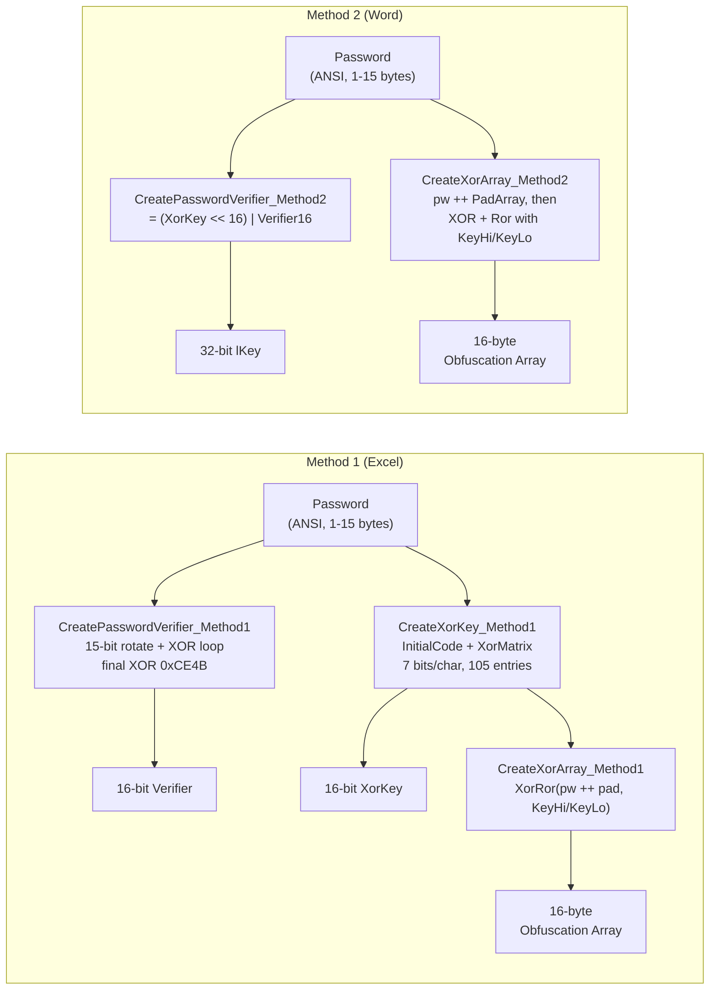
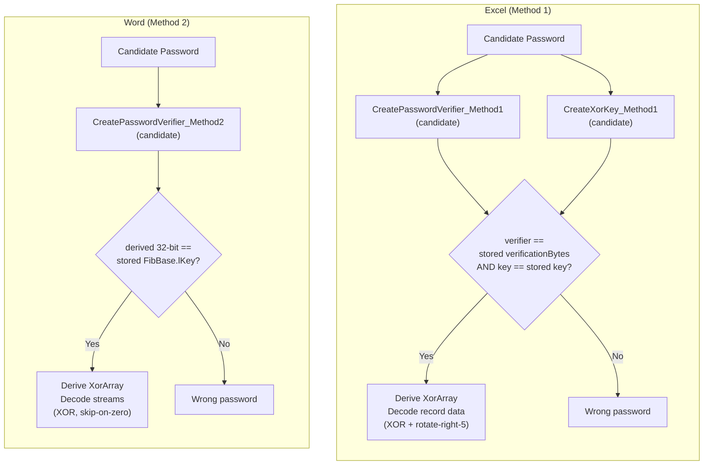
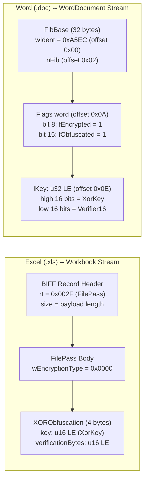

# XOR Obfuscation (Legacy Binary Document Password-to-Open)

⚪ **Obfuscation Only** — trivial XOR transform, not a cryptographic mechanism; retained for backward compatibility

## Overview

- Weakest password-to-open mechanism in the Office binary format family: transforms document bytes by XORing against a repeating 16-byte array derived from the password, with no hash, no salt, no iteration, and no block cipher
- Two methods defined: **Method 1** for Excel (.xls) produces a 16-bit verifier + 16-bit XorKey; **Method 2** for Word (.doc) packs both into a 32-bit verifier
- Password is a single-byte (ANSI) string of at most 15 characters — not UTF-16LE
- The `CreatePasswordVerifier_Method1` primitive is reused for Excel binary write protection [MS-OFFCRYPTO] SS2.4.2.2
- Used by: [Excel 97-2003 (.xls)](../../formats/excel.md), [Word 97-2003 (.doc)](../../formats/word.md)
- Spec: [MS-OFFCRYPTO] SS2.3.7 (sections 2.3.7.1 through 2.3.7.7)

## KDF Pipeline



## Verification Flow



## On-Disk Structure



## Quick Reference

| Parameter | Method 1 (Excel) | Method 2 (Word) |
|---|---|---|
| Verifier width | 16-bit (`verificationBytes`) + 16-bit (`key`) | 32-bit (`lKey` = key << 16 | verifier) |
| Storage location | `FilePass` record, `XORObfuscation` struct | `FibBase.lKey` at offset 0x0E |
| Password encoding | ANSI single-byte, 1-15 chars | ANSI single-byte, 1-15 chars |
| Hash algorithm | None (arithmetic only) | None (arithmetic only) |
| Salt | None | None |
| Iterations | None | None |
| Key material | 16-byte XOR obfuscation array | 16-byte XOR obfuscation array |
| Data transform | XOR + 8-bit rotate (left-5 encrypt, right-5 decrypt) | XOR only (skip when input or result is 0x00) |
| Detection flag | `wEncryptionType == 0x0000` in FilePass | `fEncrypted == 1 AND fObfuscated == 1` in FibBase |
| Spec sections | [MS-OFFCRYPTO] SS2.3.7.1-2.3.7.3 | [MS-OFFCRYPTO] SS2.3.7.4-2.3.7.6 |

## Extraction Target

### Excel (Method 1) — FilePass Record

Fields to extract from the `FilePass` record in the `Workbook` (or `Book`) stream:

| Field | Source Location | Type | Example |
|---|---|---|---|
| Record type | BIFF header offset 0 | u16 LE | `0x002F` (FilePass) |
| Encryption type | FilePass body offset 0 | u16 LE | `0x0000` (XOR) |
| XorKey | XORObfuscation offset 0 | u16 LE | `0x5BC7` |
| Password verifier | XORObfuscation offset 2 | u16 LE | `0x8FA1` |

### Word (Method 2) — FibBase

Fields to extract from the `WordDocument` stream header:

| Field | Source Location | Type | Example |
|---|---|---|---|
| wIdent | FibBase offset 0x00 | u16 LE | `0xA5EC` |
| Flags word | FibBase offset 0x0A | u16 LE | bit 8 = `fEncrypted`, bit 15 = `fObfuscated` |
| lKey | FibBase offset 0x0E | u32 LE | `0x5BC78FA1` (high=XorKey, low=Verifier16) |

**Python function signatures these map to:**

```python
def verify_xor_excel(
    candidate: str,  # ANSI password, 1-15 chars
    stored_key: int,  # XORObfuscation.key (u16)
    stored_verifier: int,  # XORObfuscation.verificationBytes (u16)
) -> bool: ...


def verify_xor_word(
    candidate: str,  # ANSI password, 1-15 chars
    stored_lkey: int,  # FibBase.lKey (u32)
) -> bool: ...


def decode_xor_excel(
    xor_array: bytes,  # 16-byte obfuscation array from CreateXorArray_Method1
    data: bytes,  # obfuscated record data bytes
    offset: int,  # starting byte offset in stream (for array index alignment)
) -> bytes: ...


def decode_xor_word(
    xor_array: bytes,  # 16-byte obfuscation array from CreateXorArray_Method2
    data: bytes,  # obfuscated stream bytes
) -> bytes: ...
```

---

## 1. What It Is and Where It Is Used

XOR obfuscation modifies document stream bytes in-place within OLE compound files by XORing them with a repeating 16-byte obfuscation array derived from the password. A short password verifier (16-bit or 32-bit) is stored alongside the data so an application can test a supplied password before attempting to decode the document. The spec defines it in [MS-OFFCRYPTO] section 2.3.7 (sections 2.3.7.1 through 2.3.7.7), with the overview in section 1.3.3.1.

Two methods exist [MS-OFFCRYPTO] section 1.3.3.1:

- **Method 1** specifies structures and procedures used by the Excel Binary File Format (.xls) [MS-XLS]. The 16-bit password verifier and 16-bit XorKey are stored in the `FilePass` record's `XORObfuscation` structure. Data transformation includes a rotate-right-5 step after XOR on decryption.
- **Method 2** specifies structures and procedures used by the Word Binary File Format (.doc) [MS-DOC]. The 32-bit password verifier (composed of XorKey in the high word and the 16-bit verifier in the low word) is stored in `FibBase.lKey`. Data transformation XORs each byte but leaves it unchanged when the input byte or the XOR result is 0x00.

Both methods derive the same 16-byte obfuscation array from the same password (for ASCII passwords the arrays are identical); they differ in verifier width, Unicode-to-single-byte reduction rules, and the data transformation procedure.

The `CreatePasswordVerifier_Method1` primitive is also reused for binary document write protection of Excel workbooks [MS-OFFCRYPTO] section 2.4.2.2.

**Products/formats:**
- Microsoft Excel 97-2003 (.xls, BIFF8 and earlier BIFF) — see [excel.md](../../formats/excel.md)
- Microsoft Word 97-2003 (.doc) — see [word.md](../../formats/word.md)

**Related algorithms in this project:**
- RC4 encryption (MD5 key derivation, 40-bit): [rc4-md5-legacy.md](./rc4-md5-legacy.md)
- RC4 CryptoAPI encryption (SHA-1 key derivation): [rc4-cryptoapi-sha1.md](./rc4-cryptoapi-sha1.md)
- ECMA-376 Standard encryption: [ecma376-standard.md](./ecma376-standard.md)
- ECMA-376 Agile encryption: [ecma376-agile.md](./ecma376-agile.md)
- IRM/RMS encryption: [irm-rms-encryption.md](../non-password/irm-rms-encryption.md)

## 2. Profiles / Parameters

| Profile | Method | Product / Format Spec | Verifier Width | Verifier Location | XorKey Stored? | Salt | Iterations | Key Size |
|---|---|---|---|---|---|---|---|---|
| **Excel** | Method 1 | .xls [MS-XLS] | 16-bit | `XORObfuscation.verificationBytes` in `FilePass` record | Yes, `XORObfuscation.key` (u16) | None | None | 16-byte XOR array |
| **Word** | Method 2 | .doc [MS-DOC] | 32-bit | `FibBase.lKey` (u32 at offset 0x0E in `WordDocument` stream) | Yes, high 16 bits of `lKey` | None | None | 16-byte XOR array |

Password constraints [MS-OFFCRYPTO] sections 2.3.7.2, 2.3.7.4: the password is a single-byte (ANSI) string of 1 to 15 characters. It is NOT UTF-16LE. The password character encoding is described in section 5 below.

There is no salt, no iteration count, no cryptographic hash, and no block cipher involved. All arithmetic is on 8-bit and 16-bit unsigned integers.

## 3. Byte Layout / On-Disk Structures

Both formats live inside an OLE2/Compound File Binary (CFB) container (file signature `D0 CF 11 E0 A1 B1 1A E1`). All multi-byte values are little-endian [MS-OFFCRYPTO] section 1.3.6.

### 3.1 Excel — Method 1: FilePass Record and XORObfuscation Structure

The password verifier and XorKey reside in the `Workbook` stream (legacy files may name it `Book`) as a BIFF record called `FilePass` [MS-XLS] section 2.4.117.

**BIFF record framing** [MS-XLS] section 2.1.4:

| Field | Offset (in record) | Size | Type | Meaning |
|---|---|---|---|---|
| `rt` (record type) | 0 | 2 | u16 LE | `FilePass` = **0x002F** |
| `size` | 2 | 2 | u16 LE | Byte count of record data that follows |
| record data | 4 | `size` | — | FilePass body |

**FilePass body** [MS-XLS] section 2.4.117:

| Field | Offset (in body) | Size | Type | Meaning |
|---|---|---|---|---|
| `wEncryptionType` | 0 | 2 | u16 LE | **0x0000** = XOR obfuscation; 0x0001 = RC4 encryption |
| `encryptionInfo` | 2 | variable | — | When `wEncryptionType == 0x0000`: an `XORObfuscation` structure |

**XORObfuscation structure** [MS-XLS] section 2.5.343 (total 4 bytes):

| Field | Offset | Size | Type | Meaning |
|---|---|---|---|---|
| `key` | 0 | 2 | u16 LE | 16-bit XorKey from `CreateXorKey_Method1` [MS-OFFCRYPTO] section 2.3.7.2 |
| `verificationBytes` | 2 | 2 | u16 LE | 16-bit password verifier from `CreatePasswordVerifier_Method1` [MS-OFFCRYPTO] section 2.3.7.1 |

The entire persisted XOR secret for Excel is four bytes: `key` (u16) then `verificationBytes` (u16).

**Records/bytes NOT obfuscated** [MS-XLS] section 2.2.10: the `BOF` record (type 0x0809), `FilePass` itself, `UsrExcl`, `FileLock`, `InterfaceHdr`, `RRDInfo`, `RRDHead`, and the record type/size framing (the `rt` and `size` fields of every record) are never obfuscated. Only the record data bytes of non-exempt records are transformed.

### 3.2 Word — Method 2: FibBase.lKey

Word stores the verifier inside the `WordDocument` stream, in the fixed `FibBase` structure at the very start of the stream [MS-DOC] section 2.5.2.

| Field | Offset | Size | Type | Meaning |
|---|---|---|---|---|
| `wIdent` | 0x00 | 2 | u16 LE | MUST be **0xA5EC** (Word Binary File magic) |
| `nFib` | 0x02 | 2 | u16 LE | Format version, SHOULD be 0x00C1 |
| `unused` | 0x04 | 2 | — | Ignored |
| `lid` | 0x06 | 2 | u16 LE | Install language id |
| `pnNext` | 0x08 | 2 | u16 LE | AutoText FIB offset |
| flags word | 0x0A | 2 | u16 LE (bitfield) | See bit table below |
| `nFibBack` | 0x0C | 2 | u16 LE | 0x00BF or 0x00C1 |
| **`lKey`** | **0x0E** | **4** | **u32 LE** | **32-bit XOR password verifier** from `CreatePasswordVerifier_Method2` [MS-OFFCRYPTO] section 2.3.7.4 |
| `envr` | 0x12 | 1 | u8 | MUST be 0 |
| ... | ... | ... | — | Remainder of FibBase (total 32 bytes) |

**Flags word at offset 0x0A** (bit 0 = LSB), relevant bits [MS-DOC] section 2.5.2:

| Bit | Name | Meaning |
|---|---|---|
| 8 | `fEncrypted` | 1 = document is encrypted or obfuscated |
| 15 | `fObfuscated` | When `fEncrypted == 1`: 1 = XOR obfuscation; 0 = RC4 encryption |

**Detection rule** [MS-DOC] section 2.2.6: the file uses XOR obfuscation if and only if `fEncrypted == 1` AND `fObfuscated == 1`. Then `lKey` (u32 LE at offset 0x0E) holds the 32-bit verifier: its low 16 bits are the `CreatePasswordVerifier_Method1` output and its high 16 bits are the `CreateXorKey_Method1` output.

**Streams obfuscated** [MS-DOC] section 2.2.6.1: `WordDocument`, `Table` (`0Table`/`1Table`), and `Data`. All other streams/storages MUST NOT be obfuscated. For the `WordDocument` stream, the **initial 68 bytes MUST be written with their untransformed values** (FibBase and adjacent header stay in the clear). The `Table` and `Data` streams are transformed in full per section 2.3.7.6.

## 4. Key Derivation

There is no cryptographic KDF. "Key derivation" means computing the 16-bit XorKey, computing the password verifier(s), and building the 16-byte obfuscation array. All arithmetic is on 8-bit and 16-bit unsigned integers with explicit truncation. The password is a single-byte (ANSI) string of length 1-15.

### 4.1 CreatePasswordVerifier_Method1 (16-bit verifier) — [MS-OFFCRYPTO] section 2.3.7.1

This procedure derives a 16-bit password verifier from an ASCII password string. It is used for XOR obfuscation (both methods) and for binary document write protection [MS-OFFCRYPTO] section 2.4.2.2.

**Algorithm:**

1. Build `PasswordArray`: byte at index 0 is `Password.Length`, followed by the ASCII password bytes.
2. Initialize `Verifier` to `0x0000`.
3. For each byte in `PasswordArray` in **reverse order**: rotate `Verifier` left by 1 within 15 bits (carry from bit 14 wraps into bit 0, bit 15 is cleared), then XOR in the current byte.
4. Return `Verifier XOR 0xCE4B`.

```
FUNCTION CreatePasswordVerifier_Method1
   PARAMETERS Password
   RETURNS 16-bit unsigned integer

   DECLARE Verifier AS 16-bit unsigned integer
   DECLARE PasswordArray AS array of 8-bit unsigned integers

   SET Verifier TO 0x0000
   SET PasswordArray TO (empty array of bytes)
   SET PasswordArray[0] TO Password.Length
   APPEND Password TO PasswordArray
   FOR EACH PasswordByte IN PasswordArray IN REVERSE ORDER
      IF (Verifier BITWISE AND 0x4000) is 0x0000
         SET Intermediate1 TO 0
      ELSE
         SET Intermediate1 TO 1
      ENDIF
      SET Intermediate2 TO Verifier MULTIPLIED BY 2
      SET most significant bit of Intermediate2 TO 0
      SET Intermediate3 TO Intermediate1 BITWISE OR Intermediate2
      SET Verifier TO Intermediate3 BITWISE XOR PasswordByte
   ENDFOR
   RETURN Verifier BITWISE XOR 0xCE4B
END FUNCTION
```

The rotate-left-1-within-15-bits operation is: `Intermediate2 = (Verifier << 1) AND 0x7FFF`, with the carry bit from bit 14 (`Intermediate1 = 1 if (Verifier AND 0x4000) != 0 else 0`) OR'd back into bit 0. This is a 15-bit rotation in a 16-bit word — bit 15 is always cleared before the XOR.

The final XOR constant is **0xCE4B** [MS-OFFCRYPTO] section 2.3.7.1.

### 4.2 CreateXorKey_Method1 — [MS-OFFCRYPTO] section 2.3.7.2

This procedure derives a 16-bit XorKey from the password. The XorKey is stored as `XORObfuscation.key` (Excel) or as the high 16 bits of `FibBase.lKey` (Word), and is used to construct the obfuscation array.

```
FUNCTION CreateXorKey_Method1
   PARAMETERS Password
   RETURNS 16-bit unsigned integer

   DECLARE XorKey AS 16-bit unsigned integer
   SET XorKey TO InitialCode[Password.Length MINUS 1]
   SET CurrentElement TO 0x00000068
   FOR EACH Char IN Password IN REVERSE ORDER
       FOR 7 iterations
           IF (Char BITWISE AND 0x40) IS NOT 0
               SET XorKey TO XorKey BITWISE XOR XorMatrix[CurrentElement]
           END IF
           SET Char TO Char MULTIPLIED BY 2
           DECREMENT CurrentElement
       END FOR
   END FOR
   RETURN XorKey
END FUNCTION
```

The procedure walks `XorMatrix` backwards from index **0x68 (104 decimal)**, consuming 7 entries per password character. For a maximum-length password of 15 characters, it consumes all 105 entries (indices 104 down to 0), which is why `XorMatrix` has exactly 105 elements.

The `InitialCode` array is indexed by `Password.Length - 1` (converting the 1-based length to a 0-based index).

The inner loop tests bit 6 (`0x40`) of the character value, conditionally XORs the matrix entry into `XorKey`, then shifts the character left by 1 (`Char * 2`) within 8 bits, and decrements `CurrentElement`. After 7 iterations, bits 6 through 0 of the original character have each been tested against their corresponding matrix entry.

### 4.3 CreateXorArray_Method1 (obfuscation array) — [MS-OFFCRYPTO] section 2.3.7.2

This procedure builds the 16-byte obfuscation array used to transform document data. It uses the helper functions `Ror` (rotate an 8-bit value right by 1) and `XorRor` (XOR two bytes, then rotate the result right by 1).

```
FUNCTION Ror
   PARAMETERS byte
   RETURNS 8-bit unsigned integer
   SET temp1 TO byte DIVIDED BY 2
   SET temp2 TO byte MULTIPLIED BY 128
   SET temp3 TO temp1 BITWISE OR temp2
   RETURN temp3 MODULO 0x100
END FUNCTION

FUNCTION XorRor
   PARAMETERS byte1, byte2
   RETURNS 8-bit unsigned integer
   RETURN Ror(byte1 BITWISE XOR byte2)
END FUNCTION

FUNCTION CreateXorArray_Method1
   PARAMETERS Password
   RETURNS array of 8-bit unsigned integers

   DECLARE XorKey AS 16-bit unsigned integer
   DECLARE ObfuscationArray AS array of 8-bit unsigned integers

   SET XorKey TO CreateXorKey_Method1(Password)
   SET Index TO Password.Length
   SET ObfuscationArray TO (0x00, 0x00, 0x00, 0x00, 0x00, 0x00, 0x00, 0x00,
                            0x00, 0x00, 0x00, 0x00, 0x00, 0x00, 0x00, 0x00)
   IF Index MODULO 2 IS 1
      SET Temp TO most significant byte of XorKey
      SET ObfuscationArray[Index] TO XorRor(PadArray[0], Temp)
      DECREMENT Index
      SET Temp TO least significant byte of XorKey
      SET PasswordLastChar TO Password[Password.Length MINUS 1]
      SET ObfuscationArray[Index] TO XorRor(PasswordLastChar, Temp)
   END IF
   WHILE Index IS GREATER THAN 0
      DECREMENT Index
      SET Temp TO most significant byte of XorKey
      SET ObfuscationArray[Index] TO XorRor(Password[Index], Temp)
      DECREMENT Index
      SET Temp TO least significant byte of XorKey
      SET ObfuscationArray[Index] TO XorRor(Password[Index], Temp)
   END WHILE
   SET Index TO 15
   SET PadIndex TO 15 MINUS Password.Length
   WHILE PadIndex IS greater than 0
      SET Temp TO most significant byte of XorKey
      SET ObfuscationArray[Index] TO XorRor(PadArray[PadIndex], Temp)
      DECREMENT Index
      DECREMENT PadIndex
      SET Temp TO least significant byte of XorKey
      SET ObfuscationArray[Index] TO XorRor(PadArray[PadIndex], Temp)
      DECREMENT Index
      DECREMENT PadIndex
   END WHILE
   RETURN ObfuscationArray
END FUNCTION
```

The array construction interleaves password bytes and padding bytes with alternating XOR against the most-significant and least-significant bytes of `XorKey`, then applies `Ror` (8-bit rotate-right-1). Password bytes fill indices 0 through `Password.Length - 1`; `PadArray` bytes fill indices `Password.Length` through 15.

### 4.4 CreatePasswordVerifier_Method2 (32-bit verifier) — [MS-OFFCRYPTO] section 2.3.7.4

Method 2 packs the two Method 1 outputs into a single 32-bit value. This is the value stored as `FibBase.lKey` in Word documents.

```
FUNCTION CreatePasswordVerifier_Method2
   PARAMETERS Password
   RETURNS 32-bit unsigned integer

   DECLARE Verifier AS 32-bit unsigned integer
   DECLARE KeyHigh AS 16-bit unsigned integer
   DECLARE KeyLow AS 16-bit unsigned integer

   SET KeyHigh TO CreateXorKey_Method1(Password)
   SET KeyLow TO CreatePasswordVerifier_Method1(Password)
   SET most significant 16 bits of Verifier TO KeyHigh
   SET least significant 16 bits of Verifier TO KeyLow
   RETURN Verifier
END FUNCTION
```

The 32-bit verifier is `(CreateXorKey_Method1(Password) << 16) | CreatePasswordVerifier_Method1(Password)`.

### 4.5 CreateXorArray_Method2 (obfuscation array) — [MS-OFFCRYPTO] section 2.3.7.5

This is the alternate array construction for Word documents. It produces the same 16-byte array as Method 1 for ASCII passwords.

```
FUNCTION CreateXorArray_Method2
   PARAMETERS Password
   RETURNS array of 8-bit unsigned integers

   DECLARE Verifier AS 32-bit unsigned integer
   DECLARE VerifierHighWord AS 16-bit unsigned integer
   DECLARE KeyHigh AS 8-bit unsigned integer
   DECLARE KeyLow AS 8-bit unsigned integer

   SET Verifier TO CreatePasswordVerifier_Method2(Password)
   SET VerifierHighWord TO 16 most significant bits of Verifier
   SET KeyHigh TO 8 most significant bits of VerifierHighWord
   SET KeyLow TO 8 least significant bits of VerifierHighWord
   SET PadArray TO (0xBB, 0xFF, 0xFF, 0xBA, 0xFF, 0xFF, 0xB9, 0x80,
                    0x00, 0xBE, 0x0F, 0x00, 0xBF, 0x0F, 0x00)
   SET ObfuscationArray TO (0x00, 0x00, 0x00, 0x00, 0x00, 0x00, 0x00, 0x00,
                            0x00, 0x00, 0x00, 0x00, 0x00, 0x00, 0x00, 0x00)
   SET Index TO 0
   WHILE Index IS LESS THAN Password.Length
       SET ObfuscationArray[Index] TO Password[Index]
       INCREMENT Index
   END WHILE
   WHILE Index IS LESS THAN 16
       SET ObfuscationArray[Index] TO PadArray[Index MINUS Password.Length]
       INCREMENT Index
   END WHILE
   SET Index TO 0
   WHILE Index IS LESS THAN 16
       SET Temp1 TO ObfuscationArray[Index] BITWISE XOR KeyLow
       SET ObfuscationArray[Index] TO Ror(Temp1)
       INCREMENT Index
       SET Temp1 TO ObfuscationArray[Index] BITWISE XOR KeyHigh
       SET ObfuscationArray[Index] TO Ror(Temp1)
       INCREMENT Index
   END WHILE
   RETURN ObfuscationArray
END FUNCTION
```

Method 2 first fills the array with password bytes concatenated with `PadArray` bytes (to reach 16 total), then applies the same `XOR + Ror` with alternating `KeyLo`/`KeyHi` in a single pass over the 16-byte array. The `VerifierHighWord` (the XorKey) is decomposed into its most-significant byte (`KeyHigh`) and least-significant byte (`KeyLow`).

## 5. Password Character Encoding — [MS-OFFCRYPTO] section 2.3.7.4

The password is a **single-byte string of at most 15 characters** [MS-OFFCRYPTO] sections 2.3.7.2 and 2.3.7.4. It is NOT UTF-16LE. Two methods exist for converting a Unicode input to single-byte characters:

- **LCID/ANSI reduction:** Convert the Unicode input to an ANSI string using the current locale code page, as specified in [MS-UCODEREF]. Truncate the resulting string to 15 single-byte characters.
- **Low-byte reduction:** For each input Unicode character, copy the least-significant byte into the single-byte string. If the least-significant byte is 0x00, copy the most-significant byte instead. Truncate the resulting string to 15 characters.

**When writing files**, the second approach (low-byte reduction) MUST be used [MS-OFFCRYPTO] section 2.3.7.4. **When reading files**, both methods MUST be tried, and the password MUST be considered correct if either approach results in a match.

For ASCII passwords (codepoints 0x20-0x7E), both reductions produce identical results (the byte value equals the character value).

## 6. Data Transformation (Encryption / Decryption)

### 6.1 Binary Document XOR Data Transformation Method 1 (Excel) — [MS-OFFCRYPTO] section 2.3.7.3

**Encryption** (rotate-left-5, then XOR):

```
FUNCTION EncryptData_Method1
   PARAMETERS Password, Data, XorArrayIndex

   DECLARE XorArray AS array of 8-bit unsigned integers
   SET XorArray TO CreateXorArray_Method1(Password)
   FOR Index FROM 0 TO Data.Length
       SET Value TO Data[Index]
       SET Value TO (Value rotate left 5 bits)
       SET Value TO Value BITWISE XOR XorArray[XorArrayIndex]
       SET Data[Index] TO Value
       INCREMENT XorArrayIndex
       SET XorArrayIndex TO XorArrayIndex MODULO 16
   END FOR
END FUNCTION
```

**Decryption** (XOR, then rotate-right-5):

```
FUNCTION DecryptData_Method1
   PARAMETERS Password, Data, XorArrayIndex

   DECLARE XorArray AS array of 8-bit unsigned integers
   SET XorArray TO CreateXorArray_Method1(Password)
   FOR Index FROM 0 TO Data.Length
       SET Value TO Data[Index]
       SET Value TO Value BITWISE XOR XorArray[XorArrayIndex]
       SET Value TO (Value rotate right 5 bits)
       SET Data[Index] TO Value
       INCREMENT XorArrayIndex
       SET XorArrayIndex TO XorArrayIndex MODULO 16
   END FOR
END FUNCTION
```

The `XorArrayIndex` parameter specifies the initial index into the 16-byte obfuscation array. The array index wraps modulo 16 after each byte. The rotate operations are 8-bit rotations. The `XorArrayIndex` seed for a given byte is its offset within the stream modulo 16 — record framing bytes that are exempt from obfuscation still advance the real file position, so implementers must track byte offsets carefully [MS-XLS] section 2.2.10.

### 6.2 Binary Document XOR Data Transformation Method 2 (Word) — [MS-OFFCRYPTO] section 2.3.7.6

Method 2 XORs each input byte with the corresponding obfuscation array element (cycling through the 16-byte array), **except** when the input byte is `0x00` or the result of the XOR operation is `0x00` — in either case, the byte is left unchanged [MS-OFFCRYPTO] section 2.3.7.6.

```
# Method 2 data transformation (both encrypt and decrypt are the same XOR operation):
FOR each byte position:
    IF input_byte == 0x00:
        output_byte = input_byte                       # unchanged
    ELSE IF (input_byte XOR ObfuscationArray[index]) == 0x00:
        output_byte = input_byte                       # unchanged
    ELSE:
        output_byte = input_byte XOR ObfuscationArray[index]
    index = (index + 1) MODULO 16
```

There is no rotate step in Method 2 (unlike Method 1). The skip-on-zero rule means certain bytes pass through untransformed, which can leak plaintext structure.

The obfuscation array is initialized as specified in section 2.3.7.2 (either `CreateXorArray_Method1` or `CreateXorArray_Method2` — they produce identical arrays for ASCII passwords). When the end of the array is reached, it wraps back to the beginning.

## 7. Password Verification — [MS-OFFCRYPTO] section 2.3.7.7

There is no decrypt-and-hash-compare step. Verification is a direct recomputation of the stored verifier:

1. Calculate the password verifier for the applicable method (section 2.3.7.1 for Method 1 / Excel, section 2.3.7.4 for Method 2 / Word) using the candidate password.
2. Compare the derived verifier with the verifier stored in the file.
3. If they do not match, the password is incorrect.

**Excel (Method 1):** Compute `CreatePasswordVerifier_Method1(candidate)` and compare to the stored `XORObfuscation.verificationBytes` (16-bit). Optionally also confirm `CreateXorKey_Method1(candidate) == XORObfuscation.key` for a combined 32-bit check.

**Word (Method 2):** Compute `CreatePasswordVerifier_Method2(candidate)` (32-bit) and compare to `FibBase.lKey`.

```
FUNCTION VerifyPassword_Method1(candidate, stored_key, stored_verificationBytes) -> bool
    RETURN CreatePasswordVerifier_Method1(candidate) == stored_verificationBytes
       AND CreateXorKey_Method1(candidate) == stored_key

FUNCTION VerifyPassword_Method2(candidate, stored_lKey) -> bool
    RETURN CreatePasswordVerifier_Method2(candidate) == stored_lKey
```

Because the verifier is a small fixed-width integer with no salt, it is trivially collidable: many distinct passwords map to the same verifier value. The 16-bit Excel verifier has approximately 2^16 buckets; even the 32-bit Word verifier has limited independent structure since both halves derive from the same short password. A confirmed candidate is a password that decodes the file correctly, not provably the original.

## 8. Reference Constants

All values reproduced verbatim from [MS-OFFCRYPTO] section 2.3.7.1 and section 2.3.7.2.

### 8.1 Magic Numbers

| Constant | Value | Meaning | Spec Reference |
|---|---|---|---|
| Final XOR | **0xCE4B** | XOR'd with the accumulated verifier in `CreatePasswordVerifier_Method1` | [MS-OFFCRYPTO] section 2.3.7.1 |
| Bit-14 test mask | **0x4000** | Tests bit 14 for the 15-bit rotate-left carry | [MS-OFFCRYPTO] section 2.3.7.1 |
| 15-bit mask | **0x7FFF** | Clears MSB (bit 15) after shift in the verifier loop | [MS-OFFCRYPTO] section 2.3.7.1 |
| XorMatrix start index | **0x68** (104 decimal) | Initial `CurrentElement` for `CreateXorKey_Method1` | [MS-OFFCRYPTO] section 2.3.7.2 |
| Agile Reserved | **0x40** (64 decimal) | Reserved value in agile EncryptionInfo (not this format, listed for disambiguation) | [MS-OFFCRYPTO] section 2.3.4.10 |
| FilePass record type | **0x002F** | BIFF record type for `FilePass` | [MS-XLS] section 2.4.117 |
| BOF record type | **0x0809** | BIFF8 `BOF` record (never obfuscated) | [MS-XLS] |
| Word magic | **0xA5EC** | `FibBase.wIdent` — Word Binary File identifier | [MS-DOC] section 2.5.2 |

### 8.2 PadArray (15 bytes)

Used by both `CreateXorArray_Method1` [MS-OFFCRYPTO] section 2.3.7.2 and `CreateXorArray_Method2` [MS-OFFCRYPTO] section 2.3.7.5:

```
PadArray = {
    0xBB, 0xFF, 0xFF, 0xBA, 0xFF, 0xFF, 0xB9, 0x80,
    0x00, 0xBE, 0x0F, 0x00, 0xBF, 0x0F, 0x00
}
```

### 8.3 InitialCode (15 words, u16)

Indexed by `Password.Length - 1` in `CreateXorKey_Method1` [MS-OFFCRYPTO] section 2.3.7.2:

```
InitialCode = {
    0xE1F0, 0x1D0F, 0xCC9C, 0x84C0, 0x110C,
    0x0E10, 0xF1CE, 0x313E, 0x1872, 0xE139,
    0xD40F, 0x84F9, 0x280C, 0xA96A, 0x4EC3
}
```

Index 0 corresponds to password length 1, index 14 to password length 15.

### 8.4 XorMatrix (105 words, u16)

Indexed by `CurrentElement` (starting at 104, decrementing) in `CreateXorKey_Method1` [MS-OFFCRYPTO] section 2.3.7.2:

```
XorMatrix = {
    0xAEFC, 0x4DD9, 0x9BB2, 0x2745, 0x4E8A, 0x9D14, 0x2A09,
    0x7B61, 0xF6C2, 0xFDA5, 0xEB6B, 0xC6F7, 0x9DCF, 0x2BBF,
    0x4563, 0x8AC6, 0x05AD, 0x0B5A, 0x16B4, 0x2D68, 0x5AD0,
    0x0375, 0x06EA, 0x0DD4, 0x1BA8, 0x3750, 0x6EA0, 0xDD40,
    0xD849, 0xA0B3, 0x5147, 0xA28E, 0x553D, 0xAA7A, 0x44D5,
    0x6F45, 0xDE8A, 0xAD35, 0x4A4B, 0x9496, 0x390D, 0x721A,
    0xEB23, 0xC667, 0x9CEF, 0x29FF, 0x53FE, 0xA7FC, 0x5FD9,
    0x47D3, 0x8FA6, 0x0F6D, 0x1EDA, 0x3DB4, 0x7B68, 0xF6D0,
    0xB861, 0x60E3, 0xC1C6, 0x93AD, 0x377B, 0x6EF6, 0xDDEC,
    0x45A0, 0x8B40, 0x06A1, 0x0D42, 0x1A84, 0x3508, 0x6A10,
    0xAA51, 0x4483, 0x8906, 0x022D, 0x045A, 0x08B4, 0x1168,
    0x76B4, 0xED68, 0xCAF1, 0x85C3, 0x1BA7, 0x374E, 0x6E9C,
    0x3730, 0x6E60, 0xDCC0, 0xA9A1, 0x4363, 0x86C6, 0x1DAD,
    0x3331, 0x6662, 0xCCC4, 0x89A9, 0x0373, 0x06E6, 0x0DCC,
    0x1021, 0x2042, 0x4084, 0x8108, 0x1231, 0x2462, 0x48C4
}
```

The array has exactly 105 elements (indices 0 through 104). The maximum-length password (15 characters) consumes `7 * 15 = 105` entries, walking from index 104 down to 0.

## 9. Binary Document Write Protection — [MS-OFFCRYPTO] section 2.4.2

### 9.1 Method 1 (Word .doc) — [MS-OFFCRYPTO] section 2.4.2.1

Binary documents conforming to [MS-DOC] MUST store the write protection password in the file **in plaintext** as specified in [MS-DOC] section 2.9.276.

### 9.2 Method 2 (Excel .xls) — [MS-OFFCRYPTO] section 2.4.2.2

Binary documents conforming to [MS-XLS] MUST store the write protection password verifier in the file, as specified in [MS-XLS] section 2.2.9, created by using the method specified in [MS-OFFCRYPTO] section 2.3.7.1 (`CreatePasswordVerifier_Method1`). This is the same 16-bit verifier used for XOR obfuscation password-to-open.

When a binary document using write protection method 2 is write-protected, the document can also be encrypted by using one of the methods specified in [MS-OFFCRYPTO] section 2.3.

### 9.3 Method 3 (PowerPoint .ppt) — [MS-OFFCRYPTO] section 2.4.2.3

Binary documents conforming to [MS-PPT] MUST store the write protection password in the file **in plaintext**, as specified in [MS-PPT] section 2.4.7. Write-protected PowerPoint documents SHOULD NOT also be encrypted.

### 9.4 Default Passwords — [MS-OFFCRYPTO] section 2.4.2.3, product behavior note <25>

**Excel default encryption password** (product behavior note <25>, referencing section 2.4.2.2): Documents generated by Office Excel 2007, Excel 2010, and Excel 2013 can be encrypted with the password `VelvetSweatshop` (hex: `\x56\x65\x6C\x76\x65\x74\x53\x77\x65\x61\x74\x73\x68\x6F\x70`). The conditions under which this password is used are described in [MS-XLS] and [MS-XLSB]. This is the well-known 15-character default password that exercises the maximum password length (all 105 `XorMatrix` entries are consumed).

**PowerPoint default encryption password** (section 2.4.2.3): If the user has not supplied an encryption password and the document is encrypted, the default password is `/01Hannes Ruescher/01` (hex: `\x2f\x30\x31\x48\x61\x6e\x6e\x65\x73\x20\x52\x75\x65\x73\x63\x68\x65\x72\x2f\x30\x31`, 21 characters). Product behavior note <26> states that this password was used by Office PowerPoint 2003, PowerPoint 2007, and PowerPoint 2007 SP1; PowerPoint 2007 SP2 does not use the default password.

## 10. Security Considerations — [MS-OFFCRYPTO] section 4.1.3.4

The spec states [MS-OFFCRYPTO] section 4.1.3.4:

> "XOR obfuscation is not recommended. Document data can easily be extracted. The document password could be retrievable."

> "Passwords are truncated to 15 characters. It is possible for multiple passwords to map to the same key."

Additionally, from [MS-OFFCRYPTO] section 4.1.4 on Document Write Protection:

> "Document write protection is not considered to be a security mechanism, and the write protection can easily be removed by using a binary editor. Document write protection is meant to protect against accidental modification only."

> "Some file formats, such as those described in [MS-DOC] and [MS-XLS], restrict password length to 15 characters. It is possible for multiple passwords to map to the same key when using document write protection method 2 (section 2.4.2.2)."

**Summary of weaknesses stated or implied by the spec:**

- XOR obfuscation is explicitly not recommended and is retained only for backward compatibility.
- The password verifier is a 16-bit or 32-bit checksum with no salt and no iteration, so it is trivially collidable.
- Passwords are truncated to 15 single-byte characters.
- Multiple passwords can map to the same key/verifier.
- Document data can be easily extracted even without the original password.
- Method 2 (Word) leaves bytes unchanged when the input or XOR result is 0x00, leaking plaintext structure.
- Not all record data is obfuscated (exempt records in Excel, the first 68 bytes of `WordDocument` in Word), providing known plaintext.

## 11. Spec References

| Section | Title | Content |
|---|---|---|
| [MS-OFFCRYPTO] section 1.3.3.1 | XOR Obfuscation (Overview) | Method 1 = Excel, Method 2 = Word |
| [MS-OFFCRYPTO] section 2.3.7 | XOR Obfuscation | Umbrella section |
| [MS-OFFCRYPTO] section 2.3.7.1 | Binary Document Password Verifier Derivation Method 1 | `CreatePasswordVerifier_Method1` — 16-bit verifier, `0xCE4B` final XOR |
| [MS-OFFCRYPTO] section 2.3.7.2 | Binary Document XOR Array Initialization Method 1 | `CreateXorArray_Method1`, `CreateXorKey_Method1`, `XorRor`, `Ror` helpers; `InitialCode[15]`, `XorMatrix[105]`, `PadArray[15]` constants |
| [MS-OFFCRYPTO] section 2.3.7.3 | Binary Document XOR Data Transformation Method 1 | `EncryptData_Method1` (rotate-left-5 then XOR), `DecryptData_Method1` (XOR then rotate-right-5) |
| [MS-OFFCRYPTO] section 2.3.7.4 | Binary Document Password Verifier Derivation Method 2 | `CreatePasswordVerifier_Method2` — 32-bit verifier = `(XorKey << 16) | Verifier16`; Unicode-to-single-byte reduction rules |
| [MS-OFFCRYPTO] section 2.3.7.5 | Binary Document XOR Array Initialization Method 2 | `CreateXorArray_Method2` — alternate array construction for Word |
| [MS-OFFCRYPTO] section 2.3.7.6 | Binary Document XOR Data Transformation Method 2 | XOR each byte, skip when input is 0x00 or XOR result is 0x00 |
| [MS-OFFCRYPTO] section 2.3.7.7 | Password Verification | Recompute verifier, compare to stored value |
| [MS-OFFCRYPTO] section 2.4.2 | Binary Document Write Protection | Umbrella section |
| [MS-OFFCRYPTO] section 2.4.2.1 | Binary Document Write Protection Method 1 | Word .doc stores write-protection password in plaintext |
| [MS-OFFCRYPTO] section 2.4.2.2 | Binary Document Write Protection Method 2 | Excel .xls stores 16-bit verifier via `CreatePasswordVerifier_Method1` |
| [MS-OFFCRYPTO] section 2.4.2.3 | Binary Document Write Protection Method 3 | PowerPoint .ppt stores password in plaintext; default password `/01Hannes Ruescher/01` |
| [MS-OFFCRYPTO] section 4.1.3.4 | Security Considerations: XOR Obfuscation | "Not recommended. Document data can easily be extracted." |
| [MS-OFFCRYPTO] section 4.1.4 | Security Considerations: Document Write Protection | "Not considered to be a security mechanism" |
| [MS-OFFCRYPTO] product note <25> | Product Behavior | Excel 2007/2010/2013 default encryption password `VelvetSweatshop` |
| [MS-OFFCRYPTO] product note <26> | Product Behavior | PowerPoint 2003/2007/2007 SP1 use default password |
| [MS-XLS] section 2.2.9 | Password Verifier Algorithm | Cross-references [MS-OFFCRYPTO] section 2.3.7.1 Method 1 |
| [MS-XLS] section 2.2.10 | Encryption (Password to Open) | Lists exempt records for XOR obfuscation |
| [MS-XLS] section 2.4.117 | FilePass record | Record type 0x002F, `wEncryptionType` field |
| [MS-XLS] section 2.5.343 | XORObfuscation structure | `key` (u16) + `verificationBytes` (u16) |
| [MS-DOC] section 2.2.6 | XOR Obfuscation detection | `fEncrypted && fObfuscated` in FibBase flags |
| [MS-DOC] section 2.2.6.1 | XOR Obfuscation details | Obfuscated streams, first 68 bytes exempt, Method 2 |
| [MS-DOC] section 2.5.2 | FibBase | `wIdent = 0xA5EC`, flags word, `lKey` at offset 0x0E |
