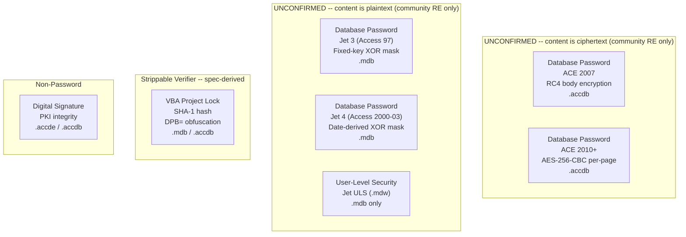
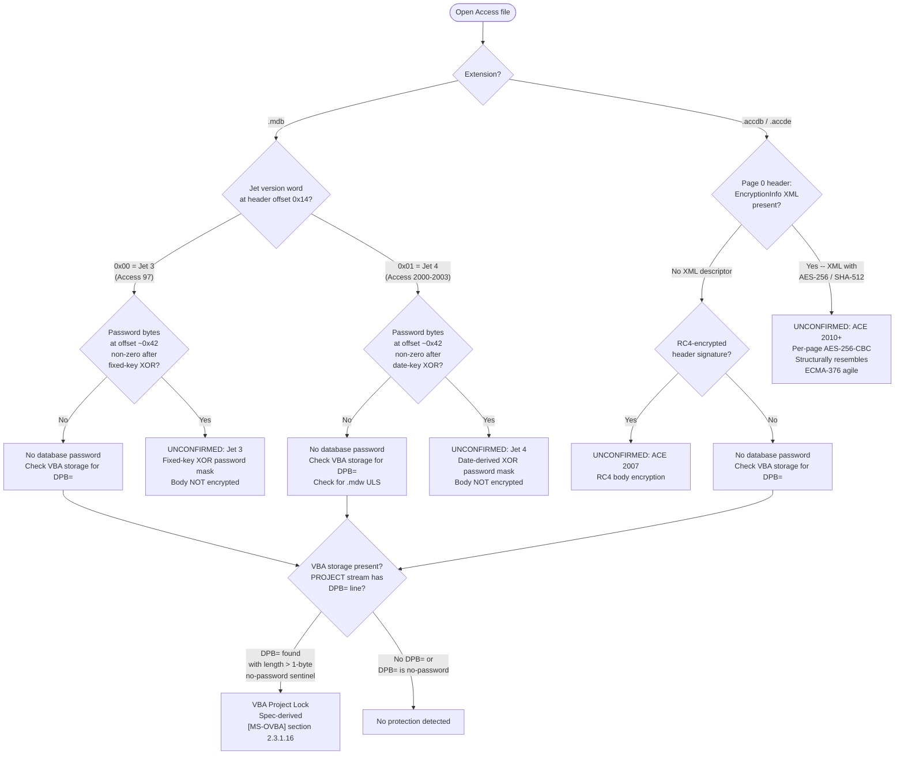
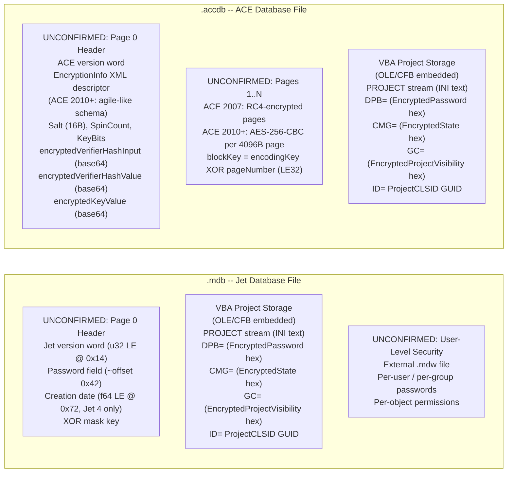

# Microsoft Access — .mdb / .accdb

Access databases do not use the Office document containers (no OLE/CFB wrapper, no OPC/ZIP package). They are proprietary paged database files managed by two distinct engines: `.mdb` is a Jet engine database (Jet 3 for Access 97, Jet 4 for Access 2000-2003), and `.accdb` is an ACE (Access Connectivity Engine) database introduced with Access 2007. Neither format is covered by a published `[MS-*]` Open Specification; there is no `[MS-ACCESS]`, `[MS-JET]`, or `[MS-ACE]` document. Grep of the full `[MS-*]` corpus produces only incidental glossary mentions of "access database" inside `[MS-XLS]` and `[MS-DOC]`, and `[MS-OFFCRYPTO]` makes no reference to Jet, ACE, `.mdb`, or `.accdb` containers. The one exception is the **VBA project** embedded within Access databases: because Access is a VBA host application, the embedded VBA storage conforms to `[MS-OVBA]` and its protection gates are fully spec-derived.

This document therefore separates its content into two tiers: **spec-derived** content (VBA project lock, sourced from `[MS-OVBA]`) and **out-of-corpus** content (database-open passwords, user-level security), where every claim in the second tier is marked UNCONFIRMED and sourced from community reverse-engineering.

## File Extensions

| Extension | Container | Description | Password Protection Applicable? | Notes |
|---|---|---|---|---|
| .mdb | Jet 3/4 paged DB | Access 97-2003 Database | Yes — Jet XOR obfuscation (fixed/date key), VBA project lock | Jet 3 = Access 97, Jet 4 = Access 2000-2003. Body NOT encrypted; password is access-control gate only. |
| .mde | Jet 3/4 paged DB | Access 97-2003 Compiled Database | VBA source code removed (compiled only). Same Jet password as .mdb | VBA source stripped at compile time; only p-code remains. Same container and encryption as .mdb. |
| .mda | Jet 3/4 paged DB | Access 97-2003 Add-in | Same as .mdb | Same container and encryption as .mdb. |
| .accdb | ACE paged DB | Access 2007+ Database | Yes — ACE 2007 RC4, ACE 2010+ agile SHA-512/AES-256 (UNCONFIRMED), VBA project lock | ACE engine; no published `[MS-*]` spec for database-open encryption. |
| .accde | ACE paged DB | Access Execute-Only Database | VBA source code removed. Same ACE password as .accdb | Same container and encryption as .accdb. VBA source stripped; only compiled code remains. |
| .accdt | ACE paged DB | Access Database Template | Same as .accdb | Same container and encryption as .accdb. |
| .accdr | ACE paged DB | Access Runtime Database | Same as .accdb, opens in runtime mode only | Same container and encryption as .accdb. Restricts UI to runtime mode (no design view). |
| .accda | ACE paged DB | Access Add-in | Same as .accdb | Same container and encryption as .accdb. |
| .accdu | ACE paged DB | Access Add-in (unsigned) | Same as .accdb | Same container and encryption as .accdb. Unsigned variant of .accda. |
| .mdw | Jet | Workgroup Security File | Stores user/group accounts for legacy user-level security (Jet ULS). OUT-OF-CORPUS | Not a database container; holds ULS account/permission data. Retired with Access 2007. |
| .laccdb / .ldb | Lock file | Record-locking file | Not a database — no password protection | Created at runtime to coordinate multi-user record locking. Not a data container. |

## Gate Strength Map



## Detection Flowchart

How to determine which protection scheme an Access file uses:



## Container Structure

Where each gate's data physically lives:



## No Default Password

Unlike Excel's `VelvetSweatshop` default open password ([MS-OFFCRYPTO] section 2.4.2.3), Access has no spec-documented or community-documented built-in default database password. An unprotected `.mdb`/`.accdb` simply has no password set.

## Gate Quick Reference

### .mdb — Jet engine (Access 97-2003)

| | Gate | Location | Algorithm | Spec |
|---|---|---|---|---|
| UNCONFIRMED | Database password — Jet 3 | Page 0 header, password field ~offset 0x42 | Fixed-key XOR mask of stored password bytes; body NOT encrypted | OUT-OF-CORPUS (no `[MS-*]` spec) |
| UNCONFIRMED | Database password — Jet 4 | Page 0 header, password field ~offset 0x42; creation date @ 0x72 | Date-derived XOR mask of stored password bytes; body NOT encrypted | OUT-OF-CORPUS (no `[MS-*]` spec) |
| UNCONFIRMED | User-level security | External `.mdw` workgroup file | Proprietary Jet ULS; retired in Access 2007 | OUT-OF-CORPUS (no `[MS-*]` spec) |
| Spec | VBA project lock | VBA storage -> `PROJECT` stream `DPB=` | [VBA password](../algorithms/password/vba-project-password.md) SHA-1 | [MS-OVBA] sections 2.3.1.15, 2.3.1.16, 2.4.3, 2.4.4 |

### .accdb — ACE engine (Access 2007+)

| | Gate | Location | Algorithm | Spec |
|---|---|---|---|---|
| UNCONFIRMED | Database password — ACE 2007 | Database header; body encrypted | RC4 keyed by password hash; body encrypted | OUT-OF-CORPUS (no `[MS-*]` spec) |
| UNCONFIRMED | Database password — ACE 2010+ | Page 0 EncryptionInfo XML; pages 1..N encrypted | AES-256-CBC per 4096B page, SHA-512, spinCount 100000; structurally resembles [ECMA-376 agile](../algorithms/password/ecma376-agile.md) | OUT-OF-CORPUS; structural analogue: [MS-OFFCRYPTO] sections 2.3.4.10-2.3.4.15 |
| Spec | VBA project lock | VBA storage -> `PROJECT` stream `DPB=` | [VBA password](../algorithms/password/vba-project-password.md) SHA-1 | [MS-OVBA] sections 2.3.1.15, 2.3.1.16, 2.4.3, 2.4.4 |

---

## Specification Detail

### Spec coverage boundary

Access is unique among Office applications in that its native file format (both `.mdb` and `.accdb`) has no published `[MS-*]` Open Specification. The `[MS-OFFCRYPTO]` applicability statement ([MS-OFFCRYPTO] section 1.5) limits its scope to OLE compound files (Office binary documents) and OPC/ZIP packages (ECMA-376 documents); it makes no reference to Jet or ACE database containers. The structural resemblance between ACE 2010+ per-page encryption and the ECMA-376 agile encryption scheme documented in [MS-OFFCRYPTO] sections 2.3.4.10-2.3.4.15 is an observation from community reverse-engineering (mdbtools, Jackcess), not a claim made by any published specification.

The only spec-derived content below is the VBA project lock gate, which is fully specified by [MS-OVBA]. All other gates are marked UNCONFIRMED and sourced from community reverse-engineering.

### VBA Project Lock — full spec-derived detail ([MS-OVBA])

Access is a VBA host application ([MS-OVBA] section 1.5, product behavior note <1>). Any Access database containing macros embeds a VBA project storage conforming to [MS-OVBA]. The VBA project storage is an OLE/CFB compound file ([MS-CFB]) embedded within the Access database, rooted at a Project Root Storage ([MS-OVBA] section 2.2.1) that MUST contain a VBA Storage (named `VBA`, case-insensitive) and a PROJECT Stream (named `PROJECT`, case-insensitive).

The project protection mechanism uses three records in the PROJECT stream, all obfuscated by the same reversible Data Encryption algorithm ([MS-OVBA] section 2.4.3):

#### ProjectProtectionState (CMG= line)

[MS-OVBA] section 2.3.1.15

ABNF syntax:
```
ProjectProtectionState   = "CMG=" DQUOTE EncryptedState DQUOTE NWLN
EncryptedState           = 22*28HEXDIG
```

The Data parameter for Data Encryption ([MS-OVBA] section 2.4.3.2) SHOULD be four bytes that specify the protection state of the VBA project. The Length parameter MUST be 4.

The four bytes are a bitfield:

| Bit | Field | Meaning |
|---|---|---|
| 0 | `fUserProtected` | The user elected to protect the VBA project |
| 1 | `fHostProtected` | The VBA host application elected to protect the VBA project |
| 2 | `fVBEProtected` | The VBA project editor elected to protect the VBA project |
| 3-31 | Reserved | MUST be 0, MUST be ignored |

Product behavior note <5> ([MS-OVBA] section 2.3.1.15): VBA 5.0 saves `0x00000000` for the protection state regardless of whether protection is enabled.

#### ProjectPassword (DPB= line)

[MS-OVBA] section 2.3.1.16

ABNF syntax:
```
ProjectPassword    = "DPB=" DQUOTE EncryptedPassword DQUOTE NWLN
EncryptedPassword  = 16*HEXDIG
```

The `EncryptedPassword` hex string is an Encrypted Data Structure ([MS-OVBA] section 2.4.3.1) that, when decrypted via the Data Decryption algorithm ([MS-OVBA] section 2.4.3.3), yields the password data. Three cases:

- **No password:** Data parameter is a single byte `0x00`, Length = 1. This is the no-password sentinel.
- **Password hash (SHOULD):** Data parameter is a 29-byte Password Hash Data Structure ([MS-OVBA] section 2.4.4.1), Length = 29. When this form is used, `ProjectId.ProjectCLSID` ([MS-OVBA] section 2.3.1.2) MUST be `{00000000-0000-0000-0000-000000000000}`.
- **Plaintext password (MAY, VBA 5.0 only):** Data parameter is a null-terminated MBCS password string encoded using the code page specified by PROJECTCODEPAGE ([MS-OVBA] section 2.3.4.2.1.5), Length = string length including the null terminator. Product behavior note <6> ([MS-OVBA] section 2.3.1.16): VBA 5.0 saves the encrypted plaintext password rather than a hash.

#### ProjectVisibilityState (GC= line)

[MS-OVBA] section 2.3.1.17

ABNF syntax:
```
ProjectVisibilityState      = "GC=" DQUOTE EncryptedProjectVisibility DQUOTE NWLN
EncryptedProjectVisibility  = 16*22HEXDIG
```

The Data parameter is a single byte specifying the visibility state. Length MUST be 1.

| Value | Meaning |
|---|---|
| `0x00` | VBA project is NOT visible. `ProjectProtectionState.fVBEProtected` MUST be TRUE. |
| `0xFF` | VBA project is visible. |

Default is `0xFF`.

#### ProjectId (ID= line) — CLSID for ProjKey derivation

[MS-OVBA] section 2.3.1.2

ABNF syntax:
```
ProjectId          = "ID=" DQUOTE ProjectCLSID DQUOTE NWLN
ProjectCLSID       = GUID
```

The `ProjectCLSID` GUID serves two purposes: it is the class identifier for the project's Automation type library, and it is used to derive the `ProjKey` for the Data Encryption algorithm ([MS-OVBA] section 2.4.3.2). When `ProjectPassword` specifies a password hash, `ProjectCLSID` MUST be `{00000000-0000-0000-0000-000000000000}`.

### Data Encryption Algorithm ([MS-OVBA] section 2.4.3)

The Data Encryption algorithm is a byte-at-a-time XOR cipher used to obfuscate the CMG=, DPB=, and GC= values. The spec explicitly states: "The design of this encryption is to obfuscate sensitive information, not to secure it" ([MS-OVBA] section 4.2). All information required to reverse the encryption is stored within the Encrypted Data Structure itself.

#### Encrypted Data Structure ([MS-OVBA] section 2.4.3.1)

| Offset | Size | Field | Type | Description |
|---|---|---|---|---|
| 0 | 1 | `Seed` | u8 | Random encryption seed |
| 1 | 1 | `VersionEnc` | u8 | `Seed XOR Version`; Version MUST be 2 |
| 2 | 1 | `ProjKeyEnc` | u8 | `Seed XOR ProjKey`; ProjKey = checksum of ProjectId.ProjectCLSID bytes |
| 3 | variable | `IgnoredEnc` | u8[] | `(Seed BAND 6) / 2` bytes of arbitrary obfuscation data, encrypted |
| 3+IgnoredLength | 4 | `DataLengthEnc` | u8[4] | Encrypted little-endian u32 specifying the length of DataEnc |
| 7+IgnoredLength | variable | `DataEnc` | u8[] | Encrypted payload (the CMG/DPB/GC data) |

#### Encryption formula ([MS-OVBA] section 2.4.3.2)

The ProjKey is computed as the byte-sum of all characters in the `ProjectId.ProjectCLSID` string ([MS-OVBA] section 2.3.1.2). The cipher state is three bytes: `UnencryptedByte1`, `EncryptedByte1`, `EncryptedByte2`. Each byte is encrypted as:

```
ByteEnc = DataByte XOR (EncryptedByte2 + UnencryptedByte1)
```

After each byte, the state rotates: `EncryptedByte2 = EncryptedByte1`, `EncryptedByte1 = ByteEnc`, `UnencryptedByte1 = DataByte`.

#### Decryption formula ([MS-OVBA] section 2.4.3.3)

Inverse of the encryption: `DataByte = ByteEnc XOR (EncryptedByte2 + UnencryptedByte1)`. Same state rotation, same initialization from `Seed`, `VersionEnc`, `ProjKeyEnc`.

### Password Hash Data Structure ([MS-OVBA] section 2.4.4.1)

The 29-byte structure that stores a VBA project password hash:

| Offset | Size | Field | Type | Description |
|---|---|---|---|---|
| 0 | 1 | `Reserved` | u8 | MUST be `0xFF`, MUST be ignored |
| 1 | 3 bits | `GrbitKey` | 4 bits (packed with GrbitHashNull) | Each bit flags a null byte in `Key` (Encode Nulls, [MS-OVBA] section 2.4.4.2) |
| 1 (bits 4-23) | 20 bits | `GrbitHashNull` | 20 bits | Each bit flags a null byte in `PasswordHash` (Encode Nulls) |
| 4 | 4 | `KeyNoNulls` | u8[4] | The 4-byte random `Key` with null bytes replaced by `0x01` |
| 8 | 20 | `PasswordHashNoNulls` | u8[20] | The 20-byte SHA-1 hash with null bytes replaced by `0x01` |
| 28 | 1 | `Terminator` | u8 | MUST be `0x00` |

Total: 29 bytes.

The `GrbitKey` and `GrbitHashNull` fields use the Encode Nulls algorithm ([MS-OVBA] section 2.4.4.2): for each byte in the original array, if the byte is `0x00`, the corresponding bit is set to FALSE and the byte is stored as `0x01`; otherwise, the bit is set to TRUE and the byte is stored as-is. The Decode Nulls algorithm ([MS-OVBA] section 2.4.4.3) reverses this: for each FALSE bit, the corresponding byte in the decoded array is set to `0x00`.

### Password Hash Algorithm ([MS-OVBA] section 2.4.4.4)

The hash algorithm takes two parameters:

- **Password (variable):** MBCS-encoded password bytes using the code page from PROJECTCODEPAGE ([MS-OVBA] section 2.3.4.2.1.5).
- **Key (4 bytes):** A random 4-byte value stored alongside the hash in the Password Hash Data Structure.

The algorithm:
```
BytesToHash = Password || Key
PasswordHash = SHA-1(BytesToHash)
```

The result is a 160-bit (20-byte) SHA-1 digest per [RFC3174].

### Password Hash Validation ([MS-OVBA] section 2.4.4.5)

To verify a new password against a stored hash:

1. Extract `Key` from the stored Password Hash Data Structure (decode nulls from `KeyNoNulls` using `GrbitKey`).
2. Extract `OldPasswordHash` from the stored Password Hash Data Structure (decode nulls from `PasswordHashNoNulls` using `GrbitHashNull`).
3. Compute `NewHash = SHA-1(NewPassword || Key)`.
4. If `NewHash == OldPasswordHash`, the password is valid.

### Extraction Targets by Gate

#### VBA Project Lock (spec-derived)

- **Location (.mdb):** VBA project storage embedded in the database -> `PROJECT` stream (INI-style text file).
- **Location (.accdb):** VBA project storage embedded in the database -> `PROJECT` stream (INI-style text file).
- **Gate active when:** `DPB=` line exists with a decoded Data length > 1 (the 1-byte `0x00` sentinel means no password).
- **Extract:**
  - `ID=` line -> `ProjectCLSID` GUID (needed to derive `ProjKey` for decryption of DPB=/CMG=/GC= values)
  - `DPB=` hex string -> decrypt with Data Decryption ([MS-OVBA] section 2.4.3.3) -> yields either:
    - 29-byte Password Hash Data Structure: extract `Key` (4 bytes), `PasswordHash` (20 bytes SHA-1), both with null bytes decoded via `GrbitKey`/`GrbitHashNull`
    - 1-byte `0x00`: no password
    - Null-terminated MBCS string: plaintext password (VBA 5.0 only, product behavior note <6>)
  - `CMG=` hex string -> decrypt -> 4-byte protection state bitfield (`fUserProtected`, `fHostProtected`, `fVBEProtected`)
  - `GC=` hex string -> decrypt -> 1-byte visibility state (`0x00` = hidden, `0xFF` = visible)

#### Database Password — Jet 3 (UNCONFIRMED, community RE)

- **Location:** Page 0 header, password field at approximately offset 0x42
- **Gate active when:** password bytes after fixed-key XOR unmask are non-zero
- **Extract:** XOR-masked password bytes; XOR key is a hardcoded constant
- **Note:** Database body pages are NOT encrypted; this is an access-control gate only

#### Database Password — Jet 4 (UNCONFIRMED, community RE)

- **Location:** Page 0 header, password field at approximately offset 0x42; creation-date value at header offset 0x72
- **Gate active when:** password bytes after date-derived XOR unmask are non-zero
- **Extract:** XOR-masked password bytes; XOR key derived from the 8-byte IEEE 754 double at offset 0x72 (database creation date)
- **Note:** Database body pages are NOT encrypted; this is an access-control gate only

#### Database Password — ACE 2007 (UNCONFIRMED, community RE)

- **Location:** Database header region; subsequent pages encrypted
- **Gate active when:** RC4-encrypted header signature detected
- **Extract:** Encrypted body; password hash used as RC4 key

#### Database Password — ACE 2010+ (UNCONFIRMED, community RE)

- **Location:** Page 0 plaintext holds an XML EncryptionInfo descriptor; pages 1..N encrypted with AES-256-CBC
- **Gate active when:** Page 0 contains an XML EncryptionInfo descriptor with `cipherAlgorithm`, `hashAlgorithm`, `keyBits`, etc.
- **Extract (from EncryptionInfo XML, structurally resembling [MS-OFFCRYPTO] section 2.3.4.10):**
  - `spinCount` (decimal, typically 100000)
  - `saltSize` (decimal, typically 16)
  - `blockSize` (decimal)
  - `keyBits` (decimal, typically 256)
  - `hashSize` (decimal, typically 64 for SHA-512)
  - `cipherAlgorithm` (string, typically "AES")
  - `hashAlgorithm` (string, typically "SHA512")
  - `saltValue` (base64)
  - `encryptedVerifierHashInput` (base64)
  - `encryptedVerifierHashValue` (base64)
  - `encryptedKeyValue` (base64)
- **Access-specific deviation:** per-4096-byte-page CBC encryption where block key = `encodingKey XOR pageNumber` (little-endian 32-bit). Page 0 remains plaintext.

### VBA Storage Streams

The embedded VBA project storage within an Access database follows the standard [MS-OVBA] file structure hierarchy ([MS-OVBA] section 2.2):

| Stream/Storage name | Purpose | Spec reference |
|---|---|---|
| Project Root Storage | Single root storage; MUST contain VBA Storage and PROJECT Stream | [MS-OVBA] section 2.2.1 |
| `VBA` (case-insensitive) | VBA Storage; contains `_VBA_PROJECT`, `dir`, and Module Streams | [MS-OVBA] section 2.2.2 |
| `_VBA_PROJECT` | Version-dependent project information; first 7 bytes are version-independent | [MS-OVBA] section 2.2.3, 2.3.4.1 |
| `dir` | Version-independent project information (compressed); contains PROJECTINFORMATION, PROJECTREFERENCES, PROJECTMODULES records | [MS-OVBA] section 2.2.4, 2.3.4.2 |
| `PROJECT` | INI-style text stream with project properties including `ID=`, `DPB=`, `CMG=`, `GC=` lines | [MS-OVBA] section 2.2.7, 2.3.1 |
| `PROJECTwm` (optional) | Module name mapping (MBCS to UTF-16) | [MS-OVBA] section 2.2.8, 2.3.3 |
| `PROJECTlk` (optional) | License information for ActiveX controls | [MS-OVBA] section 2.2.9, 2.3.2 |
| Module Streams | Source code for each module (compressed per [MS-OVBA] section 2.4.1) | [MS-OVBA] section 2.2.5, 2.3.4.3 |
| `__SRP_*` (optional) | Performance cache streams; MUST be ignored on read, MUST NOT be present on write | [MS-OVBA] section 2.2.6 |
| Designer Storages (optional) | One per designer module; contains `VBFrame` stream | [MS-OVBA] section 2.2.10, 2.2.11 |

### PROJECT Stream ABNF ([MS-OVBA] section 2.3.1)

The PROJECT stream is an INI-style text file encoded in the MBCS code page specified by PROJECTCODEPAGE ([MS-OVBA] section 2.3.4.2.1.5). The protection-relevant portion of the ABNF grammar:

```
ProjectProperties  = ProjectId
                   *ProjectItem
                   [ProjectHelpFile]
                   [ProjectExeName32]
                   ProjectName
                   ProjectHelpId
                   [ProjectDescription]
                   [ProjectVersionCompat32]
                   ProjectProtectionState
                   ProjectPassword
                   ProjectVisibilityState

ProjectId          = "ID=" DQUOTE ProjectCLSID DQUOTE NWLN
ProjectProtectionState = "CMG=" DQUOTE EncryptedState DQUOTE NWLN
ProjectPassword    = "DPB=" DQUOTE EncryptedPassword DQUOTE NWLN
ProjectVisibilityState = "GC=" DQUOTE EncryptedProjectVisibility DQUOTE NWLN
```

The `ProjectProtectionState`, `ProjectPassword`, and `ProjectVisibilityState` records appear in a fixed order within the ProjectProperties production. They MUST appear after `ProjectName` and `ProjectHelpId` and before `HostExtenders` and `ProjectWorkspace` ([MS-OVBA] section 2.3.1.1).

### Detailed Notes

#### VBA project password — spec-derived behavioral notes

- The VBA project lock only prevents the VBA editor UI from displaying source code; the actual VBA source code in module streams is compressed ([MS-OVBA] section 2.4.1) but NOT encrypted. The module stream data can be decompressed and read without knowledge of the project password ([MS-OVBA] section 2.3.4.3).
- The Content Hash ([MS-OVBA] section 2.4.2) provides an integrity digest for the VBA project. `ProjectId`, `ProjectProtectionState`, `ProjectPassword`, and `ProjectVisibilityState` are explicitly excluded from the normalized data used to compute this hash ([MS-OVBA] section 2.4.2.6). This means the protection state can be altered without invalidating the content hash.
- The Agile Content Hash ([MS-OVBA] section 2.4.2.4) and V3 Content Hash ([MS-OVBA] section 2.4.2.7) similarly exclude the protection records from their normalized data.
- When `ProjectVisibilityState` decrypts to `0x00` (project hidden), `ProjectProtectionState.fVBEProtected` MUST be TRUE ([MS-OVBA] section 2.3.1.17).
- The `_VBA_PROJECT` stream ([MS-OVBA] section 2.3.4.1) contains a `Version` field (2 bytes at offset 2) that MUST be written as `0xFFFF` for interoperability. When this value matches the version used by Office, implementation-specific performance caches are used; setting it to `0xFFFF` forces the interoperable code path ([MS-OVBA] section 1.6).
- The `dir` stream is entirely compressed using the compression algorithm specified in [MS-OVBA] section 2.4.1 (a custom LZ77 variant with 4096-byte chunks).

#### Security considerations ([MS-OVBA] section 4.2)

[MS-OVBA] section 4.2 states explicitly: "When data in a VBA project, such as a password, is encrypted, the information necessary to decrypt the data is stored with the encrypted data. The design of this encryption is to obfuscate sensitive information, not to secure it." The encrypted items are: project password (DPB=), project protection state (CMG=), and project visibility state (GC=).

#### [MS-OFFCRYPTO] applicability

[MS-OFFCRYPTO] does not reference Access, Jet, or ACE in its applicability statement ([MS-OFFCRYPTO] section 1.5), encryption sections, or product behavior notes. Its scope is limited to OLE compound files (Office binary documents) and OPC/ZIP packages (ECMA-376 documents). The structural resemblance between ACE 2010+ encryption and ECMA-376 agile encryption is an observation from community reverse-engineering, not a claim made by any published specification.

#### Product behavior notes from [MS-OVBA]

- **<1>** ([MS-OVBA] section 1.5): The VBA file format provides interoperability with applications including Microsoft Word 97 through Word 2010 and later, Microsoft Excel 97 through Excel 2010 and later, and Microsoft PowerPoint 97 through PowerPoint 2010 and later. Access is not explicitly listed but is a VBA host application.
- **<5>** ([MS-OVBA] section 2.3.1.15): VBA 5.0 saves `0x00000000` for the protection state regardless of whether protection is enabled.
- **<6>** ([MS-OVBA] section 2.3.1.16): VBA 5.0 saves the encrypted plaintext password rather than a hash.

### Out-of-corpus: database-open passwords (UNCONFIRMED)

**All details in this section are UNCONFIRMED. There is no `[MS-*]` specification for the Jet or ACE database file format.**

**Jet 3 (Access 97, `.mdb`):** Community reverse-engineering (mdbtools, Jackcess) describes the database password as a fixed-key XOR obfuscation applied to a password field stored in header page 0 (approximately offset 0x42). The XOR key is a hardcoded constant. The database body pages are not encrypted; the password field is an access-control gate only. The password can be recovered by reading the header bytes and undoing the fixed XOR mask.

**Jet 4 (Access 2000-2003, `.mdb`):** Community reverse-engineering describes a similar XOR obfuscation, but with a key derived from the creation-date value stored as an 8-byte IEEE 754 double at header offset 0x72. The database body is again not encrypted.

**ACE 2007 (`.accdb`):** Community reverse-engineering describes RC4 encryption keyed by a hash of the user-supplied password. Unlike Jet, this is actual body encryption.

**ACE 2010+ (`.accdb`):** Community reverse-engineering (Jackcess) describes a derivation structurally resembling the ECMA-376 agile encryption scheme documented in [MS-OFFCRYPTO] sections 2.3.4.10-2.3.4.15: SHA-512 key derivation with spinCount 100000, AES-256-CBC body encryption, and a 16-byte salt. The Access-specific deviation is per-4096-byte-page CBC encryption where the block key is computed as `encodingKey XOR pageNumber` (little-endian 32-bit). Page 0 remains plaintext and holds an XML `EncryptionInfo` descriptor with the same schema as the OOXML agile `\EncryptionInfo` stream. If the structural reuse is accurate, the password verifier block would be byte-compatible with the Office 2013 agile verifier ([MS-OFFCRYPTO] section 2.3.4.13), but this is UNCONFIRMED against the actual ACE implementation.

### Out-of-corpus: user-level security (Jet ULS)

**UNCONFIRMED.** Jet-era Access (97 through 2003) supported user-level security (ULS) through an external workgroup information file (`.mdw`). This system defined users and groups with per-object permissions. ULS was retired with ACE / Access 2007; `.accdb` files do not support it. No `[MS-*]` specification documents the `.mdw` format or the ULS permission model.
