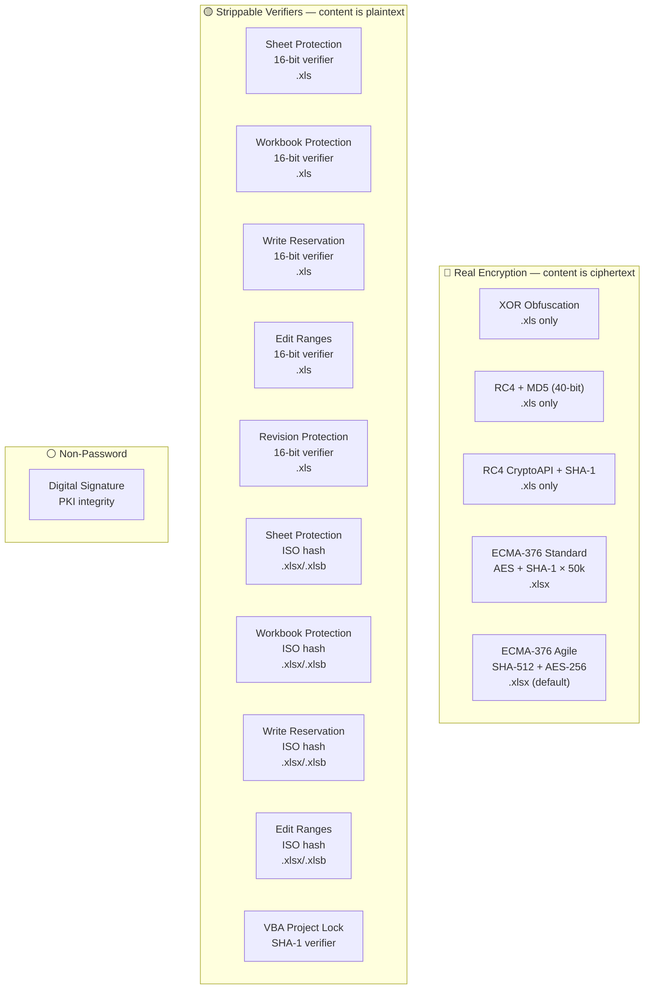
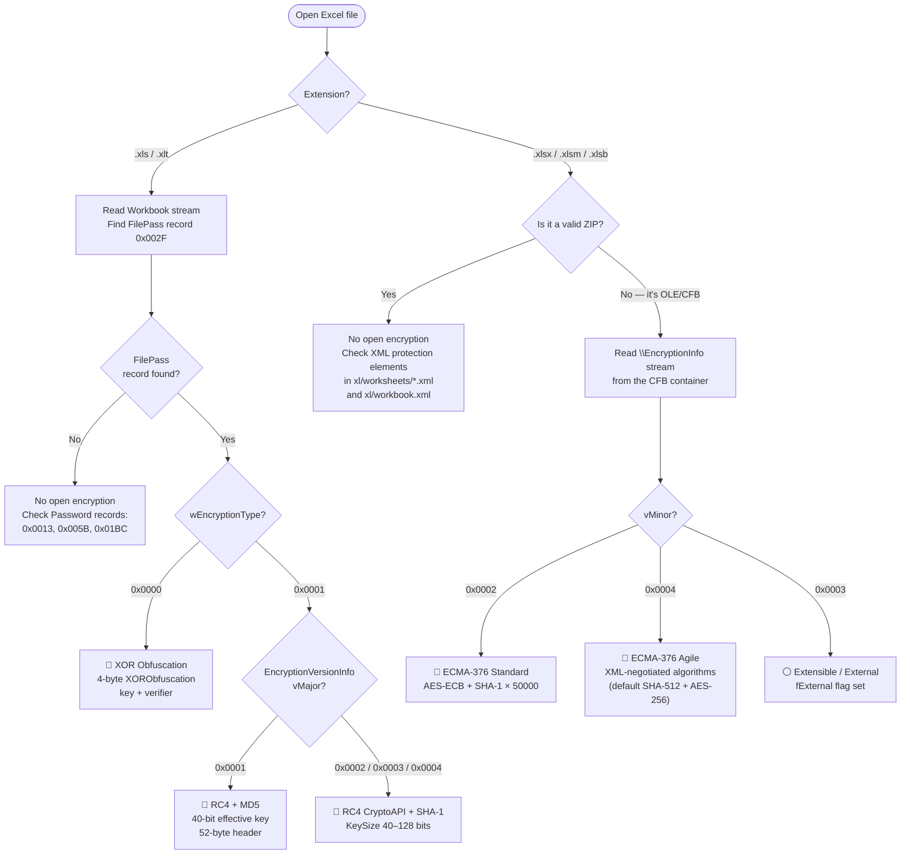
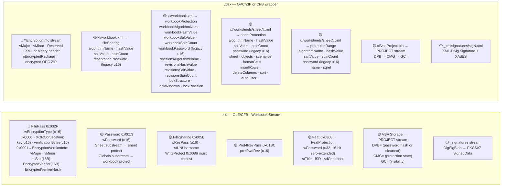

# Microsoft Excel — .xls / .xlsx / .xlsb / .xlsm / .xltx

Excel spans three container families keyed by extension. `.xls` (and `.xlt`) is the legacy **OLE/CFB** compound file carrying a BIFF8 record stream in the `Workbook` stream, as specified by [MS-XLS]. `.xlsx`/`.xlsm`/`.xltx` are **OPC/ZIP** packages (OOXML) containing XML parts such as `xl/workbook.xml` and `xl/worksheets/sheetN.xml`, as specified by [MS-XLSX] and [ISO/IEC 29500-1:2016]. `.xlsb` is also an **OPC/ZIP** package but its parts contain binary BIFF12 "Brt" records rather than XML, as specified by [MS-XLSB] — it shares the OOXML protection model. One wrinkle: an OOXML file that has a document-open password is not a ZIP on disk — the entire OPC package is re-wrapped in an **OLE/CFB** container holding `\EncryptionInfo` + `\EncryptedPackage` streams ([MS-OFFCRYPTO] §2.3.4), preserving the outer extension.

## File Extensions

| Extension | Container | Description | Password Protection Applicable? | Notes |
|---|---|---|---|---|
| .xls | OLE/CFB | Excel 97-2003 Worksheet (BIFF8) | Yes — XOR/RC4-MD5/RC4-CryptoAPI open, 16-bit sheet/workbook/write verifiers | Primary legacy binary format; `Workbook` stream carries BIFF8 records per [MS-XLS] |
| .xlt | OLE/CFB | Excel 97-2003 Template | Same as .xls | Uses the same OLE/CFB container and encryption mechanisms as .xls; saved as a template but structurally identical |
| .xlm | OLE/CFB | Excel 4.0 Macro Sheet | Legacy BIFF, limited encryption support | Pre-BIFF8 macro format; largely superseded by VBA macros in .xls/.xlsm |
| .xlsx | OPC/ZIP (or OLE/CFB when encrypted) | Excel Workbook | Yes — Standard/Agile open, ISO protection, VelvetSweatshop | Default OOXML format; when an open password is set, the OPC/ZIP is re-wrapped in an OLE/CFB container holding `\EncryptionInfo` + `\EncryptedPackage` |
| .xlsm | OPC/ZIP (or OLE/CFB when encrypted) | Excel Macro-Enabled Workbook | Same as .xlsx + VBA project lock | Same OPC/ZIP container and encryption as .xlsx; additionally contains `xl/vbaProject.bin` with DPB=/CMG=/GC= VBA project protection |
| .xltx | OPC/ZIP (or OLE/CFB when encrypted) | Excel Template | Same as .xlsx | Uses the same OPC/ZIP container and encryption as .xlsx; template variant |
| .xltm | OPC/ZIP (or OLE/CFB when encrypted) | Excel Macro-Enabled Template | Same as .xlsx + VBA project lock | Uses the same OPC/ZIP container and encryption as .xlsx; macro-enabled template with VBA project lock support |
| .xlsb | OPC/ZIP (or OLE/CFB when encrypted) | Excel Binary Workbook (BIFF12) | Same as .xlsx but protection records are binary Brt* instead of XML | OPC/ZIP package with binary BIFF12 parts per [MS-XLSB]; shares the OOXML protection model but uses BrtSheetProtection/BrtBookProtection/etc. instead of XML elements |
| .xla | OLE/CFB | Excel 97-2003 Add-in | Same as .xls (can be encrypted) | Legacy add-in format; uses the same OLE/CFB container and encryption mechanisms as .xls |
| .xlam | OPC/ZIP | Excel Macro-Enabled Add-in | Same as .xlsm | Uses the same OPC/ZIP container and encryption as .xlsm; OOXML add-in with VBA project lock support |
| .xll | DLL | Excel XLL Add-in (native code) | Not an Office document — no Office password protection | Native-code DLL loaded by Excel; not an Office document container, so no Office encryption or password protection applies |
| .xlw | Proprietary | Excel Workspace | Window layout only — no workbook data, no encryption | Stores window layout and references to workbooks, but contains no workbook data itself; no encryption or password protection mechanisms |

## Gate Strength Map



## Detection Flowchart

How to determine which encryption scheme an Excel file uses:



## Container Structure

Where each gate's data physically lives:



## VelvetSweatshop Default Password

> **Spec-confirmed default password** — [MS-OFFCRYPTO] §2.4.2.3
>
> - Password: `VelvetSweatshop` (`\x56\x65\x6C\x76\x65\x74\x53\x77\x65\x61\x74\x73\x68\x6F\x70`)
> - **Trigger:** Excel auto-encrypts the workbook stream under this fixed password when a protection record (`Password` 0x0013, `Prot4RevPass` 0x01BC, or their `.xlsb` equivalents) carries a non-zero verifier but **no user open password** was set
> - **Always try this first** on any encrypted Excel file before password-cracking attempts
> - Applies to: Excel 2007, Excel 2010, Excel 2013 — per [MS-OFFCRYPTO] Appendix A notes \<24\>, \<25\>

## Gate Quick Reference

### .xls — legacy binary

| | Gate | Record / Location | Algorithm | Spec |
|---|---|---|---|---|
| 🔴 | Open — XOR | `FilePass` 0x002F, `wEncryptionType`=0x0000 | [XOR obfuscation](../algorithms/password/xor-obfuscation.md) Method 1 | [MS-OFFCRYPTO] §2.3.7 |
| 🔴 | Open — RC4+MD5 | `FilePass` 0x002F, vMajor=1/vMinor=1 | [RC4-MD5](../algorithms/password/rc4-md5-legacy.md), 40-bit | [MS-OFFCRYPTO] §2.3.6 |
| 🔴 | Open — RC4 CryptoAPI | `FilePass` 0x002F, vMajor=2–4/vMinor=2 | [RC4-CryptoAPI-SHA1](../algorithms/password/rc4-cryptoapi-sha1.md) | [MS-OFFCRYPTO] §2.3.5 |
| 🟡 | Write reservation | `FileSharing` 0x005B, `wResPass` u16 | 16-bit verifier ([MS-OFFCRYPTO] §2.3.7.1) | [MS-XLS] §2.4.118 |
| 🟡 | Protect sheet | `Password` 0x0013 in sheet substream | 16-bit verifier ([MS-OFFCRYPTO] §2.3.7.1) | [MS-XLS] §2.4.191, §2.2.9 |
| 🟡 | Protect workbook | `Password` 0x0013 in Globals substream | 16-bit verifier ([MS-OFFCRYPTO] §2.3.7.1) | [MS-XLS] §2.4.191, §2.4.207 |
| 🟡 | Edit ranges | `FeatProtection` in `Feat` 0x0868 | 16-bit verifier, zero-extended to 32 bits | [MS-XLS] §2.4.111, §2.5.124 |
| 🟡 | Revision protect | `Prot4RevPass` 0x01BC, `protPwdRev` u16 | 16-bit verifier ([MS-OFFCRYPTO] §2.3.7.1) | [MS-XLS] §2.4.205–206 |
| 🟡 | Object protect | `ObjProtect` 0x0063 | No independent password — uses sheet's `Password` | [MS-XLS] §2.4.183 |
| 🟡 | Scenario protect | `ScenarioProtect` 0x00DD | No independent password — uses sheet's `Password` | [MS-XLS] §2.4.245 |
| 🟡 | VBA project lock | VBA storage → `PROJECT` stream `DPB=` | [VBA password](../algorithms/password/vba-project-password.md) SHA-1 | [MS-OVBA] §2.3.1.16, §2.4.4 |
| ⚪ | Digital signature | `_signatures` / `_xmlsignatures` | PKI — MD5+RSA or xmldsig/XAdES | [MS-OFFCRYPTO] §2.5 |

### .xlsx / .xlsb — OOXML

| | Gate | Element / Record | Algorithm | Spec |
|---|---|---|---|---|
| 🔴 | Open — Standard | `\EncryptionInfo` vMinor=0x0002 | [ECMA-376 Standard](../algorithms/password/ecma376-standard.md) AES-ECB | [MS-OFFCRYPTO] §2.3.4.5–9 |
| 🔴 | Open — Agile | `\EncryptionInfo` vMinor=0x0004 | [ECMA-376 Agile](../algorithms/password/ecma376-agile.md) AES-CBC | [MS-OFFCRYPTO] §2.3.4.10–15 |
| 🟡 | Write reservation | `<fileSharing>` / `BrtFileSharingIso` | [ISO hash](../algorithms/password/iso-protection-hash.md) or 16-bit legacy | [MS-OFFCRYPTO] §2.4.2.4 |
| 🟡 | Protect sheet | `<sheetProtection>` / `BrtSheetProtectionIso` | [ISO hash](../algorithms/password/iso-protection-hash.md) or 16-bit legacy | [MS-OFFCRYPTO] §2.4.2.4 |
| 🟡 | Protect workbook | `<workbookProtection>` / `BrtBookProtectionIso` | [ISO hash](../algorithms/password/iso-protection-hash.md) or 16-bit legacy | [MS-OFFCRYPTO] §2.4.2.4 |
| 🟡 | Edit ranges | `<protectedRange>` / `BrtRangeProtectionIso` | [ISO hash](../algorithms/password/iso-protection-hash.md) or 16-bit legacy | [MS-XLSX] §2.6.56 |
| 🟡 | Revision protect | `<workbookProtection>` `revisions*` attrs | [ISO hash](../algorithms/password/iso-protection-hash.md) | [MS-OE376] §2.1.621 |
| 🟡 | VBA project lock | `xl/vbaProject.bin` → `PROJECT` stream | [VBA password](../algorithms/password/vba-project-password.md) SHA-1 | [MS-OVBA] §2.3.1.16, §2.4.4 |
| ⚪ | Digital signature | `_xmlsignatures/` | xmldsig/XAdES PKI | [MS-OFFCRYPTO] §2.5.2–3 |

---

## Specification Detail

### `.xls` — legacy binary (OLE/CFB, BIFF8) — full gate table

| Gate | Location in file | Algorithm / mechanism | Spec reference |
|---|---|---|---|
| 🔴 Open / encrypt — XOR obfuscation | `FilePass` record (record type 47 / 0x002F) in the `Workbook` stream; `wEncryptionType` = 0x0000 selects `XORObfuscation` sub-structure (4 bytes: key + verifier). Record headers (type + size) and certain records (BOF, FilePass, UsrExcl, FileLock, InterfaceHdr, RRDInfo, RRDHead) are never obfuscated; `lbPlyPos` in BoundSheet8 is also exempt. | XOR obfuscation Method 1: password verifier derivation ([MS-OFFCRYPTO] §2.3.7.1), XOR array init ([MS-OFFCRYPTO] §2.3.7.2), XOR data transformation ([MS-OFFCRYPTO] §2.3.7.3). Password is truncated to 15 single-byte ANSI characters. Produces a 16-bit verifier and a 16-byte XOR array. See [xor-obfuscation](../algorithms/password/xor-obfuscation.md). | [MS-XLS] §2.4.117, §2.2.10; [MS-OFFCRYPTO] §2.3.7 |
| 🔴 Open / encrypt — RC4 + MD5 (40-bit) | `FilePass` record with `wEncryptionType` = 0x0001 and `encryptionInfo` first two bytes = 0x0001, signifying EncryptionVersionInfo (vMajor=1, vMinor=1) → 52-byte RC4 encryption header containing Salt (16 bytes), EncryptedVerifier (16 bytes), EncryptedVerifierHash (16 bytes). | RC4 encryption: key derivation uses MD5 hashing, first 5 bytes of H(password) as TruncatedHash, 336-byte IntermediateBuffer ([MS-OFFCRYPTO] §2.3.6.2). Effective key seed is 40 bits despite 128-bit RC4 key. Verification via MD5 of decrypted verifier. See [rc4-md5-legacy](../algorithms/password/rc4-md5-legacy.md). | [MS-XLS] §2.4.117, §2.2.10; [MS-OFFCRYPTO] §2.3.6 |
| 🔴 Open / encrypt — RC4 CryptoAPI + SHA-1 | `FilePass` record with `wEncryptionType` = 0x0001 and `encryptionInfo` first two bytes in {0x0002, 0x0003, 0x0004} → RC4 CryptoAPI encryption header ([MS-OFFCRYPTO] §2.3.5.1): EncryptionVersionInfo, EncryptionHeader (AlgID=0x6801 for RC4, AlgIDHash=0x8004 for SHA-1, KeySize 40–128 bits), EncryptionVerifier. | RC4 CryptoAPI: key derivation is H0 = SHA-1(salt + password), Hfinal = SHA-1(H0 + blockNumber), no iteration ([MS-OFFCRYPTO] §2.3.5.2). Verification via SHA-1 of decrypted verifier. When RC4 CryptoAPI is used, certain streams are stored in the Encryption Stream ([MS-XLS] §2.1.7.6) per [MS-OFFCRYPTO] §2.3.5.4. See [rc4-cryptoapi-sha1](../algorithms/password/rc4-cryptoapi-sha1.md). | [MS-XLS] §2.4.117, §2.2.10; [MS-OFFCRYPTO] §2.3.5 |
| 🟡 Modify / write-reservation | `FileSharing` record (record type 91 / 0x005B) in the Globals substream. `wResPass` (unsigned 16-bit) at data offset +2 holds the password verifier; a value of 0 means no write-reservation password. `stUNUsername` names the user who set the reservation. The `WriteProtect` record (record type 134 / 0x0086) MUST also exist when write protection is active. | 16-bit password verifier via CreatePasswordVerifier_Method1 ([MS-OFFCRYPTO] §2.3.7.1). When a write-reservation is set but no user-supplied open password exists, the workbook can be encrypted under the default password (see VelvetSweatshop below). See [xor-obfuscation](../algorithms/password/xor-obfuscation.md). | [MS-XLS] §2.4.118, §2.4.350; [MS-OFFCRYPTO] §2.4.2.2, §2.3.7.1 |
| 🟡 Protect sheet | `Password` record (record type 19 / 0x0013) in the worksheet, chart sheet, macro sheet, or dialog sheet substream. `wPassword` (unsigned 16-bit) holds the verifier. This record MUST exist if and only if the sheet is protected. The `Protect` record (record type 18 / 0x0012) in the same substream specifies the protection state (`fLock` = 0x0001 = protected). | 16-bit password verifier via CreatePasswordVerifier_Method1 ([MS-OFFCRYPTO] §2.3.7.1). This is the Password Verifier Algorithm described in [MS-XLS] §2.2.9: Unicode password → ANSI code-page conversion → Method 1 derivation. See [xor-obfuscation](../algorithms/password/xor-obfuscation.md). | [MS-XLS] §2.4.191, §2.4.207, §2.2.9; [MS-OFFCRYPTO] §2.3.7.1 |
| 🟡 Protect workbook (structure / windows) | `Password` record (record type 0x0013) in the **Globals** substream. `wPassword` = 0x0000 means no password. Separately, the `Protect` record in Globals sets `fLock` and the `WinProtect` record (record type 0x0019) controls whether workbook windows can be resized or moved. | Same 16-bit Password Verifier Algorithm as sheet protection ([MS-XLS] §2.2.9). | [MS-XLS] §2.4.191, §2.4.207, §2.4.347 |
| 🟡 Allow-edit-ranges | `Feat` record (record type 2152 / 0x0868) with a `FeatProtection` structure ([MS-XLS] §2.5.124) containing `wPassword` (unsigned 32-bit verifier), `stTitle`, and optional `sdContainer` (Windows security descriptor identifying users who can edit without a password). Linked to cell ranges via the Feat record's `refs` field. | Password verifier is the same Password Verifier Algorithm ([MS-XLS] §2.2.9); the `wPassword` field stores the 16-bit result zero-extended to 32 bits. When `fSD` = 1, the `sdContainer` carries a self-relative security descriptor for ACL-based authorization (users listed in the descriptor can edit without entering a password). | [MS-XLS] §2.4.111, §2.5.124, §2.2.9 |
| 🟡 Shared-workbook revision protection | `Prot4Rev` record (record type 0x01AF) with `fRevLock` Boolean (0x0001 = removal of revision logs disallowed). Followed by `Prot4RevPass` record (record type 0x01BC) whose `protPwdRev` (unsigned 16-bit) is the verifier required to change `fRevLock`. | 16-bit Password Verifier Algorithm ([MS-XLS] §2.2.9, [MS-OFFCRYPTO] §2.3.7.1). | [MS-XLS] §2.4.205, §2.4.206 |
| 🟡 Object protection | `ObjProtect` record (record type 99 / 0x0063) in the sheet substream. `fLockObj` = 0x0001 means objects are protected. This record exists if and only if the sheet is protected and the objects on the sheet are protected. | No independent password — object protection is governed by the sheet's `Password` record (same 16-bit verifier). | [MS-XLS] §2.4.183 |
| 🟡 Scenario protection | `ScenarioProtect` record (record type 0x00DD) in the sheet substream. `fScenProtect` = 0x0001 means scenarios are protected. | No independent password — scenario protection is governed by the sheet's `Password` record. | [MS-XLS] §2.4.245 |
| 🟡 VBA project lock | Embedded VBA storage (`_VBA_PROJECT_CUR` or `VBA`) → `PROJECT` stream. `ProjectProtectionState` (CMG= line, [MS-OVBA] §2.3.1.15) controls whether the project is "locked for viewing". `ProjectPassword` (DPB= line, [MS-OVBA] §2.3.1.16) stores either a password hash (29-byte Hash Data Structure) or a plaintext password, obfuscated by the Data Encryption algorithm ([MS-OVBA] §2.4.3). When password is a hash, `ProjectId.ProjectCLSID` MUST be `{00000000-0000-0000-0000-000000000000}`. | DPB obfuscation ([MS-OVBA] §2.4.3): three seed bytes + XOR-based encryption. The actual password hash uses SHA-1 via the Hash Data Structure ([MS-OVBA] §2.4.4). See [vba-project-password](../algorithms/password/vba-project-password.md). | [MS-OVBA] §2.3.1.15, §2.3.1.16, §2.4.3, §2.4.4 |
| ⚪ Digital signature | `_signatures` stream in root storage (CryptoAPI format, MD5 hash, [MS-OFFCRYPTO] §2.5.1) or `_xmlsignatures` storage (xmldsig/XAdES format, [MS-OFFCRYPTO] §2.5.2–2.5.3). For CryptoAPI sigs, the hash is generated by recursively traversing OLE streams/storages excluding `\0x06DataSpaces`, `_signatures`, and `\0x09DRMContent`; for the Workbook stream, application-specific filtering is applied ([MS-XLS] §2.1.7.15). | CryptoAPI digital signature: MD5 hash of stream data + RSA signing ([MS-OFFCRYPTO] §2.5.1.5). Xmldsig: XML-Signature Syntax and Processing [XMLDSig] with optional XAdES extensions ([MS-OFFCRYPTO] §2.5.2.6). | [MS-OFFCRYPTO] §2.5.1, §2.5.2, §2.5.3 |

### `.xlsx` / `.xlsb` — OOXML (OPC/ZIP, Excel 2007+) — full gate table

`.xlsb` carries the identical gates but as binary `Brt*` records instead of XML elements — noted per row where applicable.

| Gate | Location in file | Algorithm / mechanism | Spec reference |
|---|---|---|---|
| 🔴 Open / encrypt — ECMA-376 standard | OLE/CFB wrapper: `\EncryptionInfo` stream (EncryptionVersionInfo vMajor in {0x0002,0x0003,0x0004}, vMinor=0x0002), `\EncryptedPackage` stream. EncryptionHeader: fCryptoAPI=1, fAES=1, AlgID in {0x660E, 0x660F, 0x6610} (AES-128/192/256), AlgIDHash=0x8004 (SHA-1). The entire OPC ZIP is encrypted as a single stream inside `\EncryptedPackage`. Data spaces structures under `\0x06DataSpaces` associate the package with the StrongEncryptionTransform. | Key derivation: H0 = SHA-1(salt + password), then 50,000 iterations Hn = SHA-1(iterator + Hn-1), then Hfinal = SHA-1(Hn + blockKey), followed by HMAC-like X1/X2 derivation to reach cbRequiredKeyLength bits ([MS-OFFCRYPTO] §2.3.4.7). Encryption uses AES-ECB. Verification via SHA-1 of decrypted verifier ([MS-OFFCRYPTO] §2.3.4.9). See [ecma376-standard](../algorithms/password/ecma376-standard.md). | [MS-OFFCRYPTO] §2.3.4.5, §2.3.4.7–§2.3.4.9, §2.3.4.4 |
| 🔴 Open / encrypt — ECMA-376 agile | OLE/CFB wrapper: `\EncryptionInfo` stream (vMajor=0x0004, vMinor=0x0004, Reserved=0x00000040), followed by XML descriptor. `\EncryptedPackage` encrypted in 4096-byte segments. XML descriptor carries `<keyData>` (cipherAlgorithm, hashAlgorithm, keyBits, saltValue, blockSize), `<dataIntegrity>` (HMAC for corruption detection), and `<keyEncryptors>` with one `<p:encryptedKey>` per PasswordKeyEncryptor (spinCount, saltValue, encryptedVerifierHashInput, encryptedVerifierHashValue, encryptedKeyValue). | Key derivation: H0 = H(salt + password), iterated spinCount times ([MS-OFFCRYPTO] §2.3.4.11); Hfinal = H(Hn + blockKey). IV generation per §2.3.4.12 using KeySalt + blockKey. Cipher algorithm and hash algorithm specified in XML (typically AES-256-CBC + SHA-512 for modern files; defaults are AES-128-CBC + SHA-1). DataIntegrity HMAC validates the entire EncryptedPackage including StreamSize. CertificateKeyEncryptor allows public-key-based decryption alongside password. See [ecma376-agile](../algorithms/password/ecma376-agile.md). | [MS-OFFCRYPTO] §2.3.4.10–§2.3.4.15 |
| 🟡 Modify / write-reservation | `<fileSharing>` element in `xl/workbook.xml` ([ISO/IEC 29500-1] §3.2.12). Attributes: `reservationPassword` (legacy 16-bit hash) or `algorithmName`/`hashValue`/`saltValue`/`spinCount` (ISO hash). `userName` names the reserving user (max 54 chars). `.xlsb`: `BrtFileSharing` / `BrtFileSharingIso` record. | Legacy: 16-bit verifier identical to [MS-OFFCRYPTO] §2.3.7.1. ISO: iterated hash per [MS-OFFCRYPTO] §2.4.2.4 — H0 = H(salt + password), then Hn = H(Hn-1 + iterator) for spinCount iterations. algorithmName selects the hash function (SHA-1 through SHA-512, WHIRLPOOL, etc.). See [iso-protection-hash](../algorithms/password/iso-protection-hash.md). | [MS-XLSX] / [ISO/IEC 29500-1] §3.2.12; [MS-OE376] §2.1.607; [MS-OFFCRYPTO] §2.4.2.4 |
| 🟡 Protect sheet | `<sheetProtection>` element in `xl/worksheets/sheetN.xml` ([ISO/IEC 29500-1] §3.3.1.81). Boolean attributes control which actions remain permitted: `sheet`, `objects`, `scenarios`, `formatCells`, `formatColumns`, `formatRows`, `insertColumns`, `insertRows`, `insertHyperlinks`, `deleteColumns`, `deleteRows`, `selectLockedCells`, `sort`, `autoFilter`, `pivotTables`, `selectUnlockedCells`. Password stored via `password` (legacy 16-bit) or `algorithmName`/`hashValue`/`saltValue`/`spinCount` (ISO hash). Chart sheet: `<sheetProtection>` in `xl/chartsheets/` ([ISO/IEC 29500-1] §3.3.1.82). `.xlsb`: `BrtSheetProtection` / `BrtSheetProtectionIso`, `BrtCsProtection` / `BrtCsProtectionIso`. | ISO hash per [MS-OFFCRYPTO] §2.4.2.4 (or legacy 16-bit when only `password` attribute present). For dialog sheets, Office requires that `objects` and `scenarios` both be true when protected, with `sheet` always true ([MS-OE376] §2.1.681). See [iso-protection-hash](../algorithms/password/iso-protection-hash.md). | [MS-XLSX] / [ISO/IEC 29500-1] §3.3.1.81–82; [MS-OE376] §2.1.681–682; [MS-OFFCRYPTO] §2.4.2.4 |
| 🟡 Protect workbook (structure / windows) | `<workbookProtection>` element in `xl/workbook.xml` ([ISO/IEC 29500-1] §3.2.29). `lockStructure` prevents adding/deleting/renaming sheets. `lockWindows` prevents resizing/moving workbook windows (note: if all sheets have `windowProtection=false`, `lockWindows` is also saved as false per [MS-OE376] §2.1.621). `workbookPassword` (legacy 16-bit) or `workbookAlgorithmName`/`workbookHashValue`/`workbookSaltValue`/`workbookSpinCount` (ISO hash). `lockRevision` controls whether change history in a shared workbook can be removed, with `revisionsPassword` / `revisionsAlgorithmName` / `revisionsHashValue` / `revisionsSaltValue` / `revisionsSpinCount` as the corresponding verifier. `.xlsb`: `BrtBookProtection` / `BrtBookProtectionIso`. | ISO hash per [MS-OFFCRYPTO] §2.4.2.4. Note: Office uses `workbookPassword` for unlocking structure/windows (not revisions, despite what the standard's attribute name might suggest) — per [MS-OE376] §2.1.621(d). See [iso-protection-hash](../algorithms/password/iso-protection-hash.md). | [MS-XLSX] / [ISO/IEC 29500-1] §3.2.29; [MS-OE376] §2.1.621; [MS-OFFCRYPTO] §2.4.2.4 |
| 🟡 Allow-edit-ranges | `<protectedRange>` elements inside `<protectedRanges>` in `xl/worksheets/sheetN.xml` ([ISO/IEC 29500-1] §3.3.1.69). Each range has `name` (unique within the sheet, starting with a letter), `sqref` (cell references), and password via `password` (legacy 16-bit) or `algorithmName`/`hashValue`/`saltValue`/`spinCount` (ISO hash). `.xlsb`: `BrtRangeProtection` / `BrtRangeProtectionIso`. | ISO hash per [MS-OFFCRYPTO] §2.4.2.4. | [MS-XLSX] / [ISO/IEC 29500-1] §3.3.1.69; [MS-OE376] §2.1.672; [MS-OFFCRYPTO] §2.4.2.4 |
| 🟡 Shared-workbook revision protection | `<workbookProtection>` element's `revisionsHashValue`/`revisionsAlgorithmName`/`revisionsSaltValue`/`revisionsSpinCount` attributes in `xl/workbook.xml`. `lockRevision` = true disallows removal of revision logs. | ISO hash per [MS-OFFCRYPTO] §2.4.2.4. Per [MS-OE376] §2.1.621(c), Office uses `lockRevision` to mean "change history in a shared workbook cannot be removed". | [MS-XLSX] / [ISO/IEC 29500-1] §3.2.29; [MS-OE376] §2.1.621 |
| 🟡 VBA project lock | `xl/vbaProject.bin` (an embedded OLE/CFB binary part) → `PROJECT` stream. Same `CMG`/`DPB`/`GC` protection state and `ProjectPassword` structure as the `.xls` case. | Same DPB obfuscation and SHA-1 hash as the binary format ([MS-OVBA] §2.3.1.15–16, §2.4.3–4). See [vba-project-password](../algorithms/password/vba-project-password.md). | [MS-OVBA] §2.3.1.15, §2.3.1.16, §2.4.3, §2.4.4 |
| ⚪ Digital signature | `_xmlsignatures/` storage within the OPC package, containing XML-Signature streams per [MS-OFFCRYPTO] §2.5.2–2.5.3 and [ECMA-376] Part 2 §12. Each signature stream is a valid xmldsig `<Signature>` with optional XAdES extensions. | XML-Signature Syntax and Processing [XMLDSig]; Manifest covers all package streams except `_xmlsignatures`, `\0x06DataSpaces`, `MsoDataStore`, etc. ([MS-OFFCRYPTO] §2.5.2.4). Optional XAdES-EPES through XAdES-X-L extensions ([MS-OFFCRYPTO] §2.5.2.6). | [MS-OFFCRYPTO] §2.5.2, §2.5.3 |

### Extraction Targets by Gate

What Python code needs to extract for each gate — field names, types, locations, and "gate is active" indicators.

#### 🔴 Open / Encrypt — .xls binary

- **Location:** `Workbook` stream (or `Book`), `FilePass` record (`rt` = 0x002F)
- **Gate active when:** `FilePass` record exists
- **Extract:**
  - `wEncryptionType` — u16 LE at body offset 0 → 0x0000 = XOR, 0x0001 = RC4
  - **If XOR (0x0000):** `XORObfuscation` (4 bytes) → `key` (u16 LE), `verificationBytes` (u16 LE)
  - **If RC4 (0x0001):** read `EncryptionVersionInfo` → `vMajor` (u16 LE), `vMinor` (u16 LE)
    - vMajor=1, vMinor=1 → RC4+MD5: `Salt` (16B at offset 0x04), `EncryptedVerifier` (16B at 0x14), `EncryptedVerifierHash` (16B at 0x24)
    - vMajor=2–4, vMinor=2 → RC4 CryptoAPI: parse `EncryptionHeader` (AlgID, AlgIDHash, KeySize) + `EncryptionVerifier` (SaltSize, Salt 16B, EncryptedVerifier 16B, VerifierHashSize, EncryptedVerifierHash 20B)

#### 🔴 Open / Encrypt — .xlsx/.xlsb OOXML

- **Location:** `\EncryptionInfo` stream in the OLE/CFB wrapper (file is NOT a ZIP when encrypted)
- **Gate active when:** file fails ZIP magic check (not `PK\x03\x04`) and has OLE/CFB signature (`D0 CF 11 E0`)
- **Extract:**
  - Bytes 0–7: `vMajor` (u16 LE), `vMinor` (u16 LE), `Reserved` (u32 LE)
  - **If vMinor=0x0002 (Standard):** parse `EncryptionHeader` + `EncryptionVerifier` per [MS-OFFCRYPTO] §2.3.4.5
  - **If vMinor=0x0004 (Agile):** parse UTF-8 XML from byte 8 onward → extract from `<p:encryptedKey>`: `spinCount`, `saltSize`, `blockSize`, `keyBits`, `hashSize`, `cipherAlgorithm`, `cipherChaining`, `hashAlgorithm`, `saltValue` (base64), `encryptedVerifierHashInput` (base64), `encryptedVerifierHashValue` (base64), `encryptedKeyValue` (base64)

#### 🟡 Sheet Protection — .xls binary

- **Location:** `Password` record (`rt` = 0x0013) in the worksheet/chart/macro/dialog substream
- **Gate active when:** `Protect` record (`rt` = 0x0012) has `fLock` = 0x0001 AND `Password` record exists with `wPassword` ≠ 0x0000
- **Extract:** `wPassword` — u16 LE (the 16-bit verifier)

#### 🟡 Sheet Protection — .xlsx OOXML

- **Location:** `xl/worksheets/sheetN.xml`, element `<sheetProtection>`
- **Gate active when:** `sheet="1"` attribute is present (or any of the boolean protection attributes)
- **Extract (ISO):** `algorithmName` (string), `hashValue` (base64), `saltValue` (base64), `spinCount` (decimal)
- **Extract (legacy):** `password` (4-hex-digit ST_UnsignedShortHex, e.g. `"CC40"`)
- **Also extract:** boolean flags: `sheet`, `objects`, `scenarios`, `formatCells`, `formatColumns`, `formatRows`, `insertColumns`, `insertRows`, `insertHyperlinks`, `deleteColumns`, `deleteRows`, `selectLockedCells`, `sort`, `autoFilter`, `pivotTables`, `selectUnlockedCells`

#### 🟡 Workbook Protection — .xls binary

- **Location:** `Password` record (`rt` = 0x0013) in the **Globals** substream
- **Gate active when:** `Protect` record in Globals has `fLock` = 0x0001
- **Extract:** `wPassword` — u16 LE

#### 🟡 Workbook Protection — .xlsx OOXML

- **Location:** `xl/workbook.xml`, element `<workbookProtection>`
- **Gate active when:** `lockStructure="1"` or `lockWindows="1"` is present
- **Extract (ISO, structure):** `workbookAlgorithmName`, `workbookHashValue` (base64), `workbookSaltValue` (base64), `workbookSpinCount`
- **Extract (ISO, revisions):** `revisionsAlgorithmName`, `revisionsHashValue` (base64), `revisionsSaltValue` (base64), `revisionsSpinCount`
- **Extract (legacy):** `workbookPassword` (4-hex), `revisionsPassword` (4-hex)
- **Also extract:** `lockStructure`, `lockWindows`, `lockRevision` (booleans)

#### 🟡 Write Reservation — .xls binary

- **Location:** `FileSharing` record (`rt` = 0x005B) in the Globals substream
- **Gate active when:** `WriteProtect` record (`rt` = 0x0086) exists AND `wResPass` ≠ 0x0000
- **Extract:** `wResPass` — u16 LE at data offset +2; `stUNUsername` — XLUnicodeString

#### 🟡 Write Reservation — .xlsx OOXML

- **Location:** `xl/workbook.xml`, element `<fileSharing>`
- **Gate active when:** `<fileSharing>` element exists with any password attribute
- **Extract (ISO):** `algorithmName`, `hashValue` (base64), `saltValue` (base64), `spinCount`
- **Extract (legacy):** `reservationPassword` (4-hex)
- **Also extract:** `userName` (string, max 54 chars)

#### 🟡 Edit Ranges — .xls binary

- **Location:** `Feat` record (`rt` = 0x0868) with `FeatProtection` structure
- **Gate active when:** `wPassword` ≠ 0x00000000
- **Extract:** `wPassword` — u32 LE (16-bit verifier zero-extended); `stTitle` — range name; `fSD` — boolean; `sdContainer` — security descriptor (if `fSD`=1)

#### 🟡 Edit Ranges — .xlsx OOXML

- **Location:** `xl/worksheets/sheetN.xml`, element `<protectedRange>` inside `<protectedRanges>`
- **Gate active when:** `<protectedRange>` element exists with any password attribute
- **Extract (ISO):** `algorithmName`, `hashValue` (base64), `saltValue` (base64), `spinCount`
- **Extract (legacy):** `password` (4-hex)
- **Also extract:** `name` (string, unique per sheet), `sqref` (cell reference string)

#### 🟡 Revision Protection — .xls binary

- **Location:** `Prot4RevPass` record (`rt` = 0x01BC)
- **Gate active when:** `Prot4Rev` record (`rt` = 0x01AF) has `fRevLock` = 0x0001 AND `protPwdRev` ≠ 0x0000
- **Extract:** `protPwdRev` — u16 LE

#### 🟡 VBA Project Lock

- **Location (binary):** VBA storage → `PROJECT` stream (INI-style text)
- **Location (OOXML):** `xl/vbaProject.bin` (embedded OLE/CFB) → `PROJECT` stream
- **Gate active when:** `DPB=` line exists with length > the no-password sentinel
- **Extract:** `ID=` line (CLSID GUID for ProjKey derivation); `DPB=` hex string (decode with §2.4.3); `CMG=` hex string (protection state); `GC=` hex string (visibility)

#### ⚪ Digital Signature

- **Location (binary):** `_signatures` stream or `_xmlsignatures` storage
- **Location (OOXML):** `_xmlsignatures/sigN.xml` parts
- **Gate active when:** the stream/storage/part exists
- **Extract:** PKCS#7 SignedData blob (binary) or XML-DSig `<Signature>` elements (OOXML)

### Detailed Notes

#### VelvetSweatshop default password

The spec explicitly defines a fixed default encryption password used when a workbook has protection records but no user-supplied open password. [MS-OFFCRYPTO] §2.4.2.3 / Appendix A note <24> states that documents generated by Excel 2007, Excel 2010, and Excel 2013 "can be encrypted as specified in section 2.3 with the following password: `\x56\x65\x6C\x76\x65\x74\x53\x77\x65\x61\x74\x73\x68\x6F\x70`" — which decodes to the ASCII string `VelvetSweatshop`. Appendix A note <25> repeats the same for write-protected documents under [MS-OFFCRYPTO] §2.4.2.2. [MS-XLS] §2.2.10 and [MS-XLSB] §2.2.11 cross-reference these conditions. The trigger is: the `Password` record (`0x0013`, sheet or workbook), `Prot4RevPass` (`0x01BC`), or their `.xlsb` equivalents (`BrtBookProtection`, `BrtBookProtectionIso`) carry a non-zero verifier, but no user open password was set, so the workbook stream is auto-encrypted under this fixed password.

#### Password Verifier Algorithm (16-bit, BIFF8)

[MS-XLS] §2.2.9 describes the Password Verifier Algorithm used by the `Password`, `FileSharing`, `Prot4RevPass`, `FeatProtection`, and `FilePass` records. The spec states: "This password verifier is used to prevent accidental editing, and is not designed to be used as a security feature." The derivation is a two-stage process: (1) the Unicode password string is converted to a single-byte ANSI string using the code-page conversion algorithm specified in the `revisionsPassword` attribute in [ECMA-376] Part 4 §3.2.29; (2) this ANSI string is fed into the XOR obfuscation password verifier derivation method 1 ([MS-OFFCRYPTO] §2.3.7.1), which produces a 16-bit value. Passwords are truncated to 15 characters ([MS-OFFCRYPTO] §4.1.3.4). Multiple passwords can map to the same 16-bit verifier.

#### ISO Write Protection Method (OOXML)

[MS-OFFCRYPTO] §2.4.2.4 specifies the ISO password hashing algorithm used by all OOXML protection elements (sheetProtection, workbookProtection, protectedRange, fileSharing). The algorithm takes: Password (1–255 Unicode characters), AlgorithmName (SHA-1, SHA-256, SHA-384, SHA-512, MD5, MD4, MD2, RIPEMD-128, RIPEMD-160, WHIRLPOOL, or others supported by the OS), Salt (random, up to 65,536 bytes), and SpinCount (0 to 10,000,000). Derivation: H0 = H(salt + password), then Hn = H(Hn-1 + iterator) iterated SpinCount times. The final hash is stored as base64 in `hashValue`, the salt as base64 in `saltValue`. [MS-OE376] §2.1.607, §2.1.621, §2.1.672, §2.1.681 all document that Office uses this ISO verifier when the `UseIsoPasswordVerifier` registry key is set to 1 (HKCU/Software/Microsoft/Office/<VERSION>/Common/Security/UseIsoPasswordVerifier).

#### Legacy vs. ISO protection attribute coexistence

The OOXML protection elements support both a legacy `password` attribute (16-bit hash from CreatePasswordVerifier_Method1) and the ISO `algorithmName`/`hashValue`/`saltValue`/`spinCount` attribute set. [MS-OE376] §2.1.681 specifies that when `hashValue` is omitted, the `password` attribute contains the hash for the workbook. When both are present, the ISO hash takes precedence. For `<fileSharing>`, [MS-OE376] §2.1.607 states the same dual-attribute model with `reservationPassword` as the legacy fallback.

#### Encryption method selection in .xls

[MS-XLS] §2.2.10 states that when a `.xls` file is saved with encryption, it MUST use one of: XOR obfuscation ([MS-OFFCRYPTO] §2.3.7), RC4 encryption ([MS-OFFCRYPTO] §2.3.6), or RC4 CryptoAPI encryption ([MS-OFFCRYPTO] §2.3.5). The `FilePass` record's `wEncryptionType` field (0x0000 = XOR, 0x0001 = RC4) and, for RC4, the `EncryptionVersionInfo` vMajor value (0x0001 = RC4+MD5; 0x0002/0x0003/0x0004 = RC4 CryptoAPI) jointly determine the scheme. [MS-XLS] §2.2.10 also documents which streams are encrypted: the Workbook stream, Pivot Cache Storage, and Revision Stream are always encrypted; VBA storage, OLE stream, Office Toolbars, and signature-related streams are never encrypted. For RC4 CryptoAPI, additional streams are encrypted inside the Encryption Stream per [MS-OFFCRYPTO] §2.3.5.4.

#### BIFF8 record-level encryption constraints

[MS-XLS] §2.2.10 specifies that when obfuscating/encrypting BIFF records, "the record type and record size components MUST NOT be obfuscated or encrypted". Additionally, the following records MUST NOT be encrypted: BOF, FilePass, UsrExcl, FileLock, InterfaceHdr, RRDInfo, RRDHead. The `lbPlyPos` field of BoundSheet8 is also exempt. For RC4 and RC4 CryptoAPI, record data is encrypted in 1024-byte blocks; the block number resets to zero at the beginning of every BIFF record stream and increments at each 1024-byte boundary.

#### Protection sub-gates and their scope

Several protection sub-gates in `.xls` all depend on the same 16-bit Password Verifier Algorithm and are subordinate to sheet protection: `ObjProtect` ([MS-XLS] §2.4.183) protects objects on a sheet (exists if and only if the sheet is protected and objects are protected, `fLockObj` MUST be 0x0001); `ScenarioProtect` ([MS-XLS] §2.4.245) protects scenarios (`fScenProtect` = 0x0001); dialog sheet protection is a subset of sheet protection. None of these carry an independent password — they are governed by the sheet's `Password` record.

#### Security considerations from the specs

- **XOR obfuscation** — [MS-OFFCRYPTO] §4.1.3.4: "XOR obfuscation is not recommended. Document data can easily be extracted. The document password could be retrievable. Passwords are truncated to 15 characters. It is possible for multiple passwords to map to the same key."
- **RC4 encryption (40-bit)** — [MS-OFFCRYPTO] §4.1.3.3: "considered easily reversible and therefore is not recommended when storing sensitive materials." No iteration, no initial RC4 discard, no corruption detection, 40-bit effective key seed, key-stream reuse potential.
- **RC4 CryptoAPI encryption** — [MS-OFFCRYPTO] §4.1.3.2: "considered insecure, and therefore is not recommended when storing sensitive materials." No iteration, no initial discard, no corruption detection, small key lengths possible (40-bit minimum), key-stream reuse.
- **ECMA-376 standard encryption** — [MS-OFFCRYPTO] §4.1.3.1: "does not support CBC and does not have a provision for detecting corruption." AES-ECB mode.
- **ECMA-376 agile encryption** — [MS-OFFCRYPTO] §4.1.3.1: "required to use CBC and corruption detection, and are not subject to the issues noted for standard encryption." SHA-2 recommended; MD2/MD4/MD5/DES not recommended. Passwords limited to 255 Unicode code points.
- **Document write protection** — [MS-OFFCRYPTO] §4.1.4: "Document write protection is not considered to be a security mechanism, and the write protection can easily be removed by using a binary editor."

#### VBA project password

[MS-OVBA] §2.3.1.16 specifies that a VBA project without a password MUST use 0x00 for the Data parameter with Length = 1 in the DPB encryption. A project with a password SHOULD specify a password hash (29-byte Hash Data Structure per [MS-OVBA] §2.4.4.1) or MAY specify the plaintext password, both obfuscated by the Data Encryption algorithm ([MS-OVBA] §2.4.3). When the password hash form is used, `ProjectId.ProjectCLSID` MUST be `{00000000-0000-0000-0000-000000000000}` ([MS-OVBA] §2.3.1.16). The `ProjectVisibilityState` (GC= line, [MS-OVBA] §2.3.1.17) independently controls whether the project is visible (0xFF) or hidden (0x00); when hidden, `ProjectProtectionState.fVBEProtected` MUST be TRUE.

### BIFF Record Framing (.xls)

Every record in a BIFF8 stream is a variable-length sequence of bytes with three components [MS-XLS] §2.1.4:

| Component | Size | Type | Description |
|---|---|---|---|
| Record type (`rt`) | 2 bytes | u16 LE | Identifies the record type per the Record Enumeration [MS-XLS] §2.3 |
| Record size (`cb`) | 2 bytes | u16 LE | Byte count of the record data that follows; MUST be >= 0 and <= 8224 |
| Record data | 0..8224 bytes | type-specific | Fields specific to the record type |

- Maximum record data size is **8224 bytes** [MS-XLS] §2.1.4. If a record's logical data exceeds 8224 bytes, the first 8224 bytes are stored in the record's data component and the remainder is split into 8224-byte blocks carried by `Continue` (0x003C), `ContinueFrt` (0x0812), `ContinueFrt11` (0x0875), or `ContinueFrt12` (0x087F) records.
- The 4-byte header (record type + record size) is **never** encrypted or obfuscated, even in encrypted streams [MS-XLS] §2.2.10. This means the sequence and sizes of all records can be read without decryption.
- **Records exempt from encryption/obfuscation** [MS-XLS] §2.2.10: BOF (0x0809), FilePass (0x002F), UsrExcl, FileLock, InterfaceHdr, RRDInfo, RRDHead. Additionally, the `lbPlyPos` field of BoundSheet8 (0x0085) is exempt (the rest of BoundSheet8 IS encrypted).
- **Block numbering for RC4/CryptoAPI encryption** [MS-XLS] §2.2.10: record data is encrypted in **1024-byte blocks**. The block number starts at zero at the beginning of every BIFF record stream and increments by one at each 1024-byte boundary. For unencrypted records and record headers, a buffer of all zeros of the same size is passed into RC4 (the output is discarded) to maintain cipher state synchronization.
- **Workbook stream naming** [MS-XLS] §2.1.7.20: the stream MUST be named `"Workbook"`. The name `"Book"` was used in BIFF5/BIFF7; BIFF8 mandates `"Workbook"`. Some older implementations and third-party tools may write `"Book"` as a fallback, but the spec requires `"Workbook"`. A file MUST contain exactly one Workbook Stream, which consists of exactly one Globals Substream (first) followed by one or more sheet substreams (Chart Sheet, Dialog Sheet, Macro Sheet, or Worksheet).

### FilePass Record Layout (.xls)

**Record type:** 47 (0x002F) [MS-XLS] §2.4.117

The FilePass record specifies the encryption algorithm and provides the password verification structure. If this record exists, the workbook MUST be encrypted.

| Offset | Size | Field | Type | Description |
|---|---|---|---|---|
| data+0 | 2 | `wEncryptionType` | u16 LE | 0x0000 = XOR obfuscation; 0x0001 = RC4 encryption |
| data+2 | variable | `encryptionInfo` | variable | Encryption parameters; structure depends on `wEncryptionType` |

**When `wEncryptionType` = 0x0000 (XOR obfuscation):** `encryptionInfo` is an `XORObfuscation` structure [MS-XLS] §2.5.343:

| Offset | Size | Field | Type | Description |
|---|---|---|---|---|
| data+2 | 2 | `key` | u16 LE | XOR obfuscation key; see [MS-OFFCRYPTO] §2.3.6.2 for derivation |
| data+4 | 2 | `verificationBytes` | u16 LE | Password verification identifier; compared against the Password Verifier Algorithm output |

Total record data for XOR: 6 bytes (wEncryptionType + key + verificationBytes).

**When `wEncryptionType` = 0x0001 (RC4 encryption):** `encryptionInfo` starts with `EncryptionVersionInfo` [MS-OFFCRYPTO] §2.3.4.5:

| Offset | Size | Field | Type | Description |
|---|---|---|---|---|
| data+2 | 2 | `vMajor` | u16 LE | Major version of encryption method |
| data+4 | 2 | `vMinor` | u16 LE | Minor version of encryption method |

The `vMajor` value selects the encryption sub-type:

| `vMajor` | `vMinor` | Encryption scheme | Subsequent structure |
|---|---|---|---|
| 0x0001 | 0x0001 | RC4 + MD5 (40-bit effective key) | RC4 encryption header [MS-OFFCRYPTO] §2.3.6.1: Salt (16 bytes), EncryptedVerifier (16 bytes), EncryptedVerifierHash (16 bytes) = 52 bytes total |
| 0x0002, 0x0003, or 0x0004 | 0x0002 | RC4 CryptoAPI + SHA-1 | RC4 CryptoAPI encryption header [MS-OFFCRYPTO] §2.3.5.1: EncryptionHeader (AlgID, AlgIDHash, KeySize 40-128 bits) + EncryptionVerifier (SaltSize, Salt 16B, EncryptedVerifier 16B, VerifierHashSize, EncryptedVerifierHash 20B) |

Product behavior [MS-XLS] §2.2.10 notes:
- Only Excel 2002 and Office Excel 2003 save files with XOR obfuscation.
- Only Excel 2002, Office Excel 2003, Office Excel 2007, and Excel 2010 load/save RC4 CryptoAPI.
- Excel 97 through Excel 2003: max password length is 15 characters. Office Excel 2007 and Excel 2010: max 255 characters.

### Password Record Layout (.xls)

**Record type:** 19 (0x0013) [MS-XLS] §2.4.191

| Offset | Size | Field | Type | Description |
|---|---|---|---|---|
| data+0 | 2 | `wPassword` | u16 LE | 16-bit password verifier. 0x0000 = no password. Derived via the Password Verifier Algorithm [MS-XLS] §2.2.9. |

- **In a sheet substream** (worksheet, chart sheet, macro sheet, or dialog sheet): the record protects that individual sheet. The record MUST exist if and only if the sheet is protected, and `wPassword` MUST NOT be 0x0000 [MS-XLS] §2.4.191.
- **In the Globals substream**: the record protects the workbook structure. This record MUST exist in the Globals substream. `wPassword` = 0x0000 means no workbook password [MS-XLS] §2.4.191.
- **VelvetSweatshop trigger** [MS-XLS] §2.4.191, product note <100>: when `wPassword` in the Globals substream is not 0x0000, Excel 97 through Excel 2010 encrypt the entire document. If no user-supplied encryption password is set, the default password `"VelvetSweatshop"` is used.

### FileSharing Record Layout (.xls)

**Record type:** 91 (0x005B) [MS-XLS] §2.4.118

| Offset | Size | Field | Type | Description |
|---|---|---|---|---|
| data+0 | 2 | `fReadOnlyRec` | u16 LE (Boolean) | 0x0001 = read-only recommended is selected; 0x0000 = not selected |
| data+2 | 2 | `wResPass` | u16 LE | Write-reservation password verifier. 0x0000 = no write password. Derived via the Password Verifier Algorithm [MS-XLS] §2.2.9. |
| data+4 | 2 | `iNoResPass` | u16 LE | Present if and only if `wResPass` = 0x0000. MUST be 0x0000. |
| data+4 | variable | `stUNUsername` | XLUnicodeString | Present if and only if `wResPass` != 0x0000. Name of the user who set the write-reservation password. `cch` MUST be <= 54. |

Note: `iNoResPass` and `stUNUsername` occupy the same offset but are mutually exclusive depending on `wResPass`. The `WriteProtect` record (0x0086) MUST also exist when file-level write protection is active; `WriteProtect` has no data fields — its mere existence is the signal [MS-XLS] §2.4.350.

### Prot4RevPass Record Layout (.xls)

**Record type:** 444 (0x01BC) [MS-XLS] §2.4.206

| Offset | Size | Field | Type | Description |
|---|---|---|---|---|
| data+0 | 2 | `protPwdRev` | u16 LE | Password verifier required to change `Prot4Rev.fRevLock`. 0x0000 = no password. Derived via the Password Verifier Algorithm [MS-XLS] §2.2.9. |

- MUST be 0x0000 if the preceding `Prot4Rev` record (0x01AF) has `fRevLock` = 0x0000.
- **VelvetSweatshop trigger** [MS-XLS] §2.4.206, product note <104>: when `protPwdRev` != 0x0000, the same default encryption behavior applies — the document is encrypted with `"VelvetSweatshop"` when no explicit encryption password is set.

### Protect / WinProtect / ObjProtect / ScenarioProtect Records

All four records use the same simple layout: a single 2-byte Boolean field.

**Protect** — record type 18 (0x0012) [MS-XLS] §2.4.207:

| Offset | Size | Field | Type | Description |
|---|---|---|---|---|
| data+0 | 2 | `fLock` | u16 LE (Boolean) | 0x0000 = not protected; 0x0001 = protected |

- In the Globals substream: specifies workbook protection state. This record MUST exist.
- In a sheet substream: the sheet is protected if and only if this record exists; `fLock` MUST be 0x0001 when present.

**WinProtect** — record type 25 (0x0019) [MS-XLS] §2.4.347:

| Offset | Size | Field | Type | Description |
|---|---|---|---|---|
| data+0 | 2 | `fLockWn` | u16 LE (Boolean) | 0x0000 = workbook windows can be resized/moved and window state can be changed; 0x0001 = windows cannot be resized/moved and window state cannot be changed |

**ObjProtect** — record type 99 (0x0063) [MS-XLS] §2.4.183:

| Offset | Size | Field | Type | Description |
|---|---|---|---|---|
| data+0 | 2 | `fLockObj` | u16 LE (Boolean) | MUST be 0x0001. Objects on the sheet are protected. |

- This record exists if and only if the sheet is protected AND the objects on the sheet are protected. No independent password — uses the sheet's `Password` record.

**ScenarioProtect** — record type 221 (0x00DD) [MS-XLS] §2.4.245:

| Offset | Size | Field | Type | Description |
|---|---|---|---|---|
| data+0 | 2 | `fScenProtect` | u16 LE (Boolean) | 0x0000 = scenarios not protected; 0x0001 = scenarios protected |

- No independent password — uses the sheet's `Password` record.

**Prot4Rev** — record type 431 (0x01AF) [MS-XLS] §2.4.205:

| Offset | Size | Field | Type | Description |
|---|---|---|---|---|
| data+0 | 2 | `fRevLock` | u16 LE (Boolean) | 0x0000 = removal of shared workbook revision logs is allowed; 0x0001 = removal is disallowed |

**ABNF context** [MS-XLS] §2.1.7.20: These records appear in a fixed sequence within the Globals substream as the `PROTECTION` production:
```
PROTECTION = WinProtect Protect Password Prot4Rev Prot4RevPass
```

In sheet substreams, the production is [MS-XLS] §2.1.7.20:
```
PROTECTION = [Protect] [ScenarioProtect] [ObjProtect] [Password]
```

### FeatProtection Structure (.xls)

The `FeatProtection` structure is carried in the `rgbFeat` field of a `Feat` record (0x0868) when `isf` = `ISFPROTECTION` (0x0002) [MS-XLS] §2.5.124. It specifies password-protected editable ranges on a protected sheet.

| Offset | Size | Field | Type | Description |
|---|---|---|---|---|
| 0 (bit 0) | 1 bit | `fSD` | bit | 1 = structure contains self-relative security descriptor data in `sdContainer` |
| 0 (bits 1-31) | 31 bits | reserved | bits | MUST be zero |
| 4 | 4 | `wPassword` | u32 LE | Password verifier for editing referenced ranges. 0x00000000 = empty password. Stores the 16-bit Password Verifier Algorithm result zero-extended to 32 bits [MS-XLS] §2.2.9. |
| 8 | variable | `stTitle` | XLUnicodeString | Title for this protection feature (unique per sheet) |
| variable | variable | `sdContainer` | SDContainer | Security descriptor identifying users who can edit ranges without a password |

The `SDContainer` sub-structure [MS-XLS] §2.5.234:

| Offset | Size | Field | Type | Description |
|---|---|---|---|---|
| 0 | 4 | `cbSD` | u32 LE | Size of `sd` field in bytes. MUST be > 20. |
| 4 | `cbSD` | `sd` | SECURITY_DESCRIPTOR | Self-relative security descriptor per [MS-DTYP] §2.4.6, containing a DACL that lists SIDs for users/groups who may edit the range without entering a password |

The `Feat` record itself [MS-XLS] §2.4.111:

| Offset | Size | Field | Type | Description |
|---|---|---|---|---|
| 0 | 12 | `frtHeader` | FrtHeader | `frtHeader.rt` MUST be 0x0868 |
| 12 | 2 | `isf` | u16 LE (SharedFeatureType) | MUST be `ISFPROTECTION` (0x0002) for protection |
| 14 | 1 | `reserved1` | u8 | MUST be zero |
| 15 | 4 | `reserved2` | u32 LE | MUST be zero |
| 19 | 2 | `cref` | u16 LE | Number of `Ref8U` elements in `refs` |
| 21 | 4 | `cbFeatData` | u32 LE | MUST be zero when `isf` = `ISFPROTECTION` |
| 25 | 2 | `reserved3` | u16 LE | MUST be zero |
| 27 | variable | `refs` | Ref8U[] | Array of cell ranges (count = `cref`) |
| variable | variable | `rgbFeat` | FeatProtection | Protection data (structure above) |

The corresponding `FeatHdr` record (0x0867) in the Globals substream carries `EnhancedProtection` in its `rgbHdrData` when `isf` = `ISFPROTECTION` [MS-XLS] §2.5.104. This is a 4-byte bitmask with 15 permission flags:

| Bit | Field | Meaning (0 = action prevented, 1 = allowed) |
|---|---|---|
| 0 | `iprotObjects` | Whether linked/embedded objects can be edited |
| 1 | `iprotScenarios` | Whether scenarios can be edited |
| 2 | `iprotFormatCells` | Whether cells can be formatted |
| 3 | `iprotFormatColumns` | Whether columns can be formatted |
| 4 | `iprotFormatRows` | Whether rows can be formatted |
| 5 | `iprotInsertColumns` | Whether columns can be inserted |
| 6 | `iprotInsertRows` | Whether rows can be inserted |
| 7 | `iprotInsertHyperlinks` | Whether hyperlinks can be inserted |
| 8 | `iprotDeleteColumns` | Whether columns can be deleted |
| 9 | `iprotDeleteRows` | Whether rows can be deleted |
| 10 | `iprotSelLockedCells` | Whether locked cells can be selected |
| 11 | `iprotSort` | Whether cells can be sorted |
| 12 | `iprotAutoFilter` | Whether cells can be filtered |
| 13 | `iprotPivotTables` | Whether PivotTable reports can be created/modified |
| 14 | `iprotSelUnlockedCells` | Whether unlocked cells can be selected |
| 15-31 | reserved | MUST be zero |

### OOXML Protection Elements — XML Examples

The base protection elements are defined in [ISO/IEC 29500-1:2016]; [MS-XLSX] extends only `protectedRange`. [MS-OE376] documents Office-specific behavior for all elements.

**`<sheetProtection>`** — worksheet protection [ISO/IEC 29500-1] §3.3.1.81, [MS-OE376] §2.1.681:

```xml
<!-- ISO hash (modern) -->
<sheetProtection
    sheet="1"
    objects="1"
    scenarios="1"
    formatCells="0"
    formatColumns="0"
    formatRows="0"
    insertColumns="0"
    insertRows="0"
    insertHyperlinks="0"
    deleteColumns="0"
    deleteRows="0"
    selectLockedCells="0"
    sort="0"
    autoFilter="0"
    pivotTables="0"
    selectUnlockedCells="0"
    algorithmName="SHA-512"
    hashValue="TI4jF..."
    saltValue="rNh+..."
    spinCount="100000"/>

<!-- Legacy 16-bit verifier only -->
<sheetProtection
    sheet="1"
    objects="1"
    scenarios="1"
    password="CC40"/>
```

Boolean attributes default to `false` (0) except `sheet`, `objects`, and `scenarios` which default to `false` but MUST be `true` when the `algorithmName` or `password` attribute is present [MS-OE376] §2.1.681. A value of `1` for `formatCells`, `sort`, etc. means that action is **allowed** despite protection being active.

**`<workbookProtection>`** — workbook structure/revision protection [ISO/IEC 29500-1] §3.2.29, [MS-OE376] §2.1.621:

```xml
<workbookProtection
    lockStructure="1"
    lockWindows="0"
    lockRevision="1"
    workbookAlgorithmName="SHA-512"
    workbookHashValue="abc123..."
    workbookSaltValue="def456..."
    workbookSpinCount="100000"
    revisionsAlgorithmName="SHA-512"
    revisionsHashValue="789ghi..."
    revisionsSaltValue="jkl012..."
    revisionsSpinCount="100000"/>

<!-- Legacy 16-bit verifiers only -->
<workbookProtection
    lockStructure="1"
    workbookPassword="E7A3"
    revisionsPassword="F1B2"/>
```

The `workbook*` attributes protect workbook structure (sheets). The `revisions*` attributes protect change tracking history in shared workbooks. Per [MS-OE376] §2.1.621(d), Office uses `workbookPassword` for unlocking structure/windows (not revisions, despite the attribute's name in the standard).

**`<protectedRange>`** — editable ranges on a protected sheet [ISO/IEC 29500-1] §3.3.1.69, [MS-XLSX] §2.6.56:

```xml
<protectedRanges>
    <!-- ISO hash -->
    <protectedRange
        name="EditableArea"
        sqref="A1:D10 F1:F10"
        algorithmName="SHA-512"
        hashValue="base64encodedHash..."
        saltValue="base64encodedSalt..."
        spinCount="100000"
        securityDescriptor="O:WDG:WDD:(A;;CC;;;S-1-5-21-...)"/>

    <!-- Legacy 16-bit verifier -->
    <protectedRange
        name="LegacyRange"
        sqref="G1:G50"
        password="A1B2"/>
</protectedRanges>
```

The `password` and `algorithmName` attributes are mutually exclusive [MS-XLSX] §2.6.56. If `algorithmName` is present, then `hashValue`, `saltValue`, and `spinCount` MUST all be present. The `securityDescriptor` attribute is an SDDL string [MS-DTYP] §2.5.1 listing users who can edit the range without providing a password.

**`<fileSharing>`** — write reservation [ISO/IEC 29500-1] §3.2.12, [MS-OE376] §2.1.607:

```xml
<!-- ISO hash -->
<fileSharing
    userName="JDoe"
    readOnlyRecommended="1"
    algorithmName="SHA-512"
    hashValue="base64hash..."
    saltValue="base64salt..."
    spinCount="100000"/>

<!-- Legacy 16-bit verifier -->
<fileSharing
    userName="JDoe"
    readOnlyRecommended="1"
    reservationPassword="C8D2"/>
```

### Dual-Hash Caveat

[MS-XLSX] §2.6.56 and [MS-XLSB] §2.2.10 document a critical ambiguity in how Office may compute the ISO password hash. Under circumstances specified in [MS-OFFCRYPTO] §1.3.4, the password is **first converted to a 16-bit verifier value** (via the Password Verifier Algorithm / CreatePasswordVerifier_Method1 in [MS-OFFCRYPTO] §2.3.7.1), then that 16-bit value is **reinterpreted as a single Unicode character**, and that character is passed to the ISO hash algorithm ([MS-OFFCRYPTO] §2.4.2.4).

There is **no way to determine which method was used** to generate a stored hash without knowledge of the password. A toolkit MUST compute both hashes and accept a match from either path:

1. **Standard path:** full Unicode password string fed directly into H(salt + password), iterated spinCount times.
2. **Legacy-compatible path:** Unicode password -> 16-bit verifier (via [MS-OFFCRYPTO] §2.3.7.1) -> reinterpret the 16-bit value as a single UTF-16LE character -> feed that character into H(salt + character), iterated spinCount times.

If either computed hash matches the stored `hashValue`, the password is valid. This dual-path requirement applies to `<sheetProtection>`, `<workbookProtection>`, `<protectedRange>`, `<fileSharing>`, and all their `.xlsb` `Brt*Iso` equivalents.

### VelvetSweatshop Trigger Conditions

The default password `"VelvetSweatshop"` (`\x56\x65\x6C\x76\x65\x74\x53\x77\x65\x61\x74\x73\x68\x6F\x70`) is used to auto-encrypt the entire document when a protection record carries a non-zero verifier but no user-supplied open password was set. The following table lists every record/field combination that triggers this behavior:

| Format | Record / Element | Field | Trigger condition | Spec reference |
|---|---|---|---|---|
| .xls | Password (0x0013) in Globals substream | `wPassword` | != 0x0000 | [MS-XLS] §2.4.191, product note <100> |
| .xls | Prot4RevPass (0x01BC) | `protPwdRev` | != 0x0000 | [MS-XLS] §2.4.206, product note <104> |
| .xlsb | BrtBookProtection (type 534) | `protpwdBook` | != 0x0000 | [MS-XLSB] §2.4.308, product note <25> |
| .xlsb | BrtBookProtection (type 534) | `protpwdRev` | != 0x0000 | [MS-XLSB] §2.4.308, product note <26> |
| .xlsb | BrtBookProtectionIso (type 677) | `ipdBookPasswordData.rgbHash` | non-empty (cbLength > 0) | [MS-XLSB] §2.4.309, product note <27> |
| .xlsb | BrtBookProtectionIso (type 677) | `ipdRevPasswordData.rgbHash` | non-empty (cbLength > 0) | [MS-XLSB] §2.4.309, product note <28> |

- Applies to: Excel 2007, Excel 2010, Excel 2013 per [MS-OFFCRYPTO] §2.4.2.3, Appendix A notes <24>-<25>.
- The encryption method used is ECMA-376 Document Encryption as specified in [MS-OFFCRYPTO] §2.3.4.
- **Always attempt decryption with `"VelvetSweatshop"` first** on any encrypted Excel file before password-cracking attempts. If decryption succeeds, the file has only strippable protection, not a real user-chosen open password.

### .xlsb Binary Record Structures

`.xlsb` files use binary `Brt*` records instead of XML elements. Each protection gate has a legacy record and an ISO-compatible record; the ISO record MUST be immediately followed by its legacy counterpart with the password field zeroed out and all non-password fields duplicated [MS-XLSB] §2.4.309, §2.4.784, §2.4.343, §2.4.672, §2.4.756, §2.4.757.

**BrtBookProtection** (type 534, 6 bytes) [MS-XLSB] §2.4.308:

| Offset | Size | Field | Type | Description |
|---|---|---|---|---|
| 0 | 2 | `protpwdBook` | u16 LE | 16-bit password verifier for structure/window protection. 0x0000 = no password. |
| 2 | 2 | `protpwdRev` | u16 LE | 16-bit password verifier for revision protection. 0x0000 = no password. |
| 4 | 2 | `wFlags` | BookProtectionFlags | Bit 0: `fLockStructure`; Bit 1: `fLockWindow`; Bit 2: `fLockRevision`; Bits 3-15: reserved (zero). |

**BrtBookProtectionIso** (type 677, variable) [MS-XLSB] §2.4.309:

| Offset | Size | Field | Type | Description |
|---|---|---|---|---|
| 0 | 4 | `dwBookSpinCount` | u32 LE | Iteration count for `ipdBookPasswordData` hash. MUST NOT exceed 10,000,000. |
| 4 | 4 | `dwRevSpinCount` | u32 LE | Iteration count for `ipdRevPasswordData` hash. MUST NOT exceed 10,000,000. |
| 8 | 2 | `wFlags` | BookProtectionFlags | Same value as the trailing BrtBookProtection.wFlags. |
| 10 | variable | `ipdBookPasswordData` | IsoPasswordData | Structure/window protection hash. If `rgbHash` is empty, no password for structure (but then `ipdRevPasswordData.rgbHash` MUST be non-empty). |
| variable | variable | `ipdRevPasswordData` | IsoPasswordData | Revision protection hash. If `rgbHash` is empty, no password for revisions (but then `ipdBookPasswordData.rgbHash` MUST be non-empty). |

**BrtSheetProtection** (type 535, 66 bytes) [MS-XLSB] §2.4.783:

| Offset | Size | Field | Type | Description |
|---|---|---|---|---|
| 0 | 2 | `protpwd` | u16 LE | 16-bit password verifier. 0x0000 = no password. |
| 2 | 4 | `fLocked` | u32 LE (Boolean) | 1 = sheet is protected |
| 6 | 4 | `fObjects` | u32 LE (Boolean) | 1 = editing objects allowed (inverted when `fLocked`=1) |
| 10 | 4 | `fScenarios` | u32 LE (Boolean) | 1 = editing scenarios allowed (inverted when `fLocked`=1) |
| 14 | 4 | `fFormatCells` | u32 LE (Boolean) | 1 = formatting cells allowed |
| 18 | 4 | `fFormatColumns` | u32 LE (Boolean) | 1 = formatting columns allowed |
| 22 | 4 | `fFormatRows` | u32 LE (Boolean) | 1 = formatting rows allowed |
| 26 | 4 | `fInsertColumns` | u32 LE (Boolean) | 1 = inserting columns allowed |
| 30 | 4 | `fInsertRows` | u32 LE (Boolean) | 1 = inserting rows allowed |
| 34 | 4 | `fInsertHyperlinks` | u32 LE (Boolean) | 1 = inserting hyperlinks allowed |
| 38 | 4 | `fDeleteColumns` | u32 LE (Boolean) | 1 = deleting columns allowed |
| 42 | 4 | `fDeleteRows` | u32 LE (Boolean) | 1 = deleting rows allowed |
| 46 | 4 | `fSelLockedCells` | u32 LE (Boolean) | 1 = selecting locked cells allowed |
| 50 | 4 | `fSort` | u32 LE (Boolean) | 1 = sorting allowed |
| 54 | 4 | `fAutoFilter` | u32 LE (Boolean) | 1 = AutoFilter allowed |
| 58 | 4 | `fPivotTables` | u32 LE (Boolean) | 1 = PivotTable usage allowed |
| 62 | 4 | `fSelUnlockedCells` | u32 LE (Boolean) | 1 = selecting unlocked cells allowed |

**BrtSheetProtectionIso** (type 678, 68 bytes fixed + variable IsoPasswordData) [MS-XLSB] §2.4.784:

| Offset | Size | Field | Type | Description |
|---|---|---|---|---|
| 0 | 4 | `dwSpinCount` | u32 LE | Iteration count. MUST NOT exceed 10,000,000. |
| 4 | 64 | flags | 16 x u32 LE | Same 16 Boolean fields as BrtSheetProtection (`fLocked` through `fSelUnlockedCells`), same values |
| 68 | variable | `ipdPasswordData` | IsoPasswordData | Hash data. `rgbHash` MUST NOT be zero-length. |

MUST be immediately followed by a BrtSheetProtection record whose `protpwd` = 0x0000 and whose 16 flag fields match.

**BrtCsProtection** (type 669, 10 bytes) [MS-XLSB] §2.4.342 — chart sheet protection:

| Offset | Size | Field | Type | Description |
|---|---|---|---|---|
| 0 | 2 | `protpwd` | u16 LE | 16-bit password verifier. 0x0000 = no password. |
| 2 | 4 | `fLocked` | u32 LE (Boolean) | 1 = chart element changes prevented |
| 6 | 4 | `fObjects` | u32 LE (Boolean) | 1 = graphic object changes prevented |

**BrtCsProtectionIso** (type 679, 12 bytes fixed + variable IsoPasswordData) [MS-XLSB] §2.4.343:

| Offset | Size | Field | Type | Description |
|---|---|---|---|---|
| 0 | 4 | `dwSpinCount` | u32 LE | Iteration count. MUST NOT exceed 10,000,000. |
| 4 | 4 | `fLocked` | u32 LE (Boolean) | Same as BrtCsProtection.fLocked |
| 8 | 4 | `fObjects` | u32 LE (Boolean) | Same as BrtCsProtection.fObjects |
| 12 | variable | `ipdPasswordData` | IsoPasswordData | Hash data. `rgbHash` MUST NOT be zero-length. |

**BrtFileSharing** (type 548, variable) [MS-XLSB] §2.4.671:

| Offset | Size | Field | Type | Description |
|---|---|---|---|---|
| 0 | 2 | `fReadOnlyRec` | u16 LE (Boolean) | 1 = read-only recommended |
| 2 | 2 | `wResPass` | u16 LE | Write-reservation password verifier. 0x0000 = no password. |
| 4 | variable | `stUserName` | XLNullableWideString | User who set the write-reservation password. MUST NOT exceed 54 characters. |

**BrtFileSharingIso** (type 676, variable) [MS-XLSB] §2.4.672:

| Offset | Size | Field | Type | Description |
|---|---|---|---|---|
| 0 | 4 | `dwSpinCount` | u32 LE | Iteration count. MUST NOT exceed 10,000,000. |
| 4 | 2 | `fReadOnlyRec` | u16 LE (Boolean) | Same as BrtFileSharing.fReadOnlyRec |
| 6 | variable | `stUserName` | XLNullableWideString | Same as BrtFileSharing.stUserName. MUST NOT exceed 54 characters. |
| variable | variable | `ipdPasswordData` | IsoPasswordData | Hash data. `rgbHash` MUST NOT be zero-length. |

**BrtRangeProtection** (type 536, variable) [MS-XLSB] §2.4.754:

| Offset | Size | Field | Type | Description |
|---|---|---|---|---|
| 0 | 2 | `protPwd` | u16 LE | 16-bit password verifier. 0x0000 = no password. |
| 2 | variable | `sqRfX` | UncheckedSqRfX | Cell ranges. `crfx` MUST be > 0 and < 8192. |
| variable | variable | `RangeProtectionTitleSDRel` | RangeProtectionTitleSDRel | Title (XLWideString, 1-255 chars, unique per sheet) + optional security descriptor (`dwsdRel` u32 LE = size, then SECURITY_DESCRIPTOR per [MS-DTYP] §2.4.6). |

**BrtRangeProtectionIso** (type 680, variable) [MS-XLSB] §2.4.756:

| Offset | Size | Field | Type | Description |
|---|---|---|---|---|
| 0 | 4 | `dwSpinCount` | u32 LE | Iteration count. MUST NOT exceed 10,000,000. |
| 4 | variable | `sqRfX` | UncheckedSqRfX | Same ranges as trailing BrtRangeProtection. |
| variable | variable | `RangeProtectionTitleSDRel` | RangeProtectionTitleSDRel | Same title/SD as trailing BrtRangeProtection. |
| variable | variable | `ipdPasswordData` | IsoPasswordData | Hash data. `rgbHash` MUST NOT be zero-length. |

**BrtRangeProtection14** (type 1103) and **BrtRangeProtectionIso14** (type 1104) are identical to their non-14 counterparts but use an `FRTHeader` to encode the cell range when `crfx` >= 8192 [MS-XLSB] §2.4.755, §2.4.757.

#### IsoPasswordData Sub-Structure

`IsoPasswordData` [MS-XLSB] §2.5.80 is the variable-size structure holding the fields needed to verify a strong password hash:

| Offset | Size | Field | Type | Description |
|---|---|---|---|---|
| 0 | variable | `rgbHash` | LPByteBuf | Password hash bytes |
| variable | variable | `rgbSalt` | LPByteBuf | Salt used in hash computation |
| variable | variable | `szAlgName` | XLNullableWideString | Name of the hash algorithm (e.g. `"SHA-512"`) |

Consistency constraints [MS-XLSB] §2.5.80:
- If `rgbHash` is non-empty, `szAlgName` MUST be non-empty.
- If `rgbSalt` is non-empty, both `rgbHash` and `szAlgName` MUST be non-empty.
- If `szAlgName` is non-empty, `rgbHash` MUST be non-empty.

Typical sizes: for SHA-512, `rgbHash` = 64 bytes, `rgbSalt` = 16 bytes, `szAlgName` = "SHA-512" (7 characters = 14 bytes UTF-16LE). Minimum size (empty/no-password): 12 bytes (three 4-byte zero-length prefixes).

#### LPByteBuf Encoding

`LPByteBuf` [MS-XLSB] §2.5.91 is a length-prefixed byte array:

| Offset | Size | Field | Type | Description |
|---|---|---|---|---|
| 0 | 4 | `cbLength` | u32 LE | Number of bytes in the data array |
| 4 | `cbLength` | `rgbData` | byte[] | Raw binary data. Exactly `cbLength` bytes. |

Total wire size: `4 + cbLength` bytes.

#### XLNullableWideString Encoding

`XLNullableWideString` [MS-XLSB] §2.5.167 is a length-prefixed Unicode string that can represent NULL:

| Offset | Size | Field | Type | Description |
|---|---|---|---|---|
| 0 | 4 | `cchCharacters` | u32 LE | Number of characters. 0xFFFFFFFF = NULL string (no character data follows). |
| 4 | `cchCharacters * 2` | `rgchData` | UTF-16LE | Unicode character data. If `cchCharacters` = 0xFFFFFFFF, this array is 0 bytes. |

Total wire size: `4 + (cchCharacters * 2)` bytes, or 4 bytes if NULL.

The non-nullable variant `XLWideString` [MS-XLSB] §2.5.169 uses the same layout but `cchCharacters` MUST be >= 0x00000000 and < 0xFFFFFFFF (NULL is not permitted).

### OLE Stream Names

Special stream names within OLE/CFB containers for Excel files:

| Stream/Storage name | Hex prefix | Purpose | Spec reference |
|---|---|---|---|
| `"Workbook"` | none | BIFF8 workbook stream (MUST be this name, not `"Book"`) | [MS-XLS] §2.1.7.20 |
| `"Book"` | none | Legacy BIFF5/BIFF7 workbook stream; NOT valid for BIFF8 but tolerated by some readers | undocumented fallback |
| `"\x06DataSpaces"` | 0x06 | Data spaces storage; required for ECMA-376 encryption and IRM | [MS-OFFCRYPTO] §2.3.4.1, §2.2 |
| `"EncryptionInfo"` | none | Encryption metadata stream within the data spaces framework; carries vMajor/vMinor + encryption header/XML | [MS-OFFCRYPTO] §2.3.4.5, §2.3.4.10 |
| `"EncryptedPackage"` | none | The encrypted OPC ZIP package (for .xlsx/.xlsb with open password); the entire ZIP is encrypted as a single blob | [MS-OFFCRYPTO] §2.3.4.4 |
| `"encryption"` | none | Encryption stream for RC4 CryptoAPI in .xls files; stores encrypted versions of other streams/storages | [MS-XLS] §2.1.7.6; [MS-OFFCRYPTO] §2.3.5.4 |
| `"\x09DRMContent"` | 0x09 | IRM-protected content stream (DRM) | [MS-XLS] §2.1.7.13; [MS-OFFCRYPTO] §2.2.10 |
| `"\x09DRMViewerContent"` | 0x09 | IRM viewer content stream | [MS-XLS] §2.1.7.19; [MS-OFFCRYPTO] §2.2.11 |
| `"_signatures"` | none | CryptoAPI digital signature stream (legacy binary format) | [MS-OFFCRYPTO] §2.5.1 |
| `"_xmlsignatures"` | none | XML digital signature storage (OOXML format) | [MS-OFFCRYPTO] §2.5.2 |
| `"_VBA_PROJECT_CUR"` or `"VBA"` | none | VBA macro storage containing the `PROJECT` stream with DPB=/CMG=/GC= protection lines | [MS-OVBA] §2.2.1 |

**Distinguishing encrypted .xlsx from plain .xlsx:** an encrypted OOXML file (.xlsx/.xlsb/.xlsm) is NOT a ZIP on disk — it is re-wrapped in an OLE/CFB container. To distinguish:
- **Plain .xlsx:** starts with ZIP magic bytes `PK\x03\x04` (0x504B0304). The OPC package is the file itself.
- **Encrypted .xlsx:** starts with OLE/CFB signature `\xD0\xCF\x11\xE0\xA1\xB1\x1A\xE1`. The CFB container holds `\x06DataSpaces`, `EncryptionInfo`, and `EncryptedPackage` streams. The `EncryptedPackage` stream, once decrypted, yields the original OPC/ZIP package. The file extension (.xlsx, .xlsb, .xlsm, .xltx) is preserved unchanged despite the container format change [MS-OFFCRYPTO] §2.3.4.
