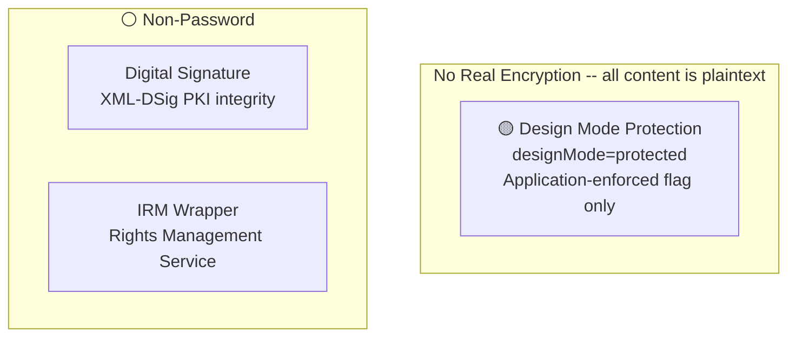
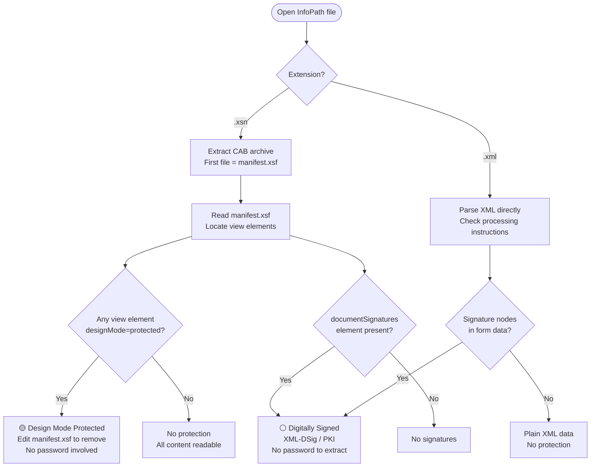
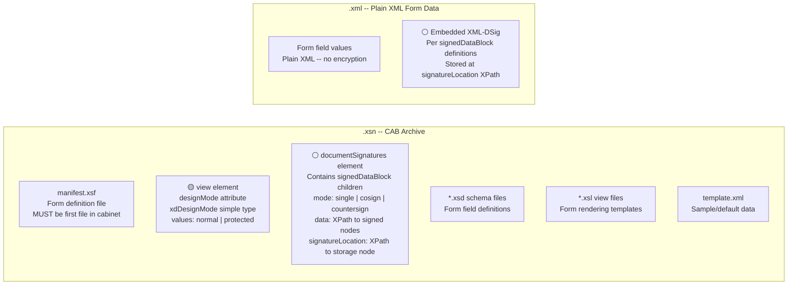

# Microsoft InfoPath — .xsn / .xml

InfoPath form templates (.xsn) are **CAB archives** ([MC-MCF]) containing XML, XSLT, and XSD files that define electronic forms. The form definition file (`manifest.xsf`) is always the first file in the cabinet and references all other component files. InfoPath form data files (.xml) are plain XML documents conforming to the template's schema. The format is specified by [MS-IPFF] (version 1) and [MS-IPFF2] (version 2).

**InfoPath has no password-based encryption and no document-open password mechanism.** The .xsn contents are never encrypted — there is no `\EncryptionInfo`, no password hash, no cipher applied to file contents. The only "protection" is the `designMode` flag (application-enforced, trivially removable by editing `manifest.xsf`) and optional digital signatures (PKI, not password).

## File Extensions

| Extension | Container | Description | Password Protection Applicable? | Notes |
|---|---|---|---|---|
| .xsn | CAB archive | InfoPath Form Template | No file-level encryption. `designMode="protected"` flag (application-level). Optional digital signature. | Cabinet archive per [MC-MCF]; first file must be `manifest.xsf`. Contains XML, XSLT, XSD, and script files defining the form. |
| .xml | XML | InfoPath Form Data | Plaintext XML — no encryption. The form data file filled in by users. | Plain XML document conforming to the template's schema. No container, no encryption layer. |

## Gate Strength Map



## Detection Flowchart



## Container Structure

Where each gate's data physically lives:



## Gate Quick Reference

| | Gate | Location | Mechanism | Spec |
|---|---|---|---|---|
| 🟡 | Design mode protection | `manifest.xsf` > `<view>` element, `designMode` attribute | `xdDesignMode` enumeration: `"normal"` or `"protected"`. A view with `designMode="protected"` is ignored by the application (cannot be opened in design mode). Application-enforced only — the flag is a plaintext XML attribute with no password, no hash, no cryptographic protection. | [MS-IPFF2] SS2.2.1.1.13, SS2.2.1.2.104; [MS-IPFF] SS2.2.13, SS2.2.123 |
| ⚪ | Form template digital signature | `manifest.xsf` > `<documentSignatures>` > `<signedDataBlock>` elements | XML Digital Signatures per [XMLDSig]. Each `signedDataBlock` defines an XPath expression (`data` attribute) identifying XML nodes to sign, a `signatureLocation` XPath for storing the signature, and a `mode` (single, cosign, or countersign). PKI-based — no password involved. | [MS-IPFF2] SS2.2.1.2.106–107; [MS-IPFFX] |
| ⚪ | IRM wrapper | External RMS envelope around the .xsn | Information Rights Management via AD RMS. Not part of the InfoPath file format itself — applied as an external wrapper. Certificate and license-based, not password-based. | [MS-IPFF2] SS2.1.15 (irm_template file) |
| 🔴 | File-level encryption | — | **Does not exist.** InfoPath defines no document-open password, no `EncryptionInfo` stream, no password hash, no cipher. The .xsn CAB contents and .xml form data are always plaintext. | — |

---

## Specification Detail

### Container Format

A form template (.xsn) file MUST be a cabinet (.cab) file per [MC-MCF] ([MS-IPFF2] SS1.3). The first file in the cabinet MUST be `manifest.xsf`, the form definition file ([MS-IPFF2] SS2.1.1). The .xsn filename MUST use Unicode UTF-16 characters and MUST NOT contain the characters `" # % & * : < > ? { | } ~` or code points 0x00-0x1F and 0x7F-0x9F ([MS-IPFF2] SS2.1).

Component files inside the .xsn cabinet:

| File | Purpose | Spec |
|---|---|---|
| `manifest.xsf` | Form definition — structure, views, data connections, validation, signatures | [MS-IPFF2] SS2.2 |
| `*.xsd` | Primary and secondary XML schemas defining form fields | [MS-IPFF2] SS2.1.2, SS2.1.6 |
| `*.xsl` | XSLT view files rendering the form as HTML | [MS-IPFF2] SS2.1.3 |
| `template.xml` | Default/sample XML data for new form instances | [MS-IPFF2] SS2.1.5 |
| `sampledata.xml` | Sample data used in design mode preview | [MS-IPFF2] SS2.1.4 |
| `upgrade.xsl` | XSLT for upgrading form data from older template versions | [MS-IPFF2] SS2.1.8 |
| `*.js` / `*.vbs` | Script files (JavaScript or VBScript) | [MS-IPFF2] SS2.1.12–13 |

All files in the cabinet MUST be declared in `manifest.xsf` except `manifest.xsf` itself ([MS-IPFF2] SS2.1).

### Design Mode Protection (xdDesignMode)

The `xdDesignMode` simple type ([MS-IPFF2] SS2.2.1.1.13, [MS-IPFF] SS2.2.13) is an enumeration with two values:

```xml
<xsd:simpleType name="xdDesignMode">
  <xsd:restriction base="xsd:NMTOKEN">
    <xsd:enumeration value="normal"/>
    <xsd:enumeration value="protected"/>
  </xsd:restriction>
</xsd:simpleType>
```

The `designMode` attribute appears on the `<view>` element ([MS-IPFF2] SS2.2.1.2.104): "A form view with a `designMode` value of 'protected' MUST be ignored. There MUST be at least one form view with a `designMode` value of 'normal'." This means a protected view cannot be opened or edited in the InfoPath designer. The attribute also appears on the `<externalView>` element ([MS-IPFF2] SS2.2.1.2.85), where it "MUST be ignored."

This is purely an application-level flag stored as a plaintext XML attribute in `manifest.xsf`. Removing or changing the attribute value from `"protected"` to `"normal"` in a text editor fully bypasses the restriction. No password, hash, or cryptographic mechanism is involved.

### Digital Signatures

InfoPath supports XML Digital Signatures per [XMLDSig], configured through the `<documentSignatures>` element in `manifest.xsf` ([MS-IPFF2] SS2.2.1.2.106). This element contains zero or more `<signedDataBlock>` children ([MS-IPFF2] SS2.2.1.2.107), each specifying:

- `name` (xdSignedDataBlockName) — unique name for the signed data block
- `data` — XPath expression evaluating to the XML nodes that MUST be signed
- `signatureLocation` — XPath expression identifying where the signature is stored in the form file
- `mode` (xdSignatureRelationEnum) — relationship between signatures: `single` (only one signature allowed), `cosign` (independent signatures), or `countersign` (each signature signs all previous ones)

Signatures are PKI-based (X.509 certificates) and provide integrity verification, not access control. There is no password to extract or crack.

### Extraction Targets by Gate

#### 🟡 Design Mode Protection

- **Location:** `manifest.xsf` (first file in .xsn CAB), `<view>` element
- **Gate active when:** `designMode="protected"` attribute is present on any `<view>` element
- **Extract:** `designMode` attribute value (string: `"normal"` or `"protected"`); `name` attribute (view name); `caption` attribute (display name)
- **Bypass:** Change `designMode="protected"` to `designMode="normal"` in the extracted `manifest.xsf`, then repackage the CAB

#### ⚪ Digital Signature

- **Location:** `manifest.xsf` > `<documentSignatures>` > `<signedDataBlock>` elements (template definition); form .xml file at `signatureLocation` XPath (actual signature data)
- **Gate active when:** `<documentSignatures>` element exists with one or more `<signedDataBlock>` children
- **Extract:** `name`, `data` (XPath), `signatureLocation` (XPath), `mode` (single/cosign/countersign) from manifest; XML-DSig `<Signature>` elements from the form data file

#### 🔴 File-Level Encryption

- **Does not exist.** No extraction targets. The .xsn CAB and .xml form data are always readable without any password or decryption.
