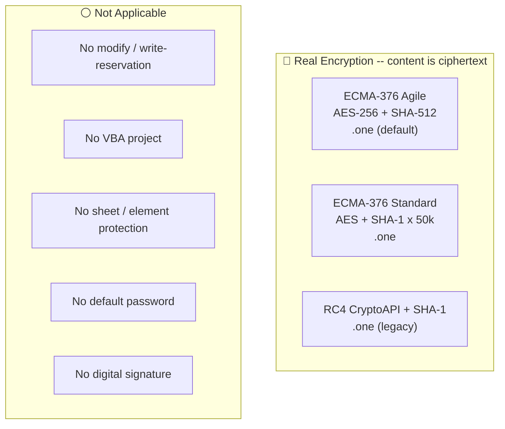
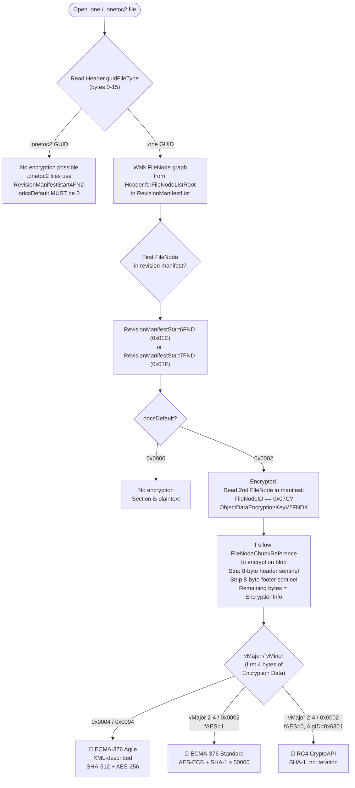
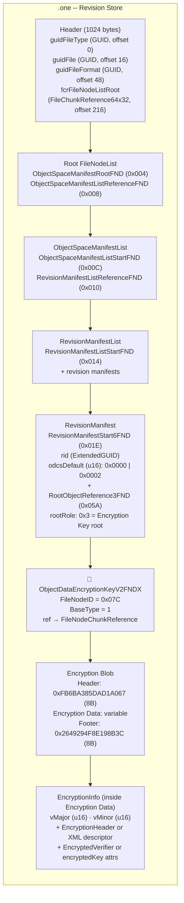

# Microsoft OneNote — `.one`, `.onetoc2`

OneNote uses neither OLE/CFB nor OPC/ZIP. A notebook is a directory of files, each a flat binary **revision store** conforming to [MS-ONESTORE]. A section is stored as a `.one` file and the notebook's table of contents as a `.onetoc2` file. Both extensions share the same container format: a fixed 1024-byte `Header` structure ([MS-ONESTORE] section 2.3.1) at offset 0, followed by a graph of `FileNodeListFragment`/`FileNode` records. The file type is discriminated by the `guidFileType` field in the header: `{7B5C52E4-D88C-4DA7-AEB1-5378D02996D3}` for `.one`, `{43FF2FA1-EFD9-4C76-9EE2-10EA5722765F}` for `.onetoc2` ([MS-ONESTORE] section 2.3.1). The section content — pages, outlines, tables, images — is the property/property-set model defined in [MS-ONE]. OneNote exposes exactly one protection mechanism: per-section password encryption of the object space within a `.one` file. There is no modify password, no section write-reservation, no VBA project, no default password, and no XOR obfuscation.

## File Extensions

| Extension | Container | Description | Password Protection Applicable? | Notes |
|---|---|---|---|---|
| `.one` | Revision Store ([MS-ONESTORE]) | OneNote Section | Yes — per-section open password via embedded EncryptionInfo blob (agile/standard/CryptoAPI). Real encryption; content is genuine ciphertext when protected. | Primary data file. Each section is one `.one` file. Encryption detected via `odcsDefault` field in `RevisionManifestStart6FND`/`RevisionManifestStart7FND` and presence of `ObjectDataEncryptionKeyV2FNDX` (FileNodeID 0x07C). |
| `.onetoc2` | Revision Store ([MS-ONESTORE]) | OneNote Table of Contents | No. Uses the same Revision Store container as `.one`, but `RevisionManifestStart4FND.odcsDefault` MUST be 0 and FileNodeID 0x07C is not valid for `.onetoc2` files. Not encrypted. | Stores notebook structure (section ordering, display names, colors). One `.onetoc2` per notebook directory. Discriminated from `.one` by `guidFileType` = `{43FF2FA1-EFD9-4C76-9EE2-10EA5722765F}`. |
| `.onepkg` | CAB archive | OneNote Package (export) | No independent password on the `.onepkg` container itself. Individual `.one` sections inside the CAB archive may be independently encrypted with their own per-section passwords. | Export/portable format. A CAB archive bundling one or more `.one` sections and a `.onetoc2` for offline transfer. The CAB wrapper adds no encryption layer. |
| `.onetmp` | Revision Store ([MS-ONESTORE]) | OneNote Temporary File | No. Temp file used during editing — not user-facing, no independent encryption mechanism. | Transient working file created by OneNote during editing sessions. Same underlying Revision Store binary format as `.one`. Deleted or cleaned up when the section is closed. |

## Gate Strength Map

## Detection Flowchart

How to determine whether a OneNote section is encrypted, and which encryption scheme it uses:

## Container Structure

Where the encryption gate's data physically lives inside a `.one` file:

## No Default Password

> **OneNote has no default password mechanism.**
>
> Unlike Excel, which auto-encrypts under the fixed password `VelvetSweatshop` when protection records carry a non-zero verifier but no user open password was set ([MS-OFFCRYPTO] section 2.4.2.3), OneNote sections are either unencrypted (`odcsDefault == 0x0000`) or encrypted with a user-supplied password. There is no spec-defined fixed password, no auto-encryption trigger, and no equivalent to the `VelvetSweatshop` mechanism. If an `ObjectDataEncryptionKeyV2FNDX` node is present, a real user-chosen password was used.

## Gate Quick Reference

### `.one` — section file

| | Gate | FileNode / Location | Algorithm | Spec |
|---|---|---|---|---|
| 🔴 | Section-open — Agile | `ObjectDataEncryptionKeyV2FNDX` (0x07C), `odcsDefault`=0x0002, vMajor=0x0004/vMinor=0x0004 | [ECMA-376 Agile](../algorithms/password/ecma376-agile.md) AES-CBC + SHA-512 | [MS-ONESTORE] section 2.5.19; [MS-OFFCRYPTO] section 2.3.4.10 |
| 🔴 | Section-open — Standard | `ObjectDataEncryptionKeyV2FNDX` (0x07C), `odcsDefault`=0x0002, vMajor=2-4/vMinor=0x0002, fAES=1 | [ECMA-376 Standard](../algorithms/password/ecma376-standard.md) AES-ECB + SHA-1 | [MS-ONESTORE] section 2.5.19; [MS-OFFCRYPTO] section 2.3.4.5 |
| 🔴 | Section-open — RC4 CryptoAPI | `ObjectDataEncryptionKeyV2FNDX` (0x07C), `odcsDefault`=0x0002, vMajor=2-4/vMinor=0x0002, AlgID=0x6801 | [RC4-CryptoAPI-SHA1](../algorithms/password/rc4-cryptoapi-sha1.md) | [MS-ONESTORE] section 2.5.19; [MS-OFFCRYPTO] section 2.3.5.1 |

### `.onetoc2` — table of contents file

| | Gate | Notes | Spec |
|---|---|---|---|
| ⚪ | None | `RevisionManifestStart4FND.odcsDefault` MUST be 0 and MUST be ignored; `FileNodeID 0x07C` is not a valid FileNode type for `.onetoc2` files | [MS-ONESTORE] section 2.5.6, section 2.4.3 |

---

## Specification Detail

### `.one` — Revision Store (OneNote Section File) — full gate table

| Gate | Location in file | Algorithm / mechanism | Spec reference |
|---|---|---|---|
| 🔴 Section-open password — ECMA-376 Agile | `ObjectDataEncryptionKeyV2FNDX` FileNode (FileNodeID = 0x07C, BaseType = 1) within the revision manifest of a `.one` revision store. The `odcsDefault` field in the preceding `RevisionManifestStart6FND` (0x01E) or `RevisionManifestStart7FND` (0x01F) MUST be 0x0002. The `FileNodeChunkReference` in the FileNode's `fnd` field points to a blob containing: an 8-byte header sentinel (`0xFB6BA385DAD1A067`), a variable-length `Encryption Data` payload, and an 8-byte footer sentinel (`0x2649294F8E198B3C`). The `Encryption Data` interior begins with `EncryptionVersionInfo` (vMajor=0x0004, vMinor=0x0004), followed by a 4-byte Reserved field (0x00000040), followed by a UTF-8 XML descriptor. The XML carries `<keyData>` (cipherAlgorithm, hashAlgorithm, keyBits, saltValue, blockSize), `<dataIntegrity>` (HMAC for corruption detection), and `<keyEncryptors>` with one `<p:encryptedKey>` per PasswordKeyEncryptor (spinCount, saltValue, encryptedVerifierHashInput, encryptedVerifierHashValue, encryptedKeyValue). A `RootObjectReference3FND` (0x05A) with `rootRole == 0x00000003` ("Encryption Key root") MUST also be present in the revision manifest. | ECMA-376 Agile Encryption: key derivation via H0 = H(salt + password) iterated spinCount times ([MS-OFFCRYPTO] section 2.3.4.11); Hfinal = H(Hn + blockKey). IV generation per section 2.3.4.12. Cipher and hash negotiated in XML (default: AES-256-CBC + SHA-512). DataIntegrity HMAC validates the entire encrypted payload. See [ecma376-agile](../algorithms/password/ecma376-agile.md). | [MS-ONESTORE] section 2.1.9, section 2.5.7, section 2.5.19, section 2.7.4; [MS-OFFCRYPTO] section 2.3.4.10–2.3.4.15 |
| 🔴 Section-open password — ECMA-376 Standard | Same `ObjectDataEncryptionKeyV2FNDX` structure and blob layout. The `Encryption Data` interior begins with `EncryptionVersionInfo` where vMajor is in {0x0002, 0x0003, 0x0004} and vMinor = 0x0002. The `EncryptionHeader` that follows has `Flags.fCryptoAPI = 1` and `Flags.fAES = 1`, and `AlgID` is one of {0x0000660E (AES-128), 0x0000660F (AES-192), 0x00006610 (AES-256)}. `AlgIDHash = 0x00008004` (SHA-1). The `EncryptionVerifier` contains `SaltSize`, `Salt` (16 bytes), `EncryptedVerifier` (16 bytes), `VerifierHashSize`, and `EncryptedVerifierHash` (32 bytes). | ECMA-376 Standard Encryption: H0 = SHA-1(salt + password), 50,000 iterations Hn = SHA-1(iterator + Hn-1), then SHA-1(Hn + blockKey), followed by X1/X2 HMAC-like derivation ([MS-OFFCRYPTO] section 2.3.4.7). Encryption uses AES-ECB. Verification via SHA-1 of decrypted verifier ([MS-OFFCRYPTO] section 2.3.4.9). See [ecma376-standard](../algorithms/password/ecma376-standard.md). | [MS-ONESTORE] section 2.5.19; [MS-OFFCRYPTO] section 2.3.4.5–2.3.4.9 |
| 🔴 Section-open password — RC4 CryptoAPI | Same `ObjectDataEncryptionKeyV2FNDX` structure and blob layout. The `Encryption Data` interior begins with `EncryptionVersionInfo` where vMajor is in {0x0002, 0x0003, 0x0004} and vMinor = 0x0002. The `EncryptionHeader` has `Flags.fCryptoAPI = 1` and `Flags.fAES = 0`, and `AlgID = 0x00006801` (RC4). `AlgIDHash = 0x00008004` (SHA-1). `KeySize` ranges from 40 to 128 bits. The `EncryptionVerifier` contains `SaltSize`, `Salt` (16 bytes), `EncryptedVerifier` (16 bytes), `VerifierHashSize`, and `EncryptedVerifierHash` (20 bytes). | RC4 CryptoAPI Encryption: H0 = SHA-1(salt + password), Hfinal = SHA-1(H0 + blockNumber), no iteration ([MS-OFFCRYPTO] section 2.3.5.2). Verification via SHA-1 of decrypted verifier. See [rc4-cryptoapi-sha1](../algorithms/password/rc4-cryptoapi-sha1.md). | [MS-ONESTORE] section 2.5.19; [MS-OFFCRYPTO] section 2.3.5.1–2.3.5.4 |

### Extraction Targets

What code needs to extract for the single gate — field names, types, locations, and "gate is active" indicators.

#### 🔴 Section-Open Password

- **Location:** `.one` revision store file. Walk the FileNode graph from `Header.fcrFileNodeListRoot` through the `ObjectSpaceManifestList` to the `RevisionManifestList`, then inspect each revision manifest.
- **Gate active when:** `RevisionManifestStart6FND.odcsDefault == 0x0002` (or `RevisionManifestStart7FND.base.odcsDefault == 0x0002`) AND the second FileNode in the revision manifest has `FileNodeID == 0x07C`.
- **Confirming indicator:** A `RootObjectReference3FND` (0x05A) with `rootRole == 0x00000003` is present in the revision manifest.
- **Extract from FileNode 0x07C:**
  - `FileNodeChunkReference.stp` — file offset to the encryption blob (size/format per `StpFormat` in the FileNode header)
  - `FileNodeChunkReference.cb` — total size of the encryption blob (size/format per `CbFormat` in the FileNode header)
- **Extract from the encryption blob:**
  - Header sentinel (8 bytes) — MUST be `0xFB6BA385DAD1A067`; verify to confirm correct blob
  - Footer sentinel (8 bytes) — MUST be `0x2649294F8E198B3C`; verify to confirm correct blob
  - `Encryption Data` — everything between the sentinels; length = `cb - 16` bytes
- **Extract from Encryption Data (EncryptionInfo):**
  - `vMajor` (u16 LE at offset 0) — encryption version major
  - `vMinor` (u16 LE at offset 2) — encryption version minor
  - **If Agile (vMajor=0x0004, vMinor=0x0004):** skip 4 bytes (`Reserved`, MUST be 0x00000040), parse UTF-8 XML from byte 8 onward. Extract from `<p:encryptedKey>`: `spinCount`, `saltSize`, `blockSize`, `keyBits`, `hashSize`, `cipherAlgorithm`, `cipherChaining`, `hashAlgorithm`, `saltValue` (base64), `encryptedVerifierHashInput` (base64), `encryptedVerifierHashValue` (base64), `encryptedKeyValue` (base64)
  - **If Standard (vMinor=0x0002, fAES=1):** parse `EncryptionHeader` + `EncryptionVerifier` per [MS-OFFCRYPTO] section 2.3.4.5. Extract: `AlgID`, `AlgIDHash`, `KeySize`, `ProviderName`, `SaltSize`, `Salt` (16B), `EncryptedVerifier` (16B), `VerifierHashSize`, `EncryptedVerifierHash` (32B)
  - **If RC4 CryptoAPI (vMinor=0x0002, fAES=0, AlgID=0x6801):** parse `EncryptionHeader` + `EncryptionVerifier` per [MS-OFFCRYPTO] section 2.3.5.1. Extract: `AlgID` (0x6801), `AlgIDHash` (0x8004), `KeySize` (40-128), `SaltSize`, `Salt` (16B), `EncryptedVerifier` (16B), `VerifierHashSize`, `EncryptedVerifierHash` (20B)

### Header Structure (1024 bytes)

The Header is the first 1024 bytes of every `.one` and `.onetoc2` file ([MS-ONESTORE] section 2.3.1). All integers are unsigned and little-endian. The following table lists the fields relevant to encryption detection and FileNode graph traversal.

| Offset | Size | Field | Type | Description |
|---|---|---|---|---|
| 0 | 16 | `guidFileType` | GUID | File type discriminator. `.one` = `{7B5C52E4-D88C-4DA7-AEB1-5378D02996D3}`; `.onetoc2` = `{43FF2FA1-EFD9-4C76-9EE2-10EA5722765F}` |
| 16 | 16 | `guidFile` | GUID | Unique identity of this revision store file. SHOULD be globally unique |
| 32 | 16 | `guidLegacyFileVersion` | GUID | MUST be `{00000000-...}`, MUST be ignored |
| 48 | 16 | `guidFileFormat` | GUID | MUST be `{109ADD3F-911B-49F5-A5D0-1791EDC8AED8}` — confirms this is a revision store file |
| 64 | 4 | `ffvLastCodeThatWroteToThisFile` | u32 LE | `.one` MUST be 0x0000002A; `.onetoc2` MUST be 0x0000001B |
| 68 | 4 | `ffvOldestCodeThatHasWrittenToThisFile` | u32 LE | Same constraints as above |
| 72 | 4 | `ffvNewestCodeThatHasWrittenToThisFile` | u32 LE | Same constraints as above |
| 76 | 4 | `ffvOldestCodeThatMayReadThisFile` | u32 LE | Same constraints. If > 0x0000002A, all other data in the file MUST be ignored |
| 80 | 8 | `fcrLegacyFreeChunkList` | FileChunkReference32 | MUST be `fcrZero` |
| 88 | 8 | `fcrLegacyTransactionLog` | FileChunkReference32 | MUST be `fcrNil` |
| 96 | 4 | `cTransactionsInLog` | u32 LE | Number of transactions in the transaction log. MUST NOT be zero |
| 100 | 4 | `cbLegacyExpectedFileLength` | u32 LE | MUST be zero, MUST be ignored |
| 104 | 8 | `rgbPlaceholder` | u64 LE | MUST be zero, MUST be ignored |
| 112 | 8 | `fcrLegacyFileNodeListRoot` | FileChunkReference32 | MUST be `fcrNil` |
| 120 | 4 | `cbLegacyFreeSpaceInFreeChunkList` | u32 LE | MUST be zero, MUST be ignored |
| 124 | 1 | `fNeedsDefrag` | u8 | MUST be ignored |
| 125 | 1 | `fRepairedFile` | u8 | MUST be ignored |
| 126 | 1 | `fNeedsGarbageCollect` | u8 | MUST be ignored |
| 127 | 1 | `fHasNoEmbeddedFileObjects` | u8 | MUST be zero, MUST be ignored |
| 128 | 16 | `guidAncestor` | GUID | `Header.guidFile` of the parent `.onetoc2`. `{00000000-...}` if no parent TOC |
| 144 | 4 | `crcName` | u32 LE | CRC of the file name (Unicode + NUL). Always uses the `.one` CRC algorithm |
| 148 | 12 | `fcrHashedChunkList` | FileChunkReference64x32 | Reference to the hashed chunk list. `fcrZero`/`fcrNil` if absent |
| 160 | 12 | `fcrTransactionLog` | FileChunkReference64x32 | Reference to the first `TransactionLogFragment`. MUST NOT be `fcrZero`/`fcrNil` |
| 172 | 12 | `fcrFileNodeListRoot` | FileChunkReference64x32 | **Entry point for FileNode graph traversal.** Reference to the root file node list. MUST NOT be `fcrZero`/`fcrNil` |
| 184 | 12 | `fcrFreeChunkList` | FileChunkReference64x32 | Reference to the free chunk list. `fcrZero`/`fcrNil` if absent |
| 196 | 8 | `cbExpectedFileLength` | u64 LE | Expected file size in bytes |
| 204 | 8 | `cbFreeSpaceInFreeChunkList` | u64 LE | Free space in the free chunk list |
| 212 | 16 | `guidFileVersion` | GUID | Changed whenever `cTransactionsInLog` or `guidDenyReadFileVersion` changes |
| 228 | 8 | `nFileVersionGeneration` | u64 LE | Incremented when `guidFileVersion` changes |
| 236 | 16 | `guidDenyReadFileVersion` | GUID | Changed when file contents (excluding Header) are modified |
| 252 | 4 | `grfDebugLogFlags` | u32 LE | MUST be zero, MUST be ignored |
| 256 | 12 | `fcrDebugLog` | FileChunkReference64x32 | MUST be `fcrZero`, MUST be ignored |
| 268 | 12 | `fcrAllocVerificationFreeChunkList` | FileChunkReference64x32 | MUST be `fcrZero`, MUST be ignored |
| 280 | 4 | `bnCreated` | u32 LE | Build number of the creating application |
| 284 | 4 | `bnLastWroteToThisFile` | u32 LE | Build number of the last writer |
| 288 | 4 | `bnOldestWritten` | u32 LE | Build number of the oldest writer |
| 292 | 4 | `bnNewestWritten` | u32 LE | Build number of the newest writer |
| 296 | 728 | `rgbReserved` | byte[728] | MUST be zero, MUST be ignored |

Total header size: 1024 bytes. The critical field for encryption detection is `fcrFileNodeListRoot` at offset 172, which provides the entry point to walk the FileNode graph and locate revision manifests that may contain the `ObjectDataEncryptionKeyV2FNDX` structure.

### FileNodeListFragment Structure

A `FileNodeListFragment` ([MS-ONESTORE] section 2.4.1) is the physical container for a sequence of `FileNode` structures. Its layout:

| Component | Size | Type | Description |
|---|---|---|---|
| `header` | 16 bytes | `FileNodeListHeader` | Contains `uintMagic` (8 bytes, MUST be `0xA4567AB1F5F7F4C4`), `FileNodeListID` (u32 LE, >= 0x00000010), `nFragmentSequence` (u32 LE, sequential from 0) |
| `rgFileNodes` | variable | `FileNode[]` | Sequence of FileNode structures. Terminated when: (a) fewer than 4 bytes remain before `nextFragment`, (b) a `ChunkTerminatorFND` (0x0FF) is read, or (c) the transaction log count is reached |
| `padding` | variable | bytes | Undefined, MUST be ignored |
| `nextFragment` | 12 bytes | `FileChunkReference64x32` | Reference to the next fragment; `fcrNil` if this is the last fragment |
| `footer` | 8 bytes | u64 LE | MUST be `0x8BC215C38233BA4B` |

### FileNode Structure

A `FileNode` ([MS-ONESTORE] section 2.4.3) is the basic unit of data organization. Its 4-byte header packs five fields into 32 bits:

| Bits | Field | Type | Description |
|---|---|---|---|
| 0-9 | `FileNodeID` | u10 | Identifies the FileNode type. 0x07C = `ObjectDataEncryptionKeyV2FNDX` |
| 10-22 | `Size` | u13 | Total size of this FileNode in bytes |
| 23-24 | `StpFormat` | u2 | Encoding of `FileNodeChunkReference.stp`: 0 = 8B uncompressed, 1 = 4B uncompressed, 2 = 2B compressed (x8), 3 = 4B compressed (x8). Ignored if BaseType = 0 |
| 25-26 | `CbFormat` | u2 | Encoding of `FileNodeChunkReference.cb`: 0 = 4B uncompressed, 1 = 8B uncompressed, 2 = 1B compressed (x8), 3 = 2B compressed (x8). Ignored if BaseType = 0 |
| 27-30 | `BaseType` | u4 | 0 = no reference (fnd contains only inline data); 1 = reference to data (first field of fnd is a `FileNodeChunkReference`); 2 = reference to a file node list |
| 31 | `Reserved` | u1 | MUST be 1, MUST be ignored |

For `ObjectDataEncryptionKeyV2FNDX` (0x07C), the `BaseType` is 1, meaning the `fnd` field starts with a `FileNodeChunkReference` whose `stp`/`cb` point to the encryption blob.

### FileNode ID Table (encryption-relevant subset)

The following FileNode types are relevant to locating encryption data in a `.one` file ([MS-ONESTORE] section 2.4.3):

| FileNodeID | BaseType | Structure | File format | Purpose |
|---|---|---|---|---|
| 0x004 | 0 | `ObjectSpaceManifestRootFND` | .one, .onetoc2 | Identifies the root object space |
| 0x008 | 2 | `ObjectSpaceManifestListReferenceFND` | .one, .onetoc2 | References an object space manifest list |
| 0x00C | 0 | `ObjectSpaceManifestListStartFND` | .one, .onetoc2 | Begins an object space manifest list |
| 0x010 | 2 | `RevisionManifestListReferenceFND` | .one, .onetoc2 | References a revision manifest list |
| 0x014 | 0 | `RevisionManifestListStartFND` | .one, .onetoc2 | Begins a revision manifest list |
| 0x01B | 0 | `RevisionManifestStart4FND` | .onetoc2 only | Begins a revision manifest; `odcsDefault` MUST be 0 |
| 0x01C | 0 | `RevisionManifestEndFND` | .one, .onetoc2 | Ends a revision manifest |
| 0x01E | 0 | `RevisionManifestStart6FND` | .one only | Begins a revision manifest; `odcsDefault` = 0x0000 or 0x0002 |
| 0x01F | 0 | `RevisionManifestStart7FND` | .one only | Begins a revision manifest with context; embeds a `RevisionManifestStart6FND` as `base` |
| 0x05A | 0 | `RootObjectReference3FND` | .one only | Specifies a root object with `rootRole`; 0x00000003 = encryption key root |
| 0x07C | 1 | `ObjectDataEncryptionKeyV2FNDX` | .one only | **Encryption marker.** Contains `FileNodeChunkReference` to the encryption blob |
| 0x0FF | — | `ChunkTerminatorFND` | .one, .onetoc2 | End of FileNode sequence in a fragment |

### RevisionManifestStart6FND Structure

The `RevisionManifestStart6FND` ([MS-ONESTORE] section 2.5.7) begins a revision manifest in a `.one` file and carries the encryption flag.

| Offset | Size | Field | Type | Description |
|---|---|---|---|---|
| 0 | 20 | `rid` | ExtendedGUID | Identity of this revision. MUST NOT be `{{00000000-...}, 0}` |
| 20 | 20 | `ridDependent` | ExtendedGUID | Dependency revision. `{{00000000-...}, 0}` = none |
| 40 | 4 | `RevisionRole` | u32 LE | Revision role label. SHOULD be 0x00000001 |
| 44 | 2 | `odcsDefault` | u16 LE | **Encryption flag.** 0x0000 = no encryption; 0x0002 = encrypted (property sets are ciphertext and MUST be ignored). MUST match the encryption state of the dependency revision |

Total structure size: 46 bytes.

`RevisionManifestStart7FND` ([MS-ONESTORE] section 2.5.8) embeds this structure as its `base` field (46 bytes), followed by a `gctxid` field (20 bytes, ExtendedGUID specifying the context). Total size: 66 bytes. The `odcsDefault` field is at `base` offset 44.

### RootObjectReference3FND Structure

The `RootObjectReference3FND` ([MS-ONESTORE] section 2.5.16) specifies a root object for a revision. When a `.one` file is encrypted, this structure declares the encryption key root.

| Offset | Size | Field | Type | Description |
|---|---|---|---|---|
| 0 | 20 | `oidRoot` | ExtendedGUID | Identity of the root object |
| 20 | 4 | `RootRole` | u32 LE | Role of the root object (see table below) |

Total structure size: 24 bytes.

The defined root roles ([MS-ONE] section 2.1.8, [MS-ONESTORE] section 2.7.4):

| Value | Meaning | Present when |
|---|---|---|
| 0x00000001 | Default content root | Always — the section's `jcidSectionNode` |
| 0x00000002 | Metadata root | Always — the section's `jcidSectionMetaData` |
| 0x00000003 | Encryption Key root | **Only when the file is encrypted** |
| 0x00000004 | Version metadata root | Optional — `jcidRevisionMetaData` |

### ObjectDataEncryptionKeyV2FNDX Structure

The `ObjectDataEncryptionKeyV2FNDX` ([MS-ONESTORE] section 2.5.19) is the definitive encryption marker in a `.one` revision store. Its `FileNodeID` is 0x07C with `BaseType = 1`.

| Field | Size | Type | Description |
|---|---|---|---|
| `ref` | variable | `FileNodeChunkReference` | References the encryption blob. Size and format determined by `FileNode.StpFormat` and `FileNode.CbFormat` |

The referenced blob has the following layout:

| Offset | Size | Field | Value / Type |
|---|---|---|---|
| 0 | 8 | Header sentinel | `0xFB6BA385DAD1A067` (constant, u64 LE) |
| 8 | `cb - 16` | Encryption Data | Variable-length array of bytes. Spec says "MUST be ignored" (see note below). Contains the `EncryptionInfo` structure per [MS-OFFCRYPTO] |
| `cb - 8` | 8 | Footer sentinel | `0x2649294F8E198B3C` (constant, u64 LE) |

**Invariant:** If any revision manifest for an object space contains a FileNode with `FileNodeID == 0x07C`, then all other revision manifests for the same object space MUST also contain it, and all instances MUST point to structures with identical encryption data ([MS-ONESTORE] section 2.5.19).

### Walking the FileNode Graph to Find Encryption Data

The procedure to determine whether a `.one` section is encrypted and to extract the `EncryptionInfo` structure:

1. **Read the Header** (bytes 0–1023). Verify `guidFileType` matches the `.one` GUID. Read `fcrFileNodeListRoot` (offset 172, `FileChunkReference64x32`: 8-byte `stp` + 4-byte `cb`).

2. **Navigate to the root file node list.** Seek to `fcrFileNodeListRoot.stp`. Read the `FileNodeListFragment` structure. Parse its `FileNode` sequence, looking for `FileNodeID = 0x008` (`ObjectSpaceManifestListReferenceFND`) entries. Each entry's `ref` field (a `FileNodeChunkReference`) points to an object space manifest list.

3. **Enter the object space manifest list.** Follow the `ref` to the first `FileNodeListFragment` of the object space manifest list. Find the `RevisionManifestListReferenceFND` (0x010) FileNode(s). If multiple exist, only the last one matters ([MS-ONESTORE] section 2.1.6).

4. **Enter the revision manifest list.** Follow the `RevisionManifestListReferenceFND.ref` to the revision manifest list's first `FileNodeListFragment`. The first FileNode should be `RevisionManifestListStartFND` (0x014).

5. **Scan revision manifests.** Each revision manifest begins with `RevisionManifestStart6FND` (0x01E) or `RevisionManifestStart7FND` (0x01F). Read `odcsDefault`:
   - If `odcsDefault == 0x0000`: this revision is not encrypted.
   - If `odcsDefault == 0x0002`: this revision is encrypted. The **next FileNode** (the second in the revision manifest sequence) MUST have `FileNodeID == 0x07C`.

6. **Read the encryption blob.** From the `ObjectDataEncryptionKeyV2FNDX` FileNode, decode the `FileNodeChunkReference` using the `StpFormat` and `CbFormat` values from the FileNode header. Seek to `stp`, read `cb` bytes.

7. **Strip sentinels.** Verify the first 8 bytes are `0xFB6BA385DAD1A067` and the last 8 bytes are `0x2649294F8E198B3C`. The bytes between them (positions 8 through `cb - 9`) are the `Encryption Data`.

8. **Parse EncryptionInfo.** Read `vMajor` (u16 LE) and `vMinor` (u16 LE) from the start of the `Encryption Data`. Dispatch by version words to the appropriate [MS-OFFCRYPTO] parsing logic (Agile, Standard, or RC4 CryptoAPI).

### Encryption Scheme Dispatch via Version Words

The `Encryption Data` blob interior begins with a 4-byte `EncryptionVersionInfo` ([MS-OFFCRYPTO] section 2.1.4) whose `vMajor` and `vMinor` fields determine the encryption scheme:

| `vMajor` | `vMinor` | Scheme | Algorithm details |
|---|---|---|---|
| 0x0004 | 0x0004 | ECMA-376 Agile Encryption | XML-described; configurable cipher (AES-128/192/256) and hash (SHA-1, SHA-256, SHA-384, SHA-512); CBC chaining; iterated key derivation with `spinCount` (default 100000). See [MS-OFFCRYPTO] section 2.3.4.10 and [ecma376-agile](../algorithms/password/ecma376-agile.md) |
| 0x0002/0x0003/0x0004 | 0x0002 | ECMA-376 Standard Encryption (when `EncryptionHeader.Flags.fCryptoAPI=1` and `Flags.fAES=1`) | AES-128/192/256 in ECB mode; SHA-1 hash; 50000-iteration key derivation. See [MS-OFFCRYPTO] section 2.3.4.5 and [ecma376-standard](../algorithms/password/ecma376-standard.md) |
| 0x0002/0x0003/0x0004 | 0x0002 | RC4 CryptoAPI Encryption (when `EncryptionHeader.Flags.fCryptoAPI=1` and `Flags.fAES=0`; `AlgID == 0x00006801`) | RC4 stream cipher; SHA-1 hash; no iteration in key derivation. See [MS-OFFCRYPTO] section 2.3.5.1 and [rc4-cryptoapi-sha1](../algorithms/password/rc4-cryptoapi-sha1.md) |

Disambiguation between Standard and RC4 CryptoAPI when `vMinor == 0x0002` requires inspecting the `EncryptionHeader.Flags` and `AlgID` fields that follow the version words. Standard encryption mandates `fCryptoAPI=1, fAES=1` and `AlgID` in `{0x0000660E, 0x0000660F, 0x00006610}` (AES); RC4 CryptoAPI mandates `fCryptoAPI=1, fAES=0` and `AlgID == 0x00006801` (RC4) ([MS-OFFCRYPTO] section 2.3.4.5, section 2.3.5.1).

### The "MUST be ignored" Contradiction

The spec labels the `Encryption Data` payload as "MUST be ignored" ([MS-ONESTORE] section 2.5.19), yet this blob is the sole carrier of the [MS-OFFCRYPTO] `EncryptionInfo` structure that defines the encryption algorithm, key derivation parameters, salt, password verifier, and (for agile encryption) the encrypted intermediate key. Without parsing this blob, the encrypted content cannot be decrypted. The spec's phrasing appears to be a conformance directive to non-encryption-aware consumers (i.e., they must not attempt to interpret or modify the raw bytes), not a statement that the data is semantically empty. This interpretation is supported by [MS-ONESTORE] section 2.7.7, which explicitly describes how the encryption data is transmitted via FSSHTTP, demonstrating that the bytes carry meaningful structure.

### Container Variant Comparison

| Aspect | `.one` (section file) | `.onetoc2` (table of contents file) |
|---|---|---|
| `guidFileType` | `{7B5C52E4-D88C-4DA7-AEB1-5378D02996D3}` | `{43FF2FA1-EFD9-4C76-9EE2-10EA5722765F}` |
| `ffvLastCodeThatWroteToThisFile` | 0x0000002A | 0x0000001B |
| Revision manifest start | `RevisionManifestStart6FND` (0x01E) or `RevisionManifestStart7FND` (0x01F) | `RevisionManifestStart4FND` (0x01B) |
| `odcsDefault` | 0x0000 (unencrypted) or 0x0002 (encrypted) | MUST be 0, MUST be ignored |
| `FileNodeID 0x07C` allowed | Yes | No — not listed as valid for .onetoc2 |
| Encryption possible | Yes, per-section password | No |
| CRC algorithm | [RFC3309] (CRC-32C) | MsoCrc32Compute ([MS-OSHARED] section 2.4.3.2) |
| Root objects | `jcidSectionNode` (content root), `jcidSectionMetaData` (metadata root) | `jcidPersistablePropertyContainerForTOC` |
| Root object reference | `RootObjectReference3FND` (0x05A) with ExtendedGUID | `RootObjectReference2FNDX` (0x059) with CompactID |

### Content is Genuine Ciphertext

When `odcsDefault == 0x0002`, the property sets within the revision manifest are actual encrypted data, not merely access-controlled cleartext. The spec requires that these property sets "MUST be ignored and MUST NOT be altered" by conforming implementations that do not possess the decryption key ([MS-ONESTORE] section 2.5.7). There is no spec-defined mechanism to recover the content without the correct password. Removing the `ObjectDataEncryptionKeyV2FNDX` node or the encryption key root object does not expose cleartext, as the payload remains encrypted. This is a fundamental difference from the strippable verifier gates in Excel and Word, where the content is plaintext behind a removable flag.

### Encryption Key Root Object

When a `.one` file is encrypted, the revision manifest includes a `RootObjectReference3FND` (0x05A) with `rootRole == 0x00000003`, defined as "Encryption Key root" ([MS-ONESTORE] section 2.7.4). The spec states: "The root object with `RootObjectReference3FND.rootRole` value set to `0x00000003` MUST be present only when the file is encrypted" ([MS-ONESTORE] section 2.7.4). This root object is an independent signal of encryption status, separate from the `odcsDefault` flag and the presence of the `ObjectDataEncryptionKeyV2FNDX` FileNode.

### Protections that Do Not Exist in OneNote

The following protection mechanisms, present in other Office formats, have no analogue in the OneNote revision store or content model:

- **Modify / write-reservation password.** Not defined in [MS-ONESTORE] or [MS-ONE]. Document write protection ([MS-OFFCRYPTO] section 2.4) applies to ECMA-376 and binary Office documents, not revision store files.
- **Sheet / section / element protection.** The `IsReadOnly` property ([MS-ONE] section 2.3.48, PropertyID `0x08001CDE`) is a content-model flag that marks a page, outline, outline element, or table cell as read-only within the application, but it is not a cryptographic protection and is stored as a cleartext Boolean in the property set. It can be trivially modified in a hex editor.
- **VBA project.** OneNote has no VBA macro container; the [MS-OVBA] structures do not apply.
- **Default password.** There is no analogue to the `VelvetSweatshop` default open password used in Excel workbook encryption ([MS-OFFCRYPTO] section 2.4.2.3). OneNote sections are either unencrypted or encrypted with a user-supplied password.
- **XOR obfuscation.** Not supported in the revision store format. XOR obfuscation ([MS-OFFCRYPTO] section 2.3.7) is defined only for Word and Excel binary formats.
- **RC4 + MD5 (40-bit).** The legacy RC4 + MD5 scheme ([MS-OFFCRYPTO] section 2.3.6) is not used by OneNote. The oldest encryption scheme available is RC4 CryptoAPI.
- **Digital signature.** [MS-ONESTORE] defines no digital signature mechanism for revision store files. The `_signatures` and `_xmlsignatures` OLE streams documented in [MS-OFFCRYPTO] section 2.5 are not applicable.

### Password Encoding

Per [MS-OFFCRYPTO], passwords are encoded as UTF-16LE arrays (no BOM, no trailing NUL in the hash input) and are limited to 255 Unicode code points ([MS-OFFCRYPTO] section 4.1.3.1, section 4.1.3.2). The `Encryption Data` within the `ObjectDataEncryptionKeyV2FNDX` blob has a length equal to `FileNodeChunkReference.cb` minus 16 bytes (8-byte header sentinel + 8-byte footer sentinel).

### Security Considerations from the Specs

[MS-ONESTORE] section 4 and [MS-ONE] section 4 both state "None." for security considerations. [MS-OFFCRYPTO] section 4.1.3 provides the security analysis for the underlying encryption algorithms:

- **Agile encryption** ([MS-OFFCRYPTO] section 4.1.3.1): Required to use CBC and corruption detection. SHA-2 series hashing algorithms are preferred; MD2, MD4, and MD5 are not recommended. Passwords are limited to 255 Unicode code points.
- **Standard encryption** ([MS-OFFCRYPTO] section 4.1.3.1): Does not support CBC and has no provision for detecting corruption, though AES is not known to be subject to bit-flipping attacks.
- **RC4 CryptoAPI encryption** ([MS-OFFCRYPTO] section 4.1.3.2): "Not recommended and ought to be used only when backward compatibility is required." The spec documents multiple cryptographic weaknesses: no iterated key derivation (enabling rapid brute-force against the password), no RC4 initial discard, no corruption detection (exposing data to bit-flipping), potential key-stream reuse with known plaintext, and small key lengths possible (40-bit minimum). The spec concludes: "it is considered insecure, and therefore is not recommended when storing sensitive materials."

### Transmission via FSSHTTP (section 2.7.7)

When a `.one` file is transmitted via the File Synchronization via SOAP over HTTP Protocol, the encryption data from the `ObjectDataEncryptionKeyV2FNDX` structure is transmitted as an object specified by a pair of `Object Declaration` and `Object Data` structures ([MS-ONESTORE] section 2.7.7). Every transmitted base revision MUST contain an object group with this encryption object. The object MUST be the only one in the object group, and the object group identifier is computed as the revision identifier XOR `{{0FE4F06F-BB18-4F79-B3D6-BC157D533D23}, 0x00000000}`. The object identifier is the revision identifier XOR `{{06357FE8-CBC7-4DD1-AA81-09BC1695B19B}, 0x00000000}`.
