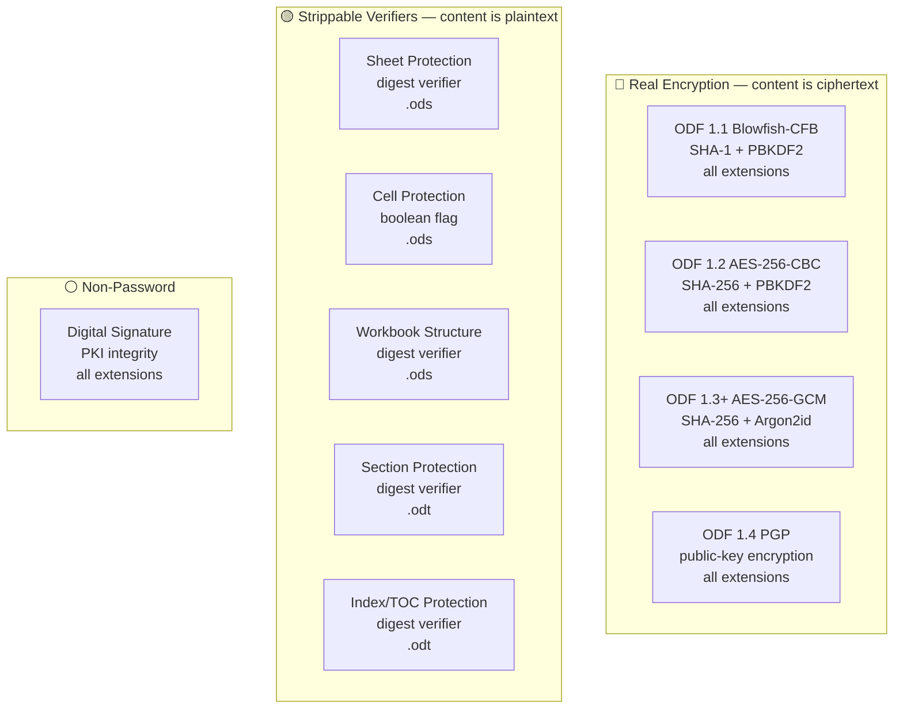
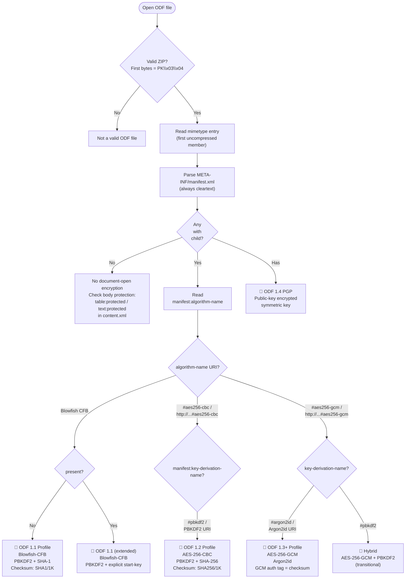
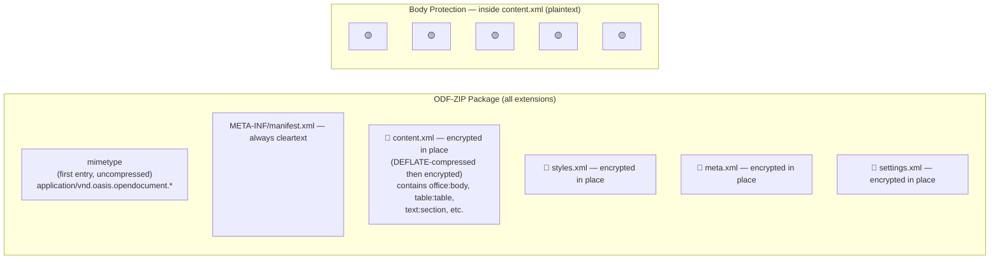

# OpenDocument — .odt / .ods / .odp / .odg / .odf / .odb

Every OpenDocument extension shares the **same container**: an ODF-ZIP package, a plain PKZIP archive whose first member is an uncompressed `mimetype` entry, followed by XML content streams (`content.xml`, `styles.xml`, `meta.xml`, `settings.xml`), embedded objects, and a package manifest at `META-INF/manifest.xml`. There is no OLE/CFB, no OPC `[Content_Types].xml`, and no monolithic `EncryptedPackage` blob. The identical physical layout backs `.odt` (text), `.ods` (spreadsheet), `.odp` (presentation), `.odg` (drawing), `.odf` (formula), `.odb` (database), template variants (`.ott`/`.ots`/`.otp`/`.otg`), and the legacy pre-ODF StarOffice XML files (`.sxw`/`.sxc`/`.sxi`). Encryption is applied **per stream**: each significant member inside the ZIP is individually DEFLATE-compressed and then encrypted in place, while the ZIP directory, `mimetype`, member file names, and `META-INF/manifest.xml` remain in cleartext. Because the container does not vary by extension, the sections below are split by **gate**, not by extension: the document-open gate is identical everywhere (varying by ODF *version*), and only the body-protection gate differs by body type.

The authoritative specification for ODF encryption algorithms is OASIS OpenDocument Format Part 3: Packages (ODF 1.0/1.1/1.2/1.3/1.4). The Microsoft Open Specifications [MS-OODF], [MS-OODF13], and [MS-OODF14] document how Microsoft Office implements (or does not implement) the OASIS standard. The sections below cite the Microsoft specs' references to the OASIS sections, and note where those specs explicitly declare features unsupported.

## File Extensions

| Extension | Container | Description | Password Protection Applicable? | Notes |
|---|---|---|---|---|
| .odt | ODF-ZIP | OpenDocument Text | Yes — per-stream encryption (ODF 1.1 Blowfish, 1.2 AES, 1.3 Argon2id/GCM). Section/index protection. | Primary text document format. |
| .ods | ODF-ZIP | OpenDocument Spreadsheet | Same as .odt + sheet protection (`table:protected`) | Also supports workbook structure protection and cell protection. |
| .odp | ODF-ZIP | OpenDocument Presentation | Same as .odt | No format-specific body-protection gates beyond document-open encryption. |
| .odg | ODF-ZIP | OpenDocument Drawing | Same as .odt | No format-specific body-protection gates beyond document-open encryption. |
| .odf | ODF-ZIP | OpenDocument Formula | Same as .odt | Mathematical formula documents. Same container and encryption as all other ODF extensions. |
| .odb | ODF-ZIP | OpenDocument Database | Same container. Database-level protection may differ. | Contains embedded HSQLDB or other database engine data alongside ODF XML streams. Database engine may impose its own access control independent of ODF encryption. |
| .ott | ODF-ZIP | OpenDocument Text Template | Same as .odt | Template variant of .odt. Uses the same OPC/ZIP container and encryption as .odt. |
| .ots | ODF-ZIP | OpenDocument Spreadsheet Template | Same as .ods | Template variant of .ods. Uses the same OPC/ZIP container and encryption as .ods. |
| .otp | ODF-ZIP | OpenDocument Presentation Template | Same as .odp | Template variant of .odp. Uses the same OPC/ZIP container and encryption as .odp. |
| .otg | ODF-ZIP | OpenDocument Drawing Template | Same as .odg | Template variant of .odg. Uses the same OPC/ZIP container and encryption as .odg. |
| .sxw | ODF-ZIP (legacy) | StarOffice/OpenOffice.org Writer | Same encryption as .odt (legacy pre-ODF format) | Pre-ODF StarOffice XML format. Same ZIP-based container and per-stream encryption architecture. |
| .sxc | ODF-ZIP (legacy) | StarOffice/OpenOffice.org Calc | Same as .ods | Pre-ODF StarOffice XML format. Same container and encryption as .sxw/.odt family. |
| .sxi | ODF-ZIP (legacy) | StarOffice/OpenOffice.org Impress | Same as .odp | Pre-ODF StarOffice XML format. Same container and encryption as .sxw/.odt family. |

## Gate Strength Map



## Detection Flowchart

How to determine which encryption profile an ODF file uses:



## Container Structure

Where each gate's data physically lives:



## No Default Password

> ODF has no equivalent of Excel's `VelvetSweatshop` or PowerPoint's `/01Hannes Ruescher/01` default password. An unprotected ODF document simply has no `<manifest:encryption-data>` elements in its manifest. A protected document always carries a real, user-chosen password behind the KDF.

## Gate Quick Reference

### All extensions — document-open encryption (per ODF version)

| | Gate | Location | Algorithm | Spec |
|---|---|---|---|---|
| 🔴 | Open — ODF 1.1 | `META-INF/manifest.xml`: `<manifest:encryption-data>` per member, `manifest:algorithm-name`=`"Blowfish CFB"` | Blowfish-CFB + PBKDF2-HMAC-SHA1 + SHA-1 start key, SHA1/1K checksum | OASIS ODF 1.1 Part 2 §17.3, §17.7.4--§17.7.6; [MS-OODF] §2.1.981, §2.1.989--§2.1.991 |
| 🔴 | Open — ODF 1.2 | `META-INF/manifest.xml`: `<manifest:encryption-data>` per member, `manifest:algorithm-name`=`"...#aes256-cbc"` | AES-256-CBC + PBKDF2-HMAC-SHA1 + SHA-256 start key, SHA256/1K checksum | OASIS ODF 1.2 Part 3 §3.4; [MS-OODF13] §2.1.1346; [MS-OODF14] §2.1.1364 |
| 🔴 | Open — ODF 1.3+ | `META-INF/manifest.xml`: `<manifest:encryption-data>` per member, `manifest:algorithm-name`=`"...#aes256-gcm"`, `manifest:key-derivation-name`=`"...#argon2id"` | AES-256-GCM + Argon2id + SHA-256 start key, GCM auth tag | OASIS ODF 1.3 Part 2 §3.4; [MS-OODF13] §2.1.1346; [MS-OODF14] §2.1.1364 |
| 🔴 | Open — ODF 1.4 PGP | `META-INF/manifest.xml`: `<manifest:encrypted-key>` with `<manifest:PGPData>` | PGP public-key encrypted symmetric key | OASIS ODF 1.4 Part 2 §4.8--§4.17; [MS-OODF14] §2.1.1367--§2.1.1375 |

### .ods — spreadsheet body protection

| | Gate | Element / Attribute | Algorithm | Spec |
|---|---|---|---|---|
| 🟡 | Sheet protection | `<table:table table:protected="true">` with `table:protection-key` (base64 digest) | Application-enforced flag + digest verifier | OASIS ODF Part 3 §19.700--§19.702; [MS-OODF14] §2.1.869--§2.1.873 |
| 🟡 | Cell protection | `<table:table-cell table:protected="true">` | Boolean sub-gate of sheet protection | OASIS ODF Part 3 §19.700; [MS-OODF14] §2.1.869, §2.1.871 |
| 🟡 | Workbook structure | `<office:spreadsheet table:structure-protected="true">` with `table:protection-key` | Application-enforced flag + digest verifier | OASIS ODF §8.5.1; [MS-OODF] §2.1.230; [MS-OODF14] §2.1.872 |

### .odt — text body protection

| | Gate | Element / Attribute | Algorithm | Spec |
|---|---|---|---|---|
| 🟡 | Section protection | `<text:section text:protected="true">` with `text:protection-key` | Application-enforced flag + digest verifier | OASIS ODF Part 3 §19.855--§19.857; [MS-OODF14] §2.1.945--§2.1.947 |
| 🟡 | Index/TOC protection | `text:protection-key-digest-algorithm` on `<text:alphabetical-index>`, `<text:bibliography>`, `<text:table-of-content>` | Application-enforced flag + digest verifier | OASIS ODF Part 3 §19.857; [MS-OODF14] §2.1.947 |

### All extensions — digital signatures

| | Gate | Location | Algorithm | Spec |
|---|---|---|---|---|
| ⚪ | Digital signature | `META-INF/documentsignatures.xml` (document) or `META-INF/macrosignatures.xml` (macros) inside the ODF-ZIP | XML-DSig | OASIS ODF Part 3 §3.5; [MS-OODF14] §2.1.1365 |

---

## Specification Detail

### Document-Open Encryption — All Extensions

ODF encryption is fundamentally different from OOXML encryption. Where OOXML wraps the entire OPC/ZIP package inside an OLE/CFB container with a monolithic `\EncryptedPackage` stream, ODF encrypts **individual members** within the ZIP archive, leaving the ZIP structure, file names, and `META-INF/manifest.xml` in cleartext. The encryption parameters for every encrypted member are stored as child elements of that member's `<manifest:file-entry>` element in the manifest.

All ODF encryption profiles share this common structure:

1. The password is encoded as **UTF-8** bytes (not UTF-16LE as in Microsoft Office formats).
2. A **start key** is derived: a hash of the raw UTF-8 password bytes. The hash algorithm is specified by `<manifest:start-key-generation manifest:start-key-generation-name="...">`.
3. A **derived key** is produced from the start key using a KDF (PBKDF2 or Argon2id) with a random salt and iteration count stored in the manifest.
4. Each member is DEFLATE-compressed, then encrypted with the derived key using the cipher specified in `<manifest:algorithm>`.
5. A **checksum** value verifies correct decryption: either a truncated hash of the first 1024 bytes of decrypted plaintext (`SHA1/1K` or `SHA256/1K`), or the GCM authentication tag for authenticated encryption modes.

#### ODF 1.1 Profile — Blowfish-CFB

| Gate | Location in file | Algorithm / mechanism | Spec reference |
|---|---|---|---|
| Document-open password | `META-INF/manifest.xml`: `<manifest:encryption-data>` on each encrypted `<manifest:file-entry>`, with `<manifest:algorithm manifest:algorithm-name="Blowfish CFB">`, `<manifest:key-derivation manifest:key-derivation-name="PBKDF2">`, and `manifest:checksum-type` referencing SHA-1/1K | Start key: SHA-1 digest of the UTF-8 password. KDF: PBKDF2-HMAC-SHA1 with `manifest:iteration-count` (default 1024) and `manifest:salt` (base64). Cipher: Blowfish in CFB mode with 8-byte IV (`manifest:initialisation-vector`). Key size: 16 bytes (128 bits). Checksum: SHA-1 of the first 1024 bytes of the uncompressed decrypted plaintext (`SHA1/1K`), stored as `manifest:checksum` (base64). | OASIS ODF 1.1 Part 2 §17.3, §17.7.4, §17.7.5, §17.7.6; [MS-OODF] §2.1.981, §2.1.989, §2.1.990, §2.1.991 |

#### ODF 1.2 Profile — AES-256-CBC

| Gate | Location in file | Algorithm / mechanism | Spec reference |
|---|---|---|---|
| Document-open password | `META-INF/manifest.xml`: `<manifest:encryption-data>` with `<manifest:algorithm manifest:algorithm-name="http://www.w3.org/2001/04/xmlenc#aes256-cbc">`, `<manifest:key-derivation manifest:key-derivation-name="PBKDF2">`, `<manifest:start-key-generation manifest:start-key-generation-name="http://www.w3.org/2000/09/xmldsig#sha256">`, and `manifest:checksum-type="urn:oasis:names:tc:opendocument:xmlns:manifest:1.0#sha256-1k"` | Start key: SHA-256 digest of the UTF-8 password. KDF: PBKDF2-HMAC-SHA1 with `manifest:iteration-count` (default 100000) and `manifest:salt` (base64). Cipher: AES-256 in CBC mode with 16-byte IV (`manifest:initialisation-vector`). Key size: 32 bytes (256 bits). Checksum: SHA-256 of the first 1024 bytes of the uncompressed decrypted plaintext (`SHA256/1K`), stored as `manifest:checksum` (base64). | OASIS ODF 1.2 Part 3 §3.4; [MS-OODF13] §2.1.1346, §2.1.1348; [MS-OODF14] §2.1.1364, §2.1.1366 |

#### ODF 1.3+ Profile — AES-256-GCM + Argon2id

| Gate | Location in file | Algorithm / mechanism | Spec reference |
|---|---|---|---|
| Document-open password | `META-INF/manifest.xml`: `<manifest:encryption-data>` with `<manifest:algorithm manifest:algorithm-name="http://www.w3.org/2009/xmlenc11#aes256-gcm">`, `<manifest:key-derivation manifest:key-derivation-name="urn:oasis:names:tc:opendocument:xmlns:manifest:1.0#argon2id">` with `manifest:argon2-iterations`, `manifest:argon2-memory`, `manifest:argon2-parallelism`, `<manifest:start-key-generation manifest:start-key-generation-name="http://www.w3.org/2000/09/xmldsig#sha256">` | Start key: SHA-256 digest of the UTF-8 password. KDF: Argon2id with configurable iterations, memory (KiB), and parallelism lanes. Cipher: AES-256 in GCM mode (authenticated encryption). No separate checksum element needed — the GCM authentication tag verifies both integrity and correct decryption. IV: 12-byte GCM nonce (`manifest:initialisation-vector`). | OASIS ODF 1.3 Part 2 §3.4; [MS-OODF13] §2.1.1346; [MS-OODF14] §2.1.1364 |

#### ODF 1.4 PGP / Public-Key Encryption

| Gate | Location in file | Algorithm / mechanism | Spec reference |
|---|---|---|---|
| PGP-encrypted document open | `META-INF/manifest.xml`: `<manifest:encrypted-key>` child of `<manifest:file-entry>`, containing `<manifest:encryption-method manifest:PGPAlgorithm="...">`, `<manifest:keyinfo>` with `<manifest:PGPData>` / `<manifest:PGPKeyID>` / `<manifest:PGPKeyPacket>`, and `<manifest:CipherData>` / `<manifest:CipherValue>` | The symmetric content-encryption key is encrypted under each recipient's PGP public key. The recipient decrypts the content key with their PGP private key, then uses it to decrypt the file content via the algorithm in `<manifest:algorithm>`. Multiple `<manifest:encrypted-key>` elements allow multi-recipient encryption. | OASIS ODF 1.4 Part 2 §4.8--§4.17; [MS-OODF14] §2.1.1367 (§4.8 manifest:encrypted-key), §2.1.1368 (§4.9 manifest:encryption-method), §2.1.1369 (§4.10 manifest:keyinfo), §2.1.1370--§2.1.1372 (§4.11--§4.13 PGPData/PGPKeyID/PGPKeyPacket), §2.1.1373--§2.1.1374 (§4.14--§4.15 CipherData/CipherValue), §2.1.1375 (§4.17 manifest:PGPAlgorithm) |

### Manifest XML Element Structure

The complete hierarchy of encryption-related elements in `META-INF/manifest.xml`, with all attributes and their types/values:

#### `<manifest:manifest>` (root element)

| Attribute | Type | Values | Spec |
|---|---|---|---|
| `manifest:version` | string | `"1.0"`, `"1.1"`, `"1.2"`, `"1.3"`, `"1.4"` | OASIS ODF Part 2 §4.2; [MS-OODF14] §2.1.1344 |
| `xmlns:manifest` | URI | `"urn:oasis:names:tc:opendocument:xmlns:manifest:1.0"` | OASIS ODF Part 2 §4.1 |

#### `<manifest:file-entry>` (one per ZIP member)

| Attribute | Type | Values / Description | Spec |
|---|---|---|---|
| `manifest:full-path` | string | Relative path of the member in the ZIP (e.g. `"content.xml"`, `"styles.xml"`, `"/"` for root) | OASIS ODF 1.1 Part 2 §17.7.3; [MS-OODF] §2.1.988 |
| `manifest:media-type` | string | MIME type (e.g. `"text/xml"`, `"application/vnd.oasis.opendocument.text"`) | OASIS ODF 1.1 Part 2 §17.7.3 |
| `manifest:size` | integer | Uncompressed size in bytes of the member before encryption (used to truncate padding after decryption) | OASIS ODF 1.2 Part 3 §3.4 |
| `manifest:preferred-view-mode` | string | `"edit"`, `"presentation-slide-show"`, `"read-only"` (ODF 1.4) | OASIS ODF 1.4 Part 2 §4.16.11; [MS-OODF14] §2.1.1343 |

#### `<manifest:encryption-data>` (child of `<manifest:file-entry>` for encrypted members)

| Attribute | Type | Values / Description | Spec |
|---|---|---|---|
| `manifest:checksum-type` | URI | Hash algorithm for decryption verification. ODF 1.1: `"SHA1/1K"` (implicit). ODF 1.2: `"urn:oasis:names:tc:opendocument:xmlns:manifest:1.0#sha256-1k"` or `"urn:oasis:names:tc:opendocument:xmlns:manifest:1.0#sha1-1k"`. ODF 1.3+ with GCM: not needed (GCM auth tag). | OASIS ODF 1.2 Part 3 §3.4; [MS-OODF13] §2.1.1348; [MS-OODF14] §2.1.1366 |
| `manifest:checksum` | base64 | The checksum value: hash of the first 1024 bytes of the uncompressed decrypted plaintext, or empty/absent for GCM modes. | OASIS ODF 1.2 Part 3 §3.4 |

#### `<manifest:algorithm>` (child of `<manifest:encryption-data>`)

| Attribute | Type | Values / Description | Spec |
|---|---|---|---|
| `manifest:algorithm-name` | URI/string | Cipher algorithm identifier. Known values: `"Blowfish CFB"` (ODF 1.1), `"http://www.w3.org/2001/04/xmlenc#aes256-cbc"` (ODF 1.2), `"http://www.w3.org/2001/04/xmlenc#aes128-cbc"` (ODF 1.2 variant), `"http://www.w3.org/2009/xmlenc11#aes256-gcm"` (ODF 1.3+) | OASIS ODF 1.1 Part 2 §17.7.5; OASIS ODF 1.2 Part 3 §3.4; [MS-OODF] §2.1.990 |
| `manifest:initialisation-vector` | base64 | IV/nonce for the cipher. Blowfish-CFB: 8 bytes. AES-CBC: 16 bytes. AES-GCM: 12 bytes. | OASIS ODF 1.1 Part 2 §17.7.5; OASIS ODF 1.2 Part 3 §3.4 |

#### `<manifest:key-derivation>` (child of `<manifest:encryption-data>`)

| Attribute | Type | Values / Description | Spec |
|---|---|---|---|
| `manifest:key-derivation-name` | URI/string | KDF algorithm identifier. Known values: `"PBKDF2"` (ODF 1.1 literal), `"urn:oasis:names:tc:opendocument:xmlns:manifest:1.0#pbkdf2"` (ODF 1.2), `"urn:oasis:names:tc:opendocument:xmlns:manifest:1.0#argon2id"` (ODF 1.3+) | OASIS ODF 1.1 Part 2 §17.7.6; OASIS ODF 1.2 Part 3 §3.4; [MS-OODF] §2.1.991 |
| `manifest:salt` | base64 | Random salt bytes used in the KDF | OASIS ODF 1.1 Part 2 §17.7.6 |
| `manifest:iteration-count` | integer | Number of PBKDF2 iterations. ODF 1.1 default: 1024. ODF 1.2 typical: 100000. Not used for Argon2id. | OASIS ODF 1.1 Part 2 §17.7.6 |
| `manifest:key-size` | integer | Derived key length in bytes. Blowfish: 16. AES-256: 32. AES-128: 16. | OASIS ODF 1.2 Part 3 §3.4 |
| `manifest:argon2-iterations` | integer | Argon2id time cost (iteration count). ODF 1.3+ only. | OASIS ODF 1.3 Part 2 §3.4 |
| `manifest:argon2-memory` | integer | Argon2id memory cost in KiB. ODF 1.3+ only. | OASIS ODF 1.3 Part 2 §3.4 |
| `manifest:argon2-parallelism` | integer | Argon2id parallelism (lanes/threads). ODF 1.3+ only. | OASIS ODF 1.3 Part 2 §3.4 |

#### `<manifest:start-key-generation>` (child of `<manifest:encryption-data>`, ODF 1.2+)

| Attribute | Type | Values / Description | Spec |
|---|---|---|---|
| `manifest:start-key-generation-name` | URI | Hash algorithm for the start key (hash of the raw password bytes). Known values: `"http://www.w3.org/2000/09/xmldsig#sha256"` (SHA-256, ODF 1.2+), `"http://www.w3.org/2000/09/xmldsig#sha1"` (SHA-1, legacy) | OASIS ODF 1.2 Part 3 §3.4 |
| `manifest:key-size` | integer | Output size of the start-key hash in bytes. SHA-256: 32. SHA-1: 20. | OASIS ODF 1.2 Part 3 §3.4 |

This element is absent in ODF 1.1, where the start key is implicitly SHA-1 of the password (per OASIS ODF 1.1 Part 2 §17.3).

#### `<manifest:encrypted-key>` (ODF 1.4 PGP, child of `<manifest:file-entry>`)

| Child Element | Description | Spec |
|---|---|---|
| `<manifest:encryption-method>` | Contains `manifest:PGPAlgorithm` attribute naming the PGP algorithm | OASIS ODF 1.4 Part 2 §4.9; [MS-OODF14] §2.1.1368 |
| `<manifest:keyinfo>` | Container for PGP key identification data | OASIS ODF 1.4 Part 2 §4.10; [MS-OODF14] §2.1.1369 |
| `<manifest:PGPData>` | Container within `<manifest:keyinfo>` for PGP-specific elements | OASIS ODF 1.4 Part 2 §4.11; [MS-OODF14] §2.1.1370 |
| `<manifest:PGPKeyID>` | Base64-encoded PGP key identifier of the recipient | OASIS ODF 1.4 Part 2 §4.12; [MS-OODF14] §2.1.1371 |
| `<manifest:PGPKeyPacket>` | Optional Base64-encoded PGP public key packet | OASIS ODF 1.4 Part 2 §4.13; [MS-OODF14] §2.1.1372 |
| `<manifest:CipherData>` | Container for the encrypted symmetric key | OASIS ODF 1.4 Part 2 §4.14; [MS-OODF14] §2.1.1373 |
| `<manifest:CipherValue>` | Base64-encoded encrypted symmetric content-encryption key | OASIS ODF 1.4 Part 2 §4.15; [MS-OODF14] §2.1.1374 |

| Attribute on `<manifest:encryption-method>` | Type | Description | Spec |
|---|---|---|---|
| `manifest:PGPAlgorithm` | URI | PGP algorithm identifier for the key encryption | OASIS ODF 1.4 Part 2 §4.17; [MS-OODF14] §2.1.1375 |

### URI / Name Literal Reference

All URI and name literals used in ODF encryption manifest attributes:

#### `manifest:algorithm-name` values

| Literal | Profile | Cipher | Spec |
|---|---|---|---|
| `"Blowfish CFB"` | ODF 1.1 | Blowfish in Cipher Feedback mode, 8-byte blocks | OASIS ODF 1.1 Part 2 §17.7.5 |
| `"http://www.w3.org/2001/04/xmlenc#aes256-cbc"` | ODF 1.2 | AES-256 in Cipher Block Chaining mode | OASIS ODF 1.2 Part 3 §3.4 |
| `"http://www.w3.org/2001/04/xmlenc#aes128-cbc"` | ODF 1.2 (variant) | AES-128 in CBC mode | OASIS ODF 1.2 Part 3 §3.4 |
| `"http://www.w3.org/2009/xmlenc11#aes256-gcm"` | ODF 1.3+ | AES-256 in Galois/Counter Mode (authenticated encryption) | OASIS ODF 1.3 Part 2 §3.4 |

#### `manifest:key-derivation-name` values

| Literal | Profile | KDF | Spec |
|---|---|---|---|
| `"PBKDF2"` | ODF 1.1 | PBKDF2-HMAC-SHA1 (literal string, not a URI) | OASIS ODF 1.1 Part 2 §17.7.6 |
| `"urn:oasis:names:tc:opendocument:xmlns:manifest:1.0#pbkdf2"` | ODF 1.2 | PBKDF2-HMAC-SHA1 (URI form) | OASIS ODF 1.2 Part 3 §3.4 |
| `"urn:oasis:names:tc:opendocument:xmlns:manifest:1.0#argon2id"` | ODF 1.3+ | Argon2id (memory-hard KDF) | OASIS ODF 1.3 Part 2 §3.4 |

#### `manifest:start-key-generation-name` values

| Literal | Profile | Hash | Spec |
|---|---|---|---|
| (absent — implicit SHA-1) | ODF 1.1 | SHA-1 of UTF-8 password | OASIS ODF 1.1 Part 2 §17.3 |
| `"http://www.w3.org/2000/09/xmldsig#sha1"` | ODF 1.2 (legacy) | SHA-1 of UTF-8 password | OASIS ODF 1.2 Part 3 §3.4 |
| `"http://www.w3.org/2000/09/xmldsig#sha256"` | ODF 1.2+ (default) | SHA-256 of UTF-8 password | OASIS ODF 1.2 Part 3 §3.4 |

#### `manifest:checksum-type` values

| Literal | Profile | Checksum | Spec |
|---|---|---|---|
| (absent — implicit SHA1/1K) | ODF 1.1 | SHA-1 of first 1024 bytes of decrypted plaintext | OASIS ODF 1.1 Part 2 §17.7.4 |
| `"urn:oasis:names:tc:opendocument:xmlns:manifest:1.0#sha1-1k"` | ODF 1.2 (legacy) | SHA-1 of first 1024 bytes | OASIS ODF 1.2 Part 3 §3.4; [MS-OODF13] §2.1.1348 |
| `"urn:oasis:names:tc:opendocument:xmlns:manifest:1.0#sha256-1k"` | ODF 1.2 (default) | SHA-256 of first 1024 bytes | OASIS ODF 1.2 Part 3 §3.4; [MS-OODF13] §2.1.1348 |
| (absent — GCM auth tag) | ODF 1.3+ (GCM) | GCM authentication tag serves as both integrity and password check | OASIS ODF 1.3 Part 2 §3.4 |

### XML Examples — Manifest Encryption Blocks

#### ODF 1.1 (Blowfish-CFB + PBKDF2 + SHA-1)

```xml
<?xml version="1.0" encoding="UTF-8"?>
<manifest:manifest xmlns:manifest="urn:oasis:names:tc:opendocument:xmlns:manifest:1.0">
  <manifest:file-entry manifest:media-type="application/vnd.oasis.opendocument.spreadsheet"
                       manifest:full-path="/"/>
  <manifest:file-entry manifest:media-type="text/xml"
                       manifest:full-path="content.xml"
                       manifest:size="28672">
    <manifest:encryption-data manifest:checksum-type="SHA1/1K"
                              manifest:checksum="hBcz5...base64...=">
      <manifest:algorithm manifest:algorithm-name="Blowfish CFB"
                          manifest:initialisation-vector="YWJjZGVmZ2g="/>
      <manifest:key-derivation manifest:key-derivation-name="PBKDF2"
                               manifest:iteration-count="1024"
                               manifest:salt="c2FsdGJ5dGVz...="/>
    </manifest:encryption-data>
  </manifest:file-entry>
  <manifest:file-entry manifest:media-type="text/xml"
                       manifest:full-path="styles.xml"
                       manifest:size="8192">
    <manifest:encryption-data manifest:checksum-type="SHA1/1K"
                              manifest:checksum="xY7m9...base64...=">
      <manifest:algorithm manifest:algorithm-name="Blowfish CFB"
                          manifest:initialisation-vector="aGlqa2xtbm9w"/>
      <manifest:key-derivation manifest:key-derivation-name="PBKDF2"
                               manifest:iteration-count="1024"
                               manifest:salt="ZGlmZmVyZW50...="/>
    </manifest:encryption-data>
  </manifest:file-entry>
  <!-- mimetype entry and META-INF/manifest.xml are never encrypted -->
</manifest:manifest>
```

Note: ODF 1.1 has no `<manifest:start-key-generation>` element — the start key is implicitly SHA-1 of the UTF-8 password. The `manifest:key-size` attribute on `<manifest:key-derivation>` is also absent in ODF 1.1, defaulting to 16 bytes (Blowfish key length).

#### ODF 1.2 (AES-256-CBC + PBKDF2 + SHA-256)

```xml
<?xml version="1.0" encoding="UTF-8"?>
<manifest:manifest xmlns:manifest="urn:oasis:names:tc:opendocument:xmlns:manifest:1.0"
                   manifest:version="1.2">
  <manifest:file-entry manifest:media-type="application/vnd.oasis.opendocument.text"
                       manifest:full-path="/"
                       manifest:version="1.2"/>
  <manifest:file-entry manifest:media-type="text/xml"
                       manifest:full-path="content.xml"
                       manifest:size="45056">
    <manifest:encryption-data manifest:checksum-type=
        "urn:oasis:names:tc:opendocument:xmlns:manifest:1.0#sha256-1k"
                              manifest:checksum="RkJw7...base64...=">
      <manifest:algorithm manifest:algorithm-name=
          "http://www.w3.org/2001/04/xmlenc#aes256-cbc"
                          manifest:initialisation-vector="MTIzNDU2Nzg5MGFiY2RlZg=="/>
      <manifest:key-derivation manifest:key-derivation-name="PBKDF2"
                               manifest:iteration-count="100000"
                               manifest:key-size="32"
                               manifest:salt="cmFuZG9tc2FsdGJ5dGVz...="/>
      <manifest:start-key-generation
          manifest:start-key-generation-name=
              "http://www.w3.org/2000/09/xmldsig#sha256"
          manifest:key-size="32"/>
    </manifest:encryption-data>
  </manifest:file-entry>
</manifest:manifest>
```

#### ODF 1.3+ (AES-256-GCM + Argon2id + SHA-256)

```xml
<?xml version="1.0" encoding="UTF-8"?>
<manifest:manifest xmlns:manifest="urn:oasis:names:tc:opendocument:xmlns:manifest:1.0"
                   manifest:version="1.3">
  <manifest:file-entry manifest:media-type="application/vnd.oasis.opendocument.presentation"
                       manifest:full-path="/"
                       manifest:version="1.3"/>
  <manifest:file-entry manifest:media-type="text/xml"
                       manifest:full-path="content.xml"
                       manifest:size="65536">
    <manifest:encryption-data>
      <manifest:algorithm manifest:algorithm-name=
          "http://www.w3.org/2009/xmlenc11#aes256-gcm"
                          manifest:initialisation-vector="R0NNbm9uY2UxMg=="/>
      <manifest:key-derivation manifest:key-derivation-name=
          "urn:oasis:names:tc:opendocument:xmlns:manifest:1.0#argon2id"
                               manifest:key-size="32"
                               manifest:salt="YXJnb24yc2FsdGJ5dGVz...="
                               manifest:argon2-iterations="3"
                               manifest:argon2-memory="65536"
                               manifest:argon2-parallelism="4"/>
      <manifest:start-key-generation
          manifest:start-key-generation-name=
              "http://www.w3.org/2000/09/xmldsig#sha256"
          manifest:key-size="32"/>
    </manifest:encryption-data>
  </manifest:file-entry>
</manifest:manifest>
```

Note: No `manifest:checksum-type` or `manifest:checksum` attributes — AES-256-GCM provides authenticated encryption, so the GCM authentication tag (appended to the ciphertext) serves as both the integrity check and the password verification mechanism.

#### ODF 1.4 PGP Public-Key Encryption

```xml
<?xml version="1.0" encoding="UTF-8"?>
<manifest:manifest xmlns:manifest="urn:oasis:names:tc:opendocument:xmlns:manifest:1.0"
                   manifest:version="1.4">
  <manifest:file-entry manifest:media-type="application/vnd.oasis.opendocument.text"
                       manifest:full-path="/"
                       manifest:version="1.4"/>
  <manifest:file-entry manifest:media-type="text/xml"
                       manifest:full-path="content.xml"
                       manifest:size="32768">
    <manifest:encryption-data>
      <manifest:algorithm manifest:algorithm-name=
          "http://www.w3.org/2001/04/xmlenc#aes256-cbc"
                          manifest:initialisation-vector="UEdQaXZieXRlczE2Yg=="/>
      <manifest:key-derivation manifest:key-derivation-name="PBKDF2"
                               manifest:iteration-count="100000"
                               manifest:key-size="32"
                               manifest:salt="cGdwc2FsdGRhdGE="/>
      <manifest:start-key-generation
          manifest:start-key-generation-name=
              "http://www.w3.org/2000/09/xmldsig#sha256"
          manifest:key-size="32"/>
    </manifest:encryption-data>
    <!-- PGP-encrypted copy of the symmetric content key for recipient 1 -->
    <manifest:encrypted-key>
      <manifest:encryption-method manifest:PGPAlgorithm=
          "http://www.w3.org/2009/xmlenc11#rsa-oaep"/>
      <manifest:keyinfo>
        <manifest:PGPData>
          <manifest:PGPKeyID>QUJDREVGRzEyMzQ1</manifest:PGPKeyID>
          <manifest:PGPKeyPacket>bWFpbGVkLXBncC1rZXktcGFja2V0...</manifest:PGPKeyPacket>
        </manifest:PGPData>
      </manifest:keyinfo>
      <manifest:CipherData>
        <manifest:CipherValue>ZW5jcnlwdGVkLXN5bW1ldHJpYy1rZXk=</manifest:CipherValue>
      </manifest:CipherData>
    </manifest:encrypted-key>
  </manifest:file-entry>
</manifest:manifest>
```

### Extraction Targets by Gate

What code needs to extract for each gate — field names, types, locations, and "gate is active" indicators.

#### 🔴 Document-Open Encryption — All Profiles

- **Location:** `META-INF/manifest.xml` inside the ODF-ZIP archive (always cleartext)
- **Gate active when:** any `<manifest:file-entry>` element contains a `<manifest:encryption-data>` child element
- **Extract per encrypted member:**
  - From `<manifest:encryption-data>`: `manifest:checksum-type` (URI string), `manifest:checksum` (base64)
  - From `<manifest:algorithm>`: `manifest:algorithm-name` (URI/string), `manifest:initialisation-vector` (base64)
  - From `<manifest:key-derivation>`: `manifest:key-derivation-name` (URI/string), `manifest:salt` (base64), `manifest:iteration-count` (integer), `manifest:key-size` (integer)
  - From `<manifest:start-key-generation>` (ODF 1.2+): `manifest:start-key-generation-name` (URI), `manifest:key-size` (integer)
  - From `<manifest:key-derivation>` (ODF 1.3+ Argon2id only): `manifest:argon2-iterations` (integer), `manifest:argon2-memory` (integer), `manifest:argon2-parallelism` (integer)
  - From `<manifest:file-entry>`: `manifest:full-path` (string, identifies which ZIP member), `manifest:size` (integer, uncompressed plaintext size for padding removal)
- **Profile identification:** determined by `manifest:algorithm-name` and `manifest:key-derivation-name` per the detection flowchart above

#### 🔴 PGP-Encrypted Document Open — ODF 1.4

- **Location:** `META-INF/manifest.xml`, `<manifest:encrypted-key>` child of `<manifest:file-entry>`
- **Gate active when:** `<manifest:encrypted-key>` element exists within a `<manifest:file-entry>`
- **Extract per recipient:**
  - From `<manifest:encryption-method>`: `manifest:PGPAlgorithm` (URI)
  - From `<manifest:PGPKeyID>`: text content (base64-encoded PGP key ID)
  - From `<manifest:PGPKeyPacket>`: text content (base64-encoded PGP public key packet, optional)
  - From `<manifest:CipherValue>`: text content (base64-encoded encrypted symmetric key)

#### 🟡 Sheet Protection — .ods

- **Location:** `content.xml`, `<table:table>` element within `<office:spreadsheet>`
- **Gate active when:** `table:protected="true"` attribute is present on `<table:table>`
- **Extract:** `table:protected` (boolean `"true"`/`"false"`), `table:protection-key` (base64-encoded digest of password, optional), `table:protection-key-digest-algorithm` (URI naming the hash algorithm, optional)

#### 🟡 Cell Protection — .ods

- **Location:** `content.xml`, `<table:table-cell>` or `<table:covered-table-cell>` element
- **Gate active when:** `table:protected="true"` on the cell element AND the containing table also has `table:protected="true"`
- **Extract:** `table:protected` (boolean). No independent password — cell protection is a sub-gate of sheet protection.

#### 🟡 Workbook Structure Protection — .ods

- **Location:** `content.xml`, `<office:spreadsheet>` element
- **Gate active when:** `table:structure-protected="true"` attribute is present
- **Extract:** `table:structure-protected` (boolean), `table:protection-key` (base64-encoded digest, optional)

#### 🟡 Section Protection — .odt

- **Location:** `content.xml`, `<text:section>` element
- **Gate active when:** `text:protected="true"` attribute is present
- **Extract:** `text:protected` (boolean), `text:protection-key` (base64-encoded digest, optional), `text:protection-key-digest-algorithm` (URI, optional)

#### 🟡 Index/TOC Protection — .odt

- **Location:** `content.xml`, `<text:alphabetical-index>`, `<text:bibliography>`, or `<text:table-of-content>` element
- **Gate active when:** `text:protection-key-digest-algorithm` attribute is present
- **Extract:** `text:protection-key-digest-algorithm` (URI)

#### ⚪ Digital Signature

- **Location:** `META-INF/documentsignatures.xml` (document signatures) or `META-INF/macrosignatures.xml` (macro signatures) inside the ODF-ZIP
- **Gate active when:** the signature XML file exists in the archive
- **Extract:** XML-DSig `<Signature>` elements

### Body Protection XML Examples

#### Sheet Protection (.ods)

```xml
<!-- Protected sheet with digest key -->
<table:table table:name="Sheet1"
             table:style-name="ta1"
             table:protected="true"
             table:protection-key="hBcz5mJP8wJk1GZvqFP7c0E9hXA="
             table:protection-key-digest-algorithm=
                 "http://www.w3.org/2000/09/xmldsig#sha1">
  <!-- ... table content ... -->
</table:table>

<!-- Protected sheet with SHA-256 digest (ODF 1.2+) -->
<table:table table:name="Sheet2"
             table:style-name="ta1"
             table:protected="true"
             table:protection-key="RkJw7sDAqH1k4...base64..."
             table:protection-key-digest-algorithm=
                 "http://www.w3.org/2000/09/xmldsig#sha256">
  <!-- ... table content ... -->
</table:table>

<!-- Protected sheet without password (just the flag) -->
<table:table table:name="Sheet3"
             table:style-name="ta1"
             table:protected="true">
  <!-- ... table content ... -->
</table:table>
```

The `table:protection-key` attribute carries a Base64-encoded digest of the password. The hash algorithm is named by `table:protection-key-digest-algorithm`. Without `table:protection-key`, the sheet is protected but has no password requirement — any user can unprotect it.

#### Cell Protection (.ods)

```xml
<table:table-cell table:protected="true"
                  table:style-name="ce1"
                  office:value-type="string">
  <text:p>This cell is locked</text:p>
</table:table-cell>
```

Cell-level `table:protected` is only enforced when the enclosing `<table:table>` also has `table:protected="true"`.

#### Workbook Structure Protection (.ods)

```xml
<office:spreadsheet table:structure-protected="true"
                    table:protection-key="hBcz5mJP8wJk1GZvqFP7c0E9hXA=">
  <table:table table:name="Sheet1" ...>
    <!-- ... -->
  </table:table>
</office:spreadsheet>
```

#### Section Protection (.odt)

```xml
<!-- Protected section with SHA-256 digest -->
<text:section text:style-name="SectC"
              text:name="ProtectedSection1"
              text:protected="true"
              text:protection-key="VGhpc0lzQUJhc2U2NEhhc2g="
              text:protection-key-digest-algorithm=
                  "http://www.w3.org/2000/09/xmldsig#sha256">
  <text:p>This section content cannot be edited.</text:p>
</text:section>

<!-- Protected section without password -->
<text:section text:style-name="SectD"
              text:name="ProtectedSection2"
              text:protected="true">
  <text:p>Protected but no password needed to unprotect.</text:p>
</text:section>
```

#### Index/TOC Protection (.odt)

```xml
<text:table-of-content text:style-name="TOC1"
                       text:protected="true"
                       text:protection-key-digest-algorithm=
                           "http://www.w3.org/2000/09/xmldsig#sha256"
                       text:name="Table of Contents">
  <!-- ... index content ... -->
</text:table-of-content>
```

### ODF-ZIP Archive Member Table

Members of an ODF-ZIP archive and their encryption treatment:

| Member path | Purpose | Encrypted? | Spec |
|---|---|---|---|
| `mimetype` | MIME type of the document (e.g. `application/vnd.oasis.opendocument.text`) | Never — first entry, uncompressed, no entry in manifest encryption | OASIS ODF 1.1 Part 2 §17.4; [MS-OODF] §2.1.982 |
| `content.xml` | Document body content (text, cells, shapes, etc.) | Yes — individually encrypted when document-open password is set | OASIS ODF Part 1 §2.1 |
| `styles.xml` | Style definitions, master pages, headers/footers | Yes | OASIS ODF Part 1 §2.1 |
| `meta.xml` | Document metadata (title, author, dates, statistics) | Yes | OASIS ODF Part 1 §2.1 |
| `settings.xml` | Application-specific settings (view state, printer, etc.) | Yes | OASIS ODF Part 1 §2.1 |
| `META-INF/manifest.xml` | Package manifest listing all members with encryption parameters | Never — must remain cleartext to identify encrypted members | OASIS ODF 1.1 Part 2 §17.7; [MS-OODF] §2.1.985 |
| `META-INF/documentsignatures.xml` | XML-DSig document signatures | Never | OASIS ODF Part 3 §3.5 |
| `META-INF/macrosignatures.xml` | XML-DSig macro signatures | Never | OASIS ODF Part 3 §3.5 |
| `Thumbnails/thumbnail.png` | Document thumbnail preview image | Optionally encrypted | OASIS ODF 1.1 Part 2 §17.6; [MS-OODF] §2.1.984 |
| `Pictures/*` | Embedded images | Yes | OASIS ODF Part 1 §2.1 |
| `Object N/*` | Embedded ODF sub-documents (charts, etc.) | Yes (each sub-member individually) | OASIS ODF Part 1 §2.1 |
| `Basic/*` | StarBasic macro source files (LibreOffice) | Optionally encrypted | LibreOffice implementation |
| ZIP directory / central directory | ZIP metadata (file names, sizes, CRC-32, offsets) | Never — inherent to ZIP format | PKZIP APPNOTE |

### Detailed Notes

#### Microsoft Office does not implement ODF encryption

All three Microsoft conformance documents state this explicitly and uniformly across all Office applications:

- **ODF 1.1:** "This is not supported in Word 2007 / Excel 2007 / PowerPoint 2007" for Section 17.3 (Encryption), Section 17.7.4 (Encryption Data), Section 17.7.5 (Algorithm), and Section 17.7.6 (Key Derivation). [MS-OODF] §2.1.981, §2.1.989--§2.1.991.
- **ODF 1.3:** "Encryption is not supported for ODF file types in Word 2013 or later / Excel 2013 or later / PowerPoint 2013 or later" for Part 2 Section 3.4 (Encryption) and Section 3.9 (Interactions Between Encryption and Digital Signatures). Every manifest encryption element (`manifest:checksum-type`, `manifest:encrypted-key`, `manifest:encryption-method`, `manifest:keyinfo`, `manifest:PGPData`, `manifest:PGPKeyID`, `manifest:PGPKeyPacket`, `manifest:CipherData`, `manifest:CipherValue`, `manifest:PGPAlgorithm`) is listed as "not supported" in all three applications. [MS-OODF13] §2.1.1346--§2.1.1357.
- **ODF 1.4:** Identical "not supported" declarations for all the same elements plus the ODF 1.4 PGP elements. [MS-OODF14] §2.1.1364--§2.1.1375.

This means Microsoft Office cannot produce encrypted ODF files, cannot open ODF files encrypted by other applications (such as LibreOffice), and will not round-trip encryption metadata. If an encrypted ODF file is encountered, Office will fail to open it rather than prompting for a password.

#### Microsoft Office partial support for body-protection attributes

The body-protection attributes have mixed support in Microsoft Office:

- **`table:protected` on `<table:table>` in `<office:spreadsheet>`**: Supported by Excel 2007 ([MS-OODF] §2.1.230 item gg). Supported in later versions for the `<table:table>` element context. [MS-OODF14] §2.1.870 (Part 3 Section 19.700.4). Not supported in Word 2013 or later ([MS-OODF14] §2.1.869 items a--c). Not supported for `<table:table>` within `<table:dde-link>` in Excel 2013 or later ([MS-OODF14] §2.1.869 item e).
- **`table:protection-key` on `<table:table>`**: Not supported in Word 2013 or later ([MS-OODF14] §2.1.872 item a). Not supported in Excel for the general case ([MS-OODF14] §2.1.872 items b--c). "Excel does not load a workbook if a protection-key is specified" ([MS-OODF] §2.1.230 item a; [MS-OODF14] §2.1.872 item c).
- **`table:protection-key` on `<office:spreadsheet>`**: Not supported in Excel 2013 or later. "Excel does not load a workbook if a protection-key is specified" ([MS-OODF14] §2.1.872 item c).
- **`table:protection-key-digest-algorithm`**: Supported in Word 2013+ for `<table:table>` ([MS-OODF14] §2.1.873 item a). Listed without explicit unsupported statement for Excel in ODF 1.4 context ([MS-OODF14] §2.1.873 item b).
- **`table:structure-protected` on `<office:spreadsheet>`**: Supported by Excel 2007 ([MS-OODF] §2.1.230 item b).
- **`text:protected` / `text:protection-key` on `<text:section>`**: Not supported in Word 2013 or later ([MS-OODF14] §2.1.945, §2.1.946).
- **`text:protection-key-digest-algorithm`**: Supported in Word 2013+ for `<text:alphabetical-index>`, `<text:bibliography>`, `<text:section>`, and `<text:table-of-content>` ([MS-OODF14] §2.1.947 items a--d).

#### Per-stream encryption architecture

ODF encryption operates at the individual member level within the ZIP archive. Each file entry listed in `META-INF/manifest.xml` that carries a `<manifest:encryption-data>` child is independently encrypted. The manifest itself, the `mimetype` entry, and the ZIP directory structure are never encrypted. This per-stream design means:

1. The file extension (`.odt`, `.ods`, etc.) and MIME type remain visible.
2. The names and sizes of all members are visible in the ZIP directory.
3. The manifest reveals which encryption profile (Blowfish-CFB, AES-256-CBC, or AES-256-GCM) is in use, along with all KDF parameters (iteration count, salt, key size).
4. Each member is encrypted independently with its own initialization vector (stored in the manifest as `manifest:initialisation-vector`).
5. The `manifest:size` attribute on the `<manifest:file-entry>` stores the original uncompressed plaintext size, allowing removal of any cipher-mode padding after decryption and decompression.

#### Password encoding: UTF-8

ODF specifies that the password is encoded as UTF-8 bytes before being fed to the start-key hash function. This is a fundamental divergence from the Microsoft Office encryption formats, which encode passwords as UTF-16LE. Any tool producing or verifying ODF password hashes must use the raw UTF-8 byte representation. The start-key hash is computed over these raw bytes: `start_key = Hash(UTF8_bytes(password))`, where Hash is SHA-1 (ODF 1.1) or SHA-256 (ODF 1.2+).

#### PBKDF2 usage in ODF

In both ODF 1.1 and ODF 1.2, the PBKDF2 variant is PBKDF2-HMAC-SHA1 (the HMAC hash function within PBKDF2 is always SHA-1, regardless of the start-key hash algorithm). The input to PBKDF2 is the start key (not the raw password), the salt from `manifest:salt`, and the iteration count from `manifest:iteration-count`. The output length is `manifest:key-size` bytes. In ODF 1.1, the typical iteration count is 1024. In ODF 1.2, the typical iteration count is 100000, though the value is application-configurable and stored in the manifest.

#### Argon2id usage in ODF 1.3+

ODF 1.3 introduced Argon2id as the KDF, replacing PBKDF2. The three Argon2id parameters are stored in `<manifest:key-derivation>` as `manifest:argon2-iterations` (time cost), `manifest:argon2-memory` (memory cost in KiB), and `manifest:argon2-parallelism` (number of lanes). Typical LibreOffice defaults as of version 24.x are iterations=3, memory=65536 (64 MiB), parallelism=4. The input to Argon2id is the start key (SHA-256 of the UTF-8 password), the salt, and the three parameters. The output length is `manifest:key-size` bytes (32 for AES-256).

#### Checksum verification process

For ODF 1.1 and ODF 1.2 (non-GCM modes), the decryption verification process is:

1. Derive the encryption key from the password using the start-key hash and KDF.
2. Decrypt the member using the derived key and IV.
3. Decompress the decrypted data (DEFLATE).
4. Compute the hash of the first min(1024, `manifest:size`) bytes of the decompressed plaintext using the algorithm from `manifest:checksum-type` (SHA-1 for `SHA1/1K`, SHA-256 for `sha256-1k`).
5. Compare against `manifest:checksum` (base64-decoded). If equal, the password is correct.

For ODF 1.3+ with AES-256-GCM, the GCM authentication tag (appended to the ciphertext per the GCM specification) serves as both the integrity check and the password verification. If GCM decryption succeeds (tag verifies), the password is correct. If the tag does not verify, the password is wrong or the data is corrupt.

#### No modify / write-reservation password

Unlike Microsoft Office formats, ODF has no separate "password to modify" or write-reservation mechanism at the document level. There is only the document-open encryption password (which gates all access) and the body-protection flags (which are application-enforced, not encryption). There is no cleartext password stored anywhere in the file.

#### No VBA project lock

ODF does not use VBA macros; it uses its own macro system (StarBasic in LibreOffice/OpenOffice, or Java/Python macros). There is no `DPB`/VBA project password mechanism. Macro security in ODF applications (LibreOffice, OpenOffice) is handled through application-level trust settings, not in-file password gates.

#### Interactions between encryption and digital signatures

OASIS ODF Part 2 Section 3.9 defines the interaction between encryption and digital signatures. The specification states that when a document is both signed and encrypted, the signature covers the encrypted form of the file entries, not the plaintext. The Microsoft specs state that this interaction is not supported because encryption itself is not supported. [MS-OODF14] §2.1.1365; [MS-OODF13] §2.1.1347.

#### The `table:protect` attribute (deprecated)

ODF 1.1 defined a `table:protect` attribute on `<table:table-cell>`. This was deprecated in ODF 1.2, replaced by `table:protected`. The Microsoft spec [MS-OODF14] §2.1.868 (Part 3 Section 19.699 table:protect) notes: "This attribute is not supported in Excel 2013 or later. This attribute was deprecated in the ODF 1.2 standard."

#### IV sizing per cipher mode

The initialization vector (`manifest:initialisation-vector`) size is determined by the cipher mode and must match exactly:

| Cipher mode | IV size | Format |
|---|---|---|
| Blowfish CFB | 8 bytes | Base64-encoded (12 characters padded) |
| AES-CBC (128 or 256) | 16 bytes | Base64-encoded (24 characters) |
| AES-GCM | 12 bytes | Base64-encoded (16 characters) |

A mismatch between the IV size and the cipher mode indicates a malformed or tampered manifest.

#### Protection-key digest algorithm URIs

The `table:protection-key-digest-algorithm` and `text:protection-key-digest-algorithm` attributes on body-protection elements use the following URIs to identify the hash algorithm:

| URI | Hash algorithm | Output size | Spec |
|---|---|---|---|
| `"http://www.w3.org/2000/09/xmldsig#sha1"` | SHA-1 | 20 bytes (28 chars base64) | OASIS ODF Part 3 §19.702, §19.857 |
| `"http://www.w3.org/2000/09/xmldsig#sha256"` | SHA-256 | 32 bytes (44 chars base64) | OASIS ODF Part 3 §19.702, §19.857 |

When the digest algorithm attribute is absent, the protection key (if present) is assumed to be a SHA-1 digest for backward compatibility with ODF 1.1. The protection-key is a digest of the password, not the password itself. To verify: hash the candidate password with the named algorithm and compare against the base64-decoded `table:protection-key` / `text:protection-key` value.

#### Encryption profile evolution summary

| ODF Version | Cipher | KDF | Start Key | Checksum | Authenticated? |
|---|---|---|---|---|---|
| 1.0 / 1.1 | Blowfish CFB (128-bit key) | PBKDF2-HMAC-SHA1, 1024 iterations default | SHA-1 of UTF-8 password | SHA1/1K (first 1024 bytes) | No |
| 1.2 | AES-256-CBC | PBKDF2-HMAC-SHA1, 100000 iterations typical | SHA-256 of UTF-8 password | SHA256/1K (first 1024 bytes) | No |
| 1.3+ | AES-256-GCM | Argon2id (memory-hard) | SHA-256 of UTF-8 password | GCM auth tag | Yes (AEAD) |
| 1.4 (PGP) | Per `<manifest:algorithm>` (typically AES-256-CBC or AES-256-GCM) | PGP public-key for key wrapping; symmetric key uses per-algorithm KDF | N/A (PGP key transport) | Per cipher mode | Depends on cipher |
