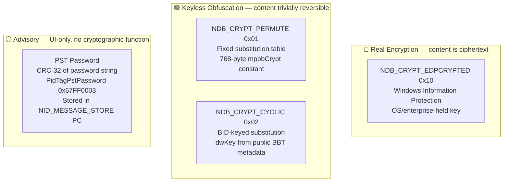
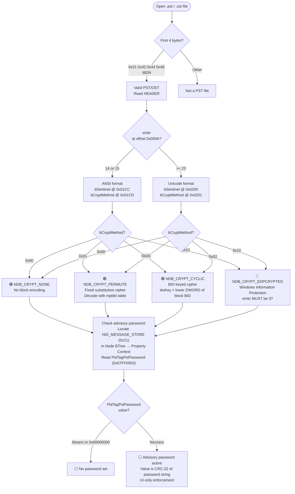
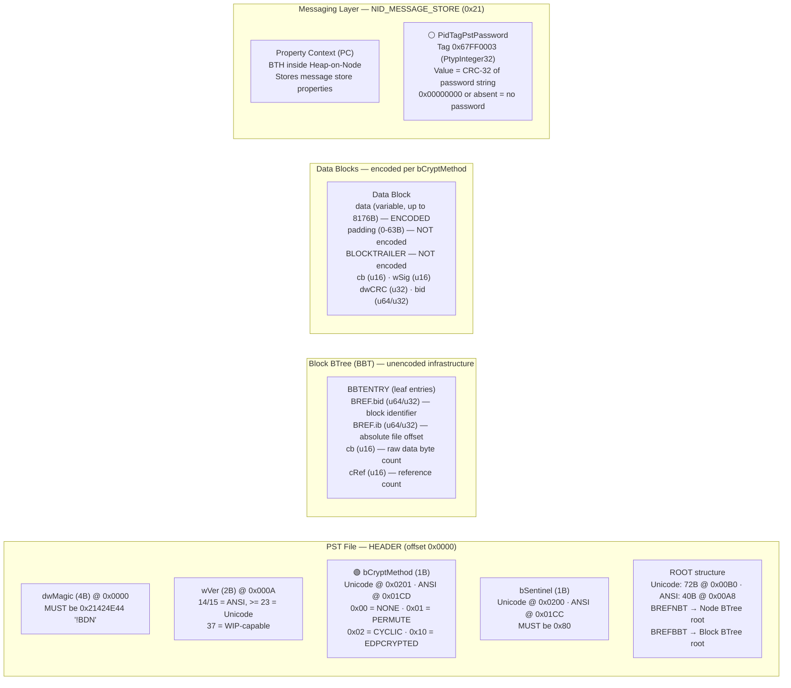

# Microsoft Outlook — `.pst` / `.ost`

Outlook Personal Folders (`.pst`) and Offline Storage (`.ost`) files are both **NDB (Node Database) containers** as defined by [MS-PST]. This is a stand-alone, self-contained, structured binary file format with no external dependencies ([MS-PST] §1.3) — it is not OLE/CFB, OPC/ZIP, or ODF-ZIP. Internally, a PST is organized in three layers: the NDB layer (node database, blocks, BTrees, allocation pages), the LTP layer (heap, BTree-on-heap, property contexts, table contexts), and the Messaging layer (message store, folders, messages, attachments) ([MS-PST] §1.3.1). Each PST represents a single message store containing an arbitrary hierarchy of Folder objects, Message objects, and Attachment objects ([MS-PST] §1.3).

Two on-disk format variants exist: **ANSI** (wVer 14 or 15, used by Outlook 97-2003, 32-bit BIDs and IBs) and **Unicode** (wVer >= 23, Outlook 2003+ default, 64-bit BIDs and IBs) ([MS-PST] §2.2.1.2, §2.2.2.6). The variant changes field widths and offsets throughout the NDB layer but does not alter the protection model. A wVer value of 37 specifically indicates the file was written by an Outlook version that supports Windows Information Protection (WIP) and the data MAY have been protected by WIP ([MS-PST] §2.2.2.6). A `.pst` is a standalone local store that the user can carry an advisory open password on; a `.ost` is the offline cache of a server mailbox (Exchange / Microsoft 365), so its access is governed by the mail profile and server credentials rather than a file-local open password. Both use the identical NDB block layout and the same body-cipher mechanism. Neither format derives any encryption key from a user password. The two protection gates documented below are fully independent of each other: the password gate and the body cipher have no interaction.

## File Extensions

| Extension | Container | Description | Password Protection Applicable? | Notes |
|---|---|---|---|---|
| `.pst` | NDB (Node Database) | Personal Storage Table — local mail store | Yes — CRC-32 advisory password (UI-only, encrypts nothing) + keyless body cipher (permute/cyclic) | Standalone portable file. ANSI (wVer 14/15) or Unicode (wVer >= 23). The primary format documented in [MS-PST]. |
| `.ost` | NDB (Node Database) | Offline Storage Table — cached Exchange mailbox | Same NDB container as .pst. Access gated by mail profile, not file password. | Uses the identical NDB block layout and body-cipher mechanism as .pst. Advisory open password (PidTagPstPassword) is typically absent because access control is enforced by the mail profile / server credentials. |
| `.msg` | OLE/CFB | Single Message Item | Can carry IRM (S/MIME or RMS) on the message. No file-level open password. | OLE/CFB compound document — not an NDB container. Defined by [MS-OXMSG]. Stores a single message with properties and attachments as OLE streams. |
| `.eml` | Text (MIME/RFC 5322) | Email Message | Plaintext MIME — no file-level encryption. May contain S/MIME encrypted body. | Industry-standard plain-text format, not a Microsoft proprietary container. Used for import/export and by non-Outlook clients. |
| `.oft` | OLE/CFB | Outlook Item Template | Same OLE/CFB as .msg — no file-level open password. | Template for creating new messages/items with pre-filled fields. Same OLE/CFB container and stream layout as .msg. |
| `.nst` | NDB (Node Database) | Group Storage File | Same NDB as .pst — stores Groups data. Same advisory password + body cipher. | Uses the same NDB container as .pst/.ost. Stores Microsoft 365 Groups data locally. |
| `.oab` | Proprietary | Offline Address Book | Binary address book cache — no password protection. | Proprietary binary format for caching the Exchange Global Address List offline. Defined by [MS-OXOAB]. No encryption or password mechanism. |

## Gate Strength Map



## Detection Flowchart

How to determine which protection gates are active in a PST/OST file:



## Container Structure

Where each gate's data physically lives:



## No Default Password

> Unlike Excel (VelvetSweatshop) and PowerPoint (/01Hannes Ruescher/01), the PST format has **no default password**. The `PidTagPstPassword` property is either absent, zero, or set by the user. There is no spec-defined fixed password that Outlook uses to auto-encrypt a PST file. The body cipher (bCryptMethod) is entirely independent of any password.

## Gate Quick Reference

### .pst / .ost — NDB container

| | Gate | Location | Algorithm | Spec |
|---|---|---|---|---|
| 🔴 | WIP encryption | `bCryptMethod` = `0x10` in HEADER | Windows Information Protection; OS/enterprise-held key, not in the PST file | [MS-PST] §2.2.2.6 |
| 🟢 | Permutative body cipher | `bCryptMethod` = `0x01` in HEADER | Fixed 256-byte substitution table `mpbbCrypt`; keyless ([pst-body-cipher](../algorithms/non-password/pst-body-cipher.md)) | [MS-PST] §2.2.2.6, §5.1, §4.1 |
| 🟢 | Cyclic body cipher | `bCryptMethod` = `0x02` in HEADER | BID-keyed substitution using `mpbbR`/`mpbbS`/`mpbbI`; `dwKey` from public BBT ([pst-body-cipher](../algorithms/non-password/pst-body-cipher.md)) | [MS-PST] §2.2.2.6, §5.2, §4.1 |
| ⚪ | Advisory open password | `PidTagPstPassword` (`0x67FF0003`) in `NID_MESSAGE_STORE` PC | CRC-32 of password string; UI-only enforcement ([pst-crc32](../algorithms/password/pst-crc32.md)) | [MS-PST] §2.4.3.3, §4.2, §5.3 |

---

## Specification Detail

### HEADER Structure — byte layout

The HEADER structure starts at absolute file offset 0 and contains the PST metadata including the `bCryptMethod` body cipher selector and the ROOT structure with BTree roots. The field layout differs between Unicode and ANSI variants, affecting the offsets of later fields ([MS-PST] §2.2.2.6).

#### Unicode HEADER (wVer >= 23)

| Offset | Size | Field | Type | Description |
|---|---|---|---|---|
| 0x0000 | 4 | `dwMagic` | u32 LE | MUST be `0x2142444E` (`"!BDN"`) |
| 0x0004 | 4 | `dwCRCPartial` | u32 LE | CRC-32 of 471 bytes starting from `wMagicClient` (offset 0x0008) |
| 0x0008 | 2 | `wMagicClient` | u16 LE | MUST be `0x4D53` (`"SM"`) |
| 0x000A | 2 | `wVer` | u16 LE | File format version. MUST be >= 23 for Unicode. 37 = WIP-capable. |
| 0x000C | 2 | `wVerClient` | u16 LE | Client format version. Current spec version = 19. |
| 0x000E | 1 | `bPlatformCreate` | u8 | MUST be `0x01` |
| 0x000F | 1 | `bPlatformAccess` | u8 | MUST be `0x01` |
| 0x0010 | 4 | `dwReserved1` | u32 LE | Reserved; MUST initialize to zero |
| 0x0014 | 4 | `dwReserved2` | u32 LE | Reserved; MUST initialize to zero |
| 0x0018 | 8 | `bidUnused` | u64 LE | Unused padding (Unicode only) |
| 0x0020 | 8 | `bidNextP` | u64 LE | Next page BID counter |
| 0x0028 | 4 | `dwUnique` | u32 LE | Monotonic modification counter |
| 0x002C | 128 | `rgnid[]` | u32[32] | NID counters by type |
| 0x00AC | 8 | `qwUnused` | u64 LE | MUST be zero |
| 0x00B4 | 72 | `root` | ROOT | ROOT structure (BTree roots, file size, AMap pointers) |
| 0x00FC | 4 | `dwAlign` | u32 LE | MUST be zero |
| 0x0100 | 128 | `rgbFM` | bytes | Deprecated FMap; MUST be `0xFF` filled |
| 0x0180 | 128 | `rgbFP` | bytes | Deprecated FPMap; MUST be `0xFF` filled |
| **0x0200** | **1** | **`bSentinel`** | **u8** | **MUST be `0x80`** |
| **0x0201** | **1** | **`bCryptMethod`** | **u8** | **Body cipher selector: `0x00`/`0x01`/`0x02`/`0x10`** |
| 0x0202 | 2 | `rgbReserved` | bytes | MUST be zero |
| 0x0204 | 8 | `bidNextB` | u64 LE | Next block BID counter (increments by 4) |
| 0x020C | 4 | `dwCRCFull` | u32 LE | CRC-32 of 516 bytes from `wMagicClient` to `bidNextB` inclusive |
| 0x0210 | 3 | `rgbReserved2` | bytes | Reserved |
| 0x0213 | 1 | `bReserved` | u8 | Reserved |
| 0x0214 | 32 | `rgbReserved3` | bytes | Reserved |

Total Unicode HEADER: 564 bytes (0x234).

#### ANSI HEADER (wVer = 14 or 15)

| Offset | Size | Field | Type | Description |
|---|---|---|---|---|
| 0x0000 | 4 | `dwMagic` | u32 LE | MUST be `0x2142444E` (`"!BDN"`) |
| 0x0004 | 4 | `dwCRCPartial` | u32 LE | CRC-32 of 471 bytes starting from `wMagicClient` |
| 0x0008 | 2 | `wMagicClient` | u16 LE | MUST be `0x4D53` |
| 0x000A | 2 | `wVer` | u16 LE | MUST be 14 or 15 for ANSI |
| 0x000C | 2 | `wVerClient` | u16 LE | Client format version |
| 0x000E | 1 | `bPlatformCreate` | u8 | MUST be `0x01` |
| 0x000F | 1 | `bPlatformAccess` | u8 | MUST be `0x01` |
| 0x0010 | 4 | `dwReserved1` | u32 LE | Reserved |
| 0x0014 | 4 | `dwReserved2` | u32 LE | Reserved |
| 0x0018 | 4 | `bidNextB` | u32 LE | Next block BID counter (ANSI: in header early, not at end) |
| 0x001C | 4 | `bidNextP` | u32 LE | Next page BID counter |
| 0x0020 | 4 | `dwUnique` | u32 LE | Monotonic modification counter |
| 0x0024 | 128 | `rgnid[]` | u32[32] | NID counters by type |
| 0x00A4 | 40 | `root` | ROOT | ROOT structure (ANSI: 40 bytes vs Unicode 72 bytes) |
| 0x00CC | 128 | `rgbFM` | bytes | Deprecated FMap; MUST be `0xFF` filled |
| 0x014C | 128 | `rgbFP` | bytes | Deprecated FPMap; MUST be `0xFF` filled |
| **0x01CC** | **1** | **`bSentinel`** | **u8** | **MUST be `0x80`** |
| **0x01CD** | **1** | **`bCryptMethod`** | **u8** | **Body cipher selector: `0x00`/`0x01`/`0x02`/`0x10`** |
| 0x01CE | 2 | `rgbReserved` | bytes | MUST be zero |
| 0x01D0 | 8 | `ullReserved` | u64 LE | Reserved; MUST be zero (ANSI only) |
| 0x01D8 | 4 | `dwReserved` | u32 LE | Reserved; MUST be zero (ANSI only) |
| 0x01DC | 3 | `rgbReserved2` | bytes | Reserved |
| 0x01DF | 1 | `bReserved` | u8 | Reserved |
| 0x01E0 | 32 | `rgbReserved3` | bytes | Reserved |

Total ANSI HEADER: 512 bytes (0x200).

### bCryptMethod Selector Values

| Value | Friendly Name | Meaning | Algorithm Section |
|---|---|---|---|
| `0x00` | `NDB_CRYPT_NONE` | Data blocks are not encoded | N/A |
| `0x01` | `NDB_CRYPT_PERMUTE` | Encoded with the Permutation algorithm | [MS-PST] §5.1 |
| `0x02` | `NDB_CRYPT_CYCLIC` | Encoded with the Cyclic algorithm | [MS-PST] §5.2 |
| `0x10` | `NDB_CRYPT_EDPCRYPTED` | Encrypted with Windows Information Protection | [MS-PST] §2.2.2.6 |

MUST be set to one of these four values ([MS-PST] §2.2.2.6). Values `0x01` and `0x02` are keyless obfuscation; `0x10` is real cryptography with an OS-held key. A wVer of 37 indicates WIP capability.

### BID (Block ID) Structure

Every block allocated in the PST is identified by a BID. The structure varies by format ([MS-PST] §2.2.2.2).

#### Unicode BID (8 bytes)

| Bit(s) | Field | Description |
|---|---|---|
| 0 | `r` (reserved) | Reserved; MUST be zero for block BIDs |
| 1 | `fInternal` | `0` = external (data) block, `1` = internal (metadata) block |
| 2-63 | `bidIndex` | Monotonically increasing block index, allocated from `HEADER.bidNextB` |

#### ANSI BID (4 bytes)

| Bit(s) | Field | Description |
|---|---|---|
| 0 | `r` (reserved) | Reserved; MUST be zero for block BIDs |
| 1 | `fInternal` | `0` = external (data) block, `1` = internal (metadata) block |
| 2-31 | `bidIndex` | Monotonically increasing block index |

Block BIDs increment by 4 (the two LSBs are flags). Page BIDs use all bits and increment by 1, allocated from `HEADER.bidNextP`.

**Cyclic encoding key derivation:** For `NDB_CRYPT_CYCLIC`, the `dwKey` parameter is the **lower DWORD** of the BID associated with the data block ([MS-PST] §5.2). In ANSI PSTs (32-bit BIDs), `dwKey` is the entire BID. In Unicode PSTs (64-bit BIDs), `dwKey` is `(DWORD)(bid & 0xFFFFFFFF)`. Since the BID is stored in the BLOCKTRAILER (unencoded) and in the BBT (unencoded infrastructure), `dwKey` is always publicly readable without decoding anything.

### BLOCKTRAILER Structure

Every block ends with a BLOCKTRAILER at the very end of the block, aligned to the block boundary ([MS-PST] §2.2.2.8.1).

#### Unicode BLOCKTRAILER (16 bytes)

| Offset (from trailer start) | Size | Field | Type | Description |
|---|---|---|---|---|
| 0 | 2 | `cb` | u16 LE | Byte count of raw data in the block (excludes trailer and padding) |
| 2 | 2 | `wSig` | u16 LE | Block signature (computed per [MS-PST] §5.5) |
| 4 | 4 | `dwCRC` | u32 LE | CRC-32 of the `cb` bytes of raw data (per [MS-PST] §5.3) |
| 8 | 8 | `bid` | u64 LE | BID of this block |

#### ANSI BLOCKTRAILER (12 bytes)

| Offset (from trailer start) | Size | Field | Type | Description |
|---|---|---|---|---|
| 0 | 2 | `cb` | u16 LE | Byte count of raw data |
| 2 | 2 | `wSig` | u16 LE | Block signature |
| 4 | 4 | `bid` | u32 LE | BID of this block |
| 8 | 4 | `dwCRC` | u32 LE | CRC-32 of the `cb` bytes of raw data |

Note: the positions of `dwCRC` and `bid` are swapped between Unicode and ANSI ([MS-PST] §2.2.2.8.1).

### BBTENTRY (Leaf BBT Entry)

The Block BTree leaf entries provide block locations and BIDs needed for cyclic encoding/decoding ([MS-PST] §2.2.2.7.7.3).

#### Unicode BBTENTRY (24 bytes)

| Offset | Size | Field | Type | Description |
|---|---|---|---|---|
| 0 | 16 | `BREF` | BREF | Contains `bid` (u64 LE) and `ib` (u64 LE, absolute file offset of the block) |
| 16 | 2 | `cb` | u16 LE | Byte count of raw data contained in the block |
| 18 | 2 | `cRef` | u16 LE | Reference count |
| 20 | 4 | `dwPadding` | u32 LE | MUST be zero |

#### ANSI BBTENTRY (12 bytes)

| Offset | Size | Field | Type | Description |
|---|---|---|---|---|
| 0 | 8 | `BREF` | BREF | Contains `bid` (u32 LE) and `ib` (u32 LE) |
| 8 | 2 | `cb` | u16 LE | Byte count of raw data |
| 10 | 2 | `cRef` | u16 LE | Reference count |

### PidTagPstPassword Property

The advisory password is stored as a single property in the message store's Property Context ([MS-PST] §2.1.2, §2.4.3.3).

| Field | Value |
|---|---|
| Canonical name | `PidTagPstPassword` |
| Property ID | `0x67FF` |
| Property type | `PtypInteger32` (`0x0003`) |
| Full property tag | `0x67FF0003` |
| Location | Property Context (PC) of `NID_MESSAGE_STORE` (`0x21`) |
| Gate active when | Property exists AND value != `0x00000000` |
| Stored value | CRC-32 hash of the password string (zero-seeded) |
| ANSI vs Unicode | In ANSI PSTs, the CRC input is the ANSI string; in Unicode PSTs, the CRC input is the Unicode string |

### Extraction Targets by Gate

What code needs to extract for each gate — field names, types, locations, and "gate is active" indicators.

#### 🟢 Body Cipher

- **Location:** HEADER at absolute file offset 0
- **Gate active when:** `bCryptMethod` != `0x00`
- **Extract:**
  - `wVer` — u16 LE at offset `0x000A` (determines ANSI vs Unicode and therefore all subsequent offsets)
  - `bSentinel` — u8 at Unicode offset `0x0200` / ANSI offset `0x01CC` (MUST be `0x80`, validation check)
  - `bCryptMethod` — u8 at Unicode offset `0x0201` / ANSI offset `0x01CD` → `0x00` = none, `0x01` = permute, `0x02` = cyclic, `0x10` = WIP
- **For decoding blocks (`0x01` or `0x02`):**
  - Locate the Block BTree (BBT) via `HEADER.root.BREFBBT`
  - For each data block: read the `bid` from the BLOCKTRAILER (last 16/12 bytes of the block)
  - For `0x01` (permutative): `CryptPermute(data, cb, FALSE)` using `mpbbI` sub-table — no key needed
  - For `0x02` (cyclic): `CryptCyclic(data, cb, (DWORD)(bid & 0xFFFFFFFF))` — `dwKey` is the lower DWORD of the block's BID
  - Only the `data` field is encoded; `padding` and BLOCKTRAILER are NOT encoded ([MS-PST] §2.2.2.8.3.1.1)
  - Only external (non-internal) data blocks are encoded; internal blocks (XBLOCK, XXBLOCK, SLBLOCK, SIBLOCK) identified by `fInternal` = 1 in the BID are NOT encoded

#### ⚪ Advisory Open Password

- **Location:** `NID_MESSAGE_STORE` (`0x21`) node in the Node BTree → its Property Context → `PidTagPstPassword` (`0x67FF0003`)
- **Gate active when:** property exists AND value != `0x00000000`
- **Extract:**
  - `PidTagPstPassword` — `PtypInteger32` (4 bytes, LE) — the CRC-32 hash of the password text
- **To verify a candidate password:** compute `ComputeCRC(0, password_bytes, len)` per [MS-PST] §5.3 and compare the result against the stored value
- **To remove the password:** set `PidTagPstPassword` to `0x00000000` or delete the property from the PC

### CRC-32 Algorithm — ComputeCRC ([MS-PST] §5.3)

The CRC algorithm used for `PidTagPstPassword` (and for all other CRCs in the format: HEADER, PAGETRAILER, BLOCKTRAILER) is a standard CRC-32 using an 8-table slicing-by-8 optimization. The polynomial is the standard IEEE 802.3 / ISO 3309 polynomial `0xEDB88320` (bit-reversed representation).

**Pseudocode (simplified single-table form):**

```
function ComputeCRC(dwCRC: uint32, data: bytes, length: int) -> uint32:
    for i in 0..length:
        dwCRC = CrcTableOffset32[(dwCRC ^ data[i]) & 0xFF] ^ (dwCRC >> 8)
    return dwCRC
```

The full implementation uses 8 lookup tables (`CrcTableOffset32` through `CrcTableOffset88`, each 256 entries of u32) for an unrolled slicing-by-8 inner loop that processes 8 bytes per iteration ([MS-PST] §5.3). In the context of password hashing, `dwCRC` MUST be initialized to zero.

**`CrcTableOffset32[256]` — first 32 entries (for identification):**

```
0x00000000, 0x77073096, 0xEE0E612C, 0x990951BA,
0x076DC419, 0x706AF48F, 0xE963A535, 0x9E6495A3,
0x0EDB8832, 0x79DCB8A4, 0xE0D5E91E, 0x97D2D988,
0x09B64C2B, 0x7EB17CBD, 0xE7B82D07, 0x90BF1D91,
0x1DB71064, 0x6AB020F2, 0xF3B97148, 0x84BE41DE,
0x1ADAD47D, 0x6DDDE4EB, 0xF4D4B551, 0x83D385C7,
0x136C9856, 0x646BA8C0, 0xFD62F97A, 0x8A65C9EC,
0x14015C4F, 0x63066CD9, 0xFA0F3D63, 0x8D080DF5,
```

This is the standard CRC-32 table (polynomial `0xEDB88320`). The remaining 7 auxiliary tables (`CrcTableOffset40` through `CrcTableOffset88`) are derived from this base table and are listed in full in [MS-PST] §5.3.

### CryptPermute Algorithm ([MS-PST] §5.1)

The permutative encoding uses a fixed 768-byte constant table `mpbbCrypt[]` divided into three 256-byte sub-tables:

| Sub-table | Offset in `mpbbCrypt` | `#define` | Purpose |
|---|---|---|---|
| `mpbbR` | bytes 0-255 | `mpbbCrypt + 0` | Encoding table (plaintext byte -> encoded byte) |
| `mpbbS` | bytes 256-511 | `mpbbCrypt + 256` | Intermediate table (used by CryptCyclic) |
| `mpbbI` | bytes 512-767 | `mpbbCrypt + 512` | Decoding table (encoded byte -> plaintext byte), inverse of `mpbbR` |

**`CryptPermute` pseudocode:**

```
function CryptPermute(data: bytes, cb: int, fEncrypt: bool):
    table = mpbbR if fEncrypt else mpbbI
    for i in 0..cb:
        data[i] = table[data[i]]
```

The function is a simple byte-for-byte substitution. There is no key — the entire algorithm is the published constant table. The spec implementation includes a DWORD-aligned optimization that processes 4 bytes per inner-loop iteration, but the result is identical.

**`mpbbR` (first 32 bytes of `mpbbCrypt`, the encoding sub-table):**

```
 65,  54,  19,  98, 168,  33, 110, 187,
244,  22, 204,   4, 127, 100, 232,  93,
 30, 242, 203,  42, 116, 197,  94,  53,
210, 149,  71, 158, 150,  45, 154, 136,
```

**`mpbbS` (first 32 bytes of sub-table at offset 256):**

```
 20,  83,  15,  86, 179, 200, 122, 156,
235, 101,  72,  23,  22,  21, 159,   2,
204,  84, 124, 131,   0,  13,  12,  11,
162,  98, 168, 118, 219, 217, 237, 199,
```

**`mpbbI` (first 32 bytes of sub-table at offset 512, the decoding/inverse table):**

```
 71, 241, 180, 230,  11, 106, 114,  72,
133,  78, 158, 235, 226, 248, 148,  83,
224, 187, 160,   2, 232,  90,   9, 171,
219, 227, 186, 198, 124, 195,  16, 221,
```

The complete 768-byte table is published in [MS-PST] §5.1. The three sub-tables satisfy the constraint that `mpbbI[mpbbR[x]] == x` for all `x` in 0..255.

### CryptCyclic Algorithm ([MS-PST] §5.2)

The cyclic encoding uses the same `mpbbR`, `mpbbS`, `mpbbI` sub-tables but introduces a key derived from the block's BID. This is a symmetric cipher — the same function is used to both encode and decode.

**`CryptCyclic` pseudocode:**

```
function CryptCyclic(data: bytes, cb: int, dwKey: uint32):
    w = (uint16)(dwKey ^ (dwKey >> 16))     # XOR high and low 16-bit halves
    for i in 0..cb:
        b = data[i]
        b = (byte)(b + (byte)(w & 0xFF))     # add low byte of w
        b = mpbbR[b]                          # substitute through R table
        b = (byte)(b + (byte)(w >> 8))        # add high byte of w
        b = mpbbS[b]                          # substitute through S table
        b = (byte)(b - (byte)(w >> 8))        # subtract high byte of w
        b = mpbbI[b]                          # substitute through I table
        b = (byte)(b - (byte)(w & 0xFF))      # subtract low byte of w
        data[i] = b
        w = (uint16)(w + 1)                   # advance counter
```

**Key derivation:** `dwKey` is the lower DWORD of the BID from the BLOCKTRAILER (or equivalently, from the BBTENTRY in the Block BTree). Since BIDs are stored in unencoded infrastructure metadata (the BBT), `dwKey` is always publicly readable. The counter `w` starts from `dwKey ^ (dwKey >> 16)` and increments by 1 for each byte processed.

**Symmetry:** The function is its own inverse — applying `CryptCyclic` twice with the same `dwKey` returns the original data.

### Data Block Encoding Scope

The following rules govern which data is encoded and which is not ([MS-PST] §2.2.2.8.3.1.1, §4.1):

- **Encoded:** Only the `data` field of non-internal (external) data blocks.
- **NOT encoded:** The `padding` bytes between data and trailer, the BLOCKTRAILER itself, all page structures (BTPAGE, AMAPPAGE, etc.), all page trailers (PAGETRAILER), the HEADER, and all internal blocks (XBLOCK, XXBLOCK, SLBLOCK, SIBLOCK).
- **Internal vs external blocks:** A block is internal if bit 1 of its BID is set (`fInternal` = 1). Internal blocks contain metadata (BID arrays for data trees, subnode BTree entries) and are NOT encoded. External blocks contain higher-layer data (property values, message bodies, etc.) and ARE encoded.
- **Infrastructure always readable:** The entire Node BTree (NBT), Block BTree (BBT), allocation pages (AMap, PMap, FMap, FPMap), Density List, and HEADER are stored without any encoding, regardless of `bCryptMethod` ([MS-PST] §4.1). This means the complete file structure, block locations, node relationships, reference counts, and all allocation metadata can be read without performing any decoding.

### ROOT Structure

The ROOT structure inside the HEADER provides access to the BTree roots needed to navigate the file ([MS-PST] §2.2.2.5).

#### Unicode ROOT (72 bytes, at HEADER offset 0x00B4)

| Offset (within ROOT) | Size | Field | Type | Description |
|---|---|---|---|---|
| 0 | 4 | `dwReserved` | u32 LE | Reserved |
| 4 | 8 | `ibFileEof` | u64 LE | Size of the PST file in bytes |
| 12 | 8 | `ibAMapLast` | u64 LE | Absolute offset to last AMap page |
| 20 | 8 | `cbAMapFree` | u64 LE | Total free space in all AMaps |
| 28 | 8 | `cbPMapFree` | u64 LE | Total free space in all PMaps (deprecated, SHOULD be zero) |
| 36 | 16 | `BREFNBT` | BREF | BID + IB of the Node BTree root page |
| 52 | 16 | `BREFBBT` | BREF | BID + IB of the Block BTree root page |
| 68 | 1 | `fAMapValid` | u8 | `0x00` = invalid, `0x01` = valid (deprecated), `0x02` = valid |
| 69 | 1 | `bReserved` | u8 | Reserved |
| 70 | 2 | `wReserved` | u16 LE | Reserved |

#### ANSI ROOT (40 bytes, at HEADER offset 0x00A4)

| Offset (within ROOT) | Size | Field | Type | Description |
|---|---|---|---|---|
| 0 | 4 | `dwReserved` | u32 LE | Reserved |
| 4 | 4 | `ibFileEof` | u32 LE | Size of the PST file in bytes |
| 8 | 4 | `ibAMapLast` | u32 LE | Absolute offset to last AMap page |
| 12 | 4 | `cbAMapFree` | u32 LE | Total free space in all AMaps |
| 16 | 4 | `cbPMapFree` | u32 LE | Deprecated |
| 20 | 8 | `BREFNBT` | BREF | BID (u32) + IB (u32) of the NBT root |
| 28 | 8 | `BREFBBT` | BREF | BID (u32) + IB (u32) of the BBT root |
| 36 | 1 | `fAMapValid` | u8 | AMap validity flag |
| 37 | 1 | `bReserved` | u8 | Reserved |
| 38 | 2 | `wReserved` | u16 LE | Reserved |

### Message Store and NID_MESSAGE_STORE

The message store is the root of the PST, implemented as a Property Context (PC) node with the special internal NID `NID_MESSAGE_STORE` (`0x21`, `nidType` = `NID_TYPE_INTERNAL` = `0x01`, `nidIndex` = `0x02`) ([MS-PST] §2.4.1, §2.4.3). Exactly one message store node MUST exist per PST.

The PidTagPstPassword property (`0x67FF0003`) resides in this PC. To access it, an implementation must:

1. Search the Node BTree (NBT) for `NID` = `0x00000021`
2. Retrieve the node's data BID from the NBTENTRY
3. Look up the data BID in the Block BTree (BBT) to find the block's file offset
4. Read and decode the data block(s) per `bCryptMethod`
5. Parse the Heap-on-Node (HN) and BTree-on-Heap (BTH) structures
6. Search the BTH for a PC record with property ID `0x67FF`
7. Read the `PtypInteger32` value — this is the CRC-32 of the password

### Special Internal NIDs ([MS-PST] §2.4.1)

| NID value | Name | Purpose |
|---|---|---|
| `0x21` | `NID_MESSAGE_STORE` | Message store PC — contains `PidTagPstPassword` |
| `0x61` | `NID_NAME_TO_ID_MAP` | Named property lookup map |
| `0x122` | `NID_ROOT_FOLDER` | Root Folder object |

### Detailed Notes

#### Advisory open password (PidTagPstPassword)

**UI-only enforcement.** [MS-PST] §2.4.3.3 states directly: "the password itself is not used to secure the PST data in any way." The password feature "is just implemented at the UI level, meaning that the password is only required to gain access of the PST through the UI." The spec imposes a SHOULD-level requirement that implementations prompt the user when a nonzero PidTagPstPassword value exists, and a MUST-level requirement that they enforce the check if one is set ([MS-PST] §2.4.3.3). But the password has no relationship to the body cipher; it does not serve as input to any encoding or decoding operation.

**CRC-32 storage.** The stored value is the CRC-32 hash of the password text, not the password itself ([MS-PST] §2.4.3.3). The CRC algorithm used is `ComputeCRC` from [MS-PST] §5.3, which is a standard CRC-32 using an 8-table slicing-by-8 implementation with the polynomial table `CrcTableOffset32[256]` (and auxiliary tables CrcTableOffset40 through CrcTableOffset88 for the unrolled inner loop). The seed (`dwCRC`) MUST be zero in the context of password hashing ([MS-PST] §5.3).

**Collision weakness.** [MS-PST] §4.2 states: "the password is stored as a CRC-32 hash of the original password string, which is prone to collisions and is relatively weak against a brute-force approach." Because CRC-32 maps an arbitrary-length password to a 32-bit verifier, the collision space is trivially small (2^32 possible values), and the original password cannot be uniquely recovered from the hash.

**No security benefit.** [MS-PST] §4.2 reiterates: "Because the password itself is not used as a key to the encoding and decoding cipher algorithms, it does not provide any security benefit to preventing the PST data to be read by unauthorized parties." This means the password and the body cipher are entirely orthogonal: knowing (or removing) the password is neither necessary nor sufficient for decoding the block data, and decoding the block data is neither necessary nor sufficient for satisfying the password prompt.

**ANSI vs Unicode.** The PidTagPstPassword property tag, storage location (NID_MESSAGE_STORE PC), and CRC-32 algorithm are identical between ANSI and Unicode PST formats. The only difference is that in ANSI PSTs, the password text fed to the CRC-32 is the ANSI string representation, while in Unicode PSTs it is the Unicode string representation. The property is typed as `PtypInteger32` in both cases.

#### Body cipher (bCryptMethod)

**Keyless obfuscation, not encryption.** [MS-PST] §4.1 is explicit: "This file format specification uses two keyless cipher algorithms to encode the data blocks in the PST. These algorithms only provide data obfuscation and can be conveniently decoded once the exact encoding algorithm is understood." The section concludes: "the strength of the encoded PST data blocks provides no additional security beyond data obfuscation."

**Scope of encoding.** Only the `data` field of non-internal data blocks is encoded. The padding and BLOCKTRAILER are not encoded ([MS-PST] §2.2.2.8.3.1.1). All other infrastructure information — the HEADER, allocation metadata pages (AMap, PMap, FMap, FPMap, DList), and BTree pages (NBT, BBT) — is stored without obfuscation ([MS-PST] §4.1). This means the entire node tree structure, block addresses, reference counts, and all page metadata are readable without any decoding.

**NDB_CRYPT_PERMUTE details.** The permutative encoding uses a 768-byte constant table `mpbbCrypt[]` divided into three 256-byte sub-tables: `mpbbR` (bytes 0-255, used for encoding), `mpbbS` (bytes 256-511, used internally by cyclic encoding), and `mpbbI` (bytes 512-767, the inverse table used for decoding) ([MS-PST] §5.1). `CryptPermute` simply replaces each byte of the data buffer with its looked-up value in either `mpbbR` (to encode) or `mpbbI` (to decode). There is no key of any kind — the entire algorithm is the substitution table, which is a published constant.

**NDB_CRYPT_CYCLIC details.** The cyclic encoding uses the same `mpbbR`, `mpbbS`, and `mpbbI` sub-tables, but introduces a key parameter: `dwKey`, which is the lower DWORD of the BID associated with the data block ([MS-PST] §5.2). The BID (Block ID) is the identifier stored in the Block BTree (BBT) for every allocated block in the PST ([MS-PST] §2.2.2.2). Since the BBT is unencoded infrastructure metadata, the `dwKey` for every block is publicly readable from the BBT without decoding anything. The `CryptCyclic` function is symmetric — it is used for both encoding and decoding with the same parameters ([MS-PST] §5.2). On each byte of the data buffer, it performs a sequence of additions and substitutions through the three sub-tables, advancing an internal 16-bit counter (`w`) for each byte. The counter is initialized from `dwKey` by XORing its high and low 16-bit halves.

**NDB_CRYPT_EDPCRYPTED.** The value `0x10` indicates encryption with Windows Information Protection (WIP), which is genuine cryptography where the key material is held by the operating system or enterprise infrastructure, not stored in the PST file ([MS-PST] §2.2.2.6). A wVer value of 37 in the HEADER indicates the file was written by an Outlook version supporting WIP ([MS-PST] §2.2.2.6). This is the only `bCryptMethod` value that provides actual cryptographic data protection.

#### Independence of the two gates

The password gate and the body cipher are completely independent mechanisms. The password is a CRC-32 verifier stored as a message-store property, used only by the UI to decide whether to prompt the user. The body cipher is selected by a HEADER byte and applies a keyless encoding to data block payloads. No information flows from one to the other: the password (or its CRC-32) is never used as a key or parameter to the body cipher, and the body cipher method has no effect on password verification ([MS-PST] §2.4.3.3, §4.1, §4.2).

#### OST-specific considerations

The [MS-PST] specification applies to `.pst` files specifically. The `.ost` (Offline Storage Table) format uses the same NDB container structure and the same body cipher mechanism, but `.ost` files are bound to a mail profile and server mailbox rather than being standalone stores. The advisory open password (`PidTagPstPassword`) is typically absent from `.ost` files because access control is enforced by the mail profile / server credentials, not a file-local password gate. The body cipher (`bCryptMethod`) operates identically in `.ost` files.

#### Block sizing constraints

Blocks are the fundamental units of data storage at the NDB layer ([MS-PST] §2.2.2.8). They are allocated in sizes that are multiples of 64 bytes, aligned on 64-byte boundaries. The maximum size of any block is 8192 bytes (8 KB). The maximum raw data capacity of a single data block is 8176 bytes (Unicode: 8192 - 16 byte BLOCKTRAILER) or 8180 bytes (ANSI: 8192 - 12 byte BLOCKTRAILER). When a node's data exceeds this, it is stored in a data tree using XBLOCK (level 1) and XXBLOCK (level 2) structures, which are internal blocks containing arrays of BIDs pointing to the actual data blocks ([MS-PST] §2.2.2.8.3.2).

#### File magic and validation

The first 4 bytes of a PST file MUST be `0x21, 0x42, 0x44, 0x4E` — the ASCII string `"!BDN"` ([MS-PST] §2.2.2.6). The `wMagicClient` field at offset 0x0008 MUST be `0x53, 0x4D` (`"SM"`). Together these two magic values uniquely identify a file as a PST/OST. The `dwCRCPartial` (offset 0x0004) provides integrity for the initial header fields; in Unicode PSTs, `dwCRCFull` (offset 0x020C) provides integrity for the expanded header region.

#### Product behavior

[MS-PST] Appendix B documents the following product support:

- **ANSI and Unicode:** Office Outlook 2003, Office Outlook 2007, Outlook 2010, and Outlook 2013 can read, write, and create both ANSI and Unicode PST files. The default format is Unicode ([MS-PST] Appendix B, note <3>).
- **Density List:** Office Outlook 2003 and Office Outlook 2007 without Service Pack 2 do not create or use Density Lists; they use PMap, FMap, and FPMap instead ([MS-PST] Appendix B, notes <14>, <15>, <16>).
- **WIP support:** A `wVer` value of 37 indicates the file was written by an Outlook version that supports Windows Information Protection; this was added in a later revision of the specification.

### Spec-stated security considerations

[MS-PST] §4 provides two security consideration sections that constitute the spec's own assessment:

1. **§4.1 Strength of Encoded PST Data Blocks:** "These algorithms only provide data obfuscation and can be conveniently decoded once the exact encoding algorithm is understood. Moreover, only end-user data blocks are encoded in the PST. All the other infrastructure information, including the header, allocation metadata pages and BTree pages are stored without obfuscation. In summary, the strength of the encoded PST data blocks provides no additional security beyond data obfuscation."

2. **§4.2 Strength of PST Password:** "The PST Password ... is a superficial mechanism that requires the client implementation to enforce the stored password. Because the password itself is not used as a key to the encoding and decoding cipher algorithms, it does not provide any security benefit to preventing the PST data to be read by unauthorized parties. Moreover, the password is stored as a CRC-32 hash of the original password string, which is prone to collisions and is relatively weak against a brute-force approach."
