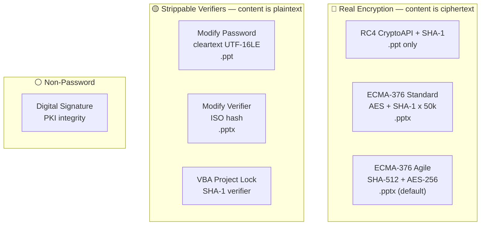
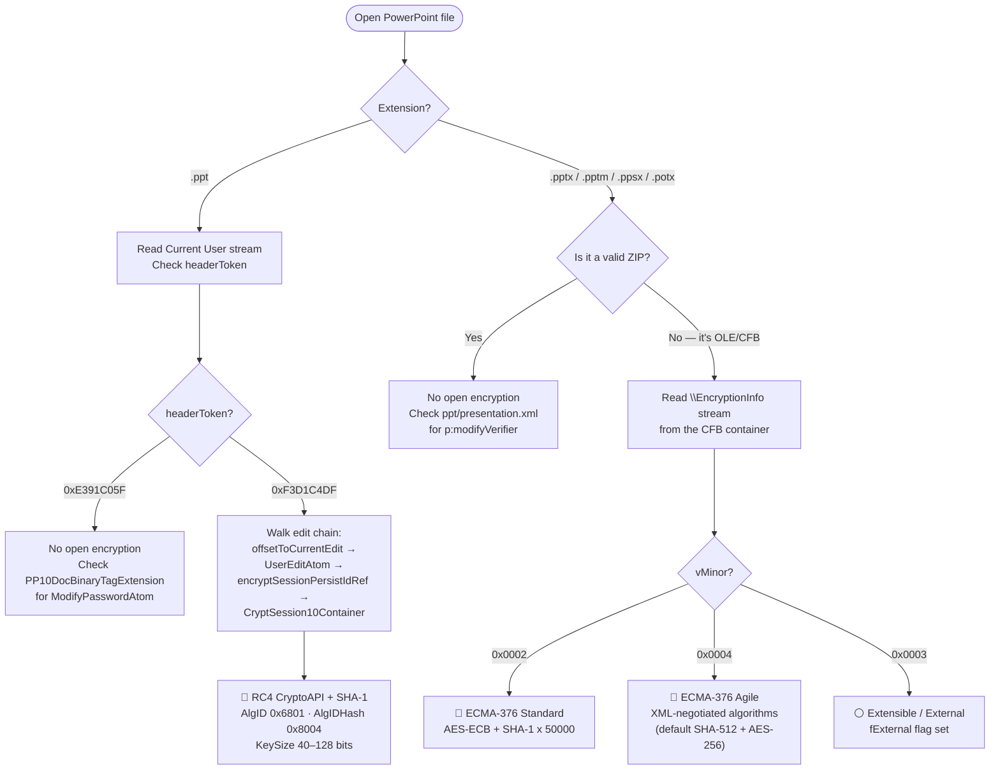
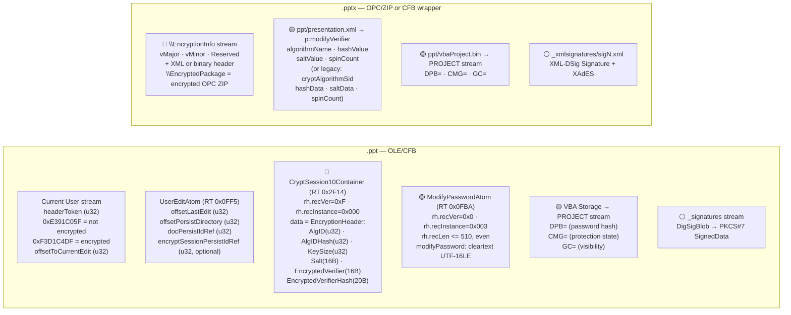

# Microsoft PowerPoint — .ppt / .pptx / .pptm / .potx / .ppsx

PowerPoint files come in two unrelated container families. `.ppt` (PowerPoint 97-2003) is an OLE Compound File Binary (CFB) document as specified in [MS-CFB]: presentation content lives in the `PowerPoint Document` stream, the edit chain is walked from the `Current User` stream, and any VBA macros sit in an embedded CFB storage ([MS-PPT] §2.1). `.pptx` (and macro-enabled `.pptm`, template `.potx`/`.potm`, show `.ppsx`/`.ppsm` — PowerPoint 2007 and later) is an OPC package (a ZIP archive of XML parts: `ppt/presentation.xml`, `ppt/slides/...`, `ppt/vbaProject.bin`, etc.) as specified by [ECMA-376]. When a `.pptx` carries a document-open password, the entire OPC/ZIP package is encrypted and re-wrapped inside an outer OLE/CFB container (streams `\EncryptionInfo` + `\EncryptedPackage`), so an encrypted `.pptx` is on-disk an OLE2 file that retains the `.pptx` extension ([MS-OFFCRYPTO] §2.3.4).

PowerPoint's protection surface is narrower than Excel's: there are no sheet-level, workbook-level, or edit-range protection gates. The binary format supports only RC4 CryptoAPI encryption for the open gate (no XOR, no MD5+RC4), and the modify password is stored in cleartext UTF-16LE.

## File Extensions

Every file extension used by Microsoft PowerPoint, grouped by container generation.

| Extension | Container | Description | Password Protection Applicable? | Notes |
|---|---|---|---|---|
| .ppt | OLE/CFB | PowerPoint 97-2003 Presentation | Yes — RC4-CryptoAPI open, cleartext modify, default pw `/01Hannes Ruescher/01` | Primary binary format; only supports RC4-CryptoAPI encryption (no XOR, no RC4+MD5) |
| .pot | OLE/CFB | PowerPoint 97-2003 Template | Same as .ppt | Template variant; identical container and encryption to .ppt |
| .pps | OLE/CFB | PowerPoint 97-2003 Slideshow | Same as .ppt (auto-starts slideshow on open) | Identical to .ppt except the shell association launches in slideshow mode |
| .ppa | OLE/CFB | PowerPoint 97-2003 Add-in | Same as .ppt | Add-in variant; identical container and encryption to .ppt |
| .pptx | OPC/ZIP (or OLE/CFB when encrypted) | PowerPoint Presentation | Yes — Standard/Agile open, ISO modifyVerifier | When encrypted, the OPC/ZIP is re-wrapped inside an OLE/CFB container but the .pptx extension is preserved |
| .pptm | OPC/ZIP (or OLE/CFB when encrypted) | PowerPoint Macro-Enabled Presentation | Same as .pptx + VBA project lock | Contains `ppt/vbaProject.bin` embedded OLE/CFB for VBA macros |
| .potx | OPC/ZIP | PowerPoint Template | Same as .pptx | Uses the same OPC/ZIP container and encryption as .pptx |
| .potm | OPC/ZIP | PowerPoint Macro-Enabled Template | Same as .pptx + VBA project lock | Template variant of .pptm; same container, encryption, and VBA handling |
| .ppsx | OPC/ZIP (or OLE/CFB when encrypted) | PowerPoint Slideshow | Same as .pptx (auto-starts slideshow) | Identical to .pptx except the shell association launches in slideshow mode |
| .ppsm | OPC/ZIP | PowerPoint Macro-Enabled Slideshow | Same as .pptx + VBA project lock | Slideshow variant of .pptm; same container, encryption, and VBA handling |
| .ppam | OPC/ZIP | PowerPoint Add-in | Same as .pptx + VBA project lock | Add-in variant; same container, encryption, and VBA handling as .pptm |
| .sldx | OPC/ZIP | PowerPoint Single Slide | Individual slide export — no standalone encryption | Single-slide export format; not independently password-protectable |
| .sldm | OPC/ZIP | PowerPoint Macro-Enabled Single Slide | Individual slide — no standalone encryption | Macro-enabled single-slide export; not independently password-protectable |

## Gate Strength Map



## Detection Flowchart

How to determine which encryption scheme a PowerPoint file uses:



## Container Structure

Where each gate's data physically lives:



## `/01Hannes Ruescher/01` Default Password

> **Spec-confirmed default password** — [MS-OFFCRYPTO] §2.4.2.3
>
> - Password: `/01Hannes Ruescher/01` (`\x2f\x30\x31\x48\x61\x6e\x6e\x65\x73\x20\x52\x75\x65\x73\x63\x68\x65\x72\x2f\x30\x31`)
> - **Trigger:** When a `.ppt` file has a modify password (ModifyPasswordAtom present, write-protection method 3) and the user has not supplied a separate open/encryption password, the file is encrypted under this fixed default password.
> - **Applies to:** PowerPoint 2003, PowerPoint 2007, PowerPoint 2007 SP1 per [MS-OFFCRYPTO] §5 note \<26\>. PowerPoint 2007 SP2 **stopped** using the default password.
> - **Always try this first** on any encrypted `.ppt` file before password-cracking attempts
> - This is distinct from Excel's default password (`VelvetSweatshop`, [MS-OFFCRYPTO] §2.4.2.3 note \<24\>)
> - The spec adds: "Due to security concerns, it is preferable not to use the default password." ([MS-OFFCRYPTO] §5 note \<26\>)

## Gate Quick Reference

### .ppt — legacy binary

| | Gate | Record / Location | Algorithm | Spec |
|---|---|---|---|---|
| 🔴 | Open — RC4 CryptoAPI | `CryptSession10Container` (RT 0x2F14) via `UserEditAtom.encryptSessionPersistIdRef` | [RC4-CryptoAPI-SHA1](../algorithms/password/rc4-cryptoapi-sha1.md), KeySize 40-128 | [MS-PPT] §2.3.7; [MS-OFFCRYPTO] §2.3.5 |
| 🟡 | Modify password | `ModifyPasswordAtom` (RT 0x0FBA, recInstance=0x003) in `PP10DocBinaryTagExtension` | Cleartext UTF-16LE — no hash | [MS-PPT] §2.4.7; [MS-OFFCRYPTO] §2.4.2.3 |
| 🟡 | VBA project lock | VBA storage → `PROJECT` stream `DPB=` | [VBA password](../algorithms/password/vba-project-password.md) SHA-1 | [MS-OVBA] §2.3.1.16, §2.4.4 |
| ⚪ | Digital signature | `_signatures` / `_xmlsignatures` | PKI — MD5+RSA or xmldsig/XAdES | [MS-OFFCRYPTO] §2.5.1, §2.5.2 |

### .pptx / .pptm — OOXML

| | Gate | Element / Record | Algorithm | Spec |
|---|---|---|---|---|
| 🔴 | Open — Standard | `\EncryptionInfo` vMinor=0x0002 | [ECMA-376 Standard](../algorithms/password/ecma376-standard.md) AES-ECB | [MS-OFFCRYPTO] §2.3.4.5-9 |
| 🔴 | Open — Agile | `\EncryptionInfo` vMinor=0x0004 | [ECMA-376 Agile](../algorithms/password/ecma376-agile.md) AES-CBC | [MS-OFFCRYPTO] §2.3.4.10-15 |
| 🟡 | Modify verifier | `<p:modifyVerifier>` in `ppt/presentation.xml` | [ISO hash](../algorithms/password/iso-protection-hash.md) or CryptoAPI SID hash | [MS-OI29500] §2.1.1104; [MS-OFFCRYPTO] §2.4.2.4 |
| 🟡 | VBA project lock | `ppt/vbaProject.bin` → `PROJECT` stream | [VBA password](../algorithms/password/vba-project-password.md) SHA-1 | [MS-OVBA] §2.3.1.16, §2.4.4 |
| ⚪ | Digital signature | `_xmlsignatures/` | xmldsig/XAdES PKI | [MS-OFFCRYPTO] §2.5.2-3 |

---

## Specification Detail

### `.ppt` — legacy binary (OLE/CFB, PowerPoint 97-2003) — full gate table

| Gate | Location in file | Algorithm / mechanism | Spec reference |
|---|---|---|---|
| 🔴 Open / encrypt — RC4 CryptoAPI + SHA-1 | `CryptSession10Container` record (recType `RT_CryptSession10Container` = 0x2F14) in the `PowerPoint Document` stream. Located via the edit chain: `Current User` stream → `CurrentUserAtom.offsetToCurrentEdit` → `UserEditAtom.encryptSessionPersistIdRef` → persist object directory lookup → offset of `CryptSession10Container`. The record header (`rh`) is never encrypted; the `data` field holds the RC4 CryptoAPI Encryption Header ([MS-OFFCRYPTO] §2.3.5.1): `EncryptionVersionInfo` (vMajor, vMinor) + `EncryptionHeader` (AlgID=0x00006801 for RC4, AlgIDHash=0x00008004 for SHA-1, KeySize 40-128 bits, ProviderType=0x00000001) + `EncryptionVerifier` (SaltSize, Salt 16B, EncryptedVerifier 16B, VerifierHashSize, EncryptedVerifierHash 20B). | RC4 CryptoAPI encryption: key derivation is H0 = SHA-1(salt + password), Hfinal = SHA-1(H0 + blockNumber), no iteration ([MS-OFFCRYPTO] §2.3.5.2). Verification via SHA-1 of decrypted verifier. The spec is explicit: "Only the Office Binary Document RC4 CryptoAPI encryption method as specified in [MS-OFFCRYPTO] section 2.3.5 is supported" ([MS-PPT] §2.3.7). There is no XOR obfuscation variant and no 40-bit RC4/MD5 legacy variant for PowerPoint. See [rc4-cryptoapi-sha1](../algorithms/password/rc4-cryptoapi-sha1.md). | [MS-PPT] §2.3.7; [MS-PPT] §2.3.3 (UserEditAtom); [MS-OFFCRYPTO] §2.3.5 (RC4 CryptoAPI); [MS-OFFCRYPTO] §2.3.5.1 (Header); [MS-OFFCRYPTO] §2.3.5.2 (Key Gen) |
| 🟡 Modify password | `ModifyPasswordAtom` record (RecordHeader: recType `RT_CString` = 0x0FBA, recInstance = 0x003, recVer = 0x0, recLen <= 510 and even) inside a `PP10DocBinaryTagExtension` container, hung off `DocumentContainer` → `docInfoList` → `DocProgTagsContainer` → `DocProgBinaryTagContainer`. The `modifyPassword` field is a `PrintableUnicodeString`: the password stored verbatim in cleartext UTF-16LE with no key derivation, no hashing, no obfuscation. Maximum password length: 255 characters (recLen / 2). | Cleartext UTF-16LE storage; no cryptographic protection. [MS-OFFCRYPTO] §2.4.2.3 specifies this as "Binary Document Write Protection Method 3." Files with a modify password MUST be encrypted per [MS-OFFCRYPTO] §2.4.2.3 — if no user-supplied open password exists, the default password `/01Hannes Ruescher/01` is used. [MS-OFFCRYPTO] §4.1.4 states: "Document write protection is not considered to be a security mechanism [...] Document write protection is meant to protect against accidental modification only." | [MS-PPT] §2.4.7 (ModifyPasswordAtom); [MS-OFFCRYPTO] §2.4.2.3 (Method 3); [MS-OFFCRYPTO] §4.1.4 |
| 🟡 VBA project lock | Embedded VBA CFB storage (referenced via `VBAInfoContainer` → `VBAInfoAtom.persistIdRef` in `DocInfoListContainer`) → `PROJECT` stream containing `CMG=` (ProjectProtectionState), `DPB=` (ProjectPassword), `GC=` (ProjectVisibilityState) lines, each obfuscated by the Data Encryption algorithm in [MS-OVBA] §2.4.3. The password, when present, is stored as a 29-byte Hash Data Structure (SHA-1 based) obfuscated by the same data encryption scheme. | [MS-OVBA] Data Encryption (obfuscation, not cryptographic security; the spec states "the design of this encryption is to obfuscate sensitive information, not to secure it" per [MS-OVBA] §4.2); SHA-1 password hash per [MS-OVBA] §2.4.4. Module source code is stored compressed but unencrypted in module streams ([MS-OVBA] §2.3.4.3) — the project password protects viewing in the VBA editor UI only. See [vba-project-password](../algorithms/password/vba-project-password.md). | [MS-PPT] §2.4.10 (VBAInfoContainer); [MS-PPT] §2.4.11 (VBAInfoAtom); [MS-OVBA] §2.3.1.15-17; [MS-OVBA] §2.4.3-4 |
| ⚪ Digital signature — CryptoAPI | PKCS#7 `SignedData` in a `DigSigBlob` structure stored as a `VtDigSigValue` property inside the `_signatures` stream in the OLE root storage. The `DigSigInfoSerialized` structure carries the signature buffer, certificate store, project name, and optional timestamp. | CryptoAPI digital signature (MD5 hash of compound file contents + RSA signing per [RFC3447] §9.2, [MS-OFFCRYPTO] §2.5.1.5). Hash generated by recursively traversing OLE streams/storages, excluding `\0x06DataSpaces`, `\0x05Bagaaqy23kudbhchAaq5u2chNd`, `_signatures`, and `\0x09DRMContent`. For PPT specifically, the `Current User` stream name is included in the hash but its data is excluded (AppFilter returns without appending data). | [MS-OFFCRYPTO] §2.5.1.3-5; [MS-OSHARED] §2.3.2.1-2 |
| ⚪ Digital signature — xmldsig | XML-Signature ([XMLDSig]) streams stored in a `_xmlsignatures` storage, with stream names that are base-10 random number strings. Each stream contains a full XML signature with `SignedInfo`, `SignatureValue`, `KeyInfo`, `idPackageObject` (Manifest referencing signed streams), `idOfficeObject` (SignatureInfoV1 metadata), and optional XAdES extensions. | W3C XML-Signature with XAdES extensions ([XAdES]). RSA signing per [RFC3447]; hash algorithm is application-provided (SHA-1 in Office 2007, any OS-supported algorithm in Office 2010+). The Current User stream hash must be calculated "as if the stream were empty" when verifying ([MS-OFFCRYPTO] §2.5.2.4). | [MS-OFFCRYPTO] §2.5.2-3 |

### `.pptx` / `.pptm` — OOXML (OPC/ZIP, PowerPoint 2007+) — full gate table

Includes `.pptx`, `.pptm`, `.potx`, `.potm`, `.ppsx`, `.ppsm`.

| Gate | Location in file | Algorithm / mechanism | Spec reference |
|---|---|---|---|
| 🔴 Open / encrypt — ECMA-376 Standard | Outer OLE/CFB wrapper: `\EncryptionInfo` stream (EncryptionVersionInfo vMajor in {0x0002, 0x0003, 0x0004}, vMinor=0x0002), `\EncryptedPackage` stream. EncryptionHeader: fCryptoAPI=1, fAES=1, AlgID in {0x660E, 0x660F, 0x6610} (AES-128/192/256), AlgIDHash=0x8004 (SHA-1). The entire OPC ZIP is encrypted as a single stream inside `\EncryptedPackage`. Data spaces structures under `\0x06DataSpaces` associate the package with the StrongEncryptionTransform. | Key derivation: H0 = SHA-1(salt + password), then 50,000 iterations Hn = SHA-1(iterator + Hn-1), then Hfinal = SHA-1(Hn + blockKey), followed by HMAC-like X1/X2 derivation to reach cbRequiredKeyLength bits ([MS-OFFCRYPTO] §2.3.4.7). Encryption uses AES-ECB. Verification via SHA-1 of decrypted verifier ([MS-OFFCRYPTO] §2.3.4.9). See [ecma376-standard](../algorithms/password/ecma376-standard.md). | [MS-OFFCRYPTO] §2.3.4.5, §2.3.4.7-9, §2.3.4.4 |
| 🔴 Open / encrypt — ECMA-376 Agile | Outer OLE/CFB wrapper: `\EncryptionInfo` stream (vMajor=0x0004, vMinor=0x0004, Reserved=0x00000040), followed by XML descriptor. `\EncryptedPackage` encrypted in 4096-byte segments. XML descriptor carries `<keyData>` (cipherAlgorithm, hashAlgorithm, keyBits, saltValue, blockSize), `<dataIntegrity>` (HMAC for corruption detection), and `<keyEncryptors>` with one `<p:encryptedKey>` per PasswordKeyEncryptor (spinCount, saltValue, encryptedVerifierHashInput, encryptedVerifierHashValue, encryptedKeyValue). | Key derivation: H0 = H(salt + password), iterated spinCount times ([MS-OFFCRYPTO] §2.3.4.11); Hfinal = H(Hn + blockKey). IV generation per §2.3.4.12 using KeySalt + blockKey. Cipher algorithm and hash algorithm specified in XML (typically AES-256-CBC + SHA-512 for modern files; defaults are AES-128-CBC + SHA-1). DataIntegrity HMAC validates the entire EncryptedPackage including StreamSize. CertificateKeyEncryptor allows public-key-based decryption alongside password. See [ecma376-agile](../algorithms/password/ecma376-agile.md). | [MS-OFFCRYPTO] §2.3.4.10-15 |
| 🟡 Modify verifier | `<p:modifyVerifier>` element in `ppt/presentation.xml` ([ISO/IEC 29500-1] §19.2.1.19). Two attribute dialects: (1) legacy CryptoAPI-style (`cryptAlgorithmSid` values 1-4/12-14, `hashData`, `saltData`, `spinCount`), and (2) ISO-style (`algorithmName`, `hashValue`, `saltValue`, `spinCount` — written when `UseIsoPasswordVerifier` registry key = 1). Hash computation: H_init = H(password, salt), then spinCount cycles of H_n = H(H_{n-1}, count) where count is a little-endian 32-bit integer starting at 0x0; PowerPoint does not include the initial hash in the spin count ([MS-OI29500] §2.1.1104). | ISO write-protection hash (iterated salted hash with configurable algorithm: SHA-1, SHA-256, SHA-384, SHA-512, MD2, MD4, MD5, RIPEMD-128, RIPEMD-160, or WHIRLPOOL). Hash comparison only; no encryption of content. See [iso-protection-hash](../algorithms/password/iso-protection-hash.md). | [MS-OI29500] §2.1.1104; [MS-OFFCRYPTO] §2.4.1; [MS-OFFCRYPTO] §2.4.2.4 |
| 🟡 VBA project lock | `ppt/vbaProject.bin` (an embedded OLE/CFB binary part inside the OPC ZIP, present only in `.pptm`/`.potm`/`.ppsm`) → `PROJECT` stream containing `CMG=` / `DPB=` / `GC=` lines, obfuscated by [MS-OVBA] Data Encryption (§2.4.3). Same SHA-1 password hash structure as in `.ppt`. | [MS-OVBA] Data Encryption (obfuscation); SHA-1 password hash per [MS-OVBA] §2.4.4. See [vba-project-password](../algorithms/password/vba-project-password.md). | [MS-OVBA] §2.3.1.15-17; [MS-OVBA] §2.4.3-4 |
| ⚪ Digital signature | `_xmlsignatures/` storage within the OPC package, containing XML-Signature streams per [MS-OFFCRYPTO] §2.5.2-3 and [ECMA-376] Part 2 §12. Each signature stream is a valid xmldsig `<Signature>` with optional XAdES extensions (XAdES-EPES through XAdES-X-L). | XML-Signature Syntax and Processing [XMLDSig]; Manifest covers all package streams except `_xmlsignatures`, `\0x06DataSpaces`, `MsoDataStore`, etc. ([MS-OFFCRYPTO] §2.5.2.4). Optional XAdES extensions ([MS-OFFCRYPTO] §2.5.2.6). | [MS-OFFCRYPTO] §2.5.2-3 |

### Extraction Targets by Gate

What Python code needs to extract for each gate — field names, types, locations, and "gate is active" indicators.

#### 🔴 Open / Encrypt — .ppt binary

- **Location:** `PowerPoint Document` stream, `CryptSession10Container` record (RT 0x2F14) located via the edit chain
- **Gate active when:** `CurrentUserAtom.headerToken` = 0xF3D1C4DF AND `UserEditAtom.encryptSessionPersistIdRef` exists
- **Edit chain traversal:**
  1. Read `CurrentUserAtom` from `Current User` stream → extract `offsetToCurrentEdit` (u32 LE at offset +16)
  2. Seek to `offsetToCurrentEdit` in `PowerPoint Document` stream → read `UserEditAtom` (RT 0x0FF5, rh.recLen = 0x1C or 0x20)
  3. If rh.recLen = 0x20: `encryptSessionPersistIdRef` = u32 LE at data offset +28
  4. Look up `encryptSessionPersistIdRef` in the persist object directory (built from `PersistDirectoryAtom` at `offsetPersistDirectory`) → get offset of `CryptSession10Container`
  5. At that offset: skip 8-byte `rh` → `data` field is the RC4 CryptoAPI Encryption Header
- **Extract from `data`:**
  - `vMajor` (u16 LE), `vMinor` (u16 LE) — EncryptionVersionInfo
  - `EncryptionHeader`: `Flags` (u32 LE, bit 0x04 = fCryptoAPI, bit 0x10 = fAES, bit 0x08 = fDocProps), `SizeExtra` (u32 LE), `AlgID` (u32 LE), `AlgIDHash` (u32 LE), `KeySize` (u32 LE), `ProviderType` (u32 LE), `Reserved1` (u32 LE), `Reserved2` (u32 LE), `CSPName` (null-terminated UTF-16LE)
  - `EncryptionVerifier`: `SaltSize` (u32 LE, MUST be 0x10), `Salt` (16 bytes), `EncryptedVerifier` (16 bytes), `VerifierHashSize` (u32 LE, MUST be 0x14 for SHA-1), `EncryptedVerifierHash` (20 bytes)

#### 🔴 Open / Encrypt — .pptx/.pptm OOXML

- **Location:** `\EncryptionInfo` stream in the OLE/CFB wrapper (file is NOT a ZIP when encrypted)
- **Gate active when:** file fails ZIP magic check (not `PK\x03\x04`) and has OLE/CFB signature (`D0 CF 11 E0`)
- **Extract:**
  - Bytes 0-7: `vMajor` (u16 LE), `vMinor` (u16 LE), `Reserved` (u32 LE)
  - **If vMinor=0x0002 (Standard):** parse `EncryptionHeader` + `EncryptionVerifier` per [MS-OFFCRYPTO] §2.3.4.5
  - **If vMinor=0x0004 (Agile):** parse UTF-8 XML from byte 8 onward → extract from `<p:encryptedKey>`: `spinCount`, `saltSize`, `blockSize`, `keyBits`, `hashSize`, `cipherAlgorithm`, `cipherChaining`, `hashAlgorithm`, `saltValue` (base64), `encryptedVerifierHashInput` (base64), `encryptedVerifierHashValue` (base64), `encryptedKeyValue` (base64)

#### 🟡 Modify Password — .ppt binary

- **Location:** `ModifyPasswordAtom` record in `PP10DocBinaryTagExtension`, inside `DocumentContainer` → `docInfoList` → `DocProgTagsContainer` → `DocProgBinaryTagContainer`
- **Gate active when:** `ModifyPasswordAtom` record exists AND `rh.recLen` > 0
- **Extract:** `modifyPassword` — raw UTF-16LE bytes starting at data offset +0, length = `rh.recLen` bytes. Divide by 2 for character count. The password is stored in cleartext with no encoding beyond UTF-16LE.
- **Record identification:** scan for RecordHeader with `rh.recType` = 0x0FBA AND `rh.recInstance` = 0x003 AND `rh.recVer` = 0x0

#### 🟡 Modify Verifier — .pptx OOXML

- **Location:** `ppt/presentation.xml`, element `<p:modifyVerifier>`
- **Gate active when:** `<p:modifyVerifier>` element exists with any hash/password attribute
- **Extract (ISO):** `algorithmName` (string), `hashValue` (base64), `saltValue` (base64), `spinCount` (decimal integer)
- **Extract (legacy CryptoAPI):** `cryptAlgorithmSid` (integer 1-4/12-14), `hashData` (base64), `saltData` (base64), `spinCount` (integer)
- **Disambiguate:** if `algorithmName` attribute present → ISO dialect; if `cryptAlgorithmSid` present → legacy CryptoAPI dialect

#### 🟡 VBA Project Lock

- **Location (binary):** VBA storage → `PROJECT` stream (INI-style text), referenced by `VBAInfoAtom.persistIdRef` ([MS-PPT] §2.4.11)
- **Location (OOXML):** `ppt/vbaProject.bin` (embedded OLE/CFB) → `PROJECT` stream
- **Gate active when:** `DPB=` line exists with length > the no-password sentinel (single 0x00 byte before obfuscation)
- **Extract:** `ID=` line (CLSID GUID for ProjKey derivation); `DPB=` hex string (decode with [MS-OVBA] §2.4.3); `CMG=` hex string (protection state); `GC=` hex string (visibility)

#### ⚪ Digital Signature

- **Location (binary CryptoAPI):** `_signatures` stream in root storage
- **Location (binary xmldsig):** `_xmlsignatures` storage in root storage
- **Location (OOXML):** `_xmlsignatures/` parts within the OPC package
- **Gate active when:** the stream/storage/part exists
- **Extract:** PKCS#7 SignedData blob (CryptoAPI) or XML-DSig `<Signature>` elements (xmldsig)

### PPT Record Framing

Every record in a PowerPoint binary stream has a fixed 8-byte header followed by variable-length data [MS-PPT] §2.3.1:

| Component | Size | Type | Description |
|---|---|---|---|
| `recVer` | 4 bits | unsigned | Record version. 0xF = container record; other values = atom record |
| `recInstance` | 12 bits | unsigned | Instance data; interpretation depends on recType |
| `recType` | 2 bytes | u16 LE | Record type identifier per RecordType enumeration [MS-PPT] §2.13.24 |
| `recLen` | 4 bytes | u32 LE | Byte count of record data following the header |

- The 8-byte header is **never** encrypted, even in encrypted streams [MS-PPT] §2.3.7. This means record boundaries can be determined without decryption.
- `recVer` and `recInstance` share the first 16-bit word: `recVer` occupies the low 4 bits and `recInstance` occupies the high 12 bits.
- Container records (`recVer` = 0xF) hold child records; atom records (`recVer` != 0xF) hold typed data.

### CurrentUserAtom Record Layout

**Record type:** `RT_CurrentUserAtom` (0x0FF6) [MS-PPT] §2.3.2

The only record in the `Current User` stream. Specifies the last user to modify the file and where the most recent user edit is located.

| Offset | Size | Field | Type | Description |
|---|---|---|---|---|
| 0 | 8 | `rh` | RecordHeader | recVer=0x0, recInstance=0x000, recType=0x0FF6 |
| 8 | 4 | `size` | u32 LE | Length of fixed portion after rh and before ansiUserName. MUST be 0x00000014 |
| 12 | 4 | `headerToken` | u32 LE | 0xE391C05F = file SHOULD NOT be encrypted; 0xF3D1C4DF = file MUST be encrypted |
| 16 | 4 | `offsetToCurrentEdit` | u32 LE | Byte offset in PowerPoint Document stream to the most recent UserEditAtom |
| 20 | 2 | `lenUserName` | u16 LE | Length in bytes of ansiUserName. MUST be <= 255 |
| 22 | 2 | `docFileVersion` | u16 LE | MUST be 0x03F4 |
| 24 | 1 | `majorVersion` | u8 | MUST be 0x03 |
| 25 | 1 | `minorVersion` | u8 | MUST be 0x00 |
| 26 | 2 | `unused` | u16 LE | Undefined, MUST be ignored |
| 28 | variable | `ansiUserName` | PrintableAnsiString | User name, length = lenUserName bytes |
| 28+len | 4 | `relVersion` | u32 LE | 0x00000008 = one main master; 0x00000009 = multiple main masters |
| 32+len | variable | `unicodeUserName` | PrintableUnicodeString | Optional; length = 2 * lenUserName bytes. Supersedes ansiUserName |

### UserEditAtom Record Layout

**Record type:** `RT_UserEditAtom` (0x0FF5) [MS-PPT] §2.3.3

Specifies information about a user edit. The edit chain is walked by following `offsetLastEdit` backward until 0x00000000.

| Offset | Size | Field | Type | Description |
|---|---|---|---|---|
| 0 | 8 | `rh` | RecordHeader | recVer=0x0, recInstance=0x000, recType=0x0FF5, recLen=0x1C or 0x20 |
| 8 | 4 | `lastSlideIdRef` | u32 LE (SlideIdRef) | Last slide viewed (meaningful only for the most recent UserEditAtom) |
| 12 | 2 | `version` | u16 LE | Build version; SHOULD be 0x0000, MUST be ignored |
| 14 | 1 | `minorVersion` | u8 | MUST be 0x00 |
| 15 | 1 | `majorVersion` | u8 | MUST be 0x03 |
| 16 | 4 | `offsetLastEdit` | u32 LE | Byte offset to previous UserEditAtom. 0x00000000 = no previous edit |
| 20 | 4 | `offsetPersistDirectory` | u32 LE | Byte offset to PersistDirectoryAtom for this edit |
| 24 | 4 | `docPersistIdRef` | u32 LE (PersistIdRef) | Persist ID for DocumentContainer. MUST be 0x00000001 |
| 28 | 4 | `persistIdSeed` | u32 LE | Seed for new persist object identifiers |
| 32 | 2 | `lastView` | u16 LE (ViewTypeEnum) | Last view used to display the file |
| 34 | 2 | `unused` | u16 LE | Undefined, MUST be ignored |
| 36 | 4 | `encryptSessionPersistIdRef` | u32 LE (PersistIdRef) | **Optional.** Present only when rh.recLen = 0x20. Persist ID for CryptSession10Container. MUST exist if the document is encrypted |

- **rh.recLen** = 0x0000001C (28 bytes): no encryption — `encryptSessionPersistIdRef` is absent.
- **rh.recLen** = 0x00000020 (32 bytes): encrypted document — `encryptSessionPersistIdRef` is present at offset 36.
- An encrypted file MUST contain exactly one `UserEditAtom` record [MS-PPT] §2.3.7.
- The `UserEditAtom` and `PersistDirectoryAtom` records are NEVER encrypted [MS-PPT] §2.3.7.

### CryptSession10Container Record Layout

**Record type:** `RT_CryptSession10Container` (0x2F14) [MS-PPT] §2.3.7

A container record that specifies encryption properties for the file. Only RC4 CryptoAPI encryption is supported.

| Offset | Size | Field | Type | Description |
|---|---|---|---|---|
| 0 | 8 | `rh` | RecordHeader | recVer=0xF, recInstance=0x000, recType=0x2F14. **Never encrypted.** |
| 8 | variable | `data` | EncryptionHeader | RC4 CryptoAPI Encryption Header per [MS-OFFCRYPTO] §2.3.5.1. **Encrypted** with the file's RC4 CryptoAPI key (block number = persist object identifier). Length = rh.recLen |

The `data` field, once decrypted, contains the following sub-structures [MS-OFFCRYPTO] §2.3.5.1:

| Sub-offset | Size | Field | Type | Description |
|---|---|---|---|---|
| 0 | 2 | `vMajor` | u16 LE | Encryption version major. For CryptoAPI: 0x0002, 0x0003, or 0x0004 |
| 2 | 2 | `vMinor` | u16 LE | Encryption version minor. MUST be 0x0002 |
| 4 | 4 | `Flags` | u32 LE (EncryptionHeaderFlags) | Bit 0x04=fCryptoAPI, bit 0x10=fAES, bit 0x08=fDocProps |
| 8 | 4 | `SizeExtra` | u32 LE | MUST be 0x00000000 |
| 12 | 4 | `AlgID` | u32 LE | 0x00006801 = RC4 |
| 16 | 4 | `AlgIDHash` | u32 LE | 0x00008004 = SHA-1 |
| 20 | 4 | `KeySize` | u32 LE | Key size in bits (40-128) |
| 24 | 4 | `ProviderType` | u32 LE | 0x00000001 |
| 28 | 4 | `Reserved1` | u32 LE | Unused |
| 32 | 4 | `Reserved2` | u32 LE | Unused |
| 36 | variable | `CSPName` | UTF-16LE null-terminated | Cryptographic service provider name |
| variable | 4 | `SaltSize` | u32 LE | MUST be 0x00000010 (16 bytes) |
| variable | 16 | `Salt` | bytes | Random salt |
| variable | 16 | `EncryptedVerifier` | bytes | Encrypted password verifier |
| variable | 4 | `VerifierHashSize` | u32 LE | MUST be 0x00000014 (20 bytes for SHA-1) |
| variable | 20 | `EncryptedVerifierHash` | bytes | Encrypted SHA-1 hash of verifier |

### ModifyPasswordAtom Record Layout

**Record type:** `RT_CString` (0x0FBA), with `recInstance` = 0x003 [MS-PPT] §2.4.7

An atom record inside `PP10DocBinaryTagExtension` that stores the modify password in cleartext.

| Offset | Size | Field | Type | Description |
|---|---|---|---|---|
| 0 | 8 | `rh` | RecordHeader | recVer=0x0, recInstance=0x003, recType=0x0FBA, recLen <= 510 and MUST be even |
| 8 | variable | `modifyPassword` | PrintableUnicodeString (UTF-16LE) | Password in cleartext. Length in bytes = rh.recLen. Character count = rh.recLen / 2. Max 255 characters |

- **Disambiguation from other RT_CString records:** the `recInstance` field distinguishes the `ModifyPasswordAtom` (recInstance = 0x003) from other RT_CString atom records (e.g., UserDateAtom = 0x000, HeaderAtom = 0x001, FooterAtom = 0x002, SoundIdAtom = 0x003 but in SoundContainer context). The containing `PP10DocBinaryTagExtension` structure determines the semantic meaning.
- **Container path:** `DocumentContainer` → `docInfoList` (DocInfoListContainer) → DocProgTagsContainer → DocProgBinaryTagContainer → PP10DocBinaryTagExtension (identified by tagName = `"___PPT10"`) → `ModifyPasswordAtom`.
- **PrintableUnicodeString** ([MS-PPT] §2.2.23): an array of UTF-16LE characters where each character MUST have a value >= 0x0020 and <= 0x007E, or >= 0x00A0.

### OOXML Protection Element — XML Examples

**`<p:modifyVerifier>`** — modification verifier [ISO/IEC 29500-1] §19.2.1.19, [MS-OI29500] §2.1.1104:

```xml
<!-- ISO-style attributes (UseIsoPasswordVerifier = 1) -->
<p:modifyVerifier
    algorithmName="SHA-512"
    hashValue="TI4jF..."
    saltValue="rNh+..."
    spinCount="100000"/>

<!-- Legacy CryptoAPI-style attributes -->
<p:modifyVerifier
    cryptProviderType="rsaFull"
    cryptAlgorithmClass="hash"
    cryptAlgorithmType="typeAny"
    cryptAlgorithmSid="14"
    spinCount="100000"
    saltData="rNh+..."
    hashData="TI4jF..."/>
```

The `cryptAlgorithmSid` values used by PowerPoint ([MS-OI29500] §2.1.1104, clause e):

| SID | Algorithm |
|---|---|
| 1 | MD5 |
| 2 | MD4 |
| 3 | MD2 |
| 4 | SHA-1 |
| 12 | SHA-256 |
| 13 | SHA-384 |
| 14 | SHA-512 |

When the `UseIsoPasswordVerifier` registry key (`HKCU/Software/Microsoft/Office/<VERSION>/Common/Security/UseIsoPasswordVerifier`) is set to 1, PowerPoint writes the ISO-style attributes (`algorithmName`, `hashValue`, `saltValue`, `spinCount`). Otherwise, the legacy CryptoAPI-style attributes are used.

### OLE Stream Names

Special stream and storage names within OLE/CFB containers for PowerPoint files:

| Stream/Storage name | Hex prefix | Purpose | Spec reference |
|---|---|---|---|
| `"Current User"` | none | Contains `CurrentUserAtom` — entry point for the edit chain; never encrypted | [MS-PPT] §2.1.1 |
| `"PowerPoint Document"` | none | Main record stream containing `UserEditAtom`, `PersistDirectoryAtom`, `CryptSession10Container`, `DocumentContainer`, slide/master/notes containers | [MS-PPT] §2.1.2 |
| `"Pictures"` | none | BLIP (picture) data; entirely encrypted when the file is encrypted | [MS-PPT] §2.1.3 |
| `"\x05SummaryInformation"` | 0x05 | OLE summary information; SHOULD be omitted for encrypted documents | [MS-PPT] §2.1.4 |
| `"\x05DocumentSummaryInformation"` | 0x05 | OLE document summary; MAY be omitted, MUST be empty for encrypted documents | [MS-PPT] §2.1.5 |
| `"EncryptedSummary"` | none | Encrypted summary information stream; exists only in encrypted documents | [MS-PPT] §2.1.6; [MS-OFFCRYPTO] §2.3.5.4 |
| `"_xmlsignatures"` | none | XML digital signature storage (xmldsig format) | [MS-PPT] §2.1.7; [MS-OFFCRYPTO] §2.5.2 |
| `"MsoDataStore"` | none | Custom XML data storage | [MS-PPT] §2.1.8; [MS-OSHARED] §2.3.6 |
| `"_signatures"` | none | CryptoAPI digital signature stream (legacy binary format); SHOULD be omitted | [MS-PPT] §2.1.9; [MS-OFFCRYPTO] §2.5.1 |
| `"\x06DataSpaces"` | 0x06 | Data spaces storage; required for ECMA-376 encryption and IRM (in .pptx CFB wrapper) | [MS-OFFCRYPTO] §2.3.4.1, §2.2 |
| `"EncryptionInfo"` | none | Encryption metadata stream (in .pptx CFB wrapper); carries vMajor/vMinor + encryption header/XML | [MS-OFFCRYPTO] §2.3.4.5, §2.3.4.10 |
| `"EncryptedPackage"` | none | Encrypted OPC ZIP package (in .pptx CFB wrapper) | [MS-OFFCRYPTO] §2.3.4.4 |
| `"\x09DRMContent"` | 0x09 | IRM-protected content stream | [MS-OFFCRYPTO] §2.2.10 |

### Detailed Notes

#### `.ppt` open encryption: RC4 CryptoAPI only

PowerPoint binary files support only one encryption method: Office Binary Document RC4 CryptoAPI Encryption ([MS-OFFCRYPTO] §2.3.5). The spec is explicit: "Only the Office Binary Document RC4 CryptoAPI encryption method as specified in [MS-OFFCRYPTO] section 2.3.5 is supported" ([MS-PPT] §2.3.7). There is no XOR obfuscation variant (that is specific to [MS-XLS] and [MS-DOC] per [MS-OFFCRYPTO] §1.3.3.1) and no 40-bit RC4/MD5 legacy variant (that is specific to [MS-XLS] and [MS-DOC] per [MS-OFFCRYPTO] §1.3.3.2). The encryption uses AlgID 0x00006801 (RC4), AlgIDHash 0x00008004 (SHA-1), KeySize 40-128 bits, ProviderType 0x00000001 ([MS-OFFCRYPTO] §2.3.5.1).

Key derivation is a single-pass operation with no iteration: H0 = SHA-1(salt + password), then Hfinal = SHA-1(H0 + blockNumber) ([MS-OFFCRYPTO] §2.3.5.2). The spec's own security considerations note that this "is weak because of the lack of a repeated iteration mechanism, and the password might be subject to rapid brute-force attacks" ([MS-OFFCRYPTO] §4.1.3.2). Additional weaknesses cited in [MS-OFFCRYPTO] §4.1.3.2: no initial-byte discard for RC4, no corruption detection (exposing data to bit-flipping attacks), key-stream reuse in document data streams and the encrypted summary stream, possible information leakage from unencrypted document properties, and with 40-bit keys, brute-force of the key itself is feasible.

#### Edit chain traversal to CryptSession10Container

The `CryptSession10Container` record is not at a fixed offset — it is located via a multi-step edit chain traversal [MS-PPT] §2.1.2, §2.3.7:

1. Read `CurrentUserAtom` from the `Current User` stream (always unencrypted).
2. Check `headerToken`: 0xF3D1C4DF confirms encryption; 0xE391C05F indicates no encryption.
3. Follow `offsetToCurrentEdit` into the `PowerPoint Document` stream to find the most recent `UserEditAtom`.
4. The `UserEditAtom.encryptSessionPersistIdRef` field (present only when rh.recLen = 0x20) gives the persist object ID.
5. Walk the `PersistDirectoryAtom` at `offsetPersistDirectory` to build the persist object directory — a map from persist IDs to stream offsets.
6. Look up `encryptSessionPersistIdRef` in the directory to get the byte offset of `CryptSession10Container`.
7. At that offset, skip the 8-byte RecordHeader (never encrypted) and read `data` (the RC4 CryptoAPI Encryption Header).

An encrypted `.ppt` file MUST contain exactly one `UserEditAtom` record [MS-PPT] §2.3.7.

#### Encrypted `.ppt` stream layout

Per [MS-PPT] §2.3.7, an encrypted `.ppt` file has the following layout constraints:

- **Current User Stream**: never encrypted. The `headerToken` field of `CurrentUserAtom` SHOULD be 0xF3D1C4DF for encrypted files ([MS-PPT] §2.3.7, note \<11\>).
- **PowerPoint Document Stream**: the `UserEditAtom` and `PersistDirectoryAtom` are never encrypted. The `CryptSession10Container.rh` is never encrypted, but its `data` field is encrypted. All other parts of the stream are encrypted. Exactly one `UserEditAtom` must exist.
- **Pictures Stream**: entirely encrypted.
- **Summary Info Stream / Document Summary Info Stream**: when `fDocProps` is not set in `data.EncryptionHeader.Flags`, the Summary Info Stream must not exist and the Encrypted Summary Info Stream must exist instead; the Document Summary Info Stream should exist but must be empty. When `fDocProps` is set, both streams are unencrypted.

Persist objects in the `PowerPoint Document` stream are decrypted using the persist object identifier as the block number for key derivation [MS-PPT] §2.3.7. The range of bytes to decrypt starts at the persist object's file offset and extends for 8 + rh.recLen bytes. Pictures Stream entries use block number zero [MS-PPT] §2.3.7.

#### Modify password in `.ppt`: cleartext UTF-16LE

The `ModifyPasswordAtom` stores the password as a `PrintableUnicodeString` in cleartext UTF-16LE with no key derivation or hashing ([MS-PPT] §2.4.7). The record has recType `RT_CString` (0x0FBA), recInstance 0x003, recVer 0x0, and recLen that is even and at most 510 bytes (max 255 characters). The spec states: "An application only grants modify access to the presentation if a user provided password matches the modifyPassword field" ([MS-PPT] §2.4.7).

The `ModifyPasswordAtom` is located inside the `PP10DocBinaryTagExtension` container, which is a tagged extension identified by the tag name `"___PPT10"` (eight UTF-16LE characters). The container path is: `DocumentContainer` → `DocInfoListContainer` → `DocProgTagsContainer` → `DocProgBinaryTagContainer` → `PP10DocBinaryTagExtension`. The tag name is stored as an `RT_CString` atom record (recInstance=0x000) immediately preceding the `BinaryTagDataBlob` (RT 0x138B) that contains the extension's child records.

[MS-OFFCRYPTO] §4.1.4 confirms the weakness: "Document write protection methods 1 (section 2.4.2.1) and 3 (section 2.4.2.3) both embed the password in plaintext into the file. [...] the password can be extracted with little difficulty. Document write protection is not considered to be a security mechanism [...] Document write protection is meant to protect against accidental modification only."

#### Default password: `/01Hannes Ruescher/01`

[MS-OFFCRYPTO] §2.4.2.3 specifies that when the user has not supplied an encryption password but the document is write-protected (and thus encrypted), the default encryption password is the following UTF-16LE byte sequence: `\x2f\x30\x31\x48\x61\x6e\x6e\x65\x73\x20\x52\x75\x65\x73\x63\x68\x65\x72\x2f\x30\x31`, which decodes to the string `/01Hannes Ruescher/01`.

The trigger: per [MS-OFFCRYPTO] §2.4.2.3, when a binary document using write protection method 3 is write protected, it "SHOULD NOT also be encrypted using one of the methods specified in section 2.3." However, the product behavior note \<26\> ([MS-OFFCRYPTO] §5) clarifies that PowerPoint 2003, PowerPoint 2007, and PowerPoint 2007 SP1 do use the default password (i.e., they encrypt under it when a modify password is set but no open password is given). PowerPoint 2007 SP2 stopped using the default password. A document created without the default password can still be opened in earlier versions. The note adds: "Due to security concerns, it is preferable not to use the default password."

This is distinct from Excel's default password (`VelvetSweatshop`, specified in [MS-OFFCRYPTO] §2.4.2.3 note \<24\>). Word uses Binary Document Write Protection Method 1 ([MS-OFFCRYPTO] §2.4.2.1), which also stores the password in plaintext but does not encrypt the file.

#### Modify verifier in `.pptx`: ISO write-protection hash

The `<p:modifyVerifier>` element in `ppt/presentation.xml` uses an iterated salted hash that gates editing only and encrypts nothing. [MS-OI29500] §2.1.1104 specifies PowerPoint's implementation: the hash is computed as H_init = H(password, salt) followed by spinCount iterations of H_n = H(H_{n-1}, count) where count begins at 0x0 as a little-endian 32-bit integer; PowerPoint "does not include the initial hash of the password with the salt in this count." The saltData is "random base 64-encoded data (typically 16 bytes), and the binary form of this attribute (not the base 64-encoded version) is used by the hashing algorithm" ([MS-OI29500] §2.1.1104).

Two attribute dialects exist depending on the `UseIsoPasswordVerifier` registry key ([MS-OI29500] §2.1.1104, clause f): the legacy CryptoAPI-style attributes (using `cryptAlgorithmSid` values 1-4, 12-14; `hashData`/`saltData`/`spinCount`) and the ISO-style attributes (using `algorithmName` from a defined set of hash algorithms: SHA-1, SHA-256, SHA-384, SHA-512, MD2, MD4, MD5, RIPEMD-128, RIPEMD-160, WHIRLPOOL; `hashValue`/`saltValue`/`spinCount`).

PowerPoint further requires that when the `algIdExt` attribute is used, a `cryptProviderTypeExt` attribute SHALL specify the CryptoAPI provider ([MS-OI29500] §2.1.1104, clause a).

#### VBA project protection: obfuscation, not security

The VBA project password mechanism is identical across `.ppt` and `.pptx`/`.pptm`. In both cases the VBA project lives in an embedded OLE/CFB storage (in `.ppt`, referenced by `VBAInfoAtom.persistIdRef` per [MS-PPT] §2.4.11; in `.pptm`, as `ppt/vbaProject.bin`). The `PROJECT` stream contains three obfuscated fields ([MS-OVBA] §2.3.1.15-17):

- `CMG=` (ProjectProtectionState): 4 bytes specifying fUserProtected, fHostProtected, fVBEProtected flags, obfuscated by Data Encryption.
- `DPB=` (ProjectPassword): either 1 byte (0x00 = no password) or 29 bytes (a Hash Data Structure containing a SHA-1 hash key and password hash, encoded to remove null bytes), obfuscated by Data Encryption. VBA 5.0 may instead store the encrypted plaintext password ([MS-OVBA] §5, note \<6\>).
- `GC=` (ProjectVisibilityState): 1 byte (0x00 = not visible, 0xFF = visible), obfuscated by Data Encryption.

[MS-OVBA] §4.2 states explicitly: "The design of this encryption is to obfuscate sensitive information, not to secure it." The Data Encryption algorithm stores the decryption key alongside the encrypted data ([MS-OVBA] §2.4.3). Module source code is stored compressed but unencrypted in the module streams ([MS-OVBA] §2.3.4.3); the project password protects viewing the source in the VBA editor UI only.

When the password hash form is used, `ProjectId.ProjectCLSID` MUST be `{00000000-0000-0000-0000-000000000000}` ([MS-OVBA] §2.3.1.16). The `ProjectVisibilityState` (GC= line) independently controls whether the project is visible (0xFF) or hidden (0x00); when hidden, `ProjectProtectionState.fVBEProtected` MUST be TRUE ([MS-OVBA] §2.3.1.17).

#### Digital signatures

Two signature formats are available for PowerPoint documents:

1. **CryptoAPI digital signature** (binary `.ppt` files): A `SignedData` (PKCS#7) structure stored in a `DigSigBlob` / `DigSigInfoSerialized` within the `_signatures` stream in the OLE root storage ([MS-OFFCRYPTO] §2.5.1.4; [MS-OSHARED] §2.3.2.2). The hash algorithm is fixed at MD5 (AlgIDHash 0x00008003, per [MS-OFFCRYPTO] §2.5.1.2). The document hash is generated by recursively traversing all OLE streams and storages, excluding `\0x06DataSpaces`, `\0x05Bagaaqy23kudbhchAaq5u2chNd`, `_signatures`, and `\0x09DRMContent` ([MS-OFFCRYPTO] §2.5.1.5). For PPT specifically, the `Current User` stream name is appended to the hash but its data content is excluded (the AppFilter returns without appending data, per [MS-OFFCRYPTO] §2.5.1.5).

2. **Xmldsig digital signature** (both `.ppt` and `.pptx` files): XML-Signature ([XMLDSig]) streams stored in a `_xmlsignatures` storage, with stream names that are base-10 random number strings ([MS-OFFCRYPTO] §2.5.3). Each stream contains a full XML signature with `SignedInfo`, `SignatureValue`, `KeyInfo`, `idPackageObject` (Manifest referencing signed streams), `idOfficeObject` (SignatureInfoV1 metadata), and optional XAdES extensions. The hash of the `Current User` stream in PPT must be calculated "as if the stream were empty" when verifying ([MS-OFFCRYPTO] §2.5.2.4).

The spec notes that "certain streams and storages are not subject to signing. Tampering with these streams or storages does not invalidate the signature" ([MS-OFFCRYPTO] §4.1.5).

#### Security considerations from the specs

- **RC4 CryptoAPI encryption** — [MS-OFFCRYPTO] §4.1.3.2: "considered insecure, and therefore is not recommended when storing sensitive materials." No iteration, no initial discard, no corruption detection, small key lengths possible (40-bit minimum), key-stream reuse.
- **ECMA-376 standard encryption** — [MS-OFFCRYPTO] §4.1.3.1: "does not support CBC and does not have a provision for detecting corruption." AES-ECB mode.
- **ECMA-376 agile encryption** — [MS-OFFCRYPTO] §4.1.3.1: "required to use CBC and corruption detection, and are not subject to the issues noted for standard encryption." SHA-2 recommended; MD2/MD4/MD5/DES not recommended. Passwords limited to 255 Unicode code points.
- **Document write protection (modify password)** — [MS-OFFCRYPTO] §4.1.4: "Document write protection methods 1 and 3 both embed the password in plaintext into the file. [...] the password can be extracted with little difficulty. Document write protection is not considered to be a security mechanism, and the write protection can easily be removed by using a binary editor."
- **VBA project password** — [MS-OVBA] §4.2: "The design of this encryption is to obfuscate sensitive information, not to secure it."

#### PowerPoint vs. Excel: protection surface differences

PowerPoint's protection model is significantly narrower than Excel's:

- **No sheet-level protection.** PowerPoint has no equivalent of Excel's `Password` (0x0013) / `Protect` (0x0012) sheet-protection records or `<sheetProtection>` elements.
- **No workbook-level structure protection.** No equivalent of Excel's workbook protection (`lockStructure`, `lockWindows`, `lockRevision`) or revision protection (`Prot4Rev`, `Prot4RevPass`).
- **No edit ranges.** No equivalent of Excel's `FeatProtection` / `<protectedRange>` editable range protection.
- **No write reservation with verifier.** PowerPoint uses cleartext password storage (Method 3) rather than a 16-bit verifier (Method 2 in Excel).
- **No XOR obfuscation or RC4+MD5.** The `.ppt` format supports only RC4 CryptoAPI encryption; Excel's `.xls` supports three encryption tiers (XOR, RC4+MD5, RC4 CryptoAPI).
- **Different default password.** PowerPoint uses `/01Hannes Ruescher/01`; Excel uses `VelvetSweatshop`.

#### Distinguishing encrypted `.pptx` from plain `.pptx`

An encrypted OOXML file (.pptx/.pptm/.ppsx etc.) is NOT a ZIP on disk — it is re-wrapped in an OLE/CFB container. To distinguish:

- **Plain .pptx:** starts with ZIP magic bytes `PK\x03\x04` (0x504B0304). The OPC package is the file itself.
- **Encrypted .pptx:** starts with OLE/CFB signature `\xD0\xCF\x11\xE0\xA1\xB1\x1A\xE1`. The CFB container holds `\0x06DataSpaces`, `EncryptionInfo`, and `EncryptedPackage` streams. The `EncryptedPackage` stream, once decrypted, yields the original OPC/ZIP package. The file extension (.pptx, .pptm, .ppsx, .potx) is preserved unchanged despite the container format change [MS-OFFCRYPTO] §2.3.4.
