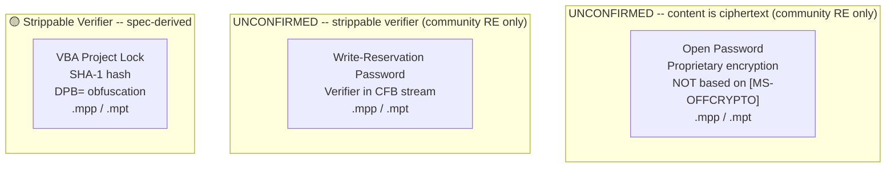
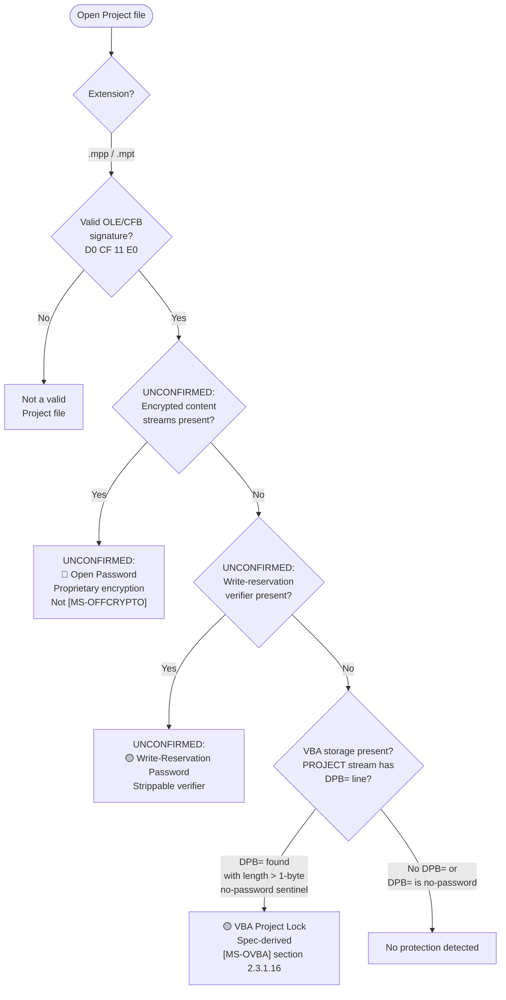
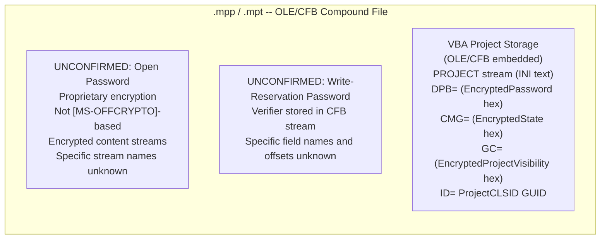

# Microsoft Project — .mpp / .mpt

Microsoft Project files use the `.mpp` extension for project plans and `.mpt` for project templates. Both are **OLE/CFB** compound files ([MS-CFB]), but unlike Word, Excel, and PowerPoint, the `.mpp` binary format has no published `[MS-*]` Open Specification — there is no `[MS-PROJ]`, `[MS-MPP]`, or equivalent document. Grep of the full `[MS-*]` corpus produces no results for `.mpp`, `.mpt`, or "Microsoft Project" in either [MS-OFFCRYPTO] or [MS-OVBA]. The [MS-OFFCRYPTO] applicability statement (section 1.5) limits its scope to OLE compound files conforming to the Office binary document format and OPC/ZIP packages conforming to ECMA-376; it makes no reference to Project files. Consequently, the only fully documented protection gate is the **VBA project lock**, because Project is a VBA host application and its embedded VBA storage conforms to [MS-OVBA].

This document separates its content into two tiers: **spec-derived** content (VBA project lock, sourced from [MS-OVBA]) and **out-of-corpus** content (open password, write-reservation password), where every claim in the second tier is marked UNCONFIRMED and sourced from community reverse-engineering (principally the MPXJ library).

> **Do not implement from these notes alone** — the .mpp format needs reverse-engineering or a community reference (e.g., MPXJ library) to validate. The only fully documented gate is the VBA project lock.

## File Extensions

| Extension | Container | Description | Password Protection Applicable? | Notes |
|---|---|---|---|---|
| .mpp | OLE/CFB | Project Plan | Yes — proprietary open + write passwords (OUT-OF-CORPUS), VBA project lock | Primary binary format; no published `[MS-*]` specification for the container format itself |
| .mpt | OLE/CFB | Project Template | Yes — same as .mpp | Uses the same OLE/CFB container and encryption as .mpp; stores default settings and formatting for new projects |
| .mpx | Text (CSV-like) | Project Exchange Format | No — plaintext, no encryption | Legacy interchange format for cross-product data exchange; superseded by XML export |
| .mpd | Jet/ODBC | Project Database | No — database-backed project, no file-level encryption | Stores project data in a Jet (Access) database via ODBC; no file-level encryption applies (database-level access controls are outside scope) |
| .xml | XML | Project XML | No — plaintext XML export, no encryption | XML serialization of project data; plain text with no encryption layer |

## Gate Strength Map



## Detection Flowchart

How to determine which protection scheme a Project file uses:



## Container Structure

Where each gate's data physically lives:



## Gate Quick Reference

| | Gate | Location | Algorithm | Spec |
|---|---|---|---|---|
| UNCONFIRMED | Open password | CFB content streams (proprietary) | Proprietary encryption; NOT based on [MS-OFFCRYPTO] | OUT-OF-CORPUS (no `[MS-*]` spec) |
| UNCONFIRMED | Write-reservation password | CFB stream (proprietary) | Unknown verifier type | OUT-OF-CORPUS (no `[MS-*]` spec) |
| 🟡 | VBA project lock | VBA storage -> `PROJECT` stream `DPB=` | [VBA password](../algorithms/password/vba-project-password.md) SHA-1 | [MS-OVBA] sections 2.3.1.15, 2.3.1.16, 2.4.3, 2.4.4 |

---

## Specification Detail

### Spec coverage boundary

Microsoft Project is unique among major Office applications in that its native file format (`.mpp` and `.mpt`) has no published `[MS-*]` Open Specification. [MS-OFFCRYPTO] (section 1.5) does not reference Project, `.mpp`, or `.mpt` in its applicability statement, encryption sections, or product behavior notes. [MS-OVBA] product behavior note <1> (section 1.5) does not explicitly list Microsoft Project among its host applications, though Project is a known VBA host. No `\EncryptionInfo` or `\EncryptedPackage` streams conforming to [MS-OFFCRYPTO] have been documented for `.mpp` files by any published specification.

The only spec-derived content below is the VBA project lock gate, which is fully specified by [MS-OVBA]. All other gates are marked UNCONFIRMED and sourced from community reverse-engineering.

### VBA Project Lock — full spec-derived detail ([MS-OVBA])

Project files containing VBA macros embed a VBA project storage conforming to [MS-OVBA]. The VBA project storage is an OLE/CFB compound file ([MS-CFB]) embedded within the Project file, rooted at a Project Root Storage ([MS-OVBA] section 2.2.1) that MUST contain a VBA Storage (named `VBA`, case-insensitive) and a PROJECT Stream (named `PROJECT`, case-insensitive).

The project protection mechanism uses three records in the PROJECT stream, all obfuscated by the same reversible Data Encryption algorithm ([MS-OVBA] section 2.4.3):

#### ProjectProtectionState (CMG= line)

[MS-OVBA] section 2.3.1.15

ABNF syntax:
```
ProjectProtectionState   = "CMG=" DQUOTE EncryptedState DQUOTE NWLN
EncryptedState           = 22*28HEXDIG
```

The Data parameter for Data Encryption ([MS-OVBA] section 2.4.3.2) SHOULD be four bytes that specify the protection state of the VBA project. The Length parameter MUST be 4.

The four bytes are a bitfield:

| Bit | Field | Meaning |
|---|---|---|
| 0 | `fUserProtected` | The user elected to protect the VBA project |
| 1 | `fHostProtected` | The VBA host application elected to protect the VBA project |
| 2 | `fVBEProtected` | The VBA project editor elected to protect the VBA project |
| 3-31 | Reserved | MUST be 0, MUST be ignored |

#### ProjectPassword (DPB= line)

[MS-OVBA] section 2.3.1.16

ABNF syntax:
```
ProjectPassword    = "DPB=" DQUOTE EncryptedPassword DQUOTE NWLN
EncryptedPassword  = 16*HEXDIG
```

The `EncryptedPassword` hex string is an Encrypted Data Structure ([MS-OVBA] section 2.4.3.1) that, when decrypted via the Data Decryption algorithm ([MS-OVBA] section 2.4.3.3), yields the password data. Three cases:

- **No password:** Data parameter is a single byte `0x00`, Length = 1. This is the no-password sentinel.
- **Password hash (SHOULD):** Data parameter is a 29-byte Password Hash Data Structure ([MS-OVBA] section 2.4.4.1), Length = 29. When this form is used, `ProjectId.ProjectCLSID` ([MS-OVBA] section 2.3.1.2) MUST be `{00000000-0000-0000-0000-000000000000}`.
- **Plaintext password (MAY, VBA 5.0 only):** Data parameter is a null-terminated MBCS password string encoded using the code page specified by PROJECTCODEPAGE ([MS-OVBA] section 2.3.4.2.1.5), Length = string length including the null terminator.

#### ProjectVisibilityState (GC= line)

[MS-OVBA] section 2.3.1.17

ABNF syntax:
```
ProjectVisibilityState      = "GC=" DQUOTE EncryptedProjectVisibility DQUOTE NWLN
EncryptedProjectVisibility  = 16*22HEXDIG
```

The Data parameter is a single byte specifying the visibility state. Length MUST be 1.

| Value | Meaning |
|---|---|
| `0x00` | VBA project is NOT visible. `ProjectProtectionState.fVBEProtected` MUST be TRUE. |
| `0xFF` | VBA project is visible. |

### Extraction Targets by Gate

#### 🟡 VBA Project Lock (spec-derived)

- **Location:** VBA project storage embedded in the `.mpp`/`.mpt` CFB container -> `PROJECT` stream (INI-style text file).
- **Gate active when:** `DPB=` line exists with a decoded Data length > 1 (the 1-byte `0x00` sentinel means no password).
- **Extract:**
  - `ID=` line -> `ProjectCLSID` GUID (needed to derive `ProjKey` for decryption of DPB=/CMG=/GC= values)
  - `DPB=` hex string -> decrypt with Data Decryption ([MS-OVBA] section 2.4.3.3) -> yields either:
    - 29-byte Password Hash Data Structure: extract `Key` (4 bytes), `PasswordHash` (20 bytes SHA-1), both with null bytes decoded via `GrbitKey`/`GrbitHashNull`
    - 1-byte `0x00`: no password
    - Null-terminated MBCS string: plaintext password (VBA 5.0 only, product behavior note <6>)
  - `CMG=` hex string -> decrypt -> 4-byte protection state bitfield (`fUserProtected`, `fHostProtected`, `fVBEProtected`)
  - `GC=` hex string -> decrypt -> 1-byte visibility state (`0x00` = hidden, `0xFF` = visible)

#### Open Password (UNCONFIRMED, community RE)

- **Location:** Unknown CFB streams within the `.mpp`/`.mpt` container
- **Gate active when:** Community RE suggests encrypted content streams are present; detection heuristic unknown
- **Extract:** Unknown field names and offsets; community RE (MPXJ) suggests this is a proprietary encryption scheme that does NOT follow [MS-OFFCRYPTO]
- **Note:** Unlike Word/Excel/PowerPoint, there is no evidence of `\EncryptionInfo` or `\EncryptedPackage` streams in `.mpp` files

#### Write-Reservation Password (UNCONFIRMED, community RE)

- **Location:** Unknown CFB stream within the `.mpp`/`.mpt` container
- **Gate active when:** Community RE suggests a write-reservation verifier field exists; detection heuristic unknown
- **Extract:** Unknown field names and offsets

### Detailed Notes

#### VBA project password — spec-derived behavioral notes

- The VBA project lock only prevents the VBA editor UI from displaying source code; the actual VBA source code in module streams is compressed ([MS-OVBA] section 2.4.1) but NOT encrypted. The module stream data can be decompressed and read without knowledge of the project password ([MS-OVBA] section 2.3.4.3).
- The Content Hash ([MS-OVBA] section 2.4.2) provides an integrity digest for the VBA project. `ProjectId`, `ProjectProtectionState`, `ProjectPassword`, and `ProjectVisibilityState` are explicitly excluded from the normalized data used to compute this hash ([MS-OVBA] section 2.4.2.6). This means the protection state can be altered without invalidating the content hash.
- When `ProjectVisibilityState` decrypts to `0x00` (project hidden), `ProjectProtectionState.fVBEProtected` MUST be TRUE ([MS-OVBA] section 2.3.1.17).

#### Security considerations ([MS-OVBA] section 4.2)

[MS-OVBA] section 4.2 states explicitly: "When data in a VBA project, such as a password, is encrypted, the information necessary to decrypt the data is stored with the encrypted data. The design of this encryption is to obfuscate sensitive information, not to secure it."

#### [MS-OFFCRYPTO] non-applicability

[MS-OFFCRYPTO] does not reference Microsoft Project in its applicability statement ([MS-OFFCRYPTO] section 1.5), encryption sections, or product behavior notes. Its scope is limited to OLE compound files conforming to the Office binary document format (Word, Excel, PowerPoint) and OPC/ZIP packages conforming to ECMA-376. Community reverse-engineering suggests that `.mpp` open-password encryption is proprietary and unrelated to the [MS-OFFCRYPTO] encryption schemes (XOR obfuscation, RC4, RC4 CryptoAPI, ECMA-376 standard/agile).

### Out-of-corpus: open password (UNCONFIRMED)

**All details in this section are UNCONFIRMED. There is no `[MS-*]` specification for the `.mpp` file format.**

Community reverse-engineering (principally the MPXJ library) indicates that Microsoft Project supports an open password that encrypts the project file content. Unlike Word, Excel, and PowerPoint, which route through [MS-OFFCRYPTO] for document-open encryption, the `.mpp` open password appears to use a proprietary encryption mechanism specific to the Project file format. No `\EncryptionInfo` or `\EncryptedPackage` streams have been documented for `.mpp` files. The specific encryption algorithm, key derivation, stream layout, and verifier structure are unknown from public specifications.

### Out-of-corpus: write-reservation password (UNCONFIRMED)

**All details in this section are UNCONFIRMED. There is no `[MS-*]` specification for the `.mpp` file format.**

Community reverse-engineering suggests that Microsoft Project supports a write-reservation password similar in concept to Word and Excel write-reservation, allowing read-only access without the password. The specific verifier type, storage location within the CFB container, and field layout are unknown from public specifications.
