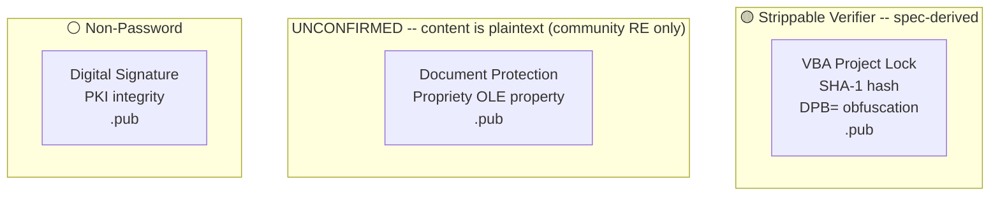
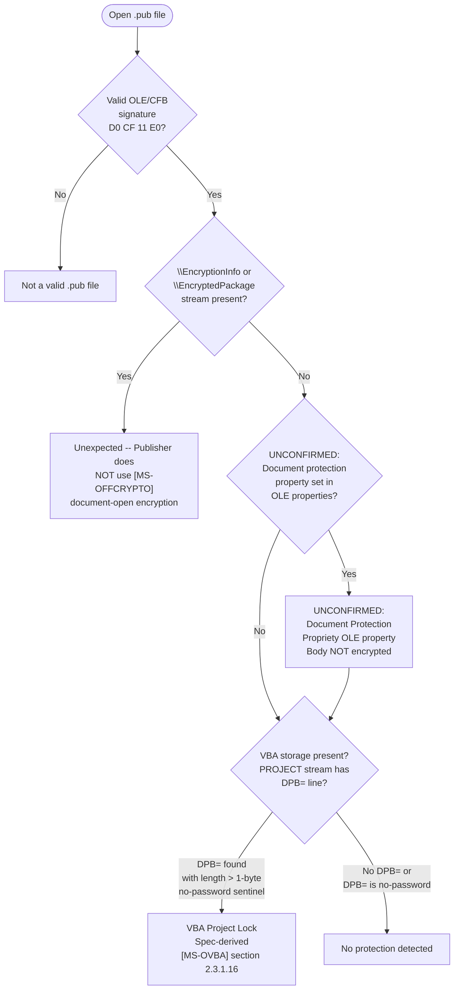
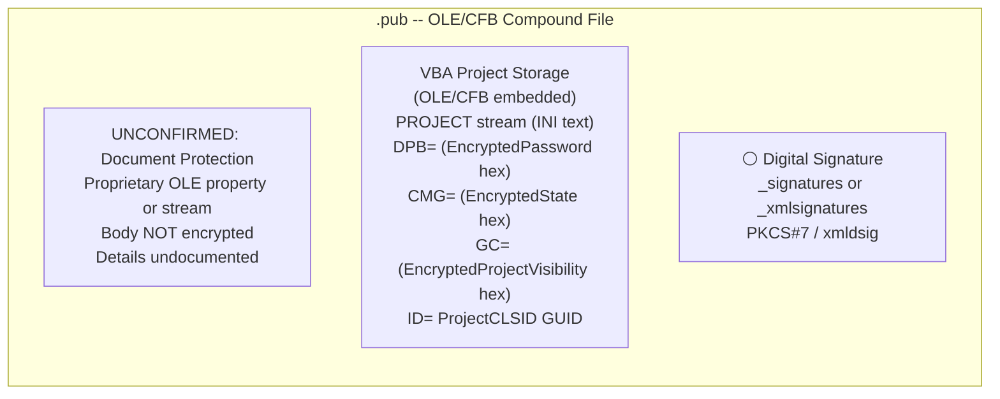

# Microsoft Publisher — .pub

Publisher uses a proprietary binary format stored in an **OLE/CFB** compound file. There is no published `[MS-PUB]` Open Specification and the `.pub` binary format is undocumented. `[MS-OFFCRYPTO]` makes no reference to Publisher in its applicability statement ([MS-OFFCRYPTO] section 1.5), encryption sections, or product behavior notes; Publisher does NOT support the full document-open encryption (XOR, RC4, ECMA-376 Standard/Agile) that Word, Excel, and PowerPoint use. The only fully spec-derived protection gate is the **VBA project lock**, because Publisher is a VBA host application and any embedded VBA project conforms to `[MS-OVBA]`.

## File Extensions

| Extension | Container | Description | Password Protection Applicable? | Notes |
|---|---|---|---|---|
| .pub | OLE/CFB | Publisher Publication | Minimal — VBA project lock only. No document-open encryption like Word/Excel/PPT. | OUT-OF-CORPUS for file-level protection. `[MS-OFFCRYPTO]` does not reference Publisher. The only spec-derived gate is VBA project lock ([MS-OVBA]). Document body is never encrypted. |

## Gate Strength Map



## Detection Flowchart

How to determine which protection scheme a Publisher file uses:



## Container Structure

Where each gate's data physically lives:



## Gate Quick Reference

| | Gate | Location | Algorithm | Spec |
|---|---|---|---|---|
| 🟡 | VBA project lock | VBA storage -> `PROJECT` stream `DPB=` | [VBA password](../algorithms/password/vba-project-password.md) SHA-1 | [MS-OVBA] sections 2.3.1.15, 2.3.1.16, 2.4.3, 2.4.4 |
| UNCONFIRMED | Document protection | Proprietary OLE property or stream | Undocumented; body NOT encrypted | OUT-OF-CORPUS (no `[MS-PUB]` spec) |
| ⚪ | Digital signature | `_signatures` / `_xmlsignatures` | PKI — MD5+RSA or xmldsig/XAdES | [MS-OFFCRYPTO] section 2.5 (general OLE signing) |

---

## Specification Detail

### Spec coverage boundary

Publisher is unique among Office applications in the degree to which its native file format lacks public documentation. There is no `[MS-PUB]` specification in the Open Specifications corpus. The `[MS-OFFCRYPTO]` applicability statement ([MS-OFFCRYPTO] section 1.5) scopes its coverage to OLE compound files carrying Office binary document streams (Word, Excel, PowerPoint) and OPC/ZIP packages (ECMA-376 documents); it makes no reference to Publisher, `.pub`, or the Publisher binary format. Publisher does not support the `FilePass`-style XOR/RC4 encryption used by Word and Excel, nor the ECMA-376 Standard/Agile encryption used by the OOXML formats. Its protection model is limited compared to Word, Excel, and PowerPoint.

The only spec-derived content below is the VBA project lock gate, which is fully specified by [MS-OVBA]. The document protection gate is marked UNCONFIRMED and sourced from observed application behavior, not from any published specification.

### VBA Project Lock — full spec-derived detail ([MS-OVBA])

Publisher is a VBA host application ([MS-OVBA] section 1.5). Any Publisher document containing macros embeds a VBA project storage conforming to [MS-OVBA]. The VBA project storage is an OLE/CFB compound file ([MS-CFB]) embedded within the `.pub` OLE container, rooted at a Project Root Storage ([MS-OVBA] section 2.2.1) that MUST contain a VBA Storage (named `VBA`, case-insensitive) and a PROJECT Stream (named `PROJECT`, case-insensitive).

The project protection mechanism uses three records in the PROJECT stream, all obfuscated by the same reversible Data Encryption algorithm ([MS-OVBA] section 2.4.3):

#### ProjectProtectionState (CMG= line)

[MS-OVBA] section 2.3.1.15

ABNF syntax:
```
ProjectProtectionState   = "CMG=" DQUOTE EncryptedState DQUOTE NWLN
EncryptedState           = 22*28HEXDIG
```

The Data parameter for Data Encryption ([MS-OVBA] section 2.4.3.2) SHOULD be four bytes that specify the protection state of the VBA project. The Length parameter MUST be 4.

The four bytes are a bitfield:

| Bit | Field | Meaning |
|---|---|---|
| 0 | `fUserProtected` | The user elected to protect the VBA project |
| 1 | `fHostProtected` | The VBA host application elected to protect the VBA project |
| 2 | `fVBEProtected` | The VBA project editor elected to protect the VBA project |
| 3-31 | Reserved | MUST be 0, MUST be ignored |

#### ProjectPassword (DPB= line)

[MS-OVBA] section 2.3.1.16

ABNF syntax:
```
ProjectPassword    = "DPB=" DQUOTE EncryptedPassword DQUOTE NWLN
EncryptedPassword  = 16*HEXDIG
```

The `EncryptedPassword` hex string is an Encrypted Data Structure ([MS-OVBA] section 2.4.3.1) that, when decrypted via the Data Decryption algorithm ([MS-OVBA] section 2.4.3.3), yields the password data. Three cases:

- **No password:** Data parameter is a single byte `0x00`, Length = 1. This is the no-password sentinel.
- **Password hash (SHOULD):** Data parameter is a 29-byte Password Hash Data Structure ([MS-OVBA] section 2.4.4.1), Length = 29. When this form is used, `ProjectId.ProjectCLSID` ([MS-OVBA] section 2.3.1.2) MUST be `{00000000-0000-0000-0000-000000000000}`.
- **Plaintext password (MAY, VBA 5.0 only):** Data parameter is a null-terminated MBCS password string encoded using the code page specified by PROJECTCODEPAGE ([MS-OVBA] section 2.3.4.2.1.5), Length = string length including the null terminator.

#### ProjectVisibilityState (GC= line)

[MS-OVBA] section 2.3.1.17

ABNF syntax:
```
ProjectVisibilityState      = "GC=" DQUOTE EncryptedProjectVisibility DQUOTE NWLN
EncryptedProjectVisibility  = 16*22HEXDIG
```

The Data parameter is a single byte specifying the visibility state. Length MUST be 1.

| Value | Meaning |
|---|---|
| `0x00` | VBA project is NOT visible. `ProjectProtectionState.fVBEProtected` MUST be TRUE. |
| `0xFF` | VBA project is visible. |

### Extraction Targets by Gate

#### 🟡 VBA Project Lock (spec-derived)

- **Location:** VBA project storage embedded in the `.pub` OLE/CFB container -> `PROJECT` stream (INI-style text file).
- **Gate active when:** `DPB=` line exists with a decoded Data length > 1 (the 1-byte `0x00` sentinel means no password).
- **Extract:**
  - `ID=` line -> `ProjectCLSID` GUID (needed to derive `ProjKey` for decryption of DPB=/CMG=/GC= values)
  - `DPB=` hex string -> decrypt with Data Decryption ([MS-OVBA] section 2.4.3.3) -> yields either:
    - 29-byte Password Hash Data Structure: extract `Key` (4 bytes), `PasswordHash` (20 bytes SHA-1), both with null bytes decoded via `GrbitKey`/`GrbitHashNull`
    - 1-byte `0x00`: no password
    - Null-terminated MBCS string: plaintext password (VBA 5.0 only, product behavior note <6>)
  - `CMG=` hex string -> decrypt -> 4-byte protection state bitfield (`fUserProtected`, `fHostProtected`, `fVBEProtected`)
  - `GC=` hex string -> decrypt -> 1-byte visibility state (`0x00` = hidden, `0xFF` = visible)

#### ⚪ Document Protection (UNCONFIRMED)

- **Location:** Proprietary OLE property or stream within the `.pub` compound file
- **Gate active when:** UNCONFIRMED — the mechanism for detecting this protection state is undocumented
- **Note:** Publisher's document-level protection is minimal. It does NOT encrypt the document body. The `.pub` binary content remains readable regardless of any document protection state. There is no `[MS-PUB]` specification documenting the protection mechanism, and `[MS-OFFCRYPTO]` does not cover Publisher.

### Detailed Notes

#### VBA project password — spec-derived behavioral notes

- The VBA project lock only prevents the VBA editor UI from displaying source code; the actual VBA source code in module streams is compressed ([MS-OVBA] section 2.4.1) but NOT encrypted. The module stream data can be decompressed and read without knowledge of the project password ([MS-OVBA] section 2.3.4.3).
- The Content Hash ([MS-OVBA] section 2.4.2) provides an integrity digest for the VBA project. `ProjectId`, `ProjectProtectionState`, `ProjectPassword`, and `ProjectVisibilityState` are explicitly excluded from the normalized data used to compute this hash ([MS-OVBA] section 2.4.2.6). This means the protection state can be altered without invalidating the content hash.
- When `ProjectVisibilityState` decrypts to `0x00` (project hidden), `ProjectProtectionState.fVBEProtected` MUST be TRUE ([MS-OVBA] section 2.3.1.17).

#### Security considerations ([MS-OVBA] section 4.2)

[MS-OVBA] section 4.2 states explicitly: "When data in a VBA project, such as a password, is encrypted, the information necessary to decrypt the data is stored with the encrypted data. The design of this encryption is to obfuscate sensitive information, not to secure it." The encrypted items are: project password (DPB=), project protection state (CMG=), and project visibility state (GC=).

#### [MS-OFFCRYPTO] applicability

[MS-OFFCRYPTO] does not reference Publisher in its applicability statement ([MS-OFFCRYPTO] section 1.5), encryption sections, or product behavior notes. Its scope is limited to OLE compound files containing Office binary document streams (Word, Excel, PowerPoint) and OPC/ZIP packages (ECMA-376 documents). Publisher's `.pub` format, while OLE/CFB-based, is not covered.

#### No document-open encryption

Publisher does NOT support the document-open encryption mechanisms documented in [MS-OFFCRYPTO]. There is no XOR obfuscation, no RC4 encryption, no ECMA-376 Standard or Agile encryption for `.pub` files. A `.pub` file with no VBA macros has no spec-documented password protection gates at all. Publisher's protection model is the most limited of any major Office application.

### Out-of-corpus: document protection (UNCONFIRMED)

**All details in this section are UNCONFIRMED. There is no `[MS-PUB]` specification.**

Publisher exposes limited document protection through its UI (e.g., restricting formatting changes), but the mechanism is proprietary and stored within the undocumented `.pub` binary streams. Unlike Word's `documentProtection` element or Excel's `sheetProtection`/`workbookProtection` records, Publisher's document-level protection has no known spec reference, no documented hash algorithm, and no documented password verifier structure. The document body is NOT encrypted under any known Publisher protection mode.
