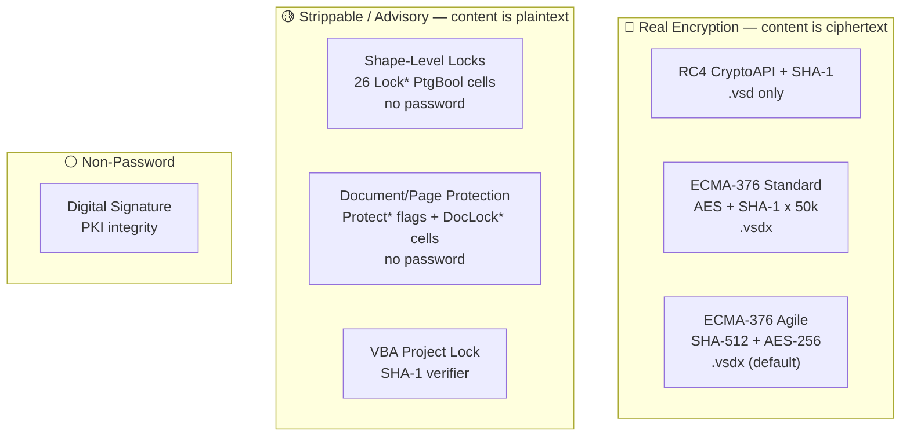
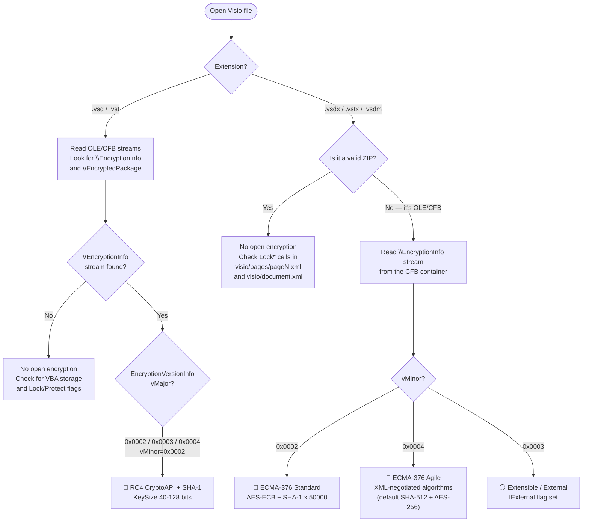
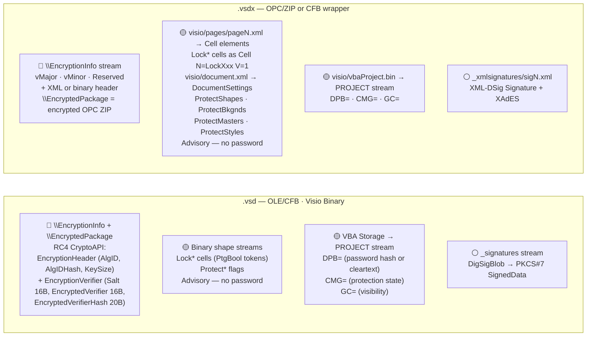

# Microsoft Visio — .vsd / .vsdx / .vstx / .vsdm

Visio spans two container families keyed by extension. `.vsd` (and `.vst`) is the legacy **OLE/CFB** compound file carrying Visio-specific binary streams. `.vsdx`/`.vstx`/`.vsdm` are **OPC/ZIP** packages (OOXML) containing XML parts such as `visio/document.xml` and `visio/pages/pageN.xml`, as specified by [MS-VSDX]. One wrinkle shared with the rest of the Office OOXML family: a `.vsdx` file with a document-open password is not a ZIP on disk — the entire OPC package is re-wrapped in an **OLE/CFB** container holding `\EncryptionInfo` + `\EncryptedPackage` streams ([MS-OFFCRYPTO] §2.3.4), preserving the outer extension.

Visio defines no application-specific cryptographic protection. The open/encrypt gate uses the exact same [MS-OFFCRYPTO] algorithms as Word, Excel, and PowerPoint. The Lock* cells and Protect* elements are purely advisory UI flags — PtgBool tokens evaluated at formula time — with no password verification and no cryptographic backing. The [MS-VSDX] §4 Security section is empty ("None" for both implementer considerations and security field index).

## File Extensions

| Extension | Container | Description | Password Protection Applicable? | Notes |
|---|---|---|---|---|
| .vsd | OLE/CFB | Visio Drawing (legacy binary) | Yes — RC4-CryptoAPI open, VBA project lock | Primary legacy format; all content encrypted or all plaintext (no partial encryption) |
| .vss | OLE/CFB | Visio Stencil (legacy) | Same as .vsd | Contains reusable shapes/masters; same OLE/CFB container and encryption as .vsd |
| .vst | OLE/CFB | Visio Template (legacy) | Same as .vsd | Template variant; same OLE/CFB container and encryption as .vsd |
| .vsw | OLE/CFB | Visio Workspace (legacy) | Same as .vsd | Workspace layout file; same OLE/CFB container and encryption as .vsd |
| .vdx | XML | Visio XML Drawing (2003-2010) | Plaintext XML — no encryption (deprecated in Visio 2013) | Flat XML format; no container encryption possible |
| .vsx | XML | Visio XML Stencil (2003-2010) | Plaintext XML — no encryption (deprecated) | Flat XML stencil; no container encryption possible |
| .vtx | XML | Visio XML Template (2003-2010) | Plaintext XML — no encryption (deprecated) | Flat XML template; no container encryption possible |
| .vsdx | OPC/ZIP (or OLE/CFB when encrypted) | Visio Drawing | Yes — Standard/Agile open, Lock* shape cells (UI-level) | Default format since Visio 2013; when encrypted the OPC/ZIP is re-wrapped in OLE/CFB |
| .vsdm | OPC/ZIP (or OLE/CFB when encrypted) | Visio Macro-Enabled Drawing | Same as .vsdx + VBA project lock | Contains visio/vbaProject.bin for macro storage |
| .vssx | OPC/ZIP | Visio Stencil | Same as .vsdx | Uses the same OPC/ZIP container and encryption as .vsdx |
| .vssm | OPC/ZIP | Visio Macro-Enabled Stencil | Same as .vsdx + VBA project lock | Macro-enabled variant of .vssx |
| .vstx | OPC/ZIP | Visio Template | Same as .vsdx | Uses the same OPC/ZIP container and encryption as .vsdx |
| .vstm | OPC/ZIP | Visio Macro-Enabled Template | Same as .vsdx + VBA project lock | Macro-enabled variant of .vstx |

## Gate Strength Map



## Detection Flowchart

How to determine which encryption scheme a Visio file uses:



## Container Structure

Where each gate's data physically lives:



## Gate Quick Reference

### .vsd — legacy binary (OLE/CFB)

| | Gate | Location | Algorithm | Spec |
|---|---|---|---|---|
| 🔴 | Open / encrypt | `\EncryptionInfo` + `\EncryptedPackage` in root storage | [RC4-CryptoAPI-SHA1](../algorithms/password/rc4-cryptoapi-sha1.md) | [MS-OFFCRYPTO] §2.3.5 |
| 🟡 | Shape locks (26 cells) | Binary shape streams, Lock* PtgBool cells | Advisory UI flag, no password | [MS-VSDX] §2.4.4.189–214 |
| 🟡 | Document protection | Binary document streams, Protect* flags | Advisory UI flag, no password | [MS-VSDX] §2.3.4.2.41, §2.3.4.2.71–74 |
| 🟡 | Page/doc lock cells | DocLockDuplicatePage, DocLockReplace, PageLockDuplicate, PageLockReplace | Advisory UI flag (PtgBool), no password | [MS-VSDX] §2.4.4.89–90, §2.4.4.243–244 |
| 🟡 | VBA project lock | VBA storage → `PROJECT` stream `DPB=` | [VBA password](../algorithms/password/vba-project-password.md) SHA-1 | [MS-OVBA] §2.3.1.16, §2.4.4 |
| ⚪ | Digital signature | `_signatures` / `_xmlsignatures` | PKI — MD5+RSA or xmldsig/XAdES | [MS-OFFCRYPTO] §2.5 |

### .vsdx / .vstx / .vsdm — OOXML

| | Gate | Element / Location | Algorithm | Spec |
|---|---|---|---|---|
| 🔴 | Open — Standard | `\EncryptionInfo` vMinor=0x0002 | [ECMA-376 Standard](../algorithms/password/ecma376-standard.md) AES-ECB | [MS-OFFCRYPTO] §2.3.4.5–9 |
| 🔴 | Open — Agile | `\EncryptionInfo` vMinor=0x0004 | [ECMA-376 Agile](../algorithms/password/ecma376-agile.md) AES-CBC | [MS-OFFCRYPTO] §2.3.4.10–15 |
| 🟡 | Shape locks (26 cells) | `visio/pages/pageN.xml`, Cell elements with N=Lock* | Advisory UI flag (PtgBool), no password | [MS-VSDX] §2.4.4.189–214 |
| 🟡 | Document protection | `visio/document.xml` → `<DocumentSettings>` → `<ProtectShapes>` etc. | Advisory UI flag (xsd:boolean), no password | [MS-VSDX] §2.3.4.2.41, §2.3.4.2.71–74 |
| 🟡 | Page/doc lock cells | Cell elements in DocumentSheet / PageSheet | Advisory UI flag (PtgBool), no password | [MS-VSDX] §2.4.4.89–90, §2.4.4.243–244 |
| 🟡 | Replace lock cells | ReplaceLockFormat, ReplaceLockShapeData, ReplaceLockText | Advisory UI flag (PtgByte), no password | [MS-VSDX] §2.4.4.286–288 |
| 🟡 | VBA project lock | `visio/vbaProject.bin` → `PROJECT` stream | [VBA password](../algorithms/password/vba-project-password.md) SHA-1 | [MS-OVBA] §2.3.1.16, §2.4.4 |
| ⚪ | Digital signature | `_xmlsignatures/` | xmldsig/XAdES PKI | [MS-OFFCRYPTO] §2.5.2–3 |

---

## Specification Detail

### Open / Encrypt — .vsd (OLE/CFB, RC4 CryptoAPI)

Visio `.vsd` files use [MS-OFFCRYPTO] RC4 CryptoAPI encryption, the same mechanism used by `.doc`, `.xls`, and `.ppt` when saved with a document-open password. The encrypted file is an OLE/CFB compound file with `\EncryptionInfo` and `\EncryptedPackage` streams in the root storage.

| Gate | Location in file | Algorithm / mechanism | Spec reference |
|---|---|---|---|
| 🔴 Open / encrypt — RC4 CryptoAPI + SHA-1 | `\EncryptionInfo` stream in root storage: EncryptionVersionInfo (vMajor in {0x0002, 0x0003, 0x0004}, vMinor=0x0002), EncryptionHeader (fCryptoAPI=1, AlgID=0x6801 for RC4, AlgIDHash=0x8004 for SHA-1, KeySize 40–128 bits), EncryptionVerifier (SaltSize=0x10, Salt 16B, EncryptedVerifier 16B, VerifierHashSize, EncryptedVerifierHash 20B). `\EncryptedPackage` holds the encrypted Visio binary content. | RC4 CryptoAPI: key derivation is H0 = SHA-1(salt + password), Hfinal = SHA-1(H0 + blockNumber), no iteration ([MS-OFFCRYPTO] §2.3.5.2). Verification via SHA-1 of decrypted verifier. See [rc4-cryptoapi-sha1](../algorithms/password/rc4-cryptoapi-sha1.md). | [MS-OFFCRYPTO] §2.3.5 |

### Open / Encrypt — .vsdx/.vstx/.vsdm (OOXML)

OOXML Visio files use the same ECMA-376 encryption as `.docx`, `.xlsx`, and `.pptx`. When a document-open password is set, the entire OPC ZIP is encrypted and re-wrapped in an OLE/CFB container. The file on disk has the original extension (`.vsdx`, `.vstx`, `.vsdm`) but begins with the OLE/CFB magic (`D0 CF 11 E0`) instead of the ZIP magic (`PK\x03\x04`).

| Gate | Location in file | Algorithm / mechanism | Spec reference |
|---|---|---|---|
| 🔴 Open / encrypt — ECMA-376 standard | OLE/CFB wrapper: `\EncryptionInfo` stream (vMajor in {0x0002,0x0003,0x0004}, vMinor=0x0002), `\EncryptedPackage` stream. EncryptionHeader: fCryptoAPI=1, fAES=1, AlgID in {0x660E, 0x660F, 0x6610} (AES-128/192/256), AlgIDHash=0x8004 (SHA-1). | Key derivation: H0 = SHA-1(salt + password), iterated 50,000 times Hn = SHA-1(iterator + Hn-1), then Hfinal = SHA-1(Hn + blockKey), followed by X1/X2 derivation to cbRequiredKeyLength bits ([MS-OFFCRYPTO] §2.3.4.7). Encryption uses AES-ECB. See [ecma376-standard](../algorithms/password/ecma376-standard.md). | [MS-OFFCRYPTO] §2.3.4.5–9 |
| 🔴 Open / encrypt — ECMA-376 agile | OLE/CFB wrapper: `\EncryptionInfo` stream (vMajor=0x0004, vMinor=0x0004, Reserved=0x00000040), followed by XML descriptor. `\EncryptedPackage` encrypted in 4096-byte segments. XML descriptor carries `<keyData>` (cipherAlgorithm, hashAlgorithm, keyBits, saltValue, blockSize), `<dataIntegrity>` (HMAC), and `<keyEncryptors>` with `<p:encryptedKey>` elements (spinCount, saltValue, encryptedVerifierHashInput, encryptedVerifierHashValue, encryptedKeyValue). | Key derivation: H0 = H(salt + password), iterated spinCount times ([MS-OFFCRYPTO] §2.3.4.11). Cipher and hash algorithms negotiated in XML (typically AES-256-CBC + SHA-512 for modern files). DataIntegrity HMAC validates the entire EncryptedPackage. See [ecma376-agile](../algorithms/password/ecma376-agile.md). | [MS-OFFCRYPTO] §2.3.4.10–15 |

### Shape-Level Lock Cells — All Formats

Visio defines 26 Lock* cells that restrict UI operations on individual shapes. Every Lock* cell is a **PtgBool parse token** — a Boolean flag evaluated during formula evaluation only ([MS-VSDX] §2.4.4.189–214). These cells carry no password, no hash, no verifier. They are purely advisory: a value of 1 signals the Visio UI to prevent the corresponding operation; a value of 0 (or missing) allows it. Any editor that modifies the XML or binary stream directly can flip or remove these flags without authentication.

Each Lock* cell MUST have a `ShapeSheet_Type` or `StyleSheet_Type` parent element.

| Cell | Section | What it locks |
|---|---|---|
| LockAspect | §2.4.4.189 | Aspect ratio during resize |
| LockBegin | §2.4.4.190 | Begin point of 1-D shape |
| LockCalcWH | §2.4.4.191 | Width/height recalculation from formula |
| LockCrop | §2.4.4.192 | Cropping of foreign (image) shapes |
| LockCustProp | §2.4.4.193 | Custom property editing |
| LockDelete | §2.4.4.194 | Deletion of the shape |
| LockEnd | §2.4.4.195 | End point of 1-D shape |
| LockFormat | §2.4.4.196 | Formatting changes (fill, line, text format) |
| LockFromGroupFormat | §2.4.4.197 | Inheriting format from parent group |
| LockGroup | §2.4.4.198 | Grouping/ungrouping |
| LockHeight | §2.4.4.199 | Height changes |
| LockMoveX | §2.4.4.200 | Horizontal movement |
| LockMoveY | §2.4.4.201 | Vertical movement |
| LockPreview | §2.4.4.202 | Preview generation (ShapeSheet or DocumentSheet parent) |
| LockReplace | §2.4.4.203 | Shape replacement |
| LockRotate | §2.4.4.204 | Rotation |
| LockSelect | §2.4.4.205 | Selection (effective only when ProtectShapes=1) |
| LockTextEdit | §2.4.4.206 | Text editing |
| LockThemeColors | §2.4.4.207 | Theme color application |
| LockThemeConnectors | §2.4.4.208 | Theme connector style application |
| LockThemeEffects | §2.4.4.209 | Theme effect application |
| LockThemeFonts | §2.4.4.210 | Theme font application |
| LockThemeIndex | §2.4.4.211 | Theme index changes |
| LockVariation | §2.4.4.212 | Theme variation changes |
| LockVtxEdit | §2.4.4.213 | Vertex editing in geometry |
| LockWidth | §2.4.4.214 | Width changes |

**LockSelect** is special: it is the only Lock* cell whose effect depends on the document-level `ProtectShapes` element. Per [MS-VSDX] §2.4.4.205: "If the ProtectShapes_Type element in the web drawing has a value equal to zero, it is used during formula evaluation only." In other words, `LockSelect=1` only prevents shape selection when `ProtectShapes=1` at the document level.

The **Lock** cell ([MS-VSDX] §2.4.4.188) is separate from the shape Lock* cells: it is a PtgBool on a `Row_Type` within a `Layer Section_Type` that controls whether shapes on that layer are selectable. A value of 1 means shapes on the layer cannot be selected.

### Document/Page Protection Flags

Visio defines four document-level protection elements within `DocumentSettings_Type` ([MS-VSDX] §2.3.4.2.41). Three of the four are explicitly marked as unused:

| Element | Type | Spec | Behavior |
|---|---|---|---|
| ProtectShapes | ProtectShapes_Type (xsd:boolean) | [MS-VSDX] §2.3.4.2.73 | Active: controls whether shapes with LockSelect=1 are non-selectable |
| ProtectBkgnds | ProtectBkgnds_Type (xsd:boolean) | [MS-VSDX] §2.3.4.2.71 | "unused and MUST be ignored" |
| ProtectMasters | ProtectMasters_Type (xsd:boolean) | [MS-VSDX] §2.3.4.2.72 | "unused and MUST be ignored" |
| ProtectStyles | ProtectStyles_Type (xsd:boolean) | [MS-VSDX] §2.3.4.2.74 | "unused and MUST be ignored" |

All four are children of the `<DocumentSettings>` element in `visio/document.xml` (OOXML) or the corresponding binary structure (.vsd). None carry a password or hash verifier — they are simple Boolean flags. `ProtectShapes` is the only one with a defined functional effect: it gates the `LockSelect` cell behavior per §2.4.4.205.

Additional PtgBool cells at the document and page level control duplication and replacement:

| Cell | Parent | Spec | What it controls |
|---|---|---|---|
| DocLockDuplicatePage | DocumentSheet_Type | [MS-VSDX] §2.4.4.89 | Page duplication at document level |
| DocLockReplace | DocumentSheet_Type | [MS-VSDX] §2.4.4.90 | Shape replacement at document level |
| PageLockDuplicate | PageSheet_Type | [MS-VSDX] §2.4.4.243 | Page duplication for a specific page |
| PageLockReplace | PageSheet_Type | [MS-VSDX] §2.4.4.244 | Shape replacement for a specific page |
| ReplaceLockFormat | ShapeSheet_Type / StyleSheet_Type (ID=0) | [MS-VSDX] §2.4.4.286 | Format preservation during replacement (PtgByte) |
| ReplaceLockShapeData | ShapeSheet_Type / StyleSheet_Type (ID=0) | [MS-VSDX] §2.4.4.287 | Shape data preservation during replacement (PtgByte) |
| ReplaceLockText | ShapeSheet_Type / StyleSheet_Type (ID=0) | [MS-VSDX] §2.4.4.288 | Text preservation during replacement (PtgByte) |

All are advisory. All are "used during formula evaluation only." None have password or cryptographic backing.

### VBA Project Lock (.vsdm and macro-enabled .vsd)

Visio supports VBA macros in `.vsdm` (macro-enabled OOXML) and `.vsd` (legacy binary) files. The VBA project lock mechanism is identical to all other Office applications — the protection data lives in the `PROJECT` stream of the embedded VBA storage.

| Gate | Location in file | Algorithm / mechanism | Spec reference |
|---|---|---|---|
| 🟡 VBA project lock | VBA storage → `PROJECT` stream (INI-style text). In `.vsdm`: `visio/vbaProject.bin` (an embedded OLE/CFB binary part) → `PROJECT` stream. `ProjectProtectionState` (CMG= line, [MS-OVBA] §2.3.1.15) controls whether the project is "locked for viewing". `ProjectPassword` (DPB= line, [MS-OVBA] §2.3.1.16) stores either a password hash (29-byte Hash Data Structure) or a plaintext password, obfuscated by the Data Encryption algorithm ([MS-OVBA] §2.4.3). `ProjectVisibilityState` (GC= line, [MS-OVBA] §2.3.1.17) controls visibility. | DPB obfuscation ([MS-OVBA] §2.4.3): three seed bytes + XOR-based encryption. The actual password hash uses SHA-1 via the Hash Data Structure ([MS-OVBA] §2.4.4). When password hash form is used, `ProjectId.ProjectCLSID` MUST be `{00000000-0000-0000-0000-000000000000}`. See [vba-project-password](../algorithms/password/vba-project-password.md). | [MS-OVBA] §2.3.1.15–17, §2.4.3–4 |

### Digital Signature

Visio supports OOXML digital signatures for `.vsdx`/`.vstx`/`.vsdm` and CryptoAPI/xmldsig signatures for `.vsd`.

| Gate | Location in file | Algorithm / mechanism | Spec reference |
|---|---|---|---|
| ⚪ Digital signature — .vsd | `_signatures` stream (CryptoAPI format, MD5 hash) or `_xmlsignatures` storage (xmldsig/XAdES format) | CryptoAPI: MD5 hash + RSA signing ([MS-OFFCRYPTO] §2.5.1.5). Xmldsig: XML-Signature + optional XAdES extensions. | [MS-OFFCRYPTO] §2.5.1–3 |
| ⚪ Digital signature — .vsdx | `_xmlsignatures/sigN.xml` parts within the OPC package | XML-Signature Syntax and Processing [XMLDSig]; Manifest covers all package parts except `_xmlsignatures`, `\0x06DataSpaces`, etc. Optional XAdES-EPES through XAdES-X-L extensions. | [MS-OFFCRYPTO] §2.5.2–3 |

### Extraction Targets by Gate

What code needs to extract for each gate — field names, types, locations, and "gate is active" indicators.

#### 🔴 Open / Encrypt — .vsd binary (RC4 CryptoAPI)

- **Location:** `\EncryptionInfo` + `\EncryptedPackage` streams in the root OLE/CFB storage
- **Gate active when:** `\EncryptionInfo` stream exists
- **Extract:**
  - Bytes 0–3: `vMajor` (u16 LE), `vMinor` (u16 LE)
  - vMajor in {0x0002, 0x0003, 0x0004}, vMinor=0x0002 → RC4 CryptoAPI
  - Parse `EncryptionHeader`: `AlgID` (u32 LE, expect 0x6801=RC4), `AlgIDHash` (u32 LE, expect 0x8004=SHA-1), `KeySize` (u32 LE, 40–128 bits)
  - Parse `EncryptionVerifier`: `SaltSize` (u32 LE), `Salt` (16B), `EncryptedVerifier` (16B), `VerifierHashSize` (u32 LE), `EncryptedVerifierHash` (20B)

#### 🔴 Open / Encrypt — .vsdx/.vstx/.vsdm OOXML

- **Location:** `\EncryptionInfo` stream in the OLE/CFB wrapper (file is NOT a ZIP when encrypted)
- **Gate active when:** file fails ZIP magic check (not `PK\x03\x04`) and has OLE/CFB signature (`D0 CF 11 E0`)
- **Extract:**
  - Bytes 0–7: `vMajor` (u16 LE), `vMinor` (u16 LE), `Reserved` (u32 LE)
  - **If vMinor=0x0002 (Standard):** parse `EncryptionHeader` + `EncryptionVerifier` per [MS-OFFCRYPTO] §2.3.4.5
  - **If vMinor=0x0004 (Agile):** parse UTF-8 XML from byte 8 onward → extract from `<p:encryptedKey>`: `spinCount`, `saltSize`, `blockSize`, `keyBits`, `hashSize`, `cipherAlgorithm`, `cipherChaining`, `hashAlgorithm`, `saltValue` (base64), `encryptedVerifierHashInput` (base64), `encryptedVerifierHashValue` (base64), `encryptedKeyValue` (base64)

#### 🟡 Shape-Level Locks

- **Location (OOXML):** `visio/pages/pageN.xml`, `<Cell>` elements within `<Shape>` elements where the `N` attribute is a Lock* cell name (e.g., `N="LockDelete"`)
- **Location (binary):** Shape streams within the OLE/CFB structure, Lock* cells as PtgBool tokens
- **Gate active when:** a Lock* cell has value `V="1"` (or binary PtgBool TRUE); for `LockSelect` to be effective, `ProtectShapes` must also be 1
- **Extract:** cell name (the `N` attribute), cell value (the `V` attribute, boolean 0/1)
- **No password or hash to extract** — pure advisory flag

#### 🟡 Document/Page Protection Flags

- **Location (OOXML):** `visio/document.xml` → `<DocumentSettings>` → `<ProtectShapes>`, `<ProtectBkgnds>`, `<ProtectMasters>`, `<ProtectStyles>`; Cell elements in DocumentSheet_Type for DocLockDuplicatePage, DocLockReplace; Cell elements in PageSheet_Type for PageLockDuplicate, PageLockReplace
- **Location (binary):** Corresponding structures in the binary document stream
- **Gate active when:** element/cell value is `true` or `1`
- **Extract:** element value (xsd:boolean for Protect* elements, PtgBool for Lock cells)
- **Note:** ProtectBkgnds, ProtectMasters, and ProtectStyles are all "unused and MUST be ignored" per [MS-VSDX] §2.3.4.2.71–74. Only ProtectShapes has a defined functional effect.
- **No password or hash to extract** — pure advisory flag

#### 🟡 VBA Project Lock

- **Location (binary):** VBA storage → `PROJECT` stream (INI-style text)
- **Location (OOXML):** `visio/vbaProject.bin` (embedded OLE/CFB) → `PROJECT` stream
- **Gate active when:** `DPB=` line exists with length > the no-password sentinel
- **Extract:** `ID=` line (CLSID GUID for ProjKey derivation); `DPB=` hex string (decode with §2.4.3); `CMG=` hex string (protection state); `GC=` hex string (visibility)

#### ⚪ Digital Signature

- **Location (binary):** `_signatures` stream or `_xmlsignatures` storage
- **Location (OOXML):** `_xmlsignatures/sigN.xml` parts
- **Gate active when:** the stream/storage/part exists
- **Extract:** PKCS#7 SignedData blob (binary) or XML-DSig `<Signature>` elements (OOXML)

### Key Differences from Other Office Formats

Visio's protection model is dramatically simpler than Word, Excel, or PowerPoint:

1. **No application-specific crypto.** The [MS-VSDX] spec defines zero cryptographic structures. All encryption is delegated to [MS-OFFCRYPTO], and VBA protection to [MS-OVBA]. The [MS-VSDX] §4 Security section is literally empty.

2. **No strippable password-based protection.** Unlike Excel (which has sheet/workbook/write-reservation passwords with 16-bit or ISO hash verifiers) or Word (which has document protection with password hashing), Visio has no intermediate password-based gates. The Lock* cells and Protect* flags are pure Boolean flags with no password verification whatsoever.

3. **No write reservation.** Visio has no equivalent of Excel's `<fileSharing>` or Word's write-reservation password.

4. **Three of four Protect* flags are dead.** The spec mandates that `ProtectBkgnds`, `ProtectMasters`, and `ProtectStyles` MUST be ignored ([MS-VSDX] §2.3.4.2.71, §2.3.4.2.72, §2.3.4.2.74). Only `ProtectShapes` has a functional effect, and even that is a passwordless Boolean.

5. **Binary gate is all-or-nothing.** A `.vsd` file is either fully encrypted (RC4 CryptoAPI) or fully readable. There is no partial encryption or per-stream encryption.

### OOXML Protection Elements — XML Examples

The Lock* cells in `.vsdx` files are stored as `<Cell>` elements within the `<Shape>` element's ShapeSheet. The `N` attribute identifies the cell, and the `V` attribute holds the Boolean value:

```xml
<Shape ID="1" NameU="Rectangle" Name="Rectangle" Type="Shape">
  <Cell N="LockDelete" V="1"/>
  <Cell N="LockTextEdit" V="1"/>
  <Cell N="LockFormat" V="1"/>
  <Cell N="LockMoveX" V="0"/>
  <Cell N="LockMoveY" V="0"/>
  <Cell N="LockRotate" V="1"/>
  <Cell N="LockAspect" V="1"/>
  <Cell N="LockGroup" V="0"/>
  <Cell N="LockSelect" V="1"/>
  <Cell N="LockWidth" V="0"/>
  <Cell N="LockHeight" V="0"/>
</Shape>
```

Document-level protection in the `<DocumentSettings>` element:

```xml
<DocumentSettings>
  <ProtectShapes>1</ProtectShapes>
  <ProtectBkgnds>0</ProtectBkgnds>
  <ProtectMasters>0</ProtectMasters>
  <ProtectStyles>0</ProtectStyles>
</DocumentSettings>
```

Page-level and document-level lock cells appear as Cell elements within `PageSheet_Type` or `DocumentSheet_Type`:

```xml
<!-- Document-level -->
<DocumentSheet>
  <Cell N="DocLockDuplicatePage" V="1"/>
  <Cell N="DocLockReplace" V="1"/>
</DocumentSheet>

<!-- Page-level -->
<PageSheet>
  <Cell N="PageLockDuplicate" V="1"/>
  <Cell N="PageLockReplace" V="1"/>
</PageSheet>
```

### Security Considerations from the Specs

- **RC4 CryptoAPI encryption** (.vsd) — [MS-OFFCRYPTO] §4.1.3.2: "considered insecure, and therefore is not recommended when storing sensitive materials." No iteration, no initial RC4 discard, no corruption detection, small key lengths possible (40-bit minimum), key-stream reuse potential.
- **ECMA-376 standard encryption** (.vsdx) — [MS-OFFCRYPTO] §4.1.3.1: "does not support CBC and does not have a provision for detecting corruption." AES-ECB mode.
- **ECMA-376 agile encryption** (.vsdx) — [MS-OFFCRYPTO] §4.1.3.1: "required to use CBC and corruption detection, and are not subject to the issues noted for standard encryption." SHA-2 recommended; MD2/MD4/MD5/DES not recommended. Passwords limited to 255 Unicode code points.
- **Shape/document protection** — Not addressed in any security consideration section. [MS-VSDX] §4 Security is "None" for both implementer considerations and security field index. These are purely UI conveniences with no security value.

### VBA Project Password

[MS-OVBA] §2.3.1.16 specifies that a VBA project without a password MUST use 0x00 for the Data parameter with Length = 1 in the DPB encryption. A project with a password SHOULD specify a password hash (29-byte Hash Data Structure per [MS-OVBA] §2.4.4.1) or MAY specify the plaintext password, both obfuscated by the Data Encryption algorithm ([MS-OVBA] §2.4.3). When the password hash form is used, `ProjectId.ProjectCLSID` MUST be `{00000000-0000-0000-0000-000000000000}` ([MS-OVBA] §2.3.1.16). The `ProjectVisibilityState` (GC= line, [MS-OVBA] §2.3.1.17) independently controls whether the project is visible (0xFF) or hidden (0x00); when hidden, `ProjectProtectionState.fVBEProtected` MUST be TRUE.
