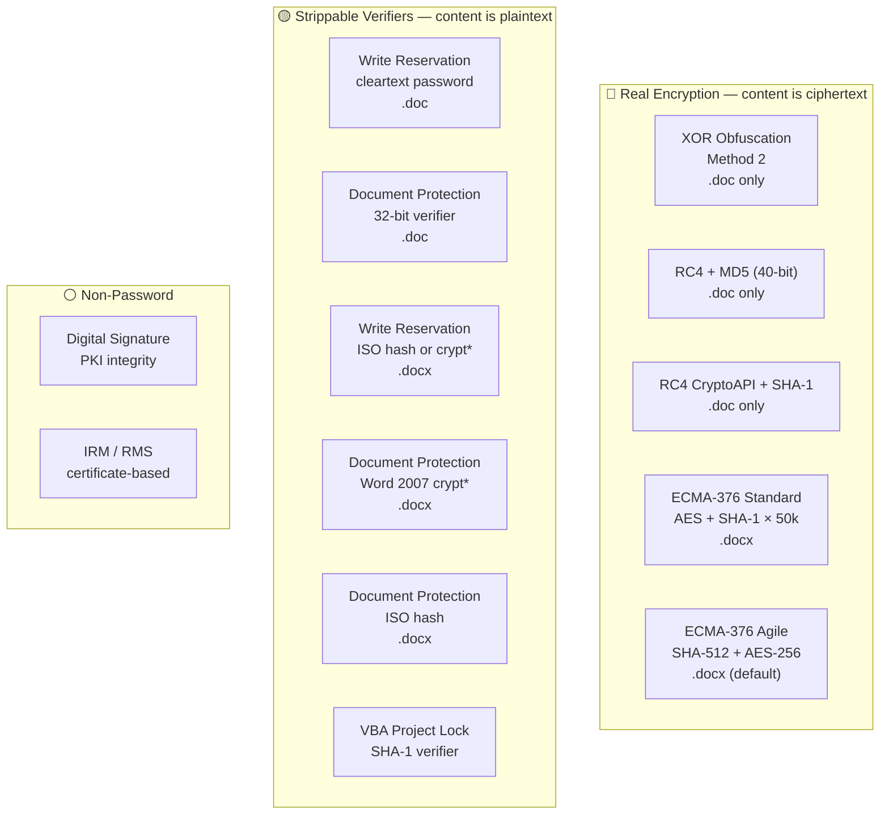
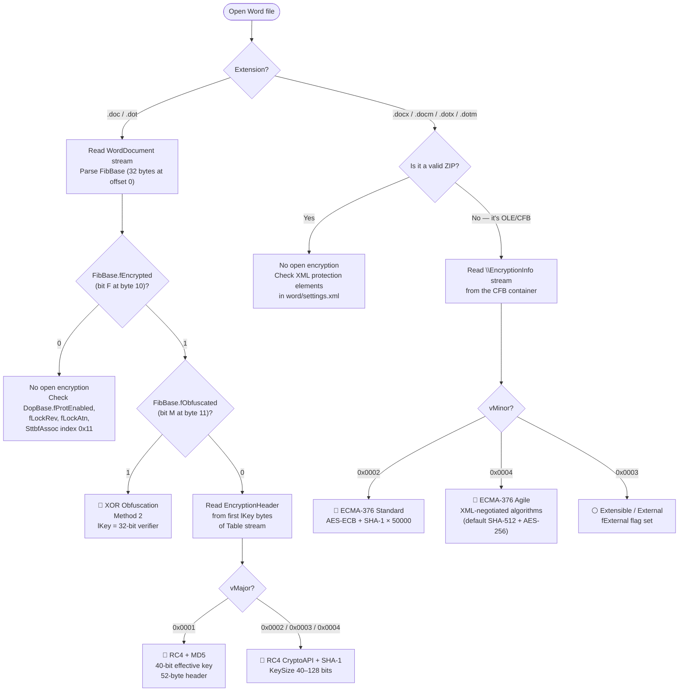
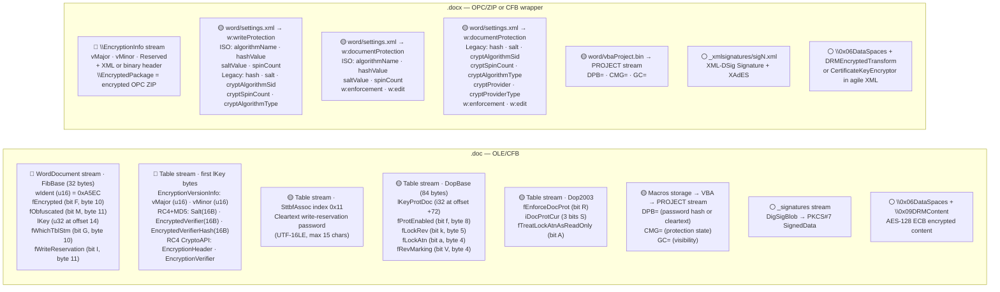

# Microsoft Word — .doc / .docx / .docm / .dotx / .dotm

Word ships two unrelated container families keyed by extension. `.doc` (and `.dot`) is the legacy **OLE/CFB** compound file carrying the File Information Block (FIB) in the `WordDocument` stream and document properties, encryption headers, and string tables in the Table stream (`0Table` or `1Table`, selected by `FibBase.fWhichTblStm`), as specified by [MS-DOC]. `.docx`/`.docm`/`.dotx`/`.dotm` are **OPC/ZIP** packages (OOXML) containing XML parts such as `word/settings.xml` and `word/document.xml`, as specified by [ISO/IEC 29500-1:2016] with extensions documented in [MS-OI29500] and [MS-OE376]. One wrinkle: an OOXML file that has a document-open password is not a ZIP on disk — the entire OPC package is re-wrapped in an **OLE/CFB** container holding `\EncryptionInfo` + `\EncryptedPackage` streams ([MS-OFFCRYPTO] §2.3.4), preserving the outer extension.

## File Extensions

| Extension | Container | Description | Password Protection Applicable? | Notes |
|---|---|---|---|---|
| .doc | OLE/CFB | Word 97-2003 Document | Yes — XOR/RC4-MD5/RC4-CryptoAPI open, cleartext write-res, 32-bit doc protection | Legacy binary format; encryption metadata in FibBase + Table stream |
| .dot | OLE/CFB | Word 97-2003 Template | Same as .doc | Identical container, encryption, and protection mechanisms as .doc |
| .wbk | OLE/CFB | Word Backup Document | Same as .doc (backup copy of encrypted file retains encryption) | Created by Word's "Always create backup copy" option; uses the same OLE/CFB structure |
| .docx | OPC/ZIP (or OLE/CFB when encrypted) | Word Document | Yes — Standard/Agile open, ISO protection hash, IRM | When a document-open password is set, the OPC/ZIP is re-wrapped in an OLE/CFB container holding `\EncryptionInfo` + `\EncryptedPackage`; the .docx extension is preserved |
| .docm | OPC/ZIP (or OLE/CFB when encrypted) | Word Macro-Enabled Document | Same as .docx + VBA project lock | .docm uses the same OPC/ZIP container and encryption as .docx; additionally supports VBA project password protection via `word/vbaProject.bin` |
| .dotx | OPC/ZIP (or OLE/CFB when encrypted) | Word Template | Same as .docx | .dotx uses the same OPC/ZIP container and encryption as .docx |
| .dotm | OPC/ZIP (or OLE/CFB when encrypted) | Word Macro-Enabled Template | Same as .docx + VBA project lock | .dotm uses the same OPC/ZIP container and encryption as .docx; additionally supports VBA project password protection via `word/vbaProject.bin` |
| .wll | DLL | Word Add-in (native code) | Not an Office document — no Office password protection | Native-code DLL loaded by Word; not an Office file format and not subject to any Office encryption or protection scheme |
| .xml | XML | Word 2003 XML Document | documentProtection element (same crypt* attrs as .docx legacy dialect) | Flat XML format (WordprocessingML 2003); uses `<w:documentProtection>` with the same attribute families as OOXML; no OLE/CFB or OPC/ZIP container |

## Gate Strength Map



## Detection Flowchart

How to determine which encryption scheme a Word file uses:



## Container Structure

Where each gate's data physically lives:



## Default Password

> **Word has no default auto-encryption password.** Unlike Excel's `VelvetSweatshop` or PowerPoint's `/01Hannes Ruescher/01`, Word does not auto-encrypt a document under a fixed default password when only strippable protection gates are set. [MS-OFFCRYPTO] §2.4.2.3 documents the default encryption password `\x2f\x30\x31\x48\x61\x6e\x6e\x65\x73\x20\x52\x75\x65\x73\x63\x68\x65\x72\x2f\x30\x31` (`/01Hannes Ruescher/01`), but this is explicitly a PowerPoint-specific behavior. When a `.doc` file has write-reservation or document-protection verifiers but no user-supplied open password, the file is NOT encrypted — the protection fields are stored in cleartext within the Table stream.

## Gate Quick Reference

### .doc — legacy binary

| | Gate | Location | Algorithm | Spec |
|---|---|---|---|---|
| 🔴 | Open — XOR | `FibBase.fEncrypted=1, fObfuscated=1`; `lKey` = 32-bit verifier | [XOR obfuscation](../algorithms/password/xor-obfuscation.md) Method 2 | [MS-OFFCRYPTO] §2.3.7; [MS-DOC] §2.2.6.1, §2.5.2 |
| 🔴 | Open — RC4+MD5 | Table stream first `lKey` bytes: vMajor=1/vMinor=1 | [RC4-MD5](../algorithms/password/rc4-md5-legacy.md), 40-bit | [MS-OFFCRYPTO] §2.3.6; [MS-DOC] §2.2.6.2 |
| 🔴 | Open — RC4 CryptoAPI | Table stream first `lKey` bytes: vMajor=2–4/vMinor=2 | [RC4-CryptoAPI-SHA1](../algorithms/password/rc4-cryptoapi-sha1.md) | [MS-OFFCRYPTO] §2.3.5; [MS-DOC] §2.2.6.3 |
| 🟡 | Write reservation | `SttbfAssoc` index 0x11 in Table stream | Cleartext password (no hash) | [MS-OFFCRYPTO] §2.4.2.1; [MS-DOC] §2.9.276 |
| 🟡 | Document protection | `DopBase.lKeyProtDoc` in Table stream | 32-bit verifier (Method 2) | [MS-DOC] §2.7.2; [MS-OFFCRYPTO] §2.3.7.4 |
| 🟡 | VBA project lock | `Macros` → `VBA` → `PROJECT` stream: `DPB=` | [VBA password](../algorithms/password/vba-project-password.md) SHA-1 | [MS-OVBA] §2.3.1.16, §2.4.4 |
| ⚪ | Digital signature | `_signatures` / `_xmlsignatures` | PKI — MD5+RSA or xmldsig/XAdES | [MS-OFFCRYPTO] §2.5.1, §2.5.2–3 |
| ⚪ | IRM / RMS | `\0x06DataSpaces` + `\0x09DRMContent` | AES-128 ECB, RMS content key | [MS-OFFCRYPTO] §2.2.1–2.2.10 |

### .docx / .docm — OOXML

| | Gate | Element / Location | Algorithm | Spec |
|---|---|---|---|---|
| 🔴 | Open — Standard | `\EncryptionInfo` vMinor=0x0002 | [ECMA-376 Standard](../algorithms/password/ecma376-standard.md) AES-ECB | [MS-OFFCRYPTO] §2.3.4.5–9 |
| 🔴 | Open — Agile | `\EncryptionInfo` vMinor=0x0004 | [ECMA-376 Agile](../algorithms/password/ecma376-agile.md) AES-CBC | [MS-OFFCRYPTO] §2.3.4.10–15 |
| 🟡 | Write reservation (ISO) | `<w:writeProtection>` with `algorithmName`/`hashValue`/`saltValue`/`spinCount` | [ISO hash](../algorithms/password/iso-protection-hash.md) | [MS-OI29500] §2.1.426; [MS-OFFCRYPTO] §2.4.2.4 |
| 🟡 | Write reservation (legacy) | `<w:writeProtection>` with `hash`/`salt`/`cryptAlgorithmSid`/`cryptSpinCount` | [Word 2007 KDF](../algorithms/password/crypt-documentprotection.md) | [MS-OE376] §2.1.438; ECMA-376 Part 4 §2.15.1.94 |
| 🟡 | Document protection (ISO) | `<w:documentProtection>` with `algorithmName`/`hashValue`/`saltValue`/`spinCount` | [ISO hash](../algorithms/password/iso-protection-hash.md) | [MS-OI29500] §2.1.402; [MS-OFFCRYPTO] §2.4.2.4 |
| 🟡 | Document protection (legacy) | `<w:documentProtection>` with `hash`/`salt`/`cryptAlgorithmSid`/`cryptSpinCount` | [Word 2007 KDF](../algorithms/password/crypt-documentprotection.md) | [MS-OE376] §2.1.410; ECMA-376 Part 4 §2.15.1.28 |
| 🟡 | VBA project lock | `word/vbaProject.bin` → `PROJECT` stream | [VBA password](../algorithms/password/vba-project-password.md) SHA-1 | [MS-OVBA] §2.3.1.16, §2.4.4 |
| ⚪ | Digital signature | `_xmlsignatures/` | xmldsig/XAdES PKI | [MS-OFFCRYPTO] §2.5.2–3 |
| ⚪ | IRM / certificate encryptor | `\0x06DataSpaces` + `DRMEncryptedTransform`, or CertificateKeyEncryptor in agile XML | AES-128 ECB (IRMDS) or RSA-wrapped key (agile cert) | [MS-OFFCRYPTO] §2.2.1–4, §2.3.4.10 |

---

## Specification Detail

### `.doc` — legacy binary (OLE/CFB, Word 97–2003) — full gate table

| Gate | Location in file | Algorithm / mechanism | Spec reference |
|---|---|---|---|
| 🔴 Open / encrypt — XOR obfuscation | `WordDocument` stream: `FibBase.fEncrypted=1` AND `FibBase.fObfuscated=1`; 32-bit password verifier stored in `FibBase.lKey` (4 bytes at offset 14 in FibBase); body XORed against a 16-byte password-derived array. The XOR array is initialized and data transformed using Method 2 ([MS-OFFCRYPTO] §2.3.7.5–2.3.7.6), which differs from Excel's Method 1 in that Word XORs 32-bit blocks rather than byte-at-a-time. Record headers and certain structures within the WordDocument stream beyond offset 68 are never obfuscated; the first 68 bytes of the WordDocument stream (containing the FIB header through FibBase) are always cleartext. | XOR obfuscation Method 2: password verifier derivation ([MS-OFFCRYPTO] §2.3.7.4), XOR array init Method 2 ([MS-OFFCRYPTO] §2.3.7.5), XOR data transformation Method 2 ([MS-OFFCRYPTO] §2.3.7.6). Password is truncated to 15 single-byte ANSI characters. Produces a 32-bit verifier (unlike Excel's 16-bit). See [xor-obfuscation](../algorithms/password/xor-obfuscation.md). | [MS-DOC] §2.2.6.1, §2.5.2; [MS-OFFCRYPTO] §2.3.7, §2.3.7.4–2.3.7.6 |
| 🔴 Open / encrypt — RC4 + MD5 (40-bit) | `FibBase.fEncrypted=1`, `FibBase.fObfuscated=0`; `FibBase.lKey` gives the byte count of the unencrypted EncryptionHeader at the start of the Table stream. `EncryptionVersionInfo` (vMajor=0x0001, vMinor=0x0001) → 52-byte RC4 encryption header: Salt (16 bytes), EncryptedVerifier (16 bytes), EncryptedVerifierHash (16 bytes). The remainder of the Table stream, the WordDocument stream beyond offset 68, and the entire Data stream are encrypted. | RC4 encryption: key derivation uses MD5 hashing, first 5 bytes of H(password) as TruncatedHash, 336-byte IntermediateBuffer ([MS-OFFCRYPTO] §2.3.6.2). Effective key seed is 40 bits despite 128-bit RC4 key. Verification via MD5 of decrypted verifier. See [rc4-md5-legacy](../algorithms/password/rc4-md5-legacy.md). | [MS-DOC] §2.2.6.2, §2.5.2; [MS-OFFCRYPTO] §2.3.6, §2.3.6.1–2.3.6.4 |
| 🔴 Open / encrypt — RC4 CryptoAPI + SHA-1 | `FibBase.fEncrypted=1`, `FibBase.fObfuscated=0`; `FibBase.lKey` gives the byte count of the unencrypted EncryptionHeader at the start of the Table stream. `EncryptionVersionInfo` vMajor in {0x0002, 0x0003, 0x0004}, vMinor=0x0002 → RC4 CryptoAPI encryption header ([MS-OFFCRYPTO] §2.3.5.1): EncryptionHeader (AlgID=0x6801 for RC4, AlgIDHash=0x8004 for SHA-1, KeySize 40–128 bits), EncryptionVerifier. Same streams encrypted as RC4+MD5. | RC4 CryptoAPI: key derivation is H0 = SHA-1(salt + password), Hfinal = SHA-1(H0 + blockNumber), no iteration ([MS-OFFCRYPTO] §2.3.5.2). Verification via SHA-1 of decrypted verifier. When RC4 CryptoAPI is used and `fDocProps` is set in `EncryptionHeader.Flags`, the `\0x05SummaryInformation` and `\0x05DocumentSummaryInformation` streams are also encrypted. See [rc4-cryptoapi-sha1](../algorithms/password/rc4-cryptoapi-sha1.md). | [MS-DOC] §2.2.6.3, §2.5.2; [MS-OFFCRYPTO] §2.3.5, §2.3.5.1–2.3.5.6 |
| 🟡 Modify / write-reservation | Table stream `SttbfAssoc` string index **0x11** stores the write-reservation password **in cleartext** (UTF-16LE, max 15 chars); `FibBase.fWriteReservation=1` (bit I at byte offset 11 of the WordDocument stream) signals its presence. The `SttbfAssoc` location is given by `FibRgFcLcb97.fcSttbfAssoc` / `lcbSttbfAssoc` in the Table stream. | No cryptographic protection whatsoever; the password is stored in the clear per [MS-OFFCRYPTO] §2.4.2.1: "Binary documents that conform to [MS-DOC] MUST store the write protection password in the file in plaintext." [MS-DOC] §4.2: "The write-reservation password is embedded in cleartext in the file." | [MS-OFFCRYPTO] §2.4.2.1; [MS-DOC] §2.9.276, §2.5.2, §4.2 |
| 🟡 Restrict editing / document protection | Table stream `DopBase.lKeyProtDoc` (signed 32-bit integer at byte offset +72 within the 84-byte DopBase structure) holds the password verifier. Protection mode set by: `DopBase.fProtEnabled` (forms-only editing), `DopBase.fLockRev` (tracked changes locked on), `DopBase.fLockAtn` (comments or read-only per `Dop2003.fTreatLockAtnAsReadOnly`), `DopBase.fRevMarking` (revision tracking active). `Dop2003.fEnforceDocProt` + `Dop2003.iDocProtCur` extend the mode set (ProtectOff=0, ProtectRevMark=1/tracked changes, ProtectAnnot=2/comments, ProtectForm=3/forms, NoRestrictions=7). Section-level form protection can be overridden by `sprmSFProtected` (sprm 0x3006). | `lKeyProtDoc` is a 32-bit hash derived from `CreatePasswordVerifier_Method2` ([MS-OFFCRYPTO] §2.3.7.4). The spec explicitly states these protections are advisory: "[MS-DOC] §2.7.2: 'These restrictions are used to prevent unintentional changes to all or part of a document. Because this protection does not encrypt the document, malicious applications can circumvent its use. This protection is not intended as a security feature and can be ignored.'" See [xor-obfuscation](../algorithms/password/xor-obfuscation.md) for shared verifier derivation. | [MS-DOC] §2.7.2 (DopBase), §2.7.7 (Dop2003), §2.6.4 (sprmSFProtected); [MS-OFFCRYPTO] §2.3.7.4 |
| 🟡 VBA project lock | `Macros` storage (OLE) → `VBA` storage → `PROJECT` stream: `CMG=` (ProjectProtectionState, [MS-OVBA] §2.3.1.15), `DPB=` (ProjectPassword, [MS-OVBA] §2.3.1.16), `GC=` (ProjectVisibilityState, [MS-OVBA] §2.3.1.17); each value is obfuscated via the VBA Data Encryption algorithm. `DPB` stores a SHA-1 password hash (29-byte Hash Data Structure) or a plaintext password, obfuscated. When the hash form is used, `ProjectId.ProjectCLSID` MUST be `{00000000-0000-0000-0000-000000000000}`. | DPB obfuscation ([MS-OVBA] §2.4.3): three seed bytes + XOR-based encryption. The actual password hash uses SHA-1 via the Hash Data Structure ([MS-OVBA] §2.4.4). See [vba-project-password](../algorithms/password/vba-project-password.md). | [MS-OVBA] §2.3.1.15–2.3.1.17, §2.4.3, §2.4.4 |
| ⚪ Digital signature | `_signatures` stream in root storage: CryptoAPI Digital Signature (MD5-based signing, [MS-OFFCRYPTO] §2.5.1.5). Hash generated by recursively traversing OLE streams/storages excluding `\0x06DataSpaces`, `_signatures`, `\0x09DRMContent`. `_xmlsignatures` storage: xmldsig format per [MS-OFFCRYPTO] §2.5.2–2.5.3 (also applicable to binary documents). | CryptoAPI: MD5 hash + RSA signature. Xmldsig: XML-Signature Syntax [XMLDSig] with optional XAdES extensions. | [MS-OFFCRYPTO] §2.5.1–2.5.3 |
| ⚪ IRM / RMS | `\0x06DataSpaces` with `0x09DRMTransform` transform (TransformID `{C73DFACD-061F-43B0-8B64-0C620D2A8B50}`); protected content in `\0x09DRMContent` stream. | AES-128, 16-byte block, ECB mode, IV of all zeros. Content key from the end-user license, encrypted per-user via RMS certificate (RSA) per [MS-RMPR]. | [MS-OFFCRYPTO] §2.2.1–2.2.10, §2.2.3 |

### `.docx` / `.docm` — OOXML (OPC/ZIP, Word 2007+) — full gate table

| Gate | Location in file | Algorithm / mechanism | Spec reference |
|---|---|---|---|
| 🔴 Open / encrypt — ECMA-376 standard | OLE/CFB wrapper: `\EncryptionInfo` stream (vMajor in {0x0002, 0x0003, 0x0004}, vMinor=0x0002), `\EncryptedPackage` stream. EncryptionHeader: fCryptoAPI=1, fAES=1, AlgID in {0x660E, 0x660F, 0x6610} (AES-128/192/256), AlgIDHash=0x8004 (SHA-1). The entire OPC ZIP is encrypted as a single stream inside `\EncryptedPackage`. Data spaces structures under `\0x06DataSpaces` associate the package with the StrongEncryptionTransform. | Key derivation: H0 = SHA-1(salt + password), then 50,000 iterations Hn = SHA-1(iterator + Hn-1), then Hfinal = SHA-1(Hn + blockKey), followed by HMAC-like X1/X2 derivation to reach cbRequiredKeyLength bits ([MS-OFFCRYPTO] §2.3.4.7). Encryption uses AES-ECB. Verification via SHA-1 of decrypted verifier ([MS-OFFCRYPTO] §2.3.4.9). See [ecma376-standard](../algorithms/password/ecma376-standard.md). | [MS-OFFCRYPTO] §2.3.4.5, §2.3.4.7–§2.3.4.9, §2.3.4.4 |
| 🔴 Open / encrypt — ECMA-376 agile | OLE/CFB wrapper: `\EncryptionInfo` stream (vMajor=0x0004, vMinor=0x0004, Reserved=0x00000040), followed by XML descriptor. `\EncryptedPackage` encrypted in 4096-byte segments. XML descriptor carries `<keyData>` (cipherAlgorithm, hashAlgorithm, keyBits, saltValue, blockSize), `<dataIntegrity>` (HMAC for corruption detection), and `<keyEncryptors>` with one `<p:encryptedKey>` per PasswordKeyEncryptor (spinCount, saltValue, encryptedVerifierHashInput, encryptedVerifierHashValue, encryptedKeyValue). | Key derivation: H0 = H(salt + password), iterated spinCount times ([MS-OFFCRYPTO] §2.3.4.11); Hfinal = H(Hn + blockKey). IV generation per §2.3.4.12 using KeySalt + blockKey. Cipher algorithm and hash specified in XML (typically AES-256-CBC + SHA-512 for modern files). DataIntegrity HMAC validates the entire EncryptedPackage. CertificateKeyEncryptor allows public-key-based decryption alongside password. See [ecma376-agile](../algorithms/password/ecma376-agile.md). | [MS-OFFCRYPTO] §2.3.4.10–§2.3.4.15 |
| 🟡 Modify / write-reservation | `<w:writeProtection>` element in `word/settings.xml` ([ISO/IEC 29500-1] §17.15.1.93). **ISO dialect:** `w:algorithmName`, `w:hashValue` (base64), `w:saltValue` (base64), `w:spinCount`. **Legacy dialect:** `w:hash`, `w:salt`, `w:cryptAlgorithmSid`, `w:cryptSpinCount`, and related `crypt*` attributes from the AG_Password group. The document body is NOT encrypted by this gate. Per [MS-OI29500] §2.1.426 note (c), if any AG_Password attribute is present, Word requires `algorithmName`, `hashValue`, and `spinCount` to all be present, or Word will not open the file. | ISO: iterated hash per [MS-OFFCRYPTO] §2.4.2.4 (H0 = H(salt + password), Hn = H(Hn-1 + iterator) for spinCount iterations). Legacy: three-stage KDF per [MS-OE376] §2.1.438 / [MS-OE376] §2.1.410. See [iso-protection-hash](../algorithms/password/iso-protection-hash.md) and [crypt-documentprotection](../algorithms/password/crypt-documentprotection.md). | [MS-OI29500] §2.1.426; [MS-OE376] §2.1.438; [MS-OFFCRYPTO] §2.4.1, §2.4.2.4; ISO/IEC 29500-1 §17.15.1.93 |
| 🟡 Restrict editing — Word 2007 legacy dialect | `<w:documentProtection>` in `word/settings.xml` with `crypt*` attributes: `w:hash`, `w:salt`, `w:cryptAlgorithmSid`, `w:cryptSpinCount`, `w:cryptAlgorithmType`, `w:cryptAlgorithmClass`, `w:cryptProvider`, `w:cryptProviderType`, `w:cryptProviderTypeExt`, `w:cryptProviderTypeExtSource`, `w:algIdExt`, `w:algIdExtSource`. `w:enforcement="1"` activates the restriction (but Word enforces protection even when enforcement is omitted per [MS-OE376] §2.1.410 note (i)). `w:edit` specifies the mode: `readOnly`, `comments`, `trackedChanges`, `forms`, `none`. | Three-stage password KDF: (1) 16-bit verifier from [MS-OFFCRYPTO] §2.3.7.1, (2) its byte-reversed form, (3) reversed form converted to a Unicode hex string and hashed via the algorithm identified by `cryptAlgorithmSid` for `cryptSpinCount` iterations. Per [MS-OE376] §2.1.410 note (h), Word restricts `cryptAlgorithmSid` to values 1, 2, 3, 4, 12, 13, 14. Per note (j), `cryptSpinCount` limited to 0–5,000,000. See [crypt-documentprotection](../algorithms/password/crypt-documentprotection.md). | [MS-OE376] §2.1.410 (notes a–l); ECMA-376 Part 4 §2.15.1.28 |
| 🟡 Restrict editing — ISO dialect | `<w:documentProtection>` in `word/settings.xml` with `*Value` attributes: `w:algorithmName`, `w:hashValue`, `w:saltValue`, `w:spinCount`; same `w:enforcement` and `w:edit` attributes. | Iterated hash identical to write-protection: H0 = H(salt + password), Hn = H(Hn-1 + iterator) for spinCount iterations per [MS-OFFCRYPTO] §2.4.2.4. `algorithmName` selects the hash (SHA-1, SHA-256, SHA-384, SHA-512, etc.). Document body NOT encrypted. Per [MS-OI29500] §2.1.402 note (d), spinCount limited to 0–10,000,000. See [iso-protection-hash](../algorithms/password/iso-protection-hash.md). | [MS-OI29500] §2.1.402 (notes a–f); [MS-OFFCRYPTO] §2.4.2.4; ISO/IEC 29500-1 §17.15.1.29 |
| 🟡 VBA project lock | `word/vbaProject.bin` (embedded OLE/CFB binary part) → `PROJECT` stream. Same `CMG`/`DPB`/`GC` protection state and `ProjectPassword` structure as the `.doc` case. | Same DPB obfuscation and SHA-1 hash as the binary format ([MS-OVBA] §2.3.1.15–16, §2.4.3–4). See [vba-project-password](../algorithms/password/vba-project-password.md). | [MS-OVBA] §2.3.1.15–2.3.1.17, §2.4.3, §2.4.4 |
| ⚪ Digital signature | `_xmlsignatures/` storage within the OPC package, containing XML-Signature streams per [MS-OFFCRYPTO] §2.5.2–2.5.3 and [ECMA-376] Part 2 §12. Each signature stream is a valid xmldsig `<Signature>` with optional XAdES extensions. | XML-Signature Syntax and Processing [XMLDSig]; Manifest covers all package streams except `_xmlsignatures`, `\0x06DataSpaces`, `MsoDataStore`, `_signatures`, summary info streams ([MS-OFFCRYPTO] §2.5.2.4). Optional XAdES-EPES through XAdES-X-L ([MS-OFFCRYPTO] §2.5.2.6). | [MS-OFFCRYPTO] §2.5.2, §2.5.3 |
| ⚪ IRM / certificate key encryptor | CFB wrapper with IRMDS data-space structure for ECMA-376: `\0x06DataSpaces` with `DRMEncryptedDataSpace` / `DRMEncryptedTransform` (TransformID `{C73DFACD-061F-43B0-8B64-0C620D2A8B50}`); OR agile encryption with a CertificateKeyEncryptor element alongside the PasswordKeyEncryptor. | IRMDS: AES-128 ECB, IV all zeros, content key from RMS per [MS-OFFCRYPTO] §2.2.10. Certificate key encryptor (agile): intermediate key RSA-encrypted to the X.509 certificate per [MS-OFFCRYPTO] §2.3.4.10. | [MS-OFFCRYPTO] §2.2.1–2.2.4, §2.3.4.10 |

### Extraction Targets by Gate

What Python code needs to extract for each gate — field names, types, locations, and "gate is active" indicators.

#### 🔴 Open / Encrypt — .doc binary

- **Location:** `WordDocument` stream, `FibBase` structure (first 32 bytes)
- **Gate active when:** `FibBase.fEncrypted` = 1 (bit F, bit 8 of the u16 at offset 10)
- **Extract from FibBase:**
  - `wIdent` — u16 LE at offset 0 → MUST be 0xA5EC
  - `nFib` — u16 LE at offset 2 → version number (0x00C1 for Word 97+)
  - `fEncrypted` — bit F (bit 8) of the u16 LE at offset 10
  - `fObfuscated` — bit M (bit 15) of the u16 LE at offset 10 (same word as fEncrypted)
  - `fWhichTblStm` — bit G (bit 9) of the u16 LE at offset 10 → 0 = `0Table`, 1 = `1Table`
  - `fWriteReservation` — bit I (bit 11) of the u16 LE at offset 10
  - `lKey` — u32 LE at offset 14
- **If XOR (fEncrypted=1, fObfuscated=1):** `lKey` is the 32-bit password verifier (Method 2)
- **If RC4 (fEncrypted=1, fObfuscated=0):** `lKey` is the byte size of the EncryptionHeader at the start of the Table stream
  - Read Table stream name from `fWhichTblStm` (0 → `"0Table"`, 1 → `"1Table"`)
  - Read first `lKey` bytes of Table stream → parse `EncryptionVersionInfo`: `vMajor` (u16 LE), `vMinor` (u16 LE)
  - vMajor=0x0001, vMinor=0x0001 → RC4+MD5: `Salt` (16B), `EncryptedVerifier` (16B), `EncryptedVerifierHash` (16B)
  - vMajor=0x0002–0x0004, vMinor=0x0002 → RC4 CryptoAPI: parse `EncryptionHeader` (AlgID, AlgIDHash, KeySize) + `EncryptionVerifier` (SaltSize, Salt 16B, EncryptedVerifier 16B, VerifierHashSize, EncryptedVerifierHash 20B)

#### 🔴 Open / Encrypt — .docx/.docm OOXML

- **Location:** `\EncryptionInfo` stream in the OLE/CFB wrapper (file is NOT a ZIP when encrypted)
- **Gate active when:** file fails ZIP magic check (not `PK\x03\x04`) and has OLE/CFB signature (`D0 CF 11 E0`)
- **Extract:**
  - Bytes 0–7: `vMajor` (u16 LE), `vMinor` (u16 LE), `Reserved` (u32 LE)
  - **If vMinor=0x0002 (Standard):** parse `EncryptionHeader` + `EncryptionVerifier` per [MS-OFFCRYPTO] §2.3.4.5
  - **If vMinor=0x0004 (Agile):** parse UTF-8 XML from byte 8 onward → extract from `<p:encryptedKey>`: `spinCount`, `saltSize`, `blockSize`, `keyBits`, `hashSize`, `cipherAlgorithm`, `cipherChaining`, `hashAlgorithm`, `saltValue` (base64), `encryptedVerifierHashInput` (base64), `encryptedVerifierHashValue` (base64), `encryptedKeyValue` (base64)

#### 🟡 Write Reservation — .doc binary

- **Location:** Table stream, `SttbfAssoc` structure (located at `FibRgFcLcb97.fcSttbfAssoc`), string index 0x11
- **Gate active when:** `FibBase.fWriteReservation` = 1 (bit I at byte offset 11) AND `SttbfAssoc[0x11]` is non-empty
- **Extract:** The UTF-16LE string at index 0x11 of the SttbfAssoc STTB — this IS the cleartext password (max 15 characters)
- **Note:** No hash, no derivation — the raw password is stored in the file. This is the only gate in any Office format that stores the actual password rather than a derived verifier.

#### 🟡 Document Protection — .doc binary

- **Location:** Table stream, `DopBase` structure (84 bytes, located at `FibRgFcLcb97.fcDop`)
- **Gate active when:** any of `fProtEnabled`, `fLockRev`, `fLockAtn` is 1, AND `lKeyProtDoc` ≠ 0
- **Extract:**
  - `fProtEnabled` — bit f (bit 5) of the u8 at DopBase byte offset +8 (within the flags dword at bit position 101)
  - `fLockRev` — bit k (bit 5) of the u8 at DopBase byte offset +5 (within the flags dword at bit position 42)
  - `fLockAtn` — bit a (bit 0) of the u8 at DopBase byte offset +4 (within the flags dword at bit position 32)
  - `fRevMarking` — bit V (bit 5) of the u8 at DopBase byte offset +4 (within the flags dword at bit position 37)
  - `lKeyProtDoc` — i32 LE at DopBase byte offset +72
- **Also extract from Dop2003 (if present):**
  - `fTreatLockAtnAsReadOnly` — bit A (first bit of the Dop2003 extension flags)
  - `fEnforceDocProt` — bit R
  - `iDocProtCur` — 3-bit field S (values: 0=TrackedChanges, 1=Comments, 2=Forms, 3=ReadOnly, 7=NoRestrictions)

#### 🟡 Write Reservation — .docx OOXML

- **Location:** `word/settings.xml`, element `<w:writeProtection>`
- **Gate active when:** `<w:writeProtection>` element exists with any password attribute
- **Extract (ISO):** `w:algorithmName` (string), `w:hashValue` (base64), `w:saltValue` (base64), `w:spinCount` (decimal)
- **Extract (legacy):** `w:hash` (base64), `w:salt` (base64), `w:cryptAlgorithmSid` (decimal), `w:cryptSpinCount` (decimal), `w:cryptAlgorithmType` (string), `w:cryptProvider` (string), `w:cryptProviderType` (string)

#### 🟡 Document Protection — .docx OOXML

- **Location:** `word/settings.xml`, element `<w:documentProtection>`
- **Gate active when:** `w:enforcement="1"` is present (but note: Word enforces protection even when `enforcement` is omitted per [MS-OE376] §2.1.410 note (i))
- **Extract (ISO):** `w:algorithmName` (string), `w:hashValue` (base64), `w:saltValue` (base64), `w:spinCount` (decimal)
- **Extract (legacy):** `w:hash` (base64), `w:salt` (base64), `w:cryptAlgorithmSid` (decimal), `w:cryptSpinCount` (decimal), `w:cryptAlgorithmType` (string), `w:cryptAlgorithmClass` (string), `w:cryptProvider` (string), `w:cryptProviderType` (string), `w:cryptProviderTypeExt` (string), `w:cryptProviderTypeExtSource` (string), `w:algIdExt` (string), `w:algIdExtSource` (string)
- **Also extract:** `w:edit` (string: `readOnly`, `comments`, `trackedChanges`, `forms`, `none`), `w:enforcement` (boolean), `w:formatting` (boolean — restricts formatting changes)

#### 🟡 VBA Project Lock

- **Location (binary):** `Macros` → `VBA` → `PROJECT` stream (INI-style text)
- **Location (OOXML):** `word/vbaProject.bin` (embedded OLE/CFB) → `PROJECT` stream
- **Gate active when:** `DPB=` line exists with length > the no-password sentinel
- **Extract:** `ID=` line (CLSID GUID for ProjKey derivation); `DPB=` hex string (decode with §2.4.3); `CMG=` hex string (protection state); `GC=` hex string (visibility)

#### ⚪ Digital Signature

- **Location (binary):** `_signatures` stream or `_xmlsignatures` storage
- **Location (OOXML):** `_xmlsignatures/sigN.xml` parts
- **Gate active when:** the stream/storage/part exists
- **Extract:** PKCS#7 SignedData blob (binary) or XML-DSig `<Signature>` elements (OOXML)

### FibBase Byte Layout (.doc)

**Structure size:** 32 bytes (fixed), at offset 0 of the `WordDocument` stream [MS-DOC] §2.5.2

The FibBase is the first structure in the Fib (File Information Block) and contains the encryption control flags, the Table stream selector, and the encryption key/header-size value.

| Offset | Size | Field | Type | Description |
|---|---|---|---|---|
| 0 | 2 | `wIdent` | u16 LE | Magic number; MUST be 0xA5EC for a Word binary file |
| 2 | 2 | `nFib` | u16 LE | Version number; SHOULD be 0x00C1 (Word 97+); superseded by `FibRgCswNew.nFibNew` if present |
| 4 | 2 | `unused` | u16 LE | Undefined, MUST be ignored |
| 6 | 2 | `lid` | u16 LE (LID) | Install language of the producing application |
| 8 | 2 | `pnNext` | u16 LE | Offset to AutoText FIB (×512), or 0 |
| 10 | 2 | flags word 1 | u16 LE bitfield | See bit layout below |
| 12 | 2 | `nFibBack` | u16 LE | SHOULD be 0x00BF; MUST be 0x00BF or 0x00C1 |
| 14 | 4 | `lKey` | u32 LE | If fEncrypted=1 AND fObfuscated=1: 32-bit XOR password verifier. If fEncrypted=1 AND fObfuscated=0: byte count of EncryptionHeader at start of Table stream. Otherwise MUST be 0. |
| 18 | 1 | `envr` | u8 | MUST be 0 |
| 19 | 1 | flags byte 2 | u8 bitfield | See bit layout below |
| 20 | 2 | `reserved3` | u16 LE | MUST be 0 |
| 22 | 2 | `reserved4` | u16 LE | MUST be 0 |
| 24 | 4 | `reserved5` | u32 LE | Undefined |
| 28 | 4 | `reserved6` | u32 LE | Undefined |

**Flags word 1 (offset 10, u16 LE) — bit positions:**

| Bit | Flag | Description |
|---|---|---|
| 0 | `fDot` | 1 = document template |
| 1 | `fGlsy` | 1 = AutoText-only document |
| 2 | `fComplex` | 1 = last save was incremental |
| 3 | `fHasPic` | 0 = SHOULD have no pictures |
| 4–7 | `cQuickSaves` | Incremental save count (MUST be 0xF if nFib ≥ 0x00D9) |
| **8** | **`fEncrypted`** | **1 = document is encrypted or obfuscated** |
| **9** | **`fWhichTblStm`** | **0 = use `0Table`; 1 = use `1Table`** |
| 10 | `fReadOnlyRecommended` | 1 = read-only recommended |
| **11** | **`fWriteReservation`** | **1 = write-reservation password present (at SttbfAssoc index 0x11)** |
| 12 | `fExtChar` | MUST be 1 |
| 13 | `fLoadOverride` | 1 = override paragraph style 0 language/font |
| 14 | `fFarEast` | 1 = creating application was East Asian |
| **15** | **`fObfuscated`** | **If fEncrypted=1: 1 = XOR obfuscation, 0 = RC4 encryption. If fEncrypted=0: ignore.** |

**Flags byte 2 (offset 19, u8) — bit positions:**

| Bit | Flag | Description |
|---|---|---|
| 0 | `fMac` | MUST be 0 |
| 1 | `fEmptySpecial` | SHOULD be 0 |
| 2 | `fLoadOverridePage` | Override section page properties |
| 3 | `reserved1` | Undefined |
| 4 | `reserved2` | Undefined |
| 5–7 | `fSpare0` | Undefined |

### DopBase Byte Layout (.doc)

**Structure size:** 84 bytes (fixed), located at Table stream offset `FibRgFcLcb97.fcDop` [MS-DOC] §2.7.2

The DopBase is the base portion of the Dop (Document Properties) structure. It contains the document-protection mode flags and the password verifier.

| Offset | Size | Field | Description |
|---|---|---|---|
| 0 | 2 | flags + fpc + unused4 | Bits: A(fFacingPages), B(unused1), C(fPMHMainDoc), D(unused2 2b), fpc(2b), E(unused3), unused4(8b) |
| 2 | 2 | rncFtn + nFtn | Bits: F(rncFtn 2b), nFtn(14b) |
| 4 | 4 | flags dword 1 | Bits 0–31 (G through l): **bit 19 = fRevMarking (V)**, **bit 24 = fLockAtn (a)**, **bit 29 = fProtEnabled (f)**, **bit 33 = fLockVbaProj (j)**, **bit 34 = fLockRev (k)** |
| 8 | 2 | `copts60` | Compatibility options |
| 10 | 2 | `dxaTab` | Default tab stop interval (twips) |
| 12 | 2 | `cpgWebOpt` | Code page for HTML save |
| 14 | 2 | `dxaHotZ` | Hyphenation zone width (twips) |
| 16 | 2 | `cConsecHypLim` | Max consecutive hyphenated lines |
| 18 | 2 | `wSpare2` | MUST be 0 |
| 20 | 4 | `dttmCreated` | Document creation timestamp (DTTM) |
| 24 | 4 | `dttmRevised` | Last save timestamp |
| 28 | 4 | `dttmLastPrint` | Last print timestamp |
| 32 | 2 | `nRevision` | Save revision count (0–0x7FFF) |
| 34 | 4 | `tmEdited` | Editing time in minutes |
| 38 | 4 | `cWords` | Word count (main document) |
| 42 | 4 | `cCh` | Character count excluding whitespace |
| 46 | 2 | `cPg` | Page count |
| 48 | 4 | `cParas` | Paragraph count |
| 52 | 4 | endnote flags + permission flags | Bits: m(rncEdn 2b), nEdn(14b), epc(2b), n(unused14 4b), o(unused15 4b), p–u(6 flag bits) |
| 56 | 4 | `cLines` | Line count |
| 60 | 4 | `cWordsWithSubdocs` | Word count including subdocuments |
| 64 | 4 | `cChWithSubdocs` | Character count including subdocuments |
| 68 | 2 | `cPgWithSubdocs` | Page count including subdocuments |
| 70 | 4 | `cParasWithSubdocs` | Paragraph count including subdocuments (first 2 bytes) |
| **72** | **4** | **`lKeyProtDoc`** | **i32 LE — password verifier for document protection (fLockRev, fProtEnabled, fLockAtn). 0 = no password. Derived via CreatePasswordVerifier_Method2 ([MS-OFFCRYPTO] §2.3.7.4).** |
| 76 | 4 | `cLinesWithSubdocs` (2 bytes) + view/zoom flags | `cLinesWithSubdocs` (2 bytes at +76), then v(wvkoSaved 3b), pctWwdSaved(9b), w(zkSaved 2b), x(unused16 1b), y(iGutterPos 1b) |
| 80 | 4 | (tail of view/zoom flags) | Continuation of the bitfield ending at byte 83 |

**Protection-relevant flags in the flags dword (offset 4, bytes 4–7):**

The 32-bit flags dword at offset 4 contains 26 single-bit flags labeled G through l in the spec. The protection-relevant bits and their byte/bit positions within this dword are:

| Bit within dword | Flag | Byte offset | Bit in byte | Description |
|---|---|---|---|---|
| 19 | `fRevMarking` (V) | 6 | 3 | 1 = tracking revisions is active |
| 24 | `fLockAtn` (a) | 7 | 0 | 1 = comment protection (or read-only if `Dop2003.fTreatLockAtnAsReadOnly=1`). When 1, `fLockRev` MUST be 0. |
| 29 | `fProtEnabled` (f) | 7 | 5 | 1 = form-field-only editing in protected sections. When 1, `fLockAtn` and `fLockRev` SHOULD be 0. |
| 33 | `fLockVbaProj` (j) | — | — | 1 = VBA project locked (note: this is in the second flags dword at offset 4, which is a 32-bit value spanning bytes 4–7; bit 33 is actually in the adjacent flags — see spec bit diagram) |
| 34 | `fLockRev` (k) | — | — | 1 = revision tracking locked on; `fRevMarking` MUST also be 1. When 1, `fLockAtn` MUST be 0. |

**Exclusivity constraints** [MS-DOC] §2.7.2: when `fProtEnabled=1`, both `fLockAtn` and `fLockRev` SHOULD be 0; when `fLockRev=1`, `fLockAtn` MUST be 0 and `fProtEnabled` SHOULD be 0; when `fLockAtn=1`, `fLockRev` MUST be 0 and `fProtEnabled` SHOULD be 0. Per product behavior notes <164>–<167>, Word 97 through Office Word 2003 allowed violations of these SHOULD constraints.

### SttbfAssoc Layout (.doc)

**Location:** Table stream at offset `FibRgFcLcb97.fcSttbfAssoc`, size `lcbSttbfAssoc` bytes [MS-DOC] §2.9.276

The SttbfAssoc is an extended STTB (String Table) containing 18 (0x12) document-associated strings. The write-reservation password is stored as a cleartext UTF-16LE string at index 0x11 (decimal 17).

| Offset | Size | Field | Type | Description |
|---|---|---|---|---|
| 0 | 2 | `fExtend` | u16 LE | MUST be 0xFFFF (extended STTB — 2-byte cchData fields) |
| 2 | 2 | `cData` | u16 LE | MUST be 0x0012 (18 strings) |
| 4 | 2 | `cbExtra` | u16 LE | MUST be 0 (no extra data per string) |
| 6 | variable | strings | `cchData` (u16 LE) + UTF-16LE data, repeated 18 times | Each string is a 2-byte character count followed by that many UTF-16LE characters |

**String indexes relevant to protection:**

| Index | Meaning | Max length | Spec reference |
|---|---|---|---|
| 0x00 | Unused | — | — |
| 0x01 | Path of associated document template | 255 chars | [MS-DOC] §2.9.276 |
| 0x11 | **Write-reservation password (cleartext)** | **15 chars** | [MS-DOC] §2.9.276; [MS-OFFCRYPTO] §2.4.2.1 |

### OOXML Protection Elements — XML Examples

The two protection elements for Word OOXML are both children of `<w:settings>` in `word/settings.xml`. Each element supports two mutually exclusive attribute families (legacy `crypt*` and ISO `*Value`).

**`<w:documentProtection>`** — restrict editing [ISO/IEC 29500-1] §17.15.1.29, [MS-OE376] §2.1.410, [MS-OI29500] §2.1.402:

```xml
<!-- ISO hash (modern, UseIsoPasswordVerifier=1) -->
<w:documentProtection
    w:edit="readOnly"
    w:enforcement="1"
    w:formatting="1"
    w:algorithmName="SHA-512"
    w:hashValue="base64encodedHash..."
    w:saltValue="base64encodedSalt..."
    w:spinCount="100000"/>

<!-- Legacy Word 2007 dialect (crypt* attributes) -->
<w:documentProtection
    w:edit="trackedChanges"
    w:enforcement="1"
    w:hash="base64encodedHash..."
    w:salt="base64encodedSalt..."
    w:cryptAlgorithmSid="14"
    w:cryptSpinCount="100000"
    w:cryptAlgorithmType="typeAny"
    w:cryptAlgorithmClass="hash"
    w:cryptProvider="Microsoft Enhanced RSA and AES Cryptographic Provider"
    w:cryptProviderType="rsaAES"/>

<!-- Minimal — no password, forms-only protection -->
<w:documentProtection
    w:edit="forms"
    w:enforcement="1"/>
```

The `w:edit` attribute selects the protection mode:

| Value | Meaning |
|---|---|
| `readOnly` | No edits allowed except in editable regions (range permissions) |
| `comments` | Only comment insertion/deletion and editable-region editing |
| `trackedChanges` | All edits tracked as revisions; cannot accept/reject |
| `forms` | Only form-field editing in protected sections |
| `none` | No restrictions (used to store a hash without enforcing) |

**`<w:writeProtection>`** — write reservation [ISO/IEC 29500-1] §17.15.1.93, [MS-OE376] §2.1.438, [MS-OI29500] §2.1.426:

```xml
<!-- ISO hash (modern) -->
<w:writeProtection
    w:algorithmName="SHA-512"
    w:hashValue="base64encodedHash..."
    w:saltValue="base64encodedSalt..."
    w:spinCount="100000"/>

<!-- Legacy Word 2007 dialect -->
<w:writeProtection
    w:hash="base64encodedHash..."
    w:salt="base64encodedSalt..."
    w:cryptAlgorithmSid="4"
    w:cryptSpinCount="100000"
    w:cryptAlgorithmType="typeAny"
    w:cryptAlgorithmClass="hash"
    w:cryptProvider="Microsoft Enhanced RSA and AES Cryptographic Provider"
    w:cryptProviderType="rsaAES"/>

<!-- Recommended read-only (no password) -->
<w:writeProtection w:recommended="1"/>
```

**Attribute precedence when both dialects are present:** Per [MS-OI29500] §2.1.1775, Word ignores the ISO attributes (`algorithmName`, `hashValue`, `saltValue`, `spinCount`) when the legacy `crypt*` attributes from ECMA-376 Part 4 §14.8.2.5 are also present. This is the reverse of what one might expect — the legacy dialect takes precedence.

**`cryptAlgorithmSid` values** (used in the legacy dialect) per [MS-OE376] §2.1.410 note (h):

| Value | Algorithm |
|---|---|
| 1 | MD2 |
| 2 | MD4 |
| 3 | MD5 |
| 4 | SHA-1 |
| 12 | SHA-256 |
| 13 | SHA-384 |
| 14 | SHA-512 |

### OLE Stream Names

Special stream and storage names within OLE/CFB containers for Word files:

| Stream/Storage name | Hex prefix | Purpose | Spec reference |
|---|---|---|---|
| `"WordDocument"` | none | Contains the FIB (File Information Block) including FibBase; first 68 bytes are never encrypted | [MS-DOC] §2.5.1–2.5.2 |
| `"0Table"` | none | Table stream (selected when `FibBase.fWhichTblStm`=0); holds Dop, SttbfAssoc, Clx, encryption header | [MS-DOC] §2.5.2 |
| `"1Table"` | none | Table stream (selected when `FibBase.fWhichTblStm`=1); same content as 0Table | [MS-DOC] §2.5.2 |
| `"Data"` | none | Data stream; entirely encrypted when document-open encryption is active | [MS-DOC] §2.2.6 |
| `"Macros"` or `"_VBA_PROJECT_CUR"` | none | VBA macro storage containing the `VBA` sub-storage with `PROJECT` stream | [MS-OVBA] §2.2.1 |
| `"\x06DataSpaces"` | 0x06 | Data spaces storage; required for ECMA-376 encryption and IRM | [MS-OFFCRYPTO] §2.3.4.1, §2.2 |
| `"EncryptionInfo"` | none | Encryption metadata stream; carries vMajor/vMinor + encryption header/XML | [MS-OFFCRYPTO] §2.3.4.5, §2.3.4.10 |
| `"EncryptedPackage"` | none | Encrypted OPC ZIP package (for .docx with open password) | [MS-OFFCRYPTO] §2.3.4.4 |
| `"\x09DRMContent"` | 0x09 | IRM-protected content stream | [MS-OFFCRYPTO] §2.2.10 |
| `"\x09DRMViewerContent"` | 0x09 | IRM viewer content stream | [MS-OFFCRYPTO] §2.2.11 |
| `"_signatures"` | none | CryptoAPI digital signature stream (legacy binary format) | [MS-OFFCRYPTO] §2.5.1 |
| `"_xmlsignatures"` | none | XML digital signature storage | [MS-OFFCRYPTO] §2.5.2 |
| `"ObjectPool"` | none | Embedded OLE objects; NOT encrypted even when document-open encryption is active | [MS-DOC] §4.1 |
| `"\x05SummaryInformation"` | 0x05 | OLE summary information; NOT encrypted unless RC4 CryptoAPI with fDocProps=1 | [MS-DOC] §4.1 |
| `"\x05DocumentSummaryInformation"` | 0x05 | OLE document summary; same encryption exclusion as SummaryInformation | [MS-DOC] §4.1 |

**Distinguishing encrypted .docx from plain .docx:** an encrypted OOXML file (.docx/.docm/.dotx/.dotm) is NOT a ZIP on disk — it is re-wrapped in an OLE/CFB container. To distinguish:
- **Plain .docx:** starts with ZIP magic bytes `PK\x03\x04` (0x504B0304). The OPC package is the file itself.
- **Encrypted .docx:** starts with OLE/CFB signature `\xD0\xCF\x11\xE0\xA1\xB1\x1A\xE1`. The CFB container holds `\x06DataSpaces`, `EncryptionInfo`, and `EncryptedPackage` streams. The `EncryptedPackage` stream, once decrypted, yields the original OPC/ZIP package. The file extension (.docx, .docm, .dotx, .dotm) is preserved unchanged despite the container format change [MS-OFFCRYPTO] §2.3.4.

### Detailed Notes

#### Encryption selection in `.doc` binary files

The `FibBase` structure ([MS-DOC] §2.5.2) controls which encryption method is in use. `FibBase.fEncrypted` (bit F, 1 bit at bit position 8 of the flags word at offset 10) indicates the file is encrypted or obfuscated. `FibBase.fObfuscated` (bit M, 1 bit at bit position 15 of the same flags word) distinguishes XOR obfuscation (both flags set to 1) from RC4 encryption (fEncrypted=1, fObfuscated=0). When RC4 encryption is active, `FibBase.lKey` (4 bytes at offset 14) gives the byte count of the unencrypted EncryptionHeader at the start of the Table stream, and the `EncryptionVersionInfo` within that header (vMajor/vMinor) distinguishes RC4+MD5 legacy (0x0001/0x0001) from RC4 CryptoAPI (0x0002–0x0004/0x0002). When XOR obfuscation is active, `FibBase.lKey` instead stores the 32-bit password verifier computed by `CreatePasswordVerifier_Method2` ([MS-OFFCRYPTO] §2.3.7.4).

#### XOR obfuscation: Method 2 vs. Method 1

Word uses XOR obfuscation **Method 2** ([MS-OFFCRYPTO] §2.3.7.4–2.3.7.6), while Excel uses **Method 1** ([MS-OFFCRYPTO] §2.3.7.1–2.3.7.3). The key differences are: (1) Method 2 produces a 32-bit password verifier (stored in `FibBase.lKey`), while Method 1 produces a 16-bit verifier; (2) Method 2 XORs the data in 32-bit blocks aligned to the data's position within the stream, while Method 1 XORs byte-by-byte with a cycled 16-byte array; (3) the initial XOR array computation is different. Both methods truncate the password to 15 single-byte ANSI characters.

#### Streams excluded from encryption in `.doc`

Per [MS-DOC] §4.1 (Security — Encryption and Obfuscation): when XOR obfuscation or any RC4 encryption variant is used, the ObjectPool storage, Macros storage, Custom XML Data storage, XML Signatures storage, and `_signatures` stream are NOT encrypted. When XOR obfuscation or RC4+MD5 legacy encryption is used, or when RC4 CryptoAPI encryption is used with `fDocProps` set to false in `EncryptionHeader.Flags`, the `\0x05DocumentSummaryInformation` and `\0x05SummaryInformation` streams are also not encrypted. The first 68 bytes of the WordDocument stream (containing FibBase and the start of FibRgW97) are never encrypted in any scheme. For RC4 encryption, the same block numbers are reused across the WordDocument stream, Table stream, and Data stream, which with known cleartext may allow portions of encrypted data to be extracted.

#### Write-reservation in `.doc` is cleartext

[MS-OFFCRYPTO] §2.4.2.1 states: "Binary documents that conform to the file format as specified in [MS-DOC] MUST store the write protection password in the file in plaintext as specified in [MS-DOC] section 2.9.276." [MS-DOC] §4.2 further clarifies: "The write-reservation password is embedded in cleartext in the file. Be aware that protection with a write reservation password is not considered a security mechanism. The protection can be easily removed by using a binary editor. Protection with a write-reservation password is meant to protect against accidental modification only." The cleartext password resides at `SttbfAssoc` index 0x11 and MUST NOT exceed 15 characters ([MS-DOC] §2.9.276).

#### Document protection mode flags in `.doc`

`DopBase` ([MS-DOC] §2.7.2) carries several interrelated bits that control editing restrictions. The spec explicitly states these protections are advisory: "[MS-DOC] §2.7.2 fLockAtn: 'These restrictions are used to prevent unintentional changes to all or part of a document. Because this protection does not encrypt the document, malicious applications can circumvent its use. This protection is not intended as a security feature and can be ignored.'" The spec imposes exclusivity constraints: when `fProtEnabled=1`, both `fLockAtn` and `fLockRev` SHOULD be 0; when `fLockRev=1`, `fLockAtn` MUST be 0 and `fProtEnabled` SHOULD be 0; when `fLockAtn=1`, `fLockRev` MUST be 0 and `fProtEnabled` SHOULD be 0 ([MS-DOC] §2.7.2). Per product behavior notes <164>–<167>, Word 97 through Office Word 2003 allowed violations of these SHOULD constraints. `Dop2003` ([MS-DOC] §2.7.7) extends the mode via `fEnforceDocProt` (bit R) and `iDocProtCur` (3-bit field S), which can specify: 0=TrackedChanges, 1=Comments, 2=Forms, 3=ReadOnly, 7=NoRestrictions. The `fTreatLockAtnAsReadOnly` bit (Dop2003 bit A, [MS-DOC] §2.7.7) changes the meaning of `DopBase.fLockAtn` from "protect for comments" to "read-only protection". The `lKeyProtDoc` field is a signed 32-bit integer that holds the password verifier per [MS-OFFCRYPTO] §2.3.7.4 (CreatePasswordVerifier_Method2).

#### Section-level form protection in `.doc`

When `DopBase.fProtEnabled=1`, individual sections can be made unprotected (editable) via the section property `sprmSFProtected` (sprm 0x3006, [MS-DOC] §2.6.4). A value of 1 for this sprm means the section is unprotected, while 0 means the section inherits the document-level form-field protection. This allows mixed-mode documents where some sections contain editable form fields while others are fully locked.

#### Two coexisting dialects of documentProtection in `.docx`

The `<w:documentProtection>` element in `word/settings.xml` supports two mutually exclusive attribute families that correspond to different hash algorithms:

**Legacy (Word 2007) dialect:** Uses attributes from the AG_Password attribute group defined in ECMA-376 Part 4: `w:hash`, `w:salt`, `w:cryptAlgorithmSid`, `w:cryptSpinCount`, `w:cryptAlgorithmType`, `w:cryptAlgorithmClass`, `w:cryptProvider`, `w:cryptProviderType`, `w:cryptProviderTypeExt`, `w:cryptProviderTypeExtSource`, `w:algIdExt`, `w:algIdExtSource`. Per [MS-OE376] §2.1.410 note (a), Word adds an extra third stage to the hashing: the reversed-byte-order legacy hash from stage two is converted to a Unicode hex string representation, and that value is then hashed by the algorithm identified by `cryptAlgorithmSid` for `cryptSpinCount` iterations. Per [MS-OE376] §2.1.410 note (h), Word restricts `cryptAlgorithmSid` to values 1, 2, 3, 4, 12, 13, and 14 (products 2007 through 2007 SP2). Per note (j), `cryptSpinCount` limited to 0–5,000,000. Per note (b), Word requires `cryptProviderTypeExt` if `algIdExt` is used. Per notes (c)–(d), both `algIdExtSource` and `cryptProviderTypeExtSource` are restricted to the value `wincrypt`.

**ISO dialect:** Uses attributes: `w:algorithmName`, `w:hashValue`, `w:saltValue`, `w:spinCount`. This is the ISO/IEC 29500 password verifier: H0 = H(salt + password), Hn = H(Hn-1 + iterator) for spinCount iterations ([MS-OFFCRYPTO] §2.4.2.4). Per [MS-OI29500] §2.1.402 note (d), `spinCount` limited to 0–10,000,000. The ISO dialect is activated when the registry key `HKCU/Software/Microsoft/Office/<VERSION>/Common/Security/UseIsoPasswordVerifier` is set to 1 ([MS-OE376] §2.1.410 note (l); [MS-OI29500] §2.1.402 note (f)). When both dialect attribute sets are present on `<w:documentProtection>`, Word ignores the ISO attributes in favor of the legacy `crypt*` attributes ([MS-OI29500] §2.1.1775). However, for `<w:writeProtection>`, the same precedence applies — legacy `crypt*` attributes override ISO attributes when both are present ([MS-OI29500] §2.1.1775).

#### Enforcement attribute behavior

Per [MS-OE376] §2.1.410 note (i): "The standard states that if the enforcement attribute is omitted, then protection settings are ignored by application. Word enforces protection when this attribute is missing." This means a `<w:documentProtection>` element present without `w:enforcement` is still active in Word, contradicting the ECMA-376 standard's statement. Per [MS-OI29500] §2.1.426 note (c): if any AG_Password attribute is present on `<w:writeProtection>`, Word requires `algorithmName`, `hashValue`, and `spinCount` to all be present, or Word will not open the file.

#### Salt prepend vs. append

Per the ECMA-376 standard, the salt is described ambiguously as both prepended and appended. [MS-OI29500] §2.1.402 note (a) resolves: "Word prepends the salt attribute to the password." [MS-OE376] §2.1.410 note (f) states: "Word appends the salt attribute to the password." Both notes then clarify that the binary form of the salt (not the base64 string representation) is used ([MS-OI29500] §2.1.402 note (e); [MS-OE376] §2.1.410 note (k)). The apparent contradiction between "prepend" and "append" across the two extension specs reflects the difference between the ISO dialect (prepend per [MS-OI29500]) and the legacy dialect (append per [MS-OE376]).

#### XOR obfuscation security considerations

[MS-OFFCRYPTO] §4.1.3.4 states that XOR obfuscation "is supported for backward compatibility with older file formats" and notes it provides only obfuscation, not encryption — data can be extracted, and the document password might be retrievable. The XOR password verifier is a 32-bit value derived from at most 15 ASCII characters ([MS-OFFCRYPTO] §2.3.7.4). Multiple passwords can produce the same verifier.

#### RC4 encryption security considerations

[MS-OFFCRYPTO] §4.1.3.3 notes that for RC4 (legacy 40-bit), the key length is only 40 bits — "considered easily reversible and therefore is not recommended when storing sensitive materials." No iteration, no initial RC4 discard, no corruption detection. [MS-OFFCRYPTO] §4.1.3.2 notes that for RC4 CryptoAPI encryption, "considered insecure, and therefore is not recommended when storing sensitive materials." No iteration, no initial discard, no corruption detection, small key lengths possible (40-bit minimum), key-stream reuse.

#### ECMA-376 standard encryption constraints

Standard encryption ([MS-OFFCRYPTO] §2.3.4.5, §2.3.4.7) uses AES exclusively (128, 192, or 256 bit) with SHA-1 as the hash and exactly 50,000 iterations. The `fCryptoAPI` and `fAES` flags in `EncryptionHeaderFlags` MUST both be set; `fDocProps` MUST be 0 ([MS-OFFCRYPTO] §2.3.4.5). The CSP name SHOULD be "Microsoft Enhanced RSA and AES Cryptographic Provider" or "Microsoft Enhanced RSA and AES Cryptographic Provider (Prototype)" ([MS-OFFCRYPTO] §2.3.4.5 note <11>). [MS-OFFCRYPTO] §4.1.3.1: "does not support CBC and does not have a provision for detecting corruption."

#### Agile encryption flexibility

The agile encryption schema ([MS-OFFCRYPTO] §2.3.4.10) permits arbitrary combinations of cipher and hash algorithms. The defined cipher algorithms are: AES, RC2, RC4 (MUST NOT be used), DES, DESX, 3DES, 3DES_112. The defined hash algorithms are: SHA-1, SHA256, SHA384, SHA512, MD5, MD4, MD2, RIPEMD-128, RIPEMD-160, WHIRLPOOL. The chaining modes are ChainingModeCBC and ChainingModeCFB. SpinCount has a maximum of 10,000,000. [MS-OFFCRYPTO] §4.1.3.1: "required to use CBC and corruption detection, and are not subject to the issues noted for standard encryption." SHA-2 recommended; MD2/MD4/MD5/DES not recommended. Passwords limited to 255 Unicode code points.

#### VBA project password

Per [MS-OVBA] §2.3.1.16 (ProjectPassword / `DPB=`): a VBA project without a password MUST use 0x00 for the Data parameter with Length 1; a VBA project with a password SHOULD specify a SHA-1 hash using the Hash Data Structure (29 bytes: 4-byte random key + 4-byte key null bitmap + 1-byte hash null bitmap + 20-byte hash, all null-encoded per [MS-OVBA] §2.4.4.2). The password hash algorithm ([MS-OVBA] §2.4.4.4) is a single-pass SHA-1: the 4-byte key is appended to each MBCS-encoded password byte in sequence, producing a 160-bit digest. [MS-OVBA] §4.2 notes: "The encryption method used is symmetric XOR obfuscation with a random seed. Since the seed value can be derived and the algorithm is XOR, data encrypted with this method can be decrypted without knowledge of the password." The `CMG=` (protection state) and `GC=` (visibility) entries use the same Data Encryption algorithm ([MS-OVBA] §2.4.3) but carry state flags rather than passwords. When the password hash form is used, `ProjectId.ProjectCLSID` MUST be `{00000000-0000-0000-0000-000000000000}` ([MS-OVBA] §2.3.1.16). The `ProjectVisibilityState` (GC= line, [MS-OVBA] §2.3.1.17) independently controls whether the project is visible (0xFF) or hidden (0x00); when hidden, `ProjectProtectionState.fVBEProtected` MUST be TRUE.

#### Digital signature formats

Two distinct signature formats exist. CryptoAPI digital signatures ([MS-OFFCRYPTO] §2.5.1) are stored in a `_signatures` stream and use MD5 hashing with RSA signing; they are applicable only to binary (`.doc`) documents. Xmldsig digital signatures ([MS-OFFCRYPTO] §2.5.2–2.5.3) are stored in a `_xmlsignatures` storage (one stream per signature, named with a random base-10 number) and use XML-Signature Syntax per [XMLDSig]; they are applicable to both binary and ECMA-376 documents. XML Advanced Electronic Signatures (XAdES) extensions per [XAdES] MAY be present per [MS-OFFCRYPTO] §2.5.2.6.

#### IRM / RMS structure

For binary documents, IRMDS uses the `0x09DRMTransform` transform with TransformID `{C73DFACD-061F-43B0-8B64-0C620D2A8B50}` ([MS-OFFCRYPTO] §2.2.3). For ECMA-376 documents, IRMDS uses the `DRMEncryptedTransform` transform with the same TransformID ([MS-OFFCRYPTO] §2.2.4). In both cases, protected content is encrypted with AES-128 ECB with a 16-byte block size and an IV of all zeros ([MS-OFFCRYPTO] §2.2.10). The content key is obtained from the end-user license stream ([MS-OFFCRYPTO] §2.2.7), which contains the symmetric content key encrypted with the user's Rights Account Certificate (RAC) public key, as specified in [MS-RMPR]. Separately, the agile encryption schema supports a `CertificateKeyEncryptor` element ([MS-OFFCRYPTO] §2.3.4.10) that wraps the intermediate encryption key to an X.509 certificate. This is distinct from IRM/RMS: it is certificate-based encryption without an RMS service, using the same agile encryption infrastructure as the password key encryptor.

#### Security considerations from the specs

- **XOR obfuscation** — [MS-OFFCRYPTO] §4.1.3.4: "XOR obfuscation is not recommended. Document data can easily be extracted. The document password could be retrievable. Passwords are truncated to 15 characters. It is possible for multiple passwords to map to the same key."
- **RC4 encryption (40-bit)** — [MS-OFFCRYPTO] §4.1.3.3: "considered easily reversible and therefore is not recommended when storing sensitive materials." No iteration, no initial RC4 discard, no corruption detection, 40-bit effective key seed, key-stream reuse potential.
- **RC4 CryptoAPI encryption** — [MS-OFFCRYPTO] §4.1.3.2: "considered insecure, and therefore is not recommended when storing sensitive materials." No iteration, no initial discard, no corruption detection, small key lengths possible (40-bit minimum), key-stream reuse.
- **ECMA-376 standard encryption** — [MS-OFFCRYPTO] §4.1.3.1: "does not support CBC and does not have a provision for detecting corruption." AES-ECB mode.
- **ECMA-376 agile encryption** — [MS-OFFCRYPTO] §4.1.3.1: "required to use CBC and corruption detection, and are not subject to the issues noted for standard encryption." SHA-2 recommended; MD2/MD4/MD5/DES not recommended. Passwords limited to 255 Unicode code points.
- **Document write protection** — [MS-OFFCRYPTO] §4.1.4: "Document write protection is not considered to be a security mechanism, and the write protection can easily be removed by using a binary editor."
- **Document editing protection** — [MS-DOC] §2.7.2: "These restrictions are used to prevent unintentional changes to all or part of a document. Because this protection does not encrypt the document, malicious applications can circumvent its use. This protection is not intended as a security feature and can be ignored."
