# Office Permission Gates — Visual Map

## Strength Legend

| Badge | Level | Meaning |
|:---:|---|---|
| 🔴 | **Real Encryption** | Content is ciphertext — must recover the password or key to read anything |
| 🟡 | **Verifier Only** | Content is plaintext — the gate stores a hash/verifier that can be stripped by editing the file |
| 🟢 | **Cleartext / Decode** | Password is stored in the file (readable or trivially reversible) |
| ⚪ | **PKI / Not Password** | Protected by certificate, external service, or keyless obfuscation — no password to guess |

## Product × Gate Matrix

| Product | Open / Encrypt | Modify / Write | Sheet / Section Protect | Workbook / Structure Protect | VBA Lock | Digital Signature | IRM / RMS |
|---|:---:|:---:|:---:|:---:|:---:|:---:|:---:|
| **Word** `.doc` | 🔴🟢 | 🟢 | — | — | 🟡 | ⚪ | ⚪ |
| **Word** `.docx` | 🔴 | 🟡 | — | — | 🟡 | ⚪ | ⚪ |
| **Excel** `.xls` | 🔴🟢 | 🟡 | 🟡 | 🟡 | 🟡 | ⚪ | — |
| **Excel** `.xlsx`/`.xlsb` | 🔴 | 🟡 | 🟡 | 🟡 | 🟡 | ⚪ | — |
| **PowerPoint** `.ppt` | 🔴 | 🟢 | — | — | 🟡 | ⚪ | — |
| **PowerPoint** `.pptx` | 🔴 | 🟡 | — | — | 🟡 | ⚪ | — |
| **OneNote** `.one` | 🔴 | — | — | — | — | — | — |
| **Outlook** `.pst` | 🟢 | — | — | — | — | — | — |
| **Access** `.mdb` | 🟢 | — | — | — | 🟡 | — | — |
| **Access** `.accdb` | 🔴 | — | — | — | 🟡 | — | — |
| **OpenDocument** `.odt`/`.ods`/`.odp` | 🔴 | — | 🟡 | — | — | — | — |
| **Visio** `.vsd` | 🔴 | — | — | — | 🟡 | ⚪ | — |
| **Visio** `.vsdx` | 🔴 | — | — | — | 🟡 | ⚪ | — |
| **Project** `.mpp` | 🟢† | 🟢† | — | — | 🟡 | — | — |
| **Publisher** `.pub` | —† | — | — | — | 🟡 | — | — |
| **Money** `.mny` | 🔴† | — | — | — | — | — | — |
| **Access** `.mdw` | 🟢† | — | — | — | — | — | — |
| **InfoPath** `.xsn` | — | — | — | — | — | ⚪ | — |

- 🔴🟢 on `.doc`/`.xls` = XOR obfuscation (🟢 reversible) coexists with RC4 encryption (🔴 real) — the scheme depends on the file's encryption flags
- `.xls` Modify is 🟡 (16-bit verifier), not 🟢 — unlike Word/PowerPoint, Excel does not store the modify password in cleartext
- Outlook `.pst` Open is 🟢 because the "password" is a CRC-32 advisory gate that encrypts nothing
- Access `.mdb` Open is 🟢 because the password is XOR-masked with a fixed/date key (instant decode)
- † = OUT-OF-CORPUS — no [MS-*] spec documents the protection mechanism; details from community RE only
- Visio open encryption uses the same [MS-OFFCRYPTO] algorithms as Word/Excel/PPT (agile for .vsdx, RC4 CryptoAPI for .vsd)
- Visio Lock* shape cells are UI-level flags, not cryptographic gates — no password involved
- InfoPath has NO file-level encryption — only a designMode="protected" UI flag and optional digital signatures

## Algorithm × Product Matrix

Which algorithms are used by which products. ✓ = used, — = not applicable.

### 🔴 Real Encryption

| Algorithm | Word `.doc` | Word `.docx` | Excel `.xls` | Excel `.xlsx`/`.xlsb` | PPT `.ppt` | PPT `.pptx` | OneNote `.one` | Outlook `.pst` | Access `.mdb` | Access `.accdb` | ODF |
|---|:---:|:---:|:---:|:---:|:---:|:---:|:---:|:---:|:---:|:---:|:---:|
| ECMA-376 Agile | — | ✓ | — | ✓ | — | ✓ | ✓ | — | — | ✓ | — |
| ECMA-376 Standard | — | ✓ | — | ✓ | — | ✓ | ✓ | — | — | — | — |
| RC4 CryptoAPI + SHA-1 | ✓ | — | ✓ | — | ✓ | — | ✓ | — | — | — | — |
| RC4 + MD5 Legacy | ✓ | — | ✓ | — | — | — | — | — | — | — | — |
| XOR Obfuscation | ✓ | — | ✓ | — | — | — | — | — | — | — | — |
| ODF Encryption (PBKDF2 / Argon2id) | — | — | — | — | — | — | — | — | — | — | ✓ |

### 🟡 Protection Verifiers

| Algorithm | Word `.doc` | Word `.docx` | Excel `.xls` | Excel `.xlsx`/`.xlsb` | PPT `.ppt` | PPT `.pptx` | OneNote `.one` | Outlook `.pst` | Access `.mdb` | Access `.accdb` | ODF |
|---|:---:|:---:|:---:|:---:|:---:|:---:|:---:|:---:|:---:|:---:|:---:|
| ISO Protection Hash | — | ✓ | — | ✓ | — | ✓ | — | — | — | — | — |
| Word 2007 Legacy KDF | — | ✓ | — | — | — | — | — | — | — | — | — |
| VBA Project Password | ✓ | ✓ | ✓ | ✓ | ✓ | ✓ | — | — | ✓ | ✓ | — |
| 16-bit Verifier (Method 1) | ✓ | — | ✓ | — | — | — | — | — | — | — | — |

### 🟢 ⚪ Non-Cryptographic

| Algorithm | Word `.doc` | Word `.docx` | Excel `.xls` | Excel `.xlsx`/`.xlsb` | PPT `.ppt` | PPT `.pptx` | OneNote `.one` | Outlook `.pst` | Access `.mdb` | Access `.accdb` | ODF |
|---|:---:|:---:|:---:|:---:|:---:|:---:|:---:|:---:|:---:|:---:|:---:|
| 🟢 Cleartext Passwords | ✓ | — | — | — | ✓ | — | — | — | — | — | — |
| 🟢 PST CRC-32 | — | — | — | — | — | — | — | ✓ | — | — | — |
| 🟢 Jet XOR (fixed/date key) | — | — | — | — | — | — | — | — | ✓ | — | — |
| 🟢 ULS 3DES (fixed key) | — | — | — | — | — | — | — | — | — | — | — |
| 🔴 MSISAM (MD5/SHA-1 + RC4) | — | — | — | — | — | — | — | — | — | — | — |
| ⚪ PST Body Cipher (keyless) | — | — | — | — | — | — | — | ✓ | — | — | — |
| ⚪ IRM / RMS (certificate) | ✓ | ✓ | ✓ | ✓ | — | — | — | — | — | — | — |
| ⚪ Digital Signatures (PKI) | ✓ | ✓ | ✓ | ✓ | ✓ | ✓ | — | — | — | — | — |

## File Detection Decision Tree

```mermaid
flowchart TD
  START([Open File]) --> EXT{Extension?}

  EXT -->|.doc .xls .ppt| OLE[Binary OLE/CFB]
  EXT -->|.docx .xlsx .pptx<br/>.docm .xlsm .pptm| ZIP_CHK{Is it a ZIP<br/>on disk?}
  EXT -->|.one .onetoc2| ONENOTE[OneNote Revision Store]
  EXT -->|.pst .ost| PST_CHK[PST NDB Container]
  EXT -->|.mdb| JET_CHK[Jet Header Page 0]
  EXT -->|.accdb| ACE_CHK[ACE Header Page 0]
  EXT -->|.odt .ods .odp| ODF_CHK[ODF-ZIP]

  %% Binary OLE path
  OLE --> BIN_APP{Which app?}
  BIN_APP -->|Word .doc| DOC_FLAGS{"FibBase flags<br/>fEncrypted? fObfuscated?"}
  BIN_APP -->|Excel .xls| XLS_FLAGS{"FilePass record<br/>wEncryptionType?"}
  BIN_APP -->|PPT .ppt| PPT_FLAGS{"CryptSession10<br/>Container present?"}

  DOC_FLAGS -->|"fEnc=1, fObs=1"| XOR_W[🟢 XOR Obfuscation<br/>Method 2]
  DOC_FLAGS -->|"fEnc=1, fObs=0"| DOC_VER{"EncryptionVersionInfo<br/>vMajor / vMinor?"}
  DOC_FLAGS -->|"fEnc=0"| DOC_NONE["No open encryption<br/>→ check modify / protect gates"]

  DOC_VER -->|"1 / 1"| RC4MD5[🔴 RC4 + MD5<br/>40-bit legacy]
  DOC_VER -->|"2-4 / 2"| RC4SHA[🔴 RC4 CryptoAPI<br/>SHA-1]

  XLS_FLAGS -->|"0x0000"| XOR_X[🟢 XOR Obfuscation<br/>Method 1]
  XLS_FLAGS -->|"0x0001"| XLS_VER{"vMajor / vMinor?"}
  XLS_FLAGS -->|"No FilePass"| XLS_NONE["No open encryption<br/>→ check VelvetSweatshop<br/>→ check sheet/workbook protection"]

  XLS_VER -->|"1 / 1"| RC4MD5
  XLS_VER -->|"2-4 / 2"| RC4SHA

  PPT_FLAGS -->|Yes| RC4SHA
  PPT_FLAGS -->|No| PPT_NONE["No open encryption<br/>→ check modify password"]

  %% OOXML path
  ZIP_CHK -->|"Yes (PK header)"| OOXML_PLAIN["OOXML plaintext ZIP<br/>→ check protection elements<br/>in settings.xml / workbook.xml<br/>/ presentation.xml"]
  ZIP_CHK -->|"No (OLE header)"| OOXML_ENC["Encrypted OOXML<br/>→ read \\EncryptionInfo stream"]

  OOXML_ENC --> ENC_MINOR{"vMinor?"}
  ENC_MINOR -->|"0x0002"| STD_ENC[🔴 ECMA-376 Standard<br/>AES + SHA-1 × 50000]
  ENC_MINOR -->|"0x0004"| AGILE_ENC[🔴 ECMA-376 Agile<br/>XML-driven params]
  ENC_MINOR -->|"0x0003"| EXT_ENC[⚪ Extensible / IRM<br/>Not password-based]

  %% OneNote path
  ONENOTE --> ONE_CHK{"FileNodeID 0x07C<br/>present?"}
  ONE_CHK -->|Yes| ONE_BLOB["Read encryption blob<br/>→ detect scheme from<br/>EncryptionVersionInfo"]
  ONE_CHK -->|No| ONE_NONE[No encryption]
  ONE_BLOB --> ENC_MINOR

  %% PST path
  PST_CHK --> PST_PW{"PidTagPstPassword<br/>0x67FF ≠ 0?"}
  PST_PW -->|Yes| PST_CRC[🟢 CRC-32 advisory<br/>password]
  PST_PW -->|No| PST_NP[No password]
  PST_CHK --> PST_BODY{"bCryptMethod?"}
  PST_BODY -->|"0x01"| PERMUTE[⚪ Permutative<br/>Keyless decode]
  PST_BODY -->|"0x02"| CYCLIC[⚪ Cyclic<br/>BID-keyed decode]
  PST_BODY -->|"0x00"| NONE_BODY[No body cipher]
  PST_BODY -->|"0x10"| WIP[⚪ WIP/EDP<br/>OS-held key]

  %% Jet / ACE path
  JET_CHK --> JET_VER{"Engine version?"}
  JET_VER -->|Jet 3| JET3[🟢 Fixed-key XOR]
  JET_VER -->|Jet 4| JET4[🟢 Date-key XOR]

  ACE_CHK --> ACE_VER{"ACE version?"}
  ACE_VER -->|2007| ACE07[🔴 RC4 + hash]
  ACE_VER -->|"2010+"| ACE10[🔴 Agile-style<br/>SHA-512 + AES-256]

  %% MDW path
  EXT -->|.mdw .mda| MDW_CHK["Jet System DB signature"]
  MDW_CHK --> ULS[🟢 ULS 3DES decode<br/>fixed key]

  %% Money / MSISAM path
  EXT -->|.mny| MNY_CHK["MSISAM Database signature"]
  MNY_CHK --> MSISAM_FLAGS{"Flag 0x06\nat 0x298?"}
  MSISAM_FLAGS -->|Yes| MSISAM[🔴 MSISAM encryption<br/>MD5/SHA-1 + RC4]
  MSISAM_FLAGS -->|No| MNY_NONE[No encryption]

  %% ODF path
  ODF_CHK --> ODF_MAN{"manifest.xml<br/>encryption-data?"}
  ODF_MAN -->|"Blowfish CFB"| ODF11[🔴 ODF 1.1<br/>PBKDF2 1024 iters]
  ODF_MAN -->|"AES-256-CBC"| ODF12[🔴 ODF 1.2<br/>PBKDF2 100K iters]
  ODF_MAN -->|"AES-256-GCM"| ODF13[🔴 ODF 1.3<br/>Argon2id]
  ODF_MAN -->|No| ODF_PLAIN["No encryption<br/>→ check table:protected<br/>/ text:protected flags"]
```

## Quick Links

### Format Docs (per-product gate reference)

| Product | Extensions | Doc |
|---|---|---|
| Word | `.doc` `.docx` `.docm` `.dotx` `.dotm` | [formats/word.md](formats/word.md) |
| Excel | `.xls` `.xlsx` `.xlsm` `.xlsb` `.xltx` | [formats/excel.md](formats/excel.md) |
| PowerPoint | `.ppt` `.pptx` `.pptm` `.potx` `.ppsx` | [formats/powerpoint.md](formats/powerpoint.md) |
| OneNote | `.one` `.onetoc2` | [formats/onenote.md](formats/onenote.md) |
| Outlook | `.pst` `.ost` | [formats/outlook.md](formats/outlook.md) |
| Access | `.mdb` `.accdb` `.mdw` | [formats/access.md](formats/access.md) |
| Money | `.mny` | (no format doc — see [MSISAM algorithm](algorithms/non-password/msisam-encryption.md)) |
| OpenDocument | `.odt` `.ods` `.odp` `.odg` `.odf` `.odb` | [formats/opendocument.md](formats/opendocument.md) |

### Algorithm Docs — 🔴 Password-Derived (Crackable)

| Algorithm | Primary Spec | Doc |
|---|---|---|
| ECMA-376 Agile | `[MS-OFFCRYPTO]` §2.3.4.10–15 | [algorithms/password/ecma376-agile.md](algorithms/password/ecma376-agile.md) |
| ECMA-376 Standard | `[MS-OFFCRYPTO]` §2.3.4.5–9 | [algorithms/password/ecma376-standard.md](algorithms/password/ecma376-standard.md) |
| RC4 CryptoAPI + SHA-1 | `[MS-OFFCRYPTO]` §2.3.5 | [algorithms/password/rc4-cryptoapi-sha1.md](algorithms/password/rc4-cryptoapi-sha1.md) |
| RC4 MD5 Legacy | `[MS-OFFCRYPTO]` §2.3.6 | [algorithms/password/rc4-md5-legacy.md](algorithms/password/rc4-md5-legacy.md) |
| XOR Obfuscation | `[MS-OFFCRYPTO]` §2.3.7 | [algorithms/password/xor-obfuscation.md](algorithms/password/xor-obfuscation.md) |
| ISO Protection Hash | `[MS-OFFCRYPTO]` §2.4.2.4 | [algorithms/password/iso-protection-hash.md](algorithms/password/iso-protection-hash.md) |
| Word 2007 documentProtection | `[MS-OE376]` §2.1.410 | [algorithms/password/word2007-documentprotection.md](algorithms/password/word2007-documentprotection.md) |
| ODF Encryption | OASIS ODF Part 3 | [algorithms/password/odf-encryption.md](algorithms/password/odf-encryption.md) |
| VBA Project Password | `[MS-OVBA]` §2.4.3–4 | [algorithms/password/vba-project-password.md](algorithms/password/vba-project-password.md) |
| PST CRC-32 | `[MS-PST]` §5.3 | [algorithms/password/pst-crc32.md](algorithms/password/pst-crc32.md) |

### Algorithm Docs — ⚪ Non-Password (Not Crackable)

| Algorithm | Primary Spec | Doc |
|---|---|---|
| IRM / RMS / Extensible | `[MS-OFFCRYPTO]` §2.2 | [algorithms/non-password/irm-rms-encryption.md](algorithms/non-password/irm-rms-encryption.md) |
| Digital Signatures | `[MS-OFFCRYPTO]` §2.5 | [algorithms/non-password/digital-signatures.md](algorithms/non-password/digital-signatures.md) |
| PST Body Cipher | `[MS-PST]` §5.1–2 | [algorithms/non-password/pst-body-cipher.md](algorithms/non-password/pst-body-cipher.md) |
| Access Jet Obfuscation | OUT-OF-CORPUS | [algorithms/non-password/access-jet-obfuscation.md](algorithms/non-password/access-jet-obfuscation.md) |
| MSISAM Page Encryption (Money) | OUT-OF-CORPUS | [algorithms/non-password/msisam-encryption.md](algorithms/non-password/msisam-encryption.md) |
| ULS Workgroup Security (MDW) | OUT-OF-CORPUS | [algorithms/non-password/uls-workgroup-security.md](algorithms/non-password/uls-workgroup-security.md) |

### Landscape Docs

| Doc | Purpose |
|---|---|
| [landscape/spec-corpus.md](landscape/spec-corpus.md) | 424-spec corpus triage — which specs matter, which don't |
| [landscape/prior-art.md](landscape/prior-art.md) | GitHub + web tools sweep — what already exists |
